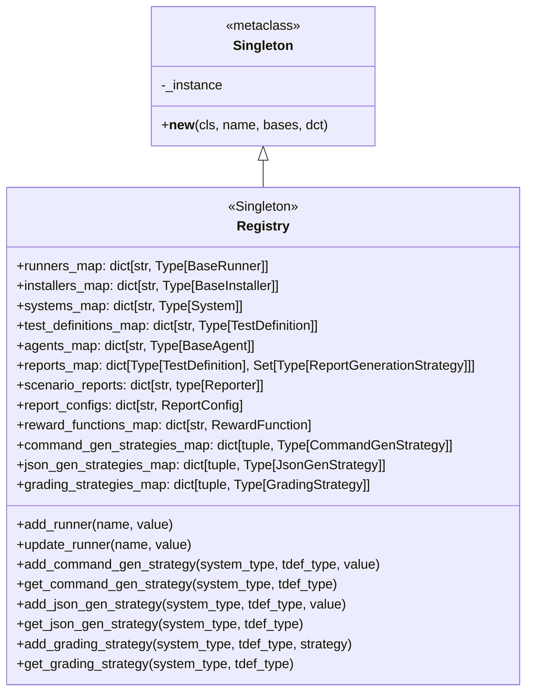
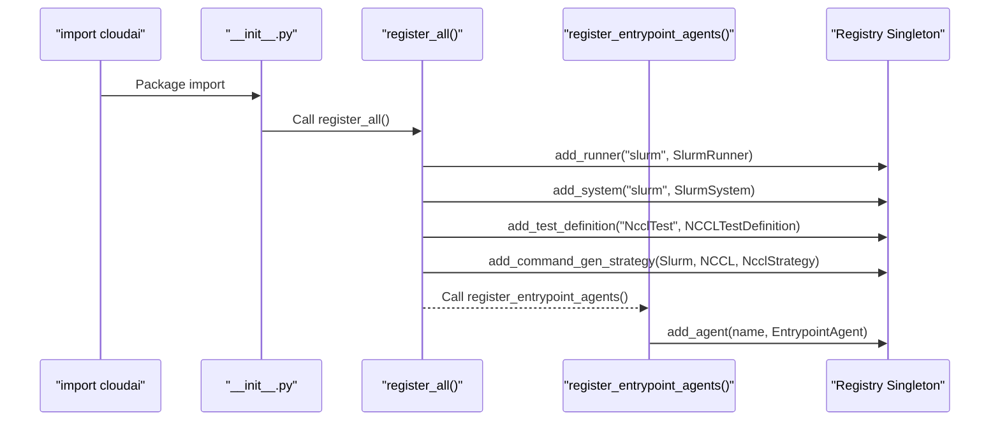
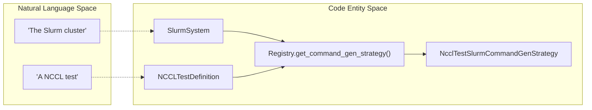
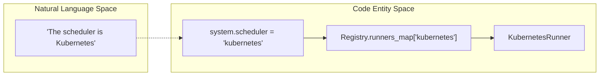

<!-- source: DeepWiki mcp.deepwiki.com · repo NVIDIA/cloudai · page 2.1 Registry System · fetched 2026-10-26 -->

# Registry System

Relevant source files

The following files were used as context for generating this wiki page:

- [src/cloudai/__init__.py](src/cloudai/__init__.py)
- [src/cloudai/_core/command_gen_strategy.py](src/cloudai/_core/command_gen_strategy.py)
- [src/cloudai/_core/registry.py](src/cloudai/_core/registry.py)
- [src/cloudai/configurator/cloudai_gym.py](src/cloudai/configurator/cloudai_gym.py)
- [src/cloudai/core.py](src/cloudai/core.py)
- [src/cloudai/registration.py](src/cloudai/registration.py)
- [src/cloudai/systems/slurm/single_sbatch_runner.py](src/cloudai/systems/slurm/single_sbatch_runner.py)
- [src/cloudai/systems/slurm/slurm_runner.py](src/cloudai/systems/slurm/slurm_runner.py)
- [src/cloudai/test_parser.py](src/cloudai/test_parser.py)
- [tests/conftest.py](tests/conftest.py)
- [tests/test_acceptance.py](tests/test_acceptance.py)
- [tests/test_get_job_id.py](tests/test_get_job_id.py)
- [tests/test_handlers.py](tests/test_handlers.py)
- [tests/test_init.py](tests/test_init.py)
- [tests/test_registry.py](tests/test_registry.py)
- [tests/test_single_sbatch_runner.py](tests/test_single_sbatch_runner.py)

## Purpose and Scope

The Registry System is the central component mapping mechanism in CloudAI. It provides a Singleton-based lookup table that connects scheduler types, workload types, and their associated implementations (runners, strategies, installers, etc.). The Registry enables CloudAI's plugin architecture by allowing runtime resolution of the correct implementation based on system type and workload type.

For information about how workloads use these registered strategies, see [Workload Plugin Architecture](#5.1). For details on how the Parser uses the Registry to load components, see [Parser and Configuration Loading](#2.3).

## Core Concepts

### Singleton Pattern

The Registry is implemented as a Singleton using a custom metaclass, ensuring exactly one instance exists throughout the application lifecycle. This is instantiated automatically when the `cloudai` package is imported.

**Registry Class Structure**

Sources: [src/cloudai/_core/registry.py:37-46](), [src/cloudai/_core/registry.py:48-63]()

### Mapping Categories

The Registry organizes mappings into three categories:

| Category | Key Type | Value Type | Purpose |
|----------|----------|------------|---------|
| **Simple Mappings** | String | Class Type | Map names to single implementation classes |
| **Strategy Mappings** | Tuple[Type, Type] | Class Type | Map (System, TestDefinition) pairs to strategy implementations |
| **Report Mappings** | Various | Class Type or Set | Map test types or names to report generators |

## Complete Registry Structure

The following diagram illustrates all mapping types maintained by the Registry:

**Registry Mapping Architecture**

```mermaid
graph TB
    subgraph "Registry Singleton"
        R["Registry()"]
    end
    
    subgraph "Simple Mappings (String Keys)"
        SM1["systems_map<br/>str → Type[System]"]
        SM2["runners_map<br/>str → Type[BaseRunner]"]
        SM3["installers_map<br/>str → Type[BaseInstaller]"]
        SM4["test_definitions_map<br/>str → Type[TestDefinition]"]
        SM5["agents_map<br/>str → Type[BaseAgent]"]
        SM6["reward_functions_map<br/>str → RewardFunction"]
    end
    
    subgraph "Strategy Mappings (Tuple Keys)"
        TM1["command_gen_strategies_map<br/>(System, TestDefinition) → Type[CommandGenStrategy]"]
        TM2["json_gen_strategies_map<br/>(System, TestDefinition) → Type[JsonGenStrategy]"]
        TM3["grading_strategies_map<br/>(System, TestDefinition) → Type[GradingStrategy]"]
    end
    
    subgraph "Report Mappings"
        RM1["reports_map<br/>Type[TestDefinition] → Set[Type[ReportGenerationStrategy]]"]
        RM2["scenario_reports<br/>str → type[Reporter]"]
        RM3["report_configs<br/>str → ReportConfig"]
    end
    
    R --> SM1
    R --> SM2
    R --> SM3
    R --> SM4
    R --> SM5
    R --> SM6
    R --> TM1
    R --> TM2
    R --> TM3
    R --> RM1
    R --> RM2
    R --> RM3
```

Sources: [src/cloudai/_core/registry.py:48-63]()

## Simple Mappings

Simple mappings use string keys to look up a single implementation class. These are populated during registration and queried at runtime.

### Systems Map

Maps scheduler type names to their corresponding `System` implementation classes.

| Key | Value | Description |
|-----|-------|-------------|
| `"slurm"` | `SlurmSystem` | Slurm workload manager |
| `"kubernetes"` | `KubernetesSystem` | Kubernetes orchestrator |
| `"standalone"` | `StandaloneSystem` | Direct script execution |
| `"lsf"` | `LSFSystem` | IBM LSF scheduler |
| `"runai"` | `RunAISystem` | Run:AI platform |

**API Methods:**
- `add_system(name: str, value: Type[System])` - [src/cloudai/_core/registry.py:132-145]()
- `update_system(name: str, value: Type[System])` - [src/cloudai/_core/registry.py:147-155]()

Sources: [src/cloudai/_core/registry.py:53](), [tests/test_init.py:109-117]()

### Runners Map

Maps scheduler type names to their corresponding `BaseRunner` implementation classes.

| Key | Value | Description |
|-----|-------|-------------|
| `"slurm"` | `SlurmRunner` | Executes tests via Slurm |
| `"kubernetes"` | `KubernetesRunner` | Executes tests via Kubernetes |
| `"standalone"` | `StandaloneRunner` | Direct process execution |
| `"lsf"` | `LSFRunner` | Executes tests via LSF |
| `"runai"` | `RunAIRunner` | Executes tests via Run:AI |

**API Methods:**
- `add_runner(name: str, value: Type[BaseRunner])` - [src/cloudai/_core/registry.py:64-77]()
- `update_runner(name: str, value: Type[BaseRunner])` - [src/cloudai/_core/registry.py:79-87]()

Sources: [src/cloudai/_core/registry.py:51](), [tests/test_init.py:119-127]()

### Test Definitions Map

Maps test template names to their `TestDefinition` subclass implementations.

| Key | Value | Key | Value |
|-----|-------|-----|-------|
| `"UCCTest"` | `UCCTestDefinition` | `"NcclTest"` | `NCCLTestDefinition` |
| `"DDLBTest"` | `DDLBTestDefinition` | `"ChakraReplay"` | `ChakraReplayTestDefinition` |
| `"DeepEP"` | `DeepEPTestDefinition` | `"Sleep"` | `SleepTestDefinition` |
| `"NeMoLauncher"` | `NeMoLauncherTestDefinition` | `"NeMoRun"` | `NeMoRunTestDefinition` |
| `"JaxToolboxGPT"` | `GPTTestDefinition` | `"JaxToolboxGrok"` | `GrokTestDefinition` |
| `"JaxToolboxNemotron"` | `NemotronTestDefinition` | `"SlurmContainer"` | `SlurmContainerTestDefinition` |
| `"MegatronRun"` | `MegatronRunTestDefinition` | `"MegatronBridge"` | `MegatronBridgeTestDefinition` |
| `"TritonInference"` | `TritonInferenceTestDefinition` | `"NIXLBench"` | `NIXLBenchTestDefinition` |
| `"AIDynamo"` | `AIDynamoTestDefinition` | `"BashCmd"` | `BashCmdTestDefinition` |
| `"NixlPerftest"` | `NixlPerftestTestDefinition` | `"NIXLKVBench"` | `NIXLKVBenchTestDefinition` |
| `"Aiconfigurator"` | `AiconfiguratorTestDefinition` | `"OSUBench"` | `OSUBenchTestDefinition` |

**API Methods:**
- `add_test_definition(name: str, value: Type[TestDefinition])` - [src/cloudai/_core/registry.py:157-170]()
- `update_test_definition(name: str, value: Type[TestDefinition])` - [src/cloudai/_core/registry.py:172-180]()

Sources: [src/cloudai/_core/registry.py:54](), [src/cloudai/registration.py:57-179]()

### Installers Map

Maps scheduler type names to their `BaseInstaller` implementation classes.

| Key | Value | Scheduler |
|-----|-------|-----------|
| `"slurm"` | `SlurmInstaller` | Slurm |
| `"kubernetes"` | `KubernetesInstaller` | Kubernetes |
| `"standalone"` | `StandaloneInstaller` | Standalone |
| `"lsf"` | `LSFInstaller` | LSF |
| `"runai"` | `RunAIInstaller` | Run:AI |

**API Methods:**
- `add_installer(name: str, value: Type[BaseInstaller])` - [src/cloudai/_core/registry.py:107-120]()
- `update_installer(name: str, value: Type[BaseInstaller])` - [src/cloudai/_core/registry.py:122-130]()

Sources: [src/cloudai/_core/registry.py:52](), [src/cloudai/registration.py:52-56]()

### Agents Map

Maps agent names to their `BaseAgent` implementation classes for Design Space Exploration.

| Key | Value | Purpose |
|-----|-------|---------|
| `"grid_search"` | `GridSearchAgent` | Exhaustive parameter grid search |

**API Methods:**
- `add_agent(name: str, value: Type[BaseAgent])` - [src/cloudai/_core/registry.py:182-195]()
- `update_agent(name: str, value: Type[BaseAgent])` - [src/cloudai/_core/registry.py:197-205]()

Sources: [src/cloudai/_core/registry.py:55](), [src/cloudai/registration.py:38]()

### Reward Functions Map

Maps reward function names to callable reward computation functions for DSE optimization.

| Key | Value Type | Description |
|-----|------------|-------------|
| `"ai_dynamo_log_scale_reward"` | `RewardFunction` | Logarithmic scaling for AIDynamo |
| `"identity_reward"` | `RewardFunction` | Returns metric value directly |

**API Methods:**
- `add_reward_function(name: str, value: RewardFunction)` - [src/cloudai/_core/registry.py:236-239]()
- `get_reward_function(name: str) -> RewardFunction` - [src/cloudai/_core/registry.py:244-249]()

Sources: [src/cloudai/_core/registry.py:34](), [src/cloudai/registration.py:39-46]()

## Strategy Mappings

Strategy mappings use tuple keys of `(Type[System], Type[TestDefinition])` to select the appropriate implementation for a specific system-workload combination.

### Command Gen Strategies Map

Maps system-workload pairs to `CommandGenStrategy` implementations.

**Key Structure:** `(System Type, TestDefinition Type) → CommandGenStrategy Type`

| System | TestDefinition | Strategy |
|--------|----------------|----------|
| `SlurmSystem` | `NCCLTestDefinition` | `NcclTestSlurmCommandGenStrategy` |
| `SlurmSystem` | `NeMoRunTestDefinition` | `NeMoRunSlurmCommandGenStrategy` |
| `SlurmSystem` | `MegatronBridgeTestDefinition` | `MegatronBridgeSlurmCommandGenStrategy` |
| `StandaloneSystem` | `SleepTestDefinition` | `SleepStandaloneCommandGenStrategy` |
| `LSFSystem` | `SleepTestDefinition` | `SleepLSFCommandGenStrategy` |

**API Methods:**
- `add_command_gen_strategy(system_type, tdef_type, value)` - [src/cloudai/_core/registry.py:251-259]()
- `get_command_gen_strategy(system_type, tdef_type) -> Type[CommandGenStrategy]` - [src/cloudai/_core/registry.py:266-271]()

Sources: [src/cloudai/_core/registry.py:60](), [tests/test_init.py:129-157]()

### Json Gen Strategies Map

Maps system-workload pairs to `JsonGenStrategy` implementations for Kubernetes/RunAI manifest generation.

| System | TestDefinition | Strategy |
|--------|----------------|----------|
| `KubernetesSystem` | `NCCLTestDefinition` | `NcclTestKubernetesJsonGenStrategy` |
| `KubernetesSystem` | `AIDynamoTestDefinition` | `AIDynamoKubernetesJsonGenStrategy` |
| `RunAISystem` | `NCCLTestDefinition` | `NcclTestRunAIJsonGenStrategy` |

**API Methods:**
- `add_json_gen_strategy(system_type, tdef_type, value)` - [src/cloudai/_core/registry.py:273-281]()
- `get_json_gen_strategy(system_type, tdef_type) -> Type[JsonGenStrategy]` - [src/cloudai/_core/registry.py:288-293]()

Sources: [src/cloudai/_core/registry.py:61](), [tests/test_init.py:158-163]()

### Grading Strategies Map

Maps system-workload pairs to `GradingStrategy` implementations for success validation.

| System | TestDefinition | Strategy |
|--------|----------------|----------|
| `SlurmSystem` | `NCCLTestDefinition` | `NcclTestGradingStrategy` |
| `SlurmSystem` | `UCCTestDefinition` | `UCCTestGradingStrategy` |
| `SlurmSystem` | `SleepTestDefinition` | `SleepGradingStrategy` |

Sources: [src/cloudai/_core/registry.py:62](), [tests/test_init.py:164-172]()

## Report Mappings

### Reports Map (Per-Test)

Maps `TestDefinition` types to sets of `ReportGenerationStrategy` classes.

**Structure:** `Type[TestDefinition] → Set[Type[ReportGenerationStrategy]]`

**API Methods:**
- `add_report(tdef_type, value)` - [src/cloudai/_core/registry.py:207-210]()

Sources: [src/cloudai/_core/registry.py:56](), [src/cloudai/registration.py:59-179]()

### Scenario Reports and Configs

Maintains mappings for scenario-level reporters (e.g., status, per-test, tarball).

**API Methods:**
- `add_scenario_report(name, report, config)` - [src/cloudai/_core/registry.py:215-220]()
- `ordered_scenario_reports() -> list[tuple[str, type[Reporter]]]` - [src/cloudai/_core/registry.py:226-234]()

Sources: [src/cloudai/_core/registry.py:57-58](), [src/cloudai/registration.py:49]()

## Registration Process

All components are registered automatically when the `cloudai` package is imported via `register_all()`.

**Registration Flow**

Sources: [src/cloudai/__init__.py:36-38](), [src/cloudai/registration.py:36-186]()

### Entrypoint Extension

External packages can register custom agents via Python entrypoints in the `cloudai.agents` group. The system validates that entrypoint classes are `BaseAgent` subclasses.

Sources: [src/cloudai/registration.py:21-34]()

## Strategy Dispatch Mechanism

At runtime, the framework uses the `Registry` to resolve strategies based on the current system and test definition.

**Natural Language to Code Entity Mapping: Strategy Dispatch**

Sources: [src/cloudai/_core/registry.py:266-271](), [src/cloudai/systems/slurm/slurm_runner.py:59]()

**Natural Language to Code Entity Mapping: Runner Selection**

Sources: [src/cloudai/_core/registry.py:51](), [src/cloudai/registration.py:182]()

---

