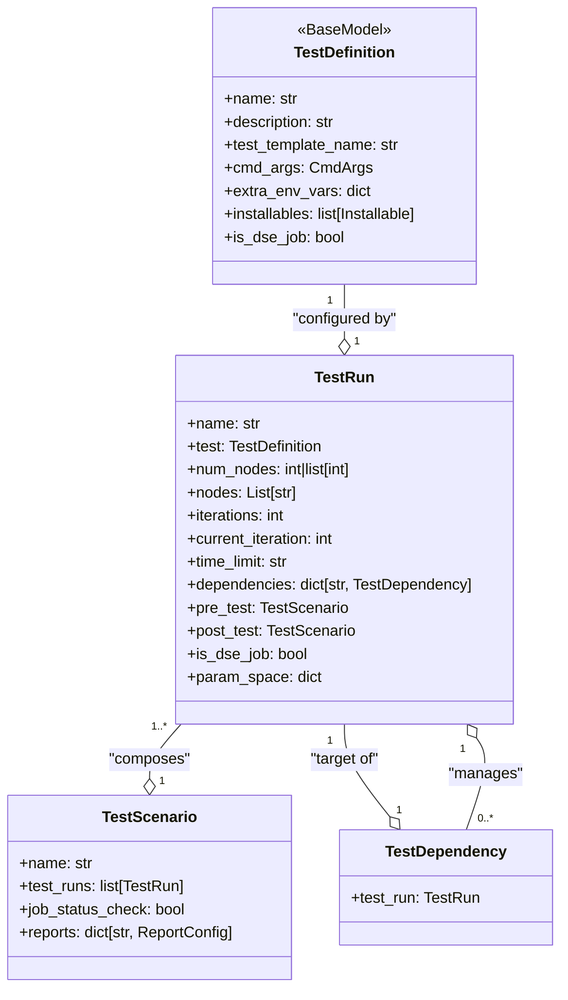
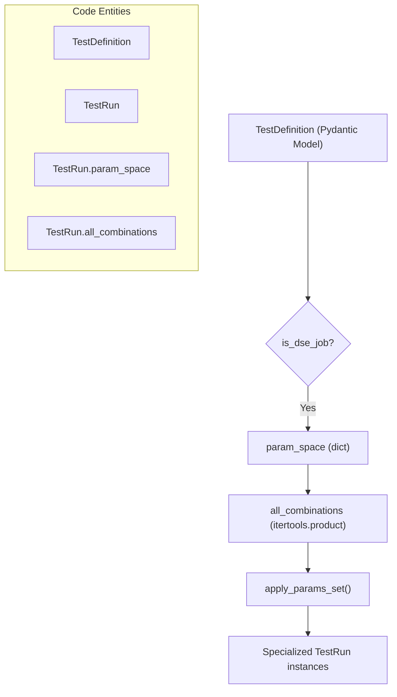
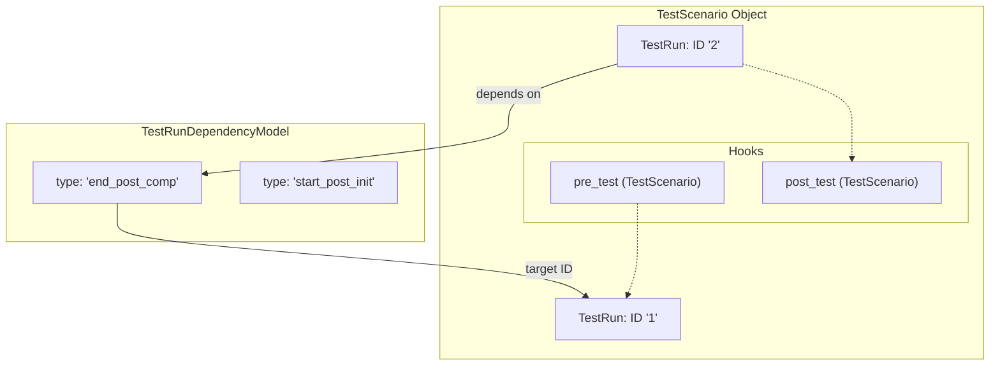
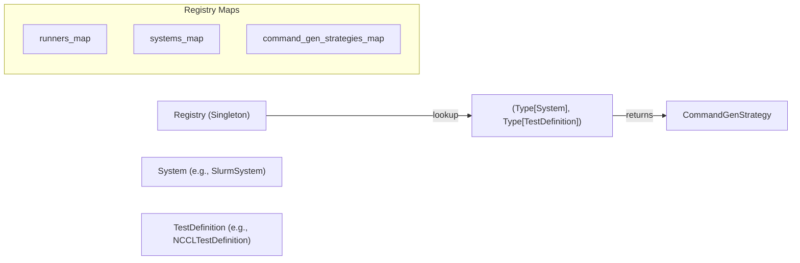

<!-- source: DeepWiki mcp.deepwiki.com · repo NVIDIA/cloudai · page 2.2 Test Framework · fetched 2026-10-26 -->

# Test Framework

Relevant source files

The following files were used as context for generating this wiki page:

- [src/cloudai/__init__.py](src/cloudai/__init__.py)
- [src/cloudai/_core/exceptions.py](src/cloudai/_core/exceptions.py)
- [src/cloudai/_core/registry.py](src/cloudai/_core/registry.py)
- [src/cloudai/_core/test_scenario.py](src/cloudai/_core/test_scenario.py)
- [src/cloudai/core.py](src/cloudai/core.py)
- [src/cloudai/models/scenario.py](src/cloudai/models/scenario.py)
- [src/cloudai/models/workload.py](src/cloudai/models/workload.py)
- [src/cloudai/parser.py](src/cloudai/parser.py)
- [src/cloudai/registration.py](src/cloudai/registration.py)
- [src/cloudai/test_parser.py](src/cloudai/test_parser.py)
- [src/cloudai/test_scenario_parser.py](src/cloudai/test_scenario_parser.py)
- [src/cloudai/workloads/megatron_run/megatron_run.py](src/cloudai/workloads/megatron_run/megatron_run.py)
- [tests/test_acceptance.py](tests/test_acceptance.py)
- [tests/test_init.py](tests/test_init.py)
- [tests/test_registry.py](tests/test_registry.py)
- [tests/test_test_definitions.py](tests/test_test_definitions.py)
- [tests/test_test_scenario.py](tests/test_test_scenario.py)
- [tests/workloads/megatron_run/test_job_status_retrieval_strategy.py](tests/workloads/megatron_run/test_job_status_retrieval_strategy.py)

The Test Framework provides the core abstractions for defining, configuring, and executing AI workload tests within CloudAI. It encompasses test definitions, test runs, test scenarios, and their associated configuration parsing and validation systems. This framework serves as the foundation for all test execution in CloudAI, managing everything from individual test specifications to complex multi-test scenarios with dependencies.

## Core Abstractions

The Test Framework is built around four primary abstractions that work together to define and execute tests:

Title: Test Framework Class Hierarchy

**Sources:** [src/cloudai/models/workload.py:89-138](), [src/cloudai/_core/test_scenario.py:58-79](), [src/cloudai/_core/test_scenario.py:179-195]()

## Test Definition System

The `TestDefinition` serves as the blueprint for workload-specific tests. It uses Pydantic for validation and defines the command arguments, environment variables, and runtime constraints.

| Component | Purpose | Key Properties |
|-----------|---------|----------------|
| `TestDefinition` | Abstract base for workload-specific test specifications | `cmd_args`, `extra_env_vars`, `installables` [src/cloudai/models/workload.py:89-138]() |
| `CmdArgs` | Pydantic model for command-line arguments | Workload-specific fields with validation [src/cloudai/models/workload.py:33-40]() |
| `NsysConfiguration` | NSYS profiling configuration | `enable`, `nsys_binary`, `cmd_args` [src/cloudai/models/workload.py:43-57]() |
| `GitRepo` | Definition for git-based installables | `url`, `commit`, `installed_path` [src/cloudai/models/workload.py:60-72]() |

### Parameter Expansion (DSE)
The framework supports Design Space Exploration (DSE) through list-valued parameters. When any parameter in `cmd_args` or `extra_env_vars` contains a list, the test becomes a DSE job.

Title: Parameter Expansion Data Flow

**Sources:** [src/cloudai/_core/test_scenario.py:114-155](), [src/cloudai/models/workload.py:129-137]()

## Test Execution Model

The `TestRun` class represents the execution instance of a test. It bridges the static `TestDefinition` with runtime environment details like node allocations and iteration tracking.

Key `TestRun` execution features:
- **Node Management**: Supports scalar node counts or lists for DSE scaling via `num_nodes` [src/cloudai/_core/test_scenario.py:63]().
- **Iteration Control**: Tracks `current_iteration` against total `iterations` [src/cloudai/_core/test_scenario.py:67-68]().
- **Metric Reporting**: Identifies suitable reporters via `metric_reporter` property by matching `agent_metrics` with available `ReportGenerationStrategy` metrics [src/cloudai/_core/test_scenario.py:93-104]().

**Sources:** [src/cloudai/_core/test_scenario.py:58-104](), [src/cloudai/_core/test_scenario.py:118-123]()

## Test Scenario Management

`TestScenario` orchestrates multiple `TestRun` instances. It supports hooks (`pre_test` and `post_test`) which are themselves `TestScenario` objects, allowing for recursive setup/teardown logic.

Title: Scenario Dependency and Hook Structure

**Sources:** [src/cloudai/_core/test_scenario.py:179-195](), [src/cloudai/models/scenario.py:61-62](), [src/cloudai/test_scenario_parser.py:159-161]()

## Configuration and Validation

The framework uses a two-tier model system: `TestDefinition` for workload templates and `TestScenarioModel`/`TestRunModel` for scenario-specific overrides.

| Model | Purpose | Key Validations |
|-------|---------|-----------------|
| `TestRunModel` | Scenario entry validation | ID length, agent registration, node range syntax [src/cloudai/models/scenario.py:65-105]() |
| `TestScenarioModel` | Complete scenario validation | ID uniqueness, no self-dependencies [src/cloudai/models/scenario.py:176-202]() |
| `TestRunDependencyModel` | Dependency metadata | Literal types: `end_post_comp`, `start_post_init`, `start_post_comp` [src/cloudai/models/scenario.py:54-62]() |

### Parsing Logic
The `TestScenarioParser` handles the conversion from TOML data to live objects:
1. **Model Validation**: Uses `TestScenarioModel.model_validate(data)` [src/cloudai/test_scenario_parser.py:118]().
2. **Hook Resolution**: Maps hook names to `TestScenario` objects from the `hook_mapping` [src/cloudai/test_scenario_parser.py:130-150]().
3. **Time Limit Aggregation**: Calculates total time limits by summing test limits and hook limits via `calculate_total_time_limit` [src/cloudai/test_scenario_parser.py:55-70]().
4. **Dependency Linking**: Converts string IDs into `TestDependency` objects pointing to other `TestRun` instances [src/cloudai/test_scenario_parser.py:157-161]().

**Sources:** [src/cloudai/test_scenario_parser.py:107-168](), [src/cloudai/models/scenario.py:125-148]()

## Registry and Strategy Dispatch

The `Registry` singleton (metaclass `Singleton`) maintains the mapping between systems and workloads.

Title: Strategy Dispatch Mechanism

**Sources:** [src/cloudai/_core/registry.py:48-62](), [src/cloudai/registration.py:181-185]()

---

