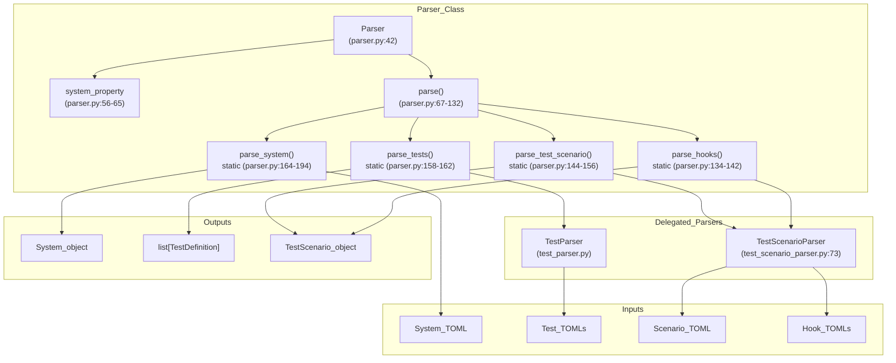
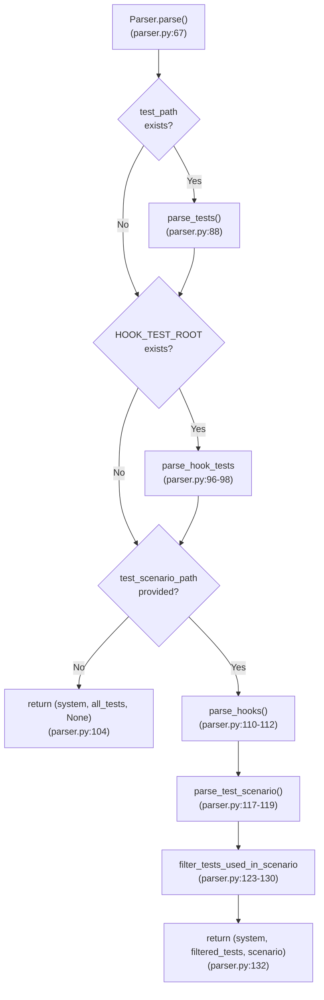
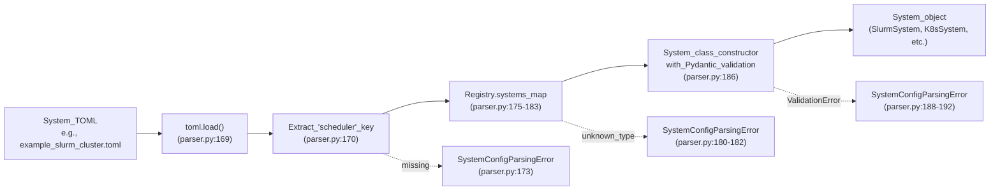
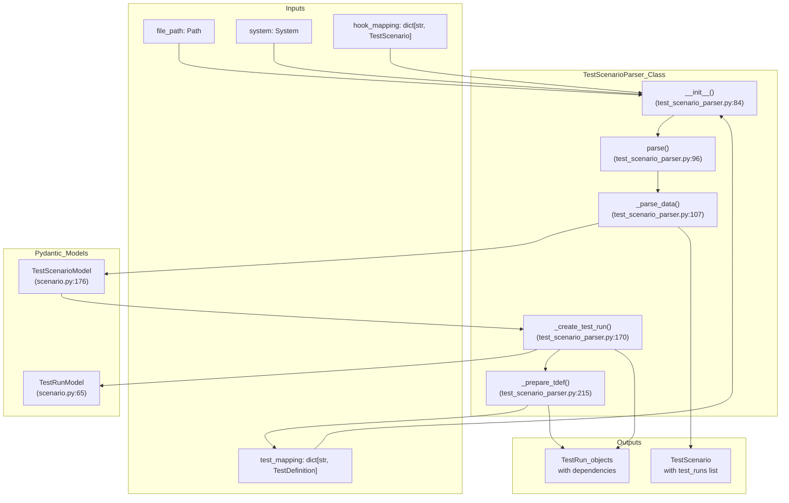

<!-- source: DeepWiki mcp.deepwiki.com · repo NVIDIA/cloudai · page 2.3 Parser and Configuration Loading · fetched 2026-10-26 -->

# Parser and Configuration Loading

Relevant source files

The following files were used as context for generating this wiki page:

- [conf/common/system/example_slurm_cluster.toml](conf/common/system/example_slurm_cluster.toml)
- [src/cloudai/_core/exceptions.py](src/cloudai/_core/exceptions.py)
- [src/cloudai/_core/test_scenario.py](src/cloudai/_core/test_scenario.py)
- [src/cloudai/models/scenario.py](src/cloudai/models/scenario.py)
- [src/cloudai/models/workload.py](src/cloudai/models/workload.py)
- [src/cloudai/parser.py](src/cloudai/parser.py)
- [src/cloudai/systems/slurm/__init__.py](src/cloudai/systems/slurm/__init__.py)
- [src/cloudai/systems/slurm/slurm-metadata.sh](src/cloudai/systems/slurm/slurm-metadata.sh)
- [src/cloudai/systems/slurm/slurm_metadata.py](src/cloudai/systems/slurm/slurm_metadata.py)
- [src/cloudai/test_scenario_parser.py](src/cloudai/test_scenario_parser.py)
- [tests/test_parser.py](tests/test_parser.py)
- [tests/test_test_scenario.py](tests/test_test_scenario.py)

## Purpose and Scope

The Parser system is responsible for loading and validating all configuration files in CloudAI. It reads TOML configuration files for systems, test definitions, and test scenarios, validates them using Pydantic models, and constructs typed Python objects ready for execution.

This page covers:
- The `Parser` class and its parsing workflow.
- How TOML files are validated into `System`, `TestDefinition`, and `TestScenario` objects.
- Pydantic model validation and error handling.
- Hook system for pre/post-test scenarios.
- Deep merging logic and time limit calculations.

For information about the Registry system that Parser uses for component lookup, see [Registry System](). For details on the test framework objects created by Parser, see [Test Framework]().

**Sources:** [src/cloudai/parser.py:1-195](), [src/cloudai/test_scenario_parser.py:1-237]()

---

## Overview of Configuration Files

CloudAI uses three types of TOML configuration files, each parsed independently and then combined.

### Configuration File Types

| File Type | Purpose | Location | Parsed Into |
|-----------|---------|----------|-------------|
| **System Config** | Defines cluster properties, scheduler type, node info | `conf/system/` | `System` object (e.g., `SlurmSystem`) |
| **Test Definition** | Defines workload type, parameters, installables | `conf/common/test/` | `TestDefinition` object (e.g., `NCCLTestDefinition`) |
| **Test Scenario** | Orchestrates test execution, dependencies, iterations | `conf/test_scenario/` | `TestScenario` object with `TestRun` list |
| **Hook Scenario** | Pre/post-test sequences | `conf/hook/` | `TestScenario` object (referenced by main scenario) |

**Sources:** [src/cloudai/parser.py:67-132](), [src/cloudai/parser.py:38-40]()

---

## Parser Architecture

The `Parser` class at [src/cloudai/parser.py:42-195]() is the main entry point for all configuration parsing. It orchestrates parsing of the three configuration types and returns validated objects.

### Parser Class Structure

Title: Parser Class and Delegated Sub-Parsers

**Sources:** [src/cloudai/parser.py:42-195](), [src/cloudai/test_scenario_parser.py:73-95]()

### Parser.parse() Workflow

Title: Parser.parse Execution Flow

**Key behaviors:**
- **Filtering**: Only tests used in the scenario are returned (filtered from full test list) [src/cloudai/parser.py:123-130]().
- **Hooks**: Hooks are always loaded from `conf/hook/` if present [src/cloudai/parser.py:92-100]().
- **Error Handling**: If parsing fails, the process exits immediately with code 1 to keep error messages readable [src/cloudai/parser.py:64, 90, 114, 121]().

**Sources:** [src/cloudai/parser.py:67-132]()

---

## System Configuration Parsing

System configs define the cluster environment and are parsed by `Parser.parse_system()` at [src/cloudai/parser.py:164-194]().

### System Parsing Flow

Title: System Configuration Parsing and Validation

**Registry lookup:** The `scheduler` field determines which `System` class is instantiated from `Registry.systems_map` [src/cloudai/parser.py:170-178]().

**Sources:** [src/cloudai/parser.py:164-194](), [src/cloudai/_core/exceptions.py:128-129](), [conf/common/system/example_slurm_cluster.toml:17-18]()

---

## Test Scenario Parsing

Test scenarios orchestrate multiple test runs with dependencies, iterations, and hooks. Parsing is handled by `TestScenarioParser` at [src/cloudai/test_scenario_parser.py:73-237]().

### TestScenarioParser Architecture

Title: TestScenarioParser Internal Data Flow

**Sources:** [src/cloudai/test_scenario_parser.py:73-237](), [src/cloudai/models/scenario.py:65-176]()

### Test Definition Merging and Overrides

When a scenario references a test, it can override parameters. `TestScenarioParser._prepare_tdef` handles this by:
1. Looking up the base `TestDefinition` in the provided `test_mapping` [src/cloudai/test_scenario_parser.py:220-222]().
2. Merging scenario-specific overrides (like `cmd_args` or `extra_env_vars`) using `deep_merge` [src/cloudai/test_scenario_parser.py:223-227]().
3. Validating the final merged structure against the `TestDefinition` model [src/cloudai/test_scenario_parser.py:227]().

**Sources:** [src/cloudai/test_scenario_parser.py:215-236](), [src/cloudai/util.py:26]()

---

## Validation with Pydantic

CloudAI uses Pydantic v2 for declarative validation. Models enforce field types and cross-field constraints.

### Key Pydantic Models

| Model | Role | Source |
|-------|------|--------|
| `TestScenarioModel` | Top-level scenario structure (name, tests, hooks). | [src/cloudai/models/scenario.py:176]() |
| `TestRunModel` | Single test entry in a scenario, including overrides. | [src/cloudai/models/scenario.py:65]() |
| `TestRunDependencyModel` | Defines `type` (e.g., `end_post_comp`) and target `id`. | [src/cloudai/models/scenario.py:54]() |
| `TestDefinition` | Base workload schema (CmdArgs, git_repos, nsys). | [src/cloudai/models/workload.py:90]() |
| `NsysConfiguration` | Schema for NSYS profiling arguments. | [src/cloudai/models/workload.py:33]() |

### Cross-Field Validation
- **Self-Dependency**: `TestScenarioModel` ensures a test does not depend on itself [src/cloudai/models/scenario.py:194-201]().
- **Duplicate IDs**: Ensures all test IDs in a scenario are unique [src/cloudai/models/scenario.py:204-213]().
- **Dependency Resolution**: Validates that all `dependencies` refer to IDs present in the same scenario [src/cloudai/models/scenario.py:215-224]().

**Sources:** [src/cloudai/models/scenario.py:54-224](), [src/cloudai/models/workload.py:33-163]()

---

## Dependency and Time Limit Resolution

### Time Limit Calculation
The `calculate_total_time_limit` function aggregates the time limits of the main test and any attached hooks (pre/post-tests). This ensures the scheduler allocation covers the entire sequence [src/cloudai/test_scenario_parser.py:55-70]().

### Dependency Mapping
After all `TestRun` objects are created, `TestScenarioParser` iterates through them to map ID strings to actual `TestDependency` objects, which hold references to other `TestRun` instances [src/cloudai/test_scenario_parser.py:157-161]().

**Sources:** [src/cloudai/test_scenario_parser.py:55-70, 157-161](), [src/cloudai/_core/test_scenario.py:37-56]()

---

## Error Handling

Parser uses custom exceptions to provide clear error messages. Validation errors from Pydantic are caught and formatted for readability [src/cloudai/_core/exceptions.py:147-156]().

| Exception | Context |
|-----------|---------|
| `SystemConfigParsingError` | Failure in `parse_system`. |
| `TestConfigParsingError` | Failure in `parse_tests`. |
| `TestScenarioParsingError` | Failure in `parse_test_scenario`. |
| `MissingTestError` | Scenario references a `test_name` not found in mapping. |

**Sources:** [src/cloudai/_core/exceptions.py:118-145](), [src/cloudai/parser.py:26-31]()

---

