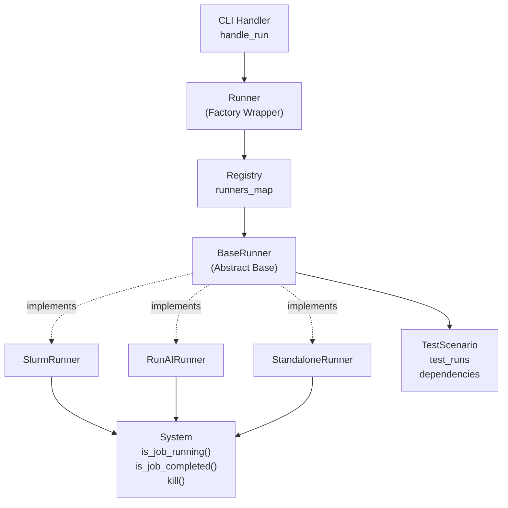
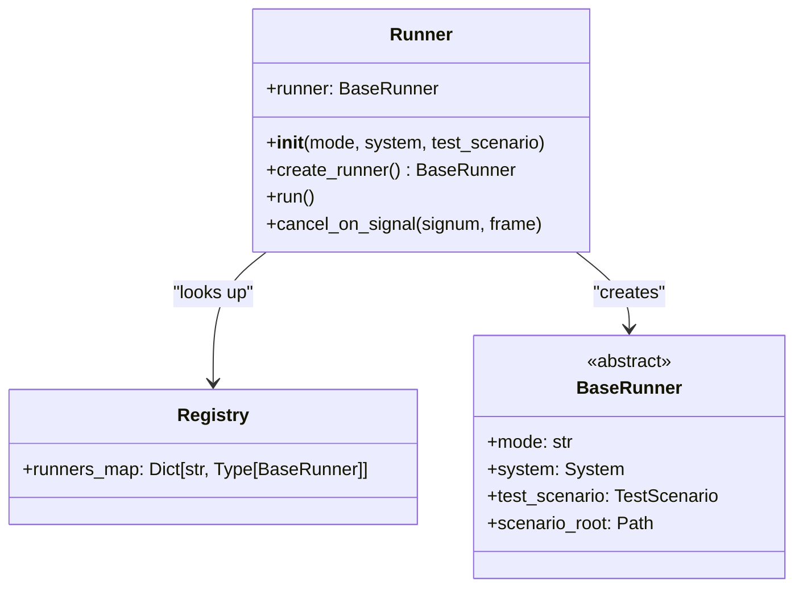
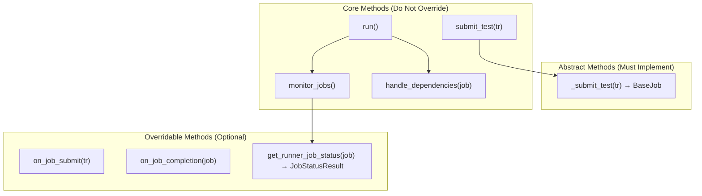
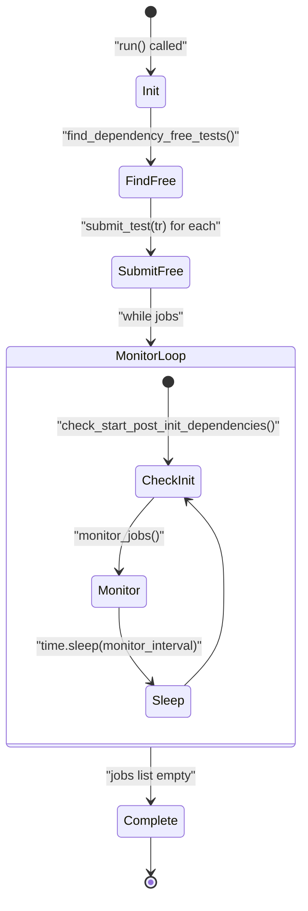
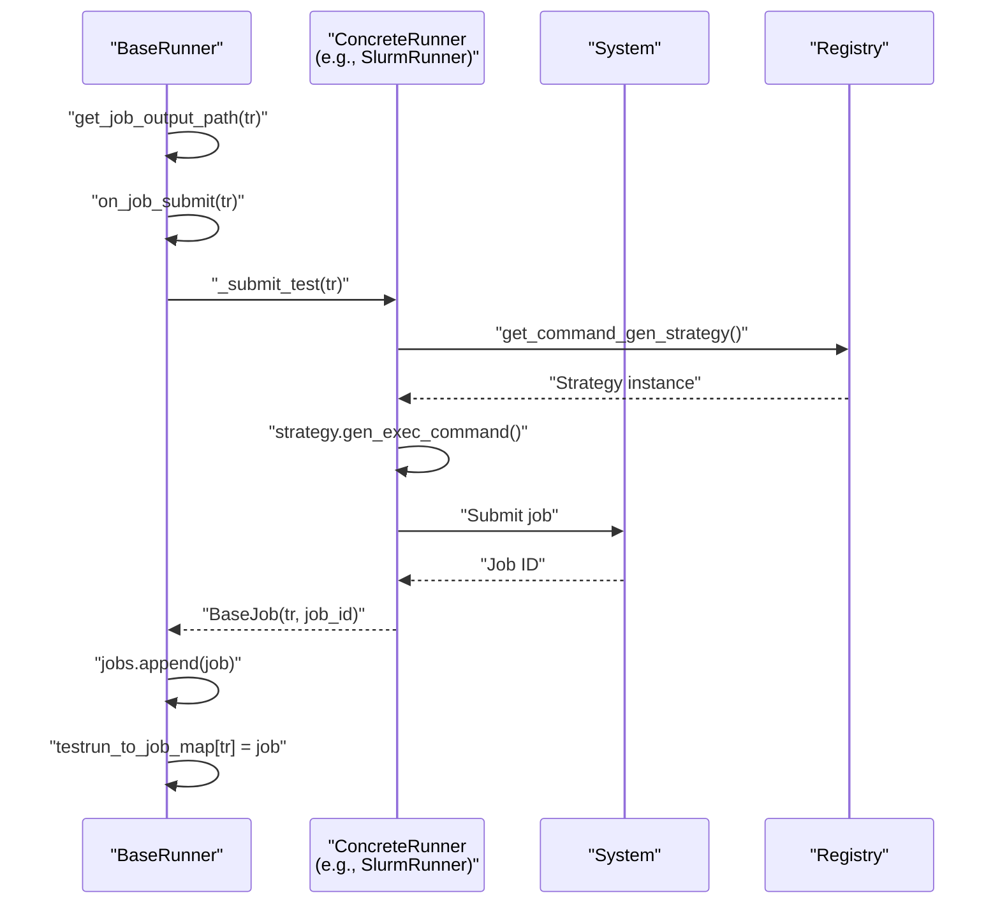

<!-- source: DeepWiki mcp.deepwiki.com · repo NVIDIA/cloudai · page 2.4 Runner System and Job Management · fetched 2026-10-26 -->

# Runner System and Job Management

<details>
<summary>Relevant source files</summary>

The following files were used as context for generating this wiki page:

- [src/cloudai/_core/base_job.py](src/cloudai/_core/base_job.py)
- [src/cloudai/_core/base_runner.py](src/cloudai/_core/base_runner.py)
- [src/cloudai/_core/command_gen_strategy.py](src/cloudai/_core/command_gen_strategy.py)
- [src/cloudai/_core/grader.py](src/cloudai/_core/grader.py)
- [src/cloudai/_core/runner.py](src/cloudai/_core/runner.py)
- [src/cloudai/_core/system.py](src/cloudai/_core/system.py)
- [src/cloudai/configurator/cloudai_gym.py](src/cloudai/configurator/cloudai_gym.py)
- [src/cloudai/systems/runai/runai_node.py](src/cloudai/systems/runai/runai_node.py)
- [src/cloudai/systems/runai/runai_rest_client.py](src/cloudai/systems/runai/runai_rest_client.py)
- [src/cloudai/systems/runai/runai_runner.py](src/cloudai/systems/runai/runai_runner.py)
- [src/cloudai/systems/runai/runai_system.py](src/cloudai/systems/runai/runai_system.py)
- [src/cloudai/systems/slurm/single_sbatch_runner.py](src/cloudai/systems/slurm/single_sbatch_runner.py)
- [src/cloudai/systems/slurm/slurm_runner.py](src/cloudai/systems/slurm/slurm_runner.py)
- [tests/conftest.py](tests/conftest.py)
- [tests/test_base_runner.py](tests/test_base_runner.py)
- [tests/test_get_job_id.py](tests/test_get_job_id.py)
- [tests/test_handlers.py](tests/test_handlers.py)
- [tests/test_single_sbatch_runner.py](tests/test_single_sbatch_runner.py)

</details>


The Runner System is responsible for orchestrating test execution in CloudAI. It manages the entire lifecycle of tests: job submission, monitoring, completion handling, and dependency resolution. The system implements a factory pattern where a `Runner` wrapper dynamically selects the appropriate scheduler-specific runner implementation based on the system configuration.

This page covers the execution orchestration layer. For test definition and parsing, see [Test Framework (2.2)](). For dependency types and execution order, see [Test Dependencies and Execution Flow (2.5)](). For DSE execution, see [Design Space Exploration (DSE) (7.1)]().

---

## Overview

The Runner System consists of two primary classes:

| Class | Role | Location |
|-------|------|----------|
| `Runner` | Factory wrapper that creates scheduler-specific runners | [src/cloudai/_core/runner.py:29-45]() |
| `BaseRunner` | Abstract base class defining execution logic | [src/cloudai/_core/base_runner.py:33-51]() |

The system operates by polling job statuses at intervals defined in the system configuration (`monitor_interval`).

**Architecture Pattern:**



Sources: [src/cloudai/_core/runner.py:29-81](), [src/cloudai/_core/base_runner.py:33-72](), [src/cloudai/_core/registry.py]()

---

## Runner Factory

The `Runner` class acts as a factory that instantiates the correct runner implementation based on the system's scheduler type. It performs Registry lookup and initializes the output directory structure.

### Class Definition



### Initialization Flow

The factory pattern implementation:

1. **Registry Lookup**: Queries `Registry().runners_map` with the scheduler type ([src/cloudai/_core/runner.py:66-72]())
2. **Directory Creation**: Creates timestamped output directory: `{output_path}/{scenario_name}_{timestamp}` ([src/cloudai/_core/runner.py:75-80]())
3. **Runner Instantiation**: Calls the runner class constructor with mode, system, test scenario, and output path ([src/cloudai/_core/runner.py:80]())

### Signal Handling

The `Runner` provides signal handler registration for graceful shutdown:

- **Shutdown Behavior**: Calls `runner.shutdown()` which initiates termination of all active jobs ([src/cloudai/_core/runner.py:95-97](), [src/cloudai/_core/base_runner.py:73-81]())

Sources: [src/cloudai/_core/runner.py:47-81](), [src/cloudai/_core/runner.py:90-97]()

---

## BaseRunner Abstract Class

`BaseRunner` defines the core execution logic shared across all scheduler implementations. Concrete runners must implement scheduler-specific job submission via the `_submit_test()` method.

### Core Attributes

| Attribute | Type | Purpose |
|-----------|------|---------|
| `mode` | `str` | Operation mode: `"dry-run"` or `"run"` |
| `system` | `System` | System configuration for job status queries |
| `test_scenario` | `TestScenario` | Test orchestration configuration |
| `scenario_root` | `Path` | Root directory for all test outputs |
| `monitor_interval` | `int` | Polling interval in seconds for job status checks |
| `jobs` | `List[BaseJob]` | Active jobs being monitored |
| `testrun_to_job_map` | `Dict[TestRun, BaseJob]` | Mapping from test runs to submitted jobs |
| `shutting_down` | `bool` | Flag to prevent new submissions during shutdown |

Sources: [src/cloudai/_core/base_runner.py:41-71]()

### Abstract and Overridable Methods



**Abstract Method:**
- `_submit_test(tr: TestRun) -> BaseJob`: Executes scheduler-specific job submission and returns a `BaseJob` object ([src/cloudai/_core/base_runner.py:132-143]())

**Overridable Hooks:**
- `on_job_submit(tr: TestRun)`: Called before job submission ([src/cloudai/_core/base_runner.py:117-118]())
- `on_job_completion(job: BaseJob)`: Called when job completes, handles cleanup and metadata storage ([src/cloudai/systems/slurm/slurm_runner.py:83-92]())
- `get_runner_job_status(job: BaseJob) -> JobStatusResult`: Runner-specific job status check ([src/cloudai/_core/base_runner.py:278-279]())

Sources: [src/cloudai/_core/base_runner.py:117-143](), [src/cloudai/systems/slurm/slurm_runner.py:83-92]()

---

## Execution Lifecycle

The execution lifecycle manages test submission, monitoring, and completion in dependency order.

### Main Execution Loop



**Implementation:**
```python
def run(self):
    total_tests = len(self.test_scenario.test_runs)
    dependency_free_trs = self.find_dependency_free_tests()
    for tr in dependency_free_trs:
        self.submit_test(tr)
    
    while self.jobs:
        self.check_start_post_init_dependencies()
        self.monitor_jobs()
        time.sleep(self.monitor_interval)
```

Sources: [src/cloudai/_core/base_runner.py:82-97]()

### Dependency-Free Test Detection

Identifies tests that can be submitted immediately:

**Criteria:**
- No `start_post_comp` dependencies
- No `start_post_init` dependencies

**Implementation:**
```python
def find_dependency_free_tests(self) -> List[TestRun]:
    dependency_free_tests = []
    for tr in self.test_scenario.test_runs:
        if "start_post_comp" not in tr.dependencies and "start_post_init" not in tr.dependencies:
            dependency_free_tests.append(tr)
    return dependency_free_tests
```

Sources: [src/cloudai/_core/base_runner.py:181-195]()

---

## Job Submission

Job submission involves output directory creation, strategy invocation, and scheduler-specific execution.

### Output Path Construction

Each test run gets a unique output directory:
`{scenario_root}/{test_run.name}/{current_iteration}/{step}`

- `current_iteration`: Iteration number (0-based) for multi-iteration tests.
- `step`: DSE step number (only present if `tr.step > 0`).

Sources: [src/cloudai/_core/base_runner.py:197-229]()

### Submission Flow



Sources: [src/cloudai/_core/base_runner.py:99-115](), [src/cloudai/systems/slurm/slurm_runner.py:57-74]()

---

## Job Monitoring

The monitoring system polls job status and handles completion events.

### Monitoring Loop

The `monitor_jobs()` method iterates through active jobs, checks status via `system.is_job_completed(job)`, and triggers completion handlers.

**Job Status Checking Precedence:**
1. **Runner-Level Status**: Calls `get_runner_job_status(job)` ([src/cloudai/_core/base_runner.py:291]())
2. **Workload-Level Status**: Calls `job.test_run.test.was_run_successful(job.test_run)` ([src/cloudai/_core/base_runner.py:292]())

If `test_scenario.job_status_check` is enabled, any failure raises a `JobFailureError` and initiates shutdown ([src/cloudai/_core/base_runner.py:253-265]()).

Sources: [src/cloudai/_core/base_runner.py:231-276](), [src/cloudai/_core/base_runner.py:281-297]()

---

## Dependency Management

The Runner system implements three dependency types:

| Type | Trigger Condition | Action |
|------|-------------------|--------|
| `start_post_init` | Parent test starts running | Submit dependent test after delay ([src/cloudai/_core/base_runner.py:145-167]()) |
| `start_post_comp` | Parent test completes | Submit dependent test after delay ([src/cloudai/_core/base_runner.py:338-344]()) |
| `end_post_comp` | Parent test completes | Terminate dependent test immediately ([src/cloudai/_core/base_runner.py:346-350]()) |

### Iteration Handling

Tests can specify multiple iterations. Upon completion:
1. Check if `has_more_iterations()` is true and job wasn't terminated by a dependency ([src/cloudai/_core/base_runner.py:315]())
2. Increment `current_iteration` ([src/cloudai/_core/base_runner.py:316]())
3. Re-submit the test ([src/cloudai/_core/base_runner.py:319]())

Sources: [src/cloudai/_core/base_runner.py:314-321]()

---

## DSE Integration

The Design Space Exploration (DSE) system uses the runner to execute parameter exploration steps. The `CloudAIGymEnv` directly invokes runner methods to execute individual steps of a test run.

**Key Implementation Details:**
- `CloudAIGymEnv.step()` applies parameters to a `TestRun` and calls `runner.run()` ([src/cloudai/configurator/cloudai_gym.py:104-141]())
- Results are cached in a trajectory to avoid redundant execution ([src/cloudai/configurator/cloudai_gym.py:120-126]())

Sources: [src/cloudai/configurator/cloudai_gym.py:40-164]()

---

## Single Sbatch Optimization

For Slurm systems, the `SingleSbatchRunner` can combine multiple tests into a single job script.

**Features:**
- Aggregates time limits across all tests ([src/cloudai/systems/slurm/single_sbatch_runner.py:71-87]())
- Calculates the maximum node requirement for the allocation ([src/cloudai/systems/slurm/single_sbatch_runner.py:88-105]())
- Generates a script using `srun` for individual test steps within the allocation ([src/cloudai/systems/slurm/single_sbatch_runner.py:115-125]())

Sources: [src/cloudai/systems/slurm/single_sbatch_runner.py:34-161]()

---

