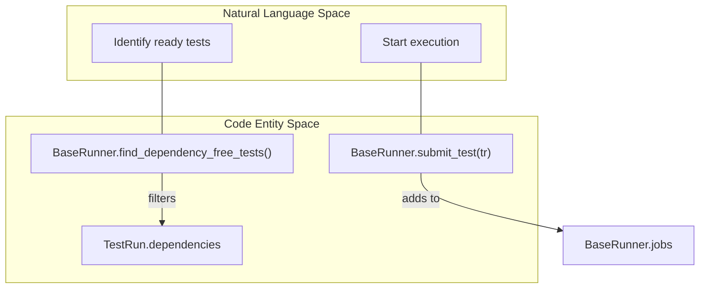
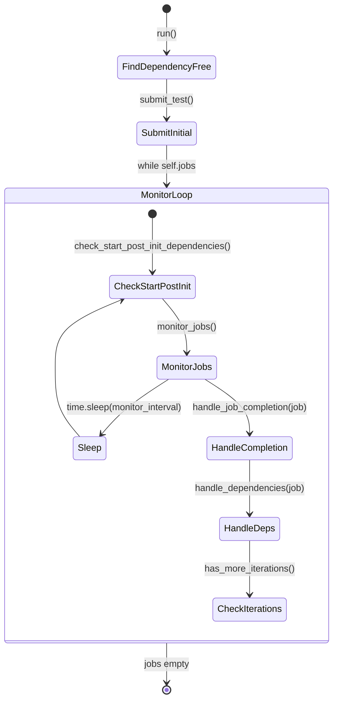
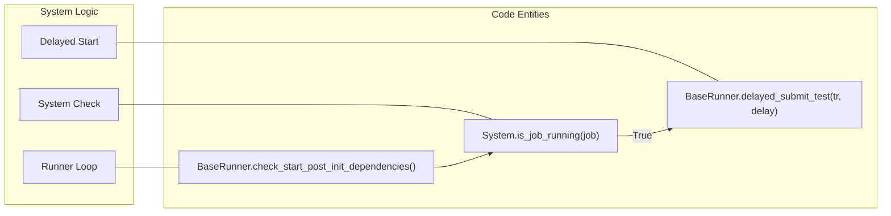

<!-- source: DeepWiki mcp.deepwiki.com · repo NVIDIA/cloudai · page 2.5 Test Dependencies and Execution Flow · fetched 2026-10-26 -->

# Test Dependencies and Execution Flow

<details>
<summary>Relevant source files</summary>

The following files were used as context for generating this wiki page:

- [src/cloudai/_core/base_runner.py](src/cloudai/_core/base_runner.py)
- [src/cloudai/_core/exceptions.py](src/cloudai/_core/exceptions.py)
- [src/cloudai/_core/runner.py](src/cloudai/_core/runner.py)
- [src/cloudai/_core/test_scenario.py](src/cloudai/_core/test_scenario.py)
- [src/cloudai/models/scenario.py](src/cloudai/models/scenario.py)
- [src/cloudai/models/workload.py](src/cloudai/models/workload.py)
- [src/cloudai/parser.py](src/cloudai/parser.py)
- [src/cloudai/systems/runai/runai_node.py](src/cloudai/systems/runai/runai_node.py)
- [src/cloudai/systems/runai/runai_rest_client.py](src/cloudai/systems/runai/runai_rest_client.py)
- [src/cloudai/systems/runai/runai_runner.py](src/cloudai/systems/runai/runai_runner.py)
- [src/cloudai/systems/runai/runai_system.py](src/cloudai/systems/runai/runai_system.py)
- [src/cloudai/test_scenario_parser.py](src/cloudai/test_scenario_parser.py)
- [tests/test_base_runner.py](tests/test_base_runner.py)
- [tests/test_test_scenario.py](tests/test_test_scenario.py)

</details>


This page describes how CloudAI orchestrates test execution using dependencies and iterations. It covers the three dependency types (`start_post_comp`, `start_post_init`, `end_post_comp`), how the runner determines execution order, and how test iterations are managed.

For information about the test scenario configuration schema, see [Configuration System](#3.2). For details on the `BaseRunner` architecture and job submission mechanics, see [Runner System and Job Management](#2.4).

---

## Overview

CloudAI supports sophisticated test orchestration through a dependency system that allows tests to coordinate their execution based on the state of other tests. Dependencies are declared in test scenarios and enforced by the runner during execution. The system handles the lifecycle from TOML parsing to job completion, including hooks (`pre_test`, `post_test`) and time limit aggregation.

**Sources:** [src/cloudai/_core/test_scenario.py:37-55](), [src/cloudai/models/scenario.py:54-63](), [src/cloudai/test_scenario_parser.py:96-105]()

---

## Dependency Types

CloudAI provides three dependency types, each enabling different coordination patterns:

### start_post_comp

A test with a `start_post_comp` dependency waits until the specified parent test **completes successfully** before starting. This is the most common dependency type and enables sequential execution pipelines.

**Example Use Case:** Test B should only run after Test A has finished processing data.

### start_post_init

A test with a `start_post_init` dependency starts as soon as the specified parent test **begins running** (i.e., transitions from pending to running state). This enables "warm-up" or parallel monitoring patterns where a dependent test runs alongside its parent.

**Example Use Case:** A monitoring test that should start observing metrics as soon as the main workload begins execution.

### end_post_comp

A test with an `end_post_comp` dependency is **terminated** when the specified parent test completes. This enables cleanup or monitoring patterns where a long-running test should be stopped when the main workload finishes.

**Example Use Case:** A background profiling job that should be killed when the training run completes.

**Sources:** [src/cloudai/models/scenario.py:61](), [src/cloudai/_core/base_runner.py:145-180](), [src/cloudai/_core/base_runner.py:335-363]()

---

## Dependency Configuration

### Configuration Schema

Dependencies are declared in test scenario TOML files using the `dependencies` array within each test section. The `TestRunDependencyModel` validates dependency specifications.

| Field | Type | Description |
|-------|------|-------------|
| `type` | Literal | One of: `"start_post_comp"`, `"start_post_init"`, `"end_post_comp"` |
| `id` | str | The test ID that this test depends on |

**Sources:** [src/cloudai/models/scenario.py:54-63](), [src/cloudai/models/scenario.py:88]()

### Dependency Validation

The `TestScenarioModel` performs validation at parse time using Pydantic:

1. **No self-dependencies**: A test cannot depend on itself ([src/cloudai/models/scenario.py:163-171]()).
2. **All dependency IDs exist**: Referenced test IDs must be defined in the scenario ([src/cloudai/models/scenario.py:184-193]()).
3. **Unique test IDs**: Each test must have a unique ID within the scenario ([src/cloudai/models/scenario.py:173-182]()).

**Sources:** [tests/test_test_scenario.py:156-171](), [src/cloudai/models/scenario.py:176-193]()

### Internal Representation

During parsing, the `TestScenarioParser` converts dependency specifications into `TestDependency` objects. Each `TestRun` stores its dependencies as a dictionary mapping dependency type strings to `TestDependency` objects.

```python
class TestDependency:
    def __init__(self, test_run: "TestRun") -> None:
        self.test_run = test_run
```

**Sources:** [src/cloudai/_core/test_scenario.py:37-55](), [src/cloudai/_core/test_scenario.py:58-76](), [src/cloudai/test_scenario_parser.py:157-161]()

---

## Execution Flow

### Dependency-Free Test Discovery

The runner begins execution by identifying tests with no `start_post_comp` or `start_post_init` dependencies. Tests with only `end_post_comp` dependencies or no dependencies at all are considered "dependency-free" and can start immediately.

**Code Entity Space Mapping: Runner Initialization**



**Implementation:**
The `find_dependency_free_tests()` method filters test runs based on the absence of blocking dependency types.

**Sources:** [src/cloudai/_core/base_runner.py:87-90](), [src/cloudai/_core/base_runner.py:181-196]()

### Main Execution Loop

The runner's main loop continuously monitors running jobs and handles dependencies.



**Key methods:**

| Method | Purpose |
|--------|---------|
| `submit_test(tr)` | Prepares output path, calls `_submit_test`, and tracks the job. |
| `check_start_post_init_dependencies()` | Periodically checks if jobs have started to trigger dependents. |
| `monitor_jobs()` | Abstract method implemented by specific runners (e.g., SlurmRunner) to poll status. |
| `handle_dependencies(job)` | Logic for `start_post_comp` and `end_post_comp`. |

**Sources:** [src/cloudai/_core/base_runner.py:82-98](), [src/cloudai/_core/base_runner.py:99-116](), [src/cloudai/_core/base_runner.py:145-167]()

### start_post_init Dependency Handling

The runner periodically checks if any jobs have transitioned to "running" or "completed" state and triggers their `start_post_init` dependents.

**Code Entity Space Mapping: Init Dependencies**



**Implementation detail:** The `delayed_submit_test()` method introduces a delay (default 5 seconds) to allow the system to stabilize before starting dependent tests.

**Sources:** [src/cloudai/_core/base_runner.py:145-180](), [src/cloudai/_core/base_runner.py:120-131]()

### Hook and Time Limit Aggregation

The `TestScenarioParser` aggregates time limits for tests that include `pre_test` or `post_test` hooks.

```python
def calculate_total_time_limit(test_hooks: List[TestScenario], time_limit: Optional[str] = None) -> Optional[str]:
    # ... logic to sum parse_time_limit(test_run.time_limit) for all hooks
```

This ensures the allocated time for a test run accounts for its entire lifecycle, including setup and teardown hooks.

**Sources:** [src/cloudai/test_scenario_parser.py:55-70](), [src/cloudai/test_scenario_parser.py:194-195]()

---

## Iteration Handling

Tests can run multiple times by specifying `iterations > 1`. The runner manages the `current_iteration` counter and handles re-submission.

### Iteration Control

The `TestRun` class provides the `has_more_iterations()` helper.

```python
def has_more_iterations(self) -> bool:
    return self.current_iteration + 1 < self.iterations
```

**Sources:** [src/cloudai/_core/test_scenario.py:83-91]()

### Job Completion and Re-submission

When a job completes, the runner checks if more iterations are required. If so, it increments `current_iteration` and re-submits the test. If not, it proceeds to handle dependencies of the completed test.

**Sources:** [src/cloudai/_core/base_runner.py:299-322]()

---

## Implementation Details

### Output Path Generation

Output paths are iteration-aware, ensuring results from different iterations do not overwrite each other.

```python
def get_job_output_path(self, tr: TestRun) -> Path:
    # ... scenario_root / tr.name / str(tr.current_iteration)
```

**Sources:** [src/cloudai/_core/base_runner.py:198-230]()

### Signal Handling and Shutdown

The `Runner` wrapper provides `cancel_on_signal`, which calls `BaseRunner.shutdown()`. This sets a `shutting_down` flag and kills all active jobs tracked in `self.jobs`.

**Sources:** [src/cloudai/_core/runner.py:90-97](), [src/cloudai/_core/base_runner.py:73-81]()

### Dry-Run Mode

In `dry-run` mode, the runner bypasses actual system status checks. `check_start_post_init_dependencies` treats all jobs as immediately running and completed to allow the dependency graph to be traversed for validation.

**Sources:** [src/cloudai/_core/base_runner.py:156-157](), [src/cloudai/_core/base_runner.py:249-251]()

---

