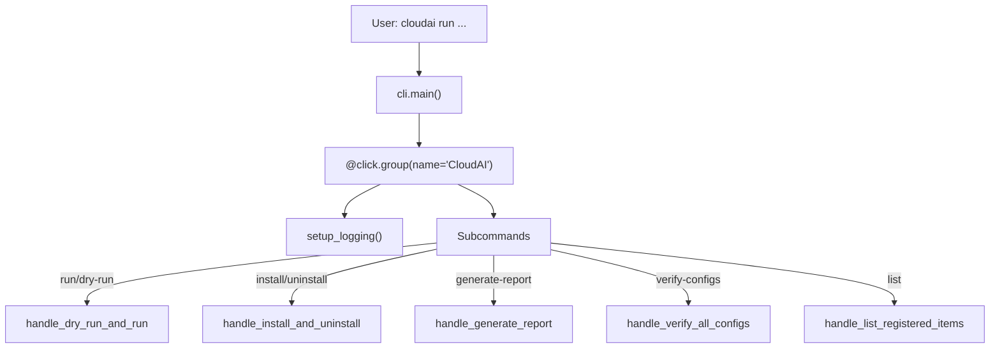
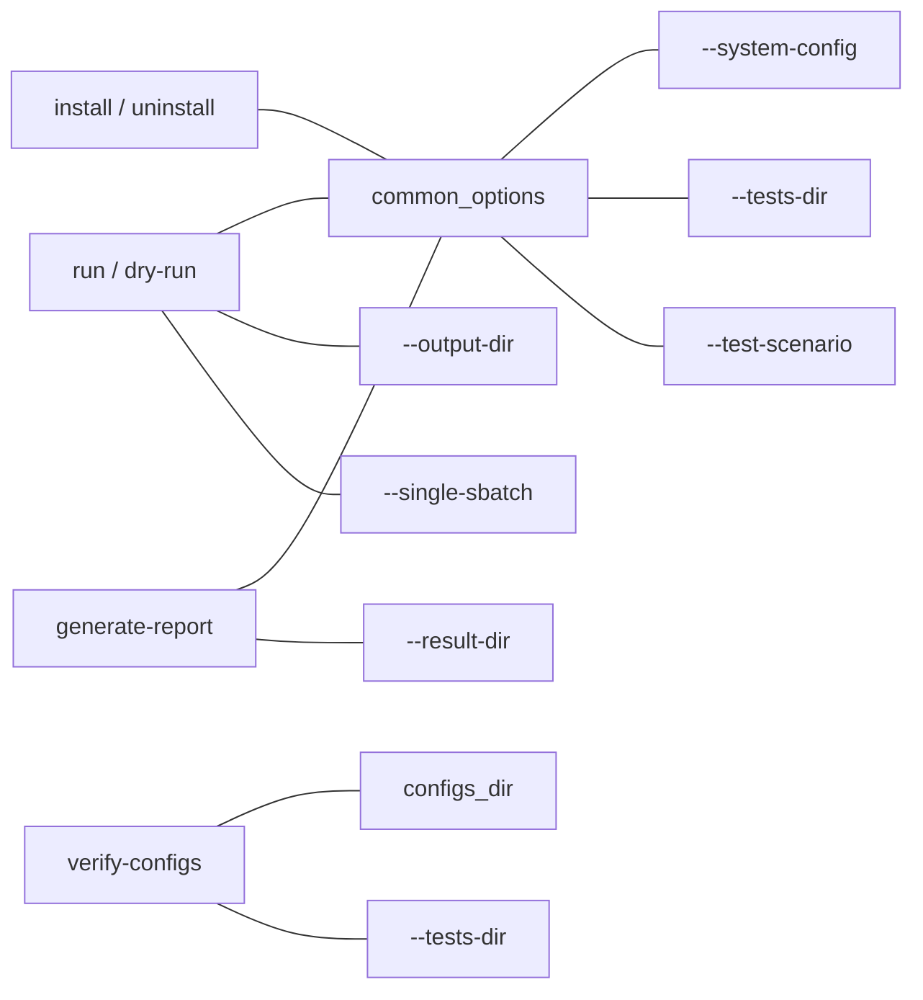
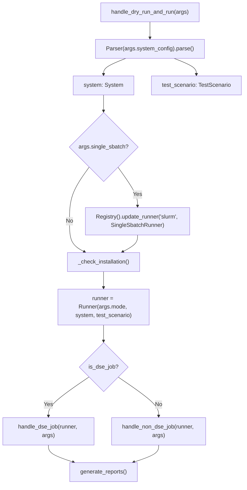

<!-- source: DeepWiki mcp.deepwiki.com · repo NVIDIA/cloudai · page 3 Command-Line Interface · fetched 2026-10-26 -->

# Command-Line Interface

Relevant source files

The following files were used as context for generating this wiki page:

- [src/cloudai/cli/__init__.py](src/cloudai/cli/__init__.py)
- [src/cloudai/cli/cli.py](src/cloudai/cli/cli.py)
- [src/cloudai/cli/handlers.py](src/cloudai/cli/handlers.py)
- [tests/test_cli.py](tests/test_cli.py)
- [tests/test_cloudaigym.py](tests/test_cloudaigym.py)
- [tests/test_job_type_handler.py](tests/test_job_type_handler.py)

This page documents CloudAI's command-line interface, covering all available commands, their arguments, and the handler functions that implement each mode. The CLI is built using the `click` library and routes all operations to appropriate backend systems.

## Overview of CLI Commands

CloudAI provides several primary commands, each mapped to a specific handler function in [src/cloudai/cli/handlers.py]().

| Command | Purpose | Handler Function | Line Reference |
|---------|---------|-----------------|----------------|
| `run` | Execute test scenarios with automatic installation | `handle_dry_run_and_run` | [src/cloudai/cli/handlers.py:264-309]() |
| `dry-run` | Simulate execution without running tests | `handle_dry_run_and_run` | [src/cloudai/cli/handlers.py:264-309]() |
| `install` | Install test prerequisites | `handle_install_and_uninstall` | [src/cloudai/cli/handlers.py:53-94]() |
| `uninstall` | Remove installed prerequisites | `handle_install_and_uninstall` | [src/cloudai/cli/handlers.py:53-94]() |
| `generate-report` | Generate reports from existing results | `handle_generate_report` | [src/cloudai/cli/handlers.py:312-327]() |
| `verify-configs` | Validate configuration files | `handle_verify_all_configs` | [src/cloudai/cli/handlers.py:468-504]() |
| `list` | List available internal components | `handle_list_registered_items` | [src/cloudai/cli/handlers.py:545-562]() |

**Sources:** [src/cloudai/cli/handlers.py:53-562](), [src/cloudai/cli/cli.py:137-234]()

## CLI Architecture and Entry Point

The CLI entry point is the `main` function in [src/cloudai/cli/cli.py](). It uses `click` to define a command group and subcommands. Global logging is configured via `setup_logging` [src/cloudai/cli/cli.py:33-84](), providing a `short` format for the console and a `standard` format for the `debug.log` file.

**Diagram: CLI Entry Point and Routing**

**Sources:** [src/cloudai/cli/cli.py:33-234](), [src/cloudai/cli/__init__.py:17-22]()

## Argument Parsing Structure

The CLI uses a `common_options` decorator [src/cloudai/cli/cli.py:86-107]() to share mandatory arguments across multiple commands.

**Diagram: Argument Configuration per Command**

**Sources:** [src/cloudai/cli/cli.py:86-234]()

## `run` and `dry-run` Commands

Both modes are handled by `handle_dry_run_and_run()` [src/cloudai/cli/handlers.py:264-309](). In `dry-run` mode, the system sets a minimal monitor interval to accelerate the simulation of the execution lifecycle.

**Diagram: Run/Dry-Run Execution Flow**

**Key Functions:**
- `_check_installation()` [src/cloudai/cli/handlers.py:250-261](): Verifies prerequisites. If `--enable-cache-without-check` is set, it marks items as installed without filesystem validation.
- `handle_non_dse_job()` [src/cloudai/cli/handlers.py:195-198](): Executes standard test runs via `asyncio.run(runner.run())`.
- `handle_dse_job()` [src/cloudai/cli/handlers.py:120-166](): Executes Design Space Exploration using `CloudAIGymEnv` and registered agents.

**Sources:** [src/cloudai/cli/handlers.py:120-309](), [src/cloudai/cli/cli.py:155-208]()

### DSE Job Handling

When a test scenario contains DSE jobs (detected via `tr.is_dse_job` [src/tests/test_job_type_handler.py:35-53]()), the handler routes to `handle_dse_job()`. 

1. **Agent Retrieval**: Fetches the agent class from `Registry().agents_map` [src/cloudai/cli/handlers.py:137-144]().
2. **Environment**: Wraps the test run in a `CloudAIGymEnv` [src/cloudai/cli/handlers.py:146]().
3. **Execution Loop**: The agent selects actions, the environment executes them (via `env.step(action)`), and the agent updates its policy based on rewards [src/cloudai/cli/handlers.py:154-164]().

**Sources:** [src/cloudai/cli/handlers.py:120-171](), [src/tests/test_cloudaigym.py:84-132]()

## `install` and `uninstall` Commands

Managed by `handle_install_and_uninstall()` [src/cloudai/cli/handlers.py:53-94](). It extracts `Installable` objects from the `TestDefinition` or `TestScenario` and uses the appropriate `BaseInstaller` implementation for the system's scheduler.

**Key Logic:**
- **De-duplication**: `prepare_installation` [src/cloudai/cli/handlers.py:97-116]() aggregates all required installables.
- **Installer Dispatch**: Retrieves the installer from `Registry().installers_map` [src/cloudai/cli/handlers.py:111-114]().

**Sources:** [src/cloudai/cli/handlers.py:53-117](), [src/cloudai/cli/cli.py:137-152]()

## `verify-configs` Command

Validates TOML configuration files using the three-schema system.

- **Detection**: `load_tomls_by_type` [src/cloudai/cli/handlers.py:507-542]() categorizes files as `system`, `test`, or `scenario` based on internal keys (e.g., `scheduler` for systems, `[[Tests]]` for scenarios).
- **Validation**: Calls `verify_system_configs`, `verify_test_configs`, and `verify_test_scenarios` [src/cloudai/cli/handlers.py:396-465]().
- **Kubeconfig Dummy**: For Kubernetes systems, it uses `_ensure_kube_config_exists` [src/cloudai/cli/handlers.py:345-393]() to allow validation even if a real cluster isn't reachable.

**Sources:** [src/cloudai/cli/handlers.py:345-542](), [src/cloudai/cli/cli.py:228-234]()

## Common Patterns and Utilities

- **Signal Handling**: `register_signal_handlers` [src/cloudai/cli/handlers.py:201-210]() ensures that `SIGINT` and `SIGTERM` trigger `runner.cancel_on_signal` for clean job termination.
- **Single-Sbatch Optimization**: For Slurm, `--single-sbatch` replaces the standard runner with `SingleSbatchRunner` [src/cloudai/cli/handlers.py:246](), allowing all tests in a scenario to run within one allocation.
- **Logging**: The CLI sets up a dual-handler logging system [src/cloudai/cli/cli.py:45-82]() with a console stream and a `debug_file` handler.

**Sources:** [src/cloudai/cli/handlers.py:201-247](), [src/cloudai/cli/cli.py:33-84]()

---

