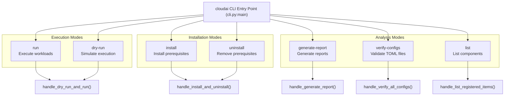
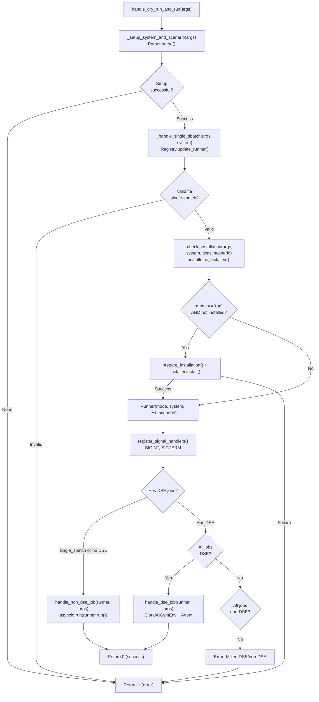
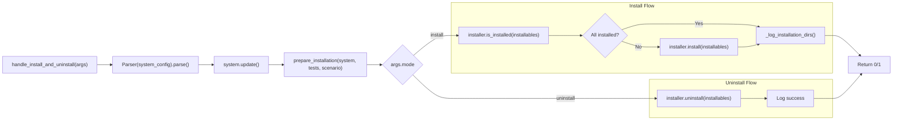

<!-- source: DeepWiki mcp.deepwiki.com · repo NVIDIA/cloudai · page 3.1 CLI Commands and Handlers · fetched 2026-10-26 -->

# CLI Commands and Handlers

Relevant source files

The following files were used as context for generating this wiki page:

- [src/cloudai/cli/__init__.py](src/cloudai/cli/__init__.py)
- [src/cloudai/cli/cli.py](src/cloudai/cli/cli.py)
- [src/cloudai/cli/handlers.py](src/cloudai/cli/handlers.py)
- [tests/test_cli.py](tests/test_cli.py)
- [tests/test_cloudaigym.py](tests/test_cloudaigym.py)
- [tests/test_job_type_handler.py](tests/test_job_type_handler.py)

## Purpose and Scope

This document describes CloudAI's command-line interface commands, their handler implementations, and execution flow. It covers all seven CLI modes (`run`, `dry-run`, `install`, `uninstall`, `generate-report`, `verify-configs`, `list`) and the internal handler functions that implement each mode. 

For information about configuration file parsing and validation, see [Configuration System](#3.2). For details about test execution and job management, see [Runner System and Job Management](#2.4).

---

## CLI Command Architecture

CloudAI provides seven distinct operational modes, each implemented by a dedicated handler function in [src/cloudai/cli/handlers.py](). The CLI entry point routes commands to the appropriate handler based on the `mode` argument.

### Command Overview

**CLI Command Routing**

Sources: [src/cloudai/cli/cli.py:128-261](), [src/cloudai/cli/handlers.py:53-562]()

---

## Command Modes Reference

| Mode | Handler Function | Primary Purpose | Auto-installs Prerequisites |
|------|------------------|-----------------|------------------------------|
| `run` | `handle_dry_run_and_run` | Execute test scenarios on actual infrastructure | ✅ Yes |
| `dry-run` | `handle_dry_run_and_run` | Simulate execution, generate scripts without submission | ❌ No |
| `install` | `handle_install_and_uninstall` | Install test prerequisites (Docker images, repos, venvs) | N/A |
| `uninstall` | `handle_install_and_uninstall` | Remove installed prerequisites | N/A |
| `generate-report` | `handle_generate_report` | Generate reports from existing results | ❌ No |
| `verify-configs` | `handle_verify_all_configs` | Validate TOML configuration files | ❌ No |
| `list` | `handle_list_registered_items` | List registered components (reports, agents) | ❌ No |

Sources: [src/cloudai/cli/cli.py:137-261](), [src/cloudai/cli/handlers.py:53-562]()

---

## Handler Function Details

### run and dry-run: `handle_dry_run_and_run`

**Purpose**: Execute or simulate test scenarios. The `run` mode submits jobs to the scheduler and monitors execution, while `dry-run` generates scripts without submission for validation purposes.

**Execution Flow for run/dry-run Mode**

**Key Implementation Details**:

1. **Setup Phase** [src/cloudai/cli/handlers.py:213-235]():
   - `_setup_system_and_scenario` parses TOML files using `Parser.parse()`.
   - Creates `System`, `TestDefinition` list, and `TestScenario` objects.
   - For `dry-run`, sets `system.monitor_interval = 1` to speed up simulation [src/cloudai/cli/handlers.py:234]().

2. **Single-Sbatch Handling** [src/cloudai/cli/handlers.py:238-247]():
   - `--single-sbatch` flag only supported for Slurm systems.
   - Dynamically updates Registry to use `SingleSbatchRunner` instead of `SlurmRunner` [src/cloudai/cli/handlers.py:246]().
   - Enables running all test cases in one sbatch job instead of per-case submission.

3. **Installation Check** [src/cloudai/cli/handlers.py:250-261]():
   - `_check_installation` calls `prepare_installation` to get `Installable` objects.
   - Verifies each installable using `installer.is_installed()`.
   - If `args.enable_cache_without_check` is set, uses `installer.mark_as_installed()` [src/cloudai/cli/handlers.py:257]().

4. **Runner Initialization** [src/cloudai/cli/handlers.py:296]():
   - `Runner` factory class selects appropriate runner from Registry based on `system.scheduler`.

5. **Signal Handler Registration** [src/cloudai/cli/handlers.py:297, 201-210]():
   - `register_signal_handlers` sets up handlers for `SIGINT`, `SIGTERM`, `SIGHUP`, `SIGQUIT`.
   - `runner.cancel_on_signal` is registered as the callback [src/cloudai/cli/handlers.py:297]().

6. **DSE vs Non-DSE Routing** [src/cloudai/cli/handlers.py:300-309]():
   - Checks `tr.is_dse_job` for each test run.
   - Routes to `handle_dse_job` if all tests are DSE jobs.
   - Routes to `handle_non_dse_job` if no DSE jobs or `--single-sbatch` mode.

Sources: [src/cloudai/cli/handlers.py:213-309](), [src/cloudai/cli/cli.py:155-208]()

---

### install and uninstall: `handle_install_and_uninstall`

**Purpose**: Manage test prerequisites including Docker images, Git repositories, Python virtual environments, and Hugging Face models.

**Installation/Uninstallation Flow**

**Key Implementation Details**:

1. **Installable Collection** [src/cloudai/cli/handlers.py:97-109]():
   - `prepare_installation` extracts `Installable` objects from test definitions.
   - If scenario provided: collects from `scenario.test_runs[*].test.installables`.
   - Otherwise: collects from all `tests[*].installables`.

2. **Installer Selection** [src/cloudai/cli/handlers.py:110-114]():
   - Looks up installer class from `Registry().installers_map` using `system.scheduler`.

3. **Installation Process** [src/cloudai/cli/handlers.py:72-84]():
   - Calls `installer.install(installables)` if `is_installed` returns False.
   - Returns 1 if `installer.install` fails [src/cloudai/cli/handlers.py:83]().

4. **Uninstallation Process** [src/cloudai/cli/handlers.py:85-92]():
   - Calls `installer.uninstall(installables)` to remove components.

Sources: [src/cloudai/cli/handlers.py:53-117](), [src/cloudai/cli/cli.py:137-152]()

---

### generate-report: `handle_generate_report`

**Purpose**: Generate analysis reports from existing test results without re-executing tests.

**Key Implementation Details**:

1. **Report Strategy Lookup** [src/cloudai/cli/handlers.py:173-177]():
   - `generate_reports` retrieves all registered scenario reports from `Registry().ordered_scenario_reports()`.
   - This ensures the `status` report is generated last [src/cloudai/core/registry.py:114-118]().

2. **Configuration Precedence** [src/cloudai/cli/handlers.py:180-185]():
   - Report configuration priority:
     1. Scenario-level: `test_scenario.reports[name]`
     2. System-level: `system.reports[name]` (for Slurm systems)
     3. Registry Default: `registry.report_configs[name]`

3. **Report Generation** [src/cloudai/cli/handlers.py:191-192]():
   - Instantiates reporter with `reporter_class(system, test_scenario, result_dir, cfg)`.
   - Calls `reporter.generate()`.

Sources: [src/cloudai/cli/handlers.py:173-193](), [src/cloudai/cli/cli.py:211-233]()

---

### verify-configs: `handle_verify_all_configs`

**Purpose**: Validate TOML configuration files for correctness without executing tests or requiring cluster access.

**Classification Logic** [src/cloudai/cli/handlers.py:507-542]():
- **System**: Contains `scheduler =` [src/cloudai/cli/handlers.py:516]().
- **Test**: Contains `test_template_name =` but not `[[Tests]]` [src/cloudai/cli/handlers.py:518]().
- **Scenario**: Contains `[[Tests]]` [src/cloudai/cli/handlers.py:521]().
- **Hook**: Files under `HOOK_ROOT` [src/cloudai/cli/handlers.py:523]().

**Verification Process**:
1. **Systems**: Calls `Parser.parse_system()` [src/cloudai/cli/handlers.py:408]().
2. **Tests**: Calls `TestParser.load_test_definition()` [src/cloudai/cli/handlers.py:433]().
3. **Scenarios**: Calls `Parser.parse_test_scenario()` with a mock system [src/cloudai/cli/handlers.py:456]().

Sources: [src/cloudai/cli/handlers.py:330-504](), [src/cloudai/cli/cli.py:236-250]()

---

### list: `handle_list_registered_items`

**Purpose**: Display registered internal components (agents, reports) available in the current CloudAI installation.

**Implementation** [src/cloudai/cli/handlers.py:545-562]():
- Lists all registered scenario reports from `Registry().scenario_reports`.
- Lists all registered DSE agents from `Registry().agents_map`.
- Supports `--verbose` to show configurations or docstrings [src/cloudai/cli/handlers.py:553, 560]().

Sources: [src/cloudai/cli/handlers.py:545-562](), [src/cloudai/cli/cli.py:253-261]()

---

## Internal Execution Handlers

### `handle_non_dse_job`: Standard Execution

**Purpose**: Execute test scenarios with standard dependency-driven scheduling.

**Implementation Details** [src/cloudai/cli/handlers.py:195-198]():
- Calls `asyncio.run(runner.run())`.
- Triggers `generate_reports()` upon completion.

Sources: [src/cloudai/cli/handlers.py:195-198]()

---

### `handle_dse_job`: DSE Parameter Exploration

**Purpose**: Execute Design Space Exploration jobs where agents iteratively explore parameter configurations.

**Key Implementation Details**:
1. **Agent Setup** [src/cloudai/cli/handlers.py:136-152]():
   - Retrieves agent class (e.g., `GridSearchAgent`) from `Registry`.
   - Initializes `CloudAIGymEnv` with the current `test_run`.
2. **Action Loop** [src/cloudai/cli/handlers.py:154-164]():
   - Agent selects an action (parameter combination).
   - `env.step(action)` executes the test and returns `reward` (metric).
   - Agent updates policy based on the feedback.

Sources: [src/cloudai/cli/handlers.py:119-171](), [tests/test_cloudaigym.py:151-164]()

---

## Utility and Special Features

### Signal Handling
- `register_signal_handlers` binds `SIGINT`, `SIGTERM`, `SIGHUP`, and `SIGQUIT` to a handler [src/cloudai/cli/handlers.py:201-210]().
- During `run`, `runner.cancel_on_signal` is used to gracefully terminate remote jobs [src/cloudai/cli/handlers.py:297]().

### Single-Sbatch Optimization
- Activated by `--single-sbatch` [src/cloudai/cli/cli.py:123]().
- Only valid for `SlurmSystem` [src/cloudai/cli/handlers.py:241]().
- Updates the registry to use `SingleSbatchRunner` [src/cloudai/cli/handlers.py:246]().
- Consolidates all scenario tests into one sbatch script to reduce scheduler overhead.

### DSE Detection
- A `TestRun` is a DSE job if `num_nodes`, `extra_env_vars`, or `cmd_args` contain lists [tests/test_job_type_handler.py:35-53]().
- DSE jobs are handled via the `CloudAIGymEnv` and iterative agent steps [src/cloudai/cli/handlers.py:146-164]().

Sources: [src/cloudai/cli/handlers.py:201-210, 238-247](), [tests/test_job_type_handler.py:35-53]()

---

