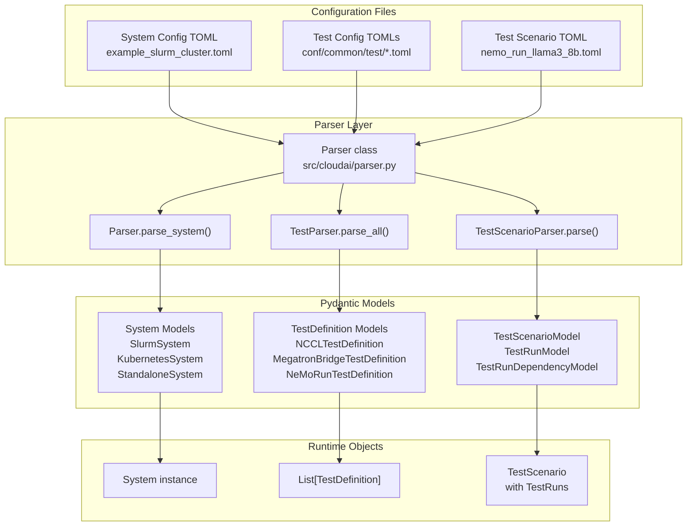
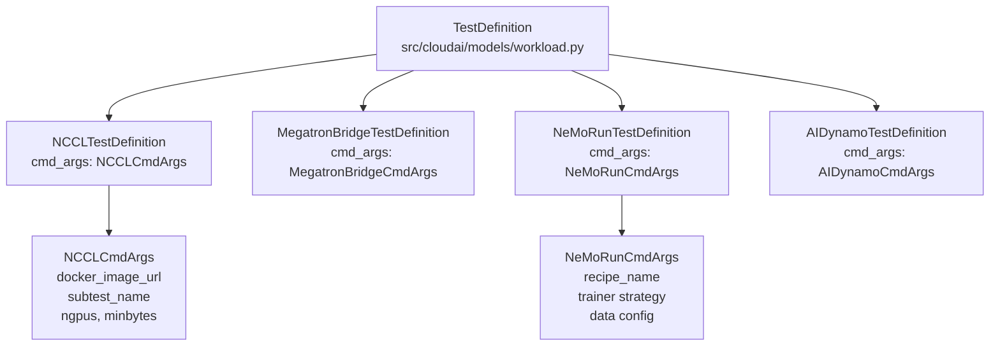

<!-- source: DeepWiki mcp.deepwiki.com · repo NVIDIA/cloudai · page 3.2 Configuration System · fetched 2026-10-26 -->

# Configuration System

<details>
<summary>Relevant source files</summary>

The following files were used as context for generating this wiki page:

- [.github/workflows/ci.yml](.github/workflows/ci.yml)
- [.github/workflows/docs.yml](.github/workflows/docs.yml)
- [.gitignore](.gitignore)
- [conf/common/test/dse_nccl_all_gather.toml](conf/common/test/dse_nccl_all_gather.toml)
- [conf/common/test/nccl_test.toml](conf/common/test/nccl_test.toml)
- [conf/common/test/nccl_test_all_gather.toml](conf/common/test/nccl_test_all_gather.toml)
- [conf/common/test/nemo_run_llama3_8b.toml](conf/common/test/nemo_run_llama3_8b.toml)
- [conf/common/test/ucc_test.toml](conf/common/test/ucc_test.toml)
- [conf/common/test_scenario/dse_nccl_all_gather.toml](conf/common/test_scenario/dse_nccl_all_gather.toml)
- [conf/common/test_scenario/dse_nemo_run_llama3_8b.toml](conf/common/test_scenario/dse_nemo_run_llama3_8b.toml)
- [conf/common/test_scenario/nccl_test.toml](conf/common/test_scenario/nccl_test.toml)
- [conf/common/test_scenario/nemo_run_llama3_8b.toml](conf/common/test_scenario/nemo_run_llama3_8b.toml)
- [conf/common/test_scenario/sleep.toml](conf/common/test_scenario/sleep.toml)
- [conf/common/test_scenario/slurm_container.toml](conf/common/test_scenario/slurm_container.toml)
- [conf/common/test_scenario/ucc_test.toml](conf/common/test_scenario/ucc_test.toml)
- [conf/release/spcx/l40s/test_scenario/l40s_bc_nccl_test.toml](conf/release/spcx/l40s/test_scenario/l40s_bc_nccl_test.toml)
- [doc/Makefile](doc/Makefile)
- [doc/conf.py](doc/conf.py)
- [pyproject.toml](pyproject.toml)
- [src/cloudai/_core/exceptions.py](src/cloudai/_core/exceptions.py)
- [src/cloudai/_core/test_scenario.py](src/cloudai/_core/test_scenario.py)
- [src/cloudai/models/scenario.py](src/cloudai/models/scenario.py)
- [src/cloudai/models/workload.py](src/cloudai/models/workload.py)
- [src/cloudai/parser.py](src/cloudai/parser.py)
- [src/cloudai/test_scenario_parser.py](src/cloudai/test_scenario_parser.py)
- [tests/test_test_scenario.py](tests/test_test_scenario.py)
- [uv.lock](uv.lock)

</details>


## Purpose and Scope

CloudAI's configuration system is built on three distinct TOML-based schemas that define how benchmarks are executed across different infrastructure types. This document covers the structure, validation, and parsing of System, Test, and Test Scenario configurations. It details the Pydantic-backed validation models, the dependency resolution mechanism, and the organization of configuration files within the `conf/` directory.

---

## Three-Schema Architecture

CloudAI separates concerns into three configuration layers, each with its own TOML schema and Pydantic model hierarchy.

### Architecture Overview

The `Parser` class coordinates the ingestion of these three schemas, transforming static TOML files into a validated runtime object graph.

Title: Three-Schema Architecture: TOML Files to Runtime Objects


Sources: [src/cloudai/parser.py:42-132](), [src/cloudai/test_scenario_parser.py:73-105](), [src/cloudai/models/scenario.py:176-254](), [src/cloudai/models/workload.py:89-142]()

---

## System Configuration Schema

System configurations describe the execution environment, including the scheduler type, node inventory, and system-wide paths.

### TOML Structure
The system TOML must define a `scheduler` key which acts as a discriminator for the registry.

```toml
# Scheduler type - determines which System class is instantiated
scheduler = "slurm"  # or "kubernetes" or "standalone"

# System identification
name = "example-slurm-cluster"

# Node configuration
node_list = ["node-001", "node-002", "node-003", "node-004"]

# Paths
install_path = "/opt/cloudai"
output_path = "/results"
```

### Parsing and Registry Dispatch
The `Parser.parse_system` method uses the `Registry` to find the corresponding class mapped to the `scheduler` string.

```python
# Implementation detail from src/cloudai/parser.py
registry = Registry()
with Path(system_config_path).open() as f:
    data = toml.load(f)
    scheduler = data.get("scheduler")
    # ... validation ...
    system = registry.systems_map[scheduler](**data)
```

Sources: [src/cloudai/parser.py:165-185](), [src/cloudai/_core/registry.py:1-100]()

---

## Test Configuration Schema

Test configurations define workload templates. They specify the `test_template_name` which maps to a specific `TestDefinition` subclass in the registry.

### TestDefinition Class Hierarchy

Title: TestDefinition Hierarchy and Command Arguments


### DSE Parameter Spaces
Test definitions can include lists for certain `cmd_args` or `extra_env_vars`. These are detected by `TestRun.is_dse_job` and expanded into a parameter space for Design Space Exploration.

| Field | Type | Description |
|-------|------|-------------|
| `num_nodes` | `int \| list[int]` | Scalar for fixed runs, list for DSE sweeps. |
| `cmd_args` | `CmdArgs` | Workload-specific Pydantic model. |
| `agent` | `str` | Optional DSE agent name (e.g., `grid_search`). |

Sources: [src/cloudai/models/workload.py:89-142](), [src/cloudai/_core/test_scenario.py:114-155](), [conf/common/test/nemo_run_llama3_8b.toml:17-54]()

---

## Test Scenario Configuration Schema

The `TestScenario` schema orchestrates the execution of multiple `TestRun` objects, defining their dependencies and iterations.

### Dependency Types
Dependencies are defined in the `TestRunDependencyModel` and managed by the `TestScenarioParser`.

| Type | Description |
|------|-------------|
| `start_post_init` | Dependent starts as soon as the parent is initialized/submitted. |
| `start_post_comp` | Dependent starts only after the parent completes successfully. |
| `end_post_comp` | Dependent (usually a monitor) is terminated when the parent completes. |

### Configuration Merging logic
When a `TestRun` references a `test_name`, the `TestScenarioParser` performs a `deep_merge` between the base `TestDefinition` and any overrides provided in the scenario TOML.

```python
# Logic from src/cloudai/test_scenario_parser.py
def _prepare_tdef(self, test_info: TestRunModel) -> TestDefinition:
    base_tdef = self.test_mapping[test_info.test_name]
    tdef_data = base_tdef.model_dump()
    overrides = test_info.tdef_model_dump(by_alias=True)
    merged_data = deep_merge(tdef_data, overrides)
    # ... validation and instantiation ...
```

Sources: [src/cloudai/models/scenario.py:54-63](), [src/cloudai/test_scenario_parser.py:152-168](), [src/cloudai/test_scenario_parser.py:215-237]()

---

## Configuration Validation and Verification

### The `verify-configs` Mechanism
The `cloudai verify-configs` command performs a dry-run of the parsing logic across all files in the `conf/` directory.

1.  **File Discovery**: Recursively finds all `.toml` files.
2.  **Classification**: Uses `load_tomls_by_type` to separate files into System, Test, and Scenario categories based on key presence (e.g., `scheduler` for systems, `[[Tests]]` for scenarios).
3.  **Schema Validation**: Passes each file through the respective Pydantic models.
4.  **Reference Integrity**: Ensures every `test_name` in a scenario exists in the provided tests directory.

### Error Handling
Validation errors are caught and formatted using `format_validation_error`, which flattens the Pydantic error location (e.g., `Tests.0.cmd_args.ngpus`) into a human-readable string.

Sources: [src/cloudai/parser.py:26-31](), [src/cloudai/test_scenario_parser.py:117-124](), [src/cloudai/cli/handlers.py:350-399]()

---

## Configuration Directory Layout

The `conf/` directory is organized by stability and environment.

-   **`conf/common/`**: Shared workload templates and scenarios.
-   **`conf/release/`**: Verified configurations for specific hardware (e.g., `spcx/l40s`).
-   **`conf/hook/`**: Special scenarios used for pre-test setup or post-test cleanup.
    -   `conf/hook/test/`: `TestDefinition` files specific to hooks.
    -   `conf/hook/*.toml`: `TestScenario` files defining hook sequences.

Sources: [src/cloudai/parser.py:38-40](), [src/cloudai/parser.py:92-101](), [.github/workflows/ci.yml:95-99]()

---

