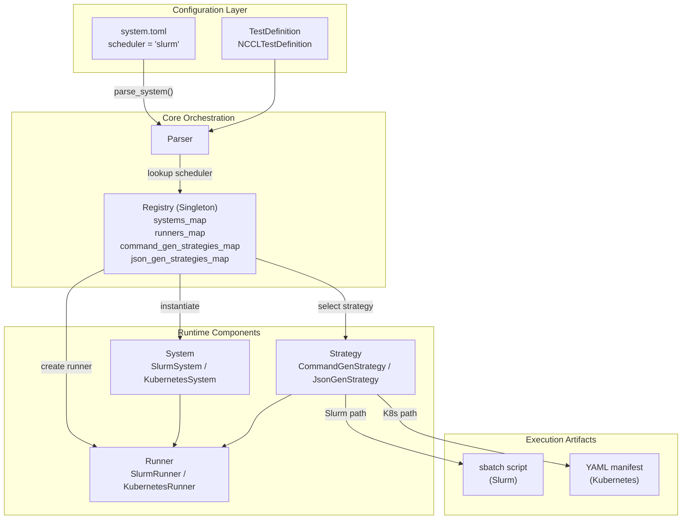
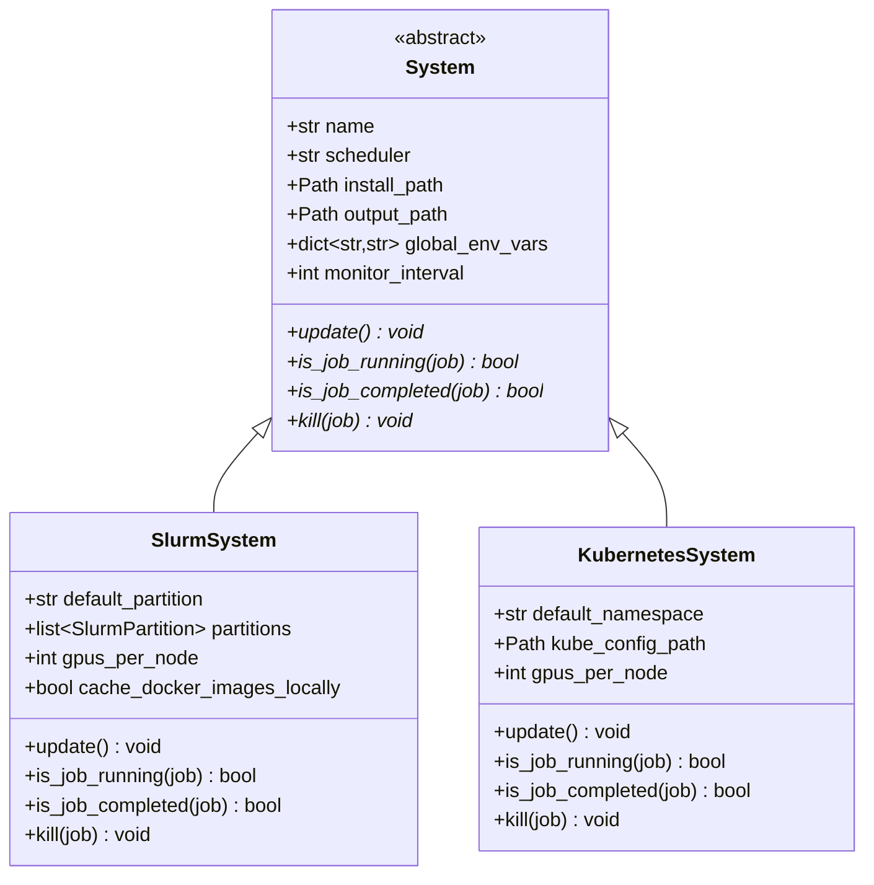
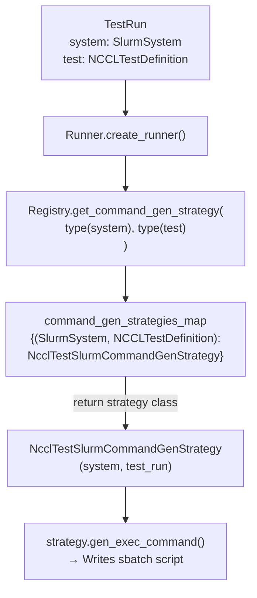
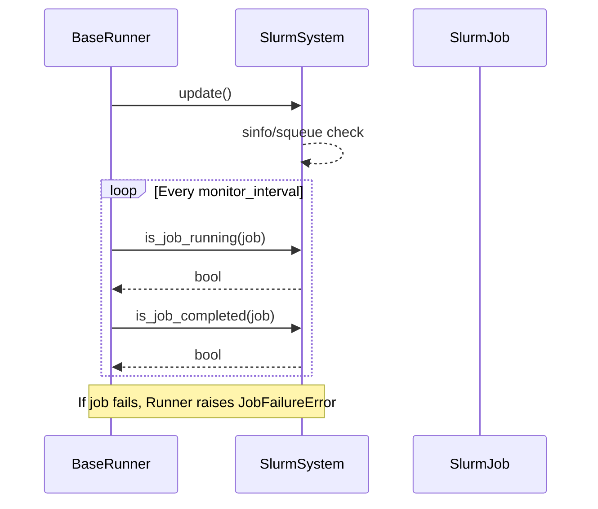

<!-- source: DeepWiki mcp.deepwiki.com · repo NVIDIA/cloudai · page 4 Scheduler Integrations · fetched 2026-10-26 -->

# Scheduler Integrations

<details>
<summary>Relevant source files</summary>

The following files were used as context for generating this wiki page:

- [conf/common/system/kubernetes_cluster.toml](conf/common/system/kubernetes_cluster.toml)
- [src/cloudai/_core/base_runner.py](src/cloudai/_core/base_runner.py)
- [src/cloudai/_core/runner.py](src/cloudai/_core/runner.py)
- [src/cloudai/systems/kubernetes/kubernetes_system.py](src/cloudai/systems/kubernetes/kubernetes_system.py)
- [src/cloudai/systems/runai/runai_node.py](src/cloudai/systems/runai/runai_node.py)
- [src/cloudai/systems/runai/runai_rest_client.py](src/cloudai/systems/runai/runai_rest_client.py)
- [src/cloudai/systems/runai/runai_runner.py](src/cloudai/systems/runai/runai_runner.py)
- [src/cloudai/systems/runai/runai_system.py](src/cloudai/systems/runai/runai_system.py)
- [src/cloudai/systems/slurm/slurm_command_gen_strategy.py](src/cloudai/systems/slurm/slurm_command_gen_strategy.py)
- [src/cloudai/systems/slurm/slurm_system.py](src/cloudai/systems/slurm/slurm_system.py)
- [src/cloudai/workloads/nccl_test/kubernetes_json_gen_strategy.py](src/cloudai/workloads/nccl_test/kubernetes_json_gen_strategy.py)
- [src/cloudai/workloads/triton_inference/slurm_command_gen_strategy.py](src/cloudai/workloads/triton_inference/slurm_command_gen_strategy.py)
- [tests/systems/slurm/test_allocation.py](tests/systems/slurm/test_allocation.py)
- [tests/systems/slurm/test_command_gen_strategy.py](tests/systems/slurm/test_command_gen_strategy.py)
- [tests/systems/slurm/test_system.py](tests/systems/slurm/test_system.py)
- [tests/test_base_runner.py](tests/test_base_runner.py)
- [tests/workloads/megatron_run/test_report_gen_strategy.py](tests/workloads/megatron_run/test_report_gen_strategy.py)
- [tests/workloads/nccl_test/test_json_gen_strategy_kubernetes.py](tests/workloads/nccl_test/test_json_gen_strategy_kubernetes.py)
- [tests/workloads/nccl_test/test_prediction_report_generator.py](tests/workloads/nccl_test/test_prediction_report_generator.py)

</details>


CloudAI supports workload execution across multiple cluster schedulers through a three-layer abstraction: `System` (cluster configuration), `Runner` (job lifecycle management), and execution strategies (command/manifest generation). This architecture enables identical test definitions to execute on Slurm, Kubernetes, Standalone, LSF, and RunAI systems without modification.

This page provides an overview of the scheduler abstraction layer and how components are selected at runtime via the `Registry`. For detailed implementation information, see the child pages:

- [Slurm Integration](#4.1) — Slurm-specific features, node management, and sbatch generation. Covers `SlurmSystem`, `SlurmRunner`, and node state tracking.
- [Command Generation Strategies](#4.2) — How workloads generate scheduler-specific execution scripts using the `CommandGenStrategy` pattern.
- [Kubernetes and JSON Generation](#4.3) — Kubernetes manifest generation and declarative execution via `JsonGenStrategy`.
- [RunAI Integration](#4.4) — `RunAISystem` and `RunAIRunner` for managed AI workloads.
- [Standalone and LSF Execution](#4.5) — Direct script execution and IBM Platform LSF integration.

## Purpose and Design Goals

The scheduler integration system provides:

| Goal | Implementation |
|------|----------------|
| **Scheduler-agnostic tests** | `TestDefinition` objects contain no scheduler-specific logic. |
| **Runtime strategy selection** | `Registry` maps `(System, TestDefinition)` tuples to concrete strategies. |
| **System-specific optimizations** | Each `System` implementation exposes native scheduler features (e.g., Slurm GRES). |
| **Extensible architecture** | New schedulers can be added via the `System` interface and strategy registration. |
| **Unified job monitoring** | `BaseRunner` provides common job lifecycle management across schedulers. |

**Sources:** [src/cloudai/_core/system.py:31-121](), [src/cloudai/_core/registry.py:48-63]()

---

## Scheduler Abstraction Architecture

CloudAI's scheduler integration consists of three primary components that work together to enable multi-scheduler execution:

### System-Runner-Strategy Architecture



**Component Roles:**

| Component | Responsibility | Examples |
|-----------|----------------|----------|
| **System** | Cluster configuration, node management, job status queries. | `SlurmSystem`, `KubernetesSystem` [src/cloudai/systems/slurm/slurm_system.py:96-119](), [src/cloudai/systems/kubernetes/kubernetes_system.py:35-43]() |
| **Runner** | Job submission, monitoring, dependency handling. | `SlurmRunner`, `KubernetesRunner`, `BaseRunner` [src/cloudai/_core/base_runner.py:33-51]() |
| **Strategy** | Generate scheduler-specific execution artifacts. | `SlurmCommandGenStrategy`, `JsonGenStrategy` [src/cloudai/systems/slurm/slurm_command_gen_strategy.py:32-39](), [src/cloudai/_core/json_gen_strategy.py:21-30]() |

**Sources:** [src/cloudai/_core/system.py:31-121](), [src/cloudai/_core/base_runner.py:1-50](), [src/cloudai/_core/registry.py:48-63]()

---

## Supported Schedulers

CloudAI currently supports several scheduler types with varying levels of feature coverage. The `Registry` tracks these mappings at package initialization via `register_all()`.

### Scheduler Support Matrix

| Scheduler | System Class | Runner Class | Strategy Type | Status |
|-----------|--------------|--------------|---------------|--------|
| **Slurm** | `SlurmSystem` | `SlurmRunner` | `CommandGenStrategy` | Production |
| **Kubernetes** | `KubernetesSystem` | `KubernetesRunner` | `JsonGenStrategy` | Production |
| **Standalone** | `StandaloneSystem` | `StandaloneRunner` | `CommandGenStrategy` | Experimental |
| **LSF** | `LSFSystem` | `LSFRunner` | `CommandGenStrategy` | Experimental |
| **RunAI** | `RunAISystem` | `RunAIRunner` | `JsonGenStrategy` | Experimental |

**Sources:** [src/cloudai/systems/slurm/slurm_system.py:96-107](), [src/cloudai/systems/kubernetes/kubernetes_system.py:35-42](), [src/cloudai/_core/runner.py:66-72]()

---

## System Abstract Base Class

The `System` class defines the interface that all scheduler implementations must satisfy. It uses Pydantic for configuration validation and provides abstract methods for job lifecycle management.

### System Class Structure



**Required Abstract Methods:**

| Method | Purpose | Implementation Example |
|--------|---------|----------------------|
| `update()` | Refresh cluster state (nodes, jobs). | `SlurmSystem.update()` calls `sinfo`/`squeue` [src/cloudai/systems/slurm/slurm_system.py:171-183](). |
| `is_job_running(job)` | Check if job is currently executing. | `KubernetesSystem.is_job_running()` checks pod status [src/cloudai/systems/kubernetes/kubernetes_system.py:175-177](). |
| `is_job_completed(job)` | Determine if job has finished. | `SlurmSystem.is_job_completed()` checks `sacct` [src/cloudai/systems/slurm/slurm_system.py:241-243](). |
| `kill(job)` | Terminate a running job. | `BaseRunner.shutdown()` calls `system.kill()` [src/cloudai/_core/base_runner.py:73-80](). |

**Sources:** [src/cloudai/_core/system.py:31-121](), [src/cloudai/systems/slurm/slurm_system.py:96-183](), [src/cloudai/systems/kubernetes/kubernetes_system.py:35-182]()

---

## Registry-Based Strategy Selection

The `Registry` singleton maps `(System, TestDefinition)` tuples to concrete strategy implementations, enabling runtime polymorphism.

### Registry Lookup Flow



**Strategy Mapping Logic:**

The `Runner` uses the `Registry` to find the correct strategy class for the current `System` and `TestDefinition`. For Slurm, this typically results in a `SlurmCommandGenStrategy` which generates an `.sbatch` file [src/cloudai/systems/slurm/slurm_command_gen_strategy.py:104-124](). For Kubernetes, it results in a `JsonGenStrategy` which generates a `deployment.yaml` [src/cloudai/workloads/nccl_test/kubernetes_json_gen_strategy.py:38-63]().

**Sources:** [src/cloudai/_core/runner.py:47-80](), [src/cloudai/systems/slurm/slurm_command_gen_strategy.py:139-152](), [src/cloudai/_core/registry.py:48-63]()

---

## System Configuration Examples

### Slurm System Configuration
Defined in `system.toml`, the configuration specifies partitions, groups, and Slurm-specific flags like `mpi` or `account`.

```toml
# Example slurm system
name = "slurm-cluster"
scheduler = "slurm"
default_partition = "main"
gpus_per_node = 8
mpi = "pmix"

[[partitions]]
name = "main"
  [[partitions.groups]]
  name = "dgx_group"
  nodes = ["node[01-16]"]
```

**Sources:** [src/cloudai/systems/slurm/slurm_system.py:96-119](), [tests/systems/slurm/test_allocation.py:36-38]()

### Kubernetes System Configuration
Requires a `kube_config_path` and `default_namespace`.

```toml
# conf/common/system/kubernetes_cluster.toml
name = "kubernetes-cluster"
scheduler = "kubernetes"
kube_config_path = ""
default_namespace = "default"
gpus_per_node = 1
```

**Sources:** [conf/common/system/kubernetes_cluster.toml:17-23](), [src/cloudai/systems/kubernetes/kubernetes_system.py:35-43]()

---

## Job Monitoring and Lifecycle

The `BaseRunner` monitors jobs by polling the `System` at a `monitor_interval`.



**Job Status Resolution:**
The `SlurmSystem` identifies node states (e.g., `ALLOCATED`, `IDLE`, `DRAINED`) and associates them with partitions and groups to track resource availability [src/cloudai/systems/slurm/slurm_system.py:126-146](), [tests/systems/slurm/test_system.py:57-91]().

**Sources:** [src/cloudai/_core/base_runner.py:93-97](), [src/cloudai/systems/slurm/slurm_system.py:171-183](), [src/cloudai/systems/kubernetes/kubernetes_system.py:175-182]()

---

