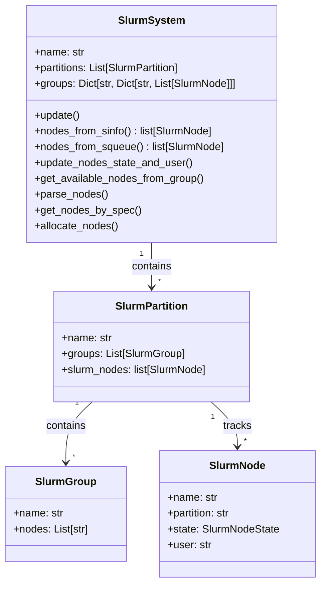

<!-- source: DeepWiki mcp.deepwiki.com · repo NVIDIA/cloudai · page 4.1 Slurm Integration · fetched 2026-10-26 -->

# Slurm Integration

<details>
<summary>Relevant source files</summary>

The following files were used as context for generating this wiki page:

- [conf/common/system/example_slurm_cluster.toml](conf/common/system/example_slurm_cluster.toml)
- [src/cloudai/_core/command_gen_strategy.py](src/cloudai/_core/command_gen_strategy.py)
- [src/cloudai/configurator/cloudai_gym.py](src/cloudai/configurator/cloudai_gym.py)
- [src/cloudai/systems/slurm/__init__.py](src/cloudai/systems/slurm/__init__.py)
- [src/cloudai/systems/slurm/single_sbatch_runner.py](src/cloudai/systems/slurm/single_sbatch_runner.py)
- [src/cloudai/systems/slurm/slurm-metadata.sh](src/cloudai/systems/slurm/slurm-metadata.sh)
- [src/cloudai/systems/slurm/slurm_command_gen_strategy.py](src/cloudai/systems/slurm/slurm_command_gen_strategy.py)
- [src/cloudai/systems/slurm/slurm_metadata.py](src/cloudai/systems/slurm/slurm_metadata.py)
- [src/cloudai/systems/slurm/slurm_runner.py](src/cloudai/systems/slurm/slurm_runner.py)
- [src/cloudai/systems/slurm/slurm_system.py](src/cloudai/systems/slurm/slurm_system.py)
- [src/cloudai/workloads/triton_inference/slurm_command_gen_strategy.py](src/cloudai/workloads/triton_inference/slurm_command_gen_strategy.py)
- [tests/conftest.py](tests/conftest.py)
- [tests/systems/slurm/test_allocation.py](tests/systems/slurm/test_allocation.py)
- [tests/systems/slurm/test_command_gen_strategy.py](tests/systems/slurm/test_command_gen_strategy.py)
- [tests/systems/slurm/test_system.py](tests/systems/slurm/test_system.py)
- [tests/test_get_job_id.py](tests/test_get_job_id.py)
- [tests/test_handlers.py](tests/test_handlers.py)
- [tests/test_parser.py](tests/test_parser.py)
- [tests/test_single_sbatch_runner.py](tests/test_single_sbatch_runner.py)

</details>


This document explains how CloudAI integrates with Slurm for job scheduling and resource management on HPC clusters. It covers the core components, configuration, command generation, job submission, and monitoring processes specific to Slurm integration in CloudAI.

## Architecture Overview

CloudAI's Slurm integration consists of several key components that work together to define, submit, monitor, and analyze Slurm jobs. The integration follows CloudAI's registry-based plugin architecture, where `SlurmSystem`, `SlurmRunner`, `SlurmCommandGenStrategy`, and `SlurmInstaller` are registered and retrieved dynamically based on the scheduler type.

**Component Hierarchy and Code Entities**

```mermaid
graph TB
    Registry["Registry.systems_map['slurm']"]
    
    subgraph "System Layer"
        SlurmSystem["SlurmSystem"]
        SlurmPartition["SlurmPartition"]
        SlurmGroup["SlurmGroup"]
        SlurmNode["SlurmNode"]
    end
    
    subgraph "Execution Layer"
        SlurmRunner["SlurmRunner<br/>BaseRunner"]
        SlurmJob["SlurmJob<br/>BaseJob"]
        SlurmCommandGenStrategy["SlurmCommandGenStrategy<br/>CommandGenStrategy"]
        SingleSbatchRunner["SingleSbatchRunner"]
    end
    
    subgraph "Installation Layer"
        SlurmInstaller["SlurmInstaller<br/>BaseInstaller"]
        DockerImageCacheManager["DockerImageCacheManager"]
    end
    
    subgraph "Slurm Commands"
        sinfo["sinfo<br/>node state queries"]
        squeue["squeue<br/>job queue queries"]
        sacct["sacct<br/>job accounting"]
        sbatch["sbatch<br/>job submission"]
        srun["srun<br/>parallel launch"]
        scancel["scancel<br/>job termination"]
    end
    
    Registry --> SlurmSystem
    Registry --> SlurmRunner
    Registry --> SlurmInstaller
    
    SlurmSystem --> SlurmPartition
    SlurmPartition --> SlurmGroup
    SlurmPartition --> SlurmNode
    
    SlurmRunner --> SlurmCommandGenStrategy
    SlurmRunner --> SlurmJob
    SlurmRunner --> sbatch
    SlurmRunner <|-- SingleSbatchRunner
    
    SlurmSystem --> sinfo
    SlurmSystem --> squeue
    SlurmSystem --> sacct
    SlurmSystem --> scancel
    
    SlurmCommandGenStrategy --> srun
    
    SlurmInstaller --> DockerImageCacheManager
```

Sources: [src/cloudai/systems/slurm/slurm_system.py:96-119](), [src/cloudai/systems/slurm/slurm_runner.py:33-45](), [src/cloudai/systems/slurm/single_sbatch_runner.py:34-42]()

## SlurmSystem Class

The `SlurmSystem` class extends the abstract `System` base class and represents a Slurm cluster with its partitions, node groups, and configuration. It is registered in the Registry and instantiated when a system configuration specifies `scheduler = "slurm"`.

### Class Definition and Key Properties

The `SlurmSystem` class definition is located at [src/cloudai/systems/slurm/slurm_system.py:96-119]():

```python
class SlurmSystem(System):
    """Represents a Slurm system."""
    
    default_partition: str
    partitions: List[SlurmPartition]
    account: Optional[str] = None
    distribution: Optional[str] = None
    mpi: str = "pmix"
    gpus_per_node: Optional[int] = None
    ntasks_per_node: Optional[int] = None
    cache_docker_images_locally: bool = False
    scheduler: str = "slurm"
    monitor_interval: int = 60
    cmd_shell: CommandShell = Field(default_factory=CommandShell, exclude=True)
    extra_srun_args: Optional[str] = None
    extra_sbatch_args: list[str] = Field(default_factory=list)
    supports_gpu_directives_cache: Optional[bool] = Field(default=None, exclude=True)
    container_mount_home: bool = False
    data_repository: Optional[DataRepositoryConfig] = None
    reports: Optional[dict[str, ReportConfig]] = None
    group_allocated: set[SlurmNode] = Field(default_factory=set, exclude=True)
```

| Property | Type | Description |
|----------|------|-------------|
| `default_partition` | `str` | Default Slurm partition for job submission |
| `partitions` | `List[SlurmPartition]` | List of partitions with node groups |
| `account` | `Optional[str]` | Slurm account name for job submission |
| `distribution` | `Optional[str]` | Task distribution strategy (e.g., "block", "cyclic") |
| `mpi` | `str` | MPI implementation (default: "pmix") |
| `gpus_per_node` | `Optional[int]` | Number of GPUs per node |
| `ntasks_per_node` | `Optional[int]` | Number of tasks to launch per node |
| `cache_docker_images_locally` | `bool` | Whether to cache Docker images on compute nodes |
| `extra_srun_args` | `Optional[str]` | Additional arguments passed to `srun` |
| `extra_sbatch_args` | `list[str]` | Additional arguments passed to `sbatch` |
| `container_mount_home` | `bool` | Whether to mount user home directory in containers |
| `group_allocated` | `set[SlurmNode]` | Set of nodes allocated by CloudAI from groups |

Sources: [src/cloudai/systems/slurm/slurm_system.py:96-119]()

### Partition and Node Management

CloudAI organizes Slurm resources into a hierarchy: `SlurmSystem` → `SlurmPartition` → `SlurmGroup` → `SlurmNode`.

**Hierarchy Structure**



**Node State Tracking**

The `SlurmSystem` refreshes its view of the cluster via the `update()` method [src/cloudai/systems/slurm/slurm_system.py:171-183](). It queries `sinfo` for general node states [src/cloudai/systems/slurm/slurm_system.py:184-201]() and `squeue` for current job allocations [src/cloudai/systems/slurm/slurm_system.py:203-221]().

**Dynamic Node Allocation**

CloudAI can dynamically select nodes from a group using `get_available_nodes_from_group()` [src/cloudai/systems/slurm/slurm_system.py:445-481](). It prioritizes node states in the following order: `IDLE` → `COMPLETING` → `ALLOCATED` [src/cloudai/systems/slurm/slurm_system.py:530-557](). Nodes selected this way are added to `group_allocated` [src/cloudai/systems/slurm/slurm_system.py:118]() to prevent overlap during the scheduling phase.

Sources: [src/cloudai/systems/slurm/slurm_system.py:79-119](), [src/cloudai/systems/slurm/slurm_system.py:171-221](), [src/cloudai/systems/slurm/slurm_system.py:445-557]()

### Job Status Tracking

`SlurmSystem` implements abstract job tracking methods by parsing `sacct` output.

| Method | Command | Description |
|--------|---------|-------------|
| `is_job_running()` | `sacct -j {id} --format=State` | Checks if "RUNNING" is present [src/cloudai/systems/slurm/slurm_system.py:333-357](). |
| `is_job_completed()` | `sacct -j {id} --format=State` | Checks for terminal states like COMPLETED or FAILED [src/cloudai/systems/slurm/slurm_system.py:358-367](). |
| `get_job_status()` | `sacct -j {id} ...` | Returns detailed `SlurmStepMetadata` [src/cloudai/systems/slurm/slurm_system.py:234-332](). |

Transient Slurm errors (e.g., "Socket timed out") are handled with a 3-attempt retry logic [src/cloudai/systems/slurm/slurm_system.py:234-245]().

Sources: [src/cloudai/systems/slurm/slurm_system.py:234-367]()

## SlurmCommandGenStrategy

The `SlurmCommandGenStrategy` [src/cloudai/systems/slurm/slurm_command_gen_strategy.py:32]() is the base for all Slurm-specific command generation. It handles the creation of sbatch scripts and srun prefixes.

### SBATCH Script Generation

The strategy generates a temporary sbatch script in the test's output directory. The `_append_sbatch_directives()` method [src/cloudai/systems/slurm/slurm_command_gen_strategy.py:246-302]() populates the script header:
- `#SBATCH -N {nodes}` or `#SBATCH --nodelist={list}`
- `#SBATCH --partition={partition}`
- `#SBATCH --gpus-per-node={gpus}` (if `supports_gpu_directives` is true [src/cloudai/systems/slurm/slurm_system.py:149]())

### Container Mounts

CloudAI standardizes container paths for Slurm workloads [src/cloudai/systems/slurm/slurm_command_gen_strategy.py:41-43]():
- `/cloudai_install`: System install path.
- `/cloudai_run_results`: Test run output path.
- `/cloudai_install/huggingface`: HF cache.

The `container_mounts()` method [src/cloudai/systems/slurm/slurm_command_gen_strategy.py:76-102]() automatically includes these paths along with any git repositories or extra mounts defined in the test.

Sources: [src/cloudai/systems/slurm/slurm_command_gen_strategy.py:32-102](), [src/cloudai/systems/slurm/slurm_command_gen_strategy.py:246-302]()

## SlurmRunner and Job Submission

The `SlurmRunner` [src/cloudai/systems/slurm/slurm_runner.py:33]() manages the submission of generated commands.

**Submission Flow**
1. **Command Generation**: Calls the strategy's `gen_exec_command()` [src/cloudai/systems/slurm/slurm_runner.py:59]().
2. **Execution**: Uses `CommandShell` to run `sbatch ...` [src/cloudai/systems/slurm/slurm_runner.py:63]().
3. **ID Retrieval**: Parses the job ID from stdout using regex [src/cloudai/systems/slurm/slurm_runner.py:46-55]().
4. **Tracking**: Creates a `SlurmJob` object for the monitoring loop [src/cloudai/systems/slurm/slurm_runner.py:74]().

### SingleSbatch Optimization

The `SingleSbatchRunner` [src/cloudai/systems/slurm/single_sbatch_runner.py:34]() is an optimized runner that aggregates all tests in a scenario into a single Slurm job allocation. 

**Key Behaviors:**
- **Directive Aggregation**: Calculates the maximum node count and total time limit required for the entire scenario [src/cloudai/systems/slurm/single_sbatch_runner.py:71-105]().
- **Sequential Execution**: Writes all `srun` commands into one script [src/cloudai/systems/slurm/single_sbatch_runner.py:144-161]().
- **Environment Sharing**: Exports global environment variables once at the top of the script [src/cloudai/systems/slurm/single_sbatch_runner.py:136-142]().

Sources: [src/cloudai/systems/slurm/slurm_runner.py:33-75](), [src/cloudai/systems/slurm/single_sbatch_runner.py:34-161]()

## Node Specification and Parsing

CloudAI supports complex node specifications via `parse_node_list()` [src/cloudai/systems/slurm/slurm_system.py:43-76]().

**Supported Formats:**
- **Explicit**: `node1,node2`
- **Ranges**: `node[001-010]`
- **Mixed**: `node[01-04,06],node10`

The parser correctly handles leading zeros (e.g., `node01` vs `node1`) and bracketed sub-lists. The `get_nodes_by_spec()` method [src/cloudai/systems/slurm/slurm_system.py:714-734]() acts as the high-level interface for strategies to resolve these strings into concrete node counts and names.

Sources: [src/cloudai/systems/slurm/slurm_system.py:43-76](), [src/cloudai/systems/slurm/slurm_system.py:714-734]()

## System Metadata Collection

During execution, CloudAI injects a metadata collection step into the sbatch script [src/cloudai/systems/slurm/slurm_command_gen_strategy.py:175-184](). This executes the `slurm-metadata.sh` script across all allocated nodes to capture:
- Hardware details (CPU, Memory, GPU).
- Software versions (MPI, CUDA, NCCL).
- Network configuration (NICs, MOFED).

Upon job completion, the `SlurmRunner` stores this metadata in `slurm-job.toml` within the test output directory [src/cloudai/systems/slurm/slurm_runner.py:124-132]().

Sources: [src/cloudai/systems/slurm/slurm_command_gen_strategy.py:175-184](), [src/cloudai/systems/slurm/slurm_runner.py:124-132]()

---

