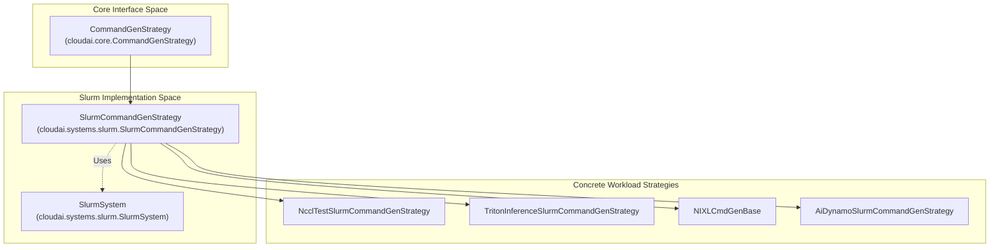
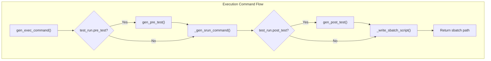
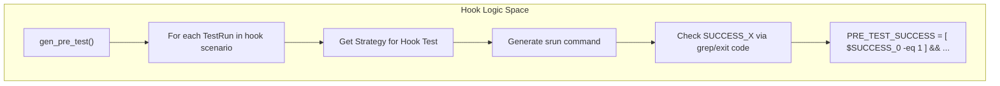

<!-- source: DeepWiki mcp.deepwiki.com · repo NVIDIA/cloudai · page 4.2 Command Generation Strategies · fetched 2026-10-26 -->

# Command Generation Strategies

Relevant source files

The following files were used as context for generating this wiki page:

- [src/cloudai/systems/slurm/slurm_command_gen_strategy.py](src/cloudai/systems/slurm/slurm_command_gen_strategy.py)
- [src/cloudai/systems/slurm/slurm_system.py](src/cloudai/systems/slurm/slurm_system.py)
- [src/cloudai/workloads/triton_inference/slurm_command_gen_strategy.py](src/cloudai/workloads/triton_inference/slurm_command_gen_strategy.py)
- [tests/ref_data/gpt-no-hook.sbatch](tests/ref_data/gpt-no-hook.sbatch)
- [tests/ref_data/gpt-pre-test.sbatch](tests/ref_data/gpt-pre-test.sbatch)
- [tests/ref_data/grok-no-hook.sbatch](tests/ref_data/grok-no-hook.sbatch)
- [tests/ref_data/grok-pre-test.sbatch](tests/ref_data/grok-pre-test.sbatch)
- [tests/ref_data/megatron-run.sbatch](tests/ref_data/megatron-run.sbatch)
- [tests/ref_data/nccl.sbatch](tests/ref_data/nccl.sbatch)
- [tests/ref_data/sleep.sbatch](tests/ref_data/sleep.sbatch)
- [tests/ref_data/slurm_container.sbatch](tests/ref_data/slurm_container.sbatch)
- [tests/ref_data/ucc.sbatch](tests/ref_data/ucc.sbatch)
- [tests/systems/slurm/test_allocation.py](tests/systems/slurm/test_allocation.py)
- [tests/systems/slurm/test_command_gen_strategy.py](tests/systems/slurm/test_command_gen_strategy.py)
- [tests/systems/slurm/test_system.py](tests/systems/slurm/test_system.py)

This page documents the command generation system in CloudAI, which is responsible for transforming test definitions into executable commands for various scheduler platforms. Command generation strategies are a key part of CloudAI's extensibility, allowing different workloads to be executed in a consistent manner across different computing environments.

## Overview

Command generation strategies implement the Strategy design pattern, enabling CloudAI to generate the appropriate execution commands for different types of workloads and scheduler systems. Each strategy is tailored to handle the specific requirements of a workload and execution environment.

### Code Entity Space to System Architecture

The following diagram bridges the natural language concepts of "Workloads" and "Schedulers" to the specific classes and files in the codebase.

Sources: `[src/cloudai/systems/slurm/slurm_command_gen_strategy.py:32-39]()`, `[src/cloudai/workloads/triton_inference/slurm_command_gen_strategy.py:26-29]()`

## Command Generation Process

The command generation process transforms a `TestRun` object into a concrete command (typically an `sbatch` script for Slurm) that can be executed on the target system.

Sources: `[src/cloudai/systems/slurm/slurm_command_gen_strategy.py:104-124]()`

## Base Slurm Command Generation Strategy

The `SlurmCommandGenStrategy` class provides common functionality for generating commands in Slurm environments. It handles container mounts, environment variable processing, and script generation.

### Key Methods and Responsibilities

- **`container_mounts()`**: Compiles all necessary container mounts including test output paths, repository mounts, and special mounts like NCCL topology files `[src/cloudai/systems/slurm/slurm_command_gen_strategy.py:76-102]()`.
- **`gen_exec_command()`**: Orchestrates the generation of the complete execution command, including pre/post test hooks `[src/cloudai/systems/slurm/slurm_command_gen_strategy.py:104-124]()`.
- **`store_test_run()`**: Serializes `TestRunDetails` to a TOML file (`test_run_details.toml`) in the output directory for metadata collection and reproducibility `[src/cloudai/systems/slurm/slurm_command_gen_strategy.py:69-74]()`.

### Container Mount Handling

CloudAI standardizes container paths to ensure workloads can find their inputs and write outputs regardless of the host filesystem structure.

| Host Path | Container Path | Purpose |
| :--- | :--- | :--- |
| `system.install_path` | `/cloudai_install` | Location of installed binaries/scripts |
| `test_run.output_path` | `/cloudai_run_results` | Standard output directory for logs/metrics |
| `repo.installed_path` | `repo.container_mount` | Custom mount points for Git repositories |

Sources: `[src/cloudai/systems/slurm/slurm_command_gen_strategy.py:41-43]()`, `[src/cloudai/systems/slurm/slurm_command_gen_strategy.py:80-92]()`

## Specialized Strategies

### Triton Inference Strategy
The `TritonInferenceSlurmCommandGenStrategy` handles complex multi-node setups where nodes are split between "Server" and "Client" roles.

- **Role Splitting**: It calculates a server/client split (e.g., N-1 server nodes, 1 client node) `[src/cloudai/workloads/triton_inference/slurm_command_gen_strategy.py:85-89]()`.
- **Background Execution**: It launches the server in the background using `&`, sleeps for a configurable duration, then launches the client `[src/cloudai/workloads/triton_inference/slurm_command_gen_strategy.py:78-83]()`.
- **Wrapper Scripts**: Dynamically generates `start_server_wrapper.sh` to handle IP address discovery and leader roles `[src/cloudai/workloads/triton_inference/slurm_command_gen_strategy.py:54-76]()`.

### Pre/Post Test Hook Generation
CloudAI allows defining scenarios as pre-test or post-test hooks. The strategy generates shell logic to handle success/failure propagation.

Sources: `[src/cloudai/systems/slurm/slurm_command_gen_strategy.py:166-180]()`, `[tests/ref_data/gpt-pre-test.sbatch:19-21]()`

## Slurm Sbatch Script Structure

The generated `sbatch` script follows a strict template to ensure compatibility and metadata collection.

1. **Directives**: `#SBATCH` lines for partition, nodes, GPUs, and output paths `[tests/ref_data/nccl.sbatch:3-9]()`.
2. **Master Node Discovery**: `export SLURM_JOB_MASTER_NODE=$(scontrol show hostname $SLURM_JOB_NODELIST | head -n 1)` `[tests/ref_data/nccl.sbatch:11]()`.
3. **Ranks Mapping**: An `srun` command that logs the mapping of hostnames to Slurm ranks `[tests/ref_data/nccl.sbatch:13]()`.
4. **Metadata Collection**: Execution of `slurm-metadata.sh` to capture node-level hardware/software state `[tests/ref_data/nccl.sbatch:15]()`.
5. **Workload Execution**: The actual workload command, often wrapped in a `bash -c` to source environment variables `[tests/ref_data/nccl.sbatch:17]()`.

## Metadata Collection and Serialization

Every test run generates a `test_run_details.toml` file. This is handled by `TestRunDetails.from_test_run` and serialized within the strategy.

- **`TestRunDetails`**: Captures the exact `test_cmd` (the workload binary) and `full_cmd` (the `srun` wrapper) `[src/cloudai/systems/slurm/slurm_command_gen_strategy.py:72-73]()`.
- **Metadata Script**: The strategy includes a call to `slurm-metadata.sh` which generates per-node TOML files containing GPU info, driver versions, and system state `[tests/ref_data/slurm_container.sbatch:15]()`.

Sources: `[src/cloudai/systems/slurm/slurm_command_gen_strategy.py:69-74]()`, `[src/cloudai/systems/slurm/slurm_metadata.py:1-33]()`

---

