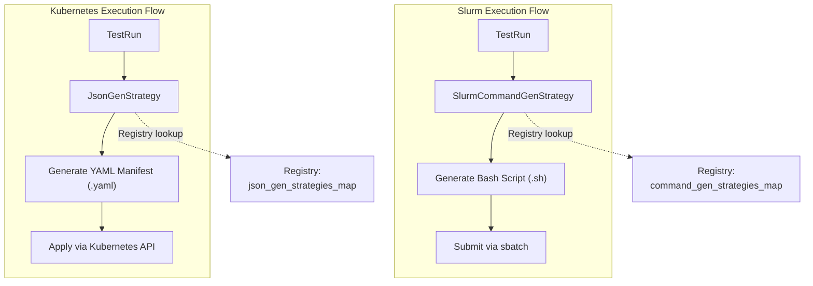
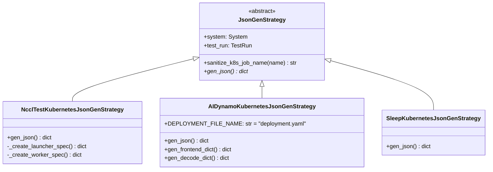

<!-- source: DeepWiki mcp.deepwiki.com · repo NVIDIA/cloudai · page 4.3 Kubernetes and JSON Generation · fetched 2026-10-26 -->

# Kubernetes and JSON Generation

<details>
<summary>Relevant source files</summary>

The following files were used as context for generating this wiki page:

- [conf/common/system/kubernetes_cluster.toml](conf/common/system/kubernetes_cluster.toml)
- [conf/experimental/ai_dynamo/test/sglang.toml](conf/experimental/ai_dynamo/test/sglang.toml)
- [conf/experimental/ai_dynamo/test/vllm.toml](conf/experimental/ai_dynamo/test/vllm.toml)
- [conf/experimental/ai_dynamo/test_scenario/sglang_slurm.toml](conf/experimental/ai_dynamo/test_scenario/sglang_slurm.toml)
- [conf/experimental/ai_dynamo/test_scenario/vllm_k8s.toml](conf/experimental/ai_dynamo/test_scenario/vllm_k8s.toml)
- [conf/experimental/ai_dynamo/test_scenario/vllm_kvbm_slurm.toml](conf/experimental/ai_dynamo/test_scenario/vllm_kvbm_slurm.toml)
- [conf/experimental/ai_dynamo/test_scenario/vllm_slurm.toml](conf/experimental/ai_dynamo/test_scenario/vllm_slurm.toml)
- [src/cloudai/_core/json_gen_strategy.py](src/cloudai/_core/json_gen_strategy.py)
- [src/cloudai/systems/kubernetes/kubernetes_runner.py](src/cloudai/systems/kubernetes/kubernetes_runner.py)
- [src/cloudai/systems/kubernetes/kubernetes_system.py](src/cloudai/systems/kubernetes/kubernetes_system.py)
- [src/cloudai/workloads/ai_dynamo/kubernetes_json_gen_strategy.py](src/cloudai/workloads/ai_dynamo/kubernetes_json_gen_strategy.py)
- [src/cloudai/workloads/nccl_test/kubernetes_json_gen_strategy.py](src/cloudai/workloads/nccl_test/kubernetes_json_gen_strategy.py)
- [src/cloudai/workloads/sleep/kubernetes_json_gen_strategy.py](src/cloudai/workloads/sleep/kubernetes_json_gen_strategy.py)
- [src/cloudai/workloads/sleep/standalone_command_gen_strategy.py](src/cloudai/workloads/sleep/standalone_command_gen_strategy.py)
- [tests/workloads/megatron_run/test_report_gen_strategy.py](tests/workloads/megatron_run/test_report_gen_strategy.py)
- [tests/workloads/nccl_test/test_json_gen_strategy_kubernetes.py](tests/workloads/nccl_test/test_json_gen_strategy_kubernetes.py)
- [tests/workloads/nccl_test/test_prediction_report_generator.py](tests/workloads/nccl_test/test_prediction_report_generator.py)

</details>


## Purpose and Scope

This page documents CloudAI's Kubernetes integration, focusing on the `JsonGenStrategy` pattern used for generating structured YAML manifests. Unlike Slurm, which uses bash command generation, Kubernetes deployments require declarative specifications for pods, services, and Custom Resource Definitions (CRDs).

Key areas covered:
- The `JsonGenStrategy` abstract base class and its role in the plugin system.
- `KubernetesSystem`, `KubernetesRunner`, and `KubernetesJob` implementations.
- Support for specialized CRDs like `MPIJob` (for NCCL tests) and `DynamoGraphDeployment` (for AI Dynamo).
- CNI networking discovery and host network fallback mechanisms.

---

## Kubernetes Execution Model

Kubernetes execution in CloudAI follows a declarative model where the framework generates a YAML manifest and submits it to the cluster via the Kubernetes Python client or `kubectl`.

### Execution Flow Comparison



**Sources:** [src/cloudai/systems/kubernetes/kubernetes_runner.py:29-43](), [src/cloudai/_core/json_gen_strategy.py:27-38]()

### Key Components

| Class | Role | Reference |
|-------|------|-----------|
| `KubernetesSystem` | Manages K8s API clients (`CoreV1`, `BatchV1`, `CustomObjects`) and CNI discovery. | [src/cloudai/systems/kubernetes/kubernetes_system.py:35-46]() |
| `KubernetesRunner` | Handles job submission, log retrieval, and cleanup. | [src/cloudai/systems/kubernetes/kubernetes_runner.py:26-63]() |
| `KubernetesJob` | Tracks the state and kind of a submitted K8s resource. | [src/cloudai/systems/kubernetes/kubernetes_job.py]() |
| `JsonGenStrategy` | Abstract base for workload-specific YAML generation. | [src/cloudai/_core/json_gen_strategy.py:27-85]() |

---

## JsonGenStrategy Pattern

The `JsonGenStrategy` defines how a `TestRun` is transformed into a Kubernetes resource specification.

### Class Hierarchy



**Sources:** [src/cloudai/_core/json_gen_strategy.py:27-85](), [src/cloudai/workloads/nccl_test/kubernetes_json_gen_strategy.py:27-38](), [src/cloudai/workloads/ai_dynamo/kubernetes_json_gen_strategy.py:27-87]()

### Sanity and Naming
Kubernetes has strict naming requirements (lowercase, alphanumeric, hyphens). The `sanitize_k8s_job_name` method ensures compliance:
- Converts to lowercase.
- Replaces non-alphanumeric characters with hyphens.
- Limits length to 253 characters.

**Sources:** [src/cloudai/_core/json_gen_strategy.py:40-64]()

---

## KubernetesSystem and Networking

The `KubernetesSystem` class initializes the Kubernetes environment by loading the `kube_config`. It also handles network discovery for multi-node workloads.

### CNI vs. Host Networking
CloudAI supports both standard host networking and CNI-based secondary networks (e.g., for high-performance RDMA).

1. **Discovery**: `resolve_cni_networks()` checks for `NetworkAttachmentDefinitions` using `kubectl get`.
2. **Logic**:
   - If `use_host_network=True`, it forces `hostNetwork: true` in pods.
   - If `use_host_network=False`, it requires CNI networks to be present.
   - If `None` (auto), it tries CNI and falls back to host networking.

**Sources:** [src/cloudai/systems/kubernetes/kubernetes_system.py:136-173]()

---

## Workload Implementations

### NCCL Tests (MPIJob)
The `NcclTestKubernetesJsonGenStrategy` generates an `MPIJob` manifest (part of the Kubeflow Training Operator). It creates a separate Launcher pod and multiple Worker pods.

- **Launcher**: Orchestrates the MPI execution.
- **Workers**: Run an SSH daemon to allow the launcher to trigger NCCL binaries.
- **Volumes**: Automatically mounts `/dev/shm` as a memory-backed `emptyDir` for efficient NCCL communication.

**Sources:** [src/cloudai/workloads/nccl_test/kubernetes_json_gen_strategy.py:38-117]()

### AI Dynamo (DynamoGraphDeployment)
The `AIDynamoKubernetesJsonGenStrategy` generates a specialized `DynamoGraphDeployment` manifest for disaggregated LLM inference.

- **Frontend**: Handles request entry.
- **Prefill/Decode Workers**: Specialized workers for different phases of LLM inference.
- **Multi-node**: If `num_nodes > 1`, a `multinode` stanza is added to the service specification.

**Sources:** [src/cloudai/workloads/ai_dynamo/kubernetes_json_gen_strategy.py:87-109, 149-152]()

### Sleep (Batch Job)
A simple implementation using the standard Kubernetes `batch/v1` Job API.

**Sources:** [src/cloudai/workloads/sleep/kubernetes_json_gen_strategy.py:28-57]()

---

## Configuration Example

A typical Kubernetes system configuration in CloudAI:

```toml
# conf/common/system/kubernetes_cluster.toml
name = "kubernetes-cluster"
scheduler = "kubernetes"
kube_config_path = ""
default_namespace = "default"
monitor_interval = 1

[global_env_vars]
NCCL_IB_GID_INDEX = "3"
NCCL_SOCKET_IFNAME = "ib0"
```

**Sources:** [conf/common/system/kubernetes_cluster.toml:17-34]()

---

## Runner Logic and Job Lifecycle

The `KubernetesRunner` manages the transition from manifest generation to cluster execution.

1. **Submission**: Calls `gen_json()`, then uses `KubernetesSystem.create_job(job_spec)`.
2. **Monitoring**: Periodically checks job status via `KubernetesSystem.is_job_running()`.
3. **Cleanup**: Upon completion or failure, it retrieves logs using `store_logs_for_job()` and deletes the K8s resources.

**Sources:** [src/cloudai/systems/kubernetes/kubernetes_runner.py:29-63](), [src/cloudai/systems/kubernetes/kubernetes_system.py:175-181]()

---

