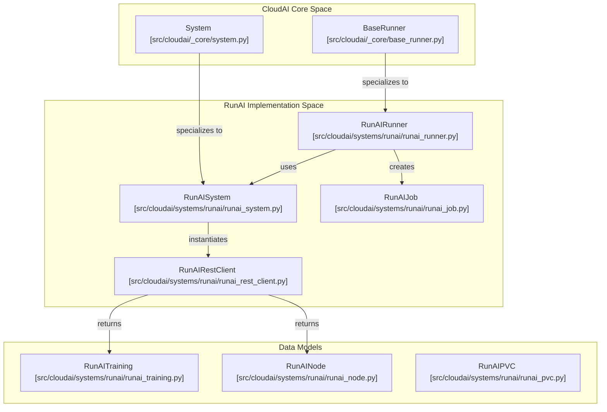
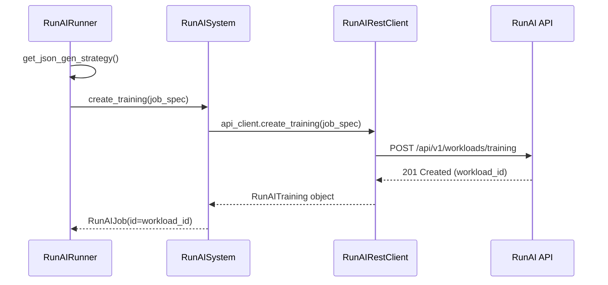

<!-- source: DeepWiki mcp.deepwiki.com · repo NVIDIA/cloudai · page 4.4 RunAI Integration · fetched 2026-10-26 -->

# RunAI Integration

Relevant source files

The following files were used as context for generating this wiki page:

- [conf/common/system/kubernetes_cluster.toml](conf/common/system/kubernetes_cluster.toml)
- [src/cloudai/_core/base_runner.py](src/cloudai/_core/base_runner.py)
- [src/cloudai/_core/runner.py](src/cloudai/_core/runner.py)
- [src/cloudai/systems/kubernetes/kubernetes_system.py](src/cloudai/systems/kubernetes/kubernetes_system.py)
- [src/cloudai/systems/runai/runai_node.py](src/cloudai/systems/runai/runai_node.py)
- [src/cloudai/systems/runai/runai_rest_client.py](src/cloudai/systems/runai/runai_rest_client.py)
- [src/cloudai/systems/runai/runai_runner.py](src/cloudai/systems/runai/runai_runner.py)
- [src/cloudai/systems/runai/runai_system.py](src/cloudai/systems/runai/runai_system.py)
- [src/cloudai/workloads/nccl_test/kubernetes_json_gen_strategy.py](src/cloudai/workloads/nccl_test/kubernetes_json_gen_strategy.py)
- [tests/test_base_runner.py](tests/test_base_runner.py)
- [tests/workloads/megatron_run/test_report_gen_strategy.py](tests/workloads/megatron_run/test_report_gen_strategy.py)
- [tests/workloads/nccl_test/test_json_gen_strategy_kubernetes.py](tests/workloads/nccl_test/test_json_gen_strategy_kubernetes.py)
- [tests/workloads/nccl_test/test_prediction_report_generator.py](tests/workloads/nccl_test/test_prediction_report_generator.py)

The RunAI integration in CloudAI allows for the execution, management, and monitoring of distributed AI workloads on the Run:ai platform. This integration leverages the Run:ai REST API for job lifecycle management and provides specialized handling for PVC assets, project-based resource allocation, and real-time log streaming via WebSockets.

## Architecture and Data Flow

The integration consists of a system model (`RunAISystem`), a runner (`RunAIRunner`), and a specialized REST client (`RunAIRestClient`). The data flow follows the standard CloudAI execution pattern but replaces Kubernetes/Slurm commands with API calls to the Run:ai control plane.

### System Components and Code Entities

The following diagram maps the logical components of the RunAI integration to their respective code entities:

**RunAI Integration Map**

Sources: [src/cloudai/systems/runai/runai_system.py:34-46](), [src/cloudai/systems/runai/runai_runner.py:26-29](), [src/cloudai/systems/runai/runai_rest_client.py:26-33]()

## RunAISystem Implementation

`RunAISystem` extends the base `System` class to provide an interface for the Run:ai platform. It manages authentication and provides methods for interacting with various Run:ai assets like Projects, PVCs, and Trainings.

### Authentication
Authentication is handled by `RunAIRestClient` using an `app_id` and `app_secret`. Upon initialization, the client calls `_get_access_token` to retrieve a Bearer token from the `/api/v1/token` endpoint [src/cloudai/systems/runai/runai_rest_client.py:77-97]().

### Key Attributes
- `base_url`: The API endpoint for the Run:ai cluster [src/cloudai/systems/runai/runai_system.py:39]().
- `project_id`: The specific Run:ai project where workloads are submitted [src/cloudai/systems/runai/runai_system.py:43]().
- `cluster_id`: The target Kubernetes cluster managed by Run:ai [src/cloudai/systems/runai/runai_system.py:44]().

### Job Status Management
The system tracks job states by mapping Run:ai's `ActualPhase` to CloudAI's internal status:
- `is_job_running`: Returns `True` if the phase is `ActualPhase.RUNNING` [src/cloudai/systems/runai/runai_system.py:65-69]().
- `is_job_completed`: Returns `True` if the phase is `ActualPhase.COMPLETED` [src/cloudai/systems/runai/runai_system.py:71-75]().

Sources: [src/cloudai/systems/runai/runai_system.py:34-75](), [src/cloudai/systems/runai/runai_rest_client.py:33-53]()

## RunAIRunner and Execution Lifecycle

`RunAIRunner` implements the execution logic for Run:ai. Unlike the `SlurmRunner`, which generates shell scripts, the `RunAIRunner` interacts with `JsonGenStrategy` to produce a JSON payload compatible with the Run:ai Training API.

### Execution Flow
1. **Job Submission**: `_submit_test` calls the `JsonGenStrategy` to get the job specification, then uses `runai_system.create_training(job_spec)` to submit the workload [src/cloudai/systems/runai/runai_runner.py:29-40]().
2. **Monitoring**: The runner uses the `monitor_interval` defined in `RunAISystem` (default 60s) to poll for status updates [src/cloudai/systems/runai/runai_system.py:38]().
3. **Completion Hooks**: Once a job finishes, `on_job_completion` is triggered. This hook retrieves workload events and streams logs to the output directory [src/cloudai/systems/runai/runai_runner.py:44-49]().

**RunAI Job Submission Sequence**

Sources: [src/cloudai/systems/runai/runai_runner.py:29-49](), [src/cloudai/systems/runai/runai_system.py:142-146]()

## Asset and Node Management

CloudAI provides detailed models for Run:ai specific entities to ensure type safety and proper validation.

### PVC Assets
`RunAISystem` can manage Persistent Volume Claim (PVC) assets. These are often required for storing datasets or model checkpoints in AI workloads.
- `get_pvc_assets()`: Fetches all entries from the Run:ai asset library [src/cloudai/systems/runai/runai_system.py:113-116]().
- `create_pvc_asset(payload)`: Programmatically creates a new PVC asset [src/cloudai/systems/runai/runai_system.py:118-121]().

### Node Metadata
The `RunAINode` model captures hardware-specific details crucial for distributed training, such as GPU types and NVLink topology.
- **GPU Info**: Extracted during model validation from the `gpuInfo` dictionary [src/cloudai/systems/runai/runai_node.py:56-64]().
- **NVLink**: Tracks `nvlink_domain_uid` and `nvlink_clique_id` to assist in scheduling communication-heavy tasks [src/cloudai/systems/runai/runai_node.py:46-47]().

### Log and Event Collection
Upon job termination or completion, CloudAI automatically collects diagnostic information:
- **Events**: `get_workload_events` fetches the audit trail of the workload (e.g., Pulling image, Scheduled, Started) and writes it to `events.txt` [src/cloudai/systems/runai/runai_system.py:128-140]().
- **Logs**: `store_logs` utilizes the REST client to download stdout/stderr from the pods and saves them to `stdout.txt` [src/cloudai/systems/runai/runai_system.py:164-168]().

Sources: [src/cloudai/systems/runai/runai_system.py:113-168](), [src/cloudai/systems/runai/runai_node.py:35-53]()

---

