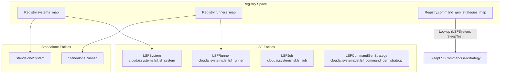
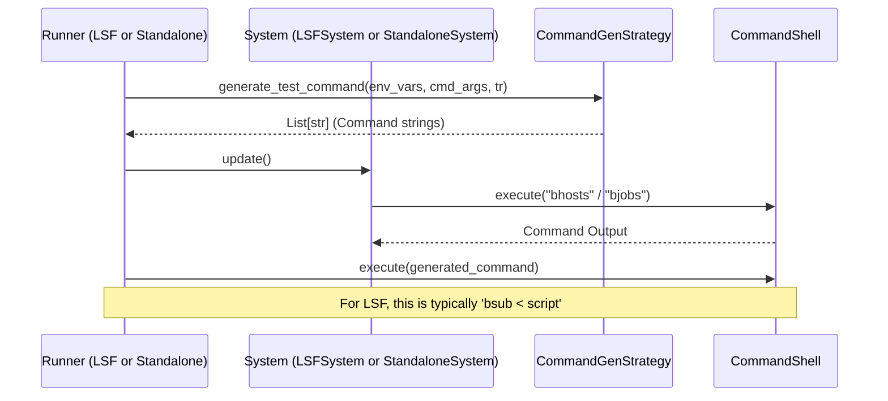

<!-- source: DeepWiki mcp.deepwiki.com · repo NVIDIA/cloudai · page 4.5 Standalone and LSF Execution · fetched 2026-10-26 -->

# Standalone and LSF Execution

<details>
<summary>Relevant source files</summary>

The following files were used as context for generating this wiki page:

- [doc/systems.rst](doc/systems.rst)
- [src/cloudai/_core/base_job.py](src/cloudai/_core/base_job.py)
- [src/cloudai/_core/grader.py](src/cloudai/_core/grader.py)
- [src/cloudai/_core/system.py](src/cloudai/_core/system.py)
- [src/cloudai/systems/__init__.py](src/cloudai/systems/__init__.py)
- [src/cloudai/systems/lsf/__init__.py](src/cloudai/systems/lsf/__init__.py)
- [src/cloudai/systems/lsf/lsf_node.py](src/cloudai/systems/lsf/lsf_node.py)
- [src/cloudai/systems/lsf/lsf_system.py](src/cloudai/systems/lsf/lsf_system.py)
- [src/cloudai/workloads/sleep/lsf_command_gen_strategy.py](src/cloudai/workloads/sleep/lsf_command_gen_strategy.py)

</details>


## Purpose and Scope

The Standalone and LSF execution systems provide distinct paths for running workloads within the CloudAI framework. 

1.  **Standalone Execution**: A scheduler-agnostic execution path for workloads that do not require cluster resource management. It runs tests directly on the local system without job scheduling infrastructure, designed for lightweight workloads, predictors (like AIConfigurator), and validation tests.
2.  **LSF Integration**: Integration with **IBM Platform LSF (Load Sharing Facility)**, allowing CloudAI to orchestrate jobs on clusters managed by the LSF workload manager. This includes support for LSF queues, host groups, and job lifecycle management using standard LSF commands like `bsub`, `bjobs`, and `bhosts`.

**Sources:** [doc/systems.rst:13-14](), [src/cloudai/systems/lsf/lsf_system.py:52-65](), [src/cloudai/workloads/sleep/lsf_command_gen_strategy.py:25-36]()

---

## Standalone and LSF Systems in CloudAI Architecture

Both systems are registered in the CloudAI Registry and follow the standard three-schema configuration system (System, Test, TestScenario).

### Component Mapping



**Bridge between Registry Space and Code Entity Space**

**Sources:** [doc/systems.rst:13-14](), [src/cloudai/systems/lsf/__init__.py:18-32](), [src/cloudai/workloads/sleep/lsf_command_gen_strategy.py:25-25]()

---

## LSF Integration Details

The LSF implementation handles cluster state discovery and job monitoring by wrapping LSF binary executables.

### LSF System Model
The `LSFSystem` class manages the state of the LSF cluster, including queues and node availability. It uses `Pydantic` for validation and `CommandShell` for executing LSF commands.

| Class | Purpose | Key Attributes |
|-------|---------|----------------|
| `LSFSystem` | Main system interface | `queues`, `account`, `project_name`, `default_queue` |
| `LSFQueue` | Represents an LSF queue | `name`, `groups`, `lsf_nodes` |
| `LSFNodeObj` | Represents a physical node | `name`, `state`, `user` |
| `LSFNodeState` | Enum of LSF node states | `OK`, `CLOSED`, `UNREACHABLE`, `BUSY`, `ERROR` |

**Sources:** [src/cloudai/systems/lsf/lsf_system.py:27-65](), [src/cloudai/systems/lsf/lsf_node.py:22-42]()

### Job Lifecycle Management
`LSFSystem` implements the abstract methods defined in the base `System` class to interact with the LSF scheduler.

*   **Update**: Queries `bhosts` and `bjobs -u all` to refresh the internal state of queues and nodes [src/cloudai/systems/lsf/lsf_system.py:71-80]().
*   **Monitoring**: `is_job_running` and `is_job_completed` execute `bjobs -noheader -o stat {job.id}` to check the status string (e.g., `RUN`, `DONE`, `EXIT`) [src/cloudai/systems/lsf/lsf_system.py:82-109]().
*   **Termination**: `kill` executes `bkill {job.id}` [src/cloudai/systems/lsf/lsf_system.py:110-117]().

### Command Generation Strategy
The `LSFCommandGenStrategy` serves as the base for generating LSF-compatible execution scripts. For example, the `SleepLSFCommandGenStrategy` extracts seconds from `SleepCmdArgs` to produce a simple `sleep` command [src/cloudai/workloads/sleep/lsf_command_gen_strategy.py:31-36]().

---

## Standalone Execution Details

The Standalone system is used for workloads that run directly on the host without a batch scheduler.

### Standalone System Configuration
The `StandaloneSystem` schema is minimal, inheriting basic paths and environment variables from the base `System` class.

```toml
scheduler = "standalone"
name = "standalone_system"
install_path = "/path/to/install"
output_path = "/path/to/output"
```

**Sources:** [doc/systems.rst:63-68](), [src/cloudai/_core/system.py:31-42]()

### Use Cases
1.  **AIConfigurator**: A performance predictor that runs locally to model AI workload performance [doc/workloads/aiconfigurator.rst:1-115]().
2.  **Sleep Workload**: Used for framework validation and dependency testing [src/cloudai/workloads/sleep/lsf_command_gen_strategy.py:22-22]().
3.  **Local Script Execution**: Running `BashCmd` or other lightweight utilities that do not require multi-node coordination.

---

## Data Flow and Command Execution

The following diagram illustrates how the `LSFRunner` or `StandaloneRunner` interacts with the system and command generation strategies.



**Data Flow for Command Execution**

**Sources:** [src/cloudai/systems/lsf/lsf_system.py:71-95](), [src/cloudai/workloads/sleep/lsf_command_gen_strategy.py:31-36](), [src/cloudai/util.py:1-50]()

---

## Comparison of Execution Modes

| Feature | Standalone | LSF Integration |
| :--- | :--- | :--- |
| **Scheduler** | None (Direct OS process) | IBM Platform LSF |
| **Resource Discovery** | Local host only | `bhosts` parsing [src/cloudai/systems/lsf/lsf_system.py:155-180]() |
| **Job Submission** | Subprocess invocation | `bsub` (via Runner) |
| **Status Check** | Process PID polling | `bjobs` polling [src/cloudai/systems/lsf/lsf_system.py:82-94]() |
| **Job Termination** | `kill -9` | `bkill` [src/cloudai/systems/lsf/lsf_system.py:110-117]() |
| **Typical Workloads** | AIConfigurator, Sleep | Distributed Training, Sleep |

**Sources:** [src/cloudai/systems/lsf/lsf_system.py:52-117](), [doc/systems.rst:1-68]()

---

## Performance Grading and Reporting

Both Standalone and LSF executions utilize the `Grader` class to evaluate performance. The `Grader` uses the `Registry` to look up the appropriate `GradingStrategy` based on the `System` type and `Test` type.

1.  The `Grader` iterates through subdirectories in the output path [src/cloudai/_core/grader.py:87-92]().
2.  It fetches the grading strategy via `Registry().get_grading_strategy(type(self.system), type(tr.test))` [src/cloudai/_core/grader.py:89-89]().
3.  A performance report is generated and saved as `performance_report.csv` [src/cloudai/_core/grader.py:111-123]().

**Sources:** [src/cloudai/_core/grader.py:27-123]()

---

