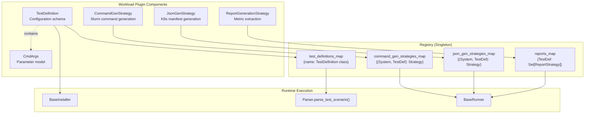
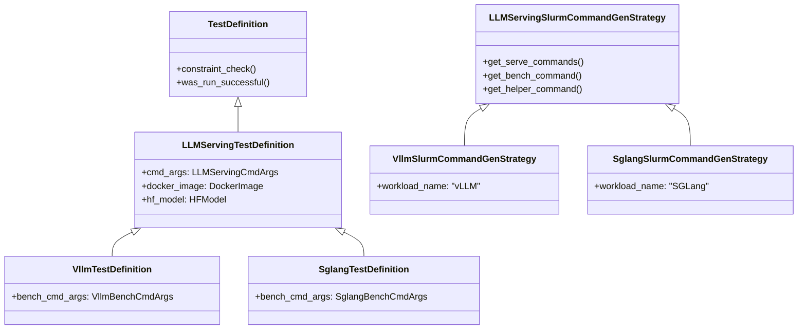

<!-- source: DeepWiki mcp.deepwiki.com · repo NVIDIA/cloudai · page 5 Workload Types · fetched 2026-10-26 -->

# Workload Types

Relevant source files

The following files were used as context for generating this wiki page:

- [src/cloudai/__init__.py](src/cloudai/__init__.py)
- [src/cloudai/_core/registry.py](src/cloudai/_core/registry.py)
- [src/cloudai/core.py](src/cloudai/core.py)
- [src/cloudai/registration.py](src/cloudai/registration.py)
- [src/cloudai/test_parser.py](src/cloudai/test_parser.py)
- [src/cloudai/workloads/common/llm_serving.py](src/cloudai/workloads/common/llm_serving.py)
- [src/cloudai/workloads/sglang/__init__.py](src/cloudai/workloads/sglang/__init__.py)
- [src/cloudai/workloads/sglang/slurm_command_gen_strategy.py](src/cloudai/workloads/sglang/slurm_command_gen_strategy.py)
- [src/cloudai/workloads/vllm/slurm_command_gen_strategy.py](src/cloudai/workloads/vllm/slurm_command_gen_strategy.py)
- [src/cloudai/workloads/vllm/vllm.py](src/cloudai/workloads/vllm/vllm.py)
- [tests/ref_data/sglang-disagg-2nodes.sbatch](tests/ref_data/sglang-disagg-2nodes.sbatch)
- [tests/ref_data/sglang-disagg.sbatch](tests/ref_data/sglang-disagg.sbatch)
- [tests/ref_data/sglang.sbatch](tests/ref_data/sglang.sbatch)
- [tests/ref_data/vllm-disagg-2nodes.sbatch](tests/ref_data/vllm-disagg-2nodes.sbatch)
- [tests/ref_data/vllm-disagg.sbatch](tests/ref_data/vllm-disagg.sbatch)
- [tests/ref_data/vllm.sbatch](tests/ref_data/vllm.sbatch)
- [tests/test_acceptance.py](tests/test_acceptance.py)
- [tests/test_init.py](tests/test_init.py)
- [tests/test_registry.py](tests/test_registry.py)
- [tests/workloads/sglang/test_command_gen_strategy_slurm.py](tests/workloads/sglang/test_command_gen_strategy_slurm.py)
- [tests/workloads/sglang/test_workload.py](tests/workloads/sglang/test_workload.py)
- [tests/workloads/test_llm_serving.py](tests/workloads/test_llm_serving.py)
- [tests/workloads/vllm/test_command_gen_strategy_slurm.py](tests/workloads/vllm/test_command_gen_strategy_slurm.py)
- [tests/workloads/vllm/test_workload.py](tests/workloads/vllm/test_workload.py)

Workloads are the core test types that CloudAI can execute. Each workload represents a specific AI training, inference, or benchmarking task that can run on HPC clusters. CloudAI currently supports over 25 distinct workload types, ranging from communication benchmarks to large-scale language model serving and training.

This page provides an overview of CloudAI's workload system. For detailed information on specific workloads, see the child pages:
- [Workload Plugin Architecture](#5.1) — How workloads are structured and registered.
- [AI Dynamo Workload](#5.2) — Distributed AI training orchestration.
- [Megatron Bridge Workload](#5.3) — Megatron-LM training workloads.
- [NeMo Run Workload](#5.4) — NeMo framework training workloads.
- [NCCL and Communication Tests](#5.5) — Communication performance benchmarks.
- [LLM Serving Workloads](#5.6) — vLLM and SGLang serving benchmarks.
- [NIXL Workloads](#5.7) — High-performance storage and network benchmarks.
- [Other Workloads](#5.8) — Additional workloads (JAX, Sleep, BashCmd, etc.).

## Workload Plugin Architecture Overview

All CloudAI workloads follow a consistent plugin architecture that enables modularity and multi-scheduler support. Each workload consists of core components that work together through the `Registry` system [src/cloudai/_core/registry.py:48-63]().

**Workload Components and Registry Integration**

Sources: [src/cloudai/_core/registry.py:48-63](), [src/cloudai/registration.py:36-179](), [src/cloudai/core.py:17-34]()

## Supported Workload Types

CloudAI supports a wide array of workloads across multiple categories. The following table shows major workloads and their scheduler support.

**Workload Catalog Overview**

| Category | Workload Name | Test Definition Class | Slurm | K8s | RunAI |
| :--- | :--- | :--- | :---: | :---: | :---: |
| **LLM Serving** | `vLLM` | `VllmTestDefinition` | ✓ | | |
| | `SGLang` | `SglangTestDefinition` | ✓ | | |
| **LLM Training** | `NeMoRun` | `NeMoRunTestDefinition` | ✓ | | |
| | `MegatronBridge` | `MegatronBridgeTestDefinition` | ✓ | | |
| | `AIDynamo` | `AIDynamoTestDefinition` | ✓ | ✓ | |
| **Communication** | `NCCLTest` | `NCCLTestDefinition` | ✓ | ✓ | ✓ |
| | `UCCTest` | `UCCTestDefinition` | ✓ | | |
| **NIXL Bench** | `NIXLBench` | `NIXLBenchTestDefinition` | ✓ | | |
| | `NIXLKVBench` | `NIXLKVBenchTestDefinition` | ✓ | | |
| **Utility** | `Sleep` | `SleepTestDefinition` | ✓ | ✓ | |

Sources: [tests/test_init.py:129-163](), [src/cloudai/registration.py:57-179]()

## LLM Serving and Disaggregation

A significant feature in recent CloudAI versions is the support for disaggregated LLM serving workloads, such as `vLLM` and `SGLang`. These workloads often involve multiple roles (e.g., `prefill` and `decode`) that may reside on different nodes or GPU sets [src/cloudai/workloads/common/llm_serving.py:116-132]().

**LLM Serving Class Hierarchy**

Sources: [src/cloudai/workloads/common/llm_serving.py:133-159](), [src/cloudai/workloads/vllm/vllm.py:83-88](), [src/cloudai/workloads/vllm/slurm_command_gen_strategy.py:29-39](), [src/cloudai/workloads/sglang/slurm_command_gen_strategy.py:30-40]()

## Adding New Workloads

To add a new workload type to CloudAI:

1.  **Create TestDefinition**: Inherit from `TestDefinition` (or a specialized base like `LLMServingTestDefinition`) and implement `constraint_check` and `was_run_successful` [src/cloudai/workloads/vllm/vllm.py:83-173]().
2.  **Define CmdArgs**: Create Pydantic models for configuration parameters [src/cloudai/workloads/vllm/vllm.py:59-81]().
3.  **Implement Strategies**: Create system-specific strategy classes (e.g., `SlurmCommandGenStrategy`) to generate execution scripts [src/cloudai/workloads/vllm/slurm_command_gen_strategy.py:29-121]().
4.  **Register Components**: Add the new classes to the `Registry` in `register_all()` [src/cloudai/registration.py:36-179]().

For detailed implementation guides, see [Workload Plugin Architecture](#5.1).

Sources: [src/cloudai/registration.py:36-179](), [src/cloudai/workloads/vllm/vllm.py:83-173](), [src/cloudai/workloads/vllm/slurm_command_gen_strategy.py:29-121]()

---

