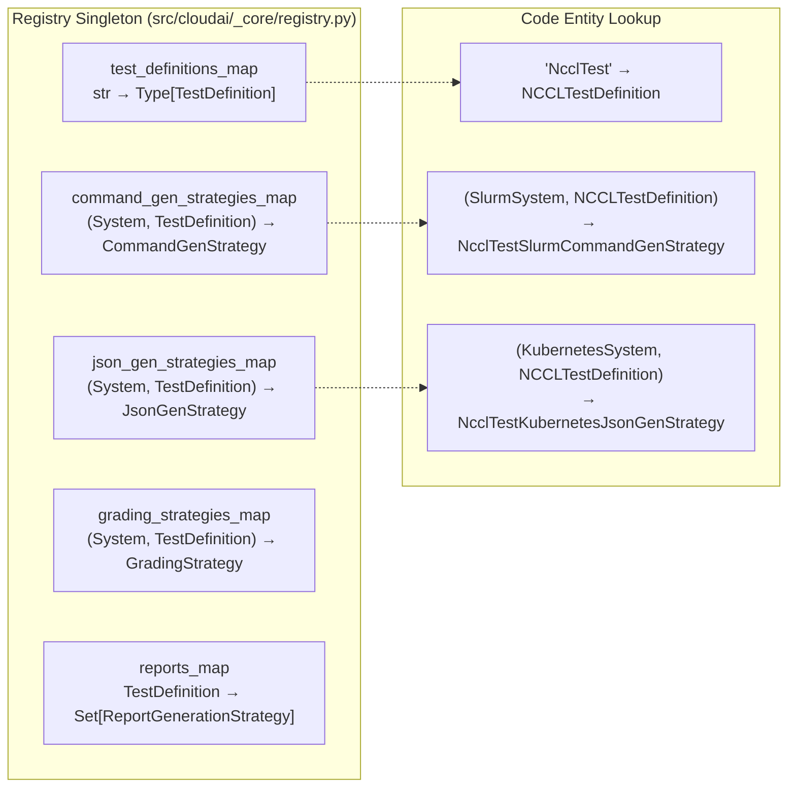
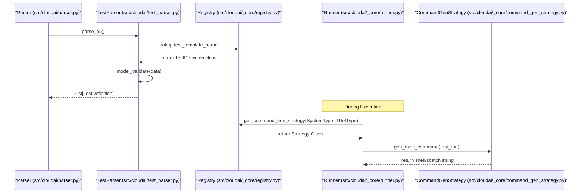

<!-- source: DeepWiki mcp.deepwiki.com · repo NVIDIA/cloudai · page 5.1 Workload Plugin Architecture · fetched 2026-10-26 -->

# Workload Plugin Architecture

<details>
<summary>Relevant source files</summary>

The following files were used as context for generating this wiki page:

- [src/cloudai/__init__.py](src/cloudai/__init__.py)
- [src/cloudai/_core/install_status_result.py](src/cloudai/_core/install_status_result.py)
- [src/cloudai/_core/registry.py](src/cloudai/_core/registry.py)
- [src/cloudai/core.py](src/cloudai/core.py)
- [src/cloudai/registration.py](src/cloudai/registration.py)
- [src/cloudai/test_parser.py](src/cloudai/test_parser.py)
- [src/cloudai/workloads/megatron_run/megatron_run.py](src/cloudai/workloads/megatron_run/megatron_run.py)
- [tests/test_acceptance.py](tests/test_acceptance.py)
- [tests/test_init.py](tests/test_init.py)
- [tests/test_registry.py](tests/test_registry.py)
- [tests/test_test_definitions.py](tests/test_test_definitions.py)
- [tests/workloads/megatron_run/test_job_status_retrieval_strategy.py](tests/workloads/megatron_run/test_job_status_retrieval_strategy.py)

</details>


## Purpose and Scope

This document describes the plugin architecture used to integrate AI workloads into CloudAI. A workload plugin defines how to configure, execute, and report on a specific AI benchmark or application (e.g., NCCL tests, Megatron training, JAX Toolbox). The architecture enables extensibility without modifying core framework code.

The system relies on a central `Registry` [src/cloudai/_core/registry.py:48-63]() that maps workload definitions to system-specific execution and reporting strategies.

**Sources:** [src/cloudai/__init__.py:17-38](), [src/cloudai/core.py:17-100](), [src/cloudai/_core/registry.py:48-63]()

---

## Core Plugin Components

Every workload plugin consists of up to five components that work together to define the workload's behavior across different execution environments.

### Component Overview

| Component | Purpose | Required | Base Class |
|-----------|---------|----------|------------|
| `TestDefinition` | Configuration schema and behavior | Yes | `TestDefinition` [src/cloudai/models/workload.py:82-176]() |
| `CmdArgs` | Parameter model with validation | Yes | `CmdArgs` [src/cloudai/models/workload.py:37-81]() |
| `CommandGenStrategy` | Slurm/Shell command generation | No* | `CommandGenStrategy` [src/cloudai/_core/command_gen_strategy.py]() |
| `JsonGenStrategy` | Kubernetes manifest generation | No* | `JsonGenStrategy` [src/cloudai/_core/json_gen_strategy.py]() |
| `ReportGenerationStrategy` | Metric extraction from outputs | No | `ReportGenerationStrategy` [src/cloudai/_core/report_generation_strategy.py]() |

\* At least one execution strategy (Command or Json) is required per supported scheduler.

**Sources:** [src/cloudai/core.py:52-100](), [src/cloudai/_core/registry.py:51-62](), [tests/test_init.py:129-180]()

### TestDefinition: Configuration Schema

The `TestDefinition` class defines the workload's configuration schema and runtime behavior. It serves as the primary entity in the "Code Entity Space" that represents a workload.

```mermaid
graph TB
    Base["TestDefinition<br/>(src/cloudai/models/workload.py)"]
    
    subgraph "Required Fields"
        Name["name: str"]
        Desc["description: str"]
        Template["test_template_name: str"]
        Args["cmd_args: CmdArgs"]
    end
    
    subgraph "Installables & Environment"
        ExtraEnv["extra_env_vars: dict"]
        ExtraCmd["extra_cmd_args: dict"]
        Mounts["extra_container_mounts: list"]
        Git["git_repos: list[GitRepo]"]
        Nsys["nsys: NsysConfiguration"]
    end
    
    subgraph "DSE (Design Space Exploration)"
        Agent["agent: str = 'grid_search'"]
        Steps["agent_steps: int = 1"]
        Metrics["agent_metrics: list[str]"]
        Reward["agent_reward_function: str"]
    end
    
    subgraph "Concrete Implementations"
        NCCL["NCCLTestDefinition"]
        Megatron["MegatronRunTestDefinition"]
        AIDynamo["AIDynamoTestDefinition"]
        NeMo["NeMoRunTestDefinition"]
    end
    
    Base --> Name
    Base --> Desc
    Base --> Template
    Base --> Args
    Base --> ExtraEnv
    Base --> ExtraCmd
    Base --> Mounts
    Base --> Git
    Base --> Nsys
    Base --> Agent
    Base --> Steps
    Base --> Metrics
    Base --> Reward
    
    Base -.-> NCCL
    Base -.-> Megatron
    Base -.-> AIDynamo
    Base -.-> NeMo
```



**Key Methods:**
- `installables`: Returns a list of `Installable` objects (e.g., `DockerImage`, `GitRepo`) [src/cloudai/models/workload.py:99-101]().
- `was_run_successful(tr: TestRun)`: Checks job completion status and parses output for success indicators [src/cloudai/workloads/megatron_run/megatron_run.py:137-175]().

**Sources:** [src/cloudai/models/workload.py:82-176](), [src/cloudai/workloads/megatron_run/megatron_run.py:82-175]()

### CmdArgs: Parameter Model

Each workload defines a `CmdArgs` subclass using Pydantic for validation.

```python
# Example from MegatronRun
class MegatronRunCmdArgs(CmdArgs):
    docker_image_url: str = Field()
    run_script: Path = Field()
    global_batch_size: Optional[int] = 16
    tensor_model_parallel_size: Optional[int] = 2
    # ... additional fields
```

**Sources:** [src/cloudai/workloads/megatron_run/megatron_run.py:37-81]()

---

## Registry-Based Plugin Discovery

The `Registry` is a Singleton that maintains the mapping between `System` types, `TestDefinition` types, and their corresponding strategies.

### Registry Mappings



**Sources:** [src/cloudai/_core/registry.py:48-63](), [tests/test_init.py:129-163]()

### Registration Process

Registration is triggered automatically when the `cloudai` package is imported via `register_all()` [src/cloudai/__init__.py:36-38]().

1. `cloudai.__init__.py` calls `register_all()` [src/cloudai/__init__.py:38]().
2. `register_all()` in `src/cloudai/registration.py` imports concrete classes and adds them to the `Registry` [src/cloudai/registration.py:36-180]().
3. External agents can be registered via entry points [src/cloudai/registration.py:21-34]().

**Sources:** [src/cloudai/__init__.py:36-38](), [src/cloudai/registration.py:21-180]()

---

## Workload Execution Flow

The system uses a strategy dispatch mechanism to generate commands based on the active system and workload type.

### Strategy Dispatch Diagram

This diagram bridges the natural language concept of "Running a Test" to the specific code entities involved.



**Sources:** [src/cloudai/test_parser.py:69-86](), [src/cloudai/_core/registry.py:266-271](), [src/cloudai/_core/runner.py]()

---

## Installables and Dependencies

Workloads declare their requirements via the `installables` property [src/cloudai/models/workload.py:123-124]().

### Installable Types [src/cloudai/_core/installables.py:35]()
- `DockerImage`: Container images for Slurm (Enroot) or Kubernetes.
- `GitRepo`: Source code repositories.
- `PythonExecutable`: Virtual environments with requirements.
- `HFModel`: Hugging Face model weights.
- `File`: Arbitrary scripts or configuration files.

**Sources:** [src/cloudai/_core/installables.py:35](), [src/cloudai/models/workload.py:123-124](), [src/cloudai/workloads/megatron_run/megatron_run.py:99-100]()

---

## Success and Status Checking

Workloads must implement `was_run_successful` to determine if a job completed correctly beyond just the scheduler's exit code.

**Example Implementation (MegatronRun):**
1. Checks for `slurm-job.toml` metadata [src/cloudai/workloads/megatron_run/megatron_run.py:138-143]().
2. Validates Slurm state is `COMPLETED` and exit code is `0:0` [src/cloudai/workloads/megatron_run/megatron_run.py:148-155]().
3. Parses `stdout.txt` for specific iteration metrics using `ITERATION_LOG_REGEX` [src/cloudai/workloads/megatron_run/megatron_run.py:164-175]().

**Sources:** [src/cloudai/workloads/megatron_run/megatron_run.py:137-175](), [src/cloudai/_core/job_status_result.py]()

---

## Adding a New Workload

To add a new workload, a developer must:

1. **Define Schema**: Create a new `TestDefinition` and `CmdArgs` in `src/cloudai/workloads/{name}/`.
2. **Implement Strategies**: 
   - Create a `CommandGenStrategy` for Slurm/Standalone.
   - Create a `ReportGenerationStrategy` for metric extraction.
3. **Register**: Add the new classes to `register_all()` in `src/cloudai/registration.py`.

**Sources:** [src/cloudai/registration.py:36-180](), [src/cloudai/test_parser.py:69-86]()

---

