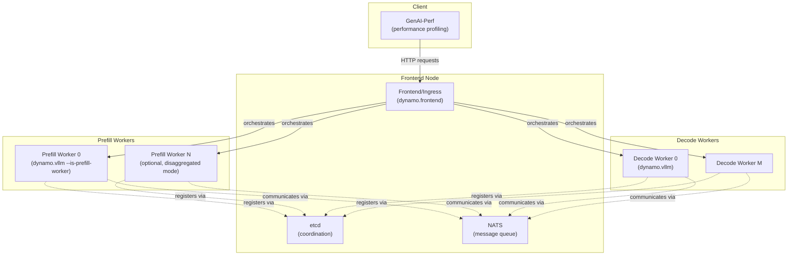
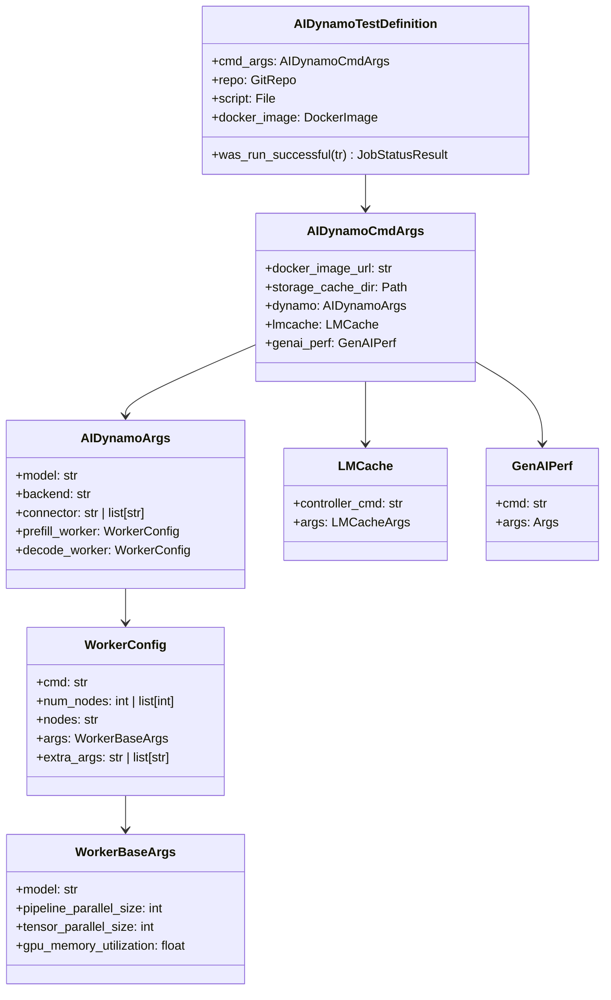

<!-- source: DeepWiki mcp.deepwiki.com · repo NVIDIA/cloudai · page 5.2 AI Dynamo Workload · fetched 2026-10-26 -->

# AI Dynamo Workload

<details>
<summary>Relevant source files</summary>

The following files were used as context for generating this wiki page:

- [conf/experimental/ai_dynamo/test/sglang.toml](conf/experimental/ai_dynamo/test/sglang.toml)
- [conf/experimental/ai_dynamo/test/vllm.toml](conf/experimental/ai_dynamo/test/vllm.toml)
- [conf/experimental/ai_dynamo/test_scenario/sglang_slurm.toml](conf/experimental/ai_dynamo/test_scenario/sglang_slurm.toml)
- [conf/experimental/ai_dynamo/test_scenario/vllm_k8s.toml](conf/experimental/ai_dynamo/test_scenario/vllm_k8s.toml)
- [conf/experimental/ai_dynamo/test_scenario/vllm_kvbm_slurm.toml](conf/experimental/ai_dynamo/test_scenario/vllm_kvbm_slurm.toml)
- [conf/experimental/ai_dynamo/test_scenario/vllm_slurm.toml](conf/experimental/ai_dynamo/test_scenario/vllm_slurm.toml)
- [doc/workloads/jax_toolbox.rst](doc/workloads/jax_toolbox.rst)
- [src/cloudai/workloads/ai_dynamo/__init__.py](src/cloudai/workloads/ai_dynamo/__init__.py)
- [src/cloudai/workloads/ai_dynamo/ai_dynamo.py](src/cloudai/workloads/ai_dynamo/ai_dynamo.py)
- [src/cloudai/workloads/ai_dynamo/ai_dynamo.sh](src/cloudai/workloads/ai_dynamo/ai_dynamo.sh)
- [src/cloudai/workloads/ai_dynamo/kubernetes_json_gen_strategy.py](src/cloudai/workloads/ai_dynamo/kubernetes_json_gen_strategy.py)
- [src/cloudai/workloads/ai_dynamo/report_generation_strategy.py](src/cloudai/workloads/ai_dynamo/report_generation_strategy.py)
- [src/cloudai/workloads/ai_dynamo/slurm_command_gen_strategy.py](src/cloudai/workloads/ai_dynamo/slurm_command_gen_strategy.py)
- [tests/ref_data/ai-dynamo.sbatch](tests/ref_data/ai-dynamo.sbatch)

</details>


## Purpose and Scope

This document describes the AI Dynamo workload implementation in CloudAI, which supports disaggregated inference benchmarking for large language models. AI Dynamo enables separation of prefill (prompt processing) and decode (token generation) operations across different worker nodes, allowing for optimized resource utilization and performance evaluation of distributed inference systems. It integrates with vLLM and SGLang backends, supports LMCache and NIXL connectors, and uses GenAI-Perf for metric collection.

**Sources:** [src/cloudai/workloads/ai_dynamo/ai_dynamo.py:1-42](), [src/cloudai/workloads/ai_dynamo/slurm_command_gen_strategy.py:29-30]()

---

## System Architecture

AI Dynamo orchestrates a distributed inference system with multiple component types coordinated through `etcd` and `NATS`. The system supports two backends (`vllm`, `sglang`, and `sglang_dsr1`) and two deployment modes (aggregated and disaggregated).

### Component Architecture



**Architecture Description:**

The frontend node runs three core services: the ingress HTTP server, `etcd` for service discovery (default port 2379), and `NATS` for inter-worker messaging (default port 4222). Prefill workers handle prompt processing and are optional—when absent, the system runs in aggregated mode. Decode workers handle token generation and are always present. GenAI-Perf acts as the benchmarking client, sending inference requests and collecting performance metrics.

**Sources:** [src/cloudai/workloads/ai_dynamo/ai_dynamo.py:181-200](), [src/cloudai/workloads/ai_dynamo/ai_dynamo.sh:42-53](), [src/cloudai/workloads/ai_dynamo/ai_dynamo.sh:606-730]()

---

## Test Definition and Configuration Model

### Class Hierarchy



**Model Description:**

`AIDynamoTestDefinition` represents the top-level AI Dynamo test. It uses `AIDynamoCmdArgs` to structure configuration for the Dynamo orchestration, LMCache KV caching, and GenAI-Perf metrics. `WorkerConfig` handles the deployment topology for prefill and decode nodes, supporting both single-node and multi-node distributions.

**Sources:** [src/cloudai/workloads/ai_dynamo/ai_dynamo.py:44-245](), [src/cloudai/workloads/ai_dynamo/slurm_command_gen_strategy.py:32-41]()

---

## Aggregated vs Disaggregated Modes

AI Dynamo supports two operational modes determined by the presence of `prefill_worker` configuration:

| Mode | Configuration | Worker Distribution | Use Case |
|------|--------------|-------------------|----------|
| **Aggregated** | `prefill_worker` is None | Single node type performs both prefill and decode | Simpler deployment, lower latency |
| **Disaggregated** | `prefill_worker` defined | Separate nodes for prefill and decode | Resource optimization, specialized hardware |

### Mode Detection and Validation

In `AIDynamoSlurmCommandGenStrategy`, the strategy validates that the total nodes requested matches the sum of prefill and decode nodes in disaggregated mode. It also ensures there is no overlap between the two sets of nodes to maintain isolation.

**Sources:** [src/cloudai/workloads/ai_dynamo/slurm_command_gen_strategy.py:145-166](), [src/cloudai/workloads/ai_dynamo/slurm_command_gen_strategy.py:190-243]()

---

## Slurm Deployment Strategy

### AIDynamoSlurmCommandGenStrategy

The `AIDynamoSlurmCommandGenStrategy` generates `srun` commands for Slurm systems. It handles container mounts, script argument serialization, and node specification caching.

#### Container Mount Configuration

The strategy mounts the Hugging Face home directory and an optional storage cache directory.

```python
def _container_mounts(self) -> list[str]:
    td = cast(AIDynamoTestDefinition, self.test_run.test)
    result = [f"{self.system.hf_home_path.absolute()}:{self.CONTAINER_MOUNT_HF_HOME}"]
    if td.cmd_args.storage_cache_dir:
        result.append(f"{td.cmd_args.storage_cache_dir}:{td.cmd_args.storage_cache_dir}")
    return result
```

**Sources:** [src/cloudai/workloads/ai_dynamo/slurm_command_gen_strategy.py:32-41]()

#### Argument Serialization

The strategy uses recursive serialization to convert Pydantic models into CLI arguments, applying prefixes like `--dynamo-`, `--prefill-`, and `--decode-`. It handles special types like `GitRepo` and `File` by resolving their container-relative paths.

**Sources:** [src/cloudai/workloads/ai_dynamo/slurm_command_gen_strategy.py:49-121]()

---

## Kubernetes Deployment Strategy

### AIDynamoKubernetesJsonGenStrategy

The Kubernetes strategy generates a `DynamoGraphDeployment` manifest, which is a custom resource used by the Dynamo operator to orchestrate the services.

#### Deployment Structure

The strategy generates three primary services within the `spec.services` block of the manifest:
1.  **frontend**: Runs the `dynamo.frontend` component.
2.  **decode**: Runs the `dynamo.vllm` (or SGLang) worker.
3.  **prefill**: (Optional) Runs the worker with the `--is-prefill-worker` flag.

**Sources:** [src/cloudai/workloads/ai_dynamo/kubernetes_json_gen_strategy.py:32-110]()

#### Network and Resource Configuration

The strategy automatically detects CNI networks from the `KubernetesSystem` and configures pod annotations and resource requests/limits for multi-NIC support. If no CNI networks are found, it defaults to `hostNetwork: true`.

**Sources:** [src/cloudai/workloads/ai_dynamo/kubernetes_json_gen_strategy.py:112-133]()

---

## The ai_dynamo.sh Orchestration Script

The `ai_dynamo.sh` script is the runtime entrypoint that executes inside the container. It manages the lifecycle of `etcd`, `NATS`, the Dynamo frontend, and the workers.

### Runtime Flow

1.  **Argument Parsing**: Parses prefixed arguments into associative arrays (`dynamo_args`, `prefill_args`, `decode_args`, `lmcache_args`, `genai_perf_args`).
2.  **Node Role Detection**: Identifies if the current node is a frontend, prefill, or decode node based on hostname.
3.  **Service Launch**:
    *   **Frontend**: Launches `etcd`, `NATS`, and the `dynamo.frontend`.
    *   **Workers**: Launches `vllm` or `sglang` processes, mapping `CUDA_VISIBLE_DEVICES` to specific workers.
4.  **Benchmarking**: The frontend node waits for all workers to initialize (using `worker-initialized-regex`) and then runs `genai-perf`.
5.  **Synchronization**: Uses success/failure markers to coordinate completion across nodes.

**Sources:** [src/cloudai/workloads/ai_dynamo/ai_dynamo.sh:140-183](), [src/cloudai/workloads/ai_dynamo/ai_dynamo.sh:449-466](), [src/cloudai/workloads/ai_dynamo/ai_dynamo.sh:606-785]()

### Retry Mechanism

The orchestration supports a retry mechanism for transient failures. If a fatal error is detected in worker logs (matching `worker-error-pattern`), a failure marker is created, and the Slurm runner can trigger a retry.

**Sources:** [src/cloudai/workloads/ai_dynamo/ai_dynamo.sh:53](), [src/cloudai/workloads/ai_dynamo/ai_dynamo.sh:374-394]()

---

## Report Generation

### AIDynamoReportGenerationStrategy

The `AIDynamoReportGenerationStrategy` extracts performance metrics from the `genai_perf_report.csv` file generated by GenAI-Perf.

#### Metric Extraction

It supports extracting metrics by name (e.g., `Time To First Token`) and type (e.g., `avg`, `p99`).

```python
def extract_metric_from_csv(self, csv_file: Path, metric_name: str, metric_type: str) -> float:
    df = lazy.pd.read_csv(csv_file)
    # ... validation ...
    series = df.loc[df["Metric"] == metric_name, metric_type]
    return float(series.iloc[0])
```

**Sources:** [src/cloudai/workloads/ai_dynamo/report_generation_strategy.py:26-64]()

---

## Configuration Examples

### vLLM on Slurm (Disaggregated)

```toml
[cmd_args.dynamo]
backend = "vllm"
model = "Qwen/Qwen3-0.6B"

  [cmd_args.dynamo.prefill_worker]
  num-nodes = 1
  cmd = 'python3 -m dynamo.vllm --is-prefill-worker'
  
    [cmd_args.dynamo.prefill_worker.args]
    tensor-parallel-size = 8

  [cmd_args.dynamo.decode_worker]
  num-nodes = 1
  cmd = 'python3 -m dynamo.vllm'
  
    [cmd_args.dynamo.decode_worker.args]
    tensor-parallel-size = 8
```

**Sources:** [conf/experimental/ai_dynamo/test/vllm.toml:26-53]()

### LMCache and NIXL Connector

AI Dynamo supports LMCache for KV caching, often used with NIXL for high-performance data transfer.

```toml
[cmd_args.lmcache]
controller_cmd = "lmcache_controller --host localhost --port 9000"

  [cmd_args.lmcache.args]
  chunk_size = 256
  nixl_buffer_size = 10737418240
  extra_config_enable_nixl_storage = true
  extra_config_nixl_backend = "GDS_MT"
```

**Sources:** [conf/experimental/ai_dynamo/test/vllm.toml:54-71]()

---

