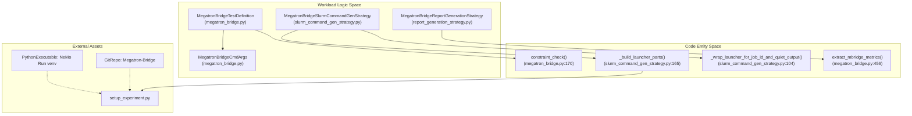
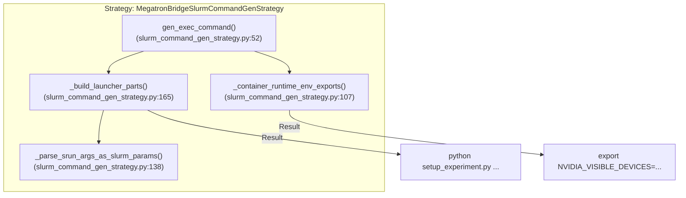

<!-- source: DeepWiki mcp.deepwiki.com · repo NVIDIA/cloudai · page 5.3 Megatron Bridge Workload · fetched 2026-10-26 -->

# Megatron Bridge Workload

<details>
<summary>Relevant source files</summary>

The following files were used as context for generating this wiki page:

- [conf/experimental/megatron_bridge/test/b200/megatron_bridge_qwen_30b.toml](conf/experimental/megatron_bridge/test/b200/megatron_bridge_qwen_30b.toml)
- [conf/experimental/megatron_bridge/test/gb200/megatron_bridge_qwen_30b.toml](conf/experimental/megatron_bridge/test/gb200/megatron_bridge_qwen_30b.toml)
- [conf/experimental/megatron_bridge/test/gb300/megatron_bridge_qwen_30b.toml](conf/experimental/megatron_bridge/test/gb300/megatron_bridge_qwen_30b.toml)
- [conf/experimental/megatron_bridge/test/h100/megatron_bridge_qwen_30b.toml](conf/experimental/megatron_bridge/test/h100/megatron_bridge_qwen_30b.toml)
- [conf/experimental/megatron_bridge/test_scenario/megatron_bridge_r0.3.0_qwen_30b.toml](conf/experimental/megatron_bridge/test_scenario/megatron_bridge_r0.3.0_qwen_30b.toml)
- [doc/workloads/megatron_bridge.rst](doc/workloads/megatron_bridge.rst)
- [src/cloudai/workloads/megatron_bridge/__init__.py](src/cloudai/workloads/megatron_bridge/__init__.py)
- [src/cloudai/workloads/megatron_bridge/megatron_bridge.py](src/cloudai/workloads/megatron_bridge/megatron_bridge.py)
- [src/cloudai/workloads/megatron_bridge/report_generation_strategy.py](src/cloudai/workloads/megatron_bridge/report_generation_strategy.py)
- [src/cloudai/workloads/megatron_bridge/slurm_command_gen_strategy.py](src/cloudai/workloads/megatron_bridge/slurm_command_gen_strategy.py)
- [tests/ref_data/megatron-bridge.sbatch](tests/ref_data/megatron-bridge.sbatch)
- [tests/workloads/megatron_bridge/test_command_gen_strategy_slurm.py](tests/workloads/megatron_bridge/test_command_gen_strategy_slurm.py)
- [tests/workloads/megatron_bridge/test_report_gen_strategy.py](tests/workloads/megatron_bridge/test_report_gen_strategy.py)

</details>


## Purpose and Scope

The Megatron Bridge workload provides integration with NVIDIA's [Megatron-Bridge](https://github.com/NVIDIA-NeMo/Megatron-Bridge) repository for executing large language model (LLM) training and evaluation jobs. This workload uses a **launcher-based execution model** where CloudAI executes a launcher script on the submit node, which in turn submits the actual training job to Slurm.

**Key characteristics:**
- **Slurm-only support**: Specifically designed for `SlurmSystem` and `SlurmRunner` [src/cloudai/workloads/megatron_bridge/slurm_command_gen_strategy.py:33-38]().
- **Extensive Constraint Checking**: Implements over 17 validation checks for parallelism hierarchies (TP/PP/CP/DP/VP/EP), FSDP compatibility, and CUDA graph scopes [src/cloudai/workloads/megatron_bridge/megatron_bridge.py:170-453]().
- **Automated Dependency Management**: Manages the Megatron-Bridge repository, a dedicated Python virtual environment, and Docker images [src/cloudai/workloads/megatron_bridge/megatron_bridge.py:105-169]().
- **Performance Reporting**: Extracts step time and TFLOP/s per GPU metrics from launcher logs [src/cloudai/workloads/megatron_bridge/report_generation_strategy.py:26-30]().

---

## Architecture Overview

The Megatron Bridge workload follows the standard CloudAI plugin architecture, consisting of a test definition, command generation strategy, and report generation strategy.

### Component Interaction Diagram

This diagram bridges the natural language concepts to the specific code entities implementing them.


**Sources:** [src/cloudai/workloads/megatron_bridge/megatron_bridge.py:28-453](), [src/cloudai/workloads/megatron_bridge/slurm_command_gen_strategy.py:33-163](), [src/cloudai/workloads/megatron_bridge/report_generation_strategy.py:26-51]()

---

## Test Definition and Constraints

### MegatronBridgeCmdArgs

The `MegatronBridgeCmdArgs` class defines the schema for all parameters passed to the Megatron-Bridge launcher. It includes support for model families (e.g., Qwen), parallelism levels, and performance features like CUDA graphs and FSDP [src/cloudai/workloads/megatron_bridge/megatron_bridge.py:28-150]().

**Key Validation Logic:**
- **HuggingFace Token**: A non-empty `hf_token` is mandatory, either via TOML or the `HF_TOKEN` environment variable [src/cloudai/workloads/megatron_bridge/megatron_bridge.py:151-161]().
- **Model Identity**: `model_family_name` and `model_recipe_name` must be non-empty strings [src/cloudai/workloads/megatron_bridge/megatron_bridge.py:48-49]().

### 17+ Constraint Checks

The `constraint_check` method validates the complex interplay between parallelism and hardware features [src/cloudai/workloads/megatron_bridge/megatron_bridge.py:170-175]().

| Category | Key Constraint Examples | Source |
| :--- | :--- | :--- |
| **Parallelism** | `num_gpus % (tp * pp * cp) == 0` | [megatron_bridge.py:202]() |
| **FSDP** | FSDP is incompatible with PP > 1, CP > 1, or CUDA Graphs. | [megatron_bridge.py:245-261]() |
| **CUDA Graphs** | Implementation `local` requires scope `full_iteration`. | [megatron_bridge.py:364-375]() |
| **MoE** | `num_gpus % (et * ep * pp) == 0`. | [megatron_bridge.py:263-268]() |
| **Offloading** | CPU offloading is incompatible with PP > 1 or CUDA Graphs. | [megatron_bridge.py:309-323]() |

---

## Command Generation Strategy

The `MegatronBridgeSlurmCommandGenStrategy` generates a wrapper shell script that executes the Megatron-Bridge launcher.

### Execution Wrapper Logic

CloudAI does not call `sbatch` directly for the training job. Instead, it runs a wrapper script on the login node that:
1. Sets up the environment (e.g., `NEMORUN_HOME`) [tests/ref_data/megatron-bridge.sbatch:4]().
2. Installs runtime dependencies like `wandb` and `numpy` into the launcher venv [tests/ref_data/megatron-bridge.sbatch:14]().
3. Executes `setup_experiment.py` [src/cloudai/workloads/megatron_bridge/slurm_command_gen_strategy.py:74-78]().
4. Parses the resulting Slurm Job ID from the launcher output to allow CloudAI to track the remote job [src/cloudai/workloads/megatron_bridge/slurm_command_gen_strategy.py:145-156]().

### Command Generation Flow


**Sources:** [src/cloudai/workloads/megatron_bridge/slurm_command_gen_strategy.py:52-163]()

---

## Performance Metrics and Reporting

The `MegatronBridgeReportGenerationStrategy` processes the launcher log file (`cloudai_megatron_bridge_launcher.log`) to generate performance summaries [src/cloudai/workloads/megatron_bridge/report_generation_strategy.py:31-33]().

### Extracted Metrics
The strategy uses the `extract_mbridge_metrics` function to parse the log for:
- **Step Time (s)**: The duration of training iterations.
- **TFLOP/s per GPU**: The compute throughput achieved.

**Data Extraction Flow:**
1. `get_log_file()` locates the launcher log [src/cloudai/workloads/megatron_bridge/report_generation_strategy.py:31-33]().
2. `extract_mbridge_metrics()` applies regex to find `Step Time` and `GPU utilization` lines [src/cloudai/workloads/megatron_bridge/megatron_bridge.py:456-474]().
3. `generate_report()` calculates mean, median, min, max, and standard deviation for the extracted values [src/cloudai/workloads/megatron_bridge/report_generation_strategy.py:70-86]().
4. Results are written to `report.txt` in the test output directory [src/cloudai/workloads/megatron_bridge/report_generation_strategy.py:88-102]().

**Sources:** [src/cloudai/workloads/megatron_bridge/report_generation_strategy.py:26-121](), [src/cloudai/workloads/megatron_bridge/megatron_bridge.py:456-474]()

---

## Configuration Examples

### Test TOML (Qwen 30B on GB200)
This configuration specifies the Megatron-Bridge repository version and the model recipe.

```toml
name = "megatron_bridge_qwen_30b"
test_template_name = "MegatronBridge"

[[git_repos]]
url = "https://github.com/NVIDIA-NeMo/Megatron-Bridge.git"
commit = "v0.3.0"

[cmd_args]
gpu_type = "gb200"
container_image = "nvcr.io#nvidia/nemo:26.02.00"
model_family_name = "qwen"
model_recipe_name = "qwen3_30b_a3b"
num_gpus = 8
domain = "llm"
task = "pretrain"
compute_dtype = "fp8_mx"
hf_token = ""
enable_vboost = true
```
**Sources:** [conf/experimental/megatron_bridge/test/gb200/megatron_bridge_qwen_30b.toml:17-38]()

---

