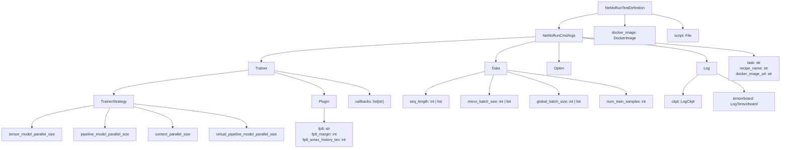
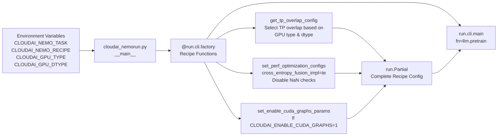
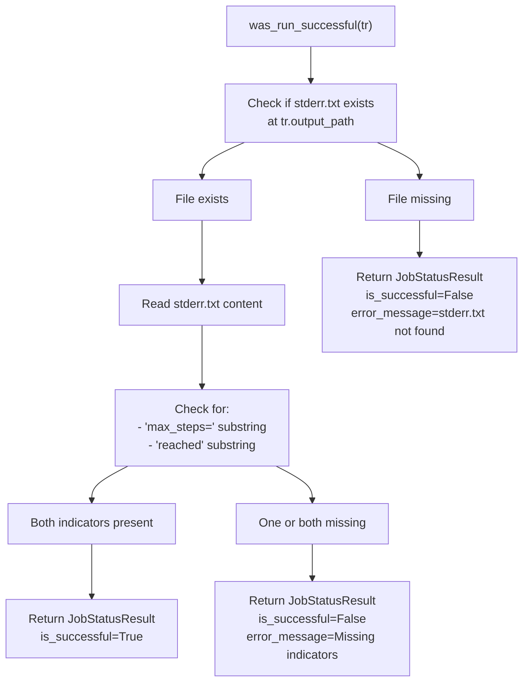

<!-- source: DeepWiki mcp.deepwiki.com · repo NVIDIA/cloudai · page 5.4 NeMo Run Workload · fetched 2026-10-26 -->

# NeMo Run Workload

Relevant source files

The following files were used as context for generating this wiki page:

- [conf/common/test/dse_nccl_all_gather.toml](conf/common/test/dse_nccl_all_gather.toml)
- [conf/common/test/nccl_test.toml](conf/common/test/nccl_test.toml)
- [conf/common/test/nccl_test_all_gather.toml](conf/common/test/nccl_test_all_gather.toml)
- [conf/common/test/nemo_run_llama3_8b.toml](conf/common/test/nemo_run_llama3_8b.toml)
- [conf/common/test/ucc_test.toml](conf/common/test/ucc_test.toml)
- [conf/common/test_scenario/dse_nccl_all_gather.toml](conf/common/test_scenario/dse_nccl_all_gather.toml)
- [conf/common/test_scenario/dse_nemo_run_llama3_8b.toml](conf/common/test_scenario/dse_nemo_run_llama3_8b.toml)
- [conf/common/test_scenario/nccl_test.toml](conf/common/test_scenario/nccl_test.toml)
- [conf/common/test_scenario/nemo_run_llama3_8b.toml](conf/common/test_scenario/nemo_run_llama3_8b.toml)
- [conf/common/test_scenario/slurm_container.toml](conf/common/test_scenario/slurm_container.toml)
- [src/cloudai/workloads/nemo_run/cloudai_nemorun.py](src/cloudai/workloads/nemo_run/cloudai_nemorun.py)
- [src/cloudai/workloads/nemo_run/nemo_run.py](src/cloudai/workloads/nemo_run/nemo_run.py)
- [src/cloudai/workloads/nemo_run/slurm_command_gen_strategy.py](src/cloudai/workloads/nemo_run/slurm_command_gen_strategy.py)
- [tests/ref_data/nemo-run-no-hook.sbatch](tests/ref_data/nemo-run-no-hook.sbatch)
- [tests/ref_data/nemo-run-pre-test.sbatch](tests/ref_data/nemo-run-pre-test.sbatch)
- [tests/ref_data/nemo-run-vboost.sbatch](tests/ref_data/nemo-run-vboost.sbatch)

## Purpose and Scope

The NeMo Run workload enables large language model (LLM) pretraining using NVIDIA's NeMo 2.0 framework. This workload abstracts the complexity of distributed training configuration through a recipe-based system, allowing users to execute production-grade training runs with minimal configuration. It supports multiple model architectures (Llama, Nemotron, Qwen) and automatically optimizes parallelism strategies, communication overlap, and precision settings based on environment variables.

The implementation relies on the `cloudai_nemorun.py` launcher script and a specialized Slurm command generation strategy to translate high-level test definitions into optimized `srun` commands.

## Configuration Model

NeMo Run uses a hierarchical Pydantic model structure to define test configurations. The root model `NeMoRunTestDefinition` contains `NeMoRunCmdArgs`, which encapsulates trainer, data, optimizer, and logging configurations.

### Configuration Hierarchy

Sources: [src/cloudai/workloads/nemo_run/nemo_run.py:27-127]()

### Key Configuration Classes

| Class | Purpose | Key Fields |
|-------|---------|------------|
| `NeMoRunTestDefinition` | Root test definition | `cmd_args`, `docker_image`, `script` |
| `NeMoRunCmdArgs` | Command arguments | `task`, `recipe_name`, `trainer`, `data`, `optim` |
| `Trainer` | Training configuration | `max_steps`, `num_nodes`, `strategy`, `plugins`, `callbacks` |
| `TrainerStrategy` | Parallelism configuration | `tensor_model_parallel_size`, `pipeline_model_parallel_size`, `context_parallel_size`, `virtual_pipeline_model_parallel_size` |
| `Data` | Dataset configuration | `seq_length`, `micro_batch_size`, `global_batch_size`, `num_train_samples` |
| `Plugin` | Precision plugins | `fp8`, `fp8_margin`, `fp8_wgrad`, `fp8_params` |
| `Optim` | Optimizer configuration | `config.use_precision_aware_optimizer` |

Sources: [src/cloudai/workloads/nemo_run/nemo_run.py:129-132](), [src/cloudai/workloads/nemo_run/nemo_run.py:27-127]()

### List-Valued Parameters for DSE

Many configuration fields in `Data` and `Trainer` accept `Union[int, List[int]]` types, enabling Design Space Exploration (DSE) when lists are provided in the TOML configuration. The framework automatically constructs a parameter space from these lists for hyperparameter tuning.

Sources: [src/cloudai/workloads/nemo_run/nemo_run.py:60-87]()

## Recipe System

NeMo Run uses a factory pattern in `cloudai_nemorun.py` to provide pre-configured recipes for different model architectures and scales. Each recipe is decorated with `@run.cli.factory` and defines a complete training configuration including model architecture, data parameters, trainer settings, and optimization strategy.

### Available Recipes

| Recipe Name | Target Model | Default Config |
|-------------|-------------|---------------|
| `cloudai_llama3_8b_recipe` | Llama3 8B | `LlamaModel`, `MockDataModule`, `CosineAnnealingScheduler` |
| `cloudai_llama3_70b_recipe` | Llama3 70B | `Llama3Config70B`, TP Overlap enabled |
| `cloudai_llama3_405b_recipe` | Llama3.1 405B | `Llama31Config405B`, FSDP support |
| `cloudai_nemotron3_8b_recipe` | Nemotron3 8B | `nemotron3_8b_recipe` from NeMo collections |
| `cloudai_nemotron4_15b_recipe` | Nemotron4 15B | `Nemotron4Config15B`, `NemotronModel` |
| `cloudai_nemotron4_340b_recipe` | Nemotron4 340B | `Nemotron4Config340B`, `NemotronModel` |
| `cloudai_qwen3_30b_a3b_recipe` | Qwen3 30B | `qwen3_30b_a3b_pretrain_recipe` |

Sources: [src/cloudai/workloads/nemo_run/cloudai_nemorun.py:641-1303]()

### Recipe Execution Flow

Sources: [src/cloudai/workloads/nemo_run/cloudai_nemorun.py:58-63](), [src/cloudai/workloads/nemo_run/cloudai_nemorun.py:603-626](), [src/cloudai/workloads/nemo_run/cloudai_nemorun.py:628-637](), [src/cloudai/workloads/nemo_run/cloudai_nemorun.py:1306-1336]()

### Optimization Components

#### TP Overlap Configuration
The `get_tp_overlap_config()` function selects tensor-parallel communication overlap configurations based on GPU type and compute dtype. It returns `TransformerLayerTPOverlapCfg` objects with hardware-specific settings for QKV, projection, and MLP layer overlaps.

Sources: [src/cloudai/workloads/nemo_run/cloudai_nemorun.py:603-626](), [src/cloudai/workloads/nemo_run/cloudai_nemorun.py:205-600]()

#### Tokenizer Factories
Multiple tokenizer factory functions provide model-specific tokenizers, including `null_tokenizer()` which uses a mock tokenizer for performance testing without real tokenization overhead.

Sources: [src/cloudai/workloads/nemo_run/cloudai_nemorun.py:95-164]()

## Command Generation Strategy

The `NeMoRunSlurmCommandGenStrategy` class generates Slurm execution scripts. It implements NeMo Run-specific logic for environment variables, container mounts, and command arguments.

### Key Methods

| Method | Purpose | Implementation Details |
|--------|---------|------------------------|
| `_set_additional_env_vars()` | Set NeMo environment vars | Sets `CLOUDAI_NEMO_TASK`, `CLOUDAI_NEMO_RECIPE`, and conditionally `NCCL_P2P_NET_CHUNKSIZE` if PP > 1. |
| `generate_test_command()` | Build Python command | Updates `num_train_samples`, validates recipe name, flattens nested config to CLI args. |
| `flatten_dict()` | Flatten nested dict | Recursively flattens nested dictionaries with dot-separated keys for NeMo Run CLI. |
| `_container_mounts()` | Get container mounts | Mounts the script directory to `/cloudai_workspace` inside the container. |
| `_enable_numa_control_cmd()` | NUMA binding | Returns `numactl` command with binding based on GPU type (divisor 2 for GB200, 4 for others). |

Sources: [src/cloudai/workloads/nemo_run/slurm_command_gen_strategy.py:38-158]()

### Environment-Driven Optimization

NeMo Run automatically configures optimizations based on environment variables prefixed with `CLOUDAI_*`.

| Variable | Impact |
|----------|--------|
| `CLOUDAI_ENABLE_CUDA_GRAPHS` | Sets `model.config.enable_cuda_graph=True`. |
| `CLOUDAI_ENABLE_FSDP` | Configures FSDP strategy and disables TP comm overlap. |
| `CLOUDAI_RECOMPUTE_LAYERS` | Sets `recompute_granularity=full` and `recompute_num_layers`. |
| `CLOUDAI_ACTIVATION_OFFLOAD_LAYERS` | Enables `cpu_offloading` for N layers. |

Sources: [src/cloudai/workloads/nemo_run/cloudai_nemorun.py:58-63](), [src/cloudai/workloads/nemo_run/cloudai_nemorun.py:930-978](), [src/cloudai/workloads/nemo_run/slurm_command_gen_strategy.py:52-60]()

## Constraint Validation

The `NeMoRunTestDefinition.constraint_check()` method validates that parallelism configurations are mathematically consistent with hardware resources.

| Constraint | Formula | Purpose |
|------------|---------|---------|
| 1 | `num_gpus % (tp * pp * cp) == 0` | Total GPUs must be divisible by parallelism dimensions. |
| 2 | `(num_layers // pp) % vp == 0` | Layers per stage must be divisible by virtual pipeline size. |
| 3 | `dp != 0` | Data parallelism degree must be at least 1. |
| 4 | `gbs % (mbs * dp) == 0` | Global batch must be divisible by micro batch * DP. |

Sources: [src/cloudai/workloads/nemo_run/nemo_run.py:147-183]()

## Success Criteria

The `was_run_successful()` method determines job success by parsing `stderr.txt` for completion indicators. NeMo's training logger outputs completion messages to stderr when reaching the configured `max_steps`.

### Success Detection Logic

Sources: [src/cloudai/workloads/nemo_run/nemo_run.py:195-228]()

---

