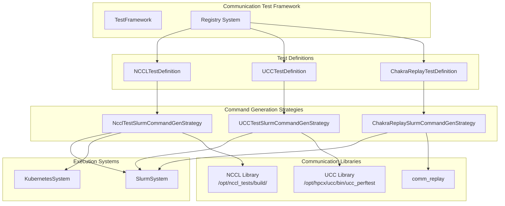
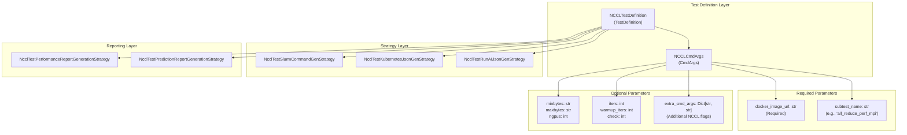
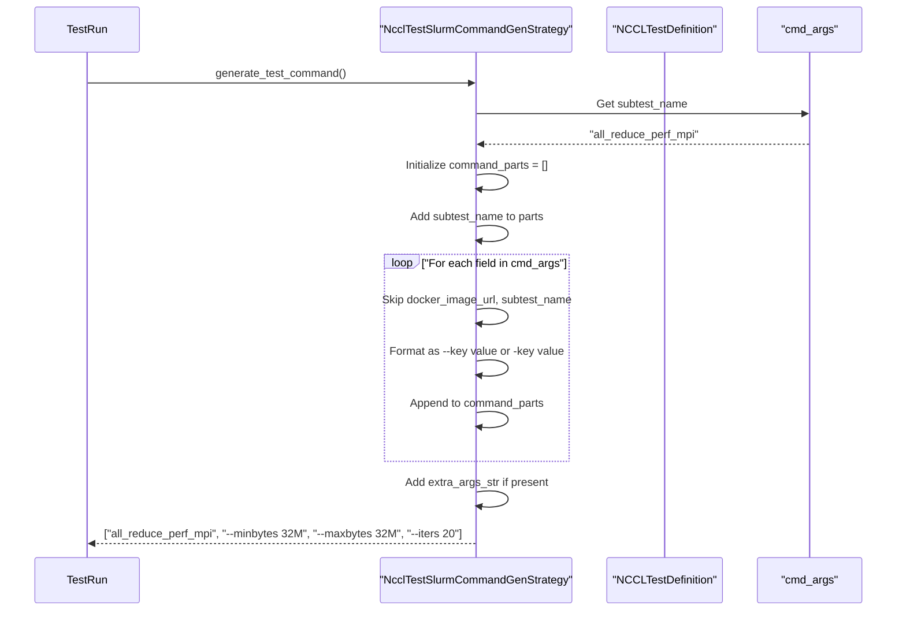

<!-- source: DeepWiki mcp.deepwiki.com · repo NVIDIA/cloudai · page 5.5 NCCL and Communication Tests · fetched 2026-10-26 -->

# NCCL and Communication Tests

<details>
<summary>Relevant source files</summary>

The following files were used as context for generating this wiki page:

- [src/cloudai/_core/base_reporter.py](src/cloudai/_core/base_reporter.py)
- [src/cloudai/report_generator/groups.py](src/cloudai/report_generator/groups.py)
- [src/cloudai/workloads/chakra_replay/slurm_command_gen_strategy.py](src/cloudai/workloads/chakra_replay/slurm_command_gen_strategy.py)
- [src/cloudai/workloads/jax_toolbox/slurm_command_gen_strategy.py](src/cloudai/workloads/jax_toolbox/slurm_command_gen_strategy.py)
- [src/cloudai/workloads/megatron_run/slurm_command_gen_strategy.py](src/cloudai/workloads/megatron_run/slurm_command_gen_strategy.py)
- [src/cloudai/workloads/nccl_test/__init__.py](src/cloudai/workloads/nccl_test/__init__.py)
- [src/cloudai/workloads/nccl_test/nccl.py](src/cloudai/workloads/nccl_test/nccl.py)
- [src/cloudai/workloads/nccl_test/performance_report_generation_strategy.py](src/cloudai/workloads/nccl_test/performance_report_generation_strategy.py)
- [src/cloudai/workloads/nccl_test/prediction_report_generation_strategy.py](src/cloudai/workloads/nccl_test/prediction_report_generation_strategy.py)
- [src/cloudai/workloads/nccl_test/prediction_report_generator.py](src/cloudai/workloads/nccl_test/prediction_report_generator.py)
- [src/cloudai/workloads/nccl_test/report_generation_strategy.py](src/cloudai/workloads/nccl_test/report_generation_strategy.py)
- [src/cloudai/workloads/nccl_test/slurm_command_gen_strategy.py](src/cloudai/workloads/nccl_test/slurm_command_gen_strategy.py)
- [src/cloudai/workloads/sleep/slurm_command_gen_strategy.py](src/cloudai/workloads/sleep/slurm_command_gen_strategy.py)
- [src/cloudai/workloads/slurm_container/slurm_command_gen_strategy.py](src/cloudai/workloads/slurm_container/slurm_command_gen_strategy.py)
- [src/cloudai/workloads/ucc_test/slurm_command_gen_strategy.py](src/cloudai/workloads/ucc_test/slurm_command_gen_strategy.py)
- [src/cloudai/workloads/ucc_test/ucc.py](src/cloudai/workloads/ucc_test/ucc.py)
- [tests/report_generation_strategy/test_report_groups.py](tests/report_generation_strategy/test_report_groups.py)

</details>


This document covers CloudAI's support for network communication performance benchmarks, including NCCL (NVIDIA Collective Communications Library), UCC (Unified Collective Communications), and trace replay workloads. These tests are designed to measure and validate high-performance communication patterns in distributed AI/ML workloads on HPC clusters.

For general workload integration patterns, see [Workload Types](5.1). For scheduler-specific command generation, see [Command Generation Strategies](4.2).

## Overview

CloudAI supports several categories of communication performance tests that measure different aspects of inter-node and inter-GPU communication:

| Test Type | Purpose | Primary Use Case |
|-----------|---------|------------------|
| NCCL Tests | Collective communication benchmarks | GPU-to-GPU bandwidth and latency measurement |
| UCC Tests | Unified collective operations testing | Cross-platform communication validation |
| Chakra Replay | Trace-based communication replay | Workload-specific communication pattern analysis |

### Communication Test Architecture



**Sources:** [src/cloudai/workloads/nccl_test/slurm_command_gen_strategy.py:24-25](), [src/cloudai/workloads/ucc_test/slurm_command_gen_strategy.py:24-25](), [src/cloudai/workloads/chakra_replay/slurm_command_gen_strategy.py:23-24]()

## NCCL Tests

NCCL tests measure collective communication performance between GPUs using NVIDIA's optimized communication library. The `NcclTestSlurmCommandGenStrategy` generates commands for various NCCL subtests including all-reduce, all-gather, broadcast, and other collective operations.

### NCCL Test Definition and Configuration

The `NCCLTestDefinition` class represents NCCL benchmark tests with their configuration parameters encapsulated in `NCCLCmdArgs`:

#### NCCL Test Components



**Sources:** [src/cloudai/workloads/nccl_test/nccl.py:23-102](), [src/cloudai/workloads/nccl_test/__init__.py:17-24]()

#### NCCL Command Arguments

The `NCCLCmdArgs` class defines the command-line arguments passed to NCCL test binaries. The `docker_image_url` is a required field:

| Field | Type | Required | Description | Example |
|-------|------|----------|-------------|---------|
| `docker_image_url` | `str` | Yes | Container image URL | `"nvcr.io/nvidia/pytorch:24.01"` |
| `subtest_name` | `str` | No | NCCL test binary name | `"all_reduce_perf_mpi"`, `"all_gather_perf_mpi"` |
| `minbytes` | `str` | No | Minimum message size | `"32M"` |
| `maxbytes` | `str` | No | Maximum message size | `"32M"` |
| `ngpus` | `int` | No | Number of GPUs per rank | `1` |
| `iters` | `int` | No | Number of iterations | `20` |
| `warmup_iters` | `int` | No | Warmup iterations | `5` |
| `check` | `int` | No | Enable correctness checking | `1` |

**Sources:** [src/cloudai/workloads/nccl_test/nccl.py:23-100]()

### NCCL Command Generation

The `NcclTestSlurmCommandGenStrategy` class generates execution commands for NCCL tests. The `generate_test_command` method constructs test commands by processing `NCCLCmdArgs` fields:

#### Command Generation Flow



**Sources:** [src/cloudai/workloads/nccl_test/slurm_command_gen_strategy.py:34-54]()

### NCCL Success Validation

NCCL tests include automatic success validation through the `was_run_successful` method in `NCCLTestDefinition`, which verifies test completion by checking for specific output patterns in `stdout.txt`:

| Success Indicator | Pattern | Purpose |
|-------------------|---------|---------|
| Bounds Check | `"# Out of bounds values"` | Confirms numerical correctness |
| Bus Bandwidth | `"# Avg bus bandwidth"` | Confirms successful completion and metric collection |

**Sources:** [src/cloudai/workloads/nccl_test/nccl.py:125-172]()

### NCCL Reporting and Prediction

CloudAI provides advanced reporting for NCCL tests, including performance visualization and theoretical performance prediction.

#### Performance Reporting
The `NcclTestPerformanceReportGenerationStrategy` extracts data from `stdout.txt` and generates:
1.  **CSV Report**: A structured `cloudai_nccl_test_csv_report.csv` containing bandwidth and latency for different message sizes [src/cloudai/workloads/nccl_test/performance_report_generation_strategy.py:145-149]().
2.  **Bokeh Report**: Interactive HTML plots showing Bus Bandwidth vs. Message Size [src/cloudai/workloads/nccl_test/performance_report_generation_strategy.py:150-182]().

#### Performance Prediction
The `NcclTestPredictionReportGenerationStrategy` uses an external predictor tool to compare measured performance against predicted values [src/cloudai/workloads/nccl_test/prediction_report_generator.py:32-42]().
- It invokes the predictor binary with a specific model and configuration based on GPU type [src/cloudai/workloads/nccl_test/prediction_report_generator.py:111-144]().
- It generates a comparison report `cloudai_nccl_test_prediction_report.csv` including "Predicted Time (us)" and "Speedup (Measured/Predicted)" [src/cloudai/workloads/nccl_test/prediction_report_generator.py:167-185]().

**Sources:** [src/cloudai/workloads/nccl_test/performance_report_generation_strategy.py:86-101](), [src/cloudai/workloads/nccl_test/prediction_report_generator.py:43-61]()

## UCC Tests

UCC (Unified Collective Communications) tests provide cross-platform collective communication benchmarks. The `UCCTestSlurmCommandGenStrategy` generates commands for the HPC-X UCC performance test suite.

### UCC Test Definition and Configuration

The `UCCTestDefinition` class represents UCC benchmark tests with configuration parameters in `UCCCmdArgs`:

| Field | Type | Required | Description | Example |
|-------|------|----------|-------------|---------|
| `docker_image_url` | `str` | Yes | Container image URL | `"nvcr.io/nvidia/pytorch:24.01"` |
| `collective` | `str` | No | Collective operation type | `"alltoall"`, `"allreduce"` |
| `b` | `int/list` | No | Starting message size (bytes) | `1` |
| `e` | `str/list` | No | Ending message size (bytes) | `"8M"` |
| `gen` | `str/list` | No | Generation method | `None` |

**Sources:** [src/cloudai/workloads/ucc_test/ucc.py:23-71]()

### UCC Command Generation

The `UCCTestSlurmCommandGenStrategy` constructs commands using the HPC-X UCC performance test binary located at `/opt/hpcx/ucc/bin/ucc_perftest`.

```python
# Command generation logic
srun_command_parts = ["/opt/hpcx/ucc/bin/ucc_perftest"]
srun_command_parts.append(f"-c {tdef_cmd_args.collective}")
srun_command_parts.append(f"-b {tdef_cmd_args.b}")
srun_command_parts.append(f"-e {tdef_cmd_args.e}")
srun_command_parts.append("-m cuda")
srun_command_parts.append("-F")
```

**Sources:** [src/cloudai/workloads/ucc_test/slurm_command_gen_strategy.py:34-50]()

## Chakra Replay Tests

Chakra Replay tests enable trace-based communication pattern analysis by replaying previously captured communication traces.

### Chakra Replay Configuration and Command Generation

The `ChakraReplaySlurmCommandGenStrategy` handles the `comm_replay` binary execution. It requires a `trace_path` which is mounted into the container [src/cloudai/workloads/chakra_replay/slurm_command_gen_strategy.py:26-30]().

The generated command includes:
- `trace-type`: Type of the trace (e.g., ET).
- `trace-path`: Path to the trace file.
- `num-replays`: Number of times to replay the trace.

**Sources:** [src/cloudai/workloads/chakra_replay/slurm_command_gen_strategy.py:36-49]()

## Command Generation Strategy Pattern

All communication tests follow the `SlurmCommandGenStrategy` pattern, providing specialized implementations for container mounts, image paths, and command construction.

| Strategy Class | Target Binary | Key Feature |
|----------------|---------------|-------------|
| `NcclTestSlurmCommandGenStrategy` | `subtest_name` (e.g. `all_reduce_perf_mpi`) | Success check via `grep` on bandwidth |
| `UCCTestSlurmCommandGenStrategy` | `/opt/hpcx/ucc/bin/ucc_perftest` | Forced CUDA memory mode (`-m cuda -F`) |
| `ChakraReplaySlurmCommandGenStrategy` | `comm_replay` | Trace path container mounting |

**Sources:** [src/cloudai/workloads/nccl_test/slurm_command_gen_strategy.py:24](), [src/cloudai/workloads/ucc_test/slurm_command_gen_strategy.py:24](), [src/cloudai/workloads/chakra_replay/slurm_command_gen_strategy.py:23]()

---

