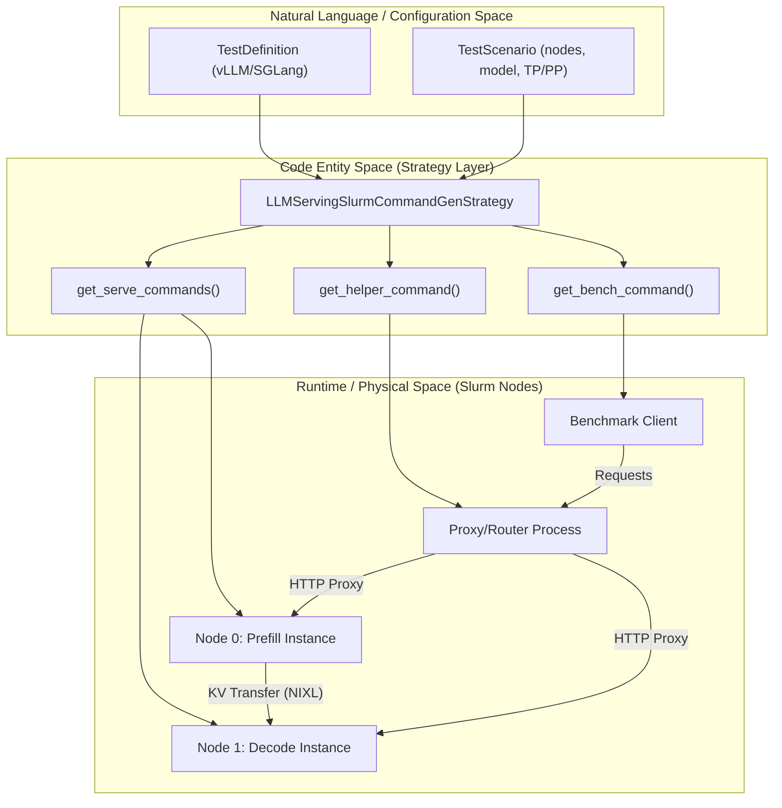
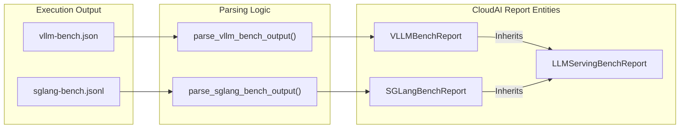

<!-- source: DeepWiki mcp.deepwiki.com · repo NVIDIA/cloudai · page 5.6 LLM Serving Workloads · fetched 2026-10-26 -->

# LLM Serving Workloads

<details>
<summary>Relevant source files</summary>

The following files were used as context for generating this wiki page:

- [src/cloudai/workloads/common/llm_serving.py](src/cloudai/workloads/common/llm_serving.py)
- [src/cloudai/workloads/sglang/__init__.py](src/cloudai/workloads/sglang/__init__.py)
- [src/cloudai/workloads/sglang/report_generation_strategy.py](src/cloudai/workloads/sglang/report_generation_strategy.py)
- [src/cloudai/workloads/sglang/sglang.py](src/cloudai/workloads/sglang/sglang.py)
- [src/cloudai/workloads/sglang/slurm_command_gen_strategy.py](src/cloudai/workloads/sglang/slurm_command_gen_strategy.py)
- [src/cloudai/workloads/vllm/__init__.py](src/cloudai/workloads/vllm/__init__.py)
- [src/cloudai/workloads/vllm/report_generation_strategy.py](src/cloudai/workloads/vllm/report_generation_strategy.py)
- [src/cloudai/workloads/vllm/slurm_command_gen_strategy.py](src/cloudai/workloads/vllm/slurm_command_gen_strategy.py)
- [src/cloudai/workloads/vllm/vllm.py](src/cloudai/workloads/vllm/vllm.py)
- [tests/ref_data/sglang-disagg-2nodes.sbatch](tests/ref_data/sglang-disagg-2nodes.sbatch)
- [tests/ref_data/sglang-disagg.sbatch](tests/ref_data/sglang-disagg.sbatch)
- [tests/ref_data/sglang.sbatch](tests/ref_data/sglang.sbatch)
- [tests/ref_data/vllm-disagg-2nodes.sbatch](tests/ref_data/vllm-disagg-2nodes.sbatch)
- [tests/ref_data/vllm-disagg.sbatch](tests/ref_data/vllm-disagg.sbatch)
- [tests/ref_data/vllm.sbatch](tests/ref_data/vllm.sbatch)
- [tests/workloads/sglang/test_command_gen_strategy_slurm.py](tests/workloads/sglang/test_command_gen_strategy_slurm.py)
- [tests/workloads/sglang/test_job_status_retrieval_strategy.py](tests/workloads/sglang/test_job_status_retrieval_strategy.py)
- [tests/workloads/sglang/test_report_gen_strategy.py](tests/workloads/sglang/test_report_gen_strategy.py)
- [tests/workloads/sglang/test_workload.py](tests/workloads/sglang/test_workload.py)
- [tests/workloads/test_llm_serving.py](tests/workloads/test_llm_serving.py)
- [tests/workloads/vllm/test_command_gen_strategy_slurm.py](tests/workloads/vllm/test_command_gen_strategy_slurm.py)
- [tests/workloads/vllm/test_report_gen_strategy.py](tests/workloads/vllm/test_report_gen_strategy.py)
- [tests/workloads/vllm/test_workload.py](tests/workloads/vllm/test_workload.py)

</details>


CloudAI provides a comprehensive framework for benchmarking Large Language Model (LLM) serving engines, specifically supporting **vLLM** and **SGLang**. These workloads support both aggregated (single instance) and disaggregated (separate prefill and decode instances) serving architectures.

## Architecture and Core Classes

The LLM serving framework is built upon a set of base classes in `src/cloudai/workloads/common/llm_serving.py` that handle shared logic for argument serialization, GPU ID calculation, and Slurm command generation.

### Base Command Generation Strategy
The `LLMServingSlurmCommandGenStrategy` class provides the skeletal structure for generating Slurm scripts that orchestrate serving instances, health checks, proxy routers, and benchmark clients.

| Component | Responsibility |
| :--- | :--- |
| `get_serve_commands` | Returns the CLI commands to start the serving engine(s). |
| `get_helper_command` | Returns the command for the proxy/router (used in disaggregated mode). |
| `get_bench_command` | Returns the benchmark client command (e.g., `vllm bench` or `sglang.bench_serving`). |
| `disaggregated_script_preamble` | Injects environment variables for NIXL ports and side channels. |

**Sources:** [src/cloudai/workloads/common/llm_serving.py:1-300](), [src/cloudai/workloads/vllm/slurm_command_gen_strategy.py:29-43]()

### Logical to Physical Entity Mapping
The following diagram illustrates how the abstract workload definitions in CloudAI map to the physical processes executed on a Slurm cluster.

**LLM Serving Execution Flow**

**Sources:** [src/cloudai/workloads/vllm/slurm_command_gen_strategy.py:44-121](), [src/cloudai/workloads/sglang/slurm_command_gen_strategy.py:41-125]()

## vLLM Workload

The vLLM implementation supports disaggregated serving using the `NixlConnector` for KV cache transfer between prefill and decode instances.

### Configuration and Constraints
vLLM workloads validate parallelism configurations (TP, PP, DP) against available hardware.
- **Constraint 1:** `(tp * pp * dp) <= gpu_count` [src/cloudai/workloads/vllm/vllm.py:104-114]()
- **Constraint 2:** `flashinfer_all2allv` backend requires `DP=1` or Expert Parallel disabled [src/cloudai/workloads/vllm/vllm.py:116-127]()

### Command Generation
For disaggregated vLLM, the strategy generates a JSON configuration for the `--kv-transfer-config` argument:
```python
kv_transfer_config = {"kv_connector": "NixlConnector", "kv_role": role}
```
It also manages `VLLM_NIXL_SIDE_CHANNEL_PORT` to avoid port collisions on multi-tenant systems by using a `PORT_OFFSET` derived from the `SLURM_JOB_ID` [src/cloudai/workloads/vllm/slurm_command_gen_strategy.py:73-85]().

**Sources:** [src/cloudai/workloads/vllm/vllm.py:83-151](), [src/cloudai/workloads/vllm/slurm_command_gen_strategy.py:44-71]()

## SGLang Workload

SGLang workloads follow a similar pattern but utilize the `sglang.launch_server` and `sglang_router.launch_router` modules.

### Disaggregated Mode
In disaggregated mode, SGLang uses the `--disaggregation-mode` flag (prefill/decode) and a specified transfer backend, typically `nixl` [src/cloudai/workloads/sglang/slurm_command_gen_strategy.py:58-78](). The router is started via `get_helper_command`, pointing to the specific HTTP endpoints of the prefill and decode instances [src/cloudai/workloads/sglang/slurm_command_gen_strategy.py:80-94]().

### Metrics Extraction
SGLang outputs benchmark results in a JSONL format. The `SGLangBenchReport` class parses these lines to extract:
- `request_throughput` (TPS)
- `mean_ttft_ms` (Time to First Token)
- `mean_tpot_ms` (Time per Output Token)

**Sources:** [src/cloudai/workloads/sglang/sglang.py:103-141](), [src/cloudai/workloads/sglang/slurm_command_gen_strategy.py:96-125]()

## Metrics and Reporting

Both workloads inherit from `LLMServingBenchReport` to ensure consistent metric reporting across different serving engines.

### Key Metrics
| Metric | Code Entity | Description |
| :--- | :--- | :--- |
| **TTFT** | `mean_ttft_ms` | Time to First Token (Latency) |
| **TPOT** | `mean_tpot_ms` | Time per Output Token (Latency) |
| **TPS** | `throughput` | Tokens per Second (Throughput) |
| **Concurrency** | `max_concurrency` | Number of simultaneous requests |

**Sources:** [src/cloudai/workloads/common/llm_serving.py:175-205](), [src/cloudai/workloads/vllm/report_generation_strategy.py:27-35](), [src/cloudai/workloads/sglang/sglang.py:103-111]()

### Data Flow for Reporting
The reporting strategy reads the engine-specific output files (`vllm-bench.json` or `sglang-bench.jsonl`) and normalizes them into a standard format.

**Reporting Data Flow**

**Sources:** [src/cloudai/workloads/vllm/report_generation_strategy.py:38-66](), [src/cloudai/workloads/sglang/report_generation_strategy.py:24-40]()

## Health Checks and Orchestration

A critical part of the LLM serving workload is ensuring the instances are ready before starting the benchmark client. The generated Slurm scripts include a `wait_for_health` shell function that polls the `/health` endpoint of the serving instances [tests/ref_data/vllm-disagg.sbatch:25-41]().

1. **Start Instances:** Prefill and Decode instances are started in the background using `srun --overlap` [tests/ref_data/vllm-disagg.sbatch:57-65]().
2. **Health Check:** The script waits for both instances to return HTTP 200 on their health ports [tests/ref_data/vllm-disagg.sbatch:68-69]().
3. **Start Router:** If disaggregated, the proxy/router is started [tests/ref_data/vllm-disagg.sbatch:71-75]().
4. **Run Benchmark:** The client runs to completion [tests/ref_data/vllm-disagg.sbatch:77-80]().
5. **Cleanup:** An `EXIT` trap ensures all background processes (PIDs) are killed upon completion or failure [tests/ref_data/vllm-disagg.sbatch:17-23]().

**Sources:** [tests/ref_data/vllm-disagg.sbatch:1-81](), [tests/ref_data/vllm.sbatch:1-55]()

---

