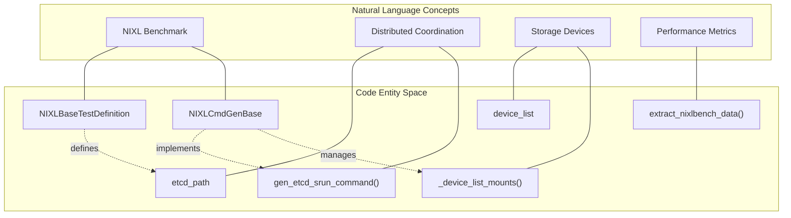
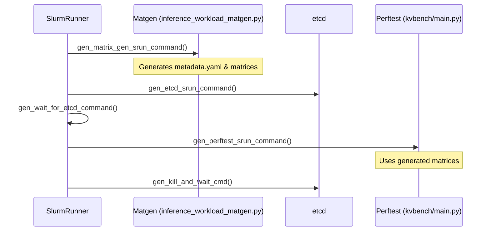

<!-- source: DeepWiki mcp.deepwiki.com · repo NVIDIA/cloudai · page 5.7 NIXL Workloads · fetched 2026-10-26 -->

# NIXL Workloads

Relevant source files

The following files were used as context for generating this wiki page:

- [doc/workloads/nixl_ep.rst](doc/workloads/nixl_ep.rst)
- [src/cloudai/workloads/common/nixl.py](src/cloudai/workloads/common/nixl.py)
- [src/cloudai/workloads/nixl_bench/__init__.py](src/cloudai/workloads/nixl_bench/__init__.py)
- [src/cloudai/workloads/nixl_bench/nixl_bench.py](src/cloudai/workloads/nixl_bench/nixl_bench.py)
- [src/cloudai/workloads/nixl_bench/report_generation_strategy.py](src/cloudai/workloads/nixl_bench/report_generation_strategy.py)
- [src/cloudai/workloads/nixl_bench/slurm_command_gen_strategy.py](src/cloudai/workloads/nixl_bench/slurm_command_gen_strategy.py)
- [src/cloudai/workloads/nixl_ep/__init__.py](src/cloudai/workloads/nixl_ep/__init__.py)
- [src/cloudai/workloads/nixl_ep/log_parsing.py](src/cloudai/workloads/nixl_ep/log_parsing.py)
- [src/cloudai/workloads/nixl_ep/nixl_ep.py](src/cloudai/workloads/nixl_ep/nixl_ep.py)
- [src/cloudai/workloads/nixl_ep/report_generation_strategy.py](src/cloudai/workloads/nixl_ep/report_generation_strategy.py)
- [src/cloudai/workloads/nixl_ep/slurm_command_gen_strategy.py](src/cloudai/workloads/nixl_ep/slurm_command_gen_strategy.py)
- [src/cloudai/workloads/nixl_kvbench/__init__.py](src/cloudai/workloads/nixl_kvbench/__init__.py)
- [src/cloudai/workloads/nixl_kvbench/nixl_kvbench.py](src/cloudai/workloads/nixl_kvbench/nixl_kvbench.py)
- [src/cloudai/workloads/nixl_kvbench/slurm_command_gen_strategy.py](src/cloudai/workloads/nixl_kvbench/slurm_command_gen_strategy.py)
- [src/cloudai/workloads/nixl_perftest/__init__.py](src/cloudai/workloads/nixl_perftest/__init__.py)
- [src/cloudai/workloads/nixl_perftest/nixl_perftest.py](src/cloudai/workloads/nixl_perftest/nixl_perftest.py)
- [src/cloudai/workloads/nixl_perftest/report_generation_strategy.py](src/cloudai/workloads/nixl_perftest/report_generation_strategy.py)
- [src/cloudai/workloads/nixl_perftest/slurm_command_gen_strategy.py](src/cloudai/workloads/nixl_perftest/slurm_command_gen_strategy.py)
- [tests/ref_data/nixl-ep.sbatch](tests/ref_data/nixl-ep.sbatch)
- [tests/ref_data/nixl-kvbench.sbatch](tests/ref_data/nixl-kvbench.sbatch)
- [tests/ref_data/nixl-perftest.sbatch](tests/ref_data/nixl-perftest.sbatch)
- [tests/ref_data/nixl_bench.sbatch](tests/ref_data/nixl_bench.sbatch)
- [tests/workloads/nixl_bench/test_command_gen_strategy_slurm.py](tests/workloads/nixl_bench/test_command_gen_strategy_slurm.py)
- [tests/workloads/nixl_ep/__init__.py](tests/workloads/nixl_ep/__init__.py)
- [tests/workloads/nixl_ep/test_job_status_retrieval_strategy.py](tests/workloads/nixl_ep/test_job_status_retrieval_strategy.py)
- [tests/workloads/nixl_kvbench/test_command_gen_slurm.py](tests/workloads/nixl_kvbench/test_command_gen_slurm.py)

NIXL (NVIDIA Inference eXchange Layer) workloads in CloudAI are a suite of benchmarks designed for high-performance storage and network evaluation, specifically focusing on Key-Value (KV) cache transfer and inference orchestration. These workloads leverage `etcd` for distributed coordination and support multiple backends including UCX, GUSLI, and GDS.

The NIXL suite consists of:
- **nixl_bench**: Low-level benchmark for NIXL primitives.
- **nixl_kvbench**: Benchmarking tool for KV cache operations.
- **nixl_perftest**: Performance testing for sequential inference scenarios.
- **nixl_ep**: Endpoint benchmarking for NIXL.

## Implementation Architecture

The NIXL implementation is built upon a common base in `src/cloudai/workloads/common/nixl.py` to ensure consistent behavior across different NIXL-based tools.

### Class Hierarchy and Command Generation

NIXL workloads extend `NIXLBaseTestDefinition` and utilize `NIXLCmdGenBase` for Slurm script generation. This base class handles complex tasks like `etcd` lifecycle management, environment variable propagation, and device mapping for both file-backed and block devices.

#### NIXL Code Entity Mapping
The following diagram illustrates how natural language concepts map to specific code entities within the NIXL implementation.

Title: NIXL Code Entity Mapping

**Sources:** [src/cloudai/workloads/common/nixl.py:127-155](), [src/cloudai/workloads/common/nixl.py:156-170]()

### Coordination with etcd

All NIXL workloads require an `etcd` instance for node synchronization. `NIXLCmdGenBase` automates the following lifecycle:
1.  **Launch**: Starts `etcd` on the master node using `srun` with the `--overlap` flag [src/cloudai/workloads/common/nixl.py:270-302]().
2.  **Wait**: Executes a health check loop using `curl` to ensure `etcd` is ready before starting benchmarks [src/cloudai/workloads/common/nixl.py:304-315]().
3.  **Execute**: Runs the NIXL benchmark tasks.
4.  **Cleanup**: Kills the `etcd` process and waits for termination [src/cloudai/workloads/common/nixl.py:317-327]().

### Device Mapping and Storage Backends

NIXL workloads support mapping specific hardware or file-backed devices into the container.
- **File-backed**: Created via `_device_list_mounts` which generates local files of a specified `total_buffer_size` and mounts them into the container [src/cloudai/workloads/common/nixl.py:185-212]().
- **Block Devices**: Passed directly via the `device_list` argument in the format `id:type:path` (e.g., `11:K:/dev/nvme0n1`) [src/cloudai/workloads/common/nixl.py:73-76]().

**Sources:** [src/cloudai/workloads/common/nixl.py:44-56](), [src/cloudai/workloads/common/nixl.py:59-76](), [src/cloudai/workloads/common/nixl.py:270-327]()

---

## Workload Specifics

### 1. nixl_bench
`NIXLBench` is the foundational benchmark for NIXL. It maps the `TestDefinition` to the `nixlbench` executable.

- **Command Generation**: `NIXLBenchSlurmCommandGenStrategy` generates the `srun` sequence [src/cloudai/workloads/nixl_bench/slurm_command_gen_strategy.py:24-49]().
- **Success Criteria**: Verified by `extract_nixlbench_data` which parses the standard output for bandwidth metrics [src/cloudai/workloads/nixl_bench/nixl_bench.py:52-58]().

### 2. nixl_kvbench
`NIXLKVBench` benchmarks KV cache operations specifically for LLM inference.

- **Arguments**: Includes `model_cfg` and `backend` (e.g., UCX, GUSLI) [src/cloudai/workloads/nixl_kvbench/nixl_kvbench.py:30-42]().
- **Mapping**: The `model_cfg` argument is automatically mapped to `--model_config` in the generated command [src/cloudai/workloads/nixl_kvbench/slurm_command_gen_strategy.py:67-69]().

### 3. nixl_perftest
`NixlPerftest` is a more complex workload that involves a pre-execution step called "Matrix Generation" (`matgen`).

Title: NixlPerftest Execution Flow

- **Constraint Check**: Ensures that the ratio of Tensor Parallelism (TP) to nodes is consistent between Prefill and Decode phases [src/cloudai/workloads/nixl_perftest/nixl_perftest.py:94-100]().
- **Matrix Generation**: Uses `inference_workload_matgen.py` to create synthetic inference request patterns before running the benchmark [src/cloudai/workloads/nixl_perftest/slurm_command_gen_strategy.py:80-122]().

**Sources:** [src/cloudai/workloads/nixl_bench/slurm_command_gen_strategy.py:31-49](), [src/cloudai/workloads/nixl_kvbench/slurm_command_gen_strategy.py:56-73](), [src/cloudai/workloads/nixl_perftest/slurm_command_gen_strategy.py:49-62](), [src/cloudai/workloads/nixl_perftest/nixl_perftest.py:94-100]()

---

## Data Flow and Metrics

NIXL workloads follow a structured data flow from configuration to performance reporting.

| Component | Role | Code Entity |
| :--- | :--- | :--- |
| **Input Parsing** | Validates buffer sizes and device formats | `BUFFER_SIZE_FORMAT`, `DEVICE_FORMAT` [src/cloudai/workloads/common/nixl.py:37-38]() |
| **Mounting** | Handles directory and file mounts for NIXL | `_filepath_mounts`, `_device_list_mounts` [src/cloudai/workloads/common/nixl.py:172-212]() |
| **Execution** | Orchestrates `etcd` and benchmark binaries | `_gen_srun_command` [src/cloudai/workloads/nixl_bench/slurm_command_gen_strategy.py:31-49]() |
| **Reporting** | Extracts bandwidth and latency from logs | `extract_nixlbench_data` [src/cloudai/workloads/common/nixl.py:330-360]() |

### Metrics Extraction
The `extract_nixlbench_data` function uses regular expressions to parse stdout for performance tables. It identifies columns such as `Bandwidth (GB/s)` and `Latency (us)` to construct a pandas DataFrame for reporting [src/cloudai/workloads/common/nixl.py:330-360]().

**Sources:** [src/cloudai/workloads/common/nixl.py:37-41](), [src/cloudai/workloads/common/nixl.py:172-212](), [src/cloudai/workloads/common/nixl.py:330-360]()

---

