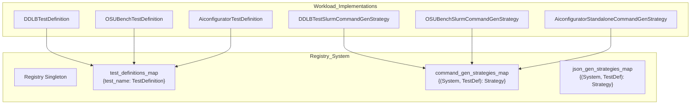
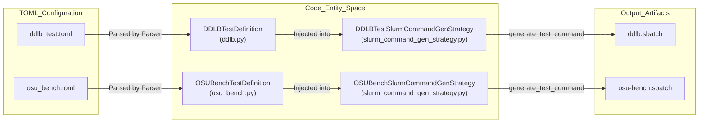

<!-- source: DeepWiki mcp.deepwiki.com · repo NVIDIA/cloudai · page 5.8 Other Workloads · fetched 2026-10-26 -->

# Other Workloads

Relevant source files

The following files were used as context for generating this wiki page:

- [conf/experimental/aiconfigurator/test/aiconfigurator_disagg.toml](conf/experimental/aiconfigurator/test/aiconfigurator_disagg.toml)
- [conf/experimental/aiconfigurator/test/dse_aiconfigurator_disagg.toml](conf/experimental/aiconfigurator/test/dse_aiconfigurator_disagg.toml)
- [conf/experimental/aiconfigurator/test_scenario/aiconfigurator_disagg.toml](conf/experimental/aiconfigurator/test_scenario/aiconfigurator_disagg.toml)
- [conf/experimental/aiconfigurator/test_scenario/dse_aiconfigurator_disagg.toml](conf/experimental/aiconfigurator/test_scenario/dse_aiconfigurator_disagg.toml)
- [conf/experimental/test/ddlb_test.toml](conf/experimental/test/ddlb_test.toml)
- [conf/experimental/test_scenario/ddlb_test.toml](conf/experimental/test_scenario/ddlb_test.toml)
- [conf/experimental/test_scenario/deepep.toml](conf/experimental/test_scenario/deepep.toml)
- [src/cloudai/workloads/aiconfig/__init__.py](src/cloudai/workloads/aiconfig/__init__.py)
- [src/cloudai/workloads/aiconfig/aiconfigurator.py](src/cloudai/workloads/aiconfig/aiconfigurator.py)
- [src/cloudai/workloads/aiconfig/predictor.py](src/cloudai/workloads/aiconfig/predictor.py)
- [src/cloudai/workloads/aiconfig/report_generation_strategy.py](src/cloudai/workloads/aiconfig/report_generation_strategy.py)
- [src/cloudai/workloads/aiconfig/simple_predictor.py](src/cloudai/workloads/aiconfig/simple_predictor.py)
- [src/cloudai/workloads/aiconfig/standalone_command_gen_strategy.py](src/cloudai/workloads/aiconfig/standalone_command_gen_strategy.py)
- [src/cloudai/workloads/bash_cmd/__init__.py](src/cloudai/workloads/bash_cmd/__init__.py)
- [src/cloudai/workloads/bash_cmd/bash_cmd.py](src/cloudai/workloads/bash_cmd/bash_cmd.py)
- [src/cloudai/workloads/ddlb/__init__.py](src/cloudai/workloads/ddlb/__init__.py)
- [src/cloudai/workloads/ddlb/ddlb.py](src/cloudai/workloads/ddlb/ddlb.py)
- [src/cloudai/workloads/ddlb/slurm_command_gen_strategy.py](src/cloudai/workloads/ddlb/slurm_command_gen_strategy.py)
- [src/cloudai/workloads/jax_toolbox/jax_toolbox.py](src/cloudai/workloads/jax_toolbox/jax_toolbox.py)
- [src/cloudai/workloads/nemo_launcher/nemo_launcher.py](src/cloudai/workloads/nemo_launcher/nemo_launcher.py)
- [src/cloudai/workloads/nemo_launcher/slurm_command_gen_strategy.py](src/cloudai/workloads/nemo_launcher/slurm_command_gen_strategy.py)
- [src/cloudai/workloads/osu_bench/__init__.py](src/cloudai/workloads/osu_bench/__init__.py)
- [src/cloudai/workloads/osu_bench/osu_bench.py](src/cloudai/workloads/osu_bench/osu_bench.py)
- [src/cloudai/workloads/osu_bench/osu_comparison_report.py](src/cloudai/workloads/osu_bench/osu_comparison_report.py)
- [src/cloudai/workloads/osu_bench/report_generation_strategy.py](src/cloudai/workloads/osu_bench/report_generation_strategy.py)
- [src/cloudai/workloads/osu_bench/slurm_command_gen_strategy.py](src/cloudai/workloads/osu_bench/slurm_command_gen_strategy.py)
- [src/cloudai/workloads/sleep/sleep.py](src/cloudai/workloads/sleep/sleep.py)
- [src/cloudai/workloads/slurm_container/slurm_container.py](src/cloudai/workloads/slurm_container/slurm_container.py)
- [tests/ref_data/ddlb.sbatch](tests/ref_data/ddlb.sbatch)
- [tests/ref_data/deepep-benchmark.sbatch](tests/ref_data/deepep-benchmark.sbatch)
- [tests/ref_data/gpt.run](tests/ref_data/gpt.run)
- [tests/ref_data/grok.run](tests/ref_data/grok.run)
- [tests/ref_data/nemo-launcher.sbatch](tests/ref_data/nemo-launcher.sbatch)
- [tests/ref_data/osu-bench.sbatch](tests/ref_data/osu-bench.sbatch)
- [tests/report_generation_strategy/test_osu_bench_report_generation_strategy.py](tests/report_generation_strategy/test_osu_bench_report_generation_strategy.py)

This page documents the remaining CloudAI workloads not covered in previous sections. For documentation on AI Dynamo, see [AI Dynamo Workload](#5.2). For Megatron Bridge, see [Megatron Bridge Workload](#5.3). For NeMo Run, see [NeMo Run Workload](#5.4). For NCCL and communication tests, see [NCCL and Communication Tests](#5.5).

CloudAI includes 22+ workload types spanning simple utilities, communication benchmarks, training frameworks, and inference engines. This page categorizes and documents these workloads, their scheduler support, and plugin architecture.

---

## Workload Overview

CloudAI supports workloads across five scheduler types: Slurm, Kubernetes, RunAI, Standalone, and LSF. The following table summarizes all workloads documented in this section:

| Workload Category | Test Name | Slurm | Kubernetes | RunAI | Standalone | LSF |
|-------------------|-----------|-------|------------|-------|------------|-----|
| **Simple/Utility** | Sleep | ✅ | ✅ | ❌ | ✅ | ✅ |
| | BashCmd | ✅ | ❌ | ❌ | ❌ | ❌ |
| | SlurmContainer | ✅ | ❌ | ❌ | ❌ | ❌ |
| | AIConfigurator | ❌ | ❌ | ❌ | ✅ | ❌ |
| **Communication** | UCC | ✅ | ❌ | ❌ | ❌ | ❌ |
| | OSUBench | ✅ | ❌ | ❌ | ❌ | ❌ |
| **Networking** | NIXLBench | ✅ | ❌ | ❌ | ❌ | ❌ |
| | NIXLKVBench | ✅ | ❌ | ❌ | ❌ | ❌ |
| | NixlPerftest | ✅ | ❌ | ❌ | ❌ | ❌ |
| | ChakraReplay | ✅ | ❌ | ❌ | ❌ | ❌ |
| **Training** | MegatronRun | ✅ | ❌ | ❌ | ❌ | ❌ |
| | JAX Toolbox (DEPRECATED) | ✅ | ❌ | ❌ | ❌ | ❌ |
| | NeMo Launcher (DEPRECATED) | ✅ | ❌ | ❌ | ❌ | ❌ |
| **Specialized** | Triton Inference | ✅ | ❌ | ❌ | ❌ | ❌ |
| | DDLB | ✅ | ❌ | ❌ | ❌ | ❌ |
| | DeepEP | ✅ | ❌ | ❌ | ❌ | ❌ |

**Sources:** [src/cloudai/workloads/sleep/sleep.py:17-20](), [src/cloudai/workloads/bash_cmd/bash_cmd.py:17-20](), [src/cloudai/workloads/slurm_container/slurm_container.py:17-20](), [src/cloudai/workloads/aiconfig/aiconfigurator.py:17-20](), [src/cloudai/workloads/osu_bench/osu_bench.py:62-65](), [src/cloudai/workloads/ddlb/ddlb.py:37-40](), [src/cloudai/workloads/nemo_launcher/nemo_launcher.py:17-20]()

---

## Workload Registration Architecture

All workloads follow the plugin architecture established by the Registry system. Each workload is registered at package import time via `register_all()`.

**Sources:** [src/cloudai/workloads/ddlb/ddlb.py:37-40](), [src/cloudai/workloads/ddlb/slurm_command_gen_strategy.py:24-25](), [src/cloudai/workloads/osu_bench/osu_bench.py:62-65](), [src/cloudai/workloads/osu_bench/slurm_command_gen_strategy.py:48-49](), [src/cloudai/workloads/aiconfig/aiconfigurator.py:30-35](), [src/cloudai/workloads/aiconfig/standalone_command_gen_strategy.py:33-34]()

---

## Simple and Utility Workloads

### Sleep Test
The `Sleep` test is used for infrastructure validation. It runs the `sleep` command for a specified duration and supports all scheduler types.
**Sources:** [src/cloudai/workloads/sleep/sleep.py:17-20]()

### BashCmd
Executes arbitrary bash commands on Slurm systems. Useful for custom setup scripts.
**Sources:** [src/cloudai/workloads/bash_cmd/bash_cmd.py:17-20]()

### SlurmContainer
Runs containerized workloads on Slurm using Enroot/Pyxis without requiring a specific workload plugin.
**Sources:** [src/cloudai/workloads/slurm_container/slurm_container.py:17-20]()

---

## AIConfigurator

The `AIConfigurator` workload invokes performance predictors for LLM inference configurations (aggregated and disaggregated). It runs in **Standalone** mode.

### Implementation Details
- **Test Definition:** `AiconfiguratorTestDefinition` [src/cloudai/workloads/aiconfig/aiconfigurator.py:30-35]().
- **Command Generation:** `AiconfiguratorStandaloneCommandGenStrategy` generates a bash script `run_simple_predictor.sh` that calls `cloudai.workloads.aiconfig.simple_predictor` [src/cloudai/workloads/aiconfig/standalone_command_gen_strategy.py:33-142]().
- **Core Logic:** Uses `predict_ifb_single` and `predict_disagg_single` functions to interface with the `aiconfigurator` SDK [src/cloudai/workloads/aiconfig/predictor.py:48-162]().

**Sources:** [src/cloudai/workloads/aiconfig/aiconfigurator.py:17-45](), [src/cloudai/workloads/aiconfig/standalone_command_gen_strategy.py:33-142](), [src/cloudai/workloads/aiconfig/predictor.py:48-162]()

---

## Communication Benchmarks

### OSU Benchmark
Runs the OSU Micro-Benchmarks suite.
- **Strategy:** `OSUBenchSlurmCommandGenStrategy` [src/cloudai/workloads/osu_bench/slurm_command_gen_strategy.py:48-49]().
- **Validation:** `was_run_successful` checks for `# Size` in `stdout.txt` [src/cloudai/workloads/osu_bench/osu_bench.py:83-125]().
- **Reporting:** `OSUBenchReportGenerationStrategy` parses bandwidth and latency data into CSV format [src/cloudai/workloads/osu_bench/report_generation_strategy.py:140-157]().

### DDLB (Distributed Deep Learning Benchmark)
Benchmarks distributed primitives like `tp_columnwise`.
- **Strategy:** `DDLBTestSlurmCommandGenStrategy` [src/cloudai/workloads/ddlb/slurm_command_gen_strategy.py:24-25]().
- **Success Check:** Greps for "Benchmark Results" in the output file [src/cloudai/workloads/ddlb/slurm_command_gen_strategy.py:59-61]().
- **Config:** Defined in [conf/experimental/test/ddlb_test.toml:17-35]().

**Sources:** [src/cloudai/workloads/osu_bench/osu_bench.py:62-126](), [src/cloudai/workloads/osu_bench/report_generation_strategy.py:140-157](), [src/cloudai/workloads/ddlb/ddlb.py:23-102](), [src/cloudai/workloads/ddlb/slurm_command_gen_strategy.py:24-62]()

---

## Deprecated Workloads

### JAX Toolbox
Training workloads for GPT, Grok, and Nemotron using JAX/XLA.
- **Implementation:** `JaxToolboxTestDefinition` [src/cloudai/workloads/jax_toolbox/jax_toolbox.py:17-20]().
- **Execution:** Generates `.run` scripts containing `nsys profile` and `paxml.main` calls [tests/ref_data/gpt.run:1-134]().

### NeMo Launcher (v1.0)
Legacy training launcher superseded by NeMo Run.
- **Strategy:** `NeMoLauncherSlurmCommandGenStrategy` [src/cloudai/workloads/nemo_launcher/slurm_command_gen_strategy.py:28-29]().
- **Command:** Invokes `launcher_scripts/main.py` with Hydra-style overrides [src/cloudai/workloads/nemo_launcher/slurm_command_gen_strategy.py:94-95]().
- **Ref Data:** [tests/ref_data/nemo-launcher.sbatch:1-27]().

**Sources:** [src/cloudai/workloads/jax_toolbox/jax_toolbox.py:17-20](), [tests/ref_data/gpt.run:1-134](), [src/cloudai/workloads/nemo_launcher/slurm_command_gen_strategy.py:28-112](), [tests/ref_data/nemo-launcher.sbatch:1-27]()

---

## Specialized Workloads

### DeepEP
Deep Exploration Platform benchmarks.
- **Execution:** Uses `torchrun` with `rdzv_backend=c10d` inside a Slurm allocation [tests/ref_data/deepep-benchmark.sbatch:27]().

### Triton Inference
Benchmarks Triton Inference Server performance on Slurm.

---

## Workload Data Flow

The following diagram bridges the TOML configuration space to the execution strategy space.

**Sources:** [src/cloudai/workloads/ddlb/ddlb.py:37-40](), [src/cloudai/workloads/ddlb/slurm_command_gen_strategy.py:34-57](), [src/cloudai/workloads/osu_bench/osu_bench.py:62-65](), [src/cloudai/workloads/osu_bench/slurm_command_gen_strategy.py:58-80](), [conf/experimental/test/ddlb_test.toml:17-35]()

---

