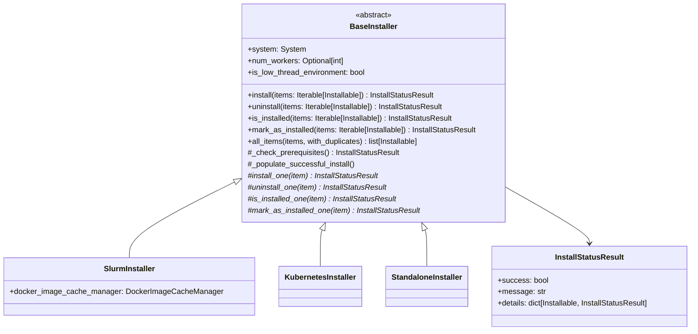
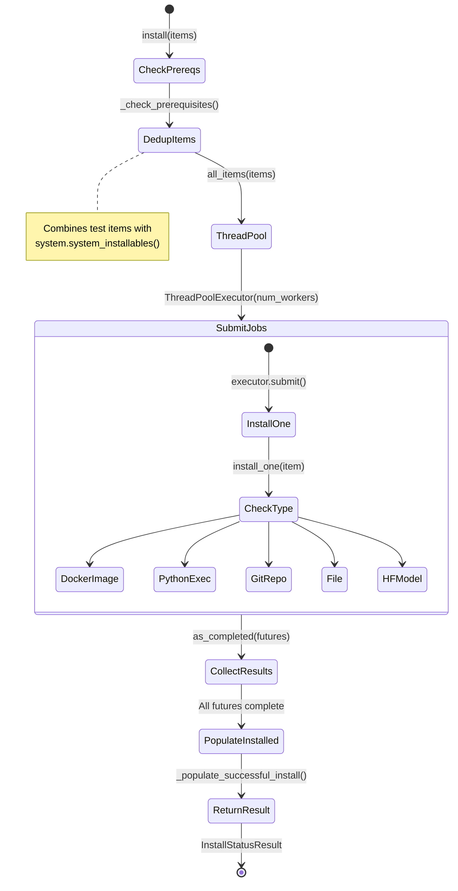
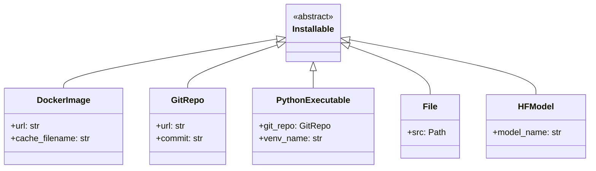
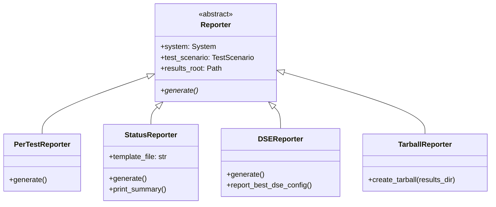

<!-- source: DeepWiki mcp.deepwiki.com · repo NVIDIA/cloudai · page 6 Infrastructure Components · fetched 2026-10-26 -->

# Infrastructure Components

Relevant source files

The following files were used as context for generating this wiki page:

- [src/cloudai/_core/base_installer.py](src/cloudai/_core/base_installer.py)
- [src/cloudai/report_generator/dse_report.py](src/cloudai/report_generator/dse_report.py)
- [src/cloudai/report_generator/util.py](src/cloudai/report_generator/util.py)
- [src/cloudai/reporter.py](src/cloudai/reporter.py)
- [src/cloudai/util/__init__.py](src/cloudai/util/__init__.py)
- [src/cloudai/util/base-report.jinja2](src/cloudai/util/base-report.jinja2)
- [src/cloudai/util/dse-report.jinja2](src/cloudai/util/dse-report.jinja2)
- [src/cloudai/util/general-report.jinja2](src/cloudai/util/general-report.jinja2)
- [tests/test_base_installer.py](tests/test_base_installer.py)
- [tests/test_reporter.py](tests/test_reporter.py)

## Purpose and Scope

The Infrastructure Components subsystem provides foundational services that enable CloudAI to manage test prerequisites, cache container images, and generate performance reports. This page documents three core infrastructure areas:

1.  **Installation System**: The `BaseInstaller` abstract class and concrete implementations for managing test dependencies.
2.  **Docker Image Management**: The `DockerImageCacheManager` for caching container images on Slurm clusters.
3.  **Reporting and Metrics**: Report generation strategies and metric extraction.

For information about test definitions and workload configurations, see [Test Framework](#2.2). For scheduler-specific implementations, see [Scheduler Integrations](#4).

---

## Installation System Overview

CloudAI's installation system follows a plugin architecture where each scheduler type (`SlurmSystem`, `KubernetesSystem`, `StandaloneSystem`) provides its own installer implementation. The abstract `BaseInstaller` class defines the contract that all installers must fulfill.

### BaseInstaller Architecture

**Diagram: BaseInstaller Class Hierarchy**

The `BaseInstaller` class [src/cloudai/_core/base_installer.py:34-43]() provides a template method pattern where public methods (`install`, `uninstall`, `is_installed`, `mark_as_installed`) orchestrate the installation workflow, while protected abstract methods (`install_one`, `uninstall_one`, etc.) are implemented by scheduler-specific subclasses.

**Sources:** [src/cloudai/_core/base_installer.py:34-288](), [tests/test_base_installer.py:48-60]()

---

## Installation Workflow

### Parallel Installation with Thread Pool

The `BaseInstaller.install()` method [src/cloudai/_core/base_installer.py:172-218]() uses `ThreadPoolExecutor` to parallelize installation operations. The number of worker threads is dynamically determined based on the system's thread limit to avoid resource exhaustion on constrained environments.

**Diagram: Installation Workflow State Machine**

Key workflow steps:
1.  **Prerequisites Check**: `_check_prerequisites()` [src/cloudai/_core/base_installer.py:114-124]() verifies required binaries are available.
2.  **Output Directory Preparation**: `prepare_output_dir()` [src/cloudai/util/__init__.py:61-91]() ensures `system.install_path` is writable.
3.  **Item Deduplication**: `all_items()` [src/cloudai/_core/base_installer.py:126-129]() combines user-provided items with system installables and removes duplicates.
4.  **Thread Pool Execution**: Worker count is determined by `num_workers` [src/cloudai/_core/base_installer.py:92-99](), which returns `1` for low-thread environments.
5.  **Result Collection**: Futures are collected via `as_completed()` [src/cloudai/_core/base_installer.py:202-210]() and logged progressively.

**Sources:** [src/cloudai/_core/base_installer.py:169-218](), [src/cloudai/_core/base_installer.py:56-99]()

---

## Installable Types

CloudAI defines several `Installable` types, each with distinct installation semantics.

### Installable Type Hierarchy

**Diagram: Installable Type Hierarchy**

### Cache Filename Generation

`DockerImage.cache_filename` transforms URLs into filesystem-safe names [tests/test_base_installer.py:144-161]():

| Input URL | Cache Filename |
| :--- | :--- |
| `http://fake_url/img` | `fake_url__img__notag.sqsh` |
| `nvcr.io#nvidia/pytorch:24.02-py3` | `nvcr.io_nvidia__pytorch__24.02-py3.sqsh` |
| `gitlab.com#org/team/image:latest` | `gitlab.com_org_team__image__latest.sqsh` |

**Sources:** [tests/test_base_installer.py:144-161](), [src/cloudai/_core/base_installer.py:28]()

---

## Reporting and Metrics

CloudAI provides a multi-layered reporting infrastructure to extract metrics from test outputs and generate human-readable summaries.

### Reporter Class Hierarchy

**Diagram: Reporter Class Hierarchy**

### Reporting Components

1.  **PerTestReporter**: Iterates through all test runs in a scenario and triggers workload-specific reporting strategies [src/cloudai/reporter.py:61-81]().
2.  **StatusReporter**: Uses Jinja2 templates (`general-report.jinja2`) to create a high-level HTML summary of the scenario execution [src/cloudai/reporter.py:83-110]().
3.  **DSEReporter**: Specialized for Design Space Exploration; calculates efficiency ratios, GPU-hour savings, and generates Chart.js visualizations [src/cloudai/reporter.py:138-177]().
4.  **TarballReporter**: Compresses the entire results directory into a `.tgz` archive for easy portability [tests/test_reporter.py:85-99]().

### Metric Calculation and Formatting

CloudAI includes utilities for converting raw data into human-readable formats:
*   **Duration**: `format_duration` converts seconds to `Xh Ym Zs` [src/cloudai/report_generator/dse_report.py:92-109]().
*   **Data Size**: `bytes_to_human_readable` handles units from B to ZB [src/cloudai/report_generator/util.py:76-93]().
*   **Savings**: `calculate_saved_gpu_hours` and `calculate_savings` estimate cost reductions based on GPU architecture (H100, B200, etc.) [src/cloudai/report_generator/dse_report.py:164-193]().

For deep technical details on these components, see the following child pages:
*   [Installation System](#6.1) — Detailed coverage of `BaseInstaller` and concurrent workflows.
*   [Docker Image Management](#6.2) — Enroot import workflow and cache management.
*   [Reporting and Metrics](#6.3) — Metric extraction, Jinja2 templates, and DSE artifacts.

**Sources:** [src/cloudai/reporter.py:38-193](), [src/cloudai/report_generator/dse_report.py:38-234](), [src/cloudai/report_generator/util.py:76-185]()

---

