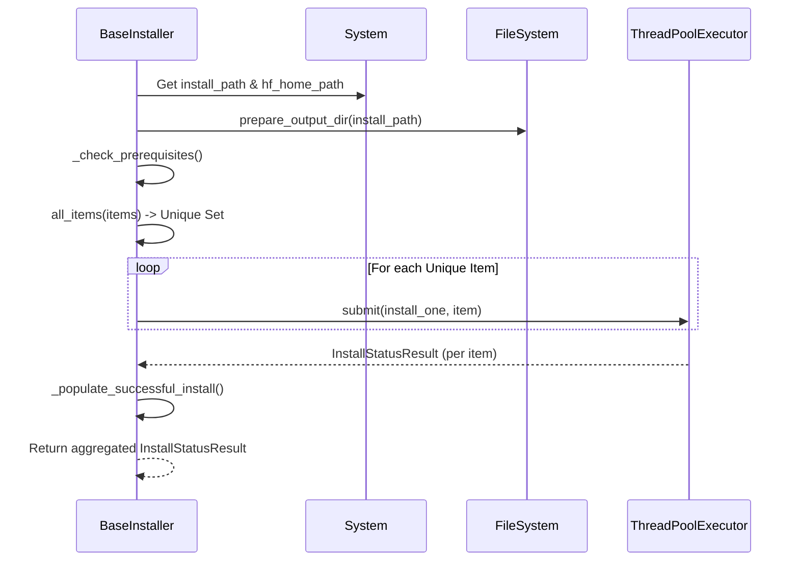

<!-- source: DeepWiki mcp.deepwiki.com · repo NVIDIA/cloudai · page 6.1 Installation System · fetched 2026-10-26 -->

# Installation System

<details>
<summary>Relevant source files</summary>

The following files were used as context for generating this wiki page:

- [conf/experimental/megatron_bridge/test_scenario/megatron_bridge_qwen_30b.toml](conf/experimental/megatron_bridge/test_scenario/megatron_bridge_qwen_30b.toml)
- [src/cloudai/_core/base_installer.py](src/cloudai/_core/base_installer.py)
- [src/cloudai/_core/install_status_result.py](src/cloudai/_core/install_status_result.py)
- [src/cloudai/_core/installables.py](src/cloudai/_core/installables.py)
- [src/cloudai/systems/kubernetes/kubernetes_installer.py](src/cloudai/systems/kubernetes/kubernetes_installer.py)
- [src/cloudai/systems/slurm/slurm_installer.py](src/cloudai/systems/slurm/slurm_installer.py)
- [src/cloudai/util/__init__.py](src/cloudai/util/__init__.py)
- [tests/systems/slurm/test_installer.py](tests/systems/slurm/test_installer.py)
- [tests/test_base_installer.py](tests/test_base_installer.py)
- [tests/test_git_repo_installer.py](tests/test_git_repo_installer.py)

</details>


The Installation System is a core infrastructure component of CloudAI that manages the installation, verification, and removal of dependencies required for running AI workloads. It provides a unified framework for managing various types of installable resources such as Docker images, Git repositories, Python environments, HuggingFace models, and files across different computing environments.

For information on Docker image caching specifically, see [Docker Image Management](6.2).

## Overview

The Installation System is built using the template method pattern, allowing for scheduler-specific implementations (e.g., Slurm, Kubernetes) while maintaining a common interface via `BaseInstaller`. It handles prerequisite checking, concurrent installation using `ThreadPoolExecutor`, and duplicate handling to ensure each resource is only processed once.

### System Architecture Mapping

The following diagram bridges the natural language concepts of "Installation" to the specific classes and relationships in the codebase.

```mermaid
flowchart TD
    subgraph "Code Entity Space: Core"
        BaseInstaller["BaseInstaller (abstract)<br/>_core/base_installer.py"]
        Installable["Installable (ABC)<br/>_core/installables.py"]
        ISR["InstallStatusResult<br/>_core/install_status_result.py"]
    end
    
    subgraph "Code Entity Space: Implementations"
        SlurmInstaller["SlurmInstaller<br/>systems/slurm/slurm_installer.py"]
        K8sInstaller["KubernetesInstaller<br/>systems/kubernetes/kubernetes_installer.py"]
        
        DockerImage["DockerImage"]
        GitRepo["GitRepo"]
        PyExec["PythonExecutable"]
        HFModel["HFModel"]
        File["File"]
    end
    
    BaseInstaller --> SlurmInstaller
    BaseInstaller --> K8sInstaller
    
    Installable <|-- DockerImage
    Installable <|-- GitRepo
    Installable <|-- PyExec
    Installable <|-- HFModel
    Installable <|-- File
    
    BaseInstaller -- "manages" --> Installable
    BaseInstaller -- "returns" --> ISR
```
Sources: [src/cloudai/_core/base_installer.py:34-43](), [src/cloudai/_core/installables.py:25-34](), [src/cloudai/_core/install_status_result.py:22-30]()

## Installer Architecture

### BaseInstaller

`BaseInstaller` [src/cloudai/_core/base_installer.py:34-43]() defines the lifecycle for resource management. It implements the high-level orchestration logic while delegating specific actions to subclasses via abstract methods like `install_one`, `uninstall_one`, and `is_installed_one`.

Key features include:
- **Low-Thread Detection**: `is_low_thread_environment` [src/cloudai/_core/base_installer.py:57-69]() checks `systemd` properties (`TasksMax`) to avoid crashing in restricted environments (e.g., login nodes with strict process limits). If detected, `num_workers` [src/cloudai/_core/base_installer.py:92-99]() is set to 1.
- **Concurrent Execution**: `install` [src/cloudai/_core/base_installer.py:172-221]() and `uninstall` [src/cloudai/_core/base_installer.py:223-264]() use a `ThreadPoolExecutor` to process items in parallel.
- **Duplicate Handling**: `all_items` [src/cloudai/_core/base_installer.py:126-129]() ensures that even if multiple tests require the same `DockerImage` or `GitRepo`, it is only installed once by utilizing `set()` operations on the items.
- **Dry-Run Support**: `mark_as_installed` [src/cloudai/_core/base_installer.py:266-284]() allows CloudAI to simulate an installation by updating the `installed_path` of items without performing actual disk operations.

Sources: [src/cloudai/_core/base_installer.py:57-99](), [src/cloudai/_core/base_installer.py:126-129](), [src/cloudai/_core/base_installer.py:172-284]()

### Installable Types

Installables are data structures representing dependencies. They implement `__eq__` and `__hash__` [src/cloudai/_core/installables.py:29-32]() to facilitate duplicate detection.

| Type | Description | Key Properties |
| :--- | :--- | :--- |
| `DockerImage` | Container images. | `cache_filename` [src/cloudai/_core/installables.py:55-74](), `installed_path`. |
| `GitRepo` | Source code repositories. | `url`, `commit`, `repo_name` [src/cloudai/_core/installables.py:114-116](). |
| `PythonExecutable` | Virtual environments. | `git_repo`, `venv_name` [src/cloudai/_core/installables.py:149-150](). |
| `HFModel` | HuggingFace models. | `model_name`, `installed_path`. |
| `File` | Static local files. | `src`, `installed_path`. |

Sources: [src/cloudai/_core/installables.py:36-197]()

## Implementation Details

### SlurmInstaller
The `SlurmInstaller` [src/cloudai/systems/slurm/slurm_installer.py:40-41]() manages dependencies for HPC environments.
- **Prerequisites**: Checks for `git`, `sbatch`, `srun`, and specific `srun` options like `--container-image` [src/cloudai/systems/slurm/slurm_installer.py:43-50]().
- **Docker Management**: Uses `DockerImageCacheManager` [src/cloudai/systems/slurm/slurm_installer.py:55]() to convert Docker URLs into `.sqsh` files for Enroot/Pyxis.
- **HF Models**: Uses `HFModelManager` [src/cloudai/systems/slurm/slurm_installer.py:56]() to download models to a shared `hf_home_path`. It includes a check `_is_hf_home_accessible` [src/cloudai/systems/slurm/slurm_installer.py:106]() to skip downloads if the path is only available on compute nodes.

Sources: [src/cloudai/systems/slurm/slurm_installer.py:43-56](), [src/cloudai/systems/slurm/slurm_installer.py:105-114]()

### KubernetesInstaller
The `KubernetesInstaller` [src/cloudai/systems/kubernetes/kubernetes_installer.py:40-41]() handles cloud-native deployments.
- **Prerequisites**: Validates local `kubeconfig` using `lazy.k8s.config.load_kube_config()` [src/cloudai/systems/kubernetes/kubernetes_installer.py:65]().
- **File Handling**: Copies local files to the designated `install_path` [src/cloudai/systems/kubernetes/kubernetes_installer.py:85-87]().

Sources: [src/cloudai/systems/kubernetes/kubernetes_installer.py:63-75](), [src/cloudai/systems/kubernetes/kubernetes_installer.py:84-87]()

## Installation Workflow

The following diagram illustrates the data flow when `install()` is called on a `BaseInstaller` implementation.


Sources: [src/cloudai/_core/base_installer.py:131-169](), [src/cloudai/_core/base_installer.py:172-221](), [src/cloudai/util/__init__.py:61-91]()

### Path Validation and Preparation
Before installation, the system uses `prepare_output_dir` [src/cloudai/util/__init__.py:61-91]() to:
1. Resolve the path format [src/cloudai/util/__init__.py:26-31]().
2. Verify the parent directory exists and is writable [src/cloudai/util/__init__.py:34-49]().
3. Create the directory if it does not exist [src/cloudai/util/__init__.py:75-76]().

Sources: [src/cloudai/util/__init__.py:26-91]()

---

