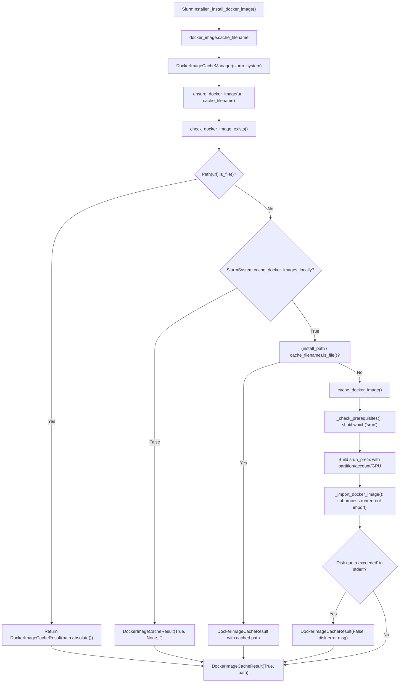
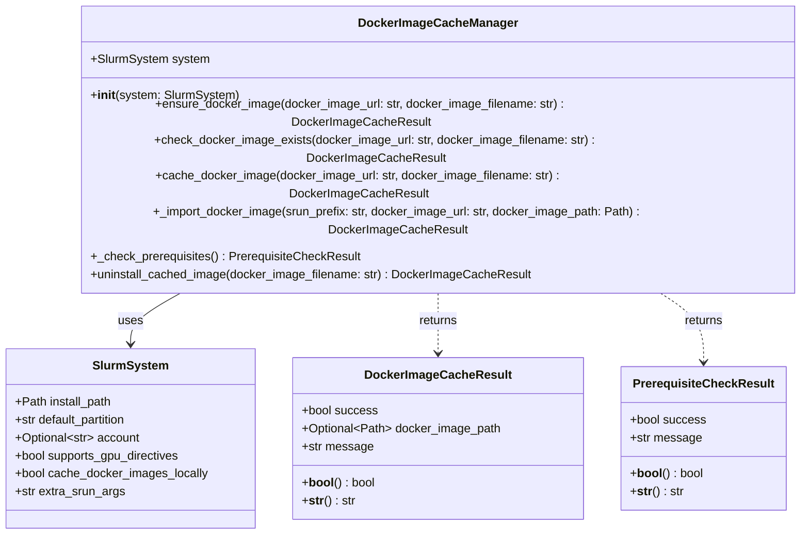
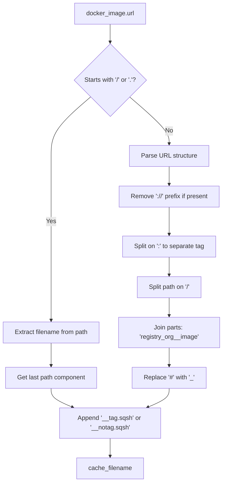
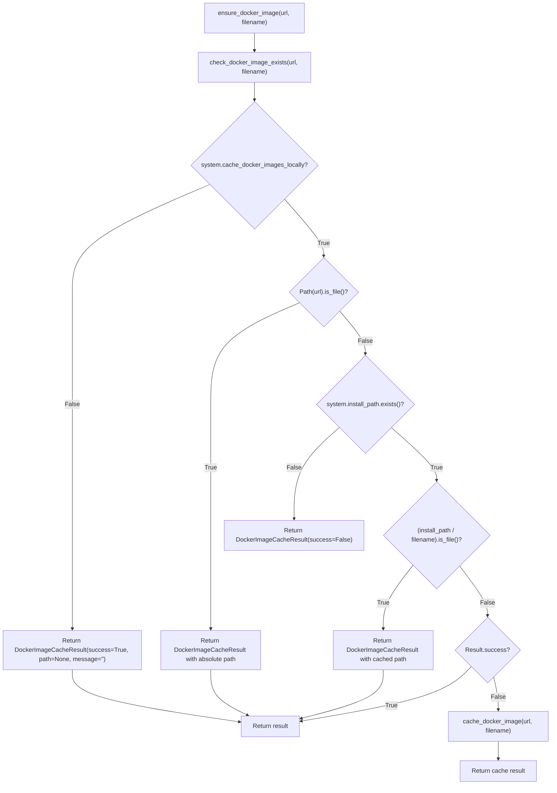
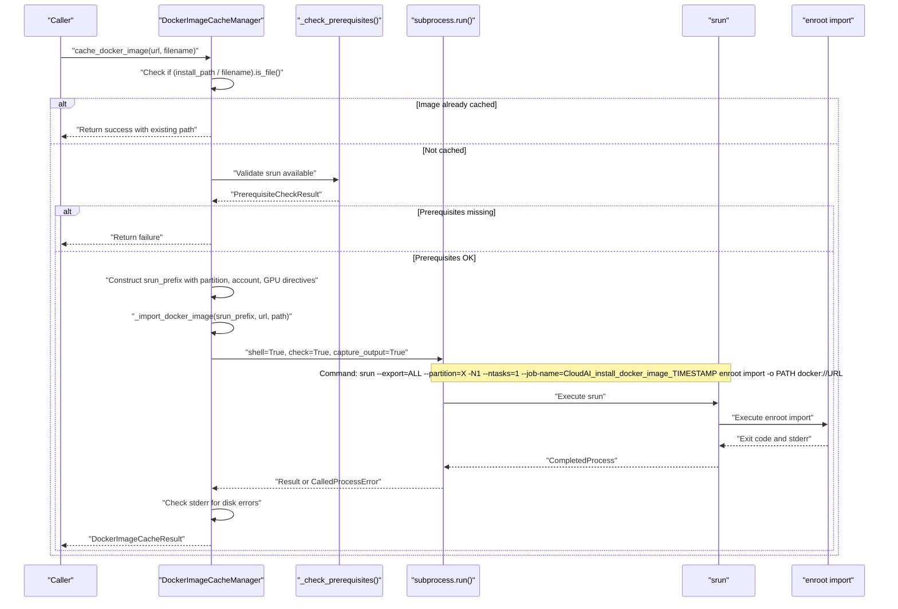
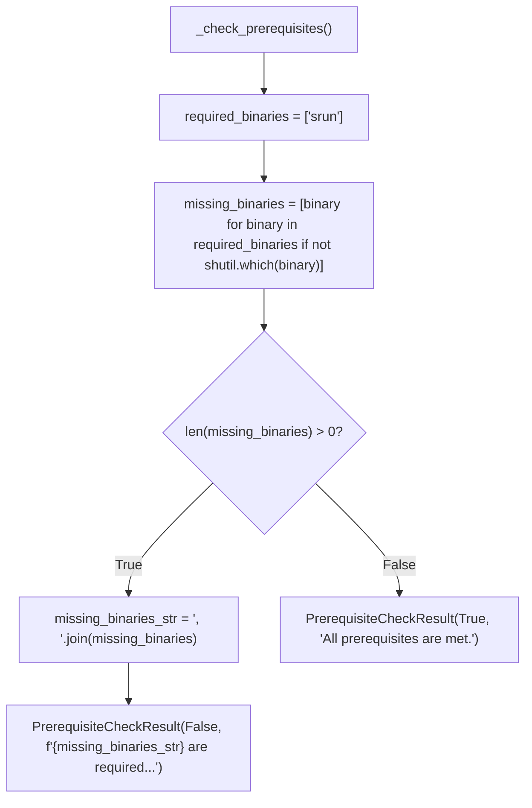
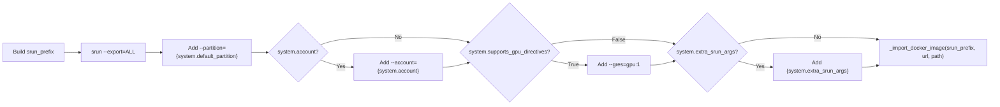

<!-- source: DeepWiki mcp.deepwiki.com · repo NVIDIA/cloudai · page 6.2 Docker Image Management · fetched 2026-10-26 -->

# Docker Image Management

Relevant source files

The following files were used as context for generating this wiki page:

- [src/cloudai/_core/base_installer.py](src/cloudai/_core/base_installer.py)
- [src/cloudai/systems/slurm/docker_image_cache_manager.py](src/cloudai/systems/slurm/docker_image_cache_manager.py)
- [src/cloudai/util/__init__.py](src/cloudai/util/__init__.py)
- [tests/test_base_installer.py](tests/test_base_installer.py)
- [tests/test_docker_image_cache_manager.py](tests/test_docker_image_cache_manager.py)

## Purpose and Scope

This document covers the `DockerImageCacheManager` class, which manages Docker image caching for CloudAI workloads executing on Slurm clusters. The system uses `enroot` to import container images via Slurm job submission, storing them in a centralized cache directory defined by `SlurmSystem.install_path`.

The cache manager integrates with the broader installation system (see page 6.1) and is invoked by `SlurmInstaller` when processing `DockerImage` installables. For Slurm command generation, see page 4.2.

Key components covered:
- **Cache Filename Generation**: `DockerImage.cache_filename` property that transforms URLs into filesystem-safe names.
- **Enroot Import Workflow**: Using `srun` and `enroot import` to download images on compute nodes.
- **Disk Quota Handling**: Error detection and reporting for disk space issues.
- **System Configuration**: Integration with `SlurmSystem` attributes for partition, account, and GPU directives.

Sources: [src/cloudai/systems/slurm/docker_image_cache_manager.py:112-121](), [src/cloudai/_core/installables.py:54-73]()

## Architecture Overview

The `DockerImageCacheManager` class is instantiated by `SlurmInstaller` and provides three primary operations: `ensure_docker_image()`, `cache_docker_image()`, and `uninstall_cached_image()`. The manager interacts with the Slurm scheduler via `subprocess.run()` to execute `enroot import` commands on compute nodes.

Title: ensure_docker_image() Execution Flow

Sources: [src/cloudai/systems/slurm/docker_image_cache_manager.py:123-141](), [src/cloudai/systems/slurm/docker_image_cache_manager.py:143-187](), [src/cloudai/systems/slurm/docker_image_cache_manager.py:189-223]()

## Core Classes and Data Structures

### DockerImageCacheManager

The `DockerImageCacheManager` class provides the primary API for Docker image operations. It is initialized with a `SlurmSystem` instance.

Title: Class Structure and Relationships

Sources: [src/cloudai/systems/slurm/docker_image_cache_manager.py:112-121](), [src/cloudai/systems/slurm/docker_image_cache_manager.py:70-110](), [src/cloudai/systems/slurm/docker_image_cache_manager.py:31-68]()

### Result Classes

Both `DockerImageCacheResult` and `PrerequisiteCheckResult` implement `__bool__()` and `__str__()` methods, allowing them to be used in boolean contexts and error messages directly.

| Class | Fields | Purpose |
|-------|--------|---------|
| `DockerImageCacheResult` | `success: bool` `docker_image_path: Optional[Path]` `message: str` | Returned by all image operations; `docker_image_path` is `None` when caching is disabled. |
| `PrerequisiteCheckResult` | `success: bool` `message: str` | Returned by `_check_prerequisites()` to indicate missing system tools. |

Sources: [src/cloudai/systems/slurm/docker_image_cache_manager.py:70-110](), [src/cloudai/systems/slurm/docker_image_cache_manager.py:31-68]()

### Public Methods

| Method | Parameters | Returns | Invoked By |
|--------|------------|---------|------------|
| `ensure_docker_image()` | `docker_image_url: str` `docker_image_filename: str` | `DockerImageCacheResult` | `SlurmInstaller._install_docker_image()` |
| `check_docker_image_exists()` | `docker_image_url: str` `docker_image_filename: str` | `DockerImageCacheResult` | `ensure_docker_image()` for validation |
| `cache_docker_image()` | `docker_image_url: str` `docker_image_filename: str` | `DockerImageCacheResult` | `ensure_docker_image()` if image not cached |
| `uninstall_cached_image()` | `docker_image_filename: str` | `DockerImageCacheResult` | `SlurmInstaller._uninstall_docker_image()` |

Sources: [src/cloudai/systems/slurm/docker_image_cache_manager.py:123-141](), [src/cloudai/systems/slurm/docker_image_cache_manager.py:143-187](), [src/cloudai/systems/slurm/docker_image_cache_manager.py:225-266](), [src/cloudai/systems/slurm/docker_image_cache_manager.py:288-311]()

## Cache Filename Generation

### DockerImage.cache_filename Property

The `DockerImage` class defines a `cache_filename` property that transforms container URLs into filesystem-safe filenames.

Title: DockerImage.cache_filename Generation Logic

Sources: [src/cloudai/_core/installables.py:54-73]()

### Cache Filename Examples

| Input URL | Generated cache_filename | Notes |
|-----------|--------------------------|-------|
| `http://fake_url/img` | `fake_url__img__notag.sqsh` | HTTP URL without tag |
| `nvcr.io#nvidia/pytorch:24.02-py3` | `nvcr.io_nvidia__pytorch__24.02-py3.sqsh` | Registry with `#` separator and tag |
| `/local/disk/file` | `file__notag.sqsh` | Absolute local path |
| `gitlab.com#org/team/image:latest` | `gitlab.com_org_team__image__latest.sqsh` | Multi-level path with tag |

Sources: [src/cloudai/_core/installables.py:54-73](), [tests/test_base_installer.py:144-154]()

## Image Resolution and Caching Process

### ensure_docker_image() Logic

The `ensure_docker_image()` method delegates to `check_docker_image_exists()` for validation, then optionally to `cache_docker_image()` if caching is enabled in the system configuration.

Title: ensure_docker_image() Decision Flow

Sources: [src/cloudai/systems/slurm/docker_image_cache_manager.py:123-141](), [src/cloudai/systems/slurm/docker_image_cache_manager.py:143-187]()

### cache_docker_image() Implementation

The `cache_docker_image()` method performs the actual import operation via Slurm job submission.

Title: cache_docker_image() Execution Sequence

Sources: [src/cloudai/systems/slurm/docker_image_cache_manager.py:225-266](), [src/cloudai/systems/slurm/docker_image_cache_manager.py:189-223]()

## System Tool Prerequisites

### _check_prerequisites() Validation

The `_check_prerequisites()` method verifies that `srun` is available on the system PATH.

Title: _check_prerequisites() Logic Flow

Sources: [src/cloudai/systems/slurm/docker_image_cache_manager.py:268-286]()

## Slurm Integration and Configuration

### srun Command Construction

The `cache_docker_image()` method builds the `srun_prefix` using `SlurmSystem` attributes.

Title: srun_prefix Construction Logic

Sources: [src/cloudai/systems/slurm/docker_image_cache_manager.py:258-266]()

### SlurmSystem Configuration Mapping

| Attribute | Effect on srun Command | Example |
|-----------|------------------------|---------|
| `default_partition` | `--partition={value}` | `--partition=batch` |
| `account` | `--account={value}` and modifies job name | `--account=my_account` |
| `supports_gpu_directives` | `--gres=gpu:1` if `True` | `--gres=gpu:1` |
| `extra_srun_args` | Appended verbatim | `--reservation test_res` |
| `install_path` | Output path for cached image | `/shared/cache/image.sqsh` |

Sources: [src/cloudai/systems/slurm/docker_image_cache_manager.py:258-264](), [tests/test_docker_image_cache_manager.py:243-265]()

## Error Handling and Result Types

### Disk Space Error Detection

The system specifically detects and reports disk-related errors by examining `stderr` output from the `enroot import` command.

| Error Pattern | Reported Message |
|---------------|------------------|
| `Disk quota exceeded` | Includes "Disk quota exceeded" in `DockerImageCacheResult.message` |
| `Write error` | Includes "Write error" in `DockerImageCacheResult.message` |

Sources: [src/cloudai/systems/slurm/docker_image_cache_manager.py:214-219](), [tests/test_docker_image_cache_manager.py:128-143]()

---

