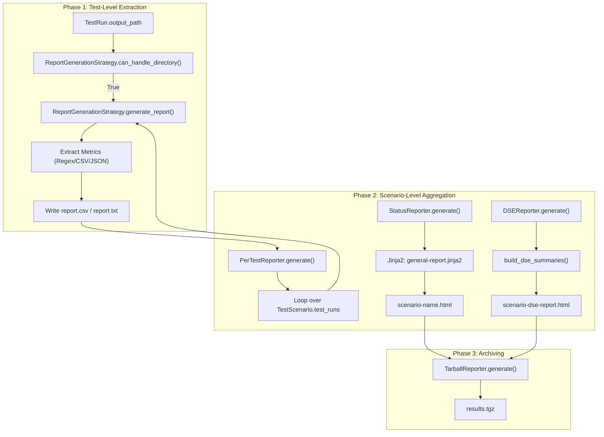

<!-- source: DeepWiki mcp.deepwiki.com · repo NVIDIA/cloudai · page 6.3 Reporting and Metrics · fetched 2026-10-26 -->

# Reporting and Metrics

Relevant source files

The following files were used as context for generating this wiki page:

- [src/cloudai/_core/report_generation_strategy.py](src/cloudai/_core/report_generation_strategy.py)
- [src/cloudai/report_generator/comparison_report.py](src/cloudai/report_generator/comparison_report.py)
- [src/cloudai/report_generator/dse_report.py](src/cloudai/report_generator/dse_report.py)
- [src/cloudai/report_generator/tool/bokeh_report_tool.py](src/cloudai/report_generator/tool/bokeh_report_tool.py)
- [src/cloudai/report_generator/tool/report_tool_interface.py](src/cloudai/report_generator/tool/report_tool_interface.py)
- [src/cloudai/report_generator/tool/tensorboard_data_reader.py](src/cloudai/report_generator/tool/tensorboard_data_reader.py)
- [src/cloudai/report_generator/util.py](src/cloudai/report_generator/util.py)
- [src/cloudai/reporter.py](src/cloudai/reporter.py)
- [src/cloudai/util/base-report.jinja2](src/cloudai/util/base-report.jinja2)
- [src/cloudai/util/dse-report.jinja2](src/cloudai/util/dse-report.jinja2)
- [src/cloudai/util/general-report.jinja2](src/cloudai/util/general-report.jinja2)
- [src/cloudai/util/lazy_imports.py](src/cloudai/util/lazy_imports.py)
- [src/cloudai/util/nixl_report_template.jinja2](src/cloudai/util/nixl_report_template.jinja2)
- [src/cloudai/workloads/chakra_replay/chakra_replay.py](src/cloudai/workloads/chakra_replay/chakra_replay.py)
- [src/cloudai/workloads/chakra_replay/report_generation_strategy.py](src/cloudai/workloads/chakra_replay/report_generation_strategy.py)
- [src/cloudai/workloads/nccl_test/nccl_comparison_report.py](src/cloudai/workloads/nccl_test/nccl_comparison_report.py)
- [src/cloudai/workloads/nemo_launcher/grading_strategy.py](src/cloudai/workloads/nemo_launcher/grading_strategy.py)
- [src/cloudai/workloads/nemo_launcher/report_generation_strategy.py](src/cloudai/workloads/nemo_launcher/report_generation_strategy.py)
- [src/cloudai/workloads/nemo_run/report_generation_strategy.py](src/cloudai/workloads/nemo_run/report_generation_strategy.py)
- [src/cloudai/workloads/nixl_bench/nixl_summary_report.py](src/cloudai/workloads/nixl_bench/nixl_summary_report.py)
- [src/cloudai/workloads/ucc_test/report_generation_strategy.py](src/cloudai/workloads/ucc_test/report_generation_strategy.py)
- [tests/report_generation_strategy/test_comparison_report.py](tests/report_generation_strategy/test_comparison_report.py)
- [tests/test_reporter.py](tests/test_reporter.py)
- [tests/test_test_scenario_parser.py](tests/test_test_scenario_parser.py)

## Purpose and Scope

CloudAI provides a comprehensive reporting and metrics extraction system designed for performance analysis at both individual test and aggregate scenario levels. The system is responsible for validating test success, extracting workload-specific metrics (e.g., throughput, latency, bandwidth), and generating interactive visualizations.

Key capabilities include:
- **Metric Extraction:** Automated parsing of raw logs (stdout, CSV, JSON) into structured metrics via `ReportGenerationStrategy`.
- **Validation:** Success checking through `TestDefinition.was_run_successful()`.
- **Scenario Aggregation:** Combining results from multiple test runs into summary reports using `Reporter` implementations.
- **Visualizations:** Generating interactive HTML reports using Jinja2 templates and Bokeh/Chart.js charts.
- **DSE Insights:** Specialized reporting for Design Space Exploration to track optimization trajectories and identify best configurations.

---

## Report Generation Architecture

The reporting pipeline is triggered either automatically upon job completion by the `Runner` or manually via the CLI `generate-report` command [src/cloudai/cli/handlers.py:28]().

### Core Components

| Component | Code Entity | Level | Purpose |
|-----------|-------------|-------|---------|
| **Base Strategy** | `ReportGenerationStrategy` | Test | Abstract base for workload-specific metric extraction [src/cloudai/_core/report_generation_strategy.py:24](). |
| **Base Reporter** | `Reporter` | Scenario | Abstract base for aggregating data across a `TestScenario` [src/cloudai/core/reporter.py:24](). |
| **Per-Test Aggregator** | `PerTestReporter` | Scenario | Iterates through all `TestRun` objects and triggers their specific strategies [src/cloudai/reporter.py:61](). |
| **Status Summary** | `StatusReporter` | Scenario | Generates an HTML status dashboard and CLI summary table [src/cloudai/reporter.py:83](). |
| **DSE Reporter** | `DSEReporter` | Scenario | Produces optimization charts and persists "best-config" TOMLs [src/cloudai/reporter.py:138](). |
| **Comparison Reporter** | `ComparisonReport` | Scenario | Base for comparing metrics (e.g., Bandwidth) across different test groups [src/cloudai/report_generator/comparison_report.py:52](). |

### Reporting Pipeline Lifecycle

The following diagram illustrates how CloudAI transitions from raw test outputs to finalized scenario reports.

**Sources:** [src/cloudai/reporter.py:61-110](), [src/cloudai/reporter.py:138-177](), [src/cloudai/cli/handlers.py:28]()

---

## Metric Extraction Strategies

Each workload implements a `ReportGenerationStrategy` to parse its specific output format. Strategies declare supported metrics via the `metrics` class variable [src/cloudai/_core/report_generation_strategy.py:27]().

### Common Workload Strategies

| Workload | Strategy Class | Key Metrics | Source |
|----------|----------------|-------------|--------|
| **NeMo Run** | `NeMoRunReportGenerationStrategy` | `step-time` (Avg/Median/Min/Max) | [src/cloudai/workloads/nemo_run/report_generation_strategy.py:62]() |
| **NIXL Bench** | `NIXLBenchComparisonReport` | `avg_lat`, `bw_gb_sec` | [src/cloudai/workloads/nixl_bench/nixl_summary_report.py:36]() |
| **NCCL Test** | `NcclComparisonReport` | `bus_bw`, `algbw` | [src/cloudai/workloads/nccl_test/nccl_comparison_report.py]() |

### Implementation Example: NeMo Run
The `NeMoRunReportGenerationStrategy` searches `stdout.txt` for `train_step_timing in s:` patterns [src/cloudai/workloads/nemo_run/report_generation_strategy.py:31-59](). It calculates statistics using `numpy` and generates an interactive Bokeh line plot of step times [src/cloudai/workloads/nemo_run/report_generation_strategy.py:88-131]().

**Sources:** [src/cloudai/workloads/nemo_run/report_generation_strategy.py:62-132]()

---

## Scenario-Level Reporters

Scenario reporters provide the high-level view of a benchmarking campaign.

### StatusReporter and Jinja2 Templates
The `StatusReporter` uses Jinja2 templates located in `src/cloudai/util/` to generate HTML reports [src/cloudai/reporter.py:87-92]().
- **Data Flow:** It converts `TestRun` objects into `ReportItem` dataclasses, which include node lists and relative log paths [src/cloudai/reporter.py:39-58]().
- **CLI Output:** It uses the `rich` library to print a formatted "Scenario results" table to the console [src/cloudai/reporter.py:117-135]().

### Comparison and ComparisonReport
The `ComparisonReport` is an abstract base for reports that compare multiple test runs (e.g., comparing bandwidth across different node counts) [src/cloudai/report_generator/comparison_report.py:52]().
- **Grouping:** Uses `TestRunsGrouper` to cluster tests based on configuration parameters [src/cloudai/report_generator/comparison_report.py:74]().
- **Visualization:** Generates multi-column `rich` tables with delta percentages and Bokeh charts [src/cloudai/report_generator/comparison_report.py:95-120]().

### DSEReporter
Specialized for Design Space Exploration [src/cloudai/reporter.py:138]().
- **Trajectory Tracking:** Parses `trajectory.csv` to visualize reward progress over agent steps [src/cloudai/reporter.py:185-191]().
- **Economic Metrics:** Calculates "Saved GPU Hours" and "Saved USD" by comparing the optimization trajectory against a projected baseline [src/cloudai/report_generator/dse_report.py:164-193]().
- **Best Config:** Automatically identifies the highest-reward step and persists its parameters as a standalone TOML file for reproduction [src/cloudai/reporter.py:178-199]().

**Sources:** [src/cloudai/reporter.py:83-137](), [src/cloudai/report_generator/comparison_report.py:52-120](), [src/cloudai/report_generator/dse_report.py:164-215]()

---

## Visualization Tools

CloudAI integrates two primary visualization libraries:

### Bokeh (Interactive Charts)
The `BokehReportTool` provides a wrapper for creating interactive performance plots [src/cloudai/report_generator/tool/bokeh_report_tool.py:33]().
- **SOL Lines:** Supports adding "Speed-of-Light" (SOL) reference lines to compare actual vs. theoretical performance [src/cloudai/report_generator/tool/bokeh_report_tool.py:91-121]().
- **Automatic Scaling:** Includes a JS-based tick formatter (`bokeh_size_unit_js_tick_formatter`) that converts bytes to human-readable units (KB, MB, GB) dynamically on the axis [src/cloudai/report_generator/util.py:31-53]().

### Chart.js (DSE Dashboard)
The DSE report uses Chart.js for lightweight, responsive reward charts within the generated HTML [src/cloudai/util/dse-report.jinja2:5](). It visualizes the exploration path taken by the DSE agent [src/cloudai/report_generator/dse_report.py:202-216]().

**Sources:** [src/cloudai/report_generator/tool/bokeh_report_tool.py:33-184](), [src/cloudai/report_generator/util.py:31-53](), [src/cloudai/util/dse-report.jinja2:1-7]()

---

## Reporting Metadata

For Slurm-based systems, CloudAI captures extensive environment metadata to include in reports:
- **System Metadata:** CPU/GPU architecture, memory, and OS info [src/cloudai/systems/slurm/slurm_metadata.py:42]().
- **Job Metadata:** Node lists, elapsed time, and scheduler-specific job IDs [src/cloudai/systems/slurm/slurm_metadata.py:40]().
- **Library Versions:** CUDA, NCCL, and MPI versions used during the run [src/cloudai/systems/slurm/slurm_metadata.py:33-36]().

This metadata is loaded via `load_system_metadata` and attached to `ReportItem` objects for display in the final HTML summary [src/cloudai/report_generator/util.py:188-205]().

**Sources:** [src/cloudai/systems/slurm/slurm_metadata.py:33-43](), [src/cloudai/reporter.py:54-55](), [src/cloudai/report_generator/util.py:188-205]()

---

