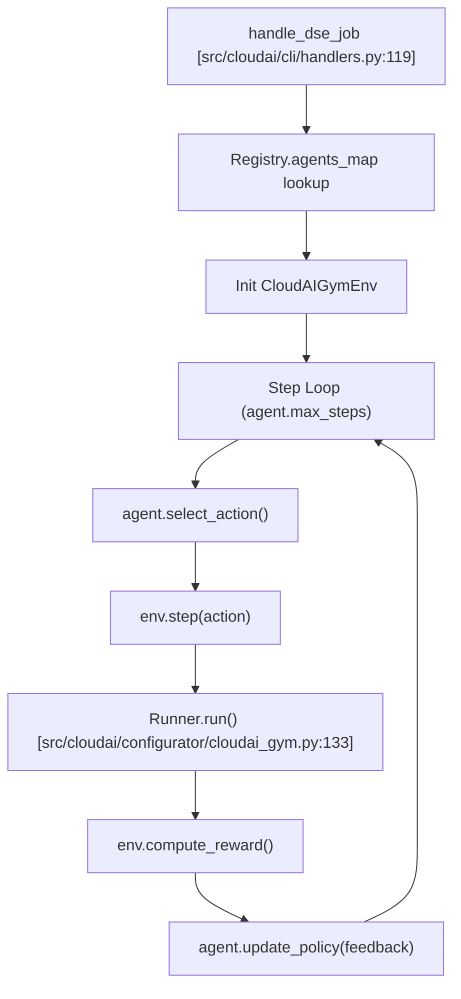
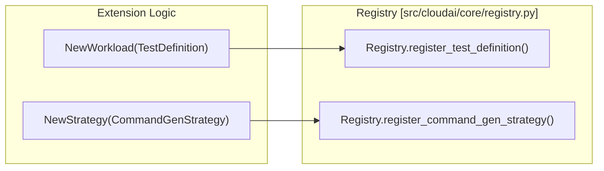

<!-- source: DeepWiki mcp.deepwiki.com · repo NVIDIA/cloudai · page 7 Advanced Features · fetched 2026-10-26 -->

# Advanced Features

<details>
<summary>Relevant source files</summary>

The following files were used as context for generating this wiki page:

- [src/cloudai/cli/handlers.py](src/cloudai/cli/handlers.py)
- [src/cloudai/configurator/base_agent.py](src/cloudai/configurator/base_agent.py)
- [src/cloudai/configurator/grid_search.py](src/cloudai/configurator/grid_search.py)
- [tests/test_agents.py](tests/test_agents.py)
- [tests/test_cloudaigym.py](tests/test_cloudaigym.py)
- [tests/test_job_type_handler.py](tests/test_job_type_handler.py)

</details>


This document covers the advanced capabilities of CloudAI, focusing on its Design Space Exploration (DSE) framework and extensibility. These features enable automated benchmarking across large parameter spaces and allow developers to integrate new workloads, systems, and strategies into the framework.

## Design Space Exploration (DSE)

CloudAI includes a built-in Design Space Exploration (DSE) engine that treats the benchmarking process as an optimization problem. It uses a Gym-like environment interface to systematically or heuristically explore configurations for AI workloads.

### DSE Architecture

The DSE system is built around the `CloudAIGymEnv` and an agent-based system. The `Registry` maps agent types to their respective implementations, such as the `GridSearchAgent`.

**Design Space Exploration Code Entities**

```mermaid
classDiagram
    class CloudAIGymEnv {
        +TestRun test_run
        +BaseRunner runner
        +define_action_space()
        +step(action)
        +compute_reward(observation)
    }
    
    class BaseAgent {
        <<abstract>>
        +select_action()
        +update_policy(feedback)
    }
    
    class GridSearchAgent {
        +action_combinations
        +index
        +select_action()
    }

    class Registry {
        +agents_map
    }
    
    CloudAIGymEnv --> TestRun : modifies [src/cloudai/configurator/cloudai_gym.py:30]()
    CloudAIGymEnv --> BaseRunner : executes [src/cloudai/configurator/cloudai_gym.py:30]()
    GridSearchAgent --|> BaseAgent : implements [src/cloudai/configurator/grid_search.py:24]()
    Registry --> BaseAgent : manages [src/cloudai/core/registry.py:46]()
```
Sources: [src/cloudai/configurator/cloudai_gym.py:30-50](), [src/cloudai/configurator/base_agent.py:34-54](), [src/cloudai/configurator/grid_search.py:24-40](), [src/cloudai/core/registry.py:46-60]()

### DSE Workflow

When the CLI detects a DSE job (parameters defined as lists in TOML), it invokes `handle_dse_job`. This handler initializes the environment and agent to iterate through the parameter space.

**DSE Execution Logic**


Sources: [src/cloudai/cli/handlers.py:119-165](), [src/cloudai/configurator/cloudai_gym.py:112-149]()

For deep technical details on reward functions, efficiency ratios, and optimization agents, see **[Design Space Exploration (DSE)](#7.1)**.

## Extending CloudAI

CloudAI is designed as a plugin-based framework. Almost every core component—Workloads, Systems, Runners, and Report Generators—can be extended by implementing specific interfaces and registering them via Python entry points.

### Extension Points

The framework relies on the `Registry` singleton to discover and load components. New features are added by inheriting from base classes:

| Component | Base Class | Purpose |
| :--- | :--- | :--- |
| **Workload** | `TestDefinition` | Defines command arguments and installation requirements. |
| **System** | `System` | Defines infrastructure (Slurm, Kubernetes, etc.). |
| **Runner** | `BaseRunner` | Handles job submission and monitoring logic. |
| **Strategy** | `CommandGenStrategy` | Generates the actual execution scripts (e.g., sbatch). |
| **Reporter** | `ReportGenerationStrategy` | Parses output files to generate visual reports. |

### Registration Pattern

CloudAI uses a registration pattern where components are added to the `Registry` during initialization. This allows for modularity and avoids circular dependencies.


Sources: [src/cloudai/core/registry.py:110-140](), [src/cloudai/core/workload/test_definition.py:25-40]()

For a step-by-step guide on adding new workloads, implementing `constraint_check`, and using the plugin system, see **[Extending CloudAI](#7.2)**.

## Advanced Configuration Logic

### DSE Parameter Detection
CloudAI automatically identifies a DSE job by checking if any `CmdArgs`, `extra_env_vars`, or `num_nodes` are provided as lists rather than scalar values.

*   **Logic Location**: The `is_dse_job` property on `TestRun` evaluates the parameter space. [src/cloudai/core/test_scenario/test_run.py:130-150]() (Note: Reference based on `tests/test_job_type_handler.py:35-53` logic).
*   **Combination Generation**: `GridSearchAgent` uses `itertools.product` to expand the cross-product of all list parameters. [src/cloudai/configurator/grid_search.py:57-62]()

### Reward Functions
The `CloudAIGymEnv` supports multiple reward functions for optimization, including `inverse`, `negative`, and `identity`, as well as workload-specific ones like `ai_dynamo_weighted_normalized`.
Sources: [src/cloudai/configurator/cloudai_gym.py:170-200](), [tests/test_cloudaigym.py:116-145]()

## Child Pages

*   **[Design Space Exploration (DSE)](#7.1)**: Deep dive into the `CloudAIGymEnv`, agent configurations, reward calculation, and GPU-hour savings reports.
*   **[Extending CloudAI](#7.2)**: Technical manual for developers on implementing new plugins, satisfying the `import-linter` boundaries, and registering components via `entry_points`.

---

