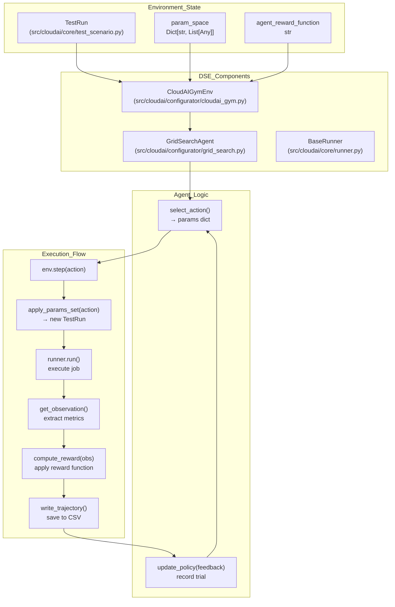
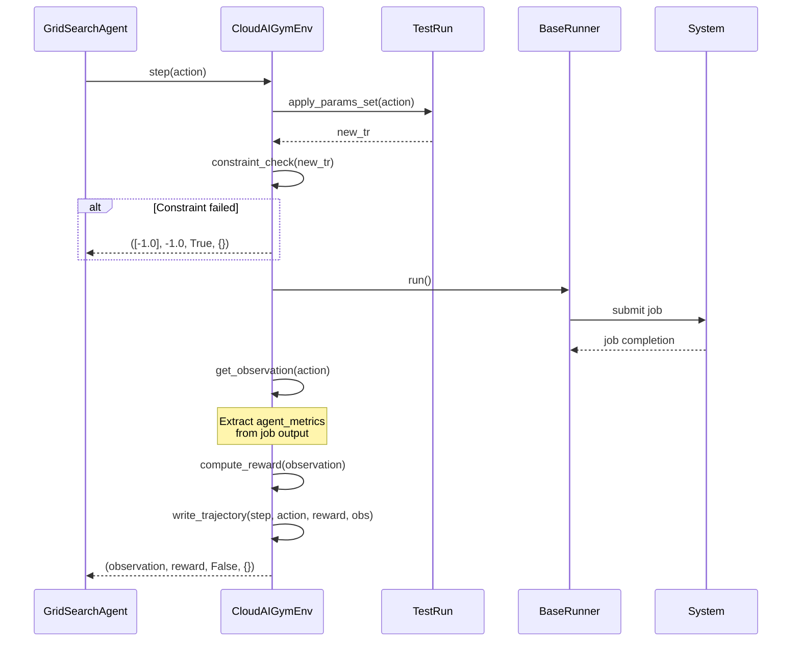
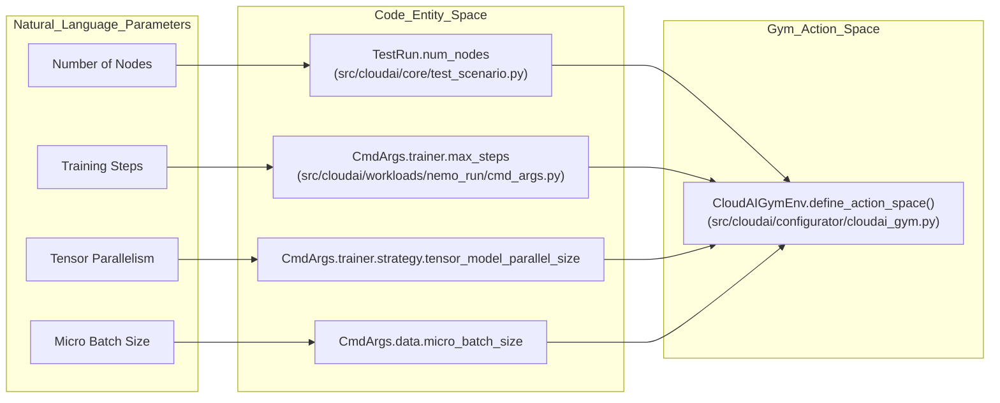
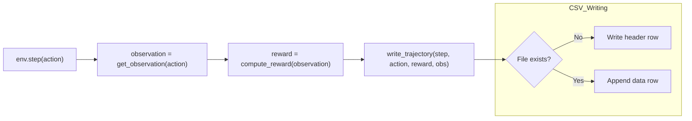

<!-- source: DeepWiki mcp.deepwiki.com · repo NVIDIA/cloudai · page 7.1 Design Space Exploration (DSE) · fetched 2026-10-26 -->

# Design Space Exploration (DSE)

Relevant source files

The following files were used as context for generating this wiki page:

- [src/cloudai/cli/handlers.py](src/cloudai/cli/handlers.py)
- [src/cloudai/configurator/__init__.py](src/cloudai/configurator/__init__.py)
- [src/cloudai/configurator/base_agent.py](src/cloudai/configurator/base_agent.py)
- [src/cloudai/configurator/grid_search.py](src/cloudai/configurator/grid_search.py)
- [src/cloudai/configurator/reward_functions.py](src/cloudai/configurator/reward_functions.py)
- [src/cloudai/report_generator/dse_report.py](src/cloudai/report_generator/dse_report.py)
- [src/cloudai/report_generator/util.py](src/cloudai/report_generator/util.py)
- [src/cloudai/reporter.py](src/cloudai/reporter.py)
- [src/cloudai/util/base-report.jinja2](src/cloudai/util/base-report.jinja2)
- [src/cloudai/util/dse-report.jinja2](src/cloudai/util/dse-report.jinja2)
- [src/cloudai/util/general-report.jinja2](src/cloudai/util/general-report.jinja2)
- [tests/test_agents.py](tests/test_agents.py)
- [tests/test_cloudaigym.py](tests/test_cloudaigym.py)
- [tests/test_job_type_handler.py](tests/test_job_type_handler.py)
- [tests/test_reporter.py](tests/test_reporter.py)

## Purpose and Scope

This document describes the Design Space Exploration (DSE) subsystem in CloudAI, which enables automatic parameter optimization through systematic exploration of hyperparameter spaces. DSE allows tests to define parameter ranges and uses agent-based exploration strategies to find optimal configurations.

For information about the CLI commands that invoke DSE, see [CLI Commands and Handlers](3.1). For details on test configuration and parameter definition, see [Test Framework](2.2).

---

## Overview

Design Space Exploration in CloudAI is a framework for automated parameter optimization that uses a Gym-like environment to explore hyperparameter spaces. When a test run contains parameter lists (rather than single values), it is automatically classified as a DSE job and processed through a specialized execution path.

### DSE Job Detection

A test run is classified as a DSE job when any of the following conditions are met:

| Condition | Example | Location |
|-----------|---------|----------|
| Parameter list in `cmd_args` | `trainer.max_steps=[1000, 2000]` | Test definition TOML |
| Parameter list in `extra_env_vars` | `BATCH_SIZE=["32", "64"]` | Test definition TOML |
| Parameter list in `num_nodes` | `num_nodes=[1, 2, 4]` | Test scenario TOML |

The detection logic is implemented in the `is_dse_job` property of `TestRun`.

**Sources:** [tests/test_job_type_handler.py:35-53](), [tests/test_cloudaigym.py:186-223]()

---

## DSE Architecture

The DSE system consists of three primary components working together in a closed loop:

### DSE Component Interaction

**Sources:** [src/cloudai/cli/handlers.py:120-167](), [src/cloudai/configurator/cloudai_gym.py:29-209]()

---

## CloudAIGymEnv: The DSE Environment

The `CloudAIGymEnv` class provides a Gym-compatible interface for parameter exploration. It manages test execution, observation extraction, and reward computation.

### Key Methods

| Method | Purpose | Returns |
|--------|---------|---------|
| `define_action_space()` | Returns `TestRun.param_space` | `Dict[str, List[Any]]` |
| `define_observation_space()` | Defines observation structure | `List[float]` |
| `step(action)` | Executes job with parameters | `(observation, reward, done, info)` |
| `compute_reward(observation)` | Applies reward function | `float` |
| `get_observation(action)` | Extracts metrics from results | `List[float]` |
| `write_trajectory(...)` | Logs step data to CSV | `None` |

### Step Execution Flow

The environment maintains two copies of the `TestRun`:
- `self.test_run`: Current state, updated with each action.
- `self.original_test_run`: Clean baseline, used if job execution fails.

**Sources:** [src/cloudai/configurator/cloudai_gym.py:87-132](), [tests/test_cloudaigym.py:148-159]()

---

## Parameter Space Definition

The parameter space is automatically constructed from all fields in the test definition that contain lists rather than scalar values.

### Parameter Space Mapping

**Sources:** [tests/test_cloudaigym.py:161-183](), [tests/test_cloudaigym.py:186-223]()

---

## Agent System

Agents implement exploration strategies to navigate the parameter space. The base agent interface defines the contract for all exploration algorithms.

### GridSearchAgent

The `GridSearchAgent` performs exhaustive search over all parameter combinations using Cartesian product expansion.

| Component | Responsibility |
|-----------|----------------|
| `get_all_combinations()` | Generates Cartesian product of the action space. |
| `select_action()` | Returns the next combination in the list. |
| `update_policy()` | Receives reward feedback from the environment. |

**Sources:** [src/cloudai/configurator/grid_search.py:20-80](), [tests/test_agents.py:39-67]()

---

## Reward Functions

Reward functions transform observations (metric values) into scalar rewards. CloudAI provides several built-in functions registered in the `Registry`.

| Function Name | Implementation | Purpose |
|--------------|----------------|---------|
| `inverse` | `1.0 / observation[0]` | Minimize latency/time. |
| `negative` | `-observation[0]` | Minimize error/loss. |
| `identity` | `observation[0]` | Maximize throughput/accuracy. |
| `ai_dynamo_ratio_normalized` | `throughput / (ttft * itl)` | AI Dynamo specific efficiency. |

**Sources:** [src/cloudai/configurator/reward_functions.py:21-128](), [tests/test_cloudaigym.py:94-145]()

---

## DSE Report and Visualization

CloudAI generates a specialized DSE report (`<scenario>-dse-report.html`) using Chart.js to visualize the optimization process.

### Efficiency Ratio and Savings
The `DSEReporter` calculates several efficiency metrics:
- **Efficiency Ratio**: Calculated as `Total Steps / Observed Steps`.
- **GPU-Hour Savings**: Savings calculated based on projected vs. actual runtimes.
- **Cost Savings (USD)**: Estimated using a mapping of GPU architectures (H100, B200, etc.) to hourly costs.

### GPU Hourly Cost Mapping
| GPU Family | Cost (USD/hr) |
|------------|---------------|
| H100 | 3.0 |
| B200 | 5.5 |
| GB200 | 11.0 |
| GB300 | 8.0 |

**Sources:** [src/cloudai/report_generator/dse_report.py:38-43](), [src/cloudai/report_generator/dse_report.py:164-183](), [src/cloudai/reporter.py:138-177]()

---

## Trajectory Tracking

DSE executions automatically log all exploration steps to a CSV file (`trajectory.csv`) located in the test run iteration directory.

### Trajectory Logging Logic

**Sources:** [src/cloudai/configurator/cloudai_gym.py:187-209](), [src/cloudai/reporter.py:178-204]()

---

## DSE Restrictions and Workflow

1. **No Dependencies**: DSE jobs cannot have test dependencies (e.g., `start_post_init`). All cases run consecutively. [src/cloudai/cli/handlers.py:124-131]()
2. **Sequential Execution**: Parameters are applied step-by-step.
3. **Best Config Persistence**: The reporter persists the highest-reward configuration for each iteration as a TOML file. [src/cloudai/reporter.py:178-204]()

**Sources:** [src/cloudai/cli/handlers.py:120-171](), [src/cloudai/reporter.py:138-177]()

---

