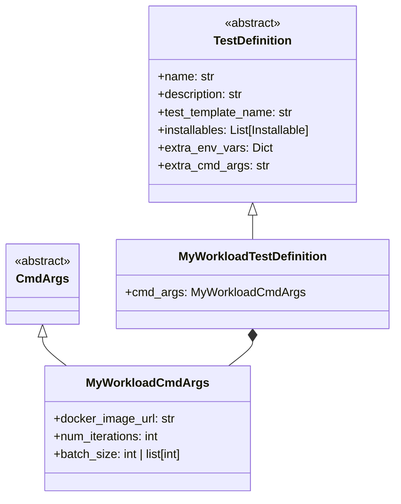
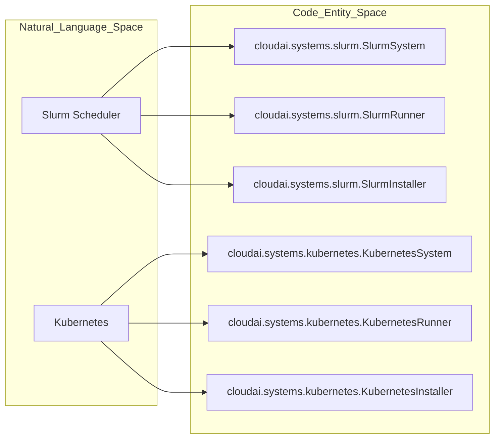

<!-- source: DeepWiki mcp.deepwiki.com · repo NVIDIA/cloudai · page 7.2 Extending CloudAI · fetched 2026-10-26 -->

# Extending CloudAI

<details>
<summary>Relevant source files</summary>

The following files were used as context for generating this wiki page:

- [.github/workflows/ci.yml](.github/workflows/ci.yml)
- [.github/workflows/docs.yml](.github/workflows/docs.yml)
- [.gitignore](.gitignore)
- [doc/Makefile](doc/Makefile)
- [doc/conf.py](doc/conf.py)
- [pyproject.toml](pyproject.toml)
- [src/cloudai/__init__.py](src/cloudai/__init__.py)
- [src/cloudai/_core/install_status_result.py](src/cloudai/_core/install_status_result.py)
- [src/cloudai/_core/registry.py](src/cloudai/_core/registry.py)
- [src/cloudai/core.py](src/cloudai/core.py)
- [src/cloudai/registration.py](src/cloudai/registration.py)
- [src/cloudai/test_parser.py](src/cloudai/test_parser.py)
- [tests/test_acceptance.py](tests/test_acceptance.py)
- [tests/test_init.py](tests/test_init.py)
- [tests/test_registry.py](tests/test_registry.py)
- [uv.lock](uv.lock)

</details>


## Purpose and Scope

This document provides a comprehensive guide for developers who want to extend CloudAI by adding new workloads, schedulers, DSE agents, or reporting capabilities. It explains CloudAI's plugin architecture, registration patterns, and step-by-step procedures for implementing custom components.

For information about using existing CloudAI features, see the Architecture Overview. For details on the core Registry system that enables extensibility, see the Registry System. For DSE-specific concepts, see Design Space Exploration.

## Extension Points Overview

CloudAI's extensibility is built on the Registry pattern, where all components are dynamically registered and looked up at runtime. The following diagram shows the complete set of extension points available in CloudAI:

```mermaid
graph TB
    subgraph "Registry_Extension_Points"
        TestDefs["test_definitions_map<br/>str → Type[TestDefinition]"]
        Systems["systems_map<br/>str → Type[System]"]
        Runners["runners_map<br/>str → Type[BaseRunner]"]
        Installers["installers_map<br/>str → Type[BaseInstaller]"]
        CmdStrats["command_gen_strategies_map<br/>(System, TestDef) → Strategy"]
        JsonStrats["json_gen_strategies_map<br/>(System, TestDef) → Strategy"]
        GradeStrats["grading_strategies_map<br/>(System, TestDef) → Strategy"]
        Reports["reports_map<br/>TestDef → Set[ReportStrategy]"]
        ScenarioReps["scenario_reports<br/>str → Type[Reporter]"]
        Agents["agents_map<br/>str → Type[BaseAgent]"]
        Rewards["reward_functions_map<br/>str → Callable"]
    end
    
    subgraph "Registration_Interface"
        AddTestDef["add_test_definition(name, cls)"]
        AddSystem["add_system(name, cls)"]
        AddRunner["add_runner(name, cls)"]
        AddInstaller["add_installer(name, cls)"]
        AddCmdStrat["add_command_gen_strategy(sys, tdef, cls)"]
        AddJsonStrat["add_json_gen_strategy(sys, tdef, cls)"]
        AddGradeStrat["add_grading_strategy(sys, tdef, cls)"]
        AddReport["add_report(tdef, cls)"]
        AddScenarioRep["add_scenario_report(name, cls, config)"]
        AddAgent["add_agent(name, cls)"]
        AddReward["add_reward_function(name, fn)"]
    end
    
    AddTestDef --> TestDefs
    AddSystem --> Systems
    AddRunner --> Runners
    AddInstaller --> Installers
    AddCmdStrat --> CmdStrats
    AddJsonStrat --> JsonStrats
    AddGradeStrat --> GradeStrats
    AddReport --> Reports
    AddScenarioRep --> ScenarioReps
    AddAgent --> Agents
    AddReward --> Rewards
```



**Extension Points by Category**

| Category | Extension Point | Key Type | Value Type | Purpose |
|----------|----------------|----------|------------|---------|
| **Workloads** | `test_definitions_map` | `str` | `Type[TestDefinition]` | Define new workload types |
| **Schedulers** | `systems_map` | `str` | `Type[System]` | Add scheduler abstractions |
| | `runners_map` | `str` | `Type[BaseRunner]` | Implement job execution |
| | `installers_map` | `str` | `Type[BaseInstaller]` | Handle prerequisite installation |
| **Strategies** | `command_gen_strategies_map` | `(Type[System], Type[TestDefinition])` | `Type[CommandGenStrategy]` | Generate bash commands |
| | `json_gen_strategies_map` | `(Type[System], Type[TestDefinition])` | `Type[JsonGenStrategy]` | Generate JSON/YAML configs |
| | `grading_strategies_map` | `(Type[System], Type[TestDefinition])` | `Type[GradingStrategy]` | Extract and grade metrics |
| **Reports** | `reports_map` | `Type[TestDefinition]` | `Set[Type[ReportGenerationStrategy]]` | Test-level reports |
| | `scenario_reports` | `str` | `Type[Reporter]` | Scenario-level reports |
| **DSE** | `agents_map` | `str` | `Type[BaseAgent]` | Parameter search agents |
| | `reward_functions_map` | `str` | `Callable` | Reward computation |

Sources: [src/cloudai/_core/registry.py:51-62](), [tests/test_init.py:109-180]()

---

## Adding a New Workload

Adding a new workload involves defining the configuration schema, implementing execution strategies, and registering the components.

### Step 1: Define TestDefinition and CmdArgs

Inherit from `TestDefinition` to define the workload's configuration schema. Separate command-line arguments into a `CmdArgs` subclass.



**Implementation Pattern:**

```python
from cloudai.core import TestDefinition, CmdArgs

class MyWorkloadCmdArgs(CmdArgs):
    docker_image_url: str
    num_iterations: int
    batch_size: int | list[int]

class MyWorkloadTestDefinition(TestDefinition):
    cmd_args: MyWorkloadCmdArgs
```

Sources: [src/cloudai/core.py:17-24](), [tests/test_acceptance.py:40-85]()

### Step 2: Implement Execution Strategies

Implement the appropriate strategy class for target schedulers. Slurm-based workloads use `SlurmCommandGenStrategy`.

```python
from cloudai.systems.slurm import SlurmCommandGenStrategy

class MyWorkloadSlurmCommandGenStrategy(SlurmCommandGenStrategy):
    def gen_exec_command(self, env_vars, cmd_args, extra_env, extra_cmd) -> str:
        srun_prefix = self.gen_srun_prefix(self.test_run, env_vars, cmd_args, extra_env, extra_cmd)
        return f"{srun_prefix} python /app/main.py --batch {cmd_args['batch_size']}"

    def _container_mounts(self, tr) -> list[str]:
        return []
```

Sources: [src/cloudai/systems/slurm/slurm_command_gen_strategy.py:32-32](), [tests/test_init.py:130-157]()

### Step 3: Register Components

All registrations must be added to `register_all()` in `src/cloudai/registration.py`.

```python
def register_all():
    # ...
    Registry().add_test_definition("MyWorkload", MyWorkloadTestDefinition)
    Registry().add_command_gen_strategy(SlurmSystem, MyWorkloadTestDefinition, MyWorkloadSlurmCommandGenStrategy)
```

Sources: [src/cloudai/registration.py:36-180](), [src/cloudai/__init__.py:36-38]()

---

## Adding a New Scheduler

Adding a scheduler requires implementing a `System`, `Runner`, and `Installer`.

### Component Association



Sources: [src/cloudai/registration.py:52-56](), [tests/test_init.py:20-24]()

### Step 1: Implement System and Runner

The `System` provides cluster state, while the `Runner` handles submission.

```python
from cloudai.core import System, Runner

class MyNewSystem(System):
    @property
    def scheduler(self) -> str:
        return "mynew"
    def update(self) -> None:
        pass

class MyNewRunner(Runner):
    def _submit_test(self, test_run):
        # Implementation for submitting job to scheduler
        pass
```

Sources: [src/cloudai/core.py:17-24](), [src/cloudai/_core/registry.py:64-155]()

---

## Plugin Registration via Entrypoints

CloudAI supports dynamic registration of external components (specifically DSE Agents) using Python entrypoints. This allows users to add agents without modifying the CloudAI source tree.

### Registration Pattern

CloudAI looks for entrypoints in the `cloudai.agents` group.

```python
def register_entrypoint_agents():
    from cloudai.configurator.base_agent import BaseAgent
    from cloudai.core import Registry

    eps = entry_points(group="cloudai.agents")
    for ep in eps:
        cls = ep.load()
        if issubclass(cls, BaseAgent):
            Registry().add_agent(ep.name, cls)
```

Sources: [src/cloudai/registration.py:21-34](), [tests/test_registry.py:37-38]()

---

## Architectural Boundaries (Import Linter)

To maintain a clean architecture, CloudAI enforces strict dependency boundaries using `import-linter`.

| Boundary | Restriction | Purpose |
|----------|-------------|---------|
| `_core` | Forbidden access from `systems`, `workloads`, `cli`, `util` | Ensures internal implementation details remain hidden. |
| `report_generator` | Forbidden access to `workloads`, `cli` | Keeps reporting as a leaf dependency. |
| `util` | Forbidden access to `systems`, `workloads`, `cli` | Utilities must be generic and independent. |

Sources: [pyproject.toml:129-158]()

## Constraint Checks

When extending workloads, the `constraint_check` method is the primary mechanism for validating if a system can run a specific test.

```python
class MyWorkloadTestDefinition(TestDefinition):
    def constraint_check(self, system: System, test_run: TestRun) -> list[str]:
        errors = []
        if test_run.num_nodes < 2:
            errors.append("MyWorkload requires at least 2 nodes.")
        return errors
```

Sources: [tests/test_acceptance.py:54-62](), [src/cloudai/_core/registry.py:54-54]()

---

