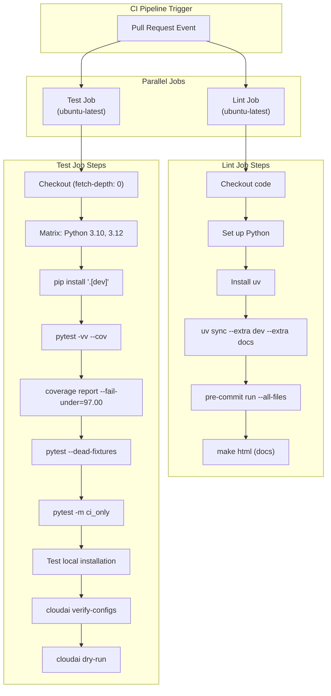
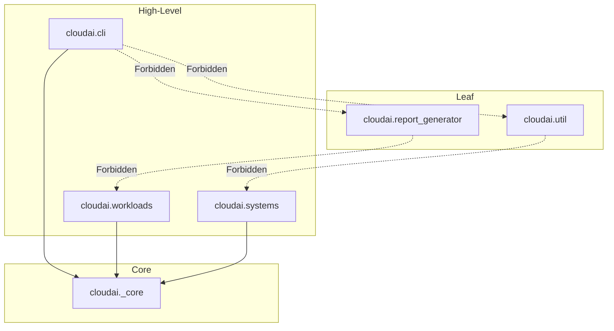

<!-- source: DeepWiki mcp.deepwiki.com · repo NVIDIA/cloudai · page 8 Development and CI · fetched 2026-10-26 -->

# Development and CI

<details>
<summary>Relevant source files</summary>

The following files were used as context for generating this wiki page:

- [.github/workflows/ci.yml](.github/workflows/ci.yml)
- [.github/workflows/docs.yml](.github/workflows/docs.yml)
- [.gitignore](.gitignore)
- [.pre-commit-config.yaml](.pre-commit-config.yaml)
- [CONTRIBUTING.md](CONTRIBUTING.md)
- [conf/common/test_scenario/ucc_generator_file.txt](conf/common/test_scenario/ucc_generator_file.txt)
- [conf/common/test_scenario/ucc_generator_test.toml](conf/common/test_scenario/ucc_generator_test.toml)
- [doc/Makefile](doc/Makefile)
- [doc/conf.py](doc/conf.py)
- [pyproject.toml](pyproject.toml)
- [uv.lock](uv.lock)

</details>


This document covers the development workflow, build system configuration, and continuous integration pipeline for CloudAI. It details the project structure, dependency management, code quality tooling, testing strategy, and automated checks that ensure code quality and maintainability.

For information about extending CloudAI with new workloads or systems, see [Extending CloudAI](#7.2). For details on the project structure from a user's perspective, see [Getting Started](#1.1).

## Development Workflow Overview

CloudAI uses a modern Python development stack with `uv` for package management, Ruff for linting and formatting, Pyright for type checking, and pytest for testing. The development workflow follows a pull request-based model with automated CI checks that run on every PR.

The project enforces strict code quality standards including:
- 100% test coverage requirement (97% minimum for the codebase) [[.github/workflows/ci.yml:72-72]()]
- Type checking with Pyright [[pyproject.toml:167-170]()]
- Import architecture contracts via `import-linter` [[pyproject.toml:129-158]()]
- Dead code detection with Vulture [[pyproject.toml:159-163]()]
- TOML formatting validation via Taplo [[pyproject.toml:51-51]()]

**Sources:** [.github/workflows/ci.yml:1-107](), [pyproject.toml:1-170]()

## Build System Configuration

CloudAI uses PDM as its build backend, configured in [pyproject.toml:70-72](). The build system configuration specifies:

```toml
[build-system]
requires = ["pdm-backend"]
build-backend = "pdm.backend"

[tool.pdm.version]
source = "scm"
fallback_version = "1.6.0+unknown"
```

The version is dynamically sourced from SCM (Source Code Management) tags using `source = "scm"`, with a fallback version of `1.6.0+unknown` [[pyproject.toml:74-76]()].

The project defines a single entry point for the CLI:

```toml
[project.scripts]
cloudai = "cloudai.cli:main"
```

This creates the `cloudai` command that invokes the `main` function in the `cloudai.cli` module [[pyproject.toml:36-37]()].

**Sources:** [pyproject.toml:36-37](), [pyproject.toml:70-76]()

## Dependency Structure

CloudAI's dependencies are organized into core runtime dependencies and optional groups for development and documentation.

### Core Runtime Dependencies

The following table lists runtime dependencies required for CloudAI execution [[pyproject.toml:20-33]()]:

| Package | Version | Purpose |
|---------|---------|---------|
| `bokeh` | ~=3.8 | Interactive visualization and plotting for reports |
| `pandas` | ~=2.3 | Data manipulation for metrics and report generation |
| `tbparse` | ~=0.0.9 | TensorBoard log parsing for training metrics |
| `toml` | ~=0.10.2 | TOML configuration file parsing |
| `kubernetes` | ~=35.0 | Kubernetes API client for K8s scheduler integration |
| `pydantic` | ~=2.12 | Data validation and settings management via models |
| `jinja2` | ~=3.1.6 | Template rendering for command generation |
| `websockets` | ~=16.0 | WebSocket support for AI Dynamo workload coordination |
| `rich` | ~=14.3 | Terminal output formatting and progress indicators |
| `click` | ~=8.3 | CLI framework and argument parsing |
| `huggingface-hub` | ~=1.4 | Hugging Face model download via `HFModel` installable |
| `aiconfigurator` | ~=0.5.0 | AI model configuration and optimization tool integration |

The project requires Python 3.10 or higher: `requires-python = ">=3.10"` [[pyproject.toml:34-34]()].

### Development and Documentation Groups

Dependencies are managed using `uv` with specific extras [[pyproject.toml:39-68]()]:
- **dev**: Includes `ruff`, `pyright`, `vulture`, `pytest`, `pytest-cov`, `import-linter`, and `taplo`.
- **docs**: Includes `sphinx`, `nvidia-sphinx-theme`, and `sphinxcontrib-mermaid`.
- **docs-cms**: Specialized group for BrightSpot CMS documentation builds using `sphinx-rtd-theme`.

**Sources:** [pyproject.toml:20-68]()

## CI Pipeline Architecture

The CI pipeline is defined in [.github/workflows/ci.yml]() and consists of two parallel jobs: `lint` and `test`.



### Lint Job
The lint job [[.github/workflows/ci.yml:8-38]()] uses `pre-commit` to run:
1. **Ruff**: Linting and formatting [[.pre-commit-config.yaml:29-36]()].
2. **Pyright**: Static type analysis [[.pre-commit-config.yaml:21-26]()].
3. **Vulture**: Dead code detection [[.pre-commit-config.yaml:38-42]()].
4. **Import-linter**: Architectural contract validation [[.pre-commit-config.yaml:44-48]()].
5. **Taplo**: TOML formatting [[.pre-commit-config.yaml:49-56]()].

### Test Job
The test job [[.github/workflows/ci.yml:39-107]()] runs across a Python version matrix and enforces a 97% coverage threshold on the entire codebase. It also validates the CLI by running `verify-configs` and a `dry-run` simulation of a `sleep` test scenario [[.github/workflows/ci.yml:95-106]()].

**Sources:** [.github/workflows/ci.yml:1-107](), [.pre-commit-config.yaml:1-56]()

## Code Quality Configuration

### Ruff and Import Sorting
Ruff is configured with a line length of 120 and includes rules for bugbear, docstrings, and complexity [[pyproject.toml:78-98]()]. It also enforces a policy against module-level imports of heavy libraries like `pandas` or `kubernetes`, requiring `cloudai.util.lazy_imports` instead [[pyproject.toml:117-119]()].

### Import Architecture Enforcement
`import-linter` enforces three primary contracts [[pyproject.toml:132-158]()]:
1. **Core Protection**: `cloudai._core` cannot be accessed directly by other modules; it must be accessed via the public API.
2. **Report Generator Isolation**: `cloudai.report_generator` is a leaf dependency and cannot import from `workloads` or `cli`.
3. **Util Isolation**: `cloudai.util` is a leaf dependency and cannot import from `systems`, `workloads`, or `cli`.



**Sources:** [pyproject.toml:78-158]()

## Testing Strategy

### Pytest Configuration
Pytest is configured to fail if markers are strict or if a parameter set is empty [[pyproject.toml:121-128]()]. It treats all warnings as errors to ensure a clean codebase [[pyproject.toml:127-127]()].

### Integration and Dry-Runs
The CI pipeline performs functional verification using the CLI [[.github/workflows/ci.yml:87-107]()]:
- `cloudai verify-configs`: Validates all TOML files in `conf/`.
- `cloudai dry-run`: Executes a scenario (e.g., `sleep.toml`) using a mock system configuration (`example_slurm_cluster.toml`) to ensure the runner and command generation logic works as expected.

**Sources:** [pyproject.toml:121-128](), [.github/workflows/ci.yml:87-107]()

## Documentation Build
CloudAI uses Sphinx for documentation. The pipeline supports two build types [[doc/Makefile:26-47]()]:
1. **Standard HTML**: Uses `nvidia_sphinx_theme` for GitHub Pages.
2. **CMS HTML**: Uses `sphinx_rtd_theme` and converts Mermaid diagrams to PNGs for compatibility with BrightSpot CMS.

The `doc/conf.py` script includes custom logic to skip internal Pydantic members (like `model_fields`) to keep the generated documentation clean [[doc/conf.py:30-50]()].

**Sources:** [doc/Makefile:1-60](), [doc/conf.py:1-115](), [.github/workflows/docs.yml:1-82]()

For detailed information on the build system, see [Build System and Dependencies](#8.1). For details on the CI pipeline, see [CI Pipeline and Code Quality](#8.2).

---

