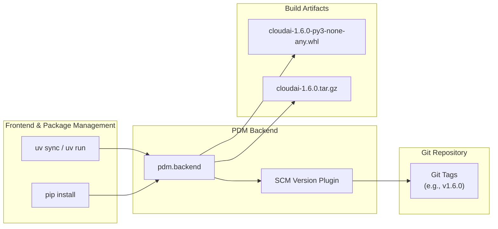
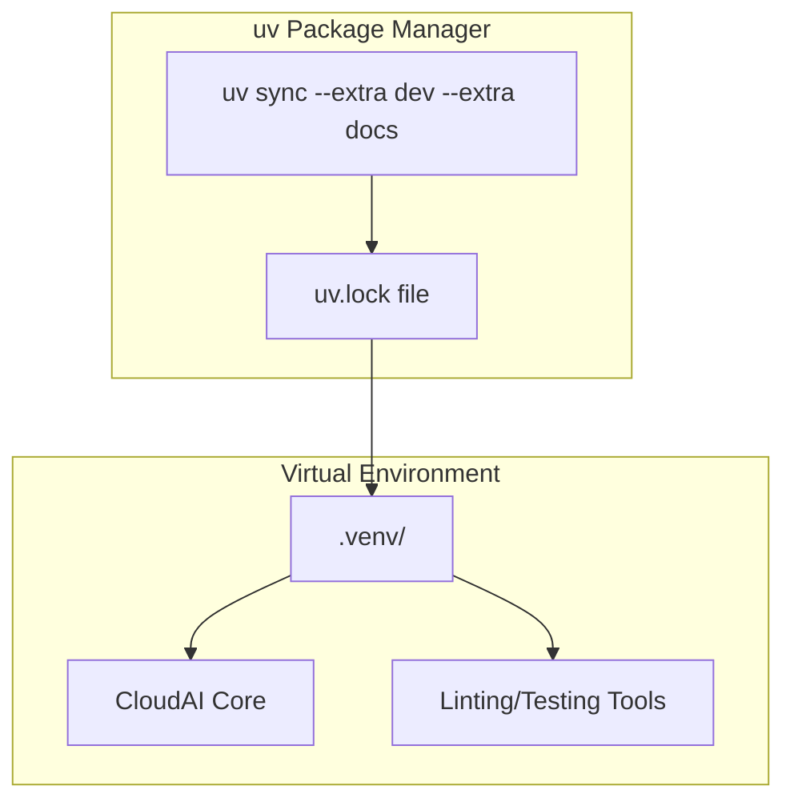
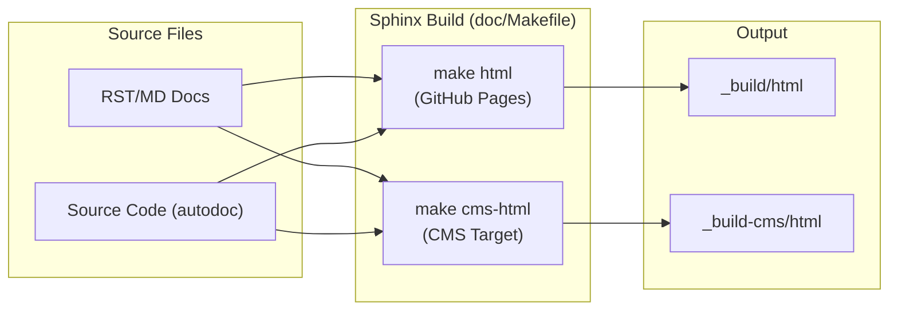

<!-- source: DeepWiki mcp.deepwiki.com · repo NVIDIA/cloudai · page 8.1 Build System and Dependencies · fetched 2026-10-26 -->

# Build System and Dependencies

<details>
<summary>Relevant source files</summary>

The following files were used as context for generating this wiki page:

- [.github/workflows/ci.yml](.github/workflows/ci.yml)
- [.github/workflows/docs.yml](.github/workflows/docs.yml)
- [.gitignore](.gitignore)
- [doc/Makefile](doc/Makefile)
- [doc/conf.py](doc/conf.py)
- [pyproject.toml](pyproject.toml)
- [uv.lock](uv.lock)

</details>


This page documents CloudAI's build system configuration, dependency management, and development tooling. It covers the package structure defined in `pyproject.toml`, the `uv` package manager integration, core and optional dependencies, and the configuration of development tools used for code quality enforcement.

For information about the CI pipeline that uses these configurations, see [CI Pipeline and Code Quality](8.2). For details on package initialization and component registration, see [Registry System](2.1).

---

## Purpose and Scope

CloudAI uses a modern Python packaging approach with:
- **PDM** as the build backend for PEP 517/518 compliance [pyproject.toml:70-72]().
- **uv** as the preferred package manager for fast dependency resolution and environment sync [.github/workflows/ci.yml:20-21]().
- **pyproject.toml** as the single source of truth for all project configuration [pyproject.toml:1-170]().
- **SCM-based versioning** for automatic version management from git tags [pyproject.toml:74-76]().
- **Optional dependency groups** for development and documentation builds [pyproject.toml:39-68]().
- **Lazy imports policy** enforced via linting to minimize startup overhead [pyproject.toml:117-119]().

---

## Package Metadata

CloudAI defines its core metadata in [pyproject.toml:17-34]():

| Property | Value | Description |
|----------|-------|-------------|
| `name` | `cloudai` | Package name for PyPI and imports |
| `version` | Dynamic (SCM) | Version determined from git tags |
| `requires-python` | `>=3.10` | Minimum Python version |
| `scripts` | `cloudai = "cloudai.cli:main"` | CLI entry point |

The package uses **dynamic versioning** [pyproject.toml:19]() to automatically derive the version from git tags using PDM's SCM plugin [pyproject.toml:74-76](). This eliminates manual version bumping in code.

**Sources:** [pyproject.toml:17-34](), [pyproject.toml:74-76]()

---

## Build System Configuration

CloudAI uses **PDM (Python Development Master)** as its build backend [pyproject.toml:70-72]():

Title: Build System Data Flow


The build system configuration [pyproject.toml:70-76]() specifies:

- **build-backend**: `pdm.backend` - Handles wheel and sdist generation.
- **version.source**: `scm` - Derives version from git tags.
- **version.fallback_version**: `1.6.0+unknown` - Used when git is unavailable.

**Sources:** [pyproject.toml:70-76]()

---

## Core Dependencies

CloudAI requires the following runtime dependencies [pyproject.toml:20-33]():

Title: Core Dependency Architecture
```mermaid
graph TB
    subgraph "CloudAI Framework"
        main["cloudai package"]
    end
    
    subgraph "CLI & UI"
        click["click~=8.3<br/>CLI Framework"]
        rich["rich~=14.3<br/>Terminal formatting"]
    end
    
    subgraph "Validation & Logic"
        pydantic["pydantic~=2.12<br/>Schema validation"]
        toml["toml~=0.10.2<br/>TOML parsing"]
        jinja2["jinja2~=3.1.6<br/>Template rendering"]
    end
    
    subgraph "Scheduler & Network"
        kubernetes["kubernetes~=35.0<br/>K8s API client"]
        websockets["websockets~=16.0<br/>Real-time monitoring"]
    end
    
    subgraph "Data & Analytics"
        pandas["pandas~=2.3<br/>Data manipulation"]
        bokeh["bokeh~=3.8<br/>Interactive visualization"]
        tbparse["tbparse~=0.0.9<br/>TensorBoard parsing"]
        aiconf["aiconfigurator~=0.5.0<br/>Workload configuration"]
    end
    
    subgraph "External Hubs"
        hf_hub["huggingface-hub~=1.4<br/>Model management"]
    end
    
    main --> click
    main --> rich
    main --> pydantic
    main --> toml
    main --> jinja2
    main --> kubernetes
    main --> websockets
    main --> pandas
    main --> bokeh
    main --> tbparse
    main --> aiconf
    main --> hf_hub
```

### Dependency Purpose Table

| Dependency | Version | Purpose |
|------------|---------|---------|
| `bokeh` | ~=3.8 | Interactive HTML visualization for reports [pyproject.toml:21]() |
| `pandas` | ~=2.3 | Data manipulation for metrics [pyproject.toml:22]() |
| `tbparse` | ~=0.0.9 | Parsing TensorBoard event files [pyproject.toml:23]() |
| `toml` | ~=0.10.2 | Parsing system/test/scenario configs [pyproject.toml:24]() |
| `kubernetes` | ~=35.0 | Kubernetes API client for K8s/RunAI [pyproject.toml:25]() |
| `pydantic` | ~=2.12 | Schema enforcement for configurations [pyproject.toml:26]() |
| `jinja2` | ~=3.1.6 | Template rendering for script generation [pyproject.toml:27]() |
| `websockets` | ~=16.0 | WebSocket support for RunAI log streaming [pyproject.toml:28]() |
| `rich` | ~=14.3 | Terminal formatting for CLI output [pyproject.toml:29]() |
| `click` | ~=8.3 | Command-line interface framework [pyproject.toml:30]() |
| `huggingface-hub`| ~=1.4 | HFModel installable support [pyproject.toml:31]() |
| `aiconfigurator` | ~=0.5.0 | Integration with AIConfigurator tool [pyproject.toml:32]() |

**Sources:** [pyproject.toml:20-33]()

---

## Optional Dependencies

CloudAI defines optional dependency groups for specialized tasks [pyproject.toml:39-68]():

### Development Dependencies (`dev` group)

Includes tools for linting, type checking, and testing [pyproject.toml:40-52]():

| Tool | Version | Purpose |
|------|---------|---------|
| `pre-commit` | ~=4.0 | Git hook management [pyproject.toml:41]() |
| `ruff` | ~=0.15 | Fast linter and formatter [pyproject.toml:42]() |
| `pyright` | ~=1.1 | Static type checker [pyproject.toml:44]() |
| `vulture` | ==2.14 | Dead code detection [pyproject.toml:46]() |
| `pytest` | ~=9.0 | Test framework [pyproject.toml:47]() |
| `import-linter` | ~=2.10 | Architecture contract enforcement [pyproject.toml:49]() |

### Documentation Dependencies (`docs` & `docs-cms` groups)

Sphinx-based documentation toolchain [pyproject.toml:53-68]():

| Tool | Version | Purpose |
|------|---------|---------|
| `sphinx` | ~=8.1 | Primary doc generator [pyproject.toml:54]() |
| `nvidia-sphinx-theme`| ~=0.0.8 | NVIDIA branding for docs [pyproject.toml:55]() |
| `sphinxcontrib-mermaid`| ~=2.0 | Mermaid diagram rendering [pyproject.toml:58]() |
| `autodoc-pydantic` | ~=2.2 | Pydantic model documentation [pyproject.toml:60]() |

**Sources:** [pyproject.toml:39-68]()

---

## Installation and Environment Management

CloudAI leverages `uv` for environment management [.github/workflows/ci.yml:20-21]().

Title: Environment Setup via uv


In CI, dependencies are synchronized using `uv sync` to ensure a reproducible environment [.github/workflows/ci.yml:26](). Local installation for testing is also performed via `pip install .` and `pip install -e .` (editable mode) [.github/workflows/ci.yml:83-85]().

**Sources:** [.github/workflows/ci.yml:20-26](), [.github/workflows/ci.yml:83-85]()

---

## Development Tool Configuration

### Ruff and Lazy Imports Policy

CloudAI enforces a **lazy imports policy** to keep the CLI responsive and avoid unnecessary heavy dependency loading [pyproject.toml:117-119]().

```toml
[tool.ruff.lint.flake8-tidy-imports]
# Ban certain modules from being imported at module level
banned-module-level-imports = ["pandas", "numpy", "kubernetes", "bokeh"]
```

Ruff is configured with a 120-character line length [pyproject.toml:79]() and selects several rule groups including `I` (isort), `B` (bugbear), and `D` (docstrings) [pyproject.toml:85-98]().

### Import Linter Contracts

Import-linter enforces architectural boundaries [pyproject.toml:129-157]():

1. **Internal Core Protection**: `cloudai._core` cannot be accessed directly by high-level modules [pyproject.toml:132-143]().
2. **Leaf Dependencies**: `cloudai.report_generator` [pyproject.toml:145-150]() and `cloudai.util` [pyproject.toml:152-157]() are leaf dependencies and cannot import from high-level systems, workloads, or the CLI.

### Pytest and Coverage

- **Pytest**: Configured to fail on empty parameter sets [pyproject.toml:125]() and treat warnings as errors [pyproject.toml:127]().
- **Coverage**: Enforces a **97.00%** coverage requirement on the `tests/` directory in CI [.github/workflows/ci.yml:72]().

**Sources:** [pyproject.toml:78-157](), [.github/workflows/ci.yml:72]()

---

## Documentation Build System

The documentation build system uses Sphinx with custom Pydantic processing [doc/conf.py:30-50]().

Title: Documentation Pipeline


The `doc/Makefile` provides targets for different environments:
- `html`: Standard build for GitHub Pages using the `nvidia_sphinx_theme` [doc/Makefile:35-40]().
- `cms-html`: Specialized build for BrightSpot CMS using `sphinx_rtd_theme` and PNG-rendered Mermaid diagrams [doc/Makefile:42-46]().

**Sources:** [doc/conf.py:30-50](), [doc/Makefile:26-46]()

---

