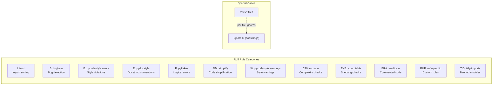
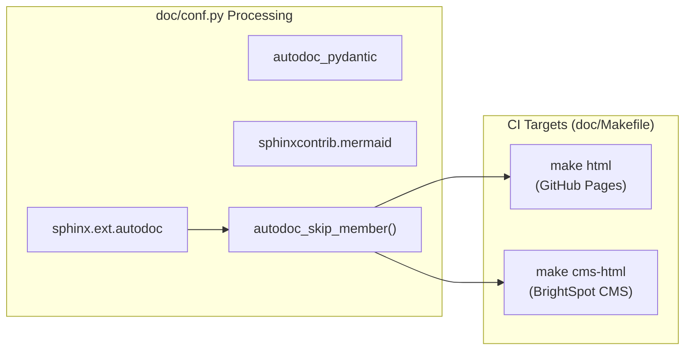

<!-- source: DeepWiki mcp.deepwiki.com · repo NVIDIA/cloudai · page 8.2 CI Pipeline and Code Quality · fetched 2026-10-26 -->

# CI Pipeline and Code Quality

<details>
<summary>Relevant source files</summary>

The following files were used as context for generating this wiki page:

- [.github/workflows/ci.yml](.github/workflows/ci.yml)
- [.github/workflows/docs.yml](.github/workflows/docs.yml)
- [.gitignore](.gitignore)
- [.pre-commit-config.yaml](.pre-commit-config.yaml)
- [CONTRIBUTING.md](CONTRIBUTING.md)
- [conf/common/test_scenario/ucc_generator_file.txt](conf/common/test_scenario/ucc_generator_file.txt)
- [conf/common/test_scenario/ucc_generator_test.toml](conf/common/test_scenario/ucc_generator_test.toml)
- [doc/Makefile](doc/Makefile)
- [doc/conf.py](doc/conf.py)
- [pyproject.toml](pyproject.toml)
- [tests/test_check_copyright_headers.py](tests/test_check_copyright_headers.py)
- [tests/test_toml_files.py](tests/test_toml_files.py)
- [uv.lock](uv.lock)

</details>


## Purpose and Scope

This document describes CloudAI's continuous integration (CI) pipeline and code quality enforcement mechanisms. It covers the GitHub Actions workflow, linting tools (ruff, pyright, vulture, import-linter), testing requirements, coverage thresholds, and architecture validation rules. For information about build configuration and dependency management, see [8.1 Build System and Dependencies]().

---

## CI Workflow Architecture

CloudAI's CI pipeline is defined in [.github/workflows/ci.yml:1-107]() and consists of two primary jobs: `lint` and `test`. The workflow triggers on pull requests ([.github/workflows/ci.yml:3-4]()) and enforces strict quality gates before code can be merged.

### Workflow Job Structure

```mermaid
flowchart TB
    PR["on: pull_request"]
    
    subgraph "jobs.lint"
        L1["actions/checkout@v6"]
        L2["actions/setup-python@v6"]
        L3["astral-sh/setup-uv@v5"]
        L4["uv sync --extra dev --extra docs"]
        L5["uv run pre-commit run --all-files"]
        L6["cd doc && make html"]
        
        L1 --> L2 --> L3 --> L4 --> L5 --> L6
    end
    
    subgraph "jobs.test"
        Matrix["strategy.matrix<br/>python-version: [3.10, 3.12]<br/>fail-fast: false"]
        T1["actions/checkout@v6<br/>fetch-depth: 0"]
        T2["actions/setup-python@v6"]
        T3["pip install '.[dev]'"]
        T4["pytest -vv --cov"]
        T5["coverage report --include='tests/*'<br/>--fail-under=97.00"]
        T6["pytest --dead-fixtures"]
        T7["pytest -vv -m ci_only"]
        T8["pip install . && pip uninstall<br/>pip install -e ."]
        T9["cloudai --help<br/>cloudai verify-configs"]
        
        Matrix --> T1
        T1 --> T2 --> T3 --> T4 --> T5 --> T6 --> T7 --> T8 --> T9
    end
    
    PR --> jobs.lint
    PR --> jobs.test
    
    jobs.lint --> Required["All steps must pass"]
    jobs.test --> Required
```



**Sources:** [.github/workflows/ci.yml:1-107]()

The workflow uses `fail-fast: false` in the test matrix ([.github/workflows/ci.yml:47]()), ensuring both Python 3.10 and 3.12 tests complete even if one version fails. The `test` job requires `fetch-depth: 0` ([.github/workflows/ci.yml:53]()) to support version detection via `scm` ([pyproject.toml:75]()).

---

## Linting and Static Analysis

### Ruff: Linter and Formatter

Ruff serves as both the linter and code formatter, replacing multiple tools with a single fast implementation.

#### Ruff Configuration

| Setting | Value | Purpose |
|---------|-------|---------|
| `line-length` | 120 | Maximum line length ([pyproject.toml:79]()) |
| `indent-style` | `"space"` | Use spaces for indentation ([pyproject.toml:82]()) |
| `select` | `["I", "B", "E", "D", "F", "SIM", "W", "C90", "EXE", "ERA", "RUF", "TID"]` | Enabled rule categories ([pyproject.toml:85-98]()) |
| `ignore` | `["D407", "D203", "D212", "D413", "TID252", "D100-107"]` | Disabled rules ([pyproject.toml:99-112]()) |

**Sources:** [pyproject.toml:78-112]()

#### Rule Categories



**Sources:** [pyproject.toml:85-115]()

CloudAI explicitly bans certain modules from being imported at the module level to ensure lazy loading ([pyproject.toml:117-119]()):
- `pandas`, `numpy`, `kubernetes`, `bokeh`

### Pyright: Static Type Checking

Pyright enforces type safety across the codebase.

| Setting | Value | Purpose |
|---------|-------|---------|
| `include` | `["src", "tests"]` | Directories to type-check ([pyproject.toml:168]()) |
| `exclude` | `["src/cloudai/workloads/nemo_run/cloudai_nemorun.py"]` | Excluded file ([pyproject.toml:169]()) |

**Sources:** [pyproject.toml:167-170]()

### Import Linter: Architecture Contracts

Import-linter enforces architectural boundaries between components ([pyproject.toml:129-158]()).

**Contract 1: `_core` Isolation** ([pyproject.toml:132-143]())
- **Forbidden:** `cloudai._core` cannot be accessed directly by `systems`, `workloads`, `util`, `cli`, or `report_generator`.
- **Exception:** Indirect imports via `cloudai` are allowed.

**Contract 2: Report Generator Leaf** ([pyproject.toml:145-151]())
- **Forbidden:** `cloudai.report_generator` cannot import from `workloads` or `cli`.

**Contract 3: Util Modules Leaf** ([pyproject.toml:152-157]())
- **Forbidden:** `cloudai.util` cannot import from `systems`, `workloads`, or `cli`.

---

## Testing and Coverage Requirements

### Pytest Configuration

CloudAI uses pytest with strict settings to ensure test reliability.

| Setting | Value | Purpose |
|---------|-------|---------|
| `testpaths` | `["tests"]` | Root for test discovery ([pyproject.toml:122]()) |
| `addopts` | `--strict-markers` | Fail on unknown markers ([pyproject.toml:124]()) |
| `filterwarnings` | `["error"]` | All warnings are errors ([pyproject.toml:127]()) |
| `exclude_also` | `["@abstractmethod"]` | Ignore abstract methods in coverage ([pyproject.toml:165]()) |

**Sources:** [pyproject.toml:121-127](), [pyproject.toml:164-165]()

### Coverage Thresholds

CloudAI enforces a **97% coverage requirement** specifically for the `tests/` directory to ensure test infrastructure is itself validated ([.github/workflows/ci.yml:72]()).

```bash
coverage report --include='tests/*' --precision=2 --fail-under=97.00
```

### Specialized Tests

#### `ci_only` Marker
Tests marked with `ci_only` ([pyproject.toml:126]()) are excluded from default local runs ([pyproject.toml:124]()) and only executed in CI ([.github/workflows/ci.yml:76]()).

#### Copyright Header Validation
The `tests/test_check_copyright_headers.py` script ([tests/test_check_copyright_headers.py:1-190]()) validates that all `.py` and `.toml` files contain the correct SPDX license header and copyright year ranges based on git history ([tests/test_check_copyright_headers.py:103-156]()).

---

## Documentation Pipeline

The documentation build is integrated into CI to prevent broken docstrings or Sphinx errors.



**Sources:** [doc/conf.py:31-50](), [doc/Makefile:35-46]()

### Documentation Formats
- **Standard HTML:** Uses `nvidia_sphinx_theme` for GitHub Pages ([doc/conf.py:104]()).
- **CMS HTML:** Uses `sphinx_rtd_theme` and converts Mermaid diagrams to PNG for internal CMS compatibility ([doc/conf.py:105-109]()).

---

## CLI and Configuration Verification

The CI pipeline "dogfoods" the CloudAI CLI to verify that example configurations in `conf/` remain valid against the Pydantic models.

| Command | Purpose |
|---------|---------|
| `cloudai verify-configs conf/` | Validates all TOML files in the repository ([.github/workflows/ci.yml:95]()). |
| `cloudai dry-run` | Executes a dry-run of the `sleep` scenario to verify runner logic ([.github/workflows/ci.yml:103-106]()). |

**Sources:** [.github/workflows/ci.yml:92-107](), [tests/test_toml_files.py:29-73]()

### Entity Mapping

| Code Entity | Quality Tool | Enforcement Site |
|-------------|--------------|------------------|
| `Parser` | `test_toml_files.py` | [tests/test_toml_files.py:55]() |
| `TestScenarioModel` | `pytest` | [tests/test_toml_files.py:72]() |
| `cloudai.cli` | `cloudai --help` | [.github/workflows/ci.yml:92]() |
| `pyproject.toml` | `taplo` | [pyproject.toml:51]() |
| `cloudai.util` | `import-linter` | [pyproject.toml:157]() |

**Sources:** [pyproject.toml:1-170](), [.github/workflows/ci.yml:1-107]()

---

