# Page: CloudAI Overview

# CloudAI Overview

<details>
<summary>Relevant source files</summary>

The following files were used as context for generating this wiki page:

- [.github/workflows/ci.yml](.github/workflows/ci.yml)
- [.github/workflows/docs.yml](.github/workflows/docs.yml)
- [.gitignore](.gitignore)
- [README.md](README.md)
- [doc/Makefile](doc/Makefile)
- [doc/conf.py](doc/conf.py)
- [doc/workloads/nemo_launcher.rst](doc/workloads/nemo_launcher.rst)
- [pyproject.toml](pyproject.toml)
- [src/cloudai/__init__.py](src/cloudai/__init__.py)
- [src/cloudai/_core/registry.py](src/cloudai/_core/registry.py)
- [src/cloudai/core.py](src/cloudai/core.py)
- [src/cloudai/registration.py](src/cloudai/registration.py)
- [src/cloudai/test_parser.py](src/cloudai/test_parser.py)
- [src/cloudai/util/hf_model_manager.py](src/cloudai/util/hf_model_manager.py)
- [tests/test_acceptance.py](tests/test_acceptance.py)
- [tests/test_hf_model_manager.py](tests/test_hf_model_manager.py)
- [tests/test_init.py](tests/test_init.py)
- [tests/test_registry.py](tests/test_registry.py)
- [uv.lock](uv.lock)

</details>


CloudAI is an automated benchmarking framework designed for grading and testing Data Center (DC) scale AI systems. It provides a unified technical interface for executing, monitoring, and analyzing high-performance machine learning workloads across diverse scheduler backends (Slurm, Kubernetes, RunAI, LSF, Standalone) with built-in support for over 19 workload types.

The framework is architected around a **Registry-driven plugin system**, which decouples the core orchestration logic from system-specific execution strategies and workload-specific command generation.

**Key Capabilities:**
- **Multi-Scheduler Support:** Native integrations for Slurm, Kubernetes, RunAI, LSF, and Standalone execution [tests/test_init.py:109-116]().
- **Three-Schema Configuration:** Declarative definition of System, Test, and TestScenario entities using TOML [README.md:18-26]().
- **Automated Lifecycle:** Handles prerequisite installation (Docker, Git, Python), job submission, status monitoring, and report generation [README.md:54-95]().
- **Complex Orchestration:** Supports sophisticated test dependency graphs including `start_post_init`, `start_post_comp`, and `end_post_comp` triggers.
- **Design Space Exploration (DSE):** Built-in Reinforcement Learning (RL) gym environment for automated hyperparameter optimization [src/cloudai/registration.py:38-46]().

For detailed technical documentation, see the following child pages:
- **[Getting Started](#1.1)** — Installation via `uv`, basic CLI usage (run, dry-run), and environment setup.
- **[Architecture Overview](#1.2)** — Deep dive into the Registry singleton, the three-schema system, and the execution lifecycle.

**Sources:** [README.md:1-12](), [src/cloudai/__init__.py:17-34](), [tests/test_init.py:109-127]()

## System and Workload Support Matrix

CloudAI provides a broad support matrix across different compute environments. Compatibility is implemented through specific `CommandGenStrategy` and `JsonGenStrategy` mappings in the Registry.

### Scheduler Support

| Scheduler | System Class | Runner Class | Installer Class |
| :--- | :--- | :--- | :--- |
| **Slurm** | `SlurmSystem` | `SlurmRunner` | `SlurmInstaller` |
| **Kubernetes** | `KubernetesSystem` | `KubernetesRunner` | `KubernetesInstaller` |
| **RunAI** | `RunAISystem` | `RunAIRunner` | `RunAIInstaller` |
| **LSF** | `LSFSystem` | `LSFRunner` | `LSFInstaller` |
| **Standalone** | `StandaloneSystem` | `StandaloneRunner` | `StandaloneInstaller` |

### Core Workloads

| Workload | Slurm | K8s | RunAI | Test Definition Class |
| :--- | :---: | :---: | :---: | :--- |
| **AI Dynamo** | ✅ | ✅ | ❌ | `AIDynamoTestDefinition` |
| **NCCL Test** | ✅ | ✅ | ✅ | `NCCLTestDefinition` |
| **NeMo Run (v2.0)** | ✅ | ❌ | ❌ | `NeMoRunTestDefinition` |
| **Megatron Run** | ✅ | ❌ | ❌ | `MegatronRunTestDefinition` |
| **NIXL Bench** | ✅ | ❌ | ❌ | `NIXLBenchTestDefinition` |
| **Sleep** | ✅ | ✅ | ❌ | `SleepTestDefinition` |

**Sources:** [README.md:29-52](), [tests/test_init.py:109-127](), [src/cloudai/registration.py:52-56]()

## High-Level Architecture

CloudAI bridges the gap between high-level user intent (TOML configurations) and low-level system execution (shell commands or API calls) through a layered abstraction.

### Component Mapping: From Configuration to Code Entities

This diagram illustrates how CloudAI translates "Natural Language" configuration concepts into specific Python classes and Registry entries.

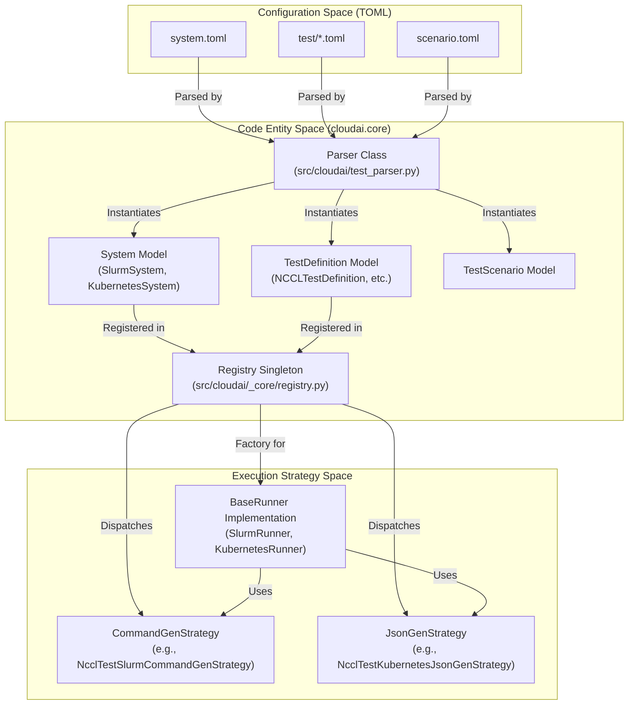

**Sources:** [src/cloudai/_core/registry.py:48-62](), [src/cloudai/__init__.py:17-34](), [tests/test_init.py:129-163]()

## Registry-Driven Extension Model

The `Registry` is a singleton that serves as the central source of truth for all pluggable components. It is populated during package initialization by the `register_all()` function.

### Registry Structure and Dispatch Logic

The following diagram shows how the `Registry` maps pairs of `System` and `TestDefinition` types to specific execution strategies.

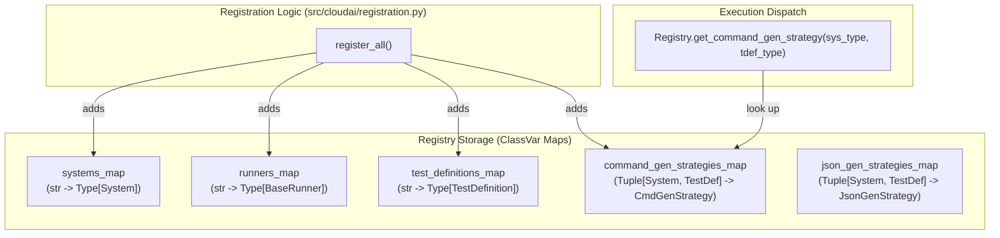

**Sources:** [src/cloudai/_core/registry.py:48-62](), [src/cloudai/registration.py:36-38](), [src/cloudai/registration.py:181-185]()

## Execution Lifecycle

CloudAI automates the entire benchmarking pipeline, from verifying local environment readiness to generating final performance reports.

1.  **Parsing & Validation:** The `Parser` loads TOML files and validates them against Pydantic models (System, Test, Scenario) [src/cloudai/__init__.py:17-24]().
2.  **Prerequisite Check:** The `BaseInstaller` (e.g., `SlurmInstaller`) checks if required `Installables` (Docker images, Git repos) are present [tests/test_init.py:21-24]().
3.  **Command Generation:** Based on the `System` type, CloudAI selects a `CommandGenStrategy` or `JsonGenStrategy` to generate execution scripts or manifests [tests/test_init.py:129-163]().
4.  **Job Submission:** The `BaseRunner` (e.g., `SlurmRunner`) submits jobs to the scheduler and tracks their `JobId` [tests/test_init.py:119-127]().
5.  **Monitoring:** The runner monitors job status via `is_job_completed()` and `is_job_running()` hooks [tests/test_acceptance.py:122-123]().
6.  **Reporting:** Once complete, the `ReportGenerationStrategy` extracts metrics and generates HTML/CSV reports [src/cloudai/registration.py:49-50]().

**Sources:** [README.md:54-85](), [src/cloudai/registration.py:49-50](), [tests/test_acceptance.py:108-132]()

---

# Page: Getting Started

# Getting Started

<details>
<summary>Relevant source files</summary>

The following files were used as context for generating this wiki page:

- [.github/workflows/ci.yml](.github/workflows/ci.yml)
- [.github/workflows/docs.yml](.github/workflows/docs.yml)
- [.gitignore](.gitignore)
- [README.md](README.md)
- [doc/Makefile](doc/Makefile)
- [doc/conf.py](doc/conf.py)
- [doc/workloads/nemo_launcher.rst](doc/workloads/nemo_launcher.rst)
- [pyproject.toml](pyproject.toml)
- [src/cloudai/cli/__init__.py](src/cloudai/cli/__init__.py)
- [src/cloudai/cli/cli.py](src/cloudai/cli/cli.py)
- [src/cloudai/util/hf_model_manager.py](src/cloudai/util/hf_model_manager.py)
- [tests/test_cli.py](tests/test_cli.py)
- [tests/test_hf_model_manager.py](tests/test_hf_model_manager.py)
- [uv.lock](uv.lock)

</details>


## Purpose and Scope

This page provides installation instructions, basic usage examples, and an overview of CloudAI's CLI modes. You will learn how to install CloudAI, verify your installation, and execute your first benchmark scenario.

For architectural details about how CloudAI components interact, see [Architecture Overview](#1.2). For detailed information about configuration file schemas, see [Configuration System](#3.2).

---

## Installation

### Prerequisites

CloudAI requires:
- **Python 3.10 or higher** [pyproject.toml:34]()
- **Access to a compute cluster** with one of the supported schedulers:
  - Slurm
  - Kubernetes
  - Standalone (for non-cluster workloads)

### Using uv (Recommended)

The `uv` tool manages Python versions and dependencies automatically, providing the fastest path to getting started:

```bash
git clone git@github.com:NVIDIA/cloudai.git
cd cloudai
uv run cloudai --help
```

This approach requires no manual dependency management. The `uv` tool will automatically:
1. Install the correct Python version if needed
2. Create an isolated virtual environment
3. Install all required dependencies from [pyproject.toml:20-33]()

**Sources:** [README.md:6-12](), [pyproject.toml:34](), [uv.lock:1-8]()

### Using pip

For traditional pip-based installation:

```bash
git clone git@github.com:NVIDIA/cloudai.git
cd cloudai
pip install .
```

This installs CloudAI and its core dependencies including:
- `bokeh~=3.8` - Interactive visualization
- `pandas~=2.3` - Data processing
- `kubernetes~=35.0` - Kubernetes integration
- `pydantic~=2.12` - Configuration validation
- `toml~=0.10.2` - TOML file parsing
- `aiconfigurator~=0.5.0` - AI configuration management
- Additional dependencies listed in [pyproject.toml:20-33]()

**Sources:** [pyproject.toml:17-37](), [README.md:16](), [uv.lock:32-57]()

### Development Installation

For contributors or users who need development tools (linters, type checkers, testing frameworks):

```bash
pip install '.[dev]'
```

This additionally installs:
- `ruff~=0.15` - Code linting and formatting
- `pyright~=1.1` - Static type checking
- `pytest~=9.0` - Testing framework
- `import-linter~=2.10` - Import dependency validation
- `vulture==2.14` - Dead code detection
- Other development tools from [pyproject.toml:40-52]()

**Sources:** [pyproject.toml:39-52](), [.github/workflows/ci.yml:61]()

---

## Quick Start

### Verify Installation

After installation, verify CloudAI is working:

```bash
cloudai --help
```

Expected output shows available commands:
```
Usage: cloudai [OPTIONS] COMMAND [ARGS]...

  CloudAI is a benchmark framework focused on grading Data Center scale AI
  systems.

Commands:
  dry-run          Dry run a scenario without executing it.
  generate-report  Generate a report from the results of a scenario.
  install          Install the necessary components for workloads.
  list             List available in Registry items.
  run              Run all the workloads from a scenario.
  uninstall        Uninstall the components used by workloads.
  verify-configs   Verify the configuration TOML files.
```

The CLI entry point is defined at [pyproject.toml:36-37]() and implemented in [src/cloudai/cli/cli.py:128-134]().

**Sources:** [src/cloudai/cli/cli.py:128-254](), [tests/test_cli.py:25-38]()

### Run Your First Example

Execute a simple test scenario using the built-in Sleep workload:

```bash
cloudai run \
    --system-config conf/common/system/example_slurm_cluster.toml \
    --tests-dir conf/common/test \
    --test-scenario conf/common/test_scenario/sleep.toml
```

This command invokes the `run` command handler [src/cloudai/cli/cli.py:186-208](), which:
1. Parses the system configuration.
2. Checks if workload prerequisites are installed.
3. Auto-installs missing components if needed.
4. Executes the test scenario.
5. Generates reports.

**Sources:** [README.md:56-64](), [src/cloudai/cli/cli.py:186-208](), [src/cloudai/cli/handlers.py:24-30]()

---

## CLI Architecture

### Command Flow

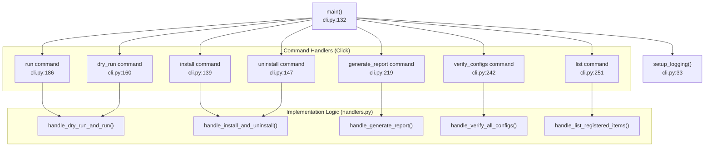

**Sources:** [src/cloudai/cli/cli.py:24-30](), [src/cloudai/cli/cli.py:128-254]()

### Common CLI Options

Most execution modes share required arguments via the `common_options` decorator [src/cloudai/cli/cli.py:86-107]():

| Option | Type | Description | Reference |
|--------|------|-------------|-----------|
| `--system-config` | Path | System configuration TOML file | [cli.py:88-93]() |
| `--tests-dir` | Path | Directory containing test TOML files (Optional) | [cli.py:95-99]() |
| `--test-scenario` | Path | Test scenario TOML file | [cli.py:101-106]() |

Additional options for `run` and `dry-run` modes:

| Option | Type | Default | Description | Reference |
|--------|------|---------|-------------|-----------|
| `--output-dir` | Path | None | Override output directory | [cli.py:110-116]() |
| `--enable-cache-without-check` | Flag | False | Skip installation checks | [cli.py:117-122]() |
| `--single-sbatch` | Flag | False | Use single sbatch for all tests (Slurm only) | [cli.py:123-125]() |

**Sources:** [src/cloudai/cli/cli.py:86-126](), [tests/test_cli.py:40-47]()

---

## CLI Modes

### Mode Comparison

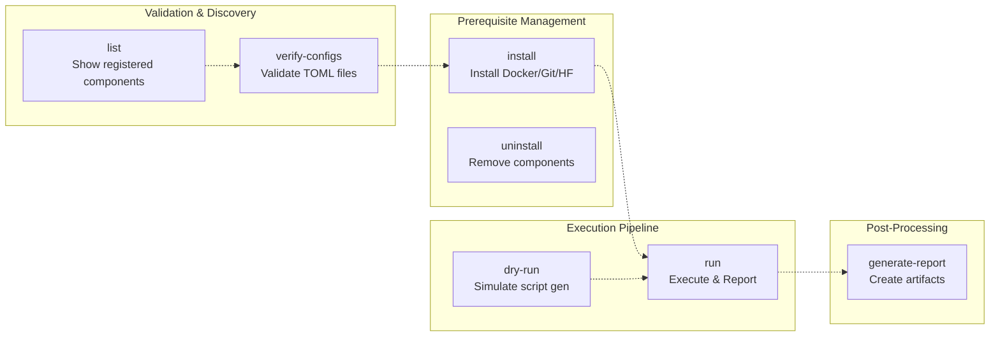

**Sources:** [README.md:54-126](), [src/cloudai/cli/cli.py:137-254]()

### run Mode

Executes workloads with automatic prerequisite installation and report generation.

**Example:**
```bash
cloudai run \
    --system-config conf/common/system/example_slurm_cluster.toml \
    --tests-dir conf/common/test \
    --test-scenario conf/common/test_scenario/sleep.toml
```

**Behavior:**
1. Parses configurations via `handle_dry_run_and_run` [src/cloudai/cli/cli.py:208]().
2. Automatically installs prerequisites if not met [README.md:57]().
3. Submits jobs to the cluster (Slurm, Kubernetes, etc.).
4. Generates HTML reports upon completion [README.md:77]().

**Sources:** [README.md:56-64](), [src/cloudai/cli/cli.py:186-208]()

### dry-run Mode

Simulates execution without running actual workloads. Useful for verifying configurations and testing experiment setups.

**Example:**
```bash
cloudai dry-run \
    --system-config conf/common/system/example_slurm_cluster.toml \
    --tests-dir conf/common/test \
    --test-scenario conf/common/test_scenario/sleep.toml
```

**Behavior:**
1. Validates TOML schemas and logic.
2. Simulates job submission.
3. Does not interact with the cluster scheduler for execution [README.md:67]().

**Sources:** [README.md:66-74](), [src/cloudai/cli/cli.py:160-178]()

### install Mode

Installs workload prerequisites such as Docker images, Git repositories, and HuggingFace models.

**Example:**
```bash
cloudai install \
    --system-config conf/common/system/example_slurm_cluster.toml \
    --tests-dir conf/common/test \
    --test-scenario conf/common/test_scenario/sleep.toml
```

**Implementation Detail:**
Uses managers like `HFModelManager` to download models into a central hub [src/cloudai/util/hf_model_manager.py:35-44]().

**Sources:** [README.md:94-102](), [src/cloudai/cli/cli.py:137-142](), [src/cloudai/util/hf_model_manager.py:30-44]()

### verify-configs Mode

Validates the correctness of system, test, and test scenario configuration files.

**Example:**
```bash
# Verify entire directory
cloudai verify-configs conf/

# Verify scenarios with specific test directory
cloudai verify-configs --tests-dir conf/common/test conf/common/test_scenario/
```

**Sources:** [README.md:120-132](), [src/cloudai/cli/cli.py:242-249](), [.github/workflows/ci.yml:94-99]()

---

## Configuration File Structure

CloudAI operates on three main schemas [README.md:20-26]():

### System Configuration
Describes the infrastructure, including the scheduler type, node list, and global environment variables [README.md:22]().
- **Key Field:** `scheduler` (e.g., `slurm`, `kubernetes`, `standalone`) [README.md:30]().

### Test Configuration
An instance of a test template (e.g., `NcclTest`, `MegatronRun`) with custom arguments and environment variables [README.md:23]().
- **Key Field:** `test_template_name`.

### Test Scenario Configuration
A set of tests with defined dependencies and descriptions [README.md:24]().
- **Key Field:** `[[Tests]]` array.

---

## Logging and Debugging

### Log Configuration

CloudAI uses a dual-handler logging system [src/cloudai/cli/cli.py:33-83]():
- **Console Handler:** Configurable via `--log-level` (default: INFO) [src/cloudai/cli/cli.py:130]().
- **File Handler:** Always logs at DEBUG level to the file specified by `--log-file` (default: `debug.log`) [src/cloudai/cli/cli.py:129]().

**Sources:** [src/cloudai/cli/cli.py:33-83](), [src/cloudai/cli/cli.py:128-134]()

### Common Debugging Patterns

**Validate Before Running:**
```bash
cloudai verify-configs conf/
```

**Check Available Components:**
```bash
cloudai list workloads
cloudai list systems
```

**Detailed Trace:**
Check `debug.log` for standard and `bokeh` specific logs [src/cloudai/cli/cli.py:67-81]().

**Sources:** [README.md:113-125](), [src/cloudai/cli/cli.py:45-83]()

---

# Page: Architecture Overview

# Architecture Overview

<details>
<summary>Relevant source files</summary>

The following files were used as context for generating this wiki page:

- [src/cloudai/__init__.py](src/cloudai/__init__.py)
- [src/cloudai/_core/base_runner.py](src/cloudai/_core/base_runner.py)
- [src/cloudai/_core/registry.py](src/cloudai/_core/registry.py)
- [src/cloudai/_core/runner.py](src/cloudai/_core/runner.py)
- [src/cloudai/cli/handlers.py](src/cloudai/cli/handlers.py)
- [src/cloudai/core.py](src/cloudai/core.py)
- [src/cloudai/registration.py](src/cloudai/registration.py)
- [src/cloudai/systems/runai/runai_node.py](src/cloudai/systems/runai/runai_node.py)
- [src/cloudai/systems/runai/runai_rest_client.py](src/cloudai/systems/runai/runai_rest_client.py)
- [src/cloudai/systems/runai/runai_runner.py](src/cloudai/systems/runai/runai_runner.py)
- [src/cloudai/systems/runai/runai_system.py](src/cloudai/systems/runai/runai_system.py)
- [src/cloudai/test_parser.py](src/cloudai/test_parser.py)
- [tests/test_acceptance.py](tests/test_acceptance.py)
- [tests/test_base_runner.py](tests/test_base_runner.py)
- [tests/test_cloudaigym.py](tests/test_cloudaigym.py)
- [tests/test_init.py](tests/test_init.py)
- [tests/test_job_type_handler.py](tests/test_job_type_handler.py)
- [tests/test_registry.py](tests/test_registry.py)

</details>


## Purpose and Scope

This page describes the high-level architecture of CloudAI, focusing on how the core components interact to provide a flexible, extensible framework for running AI benchmarks across multiple schedulers. We cover the Registry-based plugin system, the three-layer architecture, and the strategy pattern that enables multi-scheduler support.

For details on specific components mentioned here, see:
- Registry implementation details: [2.1]()
- Test framework models: [2.2]()
- Configuration parsing: [2.3]()
- Runner system: [2.4]()
- CLI functionality: [3.1]()

## Three-Layer Architecture

CloudAI follows a three-layer architecture that separates user interface, orchestration logic, and execution engines:

Title: Three-Layer System Architecture
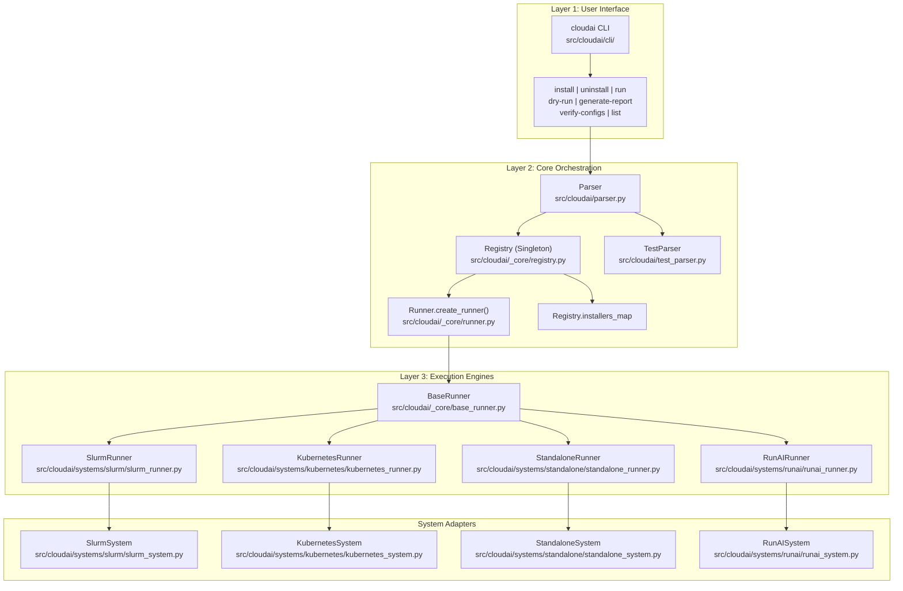

**Sources:** [src/cloudai/__init__.py:17-38](), [src/cloudai/_core/registry.py:48-62](), [src/cloudai/_core/runner.py:47-80](), [src/cloudai/cli/handlers.py:29-41]()

### Layer Responsibilities

| Layer | Components | Responsibilities |
|-------|-----------|------------------|
| **User Interface** | CLI handlers | Parse command-line arguments, invoke orchestration layer ([src/cloudai/cli/handlers.py:53-171]()) |
| **Core Orchestration** | Registry, Parser, Factories | Load configurations, validate schemas, select appropriate implementations ([src/cloudai/_core/registry.py:48-62]()) |
| **Execution Engines** | Runners, Systems | Submit jobs, monitor execution, handle scheduler-specific logic ([src/cloudai/_core/base_runner.py:33-51]()) |

The separation ensures that adding new schedulers or workloads requires changes only to Layer 3 components, with automatic registration into Layer 2 via `register_all()` ([src/cloudai/registration.py:36-180]()).

**Sources:** [src/cloudai/__init__.py:36-38](), [src/cloudai/cli/handlers.py:110-116]()

## Registry: The Central Nervous System

The `Registry` class is a Singleton that maintains all component mappings. It is populated at package import time via `register_all()` and serves as the lookup table for all runtime component selection.

Title: Registry Component Mapping
```mermaid
graph TB
    subgraph "Registry Singleton (src/cloudai/_core/registry.py)"
        RegClass["Registry (metaclass=Singleton)"]
        
        subgraph "Simple Mappings (str → Type)"
            SystemsMap["systems_map<br/>{'slurm': SlurmSystem, 'kubernetes': KubernetesSystem, ...}"]
            RunnersMap["runners_map<br/>{'slurm': SlurmRunner, 'kubernetes': KubernetesRunner, ...}"]
            TestDefsMap["test_definitions_map<br/>{'NcclTest': NCCLTestDefinition, 'Sleep': SleepTestDefinition, ...}"]
            InstallersMap["installers_map<br/>{'slurm': SlurmInstaller, ...}"]
            AgentsMap["agents_map<br/>{'grid_search': GridSearchAgent, ...}"]
        end
        
        subgraph "Strategy Mappings (Tuple[Type, Type] → Type)"
            CmdGenMap["command_gen_strategies_map<br/>{(SlurmSystem, NCCLTestDefinition): NcclTestSlurmCommandGenStrategy, ...}"]
            JsonGenMap["json_gen_strategies_map<br/>{(KubernetesSystem, NCCLTestDefinition): NcclTestKubernetesJsonGenStrategy, ...}"]
            GradingMap["grading_strategies_map<br/>{(SlurmSystem, NCCLTestDefinition): NcclTestGradingStrategy, ...}"]
        end
        
        subgraph "Report Mappings"
            ReportsMap["reports_map<br/>{NCCLTestDefinition: {NcclTestPerformanceReportGenerationStrategy, ...}, ...}"]
            ScenarioReports["scenario_reports<br/>{'per_test': PerTestReporter, 'status': StatusReporter, ...}"]
        end
    end
    
    subgraph "Registration Process"
        Init["cloudai.__init__:38<br/>register_all()"]
        EP["register_entrypoint_agents()"]
    end
    
    subgraph "Runtime Lookup"
        ParserLookup["Parser → systems_map"]
        FactoryLookup["Runner.create_runner() → runners_map"]
        StrategyLookup["BaseRunner → command_gen_strategies_map"]
    end
    
    Init --> EP
    Init --> RegClass
    RegClass --> SystemsMap
    RegClass --> RunnersMap
    RegClass --> TestDefsMap
    RegClass --> InstallersMap
    RegClass --> AgentsMap
    RegClass --> CmdGenMap
    RegClass --> JsonGenMap
    RegClass --> GradingMap
    RegClass --> ReportsMap
    RegClass --> ScenarioReports
    
    ParserLookup -.lookup.-> SystemsMap
    FactoryLookup -.lookup.-> RunnersMap
    StrategyLookup -.lookup.-> CmdGenMap
```

**Sources:** [src/cloudai/_core/registry.py:48-294](), [src/cloudai/__init__.py:36-38](), [tests/test_init.py:102-265](), [src/cloudai/registration.py:21-34]()

### Registry Map Types

The Registry maintains two categories of mappings ([src/cloudai/_core/registry.py:51-62]()):

**Simple Mappings (string keys):**
- `systems_map`: 5 scheduler types (`"slurm"`, `"kubernetes"`, `"runai"`, `"lsf"`, `"standalone"`)
- `runners_map`: 5 corresponding runner implementations
- `test_definitions_map`: 22+ workload types (e.g., `"NcclTest"`, `"Sleep"`, `"AIDynamo"`)
- `installers_map`: 5 installer implementations
- `agents_map`: Design space exploration agents (e.g., `"grid_search"`)

**Strategy Mappings (tuple keys):**
- `command_gen_strategies_map`: Maps `(System type, TestDefinition type)` to command generation strategies.
- `json_gen_strategies_map`: Entries for Kubernetes/RunAI manifest generation.
- `grading_strategies_map`: Maps `(System type, TestDefinition type)` to performance grading strategies.

**Sources:** [tests/test_init.py:102-265](), [src/cloudai/_core/registry.py:51-62]()

### Key Registry Methods

| Method | Purpose | Line Reference |
|--------|---------|----------------|
| `add_system(name, type)` | Register new scheduler system | [src/cloudai/_core/registry.py:132-155]() |
| `add_runner(name, type)` | Register runner implementation | [src/cloudai/_core/registry.py:64-87]() |
| `add_test_definition(name, type)` | Register workload type | [src/cloudai/_core/registry.py:157-180]() |
| `add_command_gen_strategy(sys, tdef, strategy)` | Register command generation strategy | [src/cloudai/_core/registry.py:251-264]() |
| `get_command_gen_strategy(sys, tdef)` | Lookup strategy at runtime | [src/cloudai/_core/registry.py:266-271]() |
| `add_json_gen_strategy(sys, tdef, strategy)` | Register JSON manifest strategy | [src/cloudai/_core/registry.py:273-286]() |
| `add_grading_strategy(sys, tdef, strategy)` | Register grading strategy | [src/cloudai/_core/registry.py:89-100]() |

**Sources:** [src/cloudai/_core/registry.py:64-294]()

## Component Registration

At package import time, CloudAI populates the Registry through a centralized registration process in `register_all()` ([src/cloudai/registration.py:36-180]()).

Title: Registration Lifecycle
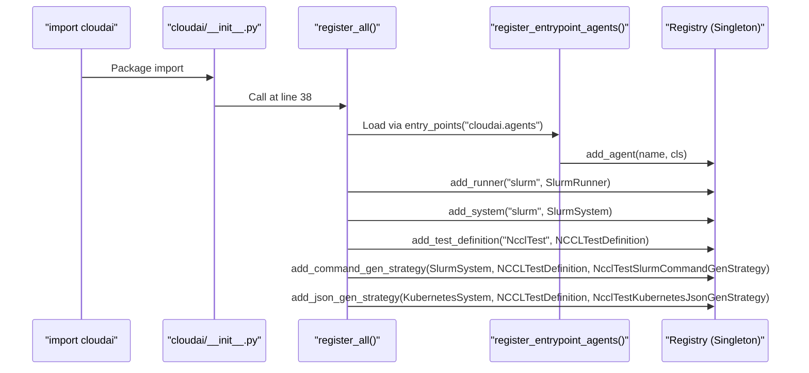

**Sources:** [src/cloudai/__init__.py:36-38](), [src/cloudai/registration.py:21-180]()

## Strategy Pattern for Multi-Scheduler Support

CloudAI uses the Strategy pattern to support multiple schedulers without modifying core logic. Each `(System, TestDefinition)` pair maps to a specific strategy implementation ([src/cloudai/_core/registry.py:60-62]()).

### Strategy Selection at Runtime

Title: Strategy Dispatch Mechanism
```mermaid
graph TB
    subgraph "Runtime Strategy Selection"
        Runner["BaseRunner.run()"]
        SystemType["system: SlurmSystem"]
        TestDefType["test.test_definition: NCCLTestDefinition"]
        
        LookupKey["key = (type(system), type(test.test_definition))"]
        RegLookup["Registry().get_command_gen_strategy(key)"]
        
        Strategy["NcclTestSlurmCommandGenStrategy"]
        GenCmd["strategy.gen_exec_command(system, test)"]
        SlurmScript["Slurm sbatch script"]
    end
    
    subgraph "Alternative Path: Kubernetes"
        K8sSystem["system: KubernetesSystem"]
        K8sLookup["Registry().get_json_gen_strategy(key)"]
        K8sStrategy["NcclTestKubernetesJsonGenStrategy"]
        K8sManifest["Kubernetes manifest YAML"]
    end
    
    Runner --> SystemType
    Runner --> TestDefType
    SystemType --> LookupKey
    TestDefType --> LookupKey
    
    LookupKey --> RegLookup
    RegLookup --> Strategy
    Strategy --> GenCmd
    GenCmd --> SlurmScript
    
    K8sSystem --> K8sLookup
    K8sLookup --> K8sStrategy
    K8sStrategy --> K8sManifest
```

**Sources:** [src/cloudai/_core/registry.py:266-293](), [tests/test_init.py:129-163](), [src/cloudai/_core/base_runner.py:133-144]()

## Workload Plugin Architecture

Each workload is a self-contained plugin with core components defined in `src/cloudai/models/workload.py` and `src/cloudai/_core/`.

Title: Workload Plugin Components
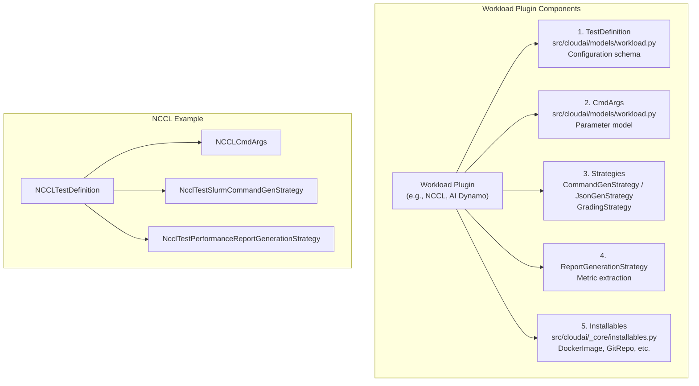

**Sources:** [src/cloudai/models/workload.py:43-118](), [src/cloudai/registration.py:105-114](), [src/cloudai/_core/installables.py]()

### Component Details

**1. TestDefinition**
Defines the workload's schema, inheriting from `TestDefinition` ([src/cloudai/models/workload.py:43]()). It handles constraint checks via `constraint_check` and success validation via `was_run_successful`.

**2. CmdArgs**
Pydantic model specifying all command-line parameters. It supports Design Space Exploration (DSE) by allowing list-based values for parameters ([tests/test_job_type_handler.py:39-43]()).

**3. Strategies**
- `CommandGenStrategy`: Generates shell scripts for Slurm/Standalone/LSF.
- `JsonGenStrategy`: Generates Kubernetes/RunAI manifests ([src/cloudai/_core/json_gen_strategy.py]()).
- `GradingStrategy`: Provides performance scoring logic ([src/cloudai/_core/registry.py:89]()).

**4. Installables**
Specifies dependencies like `DockerImage`, `GitRepo`, `PythonExecutable`, `HFModel`, or `File` ([src/cloudai/cli/handlers.py:100-108]()).

**Sources:** [src/cloudai/models/workload.py:43-118](), [src/cloudai/_core/registry.py:89-105](), [src/cloudai/registration.py:105-114]()

## Configuration-to-Execution Pipeline

The transformation from TOML configurations to running jobs follows a defined lifecycle managed by the `Runner` ([src/cloudai/_core/runner.py]()) and `BaseRunner` ([src/cloudai/_core/base_runner.py]()).

Title: Execution Pipeline Flow
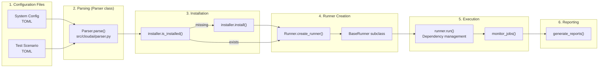

**Sources:** [src/cloudai/parser.py](), [src/cloudai/cli/handlers.py:62-94](), [src/cloudai/_core/runner.py:47-81](), [src/cloudai/_core/base_runner.py:82-98]()

### Pipeline Stages

**Stage 1: Configuration Loading**
The `Parser` reads system and scenario TOMLs, validating them against Pydantic models ([src/cloudai/cli/handlers.py:62-63]()).

**Stage 2: Installation**
The `BaseInstaller` subclass (selected by scheduler type) ensures all `Installable` objects required by the tests are present ([src/cloudai/cli/handlers.py:110-116]()).

**Stage 3: Runner Factory**
`Runner.create_runner()` looks up the appropriate runner in `Registry().runners_map` and initializes it with a timestamped results directory ([src/cloudai/_core/runner.py:47-80]()).

**Stage 4: Execution & Monitoring**
`BaseRunner.run()` manages the job lifecycle, including handling dependencies like `start_post_init` and `start_post_comp` ([src/cloudai/_core/base_runner.py:82-180]()).

**Stage 5: Reporting**
`generate_reports()` iterates through registered scenario reports, applying them to the results directory ([src/cloudai/cli/handlers.py:174-200]()).

**Sources:** [src/cloudai/cli/handlers.py:53-200](), [src/cloudai/_core/runner.py:47-81](), [src/cloudai/_core/base_runner.py:82-180]()

---

# Page: Core Components

# Core Components

<details>
<summary>Relevant source files</summary>

The following files were used as context for generating this wiki page:

- [src/cloudai/__init__.py](src/cloudai/__init__.py)
- [src/cloudai/_core/exceptions.py](src/cloudai/_core/exceptions.py)
- [src/cloudai/_core/registry.py](src/cloudai/_core/registry.py)
- [src/cloudai/_core/test_scenario.py](src/cloudai/_core/test_scenario.py)
- [src/cloudai/core.py](src/cloudai/core.py)
- [src/cloudai/models/scenario.py](src/cloudai/models/scenario.py)
- [src/cloudai/models/workload.py](src/cloudai/models/workload.py)
- [src/cloudai/parser.py](src/cloudai/parser.py)
- [src/cloudai/registration.py](src/cloudai/registration.py)
- [src/cloudai/test_parser.py](src/cloudai/test_parser.py)
- [src/cloudai/test_scenario_parser.py](src/cloudai/test_scenario_parser.py)
- [tests/test_acceptance.py](tests/test_acceptance.py)
- [tests/test_init.py](tests/test_init.py)
- [tests/test_registry.py](tests/test_registry.py)
- [tests/test_test_scenario.py](tests/test_test_scenario.py)

</details>


This document covers the fundamental building blocks that make up the CloudAI framework. These core components provide the foundational abstractions for test definition, execution orchestration, and system integration that enable CloudAI's automated testing capabilities.

For information about how these components are integrated with specific schedulers like Slurm, see [Scheduler Integrations](#4). For details on the command-line interface that coordinates these components, see [Command-Line Interface](#3).

## Component Registry System

The `Registry` class serves as the central component discovery and instantiation mechanism for CloudAI. It implements the singleton pattern and maintains mappings between abstract interfaces and concrete implementations, enabling dynamic component selection based on system type and test requirements.

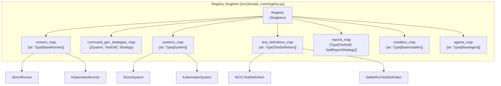

### Registry Component Mappings

The registry maintains several key mapping structures used for strategy dispatch and component instantiation:

*   **System Mappings**: Maps scheduler names to `System` implementations [src/cloudai/_core/registry.py:53]().
*   **Runner Mappings**: Maps system names to `BaseRunner` implementations [src/cloudai/_core/registry.py:51]().
*   **Strategy Mappings**: Maps `(Type[System], Type[TestDefinition])` tuples to concrete strategies like `CommandGenStrategy` [src/cloudai/_core/registry.py:60](), `JsonGenStrategy` [src/cloudai/_core/registry.py:61](), and `GradingStrategy` [src/cloudai/_core/registry.py:62]().
*   **Agent Mappings**: Maps agent names to `BaseAgent` classes for Design Space Exploration [src/cloudai/_core/registry.py:55]().

Registration is triggered globally via `register_all()` in `src/cloudai/registration.py`, which populates these maps with built-in and entrypoint-based extensions [src/cloudai/registration.py:36-187]().

For details, see [Registry System](#2.1).

**Sources**: [src/cloudai/_core/registry.py:48-62](), [src/cloudai/registration.py:36-187](), [tests/test_init.py:109-157]()

## Test Framework Object Model

The test framework provides a hierarchical structure for defining and organizing tests, using Pydantic models for validation and schema enforcement.

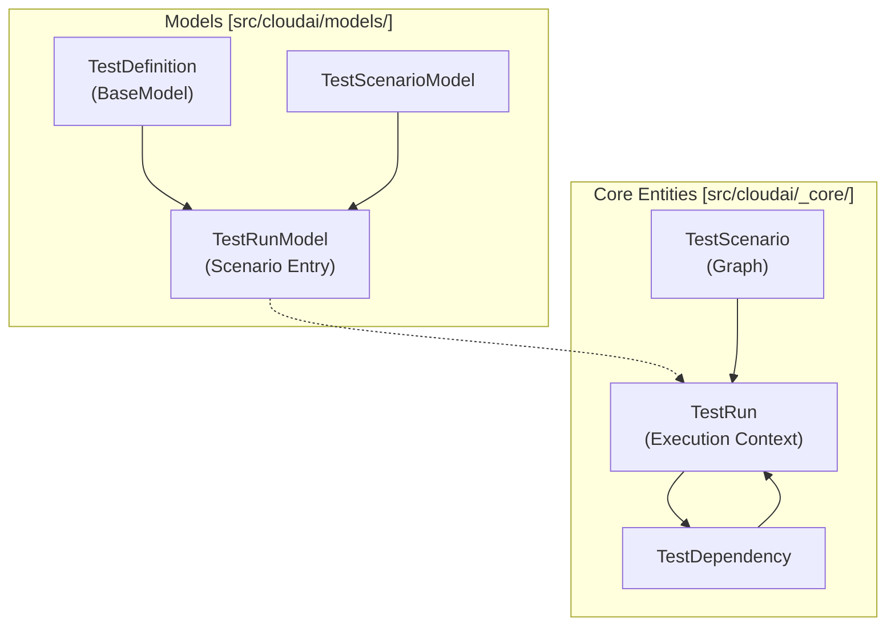

### Test Component Hierarchy

*   **TestDefinition**: Abstract base class defining the workload, its `CmdArgs`, and `installables` (like `GitRepo`) [src/cloudai/models/workload.py:90-128]().
*   **TestRun**: Represents a specific execution instance of a test within a scenario. It tracks `num_nodes`, `iterations`, `time_limit`, and runtime `dependencies` [src/cloudai/_core/test_scenario.py:58-79]().
*   **TestScenario**: A collection of `TestRun` objects. It manages scenario-level hooks (`pre_test`, `post_test`) and total time limit aggregation [src/cloudai/_core/test_scenario.py:179-196]().
*   **Design Space Exploration (DSE)**: `TestRun` supports parameter expansion. If `num_nodes` is a list or `CmdArgs` contains lists, the framework treats it as a DSE job, enabling agents to explore the parameter space [src/cloudai/_core/test_scenario.py:114-156]().

For details, see [Test Framework](#2.2).

**Sources**: [src/cloudai/models/workload.py:90-142](), [src/cloudai/_core/test_scenario.py:58-196](), [src/cloudai/models/scenario.py:65-105]()

## Parser and Configuration Loading

The `Parser` coordinates the loading of the "Three-Schema" system: System, Test, and TestScenario.

### Configuration Lifecycle
1.  **System Parsing**: `Parser.parse_system` loads the system TOML, identifies the `scheduler`, and retrieves the corresponding `System` class from the `Registry` [src/cloudai/parser.py:165-185]().
2.  **Test Parsing**: `TestParser` loads individual test templates, validating them against the registered `TestDefinition` subclasses [src/cloudai/parser.py:159-162]().
3.  **Scenario Parsing**: `TestScenarioParser` resolves dependencies between tests and merges scenario-specific overrides into the base test definitions using `deep_merge` [src/cloudai/test_scenario_parser.py:107-168]().

For details, see [Parser and Configuration Loading](#2.3).

**Sources**: [src/cloudai/parser.py:42-162](), [src/cloudai/test_scenario_parser.py:73-168]()

## Runner and Job Management

The `BaseRunner` architecture defines how jobs are submitted and monitored across different schedulers.

*   **Strategy Dispatch**: Runners use the `Registry` to find the correct `CommandGenStrategy` for a given `System` and `TestDefinition` pair [tests/test_init.py:129-157]().
*   **Dependency Resolution**: The runner respects three dependency types: `start_post_init` (starts after dependency is submitted), `start_post_comp` (starts after dependency completes), and `end_post_comp` (must complete before dependency starts) [src/cloudai/models/scenario.py:61]().
*   **Job Lifecycle**: Runners manage the transition from command generation to submission, status polling, and finally report generation via `ReportGenerationStrategy` [src/cloudai/_core/test_scenario.py:106-112]().

For details, see [Runner System and Job Management](#2.4) and [Test Dependencies and Execution Flow](#2.5).

**Sources**: [src/cloudai/_core/registry.py:51-105](), [src/cloudai/_core/test_scenario.py:37-79](), [src/cloudai/models/scenario.py:54-62]()

## Component Interaction Flow

The following diagram illustrates how core components interact during a typical test execution:

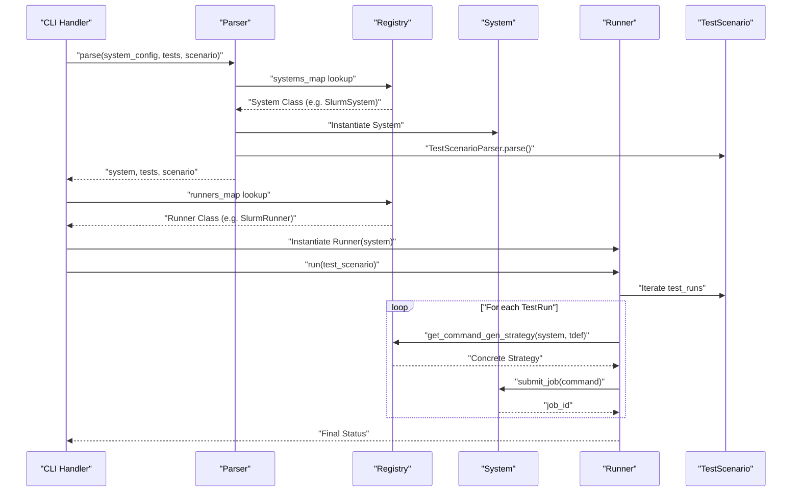

**Sources**: [src/cloudai/parser.py:67-132](), [src/cloudai/_core/registry.py:48-105](), [src/cloudai/__init__.py:36-38]()

---

# Page: Registry System

# Registry System

<details>
<summary>Relevant source files</summary>

The following files were used as context for generating this wiki page:

- [src/cloudai/__init__.py](src/cloudai/__init__.py)
- [src/cloudai/_core/command_gen_strategy.py](src/cloudai/_core/command_gen_strategy.py)
- [src/cloudai/_core/registry.py](src/cloudai/_core/registry.py)
- [src/cloudai/configurator/cloudai_gym.py](src/cloudai/configurator/cloudai_gym.py)
- [src/cloudai/core.py](src/cloudai/core.py)
- [src/cloudai/registration.py](src/cloudai/registration.py)
- [src/cloudai/systems/slurm/single_sbatch_runner.py](src/cloudai/systems/slurm/single_sbatch_runner.py)
- [src/cloudai/systems/slurm/slurm_runner.py](src/cloudai/systems/slurm/slurm_runner.py)
- [src/cloudai/test_parser.py](src/cloudai/test_parser.py)
- [tests/conftest.py](tests/conftest.py)
- [tests/test_acceptance.py](tests/test_acceptance.py)
- [tests/test_get_job_id.py](tests/test_get_job_id.py)
- [tests/test_handlers.py](tests/test_handlers.py)
- [tests/test_init.py](tests/test_init.py)
- [tests/test_registry.py](tests/test_registry.py)
- [tests/test_single_sbatch_runner.py](tests/test_single_sbatch_runner.py)

</details>


## Purpose and Scope

The Registry System is the central component mapping mechanism in CloudAI. It provides a Singleton-based lookup table that connects scheduler types, workload types, and their associated implementations (runners, strategies, installers, etc.). The Registry enables CloudAI's plugin architecture by allowing runtime resolution of the correct implementation based on system type and workload type.

For information about how workloads use these registered strategies, see [Workload Plugin Architecture](#5.1). For details on how the Parser uses the Registry to load components, see [Parser and Configuration Loading](#2.3).

## Core Concepts

### Singleton Pattern

The Registry is implemented as a Singleton using a custom metaclass, ensuring exactly one instance exists throughout the application lifecycle. This is instantiated automatically when the `cloudai` package is imported.

**Registry Class Structure**

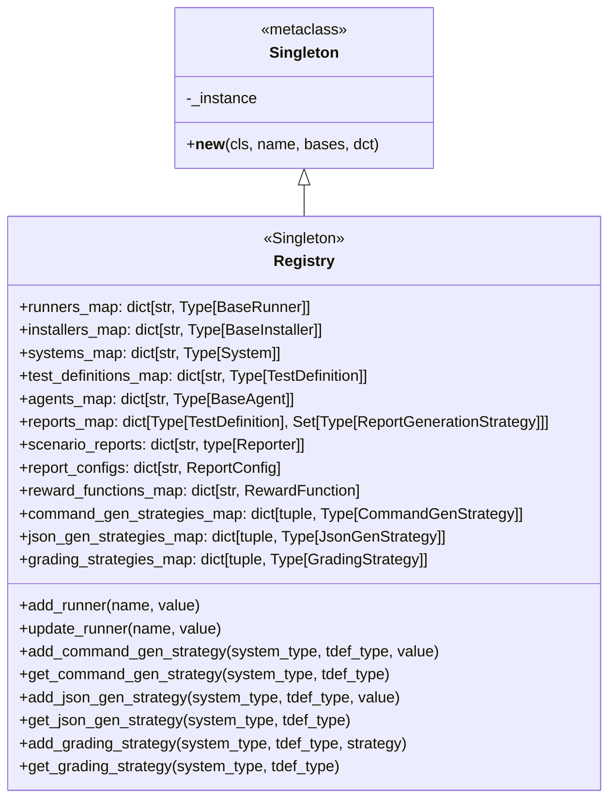

Sources: [src/cloudai/_core/registry.py:37-46](), [src/cloudai/_core/registry.py:48-63]()

### Mapping Categories

The Registry organizes mappings into three categories:

| Category | Key Type | Value Type | Purpose |
|----------|----------|------------|---------|
| **Simple Mappings** | String | Class Type | Map names to single implementation classes |
| **Strategy Mappings** | Tuple[Type, Type] | Class Type | Map (System, TestDefinition) pairs to strategy implementations |
| **Report Mappings** | Various | Class Type or Set | Map test types or names to report generators |

## Complete Registry Structure

The following diagram illustrates all mapping types maintained by the Registry:

**Registry Mapping Architecture**

```mermaid
graph TB
    subgraph "Registry Singleton"
        R["Registry()"]
    end
    
    subgraph "Simple Mappings (String Keys)"
        SM1["systems_map<br/>str → Type[System]"]
        SM2["runners_map<br/>str → Type[BaseRunner]"]
        SM3["installers_map<br/>str → Type[BaseInstaller]"]
        SM4["test_definitions_map<br/>str → Type[TestDefinition]"]
        SM5["agents_map<br/>str → Type[BaseAgent]"]
        SM6["reward_functions_map<br/>str → RewardFunction"]
    end
    
    subgraph "Strategy Mappings (Tuple Keys)"
        TM1["command_gen_strategies_map<br/>(System, TestDefinition) → Type[CommandGenStrategy]"]
        TM2["json_gen_strategies_map<br/>(System, TestDefinition) → Type[JsonGenStrategy]"]
        TM3["grading_strategies_map<br/>(System, TestDefinition) → Type[GradingStrategy]"]
    end
    
    subgraph "Report Mappings"
        RM1["reports_map<br/>Type[TestDefinition] → Set[Type[ReportGenerationStrategy]]"]
        RM2["scenario_reports<br/>str → type[Reporter]"]
        RM3["report_configs<br/>str → ReportConfig"]
    end
    
    R --> SM1
    R --> SM2
    R --> SM3
    R --> SM4
    R --> SM5
    R --> SM6
    R --> TM1
    R --> TM2
    R --> TM3
    R --> RM1
    R --> RM2
    R --> RM3
```

Sources: [src/cloudai/_core/registry.py:48-63]()

## Simple Mappings

Simple mappings use string keys to look up a single implementation class. These are populated during registration and queried at runtime.

### Systems Map

Maps scheduler type names to their corresponding `System` implementation classes.

| Key | Value | Description |
|-----|-------|-------------|
| `"slurm"` | `SlurmSystem` | Slurm workload manager |
| `"kubernetes"` | `KubernetesSystem` | Kubernetes orchestrator |
| `"standalone"` | `StandaloneSystem` | Direct script execution |
| `"lsf"` | `LSFSystem` | IBM LSF scheduler |
| `"runai"` | `RunAISystem` | Run:AI platform |

**API Methods:**
- `add_system(name: str, value: Type[System])` - [src/cloudai/_core/registry.py:132-145]()
- `update_system(name: str, value: Type[System])` - [src/cloudai/_core/registry.py:147-155]()

Sources: [src/cloudai/_core/registry.py:53](), [tests/test_init.py:109-117]()

### Runners Map

Maps scheduler type names to their corresponding `BaseRunner` implementation classes.

| Key | Value | Description |
|-----|-------|-------------|
| `"slurm"` | `SlurmRunner` | Executes tests via Slurm |
| `"kubernetes"` | `KubernetesRunner` | Executes tests via Kubernetes |
| `"standalone"` | `StandaloneRunner` | Direct process execution |
| `"lsf"` | `LSFRunner` | Executes tests via LSF |
| `"runai"` | `RunAIRunner` | Executes tests via Run:AI |

**API Methods:**
- `add_runner(name: str, value: Type[BaseRunner])` - [src/cloudai/_core/registry.py:64-77]()
- `update_runner(name: str, value: Type[BaseRunner])` - [src/cloudai/_core/registry.py:79-87]()

Sources: [src/cloudai/_core/registry.py:51](), [tests/test_init.py:119-127]()

### Test Definitions Map

Maps test template names to their `TestDefinition` subclass implementations.

| Key | Value | Key | Value |
|-----|-------|-----|-------|
| `"UCCTest"` | `UCCTestDefinition` | `"NcclTest"` | `NCCLTestDefinition` |
| `"DDLBTest"` | `DDLBTestDefinition` | `"ChakraReplay"` | `ChakraReplayTestDefinition` |
| `"DeepEP"` | `DeepEPTestDefinition` | `"Sleep"` | `SleepTestDefinition` |
| `"NeMoLauncher"` | `NeMoLauncherTestDefinition` | `"NeMoRun"` | `NeMoRunTestDefinition` |
| `"JaxToolboxGPT"` | `GPTTestDefinition` | `"JaxToolboxGrok"` | `GrokTestDefinition` |
| `"JaxToolboxNemotron"` | `NemotronTestDefinition` | `"SlurmContainer"` | `SlurmContainerTestDefinition` |
| `"MegatronRun"` | `MegatronRunTestDefinition` | `"MegatronBridge"` | `MegatronBridgeTestDefinition` |
| `"TritonInference"` | `TritonInferenceTestDefinition` | `"NIXLBench"` | `NIXLBenchTestDefinition` |
| `"AIDynamo"` | `AIDynamoTestDefinition` | `"BashCmd"` | `BashCmdTestDefinition` |
| `"NixlPerftest"` | `NixlPerftestTestDefinition` | `"NIXLKVBench"` | `NIXLKVBenchTestDefinition` |
| `"Aiconfigurator"` | `AiconfiguratorTestDefinition` | `"OSUBench"` | `OSUBenchTestDefinition` |

**API Methods:**
- `add_test_definition(name: str, value: Type[TestDefinition])` - [src/cloudai/_core/registry.py:157-170]()
- `update_test_definition(name: str, value: Type[TestDefinition])` - [src/cloudai/_core/registry.py:172-180]()

Sources: [src/cloudai/_core/registry.py:54](), [src/cloudai/registration.py:57-179]()

### Installers Map

Maps scheduler type names to their `BaseInstaller` implementation classes.

| Key | Value | Scheduler |
|-----|-------|-----------|
| `"slurm"` | `SlurmInstaller` | Slurm |
| `"kubernetes"` | `KubernetesInstaller` | Kubernetes |
| `"standalone"` | `StandaloneInstaller` | Standalone |
| `"lsf"` | `LSFInstaller` | LSF |
| `"runai"` | `RunAIInstaller` | Run:AI |

**API Methods:**
- `add_installer(name: str, value: Type[BaseInstaller])` - [src/cloudai/_core/registry.py:107-120]()
- `update_installer(name: str, value: Type[BaseInstaller])` - [src/cloudai/_core/registry.py:122-130]()

Sources: [src/cloudai/_core/registry.py:52](), [src/cloudai/registration.py:52-56]()

### Agents Map

Maps agent names to their `BaseAgent` implementation classes for Design Space Exploration.

| Key | Value | Purpose |
|-----|-------|---------|
| `"grid_search"` | `GridSearchAgent` | Exhaustive parameter grid search |

**API Methods:**
- `add_agent(name: str, value: Type[BaseAgent])` - [src/cloudai/_core/registry.py:182-195]()
- `update_agent(name: str, value: Type[BaseAgent])` - [src/cloudai/_core/registry.py:197-205]()

Sources: [src/cloudai/_core/registry.py:55](), [src/cloudai/registration.py:38]()

### Reward Functions Map

Maps reward function names to callable reward computation functions for DSE optimization.

| Key | Value Type | Description |
|-----|------------|-------------|
| `"ai_dynamo_log_scale_reward"` | `RewardFunction` | Logarithmic scaling for AIDynamo |
| `"identity_reward"` | `RewardFunction` | Returns metric value directly |

**API Methods:**
- `add_reward_function(name: str, value: RewardFunction)` - [src/cloudai/_core/registry.py:236-239]()
- `get_reward_function(name: str) -> RewardFunction` - [src/cloudai/_core/registry.py:244-249]()

Sources: [src/cloudai/_core/registry.py:34](), [src/cloudai/registration.py:39-46]()

## Strategy Mappings

Strategy mappings use tuple keys of `(Type[System], Type[TestDefinition])` to select the appropriate implementation for a specific system-workload combination.

### Command Gen Strategies Map

Maps system-workload pairs to `CommandGenStrategy` implementations.

**Key Structure:** `(System Type, TestDefinition Type) → CommandGenStrategy Type`

| System | TestDefinition | Strategy |
|--------|----------------|----------|
| `SlurmSystem` | `NCCLTestDefinition` | `NcclTestSlurmCommandGenStrategy` |
| `SlurmSystem` | `NeMoRunTestDefinition` | `NeMoRunSlurmCommandGenStrategy` |
| `SlurmSystem` | `MegatronBridgeTestDefinition` | `MegatronBridgeSlurmCommandGenStrategy` |
| `StandaloneSystem` | `SleepTestDefinition` | `SleepStandaloneCommandGenStrategy` |
| `LSFSystem` | `SleepTestDefinition` | `SleepLSFCommandGenStrategy` |

**API Methods:**
- `add_command_gen_strategy(system_type, tdef_type, value)` - [src/cloudai/_core/registry.py:251-259]()
- `get_command_gen_strategy(system_type, tdef_type) -> Type[CommandGenStrategy]` - [src/cloudai/_core/registry.py:266-271]()

Sources: [src/cloudai/_core/registry.py:60](), [tests/test_init.py:129-157]()

### Json Gen Strategies Map

Maps system-workload pairs to `JsonGenStrategy` implementations for Kubernetes/RunAI manifest generation.

| System | TestDefinition | Strategy |
|--------|----------------|----------|
| `KubernetesSystem` | `NCCLTestDefinition` | `NcclTestKubernetesJsonGenStrategy` |
| `KubernetesSystem` | `AIDynamoTestDefinition` | `AIDynamoKubernetesJsonGenStrategy` |
| `RunAISystem` | `NCCLTestDefinition` | `NcclTestRunAIJsonGenStrategy` |

**API Methods:**
- `add_json_gen_strategy(system_type, tdef_type, value)` - [src/cloudai/_core/registry.py:273-281]()
- `get_json_gen_strategy(system_type, tdef_type) -> Type[JsonGenStrategy]` - [src/cloudai/_core/registry.py:288-293]()

Sources: [src/cloudai/_core/registry.py:61](), [tests/test_init.py:158-163]()

### Grading Strategies Map

Maps system-workload pairs to `GradingStrategy` implementations for success validation.

| System | TestDefinition | Strategy |
|--------|----------------|----------|
| `SlurmSystem` | `NCCLTestDefinition` | `NcclTestGradingStrategy` |
| `SlurmSystem` | `UCCTestDefinition` | `UCCTestGradingStrategy` |
| `SlurmSystem` | `SleepTestDefinition` | `SleepGradingStrategy` |

Sources: [src/cloudai/_core/registry.py:62](), [tests/test_init.py:164-172]()

## Report Mappings

### Reports Map (Per-Test)

Maps `TestDefinition` types to sets of `ReportGenerationStrategy` classes.

**Structure:** `Type[TestDefinition] → Set[Type[ReportGenerationStrategy]]`

**API Methods:**
- `add_report(tdef_type, value)` - [src/cloudai/_core/registry.py:207-210]()

Sources: [src/cloudai/_core/registry.py:56](), [src/cloudai/registration.py:59-179]()

### Scenario Reports and Configs

Maintains mappings for scenario-level reporters (e.g., status, per-test, tarball).

**API Methods:**
- `add_scenario_report(name, report, config)` - [src/cloudai/_core/registry.py:215-220]()
- `ordered_scenario_reports() -> list[tuple[str, type[Reporter]]]` - [src/cloudai/_core/registry.py:226-234]()

Sources: [src/cloudai/_core/registry.py:57-58](), [src/cloudai/registration.py:49]()

## Registration Process

All components are registered automatically when the `cloudai` package is imported via `register_all()`.

**Registration Flow**

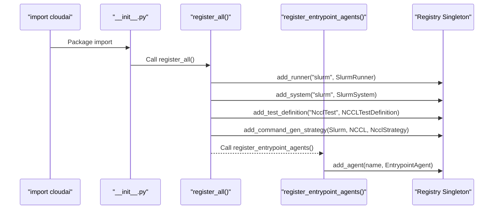

Sources: [src/cloudai/__init__.py:36-38](), [src/cloudai/registration.py:36-186]()

### Entrypoint Extension

External packages can register custom agents via Python entrypoints in the `cloudai.agents` group. The system validates that entrypoint classes are `BaseAgent` subclasses.

Sources: [src/cloudai/registration.py:21-34]()

## Strategy Dispatch Mechanism

At runtime, the framework uses the `Registry` to resolve strategies based on the current system and test definition.

**Natural Language to Code Entity Mapping: Strategy Dispatch**

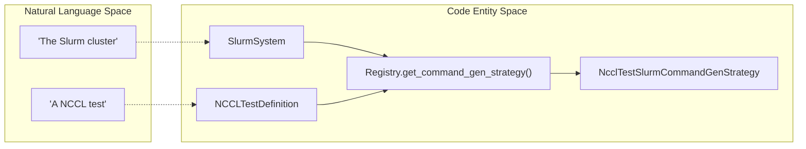

Sources: [src/cloudai/_core/registry.py:266-271](), [src/cloudai/systems/slurm/slurm_runner.py:59]()

**Natural Language to Code Entity Mapping: Runner Selection**

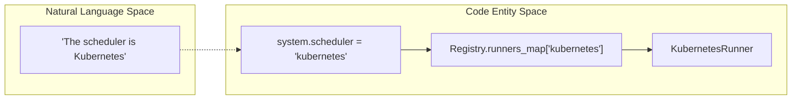

Sources: [src/cloudai/_core/registry.py:51](), [src/cloudai/registration.py:182]()

---

# Page: Test Framework

# Test Framework

<details>
<summary>Relevant source files</summary>

The following files were used as context for generating this wiki page:

- [src/cloudai/__init__.py](src/cloudai/__init__.py)
- [src/cloudai/_core/exceptions.py](src/cloudai/_core/exceptions.py)
- [src/cloudai/_core/registry.py](src/cloudai/_core/registry.py)
- [src/cloudai/_core/test_scenario.py](src/cloudai/_core/test_scenario.py)
- [src/cloudai/core.py](src/cloudai/core.py)
- [src/cloudai/models/scenario.py](src/cloudai/models/scenario.py)
- [src/cloudai/models/workload.py](src/cloudai/models/workload.py)
- [src/cloudai/parser.py](src/cloudai/parser.py)
- [src/cloudai/registration.py](src/cloudai/registration.py)
- [src/cloudai/test_parser.py](src/cloudai/test_parser.py)
- [src/cloudai/test_scenario_parser.py](src/cloudai/test_scenario_parser.py)
- [src/cloudai/workloads/megatron_run/megatron_run.py](src/cloudai/workloads/megatron_run/megatron_run.py)
- [tests/test_acceptance.py](tests/test_acceptance.py)
- [tests/test_init.py](tests/test_init.py)
- [tests/test_registry.py](tests/test_registry.py)
- [tests/test_test_definitions.py](tests/test_test_definitions.py)
- [tests/test_test_scenario.py](tests/test_test_scenario.py)
- [tests/workloads/megatron_run/test_job_status_retrieval_strategy.py](tests/workloads/megatron_run/test_job_status_retrieval_strategy.py)

</details>


The Test Framework provides the core abstractions for defining, configuring, and executing AI workload tests within CloudAI. It encompasses test definitions, test runs, test scenarios, and their associated configuration parsing and validation systems. This framework serves as the foundation for all test execution in CloudAI, managing everything from individual test specifications to complex multi-test scenarios with dependencies.

## Core Abstractions

The Test Framework is built around four primary abstractions that work together to define and execute tests:

Title: Test Framework Class Hierarchy
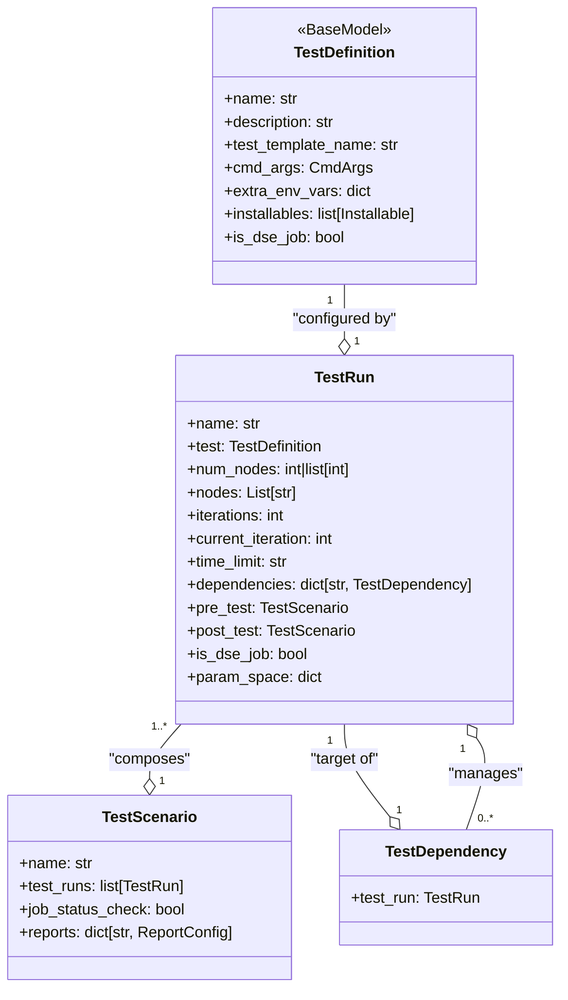

**Sources:** [src/cloudai/models/workload.py:89-138](), [src/cloudai/_core/test_scenario.py:58-79](), [src/cloudai/_core/test_scenario.py:179-195]()

## Test Definition System

The `TestDefinition` serves as the blueprint for workload-specific tests. It uses Pydantic for validation and defines the command arguments, environment variables, and runtime constraints.

| Component | Purpose | Key Properties |
|-----------|---------|----------------|
| `TestDefinition` | Abstract base for workload-specific test specifications | `cmd_args`, `extra_env_vars`, `installables` [src/cloudai/models/workload.py:89-138]() |
| `CmdArgs` | Pydantic model for command-line arguments | Workload-specific fields with validation [src/cloudai/models/workload.py:33-40]() |
| `NsysConfiguration` | NSYS profiling configuration | `enable`, `nsys_binary`, `cmd_args` [src/cloudai/models/workload.py:43-57]() |
| `GitRepo` | Definition for git-based installables | `url`, `commit`, `installed_path` [src/cloudai/models/workload.py:60-72]() |

### Parameter Expansion (DSE)
The framework supports Design Space Exploration (DSE) through list-valued parameters. When any parameter in `cmd_args` or `extra_env_vars` contains a list, the test becomes a DSE job.

Title: Parameter Expansion Data Flow
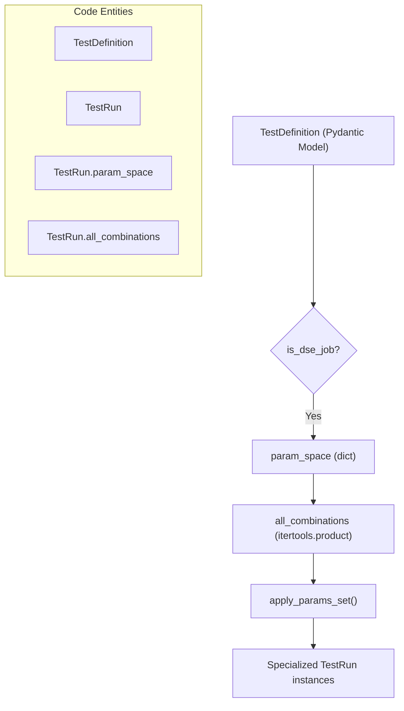

**Sources:** [src/cloudai/_core/test_scenario.py:114-155](), [src/cloudai/models/workload.py:129-137]()

## Test Execution Model

The `TestRun` class represents the execution instance of a test. It bridges the static `TestDefinition` with runtime environment details like node allocations and iteration tracking.

Key `TestRun` execution features:
- **Node Management**: Supports scalar node counts or lists for DSE scaling via `num_nodes` [src/cloudai/_core/test_scenario.py:63]().
- **Iteration Control**: Tracks `current_iteration` against total `iterations` [src/cloudai/_core/test_scenario.py:67-68]().
- **Metric Reporting**: Identifies suitable reporters via `metric_reporter` property by matching `agent_metrics` with available `ReportGenerationStrategy` metrics [src/cloudai/_core/test_scenario.py:93-104]().

**Sources:** [src/cloudai/_core/test_scenario.py:58-104](), [src/cloudai/_core/test_scenario.py:118-123]()

## Test Scenario Management

`TestScenario` orchestrates multiple `TestRun` instances. It supports hooks (`pre_test` and `post_test`) which are themselves `TestScenario` objects, allowing for recursive setup/teardown logic.

Title: Scenario Dependency and Hook Structure
```mermaid
graph TB
    subgraph "TestScenario Object"
        TR1["TestRun: ID '1'"]
        TR2["TestRun: ID '2'"]
        
        subgraph "Hooks"
            Pre["pre_test (TestScenario)"]
            Post["post_test (TestScenario)"]
        end
    end
    
    subgraph "TestRunDependencyModel"
        D1["type: 'end_post_comp'"]
        D2["type: 'start_post_init'"]
    end
    
    TR2 -- "depends on" --> D1
    D1 -- "target ID" --> TR1
    
    Pre -.-> TR1
    TR2 -.-> Post
```

**Sources:** [src/cloudai/_core/test_scenario.py:179-195](), [src/cloudai/models/scenario.py:61-62](), [src/cloudai/test_scenario_parser.py:159-161]()

## Configuration and Validation

The framework uses a two-tier model system: `TestDefinition` for workload templates and `TestScenarioModel`/`TestRunModel` for scenario-specific overrides.

| Model | Purpose | Key Validations |
|-------|---------|-----------------|
| `TestRunModel` | Scenario entry validation | ID length, agent registration, node range syntax [src/cloudai/models/scenario.py:65-105]() |
| `TestScenarioModel` | Complete scenario validation | ID uniqueness, no self-dependencies [src/cloudai/models/scenario.py:176-202]() |
| `TestRunDependencyModel` | Dependency metadata | Literal types: `end_post_comp`, `start_post_init`, `start_post_comp` [src/cloudai/models/scenario.py:54-62]() |

### Parsing Logic
The `TestScenarioParser` handles the conversion from TOML data to live objects:
1. **Model Validation**: Uses `TestScenarioModel.model_validate(data)` [src/cloudai/test_scenario_parser.py:118]().
2. **Hook Resolution**: Maps hook names to `TestScenario` objects from the `hook_mapping` [src/cloudai/test_scenario_parser.py:130-150]().
3. **Time Limit Aggregation**: Calculates total time limits by summing test limits and hook limits via `calculate_total_time_limit` [src/cloudai/test_scenario_parser.py:55-70]().
4. **Dependency Linking**: Converts string IDs into `TestDependency` objects pointing to other `TestRun` instances [src/cloudai/test_scenario_parser.py:157-161]().

**Sources:** [src/cloudai/test_scenario_parser.py:107-168](), [src/cloudai/models/scenario.py:125-148]()

## Registry and Strategy Dispatch

The `Registry` singleton (metaclass `Singleton`) maintains the mapping between systems and workloads.

Title: Strategy Dispatch Mechanism
```mermaid
flowchart LR
    Registry["Registry (Singleton)"]
    System["System (e.g., SlurmSystem)"]
    TDef["TestDefinition (e.g., NCCLTestDefinition)"]
    
    Registry -->|lookup| Key["(Type[System], Type[TestDefinition])"]
    Key -->|returns| Strategy["CommandGenStrategy"]
    
    subgraph "Registry Maps"
    runners_map["runners_map"]
    systems_map["systems_map"]
    cg_map["command_gen_strategies_map"]
    end
```

**Sources:** [src/cloudai/_core/registry.py:48-62](), [src/cloudai/registration.py:181-185]()

---

# Page: Parser and Configuration Loading

# Parser and Configuration Loading

<details>
<summary>Relevant source files</summary>

The following files were used as context for generating this wiki page:

- [conf/common/system/example_slurm_cluster.toml](conf/common/system/example_slurm_cluster.toml)
- [src/cloudai/_core/exceptions.py](src/cloudai/_core/exceptions.py)
- [src/cloudai/_core/test_scenario.py](src/cloudai/_core/test_scenario.py)
- [src/cloudai/models/scenario.py](src/cloudai/models/scenario.py)
- [src/cloudai/models/workload.py](src/cloudai/models/workload.py)
- [src/cloudai/parser.py](src/cloudai/parser.py)
- [src/cloudai/systems/slurm/__init__.py](src/cloudai/systems/slurm/__init__.py)
- [src/cloudai/systems/slurm/slurm-metadata.sh](src/cloudai/systems/slurm/slurm-metadata.sh)
- [src/cloudai/systems/slurm/slurm_metadata.py](src/cloudai/systems/slurm/slurm_metadata.py)
- [src/cloudai/test_scenario_parser.py](src/cloudai/test_scenario_parser.py)
- [tests/test_parser.py](tests/test_parser.py)
- [tests/test_test_scenario.py](tests/test_test_scenario.py)

</details>


## Purpose and Scope

The Parser system is responsible for loading and validating all configuration files in CloudAI. It reads TOML configuration files for systems, test definitions, and test scenarios, validates them using Pydantic models, and constructs typed Python objects ready for execution.

This page covers:
- The `Parser` class and its parsing workflow.
- How TOML files are validated into `System`, `TestDefinition`, and `TestScenario` objects.
- Pydantic model validation and error handling.
- Hook system for pre/post-test scenarios.
- Deep merging logic and time limit calculations.

For information about the Registry system that Parser uses for component lookup, see [Registry System](). For details on the test framework objects created by Parser, see [Test Framework]().

**Sources:** [src/cloudai/parser.py:1-195](), [src/cloudai/test_scenario_parser.py:1-237]()

---

## Overview of Configuration Files

CloudAI uses three types of TOML configuration files, each parsed independently and then combined.

### Configuration File Types

| File Type | Purpose | Location | Parsed Into |
|-----------|---------|----------|-------------|
| **System Config** | Defines cluster properties, scheduler type, node info | `conf/system/` | `System` object (e.g., `SlurmSystem`) |
| **Test Definition** | Defines workload type, parameters, installables | `conf/common/test/` | `TestDefinition` object (e.g., `NCCLTestDefinition`) |
| **Test Scenario** | Orchestrates test execution, dependencies, iterations | `conf/test_scenario/` | `TestScenario` object with `TestRun` list |
| **Hook Scenario** | Pre/post-test sequences | `conf/hook/` | `TestScenario` object (referenced by main scenario) |

**Sources:** [src/cloudai/parser.py:67-132](), [src/cloudai/parser.py:38-40]()

---

## Parser Architecture

The `Parser` class at [src/cloudai/parser.py:42-195]() is the main entry point for all configuration parsing. It orchestrates parsing of the three configuration types and returns validated objects.

### Parser Class Structure

Title: Parser Class and Delegated Sub-Parsers
```mermaid
graph TB
    subgraph "Parser_Class"
        P["Parser<br/>(parser.py:42)"]
        Prop["system_property<br/>(parser.py:56-65)"]
        Parse["parse()<br/>(parser.py:67-132)"]
        
        PS["parse_system()<br/>static (parser.py:164-194)"]
        PT["parse_tests()<br/>static (parser.py:158-162)"]
        PTS["parse_test_scenario()<br/>static (parser.py:144-156)"]
        PH["parse_hooks()<br/>static (parser.py:134-142)"]
    end
    
    subgraph "Delegated_Parsers"
        TP["TestParser<br/>(test_parser.py)"]
        TSP["TestScenarioParser<br/>(test_scenario_parser.py:73)"]
    end
    
    subgraph "Inputs"
        SysToml["System_TOML"]
        TestToml["Test_TOMLs"]
        ScenToml["Scenario_TOML"]
        HookToml["Hook_TOMLs"]
    end
    
    subgraph "Outputs"
        SysObj["System_object"]
        TestList["list[TestDefinition]"]
        ScenObj["TestScenario_object"]
    end
    
    P --> Prop
    P --> Parse
    Parse --> PS
    Parse --> PT
    Parse --> PTS
    Parse --> PH
    
    PS --> SysToml
    PT --> TP
    PTS --> TSP
    PH --> TSP
    
    TP --> TestToml
    TSP --> ScenToml
    TSP --> HookToml
    
    PS --> SysObj
    PT --> TestList
    PTS --> ScenObj
    PH --> ScenObj
```

**Sources:** [src/cloudai/parser.py:42-195](), [src/cloudai/test_scenario_parser.py:73-95]()

### Parser.parse() Workflow

Title: Parser.parse Execution Flow
```mermaid
flowchart TD
    Start["Parser.parse()<br/>(parser.py:67)"]
    
    CheckTestPath{"test_path<br/>exists?"}
    ParseTests["parse_tests()<br/>(parser.py:88)"]
    
    CheckHooks{"HOOK_TEST_ROOT<br/>exists?"}
    ParseHooks["parse_hook_tests<br/>(parser.py:96-98)"]
    
    CheckScenario{"test_scenario_path<br/>provided?"}
    ReturnEarly["return (system, all_tests, None)<br/>(parser.py:104)"]
    
    ParseHookScenarios["parse_hooks()<br/>(parser.py:110-112)"]
    ParseScenario["parse_test_scenario()<br/>(parser.py:117-119)"]
    
    FilterTests["filter_tests_used_in_scenario<br/>(parser.py:123-130)"]
    ReturnFull["return (system, filtered_tests, scenario)<br/>(parser.py:132)"]
    
    Start --> CheckTestPath
    CheckTestPath -->|Yes| ParseTests
    CheckTestPath -->|No| CheckHooks
    
    ParseTests --> CheckHooks
    CheckHooks -->|Yes| ParseHooks
    CheckHooks -->|No| CheckScenario
    
    ParseHooks --> CheckScenario
    CheckScenario -->|No| ReturnEarly
    CheckScenario -->|Yes| ParseHookScenarios
    
    ParseHookScenarios --> ParseScenario
    ParseScenario --> FilterTests
    FilterTests --> ReturnFull
```

**Key behaviors:**
- **Filtering**: Only tests used in the scenario are returned (filtered from full test list) [src/cloudai/parser.py:123-130]().
- **Hooks**: Hooks are always loaded from `conf/hook/` if present [src/cloudai/parser.py:92-100]().
- **Error Handling**: If parsing fails, the process exits immediately with code 1 to keep error messages readable [src/cloudai/parser.py:64, 90, 114, 121]().

**Sources:** [src/cloudai/parser.py:67-132]()

---

## System Configuration Parsing

System configs define the cluster environment and are parsed by `Parser.parse_system()` at [src/cloudai/parser.py:164-194]().

### System Parsing Flow

Title: System Configuration Parsing and Validation
```mermaid
flowchart LR
    TomlFile["System_TOML<br/>e.g., example_slurm_cluster.toml"]
    LoadToml["toml.load()<br/>(parser.py:169)"]
    ExtractSched["Extract_'scheduler'_key<br/>(parser.py:170)"]
    
    RegistryLookup["Registry.systems_map<br/>(parser.py:175-183)"]
    ValidateModel["System_class_constructor<br/>with_Pydantic_validation<br/>(parser.py:186)"]
    
    SystemObj["System_object<br/>(SlurmSystem, K8sSystem, etc.)"]
    
    TomlFile --> LoadToml
    LoadToml --> ExtractSched
    ExtractSched --> RegistryLookup
    RegistryLookup --> ValidateModel
    ValidateModel --> SystemObj
    
    ExtractSched -.missing.-> Error1["SystemConfigParsingError<br/>(parser.py:173)"]
    RegistryLookup -.unknown_type.-> Error2["SystemConfigParsingError<br/>(parser.py:180-182)"]
    ValidateModel -.ValidationError.-> Error3["SystemConfigParsingError<br/>(parser.py:188-192)"]
```

**Registry lookup:** The `scheduler` field determines which `System` class is instantiated from `Registry.systems_map` [src/cloudai/parser.py:170-178]().

**Sources:** [src/cloudai/parser.py:164-194](), [src/cloudai/_core/exceptions.py:128-129](), [conf/common/system/example_slurm_cluster.toml:17-18]()

---

## Test Scenario Parsing

Test scenarios orchestrate multiple test runs with dependencies, iterations, and hooks. Parsing is handled by `TestScenarioParser` at [src/cloudai/test_scenario_parser.py:73-237]().

### TestScenarioParser Architecture

Title: TestScenarioParser Internal Data Flow
```mermaid
graph TB
    subgraph "TestScenarioParser_Class"
        Init["__init__()<br/>(test_scenario_parser.py:84)"]
        Parse["parse()<br/>(test_scenario_parser.py:96)"]
        ParseData["_parse_data()<br/>(test_scenario_parser.py:107)"]
        CreateTR["_create_test_run()<br/>(test_scenario_parser.py:170)"]
        PrepareTdef["_prepare_tdef()<br/>(test_scenario_parser.py:215)"]
    end
    
    subgraph "Inputs"
        FilePath["file_path: Path"]
        System["system: System"]
        TestMap["test_mapping: dict[str, TestDefinition]"]
        HookMap["hook_mapping: dict[str, TestScenario]"]
    end
    
    subgraph "Pydantic_Models"
        TSModel["TestScenarioModel<br/>(scenario.py:176)"]
        TRModel["TestRunModel<br/>(scenario.py:65)"]
    end
    
    subgraph "Outputs"
        TS["TestScenario<br/>with test_runs list"]
        TR["TestRun_objects<br/>with dependencies"]
    end
    
    FilePath --> Init
    System --> Init
    TestMap --> Init
    HookMap --> Init
    
    Init --> Parse
    Parse --> ParseData
    
    ParseData --> TSModel
    TSModel --> CreateTR
    CreateTR --> TRModel
    CreateTR --> PrepareTdef
    
    PrepareTdef --> TestMap
    PrepareTdef --> TR
    
    CreateTR --> TR
    ParseData --> TS
```

**Sources:** [src/cloudai/test_scenario_parser.py:73-237](), [src/cloudai/models/scenario.py:65-176]()

### Test Definition Merging and Overrides

When a scenario references a test, it can override parameters. `TestScenarioParser._prepare_tdef` handles this by:
1. Looking up the base `TestDefinition` in the provided `test_mapping` [src/cloudai/test_scenario_parser.py:220-222]().
2. Merging scenario-specific overrides (like `cmd_args` or `extra_env_vars`) using `deep_merge` [src/cloudai/test_scenario_parser.py:223-227]().
3. Validating the final merged structure against the `TestDefinition` model [src/cloudai/test_scenario_parser.py:227]().

**Sources:** [src/cloudai/test_scenario_parser.py:215-236](), [src/cloudai/util.py:26]()

---

## Validation with Pydantic

CloudAI uses Pydantic v2 for declarative validation. Models enforce field types and cross-field constraints.

### Key Pydantic Models

| Model | Role | Source |
|-------|------|--------|
| `TestScenarioModel` | Top-level scenario structure (name, tests, hooks). | [src/cloudai/models/scenario.py:176]() |
| `TestRunModel` | Single test entry in a scenario, including overrides. | [src/cloudai/models/scenario.py:65]() |
| `TestRunDependencyModel` | Defines `type` (e.g., `end_post_comp`) and target `id`. | [src/cloudai/models/scenario.py:54]() |
| `TestDefinition` | Base workload schema (CmdArgs, git_repos, nsys). | [src/cloudai/models/workload.py:90]() |
| `NsysConfiguration` | Schema for NSYS profiling arguments. | [src/cloudai/models/workload.py:33]() |

### Cross-Field Validation
- **Self-Dependency**: `TestScenarioModel` ensures a test does not depend on itself [src/cloudai/models/scenario.py:194-201]().
- **Duplicate IDs**: Ensures all test IDs in a scenario are unique [src/cloudai/models/scenario.py:204-213]().
- **Dependency Resolution**: Validates that all `dependencies` refer to IDs present in the same scenario [src/cloudai/models/scenario.py:215-224]().

**Sources:** [src/cloudai/models/scenario.py:54-224](), [src/cloudai/models/workload.py:33-163]()

---

## Dependency and Time Limit Resolution

### Time Limit Calculation
The `calculate_total_time_limit` function aggregates the time limits of the main test and any attached hooks (pre/post-tests). This ensures the scheduler allocation covers the entire sequence [src/cloudai/test_scenario_parser.py:55-70]().

### Dependency Mapping
After all `TestRun` objects are created, `TestScenarioParser` iterates through them to map ID strings to actual `TestDependency` objects, which hold references to other `TestRun` instances [src/cloudai/test_scenario_parser.py:157-161]().

**Sources:** [src/cloudai/test_scenario_parser.py:55-70, 157-161](), [src/cloudai/_core/test_scenario.py:37-56]()

---

## Error Handling

Parser uses custom exceptions to provide clear error messages. Validation errors from Pydantic are caught and formatted for readability [src/cloudai/_core/exceptions.py:147-156]().

| Exception | Context |
|-----------|---------|
| `SystemConfigParsingError` | Failure in `parse_system`. |
| `TestConfigParsingError` | Failure in `parse_tests`. |
| `TestScenarioParsingError` | Failure in `parse_test_scenario`. |
| `MissingTestError` | Scenario references a `test_name` not found in mapping. |

**Sources:** [src/cloudai/_core/exceptions.py:118-145](), [src/cloudai/parser.py:26-31]()

---

# Page: Runner System and Job Management

# Runner System and Job Management

<details>
<summary>Relevant source files</summary>

The following files were used as context for generating this wiki page:

- [src/cloudai/_core/base_job.py](src/cloudai/_core/base_job.py)
- [src/cloudai/_core/base_runner.py](src/cloudai/_core/base_runner.py)
- [src/cloudai/_core/command_gen_strategy.py](src/cloudai/_core/command_gen_strategy.py)
- [src/cloudai/_core/grader.py](src/cloudai/_core/grader.py)
- [src/cloudai/_core/runner.py](src/cloudai/_core/runner.py)
- [src/cloudai/_core/system.py](src/cloudai/_core/system.py)
- [src/cloudai/configurator/cloudai_gym.py](src/cloudai/configurator/cloudai_gym.py)
- [src/cloudai/systems/runai/runai_node.py](src/cloudai/systems/runai/runai_node.py)
- [src/cloudai/systems/runai/runai_rest_client.py](src/cloudai/systems/runai/runai_rest_client.py)
- [src/cloudai/systems/runai/runai_runner.py](src/cloudai/systems/runai/runai_runner.py)
- [src/cloudai/systems/runai/runai_system.py](src/cloudai/systems/runai/runai_system.py)
- [src/cloudai/systems/slurm/single_sbatch_runner.py](src/cloudai/systems/slurm/single_sbatch_runner.py)
- [src/cloudai/systems/slurm/slurm_runner.py](src/cloudai/systems/slurm/slurm_runner.py)
- [tests/conftest.py](tests/conftest.py)
- [tests/test_base_runner.py](tests/test_base_runner.py)
- [tests/test_get_job_id.py](tests/test_get_job_id.py)
- [tests/test_handlers.py](tests/test_handlers.py)
- [tests/test_single_sbatch_runner.py](tests/test_single_sbatch_runner.py)

</details>


The Runner System is responsible for orchestrating test execution in CloudAI. It manages the entire lifecycle of tests: job submission, monitoring, completion handling, and dependency resolution. The system implements a factory pattern where a `Runner` wrapper dynamically selects the appropriate scheduler-specific runner implementation based on the system configuration.

This page covers the execution orchestration layer. For test definition and parsing, see [Test Framework (2.2)](). For dependency types and execution order, see [Test Dependencies and Execution Flow (2.5)](). For DSE execution, see [Design Space Exploration (DSE) (7.1)]().

---

## Overview

The Runner System consists of two primary classes:

| Class | Role | Location |
|-------|------|----------|
| `Runner` | Factory wrapper that creates scheduler-specific runners | [src/cloudai/_core/runner.py:29-45]() |
| `BaseRunner` | Abstract base class defining execution logic | [src/cloudai/_core/base_runner.py:33-51]() |

The system operates by polling job statuses at intervals defined in the system configuration (`monitor_interval`).

**Architecture Pattern:**

```mermaid
graph TB
    CLI["CLI Handler<br/>handle_run"]
    
    RunnerFactory["Runner<br/>(Factory Wrapper)"]
    
    Registry["Registry<br/>runners_map"]
    
    BaseRunner["BaseRunner<br/>(Abstract Base)"]
    
    SlurmRunner["SlurmRunner"]
    RunAIRunner["RunAIRunner"]
    StandaloneRunner["StandaloneRunner"]
    
    System["System<br/>is_job_running()<br/>is_job_completed()<br/>kill()"]
    
    TestScenario["TestScenario<br/>test_runs<br/>dependencies"]
    
    CLI --> RunnerFactory
    RunnerFactory --> Registry
    Registry --> BaseRunner
    
    BaseRunner -.implements.-> SlurmRunner
    BaseRunner -.implements.-> RunAIRunner
    BaseRunner -.implements.-> StandaloneRunner
    
    SlurmRunner --> System
    RunAIRunner --> System
    StandaloneRunner --> System
    
    BaseRunner --> TestScenario
```

Sources: [src/cloudai/_core/runner.py:29-81](), [src/cloudai/_core/base_runner.py:33-72](), [src/cloudai/_core/registry.py]()

---

## Runner Factory

The `Runner` class acts as a factory that instantiates the correct runner implementation based on the system's scheduler type. It performs Registry lookup and initializes the output directory structure.

### Class Definition

```mermaid
classDiagram
    class Runner {
        +runner: BaseRunner
        +__init__(mode, system, test_scenario)
        +create_runner() BaseRunner
        +run()
        +cancel_on_signal(signum, frame)
    }
    
    class Registry {
        +runners_map: Dict[str, Type[BaseRunner]]
    }
    
    class BaseRunner {
        <<abstract>>
        +mode: str
        +system: System
        +test_scenario: TestScenario
        +scenario_root: Path
    }
    
    Runner --> Registry : "looks up"
    Runner --> BaseRunner : "creates"
```

### Initialization Flow

The factory pattern implementation:

1. **Registry Lookup**: Queries `Registry().runners_map` with the scheduler type ([src/cloudai/_core/runner.py:66-72]())
2. **Directory Creation**: Creates timestamped output directory: `{output_path}/{scenario_name}_{timestamp}` ([src/cloudai/_core/runner.py:75-80]())
3. **Runner Instantiation**: Calls the runner class constructor with mode, system, test scenario, and output path ([src/cloudai/_core/runner.py:80]())

### Signal Handling

The `Runner` provides signal handler registration for graceful shutdown:

- **Shutdown Behavior**: Calls `runner.shutdown()` which initiates termination of all active jobs ([src/cloudai/_core/runner.py:95-97](), [src/cloudai/_core/base_runner.py:73-81]())

Sources: [src/cloudai/_core/runner.py:47-81](), [src/cloudai/_core/runner.py:90-97]()

---

## BaseRunner Abstract Class

`BaseRunner` defines the core execution logic shared across all scheduler implementations. Concrete runners must implement scheduler-specific job submission via the `_submit_test()` method.

### Core Attributes

| Attribute | Type | Purpose |
|-----------|------|---------|
| `mode` | `str` | Operation mode: `"dry-run"` or `"run"` |
| `system` | `System` | System configuration for job status queries |
| `test_scenario` | `TestScenario` | Test orchestration configuration |
| `scenario_root` | `Path` | Root directory for all test outputs |
| `monitor_interval` | `int` | Polling interval in seconds for job status checks |
| `jobs` | `List[BaseJob]` | Active jobs being monitored |
| `testrun_to_job_map` | `Dict[TestRun, BaseJob]` | Mapping from test runs to submitted jobs |
| `shutting_down` | `bool` | Flag to prevent new submissions during shutdown |

Sources: [src/cloudai/_core/base_runner.py:41-71]()

### Abstract and Overridable Methods

```mermaid
graph TB
    subgraph "Abstract Methods (Must Implement)"
        SubmitTest["_submit_test(tr) → BaseJob"]
    end
    
    subgraph "Overridable Methods (Optional)"
        OnJobSubmit["on_job_submit(tr)"]
        OnJobCompletion["on_job_completion(job)"]
        GetRunnerJobStatus["get_runner_job_status(job) → JobStatusResult"]
    end
    
    subgraph "Core Methods (Do Not Override)"
        Run["run()"]
        MonitorJobs["monitor_jobs()"]
        HandleDeps["handle_dependencies(job)"]
        SubmitTestPublic["submit_test(tr)"]
    end
    
    SubmitTestPublic --> SubmitTest
    MonitorJobs --> GetRunnerJobStatus
    Run --> MonitorJobs
    Run --> HandleDeps
```

**Abstract Method:**
- `_submit_test(tr: TestRun) -> BaseJob`: Executes scheduler-specific job submission and returns a `BaseJob` object ([src/cloudai/_core/base_runner.py:132-143]())

**Overridable Hooks:**
- `on_job_submit(tr: TestRun)`: Called before job submission ([src/cloudai/_core/base_runner.py:117-118]())
- `on_job_completion(job: BaseJob)`: Called when job completes, handles cleanup and metadata storage ([src/cloudai/systems/slurm/slurm_runner.py:83-92]())
- `get_runner_job_status(job: BaseJob) -> JobStatusResult`: Runner-specific job status check ([src/cloudai/_core/base_runner.py:278-279]())

Sources: [src/cloudai/_core/base_runner.py:117-143](), [src/cloudai/systems/slurm/slurm_runner.py:83-92]()

---

## Execution Lifecycle

The execution lifecycle manages test submission, monitoring, and completion in dependency order.

### Main Execution Loop

```mermaid
stateDiagram-v2
    [*] --> Init: "run() called"
    
    Init --> FindFree: "find_dependency_free_tests()"
    FindFree --> SubmitFree: "submit_test(tr) for each"
    
    SubmitFree --> MonitorLoop: "while jobs"
    
    state MonitorLoop {
        [*] --> CheckInit: "check_start_post_init_dependencies()"
        CheckInit --> Monitor: "monitor_jobs()"
        Monitor --> Sleep: "time.sleep(monitor_interval)"
        Sleep --> CheckInit
    }
    
    MonitorLoop --> Complete: "jobs list empty"
    Complete --> [*]
```

**Implementation:**
```python
def run(self):
    total_tests = len(self.test_scenario.test_runs)
    dependency_free_trs = self.find_dependency_free_tests()
    for tr in dependency_free_trs:
        self.submit_test(tr)
    
    while self.jobs:
        self.check_start_post_init_dependencies()
        self.monitor_jobs()
        time.sleep(self.monitor_interval)
```

Sources: [src/cloudai/_core/base_runner.py:82-97]()

### Dependency-Free Test Detection

Identifies tests that can be submitted immediately:

**Criteria:**
- No `start_post_comp` dependencies
- No `start_post_init` dependencies

**Implementation:**
```python
def find_dependency_free_tests(self) -> List[TestRun]:
    dependency_free_tests = []
    for tr in self.test_scenario.test_runs:
        if "start_post_comp" not in tr.dependencies and "start_post_init" not in tr.dependencies:
            dependency_free_tests.append(tr)
    return dependency_free_tests
```

Sources: [src/cloudai/_core/base_runner.py:181-195]()

---

## Job Submission

Job submission involves output directory creation, strategy invocation, and scheduler-specific execution.

### Output Path Construction

Each test run gets a unique output directory:
`{scenario_root}/{test_run.name}/{current_iteration}/{step}`

- `current_iteration`: Iteration number (0-based) for multi-iteration tests.
- `step`: DSE step number (only present if `tr.step > 0`).

Sources: [src/cloudai/_core/base_runner.py:197-229]()

### Submission Flow

```mermaid
sequenceDiagram
    participant BR as "BaseRunner"
    participant CR as "ConcreteRunner<br/>(e.g., SlurmRunner)"
    participant Sys as "System"
    participant Reg as "Registry"
    
    BR->>BR: "get_job_output_path(tr)"
    BR->>BR: "on_job_submit(tr)"
    BR->>CR: "_submit_test(tr)"
    CR->>Reg: "get_command_gen_strategy()"
    Reg-->>CR: "Strategy instance"
    CR->>CR: "strategy.gen_exec_command()"
    CR->>Sys: "Submit job"
    Sys-->>CR: "Job ID"
    CR-->>BR: "BaseJob(tr, job_id)"
    BR->>BR: "jobs.append(job)"
    BR->>BR: "testrun_to_job_map[tr] = job"
```

Sources: [src/cloudai/_core/base_runner.py:99-115](), [src/cloudai/systems/slurm/slurm_runner.py:57-74]()

---

## Job Monitoring

The monitoring system polls job status and handles completion events.

### Monitoring Loop

The `monitor_jobs()` method iterates through active jobs, checks status via `system.is_job_completed(job)`, and triggers completion handlers.

**Job Status Checking Precedence:**
1. **Runner-Level Status**: Calls `get_runner_job_status(job)` ([src/cloudai/_core/base_runner.py:291]())
2. **Workload-Level Status**: Calls `job.test_run.test.was_run_successful(job.test_run)` ([src/cloudai/_core/base_runner.py:292]())

If `test_scenario.job_status_check` is enabled, any failure raises a `JobFailureError` and initiates shutdown ([src/cloudai/_core/base_runner.py:253-265]()).

Sources: [src/cloudai/_core/base_runner.py:231-276](), [src/cloudai/_core/base_runner.py:281-297]()

---

## Dependency Management

The Runner system implements three dependency types:

| Type | Trigger Condition | Action |
|------|-------------------|--------|
| `start_post_init` | Parent test starts running | Submit dependent test after delay ([src/cloudai/_core/base_runner.py:145-167]()) |
| `start_post_comp` | Parent test completes | Submit dependent test after delay ([src/cloudai/_core/base_runner.py:338-344]()) |
| `end_post_comp` | Parent test completes | Terminate dependent test immediately ([src/cloudai/_core/base_runner.py:346-350]()) |

### Iteration Handling

Tests can specify multiple iterations. Upon completion:
1. Check if `has_more_iterations()` is true and job wasn't terminated by a dependency ([src/cloudai/_core/base_runner.py:315]())
2. Increment `current_iteration` ([src/cloudai/_core/base_runner.py:316]())
3. Re-submit the test ([src/cloudai/_core/base_runner.py:319]())

Sources: [src/cloudai/_core/base_runner.py:314-321]()

---

## DSE Integration

The Design Space Exploration (DSE) system uses the runner to execute parameter exploration steps. The `CloudAIGymEnv` directly invokes runner methods to execute individual steps of a test run.

**Key Implementation Details:**
- `CloudAIGymEnv.step()` applies parameters to a `TestRun` and calls `runner.run()` ([src/cloudai/configurator/cloudai_gym.py:104-141]())
- Results are cached in a trajectory to avoid redundant execution ([src/cloudai/configurator/cloudai_gym.py:120-126]())

Sources: [src/cloudai/configurator/cloudai_gym.py:40-164]()

---

## Single Sbatch Optimization

For Slurm systems, the `SingleSbatchRunner` can combine multiple tests into a single job script.

**Features:**
- Aggregates time limits across all tests ([src/cloudai/systems/slurm/single_sbatch_runner.py:71-87]())
- Calculates the maximum node requirement for the allocation ([src/cloudai/systems/slurm/single_sbatch_runner.py:88-105]())
- Generates a script using `srun` for individual test steps within the allocation ([src/cloudai/systems/slurm/single_sbatch_runner.py:115-125]())

Sources: [src/cloudai/systems/slurm/single_sbatch_runner.py:34-161]()

---

# Page: Test Dependencies and Execution Flow

# Test Dependencies and Execution Flow

<details>
<summary>Relevant source files</summary>

The following files were used as context for generating this wiki page:

- [src/cloudai/_core/base_runner.py](src/cloudai/_core/base_runner.py)
- [src/cloudai/_core/exceptions.py](src/cloudai/_core/exceptions.py)
- [src/cloudai/_core/runner.py](src/cloudai/_core/runner.py)
- [src/cloudai/_core/test_scenario.py](src/cloudai/_core/test_scenario.py)
- [src/cloudai/models/scenario.py](src/cloudai/models/scenario.py)
- [src/cloudai/models/workload.py](src/cloudai/models/workload.py)
- [src/cloudai/parser.py](src/cloudai/parser.py)
- [src/cloudai/systems/runai/runai_node.py](src/cloudai/systems/runai/runai_node.py)
- [src/cloudai/systems/runai/runai_rest_client.py](src/cloudai/systems/runai/runai_rest_client.py)
- [src/cloudai/systems/runai/runai_runner.py](src/cloudai/systems/runai/runai_runner.py)
- [src/cloudai/systems/runai/runai_system.py](src/cloudai/systems/runai/runai_system.py)
- [src/cloudai/test_scenario_parser.py](src/cloudai/test_scenario_parser.py)
- [tests/test_base_runner.py](tests/test_base_runner.py)
- [tests/test_test_scenario.py](tests/test_test_scenario.py)

</details>


This page describes how CloudAI orchestrates test execution using dependencies and iterations. It covers the three dependency types (`start_post_comp`, `start_post_init`, `end_post_comp`), how the runner determines execution order, and how test iterations are managed.

For information about the test scenario configuration schema, see [Configuration System](#3.2). For details on the `BaseRunner` architecture and job submission mechanics, see [Runner System and Job Management](#2.4).

---

## Overview

CloudAI supports sophisticated test orchestration through a dependency system that allows tests to coordinate their execution based on the state of other tests. Dependencies are declared in test scenarios and enforced by the runner during execution. The system handles the lifecycle from TOML parsing to job completion, including hooks (`pre_test`, `post_test`) and time limit aggregation.

**Sources:** [src/cloudai/_core/test_scenario.py:37-55](), [src/cloudai/models/scenario.py:54-63](), [src/cloudai/test_scenario_parser.py:96-105]()

---

## Dependency Types

CloudAI provides three dependency types, each enabling different coordination patterns:

### start_post_comp

A test with a `start_post_comp` dependency waits until the specified parent test **completes successfully** before starting. This is the most common dependency type and enables sequential execution pipelines.

**Example Use Case:** Test B should only run after Test A has finished processing data.

### start_post_init

A test with a `start_post_init` dependency starts as soon as the specified parent test **begins running** (i.e., transitions from pending to running state). This enables "warm-up" or parallel monitoring patterns where a dependent test runs alongside its parent.

**Example Use Case:** A monitoring test that should start observing metrics as soon as the main workload begins execution.

### end_post_comp

A test with an `end_post_comp` dependency is **terminated** when the specified parent test completes. This enables cleanup or monitoring patterns where a long-running test should be stopped when the main workload finishes.

**Example Use Case:** A background profiling job that should be killed when the training run completes.

**Sources:** [src/cloudai/models/scenario.py:61](), [src/cloudai/_core/base_runner.py:145-180](), [src/cloudai/_core/base_runner.py:335-363]()

---

## Dependency Configuration

### Configuration Schema

Dependencies are declared in test scenario TOML files using the `dependencies` array within each test section. The `TestRunDependencyModel` validates dependency specifications.

| Field | Type | Description |
|-------|------|-------------|
| `type` | Literal | One of: `"start_post_comp"`, `"start_post_init"`, `"end_post_comp"` |
| `id` | str | The test ID that this test depends on |

**Sources:** [src/cloudai/models/scenario.py:54-63](), [src/cloudai/models/scenario.py:88]()

### Dependency Validation

The `TestScenarioModel` performs validation at parse time using Pydantic:

1. **No self-dependencies**: A test cannot depend on itself ([src/cloudai/models/scenario.py:163-171]()).
2. **All dependency IDs exist**: Referenced test IDs must be defined in the scenario ([src/cloudai/models/scenario.py:184-193]()).
3. **Unique test IDs**: Each test must have a unique ID within the scenario ([src/cloudai/models/scenario.py:173-182]()).

**Sources:** [tests/test_test_scenario.py:156-171](), [src/cloudai/models/scenario.py:176-193]()

### Internal Representation

During parsing, the `TestScenarioParser` converts dependency specifications into `TestDependency` objects. Each `TestRun` stores its dependencies as a dictionary mapping dependency type strings to `TestDependency` objects.

```python
class TestDependency:
    def __init__(self, test_run: "TestRun") -> None:
        self.test_run = test_run
```

**Sources:** [src/cloudai/_core/test_scenario.py:37-55](), [src/cloudai/_core/test_scenario.py:58-76](), [src/cloudai/test_scenario_parser.py:157-161]()

---

## Execution Flow

### Dependency-Free Test Discovery

The runner begins execution by identifying tests with no `start_post_comp` or `start_post_init` dependencies. Tests with only `end_post_comp` dependencies or no dependencies at all are considered "dependency-free" and can start immediately.

**Code Entity Space Mapping: Runner Initialization**

```mermaid
graph TD
    subgraph "Natural Language Space"
        A["Identify ready tests"]
        B["Start execution"]
    end

    subgraph "Code Entity Space"
        C["BaseRunner.find_dependency_free_tests()"]
        D["BaseRunner.submit_test(tr)"]
        E["TestRun.dependencies"]
    end

    A --- C
    B --- D
    C -->|filters| E
    D -->|adds to| F["BaseRunner.jobs"]
```

**Implementation:**
The `find_dependency_free_tests()` method filters test runs based on the absence of blocking dependency types.

**Sources:** [src/cloudai/_core/base_runner.py:87-90](), [src/cloudai/_core/base_runner.py:181-196]()

### Main Execution Loop

The runner's main loop continuously monitors running jobs and handles dependencies.

```mermaid
stateDiagram-v2
    [*] --> FindDependencyFree: run()
    FindDependencyFree --> SubmitInitial: submit_test()
    SubmitInitial --> MonitorLoop: while self.jobs
    
    state MonitorLoop {
        [*] --> CheckStartPostInit: check_start_post_init_dependencies()
        CheckStartPostInit --> MonitorJobs: monitor_jobs()
        MonitorJobs --> Sleep: time.sleep(monitor_interval)
        Sleep --> CheckStartPostInit
        
        MonitorJobs --> HandleCompletion: handle_job_completion(job)
        HandleCompletion --> HandleDeps: handle_dependencies(job)
        HandleDeps --> CheckIterations: has_more_iterations()
    }
    
    MonitorLoop --> [*]: jobs empty
```

**Key methods:**

| Method | Purpose |
|--------|---------|
| `submit_test(tr)` | Prepares output path, calls `_submit_test`, and tracks the job. |
| `check_start_post_init_dependencies()` | Periodically checks if jobs have started to trigger dependents. |
| `monitor_jobs()` | Abstract method implemented by specific runners (e.g., SlurmRunner) to poll status. |
| `handle_dependencies(job)` | Logic for `start_post_comp` and `end_post_comp`. |

**Sources:** [src/cloudai/_core/base_runner.py:82-98](), [src/cloudai/_core/base_runner.py:99-116](), [src/cloudai/_core/base_runner.py:145-167]()

### start_post_init Dependency Handling

The runner periodically checks if any jobs have transitioned to "running" or "completed" state and triggers their `start_post_init` dependents.

**Code Entity Space Mapping: Init Dependencies**

```mermaid
graph LR
    subgraph "System Logic"
        A["Runner Loop"]
        B["System Check"]
        C["Delayed Start"]
    end

    subgraph "Code Entities"
        D["BaseRunner.check_start_post_init_dependencies()"]
        E["System.is_job_running(job)"]
        F["BaseRunner.delayed_submit_test(tr, delay)"]
    end

    A --- D
    B --- E
    C --- F
    D --> E
    E -->|True| F
```

**Implementation detail:** The `delayed_submit_test()` method introduces a delay (default 5 seconds) to allow the system to stabilize before starting dependent tests.

**Sources:** [src/cloudai/_core/base_runner.py:145-180](), [src/cloudai/_core/base_runner.py:120-131]()

### Hook and Time Limit Aggregation

The `TestScenarioParser` aggregates time limits for tests that include `pre_test` or `post_test` hooks.

```python
def calculate_total_time_limit(test_hooks: List[TestScenario], time_limit: Optional[str] = None) -> Optional[str]:
    # ... logic to sum parse_time_limit(test_run.time_limit) for all hooks
```

This ensures the allocated time for a test run accounts for its entire lifecycle, including setup and teardown hooks.

**Sources:** [src/cloudai/test_scenario_parser.py:55-70](), [src/cloudai/test_scenario_parser.py:194-195]()

---

## Iteration Handling

Tests can run multiple times by specifying `iterations > 1`. The runner manages the `current_iteration` counter and handles re-submission.

### Iteration Control

The `TestRun` class provides the `has_more_iterations()` helper.

```python
def has_more_iterations(self) -> bool:
    return self.current_iteration + 1 < self.iterations
```

**Sources:** [src/cloudai/_core/test_scenario.py:83-91]()

### Job Completion and Re-submission

When a job completes, the runner checks if more iterations are required. If so, it increments `current_iteration` and re-submits the test. If not, it proceeds to handle dependencies of the completed test.

**Sources:** [src/cloudai/_core/base_runner.py:299-322]()

---

## Implementation Details

### Output Path Generation

Output paths are iteration-aware, ensuring results from different iterations do not overwrite each other.

```python
def get_job_output_path(self, tr: TestRun) -> Path:
    # ... scenario_root / tr.name / str(tr.current_iteration)
```

**Sources:** [src/cloudai/_core/base_runner.py:198-230]()

### Signal Handling and Shutdown

The `Runner` wrapper provides `cancel_on_signal`, which calls `BaseRunner.shutdown()`. This sets a `shutting_down` flag and kills all active jobs tracked in `self.jobs`.

**Sources:** [src/cloudai/_core/runner.py:90-97](), [src/cloudai/_core/base_runner.py:73-81]()

### Dry-Run Mode

In `dry-run` mode, the runner bypasses actual system status checks. `check_start_post_init_dependencies` treats all jobs as immediately running and completed to allow the dependency graph to be traversed for validation.

**Sources:** [src/cloudai/_core/base_runner.py:156-157](), [src/cloudai/_core/base_runner.py:249-251]()

---

# Page: Command-Line Interface

# Command-Line Interface

<details>
<summary>Relevant source files</summary>

The following files were used as context for generating this wiki page:

- [src/cloudai/cli/__init__.py](src/cloudai/cli/__init__.py)
- [src/cloudai/cli/cli.py](src/cloudai/cli/cli.py)
- [src/cloudai/cli/handlers.py](src/cloudai/cli/handlers.py)
- [tests/test_cli.py](tests/test_cli.py)
- [tests/test_cloudaigym.py](tests/test_cloudaigym.py)
- [tests/test_job_type_handler.py](tests/test_job_type_handler.py)

</details>


This page documents CloudAI's command-line interface, covering all available commands, their arguments, and the handler functions that implement each mode. The CLI is built using the `click` library and routes all operations to appropriate backend systems.

## Overview of CLI Commands

CloudAI provides several primary commands, each mapped to a specific handler function in [src/cloudai/cli/handlers.py]().

| Command | Purpose | Handler Function | Line Reference |
|---------|---------|-----------------|----------------|
| `run` | Execute test scenarios with automatic installation | `handle_dry_run_and_run` | [src/cloudai/cli/handlers.py:264-309]() |
| `dry-run` | Simulate execution without running tests | `handle_dry_run_and_run` | [src/cloudai/cli/handlers.py:264-309]() |
| `install` | Install test prerequisites | `handle_install_and_uninstall` | [src/cloudai/cli/handlers.py:53-94]() |
| `uninstall` | Remove installed prerequisites | `handle_install_and_uninstall` | [src/cloudai/cli/handlers.py:53-94]() |
| `generate-report` | Generate reports from existing results | `handle_generate_report` | [src/cloudai/cli/handlers.py:312-327]() |
| `verify-configs` | Validate configuration files | `handle_verify_all_configs` | [src/cloudai/cli/handlers.py:468-504]() |
| `list` | List available internal components | `handle_list_registered_items` | [src/cloudai/cli/handlers.py:545-562]() |

**Sources:** [src/cloudai/cli/handlers.py:53-562](), [src/cloudai/cli/cli.py:137-234]()

## CLI Architecture and Entry Point

The CLI entry point is the `main` function in [src/cloudai/cli/cli.py](). It uses `click` to define a command group and subcommands. Global logging is configured via `setup_logging` [src/cloudai/cli/cli.py:33-84](), providing a `short` format for the console and a `standard` format for the `debug.log` file.

**Diagram: CLI Entry Point and Routing**

```mermaid
graph TB
    User["User: cloudai run ..."]
    MainFunc["cli.main()"]
    ClickGroup["@click.group(name='CloudAI')"]
    SetupLog["setup_logging()"]
    
    SubCmd["Subcommands"]
    Handler1["handle_dry_run_and_run"]
    Handler2["handle_install_and_uninstall"]
    Handler3["handle_generate_report"]
    Handler4["handle_verify_all_configs"]
    Handler5["handle_list_registered_items"]
    
    User --> MainFunc
    MainFunc --> ClickGroup
    ClickGroup --> SetupLog
    ClickGroup --> SubCmd
    
    SubCmd -->|run/dry-run| Handler1
    SubCmd -->|install/uninstall| Handler2
    SubCmd -->|generate-report| Handler3
    SubCmd -->|verify-configs| Handler4
    SubCmd -->|list| Handler5
```

**Sources:** [src/cloudai/cli/cli.py:33-234](), [src/cloudai/cli/__init__.py:17-22]()

## Argument Parsing Structure

The CLI uses a `common_options` decorator [src/cloudai/cli/cli.py:86-107]() to share mandatory arguments across multiple commands.

**Diagram: Argument Configuration per Command**

```mermaid
graph LR
    Common["common_options"]
    SysCfg["--system-config"]
    TestsDir["--tests-dir"]
    ScenCfg["--test-scenario"]
    
    Common --- SysCfg
    Common --- TestsDir
    Common --- ScenCfg

    RunCmd["run / dry-run"]
    RunCmd --- Common
    RunCmd --- OutDir["--output-dir"]
    RunCmd --- SingleSbatch["--single-sbatch"]
    
    InstallCmd["install / uninstall"]
    InstallCmd --- Common
    
    ReportCmd["generate-report"]
    ReportCmd --- Common
    ReportCmd --- ResDir["--result-dir"]
    
    VerifyCmd["verify-configs"]
    VerifyCmd --- ConfigsDir["configs_dir"]
    VerifyCmd --- TestsDirOpt["--tests-dir"]
```

**Sources:** [src/cloudai/cli/cli.py:86-234]()

## `run` and `dry-run` Commands

Both modes are handled by `handle_dry_run_and_run()` [src/cloudai/cli/handlers.py:264-309](). In `dry-run` mode, the system sets a minimal monitor interval to accelerate the simulation of the execution lifecycle.

**Diagram: Run/Dry-Run Execution Flow**

```mermaid
flowchart TD
    Start["handle_dry_run_and_run(args)"]
    Parser["Parser(args.system_config).parse()"]
    System["system: System"]
    Scenario["test_scenario: TestScenario"]
    
    SingleSbatch{"args.single_sbatch?"}
    UpdateRegistry["Registry().update_runner('slurm', SingleSbatchRunner)"]
    
    CheckInstall["_check_installation()"]
    CreateRunner["runner = Runner(args.mode, system, test_scenario)"]
    
    CheckDSE{"is_dse_job?"}
    HandleDSE["handle_dse_job(runner, args)"]
    HandleNonDSE["handle_non_dse_job(runner, args)"]
    GenReports["generate_reports()"]
    
    Start --> Parser
    Parser --> System
    Parser --> Scenario
    System --> SingleSbatch
    SingleSbatch -->|Yes| UpdateRegistry
    SingleSbatch -->|No| CheckInstall
    UpdateRegistry --> CheckInstall
    CheckInstall --> CreateRunner
    CreateRunner --> CheckDSE
    CheckDSE -->|Yes| HandleDSE
    CheckDSE -->|No| HandleNonDSE
    HandleDSE --> GenReports
    HandleNonDSE --> GenReports
```

**Key Functions:**
- `_check_installation()` [src/cloudai/cli/handlers.py:250-261](): Verifies prerequisites. If `--enable-cache-without-check` is set, it marks items as installed without filesystem validation.
- `handle_non_dse_job()` [src/cloudai/cli/handlers.py:195-198](): Executes standard test runs via `asyncio.run(runner.run())`.
- `handle_dse_job()` [src/cloudai/cli/handlers.py:120-166](): Executes Design Space Exploration using `CloudAIGymEnv` and registered agents.

**Sources:** [src/cloudai/cli/handlers.py:120-309](), [src/cloudai/cli/cli.py:155-208]()

### DSE Job Handling

When a test scenario contains DSE jobs (detected via `tr.is_dse_job` [src/tests/test_job_type_handler.py:35-53]()), the handler routes to `handle_dse_job()`. 

1. **Agent Retrieval**: Fetches the agent class from `Registry().agents_map` [src/cloudai/cli/handlers.py:137-144]().
2. **Environment**: Wraps the test run in a `CloudAIGymEnv` [src/cloudai/cli/handlers.py:146]().
3. **Execution Loop**: The agent selects actions, the environment executes them (via `env.step(action)`), and the agent updates its policy based on rewards [src/cloudai/cli/handlers.py:154-164]().

**Sources:** [src/cloudai/cli/handlers.py:120-171](), [src/tests/test_cloudaigym.py:84-132]()

## `install` and `uninstall` Commands

Managed by `handle_install_and_uninstall()` [src/cloudai/cli/handlers.py:53-94](). It extracts `Installable` objects from the `TestDefinition` or `TestScenario` and uses the appropriate `BaseInstaller` implementation for the system's scheduler.

**Key Logic:**
- **De-duplication**: `prepare_installation` [src/cloudai/cli/handlers.py:97-116]() aggregates all required installables.
- **Installer Dispatch**: Retrieves the installer from `Registry().installers_map` [src/cloudai/cli/handlers.py:111-114]().

**Sources:** [src/cloudai/cli/handlers.py:53-117](), [src/cloudai/cli/cli.py:137-152]()

## `verify-configs` Command

Validates TOML configuration files using the three-schema system.

- **Detection**: `load_tomls_by_type` [src/cloudai/cli/handlers.py:507-542]() categorizes files as `system`, `test`, or `scenario` based on internal keys (e.g., `scheduler` for systems, `[[Tests]]` for scenarios).
- **Validation**: Calls `verify_system_configs`, `verify_test_configs`, and `verify_test_scenarios` [src/cloudai/cli/handlers.py:396-465]().
- **Kubeconfig Dummy**: For Kubernetes systems, it uses `_ensure_kube_config_exists` [src/cloudai/cli/handlers.py:345-393]() to allow validation even if a real cluster isn't reachable.

**Sources:** [src/cloudai/cli/handlers.py:345-542](), [src/cloudai/cli/cli.py:228-234]()

## Common Patterns and Utilities

- **Signal Handling**: `register_signal_handlers` [src/cloudai/cli/handlers.py:201-210]() ensures that `SIGINT` and `SIGTERM` trigger `runner.cancel_on_signal` for clean job termination.
- **Single-Sbatch Optimization**: For Slurm, `--single-sbatch` replaces the standard runner with `SingleSbatchRunner` [src/cloudai/cli/handlers.py:246](), allowing all tests in a scenario to run within one allocation.
- **Logging**: The CLI sets up a dual-handler logging system [src/cloudai/cli/cli.py:45-82]() with a console stream and a `debug_file` handler.

**Sources:** [src/cloudai/cli/handlers.py:201-247](), [src/cloudai/cli/cli.py:33-84]()

---

# Page: CLI Commands and Handlers

# CLI Commands and Handlers

<details>
<summary>Relevant source files</summary>

The following files were used as context for generating this wiki page:

- [src/cloudai/cli/__init__.py](src/cloudai/cli/__init__.py)
- [src/cloudai/cli/cli.py](src/cloudai/cli/cli.py)
- [src/cloudai/cli/handlers.py](src/cloudai/cli/handlers.py)
- [tests/test_cli.py](tests/test_cli.py)
- [tests/test_cloudaigym.py](tests/test_cloudaigym.py)
- [tests/test_job_type_handler.py](tests/test_job_type_handler.py)

</details>


## Purpose and Scope

This document describes CloudAI's command-line interface commands, their handler implementations, and execution flow. It covers all seven CLI modes (`run`, `dry-run`, `install`, `uninstall`, `generate-report`, `verify-configs`, `list`) and the internal handler functions that implement each mode. 

For information about configuration file parsing and validation, see [Configuration System](#3.2). For details about test execution and job management, see [Runner System and Job Management](#2.4).

---

## CLI Command Architecture

CloudAI provides seven distinct operational modes, each implemented by a dedicated handler function in [src/cloudai/cli/handlers.py](). The CLI entry point routes commands to the appropriate handler based on the `mode` argument.

### Command Overview

```mermaid
graph TB
    CLI["cloudai CLI Entry Point (cli.py:main)"]
    
    subgraph "Execution Modes"
        Run["run<br/>Execute workloads"]
        DryRun["dry-run<br/>Simulate execution"]
    end
    
    subgraph "Installation Modes"
        Install["install<br/>Install prerequisites"]
        Uninstall["uninstall<br/>Remove prerequisites"]
    end
    
    subgraph "Analysis Modes"
        GenReport["generate-report<br/>Generate reports"]
        VerifyConfigs["verify-configs<br/>Validate TOML files"]
        List["list<br/>List components"]
    end
    
    CLI --> Run
    CLI --> DryRun
    CLI --> Install
    CLI --> Uninstall
    CLI --> GenReport
    CLI --> VerifyConfigs
    CLI --> List
    
    Run --> HandleDryRunAndRun["handle_dry_run_and_run()"]
    DryRun --> HandleDryRunAndRun
    Install --> HandleInstall["handle_install_and_uninstall()"]
    Uninstall --> HandleInstall
    GenReport --> HandleGenReport["handle_generate_report()"]
    VerifyConfigs --> HandleVerify["handle_verify_all_configs()"]
    List --> HandleList["handle_list_registered_items()"]
```

**CLI Command Routing**

Sources: [src/cloudai/cli/cli.py:128-261](), [src/cloudai/cli/handlers.py:53-562]()

---

## Command Modes Reference

| Mode | Handler Function | Primary Purpose | Auto-installs Prerequisites |
|------|------------------|-----------------|------------------------------|
| `run` | `handle_dry_run_and_run` | Execute test scenarios on actual infrastructure | ✅ Yes |
| `dry-run` | `handle_dry_run_and_run` | Simulate execution, generate scripts without submission | ❌ No |
| `install` | `handle_install_and_uninstall` | Install test prerequisites (Docker images, repos, venvs) | N/A |
| `uninstall` | `handle_install_and_uninstall` | Remove installed prerequisites | N/A |
| `generate-report` | `handle_generate_report` | Generate reports from existing results | ❌ No |
| `verify-configs` | `handle_verify_all_configs` | Validate TOML configuration files | ❌ No |
| `list` | `handle_list_registered_items` | List registered components (reports, agents) | ❌ No |

Sources: [src/cloudai/cli/cli.py:137-261](), [src/cloudai/cli/handlers.py:53-562]()

---

## Handler Function Details

### run and dry-run: `handle_dry_run_and_run`

**Purpose**: Execute or simulate test scenarios. The `run` mode submits jobs to the scheduler and monitors execution, while `dry-run` generates scripts without submission for validation purposes.

```mermaid
flowchart TB
    Start["handle_dry_run_and_run(args)"]
    
    Setup["_setup_system_and_scenario(args)<br/>Parser.parse()"]
    CheckErr{Setup<br/>successful?}
    
    SingleSbatch["_handle_single_sbatch(args, system)<br/>Registry.update_runner()"]
    CheckSbatch{Valid for<br/>single-sbatch?}
    
    CheckInstall["_check_installation(args, system, tests, scenario)<br/>installer.is_installed()"]
    IsRun{mode == 'run'<br/>AND not installed?}
    
    DoInstall["prepare_installation() + installer.install()"]
    
    CreateRunner["Runner(mode, system, test_scenario)"]
    RegisterSignals["register_signal_handlers()<br/>SIGINT, SIGTERM"]
    
    CheckDSE{Has DSE jobs?}
    AllDSE{All jobs<br/>DSE?}
    NonDSE{All jobs<br/>non-DSE?}
    
    HandleNonDSE["handle_non_dse_job(runner, args)<br/>asyncio.run(runner.run())"]
    HandleDSE["handle_dse_job(runner, args)<br/>CloudAIGymEnv + Agent"]
    Error["Error: Mixed DSE/non-DSE"]
    
    End["Return 0 (success)"]
    EndErr["Return 1 (error)"]
    
    Start --> Setup
    Setup --> CheckErr
    CheckErr -->|None| EndErr
    CheckErr -->|Success| SingleSbatch
    
    SingleSbatch --> CheckSbatch
    CheckSbatch -->|Invalid| EndErr
    CheckSbatch -->|Valid| CheckInstall
    
    CheckInstall --> IsRun
    IsRun -->|Yes| DoInstall
    IsRun -->|No| CreateRunner
    DoInstall -->|Success| CreateRunner
    DoInstall -->|Failure| EndErr
    
    CreateRunner --> RegisterSignals
    RegisterSignals --> CheckDSE
    
    CheckDSE -->|single_sbatch or no DSE| HandleNonDSE
    CheckDSE -->|Has DSE| AllDSE
    
    AllDSE -->|Yes| HandleDSE
    AllDSE -->|No| NonDSE
    
    NonDSE -->|No| Error
    
    HandleNonDSE --> End
    HandleDSE --> End
    Error --> EndErr
```

**Execution Flow for run/dry-run Mode**

**Key Implementation Details**:

1. **Setup Phase** [src/cloudai/cli/handlers.py:213-235]():
   - `_setup_system_and_scenario` parses TOML files using `Parser.parse()`.
   - Creates `System`, `TestDefinition` list, and `TestScenario` objects.
   - For `dry-run`, sets `system.monitor_interval = 1` to speed up simulation [src/cloudai/cli/handlers.py:234]().

2. **Single-Sbatch Handling** [src/cloudai/cli/handlers.py:238-247]():
   - `--single-sbatch` flag only supported for Slurm systems.
   - Dynamically updates Registry to use `SingleSbatchRunner` instead of `SlurmRunner` [src/cloudai/cli/handlers.py:246]().
   - Enables running all test cases in one sbatch job instead of per-case submission.

3. **Installation Check** [src/cloudai/cli/handlers.py:250-261]():
   - `_check_installation` calls `prepare_installation` to get `Installable` objects.
   - Verifies each installable using `installer.is_installed()`.
   - If `args.enable_cache_without_check` is set, uses `installer.mark_as_installed()` [src/cloudai/cli/handlers.py:257]().

4. **Runner Initialization** [src/cloudai/cli/handlers.py:296]():
   - `Runner` factory class selects appropriate runner from Registry based on `system.scheduler`.

5. **Signal Handler Registration** [src/cloudai/cli/handlers.py:297, 201-210]():
   - `register_signal_handlers` sets up handlers for `SIGINT`, `SIGTERM`, `SIGHUP`, `SIGQUIT`.
   - `runner.cancel_on_signal` is registered as the callback [src/cloudai/cli/handlers.py:297]().

6. **DSE vs Non-DSE Routing** [src/cloudai/cli/handlers.py:300-309]():
   - Checks `tr.is_dse_job` for each test run.
   - Routes to `handle_dse_job` if all tests are DSE jobs.
   - Routes to `handle_non_dse_job` if no DSE jobs or `--single-sbatch` mode.

Sources: [src/cloudai/cli/handlers.py:213-309](), [src/cloudai/cli/cli.py:155-208]()

---

### install and uninstall: `handle_install_and_uninstall`

**Purpose**: Manage test prerequisites including Docker images, Git repositories, Python virtual environments, and Hugging Face models.

```mermaid
flowchart LR
    Start["handle_install_and_uninstall(args)"]
    
    Parse["Parser(system_config).parse()"]
    Update["system.update()"]
    
    PrepInstall["prepare_installation(system, tests, scenario)"]
    
    CheckMode{args.mode}
    
    subgraph "Install Flow"
        CheckInstalled["installer.is_installed(installables)"]
        IsInstalled{All installed?}
        DoInstall["installer.install(installables)"]
        LogInstalled["_log_installation_dirs()"]
    end
    
    subgraph "Uninstall Flow"
        DoUninstall["installer.uninstall(installables)"]
        LogUninstalled["Log success"]
    end
    
    End["Return 0/1"]
    
    Start --> Parse
    Parse --> Update
    Update --> PrepInstall
    PrepInstall --> CheckMode
    
    CheckMode -->|"install"| CheckInstalled
    CheckInstalled --> IsInstalled
    IsInstalled -->|Yes| LogInstalled
    IsInstalled -->|No| DoInstall
    DoInstall --> LogInstalled
    
    CheckMode -->|"uninstall"| DoUninstall
    DoUninstall --> LogUninstalled
    
    LogInstalled --> End
    LogUninstalled --> End
```

**Installation/Uninstallation Flow**

**Key Implementation Details**:

1. **Installable Collection** [src/cloudai/cli/handlers.py:97-109]():
   - `prepare_installation` extracts `Installable` objects from test definitions.
   - If scenario provided: collects from `scenario.test_runs[*].test.installables`.
   - Otherwise: collects from all `tests[*].installables`.

2. **Installer Selection** [src/cloudai/cli/handlers.py:110-114]():
   - Looks up installer class from `Registry().installers_map` using `system.scheduler`.

3. **Installation Process** [src/cloudai/cli/handlers.py:72-84]():
   - Calls `installer.install(installables)` if `is_installed` returns False.
   - Returns 1 if `installer.install` fails [src/cloudai/cli/handlers.py:83]().

4. **Uninstallation Process** [src/cloudai/cli/handlers.py:85-92]():
   - Calls `installer.uninstall(installables)` to remove components.

Sources: [src/cloudai/cli/handlers.py:53-117](), [src/cloudai/cli/cli.py:137-152]()

---

### generate-report: `handle_generate_report`

**Purpose**: Generate analysis reports from existing test results without re-executing tests.

**Key Implementation Details**:

1. **Report Strategy Lookup** [src/cloudai/cli/handlers.py:173-177]():
   - `generate_reports` retrieves all registered scenario reports from `Registry().ordered_scenario_reports()`.
   - This ensures the `status` report is generated last [src/cloudai/core/registry.py:114-118]().

2. **Configuration Precedence** [src/cloudai/cli/handlers.py:180-185]():
   - Report configuration priority:
     1. Scenario-level: `test_scenario.reports[name]`
     2. System-level: `system.reports[name]` (for Slurm systems)
     3. Registry Default: `registry.report_configs[name]`

3. **Report Generation** [src/cloudai/cli/handlers.py:191-192]():
   - Instantiates reporter with `reporter_class(system, test_scenario, result_dir, cfg)`.
   - Calls `reporter.generate()`.

Sources: [src/cloudai/cli/handlers.py:173-193](), [src/cloudai/cli/cli.py:211-233]()

---

### verify-configs: `handle_verify_all_configs`

**Purpose**: Validate TOML configuration files for correctness without executing tests or requiring cluster access.

**Classification Logic** [src/cloudai/cli/handlers.py:507-542]():
- **System**: Contains `scheduler =` [src/cloudai/cli/handlers.py:516]().
- **Test**: Contains `test_template_name =` but not `[[Tests]]` [src/cloudai/cli/handlers.py:518]().
- **Scenario**: Contains `[[Tests]]` [src/cloudai/cli/handlers.py:521]().
- **Hook**: Files under `HOOK_ROOT` [src/cloudai/cli/handlers.py:523]().

**Verification Process**:
1. **Systems**: Calls `Parser.parse_system()` [src/cloudai/cli/handlers.py:408]().
2. **Tests**: Calls `TestParser.load_test_definition()` [src/cloudai/cli/handlers.py:433]().
3. **Scenarios**: Calls `Parser.parse_test_scenario()` with a mock system [src/cloudai/cli/handlers.py:456]().

Sources: [src/cloudai/cli/handlers.py:330-504](), [src/cloudai/cli/cli.py:236-250]()

---

### list: `handle_list_registered_items`

**Purpose**: Display registered internal components (agents, reports) available in the current CloudAI installation.

**Implementation** [src/cloudai/cli/handlers.py:545-562]():
- Lists all registered scenario reports from `Registry().scenario_reports`.
- Lists all registered DSE agents from `Registry().agents_map`.
- Supports `--verbose` to show configurations or docstrings [src/cloudai/cli/handlers.py:553, 560]().

Sources: [src/cloudai/cli/handlers.py:545-562](), [src/cloudai/cli/cli.py:253-261]()

---

## Internal Execution Handlers

### `handle_non_dse_job`: Standard Execution

**Purpose**: Execute test scenarios with standard dependency-driven scheduling.

**Implementation Details** [src/cloudai/cli/handlers.py:195-198]():
- Calls `asyncio.run(runner.run())`.
- Triggers `generate_reports()` upon completion.

Sources: [src/cloudai/cli/handlers.py:195-198]()

---

### `handle_dse_job`: DSE Parameter Exploration

**Purpose**: Execute Design Space Exploration jobs where agents iteratively explore parameter configurations.

**Key Implementation Details**:
1. **Agent Setup** [src/cloudai/cli/handlers.py:136-152]():
   - Retrieves agent class (e.g., `GridSearchAgent`) from `Registry`.
   - Initializes `CloudAIGymEnv` with the current `test_run`.
2. **Action Loop** [src/cloudai/cli/handlers.py:154-164]():
   - Agent selects an action (parameter combination).
   - `env.step(action)` executes the test and returns `reward` (metric).
   - Agent updates policy based on the feedback.

Sources: [src/cloudai/cli/handlers.py:119-171](), [tests/test_cloudaigym.py:151-164]()

---

## Utility and Special Features

### Signal Handling
- `register_signal_handlers` binds `SIGINT`, `SIGTERM`, `SIGHUP`, and `SIGQUIT` to a handler [src/cloudai/cli/handlers.py:201-210]().
- During `run`, `runner.cancel_on_signal` is used to gracefully terminate remote jobs [src/cloudai/cli/handlers.py:297]().

### Single-Sbatch Optimization
- Activated by `--single-sbatch` [src/cloudai/cli/cli.py:123]().
- Only valid for `SlurmSystem` [src/cloudai/cli/handlers.py:241]().
- Updates the registry to use `SingleSbatchRunner` [src/cloudai/cli/handlers.py:246]().
- Consolidates all scenario tests into one sbatch script to reduce scheduler overhead.

### DSE Detection
- A `TestRun` is a DSE job if `num_nodes`, `extra_env_vars`, or `cmd_args` contain lists [tests/test_job_type_handler.py:35-53]().
- DSE jobs are handled via the `CloudAIGymEnv` and iterative agent steps [src/cloudai/cli/handlers.py:146-164]().

Sources: [src/cloudai/cli/handlers.py:201-210, 238-247](), [tests/test_job_type_handler.py:35-53]()

---

# Page: Configuration System

# Configuration System

<details>
<summary>Relevant source files</summary>

The following files were used as context for generating this wiki page:

- [.github/workflows/ci.yml](.github/workflows/ci.yml)
- [.github/workflows/docs.yml](.github/workflows/docs.yml)
- [.gitignore](.gitignore)
- [conf/common/test/dse_nccl_all_gather.toml](conf/common/test/dse_nccl_all_gather.toml)
- [conf/common/test/nccl_test.toml](conf/common/test/nccl_test.toml)
- [conf/common/test/nccl_test_all_gather.toml](conf/common/test/nccl_test_all_gather.toml)
- [conf/common/test/nemo_run_llama3_8b.toml](conf/common/test/nemo_run_llama3_8b.toml)
- [conf/common/test/ucc_test.toml](conf/common/test/ucc_test.toml)
- [conf/common/test_scenario/dse_nccl_all_gather.toml](conf/common/test_scenario/dse_nccl_all_gather.toml)
- [conf/common/test_scenario/dse_nemo_run_llama3_8b.toml](conf/common/test_scenario/dse_nemo_run_llama3_8b.toml)
- [conf/common/test_scenario/nccl_test.toml](conf/common/test_scenario/nccl_test.toml)
- [conf/common/test_scenario/nemo_run_llama3_8b.toml](conf/common/test_scenario/nemo_run_llama3_8b.toml)
- [conf/common/test_scenario/sleep.toml](conf/common/test_scenario/sleep.toml)
- [conf/common/test_scenario/slurm_container.toml](conf/common/test_scenario/slurm_container.toml)
- [conf/common/test_scenario/ucc_test.toml](conf/common/test_scenario/ucc_test.toml)
- [conf/release/spcx/l40s/test_scenario/l40s_bc_nccl_test.toml](conf/release/spcx/l40s/test_scenario/l40s_bc_nccl_test.toml)
- [doc/Makefile](doc/Makefile)
- [doc/conf.py](doc/conf.py)
- [pyproject.toml](pyproject.toml)
- [src/cloudai/_core/exceptions.py](src/cloudai/_core/exceptions.py)
- [src/cloudai/_core/test_scenario.py](src/cloudai/_core/test_scenario.py)
- [src/cloudai/models/scenario.py](src/cloudai/models/scenario.py)
- [src/cloudai/models/workload.py](src/cloudai/models/workload.py)
- [src/cloudai/parser.py](src/cloudai/parser.py)
- [src/cloudai/test_scenario_parser.py](src/cloudai/test_scenario_parser.py)
- [tests/test_test_scenario.py](tests/test_test_scenario.py)
- [uv.lock](uv.lock)

</details>


## Purpose and Scope

CloudAI's configuration system is built on three distinct TOML-based schemas that define how benchmarks are executed across different infrastructure types. This document covers the structure, validation, and parsing of System, Test, and Test Scenario configurations. It details the Pydantic-backed validation models, the dependency resolution mechanism, and the organization of configuration files within the `conf/` directory.

---

## Three-Schema Architecture

CloudAI separates concerns into three configuration layers, each with its own TOML schema and Pydantic model hierarchy.

### Architecture Overview

The `Parser` class coordinates the ingestion of these three schemas, transforming static TOML files into a validated runtime object graph.

Title: Three-Schema Architecture: TOML Files to Runtime Objects
```mermaid
graph TB
    subgraph "Configuration Files"
        SystemTOML["System Config TOML<br/>example_slurm_cluster.toml"]
        TestTOMLS["Test Config TOMLs<br/>conf/common/test/*.toml"]
        ScenarioTOML["Test Scenario TOML<br/>nemo_run_llama3_8b.toml"]
    end
    
    subgraph "Parser Layer"
        ParserClass["Parser class<br/>src/cloudai/parser.py"]
        ParseSystem["Parser.parse_system()"]
        ParseTests["TestParser.parse_all()"]
        ParseScenario["TestScenarioParser.parse()"]
    end
    
    subgraph "Pydantic Models"
        SystemModel["System Models<br/>SlurmSystem<br/>KubernetesSystem<br/>StandaloneSystem"]
        TestDefModel["TestDefinition Models<br/>NCCLTestDefinition<br/>MegatronBridgeTestDefinition<br/>NeMoRunTestDefinition"]
        ScenarioModel["TestScenarioModel<br/>TestRunModel<br/>TestRunDependencyModel"]
    end
    
    subgraph "Runtime Objects"
        SystemObj["System instance"]
        TestDefs["List[TestDefinition]"]
        ScenarioObj["TestScenario<br/>with TestRuns"]
    end
    
    SystemTOML --> ParserClass
    TestTOMLS --> ParserClass
    ScenarioTOML --> ParserClass
    
    ParserClass --> ParseSystem
    ParserClass --> ParseTests
    ParserClass --> ParseScenario
    
    ParseSystem --> SystemModel
    ParseTests --> TestDefModel
    ParseScenario --> ScenarioModel
    
    SystemModel --> SystemObj
    TestDefModel --> TestDefs
    ScenarioModel --> ScenarioObj
```

Sources: [src/cloudai/parser.py:42-132](), [src/cloudai/test_scenario_parser.py:73-105](), [src/cloudai/models/scenario.py:176-254](), [src/cloudai/models/workload.py:89-142]()

---

## System Configuration Schema

System configurations describe the execution environment, including the scheduler type, node inventory, and system-wide paths.

### TOML Structure
The system TOML must define a `scheduler` key which acts as a discriminator for the registry.

```toml
# Scheduler type - determines which System class is instantiated
scheduler = "slurm"  # or "kubernetes" or "standalone"

# System identification
name = "example-slurm-cluster"

# Node configuration
node_list = ["node-001", "node-002", "node-003", "node-004"]

# Paths
install_path = "/opt/cloudai"
output_path = "/results"
```

### Parsing and Registry Dispatch
The `Parser.parse_system` method uses the `Registry` to find the corresponding class mapped to the `scheduler` string.

```python
# Implementation detail from src/cloudai/parser.py
registry = Registry()
with Path(system_config_path).open() as f:
    data = toml.load(f)
    scheduler = data.get("scheduler")
    # ... validation ...
    system = registry.systems_map[scheduler](**data)
```

Sources: [src/cloudai/parser.py:165-185](), [src/cloudai/_core/registry.py:1-100]()

---

## Test Configuration Schema

Test configurations define workload templates. They specify the `test_template_name` which maps to a specific `TestDefinition` subclass in the registry.

### TestDefinition Class Hierarchy

Title: TestDefinition Hierarchy and Command Arguments
```mermaid
graph TB
    TestDef["TestDefinition<br/>src/cloudai/models/workload.py"]
    
    TestDef --> NCCL["NCCLTestDefinition<br/>cmd_args: NCCLCmdArgs"]
    TestDef --> Megatron["MegatronBridgeTestDefinition<br/>cmd_args: MegatronBridgeCmdArgs"]
    TestDef --> NeMoRun["NeMoRunTestDefinition<br/>cmd_args: NeMoRunCmdArgs"]
    TestDef --> AIDynamo["AIDynamoTestDefinition<br/>cmd_args: AIDynamoCmdArgs"]
    
    NCCL --> NCCLArgs["NCCLCmdArgs<br/>docker_image_url<br/>subtest_name<br/>ngpus, minbytes"]
    NeMoRun --> NeMoArgs["NeMoRunCmdArgs<br/>recipe_name<br/>trainer strategy<br/>data config"]
```

### DSE Parameter Spaces
Test definitions can include lists for certain `cmd_args` or `extra_env_vars`. These are detected by `TestRun.is_dse_job` and expanded into a parameter space for Design Space Exploration.

| Field | Type | Description |
|-------|------|-------------|
| `num_nodes` | `int \| list[int]` | Scalar for fixed runs, list for DSE sweeps. |
| `cmd_args` | `CmdArgs` | Workload-specific Pydantic model. |
| `agent` | `str` | Optional DSE agent name (e.g., `grid_search`). |

Sources: [src/cloudai/models/workload.py:89-142](), [src/cloudai/_core/test_scenario.py:114-155](), [conf/common/test/nemo_run_llama3_8b.toml:17-54]()

---

## Test Scenario Configuration Schema

The `TestScenario` schema orchestrates the execution of multiple `TestRun` objects, defining their dependencies and iterations.

### Dependency Types
Dependencies are defined in the `TestRunDependencyModel` and managed by the `TestScenarioParser`.

| Type | Description |
|------|-------------|
| `start_post_init` | Dependent starts as soon as the parent is initialized/submitted. |
| `start_post_comp` | Dependent starts only after the parent completes successfully. |
| `end_post_comp` | Dependent (usually a monitor) is terminated when the parent completes. |

### Configuration Merging logic
When a `TestRun` references a `test_name`, the `TestScenarioParser` performs a `deep_merge` between the base `TestDefinition` and any overrides provided in the scenario TOML.

```python
# Logic from src/cloudai/test_scenario_parser.py
def _prepare_tdef(self, test_info: TestRunModel) -> TestDefinition:
    base_tdef = self.test_mapping[test_info.test_name]
    tdef_data = base_tdef.model_dump()
    overrides = test_info.tdef_model_dump(by_alias=True)
    merged_data = deep_merge(tdef_data, overrides)
    # ... validation and instantiation ...
```

Sources: [src/cloudai/models/scenario.py:54-63](), [src/cloudai/test_scenario_parser.py:152-168](), [src/cloudai/test_scenario_parser.py:215-237]()

---

## Configuration Validation and Verification

### The `verify-configs` Mechanism
The `cloudai verify-configs` command performs a dry-run of the parsing logic across all files in the `conf/` directory.

1.  **File Discovery**: Recursively finds all `.toml` files.
2.  **Classification**: Uses `load_tomls_by_type` to separate files into System, Test, and Scenario categories based on key presence (e.g., `scheduler` for systems, `[[Tests]]` for scenarios).
3.  **Schema Validation**: Passes each file through the respective Pydantic models.
4.  **Reference Integrity**: Ensures every `test_name` in a scenario exists in the provided tests directory.

### Error Handling
Validation errors are caught and formatted using `format_validation_error`, which flattens the Pydantic error location (e.g., `Tests.0.cmd_args.ngpus`) into a human-readable string.

Sources: [src/cloudai/parser.py:26-31](), [src/cloudai/test_scenario_parser.py:117-124](), [src/cloudai/cli/handlers.py:350-399]()

---

## Configuration Directory Layout

The `conf/` directory is organized by stability and environment.

-   **`conf/common/`**: Shared workload templates and scenarios.
-   **`conf/release/`**: Verified configurations for specific hardware (e.g., `spcx/l40s`).
-   **`conf/hook/`**: Special scenarios used for pre-test setup or post-test cleanup.
    -   `conf/hook/test/`: `TestDefinition` files specific to hooks.
    -   `conf/hook/*.toml`: `TestScenario` files defining hook sequences.

Sources: [src/cloudai/parser.py:38-40](), [src/cloudai/parser.py:92-101](), [.github/workflows/ci.yml:95-99]()

---

# Page: Scheduler Integrations

# Scheduler Integrations

<details>
<summary>Relevant source files</summary>

The following files were used as context for generating this wiki page:

- [conf/common/system/kubernetes_cluster.toml](conf/common/system/kubernetes_cluster.toml)
- [src/cloudai/_core/base_runner.py](src/cloudai/_core/base_runner.py)
- [src/cloudai/_core/runner.py](src/cloudai/_core/runner.py)
- [src/cloudai/systems/kubernetes/kubernetes_system.py](src/cloudai/systems/kubernetes/kubernetes_system.py)
- [src/cloudai/systems/runai/runai_node.py](src/cloudai/systems/runai/runai_node.py)
- [src/cloudai/systems/runai/runai_rest_client.py](src/cloudai/systems/runai/runai_rest_client.py)
- [src/cloudai/systems/runai/runai_runner.py](src/cloudai/systems/runai/runai_runner.py)
- [src/cloudai/systems/runai/runai_system.py](src/cloudai/systems/runai/runai_system.py)
- [src/cloudai/systems/slurm/slurm_command_gen_strategy.py](src/cloudai/systems/slurm/slurm_command_gen_strategy.py)
- [src/cloudai/systems/slurm/slurm_system.py](src/cloudai/systems/slurm/slurm_system.py)
- [src/cloudai/workloads/nccl_test/kubernetes_json_gen_strategy.py](src/cloudai/workloads/nccl_test/kubernetes_json_gen_strategy.py)
- [src/cloudai/workloads/triton_inference/slurm_command_gen_strategy.py](src/cloudai/workloads/triton_inference/slurm_command_gen_strategy.py)
- [tests/systems/slurm/test_allocation.py](tests/systems/slurm/test_allocation.py)
- [tests/systems/slurm/test_command_gen_strategy.py](tests/systems/slurm/test_command_gen_strategy.py)
- [tests/systems/slurm/test_system.py](tests/systems/slurm/test_system.py)
- [tests/test_base_runner.py](tests/test_base_runner.py)
- [tests/workloads/megatron_run/test_report_gen_strategy.py](tests/workloads/megatron_run/test_report_gen_strategy.py)
- [tests/workloads/nccl_test/test_json_gen_strategy_kubernetes.py](tests/workloads/nccl_test/test_json_gen_strategy_kubernetes.py)
- [tests/workloads/nccl_test/test_prediction_report_generator.py](tests/workloads/nccl_test/test_prediction_report_generator.py)

</details>


CloudAI supports workload execution across multiple cluster schedulers through a three-layer abstraction: `System` (cluster configuration), `Runner` (job lifecycle management), and execution strategies (command/manifest generation). This architecture enables identical test definitions to execute on Slurm, Kubernetes, Standalone, LSF, and RunAI systems without modification.

This page provides an overview of the scheduler abstraction layer and how components are selected at runtime via the `Registry`. For detailed implementation information, see the child pages:

- [Slurm Integration](#4.1) — Slurm-specific features, node management, and sbatch generation. Covers `SlurmSystem`, `SlurmRunner`, and node state tracking.
- [Command Generation Strategies](#4.2) — How workloads generate scheduler-specific execution scripts using the `CommandGenStrategy` pattern.
- [Kubernetes and JSON Generation](#4.3) — Kubernetes manifest generation and declarative execution via `JsonGenStrategy`.
- [RunAI Integration](#4.4) — `RunAISystem` and `RunAIRunner` for managed AI workloads.
- [Standalone and LSF Execution](#4.5) — Direct script execution and IBM Platform LSF integration.

## Purpose and Design Goals

The scheduler integration system provides:

| Goal | Implementation |
|------|----------------|
| **Scheduler-agnostic tests** | `TestDefinition` objects contain no scheduler-specific logic. |
| **Runtime strategy selection** | `Registry` maps `(System, TestDefinition)` tuples to concrete strategies. |
| **System-specific optimizations** | Each `System` implementation exposes native scheduler features (e.g., Slurm GRES). |
| **Extensible architecture** | New schedulers can be added via the `System` interface and strategy registration. |
| **Unified job monitoring** | `BaseRunner` provides common job lifecycle management across schedulers. |

**Sources:** [src/cloudai/_core/system.py:31-121](), [src/cloudai/_core/registry.py:48-63]()

---

## Scheduler Abstraction Architecture

CloudAI's scheduler integration consists of three primary components that work together to enable multi-scheduler execution:

### System-Runner-Strategy Architecture

```mermaid
graph TB
    subgraph "Configuration Layer"
        SystemTOML["system.toml<br/>scheduler = 'slurm'"]
        TestDef["TestDefinition<br/>NCCLTestDefinition"]
    end
    
    subgraph "Core Orchestration"
        Registry["Registry (Singleton)<br/>systems_map<br/>runners_map<br/>command_gen_strategies_map<br/>json_gen_strategies_map"]
        Parser["Parser"]
    end
    
    subgraph "Runtime Components"
        System["System<br/>SlurmSystem / KubernetesSystem"]
        Runner["Runner<br/>SlurmRunner / KubernetesRunner"]
        Strategy["Strategy<br/>CommandGenStrategy / JsonGenStrategy"]
    end
    
    subgraph "Execution Artifacts"
        Script["sbatch script<br/>(Slurm)"]
        Manifest["YAML manifest<br/>(Kubernetes)"]
    end
    
    SystemTOML -->|"parse_system()"| Parser
    TestDef --> Parser
    Parser -->|"lookup scheduler"| Registry
    Registry -->|"instantiate"| System
    Registry -->|"create runner"| Runner
    Registry -->|"select strategy"| Strategy
    
    System --> Runner
    Strategy --> Runner
    
    Strategy -->|"Slurm path"| Script
    Strategy -->|"K8s path"| Manifest
```

**Component Roles:**

| Component | Responsibility | Examples |
|-----------|----------------|----------|
| **System** | Cluster configuration, node management, job status queries. | `SlurmSystem`, `KubernetesSystem` [src/cloudai/systems/slurm/slurm_system.py:96-119](), [src/cloudai/systems/kubernetes/kubernetes_system.py:35-43]() |
| **Runner** | Job submission, monitoring, dependency handling. | `SlurmRunner`, `KubernetesRunner`, `BaseRunner` [src/cloudai/_core/base_runner.py:33-51]() |
| **Strategy** | Generate scheduler-specific execution artifacts. | `SlurmCommandGenStrategy`, `JsonGenStrategy` [src/cloudai/systems/slurm/slurm_command_gen_strategy.py:32-39](), [src/cloudai/_core/json_gen_strategy.py:21-30]() |

**Sources:** [src/cloudai/_core/system.py:31-121](), [src/cloudai/_core/base_runner.py:1-50](), [src/cloudai/_core/registry.py:48-63]()

---

## Supported Schedulers

CloudAI currently supports several scheduler types with varying levels of feature coverage. The `Registry` tracks these mappings at package initialization via `register_all()`.

### Scheduler Support Matrix

| Scheduler | System Class | Runner Class | Strategy Type | Status |
|-----------|--------------|--------------|---------------|--------|
| **Slurm** | `SlurmSystem` | `SlurmRunner` | `CommandGenStrategy` | Production |
| **Kubernetes** | `KubernetesSystem` | `KubernetesRunner` | `JsonGenStrategy` | Production |
| **Standalone** | `StandaloneSystem` | `StandaloneRunner` | `CommandGenStrategy` | Experimental |
| **LSF** | `LSFSystem` | `LSFRunner` | `CommandGenStrategy` | Experimental |
| **RunAI** | `RunAISystem` | `RunAIRunner` | `JsonGenStrategy` | Experimental |

**Sources:** [src/cloudai/systems/slurm/slurm_system.py:96-107](), [src/cloudai/systems/kubernetes/kubernetes_system.py:35-42](), [src/cloudai/_core/runner.py:66-72]()

---

## System Abstract Base Class

The `System` class defines the interface that all scheduler implementations must satisfy. It uses Pydantic for configuration validation and provides abstract methods for job lifecycle management.

### System Class Structure

```mermaid
classDiagram
    class System {
        <<abstract>>
        +str name
        +str scheduler
        +Path install_path
        +Path output_path
        +dict~str,str~ global_env_vars
        +int monitor_interval
        
        +update()* void
        +is_job_running(job)* bool
        +is_job_completed(job)* bool
        +kill(job)* void
    }
    
    class SlurmSystem {
        +str default_partition
        +list~SlurmPartition~ partitions
        +int gpus_per_node
        +bool cache_docker_images_locally
        
        +update() void
        +is_job_running(job) bool
        +is_job_completed(job) bool
        +kill(job) void
    }
    
    class KubernetesSystem {
        +str default_namespace
        +Path kube_config_path
        +int gpus_per_node
        
        +update() void
        +is_job_running(job) bool
        +is_job_completed(job) bool
        +kill(job) void
    }
    
    System <|-- SlurmSystem
    System <|-- KubernetesSystem
```

**Required Abstract Methods:**

| Method | Purpose | Implementation Example |
|--------|---------|----------------------|
| `update()` | Refresh cluster state (nodes, jobs). | `SlurmSystem.update()` calls `sinfo`/`squeue` [src/cloudai/systems/slurm/slurm_system.py:171-183](). |
| `is_job_running(job)` | Check if job is currently executing. | `KubernetesSystem.is_job_running()` checks pod status [src/cloudai/systems/kubernetes/kubernetes_system.py:175-177](). |
| `is_job_completed(job)` | Determine if job has finished. | `SlurmSystem.is_job_completed()` checks `sacct` [src/cloudai/systems/slurm/slurm_system.py:241-243](). |
| `kill(job)` | Terminate a running job. | `BaseRunner.shutdown()` calls `system.kill()` [src/cloudai/_core/base_runner.py:73-80](). |

**Sources:** [src/cloudai/_core/system.py:31-121](), [src/cloudai/systems/slurm/slurm_system.py:96-183](), [src/cloudai/systems/kubernetes/kubernetes_system.py:35-182]()

---

## Registry-Based Strategy Selection

The `Registry` singleton maps `(System, TestDefinition)` tuples to concrete strategy implementations, enabling runtime polymorphism.

### Registry Lookup Flow

```mermaid
flowchart TD
    TestRun["TestRun<br/>system: SlurmSystem<br/>test: NCCLTestDefinition"]
    
    Runner["Runner.create_runner()"]
    
    StrategyLookup["Registry.get_command_gen_strategy(<br/>type(system), type(test)<br/>)"]
    
    RegistryMap["command_gen_strategies_map<br/>{(SlurmSystem, NCCLTestDefinition):<br/>NcclTestSlurmCommandGenStrategy}"]
    
    Strategy["NcclTestSlurmCommandGenStrategy<br/>(system, test_run)"]
    
    GenExec["strategy.gen_exec_command()<br/>→ Writes sbatch script"]
    
    TestRun --> Runner
    Runner --> StrategyLookup
    StrategyLookup --> RegistryMap
    RegistryMap -->|"return strategy class"| Strategy
    Strategy --> GenExec
```

**Strategy Mapping Logic:**

The `Runner` uses the `Registry` to find the correct strategy class for the current `System` and `TestDefinition`. For Slurm, this typically results in a `SlurmCommandGenStrategy` which generates an `.sbatch` file [src/cloudai/systems/slurm/slurm_command_gen_strategy.py:104-124](). For Kubernetes, it results in a `JsonGenStrategy` which generates a `deployment.yaml` [src/cloudai/workloads/nccl_test/kubernetes_json_gen_strategy.py:38-63]().

**Sources:** [src/cloudai/_core/runner.py:47-80](), [src/cloudai/systems/slurm/slurm_command_gen_strategy.py:139-152](), [src/cloudai/_core/registry.py:48-63]()

---

## System Configuration Examples

### Slurm System Configuration
Defined in `system.toml`, the configuration specifies partitions, groups, and Slurm-specific flags like `mpi` or `account`.

```toml
# Example slurm system
name = "slurm-cluster"
scheduler = "slurm"
default_partition = "main"
gpus_per_node = 8
mpi = "pmix"

[[partitions]]
name = "main"
  [[partitions.groups]]
  name = "dgx_group"
  nodes = ["node[01-16]"]
```

**Sources:** [src/cloudai/systems/slurm/slurm_system.py:96-119](), [tests/systems/slurm/test_allocation.py:36-38]()

### Kubernetes System Configuration
Requires a `kube_config_path` and `default_namespace`.

```toml
# conf/common/system/kubernetes_cluster.toml
name = "kubernetes-cluster"
scheduler = "kubernetes"
kube_config_path = ""
default_namespace = "default"
gpus_per_node = 1
```

**Sources:** [conf/common/system/kubernetes_cluster.toml:17-23](), [src/cloudai/systems/kubernetes/kubernetes_system.py:35-43]()

---

## Job Monitoring and Lifecycle

The `BaseRunner` monitors jobs by polling the `System` at a `monitor_interval`.

```mermaid
sequenceDiagram
    participant Runner as BaseRunner
    participant System as SlurmSystem
    participant Job as SlurmJob
    
    Runner->>System: update()
    System-->>System: sinfo/squeue check
    
    loop Every monitor_interval
        Runner->>System: is_job_running(job)
        System-->>Runner: bool
        Runner->>System: is_job_completed(job)
        System-->>Runner: bool
    end
    
    Note over Runner, System: If job fails, Runner raises JobFailureError
```

**Job Status Resolution:**
The `SlurmSystem` identifies node states (e.g., `ALLOCATED`, `IDLE`, `DRAINED`) and associates them with partitions and groups to track resource availability [src/cloudai/systems/slurm/slurm_system.py:126-146](), [tests/systems/slurm/test_system.py:57-91]().

**Sources:** [src/cloudai/_core/base_runner.py:93-97](), [src/cloudai/systems/slurm/slurm_system.py:171-183](), [src/cloudai/systems/kubernetes/kubernetes_system.py:175-182]()

---

# Page: Slurm Integration

# Slurm Integration

<details>
<summary>Relevant source files</summary>

The following files were used as context for generating this wiki page:

- [conf/common/system/example_slurm_cluster.toml](conf/common/system/example_slurm_cluster.toml)
- [src/cloudai/_core/command_gen_strategy.py](src/cloudai/_core/command_gen_strategy.py)
- [src/cloudai/configurator/cloudai_gym.py](src/cloudai/configurator/cloudai_gym.py)
- [src/cloudai/systems/slurm/__init__.py](src/cloudai/systems/slurm/__init__.py)
- [src/cloudai/systems/slurm/single_sbatch_runner.py](src/cloudai/systems/slurm/single_sbatch_runner.py)
- [src/cloudai/systems/slurm/slurm-metadata.sh](src/cloudai/systems/slurm/slurm-metadata.sh)
- [src/cloudai/systems/slurm/slurm_command_gen_strategy.py](src/cloudai/systems/slurm/slurm_command_gen_strategy.py)
- [src/cloudai/systems/slurm/slurm_metadata.py](src/cloudai/systems/slurm/slurm_metadata.py)
- [src/cloudai/systems/slurm/slurm_runner.py](src/cloudai/systems/slurm/slurm_runner.py)
- [src/cloudai/systems/slurm/slurm_system.py](src/cloudai/systems/slurm/slurm_system.py)
- [src/cloudai/workloads/triton_inference/slurm_command_gen_strategy.py](src/cloudai/workloads/triton_inference/slurm_command_gen_strategy.py)
- [tests/conftest.py](tests/conftest.py)
- [tests/systems/slurm/test_allocation.py](tests/systems/slurm/test_allocation.py)
- [tests/systems/slurm/test_command_gen_strategy.py](tests/systems/slurm/test_command_gen_strategy.py)
- [tests/systems/slurm/test_system.py](tests/systems/slurm/test_system.py)
- [tests/test_get_job_id.py](tests/test_get_job_id.py)
- [tests/test_handlers.py](tests/test_handlers.py)
- [tests/test_parser.py](tests/test_parser.py)
- [tests/test_single_sbatch_runner.py](tests/test_single_sbatch_runner.py)

</details>


This document explains how CloudAI integrates with Slurm for job scheduling and resource management on HPC clusters. It covers the core components, configuration, command generation, job submission, and monitoring processes specific to Slurm integration in CloudAI.

## Architecture Overview

CloudAI's Slurm integration consists of several key components that work together to define, submit, monitor, and analyze Slurm jobs. The integration follows CloudAI's registry-based plugin architecture, where `SlurmSystem`, `SlurmRunner`, `SlurmCommandGenStrategy`, and `SlurmInstaller` are registered and retrieved dynamically based on the scheduler type.

**Component Hierarchy and Code Entities**

```mermaid
graph TB
    Registry["Registry.systems_map['slurm']"]
    
    subgraph "System Layer"
        SlurmSystem["SlurmSystem"]
        SlurmPartition["SlurmPartition"]
        SlurmGroup["SlurmGroup"]
        SlurmNode["SlurmNode"]
    end
    
    subgraph "Execution Layer"
        SlurmRunner["SlurmRunner<br/>BaseRunner"]
        SlurmJob["SlurmJob<br/>BaseJob"]
        SlurmCommandGenStrategy["SlurmCommandGenStrategy<br/>CommandGenStrategy"]
        SingleSbatchRunner["SingleSbatchRunner"]
    end
    
    subgraph "Installation Layer"
        SlurmInstaller["SlurmInstaller<br/>BaseInstaller"]
        DockerImageCacheManager["DockerImageCacheManager"]
    end
    
    subgraph "Slurm Commands"
        sinfo["sinfo<br/>node state queries"]
        squeue["squeue<br/>job queue queries"]
        sacct["sacct<br/>job accounting"]
        sbatch["sbatch<br/>job submission"]
        srun["srun<br/>parallel launch"]
        scancel["scancel<br/>job termination"]
    end
    
    Registry --> SlurmSystem
    Registry --> SlurmRunner
    Registry --> SlurmInstaller
    
    SlurmSystem --> SlurmPartition
    SlurmPartition --> SlurmGroup
    SlurmPartition --> SlurmNode
    
    SlurmRunner --> SlurmCommandGenStrategy
    SlurmRunner --> SlurmJob
    SlurmRunner --> sbatch
    SlurmRunner <|-- SingleSbatchRunner
    
    SlurmSystem --> sinfo
    SlurmSystem --> squeue
    SlurmSystem --> sacct
    SlurmSystem --> scancel
    
    SlurmCommandGenStrategy --> srun
    
    SlurmInstaller --> DockerImageCacheManager
```

Sources: [src/cloudai/systems/slurm/slurm_system.py:96-119](), [src/cloudai/systems/slurm/slurm_runner.py:33-45](), [src/cloudai/systems/slurm/single_sbatch_runner.py:34-42]()

## SlurmSystem Class

The `SlurmSystem` class extends the abstract `System` base class and represents a Slurm cluster with its partitions, node groups, and configuration. It is registered in the Registry and instantiated when a system configuration specifies `scheduler = "slurm"`.

### Class Definition and Key Properties

The `SlurmSystem` class definition is located at [src/cloudai/systems/slurm/slurm_system.py:96-119]():

```python
class SlurmSystem(System):
    """Represents a Slurm system."""
    
    default_partition: str
    partitions: List[SlurmPartition]
    account: Optional[str] = None
    distribution: Optional[str] = None
    mpi: str = "pmix"
    gpus_per_node: Optional[int] = None
    ntasks_per_node: Optional[int] = None
    cache_docker_images_locally: bool = False
    scheduler: str = "slurm"
    monitor_interval: int = 60
    cmd_shell: CommandShell = Field(default_factory=CommandShell, exclude=True)
    extra_srun_args: Optional[str] = None
    extra_sbatch_args: list[str] = Field(default_factory=list)
    supports_gpu_directives_cache: Optional[bool] = Field(default=None, exclude=True)
    container_mount_home: bool = False
    data_repository: Optional[DataRepositoryConfig] = None
    reports: Optional[dict[str, ReportConfig]] = None
    group_allocated: set[SlurmNode] = Field(default_factory=set, exclude=True)
```

| Property | Type | Description |
|----------|------|-------------|
| `default_partition` | `str` | Default Slurm partition for job submission |
| `partitions` | `List[SlurmPartition]` | List of partitions with node groups |
| `account` | `Optional[str]` | Slurm account name for job submission |
| `distribution` | `Optional[str]` | Task distribution strategy (e.g., "block", "cyclic") |
| `mpi` | `str` | MPI implementation (default: "pmix") |
| `gpus_per_node` | `Optional[int]` | Number of GPUs per node |
| `ntasks_per_node` | `Optional[int]` | Number of tasks to launch per node |
| `cache_docker_images_locally` | `bool` | Whether to cache Docker images on compute nodes |
| `extra_srun_args` | `Optional[str]` | Additional arguments passed to `srun` |
| `extra_sbatch_args` | `list[str]` | Additional arguments passed to `sbatch` |
| `container_mount_home` | `bool` | Whether to mount user home directory in containers |
| `group_allocated` | `set[SlurmNode]` | Set of nodes allocated by CloudAI from groups |

Sources: [src/cloudai/systems/slurm/slurm_system.py:96-119]()

### Partition and Node Management

CloudAI organizes Slurm resources into a hierarchy: `SlurmSystem` → `SlurmPartition` → `SlurmGroup` → `SlurmNode`.

**Hierarchy Structure**

```mermaid
classDiagram
    class SlurmSystem {
        +name: str
        +partitions: List[SlurmPartition]
        +groups: Dict[str, Dict[str, List[SlurmNode]]]
        +update()
        +nodes_from_sinfo() list[SlurmNode]
        +nodes_from_squeue() list[SlurmNode]
        +update_nodes_state_and_user()
        +get_available_nodes_from_group()
        +parse_nodes()
        +get_nodes_by_spec()
        +allocate_nodes()
    }
    
    class SlurmPartition {
        +name: str
        +groups: List[SlurmGroup]
        +slurm_nodes: list[SlurmNode]
    }
    
    class SlurmGroup {
        +name: str
        +nodes: List[str]
    }
    
    class SlurmNode {
        +name: str
        +partition: str
        +state: SlurmNodeState
        +user: str
    }
    
    SlurmSystem "1" --> "*" SlurmPartition: contains
    SlurmPartition "1" --> "*" SlurmGroup: contains
    SlurmPartition "1" --> "*" SlurmNode: tracks
```

**Node State Tracking**

The `SlurmSystem` refreshes its view of the cluster via the `update()` method [src/cloudai/systems/slurm/slurm_system.py:171-183](). It queries `sinfo` for general node states [src/cloudai/systems/slurm/slurm_system.py:184-201]() and `squeue` for current job allocations [src/cloudai/systems/slurm/slurm_system.py:203-221]().

**Dynamic Node Allocation**

CloudAI can dynamically select nodes from a group using `get_available_nodes_from_group()` [src/cloudai/systems/slurm/slurm_system.py:445-481](). It prioritizes node states in the following order: `IDLE` → `COMPLETING` → `ALLOCATED` [src/cloudai/systems/slurm/slurm_system.py:530-557](). Nodes selected this way are added to `group_allocated` [src/cloudai/systems/slurm/slurm_system.py:118]() to prevent overlap during the scheduling phase.

Sources: [src/cloudai/systems/slurm/slurm_system.py:79-119](), [src/cloudai/systems/slurm/slurm_system.py:171-221](), [src/cloudai/systems/slurm/slurm_system.py:445-557]()

### Job Status Tracking

`SlurmSystem` implements abstract job tracking methods by parsing `sacct` output.

| Method | Command | Description |
|--------|---------|-------------|
| `is_job_running()` | `sacct -j {id} --format=State` | Checks if "RUNNING" is present [src/cloudai/systems/slurm/slurm_system.py:333-357](). |
| `is_job_completed()` | `sacct -j {id} --format=State` | Checks for terminal states like COMPLETED or FAILED [src/cloudai/systems/slurm/slurm_system.py:358-367](). |
| `get_job_status()` | `sacct -j {id} ...` | Returns detailed `SlurmStepMetadata` [src/cloudai/systems/slurm/slurm_system.py:234-332](). |

Transient Slurm errors (e.g., "Socket timed out") are handled with a 3-attempt retry logic [src/cloudai/systems/slurm/slurm_system.py:234-245]().

Sources: [src/cloudai/systems/slurm/slurm_system.py:234-367]()

## SlurmCommandGenStrategy

The `SlurmCommandGenStrategy` [src/cloudai/systems/slurm/slurm_command_gen_strategy.py:32]() is the base for all Slurm-specific command generation. It handles the creation of sbatch scripts and srun prefixes.

### SBATCH Script Generation

The strategy generates a temporary sbatch script in the test's output directory. The `_append_sbatch_directives()` method [src/cloudai/systems/slurm/slurm_command_gen_strategy.py:246-302]() populates the script header:
- `#SBATCH -N {nodes}` or `#SBATCH --nodelist={list}`
- `#SBATCH --partition={partition}`
- `#SBATCH --gpus-per-node={gpus}` (if `supports_gpu_directives` is true [src/cloudai/systems/slurm/slurm_system.py:149]())

### Container Mounts

CloudAI standardizes container paths for Slurm workloads [src/cloudai/systems/slurm/slurm_command_gen_strategy.py:41-43]():
- `/cloudai_install`: System install path.
- `/cloudai_run_results`: Test run output path.
- `/cloudai_install/huggingface`: HF cache.

The `container_mounts()` method [src/cloudai/systems/slurm/slurm_command_gen_strategy.py:76-102]() automatically includes these paths along with any git repositories or extra mounts defined in the test.

Sources: [src/cloudai/systems/slurm/slurm_command_gen_strategy.py:32-102](), [src/cloudai/systems/slurm/slurm_command_gen_strategy.py:246-302]()

## SlurmRunner and Job Submission

The `SlurmRunner` [src/cloudai/systems/slurm/slurm_runner.py:33]() manages the submission of generated commands.

**Submission Flow**
1. **Command Generation**: Calls the strategy's `gen_exec_command()` [src/cloudai/systems/slurm/slurm_runner.py:59]().
2. **Execution**: Uses `CommandShell` to run `sbatch ...` [src/cloudai/systems/slurm/slurm_runner.py:63]().
3. **ID Retrieval**: Parses the job ID from stdout using regex [src/cloudai/systems/slurm/slurm_runner.py:46-55]().
4. **Tracking**: Creates a `SlurmJob` object for the monitoring loop [src/cloudai/systems/slurm/slurm_runner.py:74]().

### SingleSbatch Optimization

The `SingleSbatchRunner` [src/cloudai/systems/slurm/single_sbatch_runner.py:34]() is an optimized runner that aggregates all tests in a scenario into a single Slurm job allocation. 

**Key Behaviors:**
- **Directive Aggregation**: Calculates the maximum node count and total time limit required for the entire scenario [src/cloudai/systems/slurm/single_sbatch_runner.py:71-105]().
- **Sequential Execution**: Writes all `srun` commands into one script [src/cloudai/systems/slurm/single_sbatch_runner.py:144-161]().
- **Environment Sharing**: Exports global environment variables once at the top of the script [src/cloudai/systems/slurm/single_sbatch_runner.py:136-142]().

Sources: [src/cloudai/systems/slurm/slurm_runner.py:33-75](), [src/cloudai/systems/slurm/single_sbatch_runner.py:34-161]()

## Node Specification and Parsing

CloudAI supports complex node specifications via `parse_node_list()` [src/cloudai/systems/slurm/slurm_system.py:43-76]().

**Supported Formats:**
- **Explicit**: `node1,node2`
- **Ranges**: `node[001-010]`
- **Mixed**: `node[01-04,06],node10`

The parser correctly handles leading zeros (e.g., `node01` vs `node1`) and bracketed sub-lists. The `get_nodes_by_spec()` method [src/cloudai/systems/slurm/slurm_system.py:714-734]() acts as the high-level interface for strategies to resolve these strings into concrete node counts and names.

Sources: [src/cloudai/systems/slurm/slurm_system.py:43-76](), [src/cloudai/systems/slurm/slurm_system.py:714-734]()

## System Metadata Collection

During execution, CloudAI injects a metadata collection step into the sbatch script [src/cloudai/systems/slurm/slurm_command_gen_strategy.py:175-184](). This executes the `slurm-metadata.sh` script across all allocated nodes to capture:
- Hardware details (CPU, Memory, GPU).
- Software versions (MPI, CUDA, NCCL).
- Network configuration (NICs, MOFED).

Upon job completion, the `SlurmRunner` stores this metadata in `slurm-job.toml` within the test output directory [src/cloudai/systems/slurm/slurm_runner.py:124-132]().

Sources: [src/cloudai/systems/slurm/slurm_command_gen_strategy.py:175-184](), [src/cloudai/systems/slurm/slurm_runner.py:124-132]()

---

# Page: Command Generation Strategies

# Command Generation Strategies

<details>
<summary>Relevant source files</summary>

The following files were used as context for generating this wiki page:

- [src/cloudai/systems/slurm/slurm_command_gen_strategy.py](src/cloudai/systems/slurm/slurm_command_gen_strategy.py)
- [src/cloudai/systems/slurm/slurm_system.py](src/cloudai/systems/slurm/slurm_system.py)
- [src/cloudai/workloads/triton_inference/slurm_command_gen_strategy.py](src/cloudai/workloads/triton_inference/slurm_command_gen_strategy.py)
- [tests/ref_data/gpt-no-hook.sbatch](tests/ref_data/gpt-no-hook.sbatch)
- [tests/ref_data/gpt-pre-test.sbatch](tests/ref_data/gpt-pre-test.sbatch)
- [tests/ref_data/grok-no-hook.sbatch](tests/ref_data/grok-no-hook.sbatch)
- [tests/ref_data/grok-pre-test.sbatch](tests/ref_data/grok-pre-test.sbatch)
- [tests/ref_data/megatron-run.sbatch](tests/ref_data/megatron-run.sbatch)
- [tests/ref_data/nccl.sbatch](tests/ref_data/nccl.sbatch)
- [tests/ref_data/sleep.sbatch](tests/ref_data/sleep.sbatch)
- [tests/ref_data/slurm_container.sbatch](tests/ref_data/slurm_container.sbatch)
- [tests/ref_data/ucc.sbatch](tests/ref_data/ucc.sbatch)
- [tests/systems/slurm/test_allocation.py](tests/systems/slurm/test_allocation.py)
- [tests/systems/slurm/test_command_gen_strategy.py](tests/systems/slurm/test_command_gen_strategy.py)
- [tests/systems/slurm/test_system.py](tests/systems/slurm/test_system.py)

</details>


This page documents the command generation system in CloudAI, which is responsible for transforming test definitions into executable commands for various scheduler platforms. Command generation strategies are a key part of CloudAI's extensibility, allowing different workloads to be executed in a consistent manner across different computing environments.

## Overview

Command generation strategies implement the Strategy design pattern, enabling CloudAI to generate the appropriate execution commands for different types of workloads and scheduler systems. Each strategy is tailored to handle the specific requirements of a workload and execution environment.

### Code Entity Space to System Architecture

The following diagram bridges the natural language concepts of "Workloads" and "Schedulers" to the specific classes and files in the codebase.

```mermaid
graph TD
    subgraph "Core Interface Space"
        Base["CommandGenStrategy<br/>(cloudai.core.CommandGenStrategy)"]
    end

    subgraph "Slurm Implementation Space"
        SlurmBase["SlurmCommandGenStrategy<br/>(cloudai.systems.slurm.SlurmCommandGenStrategy)"]
        SlurmSys["SlurmSystem<br/>(cloudai.systems.slurm.SlurmSystem)"]
    end

    subgraph "Concrete Workload Strategies"
        NCCL["NcclTestSlurmCommandGenStrategy"]
        Triton["TritonInferenceSlurmCommandGenStrategy"]
        NIXL["NIXLCmdGenBase"]
        AI_Dyn["AiDynamoSlurmCommandGenStrategy"]
    end

    Base --> SlurmBase
    SlurmBase --> NCCL
    SlurmBase --> Triton
    SlurmBase --> NIXL
    SlurmBase --> AI_Dyn
    SlurmBase -.->|Uses| SlurmSys
```

Sources: `[src/cloudai/systems/slurm/slurm_command_gen_strategy.py:32-39]()`, `[src/cloudai/workloads/triton_inference/slurm_command_gen_strategy.py:26-29]()`

## Command Generation Process

The command generation process transforms a `TestRun` object into a concrete command (typically an `sbatch` script for Slurm) that can be executed on the target system.

```mermaid
flowchart TD
    subgraph "Execution Command Flow"
        Start["gen_exec_command()"] --> PreTest{"test_run.pre_test?"}
        PreTest -->|Yes| GenPre["gen_pre_test()"]
        GenPre --> Srun["_gen_srun_command()"]
        PreTest -->|No| Srun
        Srun --> PostTest{"test_run.post_test?"}
        PostTest -->|Yes| GenPost["gen_post_test()"]
        GenPost --> Write["_write_sbatch_script()"]
        PostTest -->|No| Write
        Write --> Finish["Return sbatch path"]
    end
```

Sources: `[src/cloudai/systems/slurm/slurm_command_gen_strategy.py:104-124]()`

## Base Slurm Command Generation Strategy

The `SlurmCommandGenStrategy` class provides common functionality for generating commands in Slurm environments. It handles container mounts, environment variable processing, and script generation.

### Key Methods and Responsibilities

- **`container_mounts()`**: Compiles all necessary container mounts including test output paths, repository mounts, and special mounts like NCCL topology files `[src/cloudai/systems/slurm/slurm_command_gen_strategy.py:76-102]()`.
- **`gen_exec_command()`**: Orchestrates the generation of the complete execution command, including pre/post test hooks `[src/cloudai/systems/slurm/slurm_command_gen_strategy.py:104-124]()`.
- **`store_test_run()`**: Serializes `TestRunDetails` to a TOML file (`test_run_details.toml`) in the output directory for metadata collection and reproducibility `[src/cloudai/systems/slurm/slurm_command_gen_strategy.py:69-74]()`.

### Container Mount Handling

CloudAI standardizes container paths to ensure workloads can find their inputs and write outputs regardless of the host filesystem structure.

| Host Path | Container Path | Purpose |
| :--- | :--- | :--- |
| `system.install_path` | `/cloudai_install` | Location of installed binaries/scripts |
| `test_run.output_path` | `/cloudai_run_results` | Standard output directory for logs/metrics |
| `repo.installed_path` | `repo.container_mount` | Custom mount points for Git repositories |

Sources: `[src/cloudai/systems/slurm/slurm_command_gen_strategy.py:41-43]()`, `[src/cloudai/systems/slurm/slurm_command_gen_strategy.py:80-92]()`

## Specialized Strategies

### Triton Inference Strategy
The `TritonInferenceSlurmCommandGenStrategy` handles complex multi-node setups where nodes are split between "Server" and "Client" roles.

- **Role Splitting**: It calculates a server/client split (e.g., N-1 server nodes, 1 client node) `[src/cloudai/workloads/triton_inference/slurm_command_gen_strategy.py:85-89]()`.
- **Background Execution**: It launches the server in the background using `&`, sleeps for a configurable duration, then launches the client `[src/cloudai/workloads/triton_inference/slurm_command_gen_strategy.py:78-83]()`.
- **Wrapper Scripts**: Dynamically generates `start_server_wrapper.sh` to handle IP address discovery and leader roles `[src/cloudai/workloads/triton_inference/slurm_command_gen_strategy.py:54-76]()`.

### Pre/Post Test Hook Generation
CloudAI allows defining scenarios as pre-test or post-test hooks. The strategy generates shell logic to handle success/failure propagation.

```mermaid
flowchart TD
    subgraph "Hook Logic Space"
        Pre["gen_pre_test()"] --> Loop["For each TestRun in hook scenario"]
        Loop --> Strategy["Get Strategy for Hook Test"]
        Strategy --> Srun["Generate srun command"]
        Srun --> Success["Check SUCCESS_X via grep/exit code"]
        Success --> FinalSuccess["PRE_TEST_SUCCESS = [ $SUCCESS_0 -eq 1 ] && ..."]
    end
```

Sources: `[src/cloudai/systems/slurm/slurm_command_gen_strategy.py:166-180]()`, `[tests/ref_data/gpt-pre-test.sbatch:19-21]()`

## Slurm Sbatch Script Structure

The generated `sbatch` script follows a strict template to ensure compatibility and metadata collection.

1. **Directives**: `#SBATCH` lines for partition, nodes, GPUs, and output paths `[tests/ref_data/nccl.sbatch:3-9]()`.
2. **Master Node Discovery**: `export SLURM_JOB_MASTER_NODE=$(scontrol show hostname $SLURM_JOB_NODELIST | head -n 1)` `[tests/ref_data/nccl.sbatch:11]()`.
3. **Ranks Mapping**: An `srun` command that logs the mapping of hostnames to Slurm ranks `[tests/ref_data/nccl.sbatch:13]()`.
4. **Metadata Collection**: Execution of `slurm-metadata.sh` to capture node-level hardware/software state `[tests/ref_data/nccl.sbatch:15]()`.
5. **Workload Execution**: The actual workload command, often wrapped in a `bash -c` to source environment variables `[tests/ref_data/nccl.sbatch:17]()`.

## Metadata Collection and Serialization

Every test run generates a `test_run_details.toml` file. This is handled by `TestRunDetails.from_test_run` and serialized within the strategy.

- **`TestRunDetails`**: Captures the exact `test_cmd` (the workload binary) and `full_cmd` (the `srun` wrapper) `[src/cloudai/systems/slurm/slurm_command_gen_strategy.py:72-73]()`.
- **Metadata Script**: The strategy includes a call to `slurm-metadata.sh` which generates per-node TOML files containing GPU info, driver versions, and system state `[tests/ref_data/slurm_container.sbatch:15]()`.

Sources: `[src/cloudai/systems/slurm/slurm_command_gen_strategy.py:69-74]()`, `[src/cloudai/systems/slurm/slurm_metadata.py:1-33]()`

---

# Page: Kubernetes and JSON Generation

# Kubernetes and JSON Generation

<details>
<summary>Relevant source files</summary>

The following files were used as context for generating this wiki page:

- [conf/common/system/kubernetes_cluster.toml](conf/common/system/kubernetes_cluster.toml)
- [conf/experimental/ai_dynamo/test/sglang.toml](conf/experimental/ai_dynamo/test/sglang.toml)
- [conf/experimental/ai_dynamo/test/vllm.toml](conf/experimental/ai_dynamo/test/vllm.toml)
- [conf/experimental/ai_dynamo/test_scenario/sglang_slurm.toml](conf/experimental/ai_dynamo/test_scenario/sglang_slurm.toml)
- [conf/experimental/ai_dynamo/test_scenario/vllm_k8s.toml](conf/experimental/ai_dynamo/test_scenario/vllm_k8s.toml)
- [conf/experimental/ai_dynamo/test_scenario/vllm_kvbm_slurm.toml](conf/experimental/ai_dynamo/test_scenario/vllm_kvbm_slurm.toml)
- [conf/experimental/ai_dynamo/test_scenario/vllm_slurm.toml](conf/experimental/ai_dynamo/test_scenario/vllm_slurm.toml)
- [src/cloudai/_core/json_gen_strategy.py](src/cloudai/_core/json_gen_strategy.py)
- [src/cloudai/systems/kubernetes/kubernetes_runner.py](src/cloudai/systems/kubernetes/kubernetes_runner.py)
- [src/cloudai/systems/kubernetes/kubernetes_system.py](src/cloudai/systems/kubernetes/kubernetes_system.py)
- [src/cloudai/workloads/ai_dynamo/kubernetes_json_gen_strategy.py](src/cloudai/workloads/ai_dynamo/kubernetes_json_gen_strategy.py)
- [src/cloudai/workloads/nccl_test/kubernetes_json_gen_strategy.py](src/cloudai/workloads/nccl_test/kubernetes_json_gen_strategy.py)
- [src/cloudai/workloads/sleep/kubernetes_json_gen_strategy.py](src/cloudai/workloads/sleep/kubernetes_json_gen_strategy.py)
- [src/cloudai/workloads/sleep/standalone_command_gen_strategy.py](src/cloudai/workloads/sleep/standalone_command_gen_strategy.py)
- [tests/workloads/megatron_run/test_report_gen_strategy.py](tests/workloads/megatron_run/test_report_gen_strategy.py)
- [tests/workloads/nccl_test/test_json_gen_strategy_kubernetes.py](tests/workloads/nccl_test/test_json_gen_strategy_kubernetes.py)
- [tests/workloads/nccl_test/test_prediction_report_generator.py](tests/workloads/nccl_test/test_prediction_report_generator.py)

</details>


## Purpose and Scope

This page documents CloudAI's Kubernetes integration, focusing on the `JsonGenStrategy` pattern used for generating structured YAML manifests. Unlike Slurm, which uses bash command generation, Kubernetes deployments require declarative specifications for pods, services, and Custom Resource Definitions (CRDs).

Key areas covered:
- The `JsonGenStrategy` abstract base class and its role in the plugin system.
- `KubernetesSystem`, `KubernetesRunner`, and `KubernetesJob` implementations.
- Support for specialized CRDs like `MPIJob` (for NCCL tests) and `DynamoGraphDeployment` (for AI Dynamo).
- CNI networking discovery and host network fallback mechanisms.

---

## Kubernetes Execution Model

Kubernetes execution in CloudAI follows a declarative model where the framework generates a YAML manifest and submits it to the cluster via the Kubernetes Python client or `kubectl`.

### Execution Flow Comparison

```mermaid
flowchart TB
    subgraph SlurmFlow["Slurm Execution Flow"]
        S1["TestRun"] --> S2["SlurmCommandGenStrategy"]
        S2 --> S3["Generate Bash Script (.sh)"]
        S3 --> S4["Submit via sbatch"]
    end
    
    subgraph K8sFlow["Kubernetes Execution Flow"]
        K1["TestRun"] --> K2["JsonGenStrategy"]
        K2 --> K3["Generate YAML Manifest (.yaml)"]
        K3 --> K4["Apply via Kubernetes API"]
    end
    
    S2 -.Registry lookup.-> RegSlurm["Registry:\ncommand_gen_strategies_map"]
    K2 -.Registry lookup.-> RegK8s["Registry:\njson_gen_strategies_map"]
```

**Sources:** [src/cloudai/systems/kubernetes/kubernetes_runner.py:29-43](), [src/cloudai/_core/json_gen_strategy.py:27-38]()

### Key Components

| Class | Role | Reference |
|-------|------|-----------|
| `KubernetesSystem` | Manages K8s API clients (`CoreV1`, `BatchV1`, `CustomObjects`) and CNI discovery. | [src/cloudai/systems/kubernetes/kubernetes_system.py:35-46]() |
| `KubernetesRunner` | Handles job submission, log retrieval, and cleanup. | [src/cloudai/systems/kubernetes/kubernetes_runner.py:26-63]() |
| `KubernetesJob` | Tracks the state and kind of a submitted K8s resource. | [src/cloudai/systems/kubernetes/kubernetes_job.py]() |
| `JsonGenStrategy` | Abstract base for workload-specific YAML generation. | [src/cloudai/_core/json_gen_strategy.py:27-85]() |

---

## JsonGenStrategy Pattern

The `JsonGenStrategy` defines how a `TestRun` is transformed into a Kubernetes resource specification.

### Class Hierarchy

```mermaid
classDiagram
    class JsonGenStrategy {
        <<abstract>>
        +system: System
        +test_run: TestRun
        +sanitize_k8s_job_name(name) str
        +gen_json()* dict
    }
    
    class NcclTestKubernetesJsonGenStrategy {
        +gen_json() dict
        -_create_launcher_spec() dict
        -_create_worker_spec() dict
    }
    
    class AIDynamoKubernetesJsonGenStrategy {
        +DEPLOYMENT_FILE_NAME: str = "deployment.yaml"
        +gen_json() dict
        +gen_frontend_dict() dict
        +gen_decode_dict() dict
    }
    
    class SleepKubernetesJsonGenStrategy {
        +gen_json() dict
    }
    
    JsonGenStrategy <|-- NcclTestKubernetesJsonGenStrategy
    JsonGenStrategy <|-- AIDynamoKubernetesJsonGenStrategy
    JsonGenStrategy <|-- SleepKubernetesJsonGenStrategy
```

**Sources:** [src/cloudai/_core/json_gen_strategy.py:27-85](), [src/cloudai/workloads/nccl_test/kubernetes_json_gen_strategy.py:27-38](), [src/cloudai/workloads/ai_dynamo/kubernetes_json_gen_strategy.py:27-87]()

### Sanity and Naming
Kubernetes has strict naming requirements (lowercase, alphanumeric, hyphens). The `sanitize_k8s_job_name` method ensures compliance:
- Converts to lowercase.
- Replaces non-alphanumeric characters with hyphens.
- Limits length to 253 characters.

**Sources:** [src/cloudai/_core/json_gen_strategy.py:40-64]()

---

## KubernetesSystem and Networking

The `KubernetesSystem` class initializes the Kubernetes environment by loading the `kube_config`. It also handles network discovery for multi-node workloads.

### CNI vs. Host Networking
CloudAI supports both standard host networking and CNI-based secondary networks (e.g., for high-performance RDMA).

1. **Discovery**: `resolve_cni_networks()` checks for `NetworkAttachmentDefinitions` using `kubectl get`.
2. **Logic**:
   - If `use_host_network=True`, it forces `hostNetwork: true` in pods.
   - If `use_host_network=False`, it requires CNI networks to be present.
   - If `None` (auto), it tries CNI and falls back to host networking.

**Sources:** [src/cloudai/systems/kubernetes/kubernetes_system.py:136-173]()

---

## Workload Implementations

### NCCL Tests (MPIJob)
The `NcclTestKubernetesJsonGenStrategy` generates an `MPIJob` manifest (part of the Kubeflow Training Operator). It creates a separate Launcher pod and multiple Worker pods.

- **Launcher**: Orchestrates the MPI execution.
- **Workers**: Run an SSH daemon to allow the launcher to trigger NCCL binaries.
- **Volumes**: Automatically mounts `/dev/shm` as a memory-backed `emptyDir` for efficient NCCL communication.

**Sources:** [src/cloudai/workloads/nccl_test/kubernetes_json_gen_strategy.py:38-117]()

### AI Dynamo (DynamoGraphDeployment)
The `AIDynamoKubernetesJsonGenStrategy` generates a specialized `DynamoGraphDeployment` manifest for disaggregated LLM inference.

- **Frontend**: Handles request entry.
- **Prefill/Decode Workers**: Specialized workers for different phases of LLM inference.
- **Multi-node**: If `num_nodes > 1`, a `multinode` stanza is added to the service specification.

**Sources:** [src/cloudai/workloads/ai_dynamo/kubernetes_json_gen_strategy.py:87-109, 149-152]()

### Sleep (Batch Job)
A simple implementation using the standard Kubernetes `batch/v1` Job API.

**Sources:** [src/cloudai/workloads/sleep/kubernetes_json_gen_strategy.py:28-57]()

---

## Configuration Example

A typical Kubernetes system configuration in CloudAI:

```toml
# conf/common/system/kubernetes_cluster.toml
name = "kubernetes-cluster"
scheduler = "kubernetes"
kube_config_path = ""
default_namespace = "default"
monitor_interval = 1

[global_env_vars]
NCCL_IB_GID_INDEX = "3"
NCCL_SOCKET_IFNAME = "ib0"
```

**Sources:** [conf/common/system/kubernetes_cluster.toml:17-34]()

---

## Runner Logic and Job Lifecycle

The `KubernetesRunner` manages the transition from manifest generation to cluster execution.

1. **Submission**: Calls `gen_json()`, then uses `KubernetesSystem.create_job(job_spec)`.
2. **Monitoring**: Periodically checks job status via `KubernetesSystem.is_job_running()`.
3. **Cleanup**: Upon completion or failure, it retrieves logs using `store_logs_for_job()` and deletes the K8s resources.

**Sources:** [src/cloudai/systems/kubernetes/kubernetes_runner.py:29-63](), [src/cloudai/systems/kubernetes/kubernetes_system.py:175-181]()

---

# Page: RunAI Integration

# RunAI Integration

<details>
<summary>Relevant source files</summary>

The following files were used as context for generating this wiki page:

- [conf/common/system/kubernetes_cluster.toml](conf/common/system/kubernetes_cluster.toml)
- [src/cloudai/_core/base_runner.py](src/cloudai/_core/base_runner.py)
- [src/cloudai/_core/runner.py](src/cloudai/_core/runner.py)
- [src/cloudai/systems/kubernetes/kubernetes_system.py](src/cloudai/systems/kubernetes/kubernetes_system.py)
- [src/cloudai/systems/runai/runai_node.py](src/cloudai/systems/runai/runai_node.py)
- [src/cloudai/systems/runai/runai_rest_client.py](src/cloudai/systems/runai/runai_rest_client.py)
- [src/cloudai/systems/runai/runai_runner.py](src/cloudai/systems/runai/runai_runner.py)
- [src/cloudai/systems/runai/runai_system.py](src/cloudai/systems/runai/runai_system.py)
- [src/cloudai/workloads/nccl_test/kubernetes_json_gen_strategy.py](src/cloudai/workloads/nccl_test/kubernetes_json_gen_strategy.py)
- [tests/test_base_runner.py](tests/test_base_runner.py)
- [tests/workloads/megatron_run/test_report_gen_strategy.py](tests/workloads/megatron_run/test_report_gen_strategy.py)
- [tests/workloads/nccl_test/test_json_gen_strategy_kubernetes.py](tests/workloads/nccl_test/test_json_gen_strategy_kubernetes.py)
- [tests/workloads/nccl_test/test_prediction_report_generator.py](tests/workloads/nccl_test/test_prediction_report_generator.py)

</details>


The RunAI integration in CloudAI allows for the execution, management, and monitoring of distributed AI workloads on the Run:ai platform. This integration leverages the Run:ai REST API for job lifecycle management and provides specialized handling for PVC assets, project-based resource allocation, and real-time log streaming via WebSockets.

## Architecture and Data Flow

The integration consists of a system model (`RunAISystem`), a runner (`RunAIRunner`), and a specialized REST client (`RunAIRestClient`). The data flow follows the standard CloudAI execution pattern but replaces Kubernetes/Slurm commands with API calls to the Run:ai control plane.

### System Components and Code Entities

The following diagram maps the logical components of the RunAI integration to their respective code entities:

**RunAI Integration Map**
```mermaid
graph TD
    subgraph "CloudAI Core Space"
        BaseRunner["BaseRunner [src/cloudai/_core/base_runner.py]"]
        System["System [src/cloudai/_core/system.py]"]
    end

    subgraph "RunAI Implementation Space"
        RunAISystem["RunAISystem [src/cloudai/systems/runai/runai_system.py]"]
        RunAIRunner["RunAIRunner [src/cloudai/systems/runai/runai_runner.py]"]
        RunAIRestClient["RunAIRestClient [src/cloudai/systems/runai/runai_rest_client.py]"]
        RunAIJob["RunAIJob [src/cloudai/systems/runai/runai_job.py]"]
    end

    subgraph "Data Models"
        RunAITraining["RunAITraining [src/cloudai/systems/runai/runai_training.py]"]
        RunAINode["RunAINode [src/cloudai/systems/runai/runai_node.py]"]
        RunAIPVC["RunAIPVC [src/cloudai/systems/runai/runai_pvc.py]"]
    end

    BaseRunner -- "specializes to" --> RunAIRunner
    System -- "specializes to" --> RunAISystem
    RunAIRunner -- "uses" --> RunAISystem
    RunAISystem -- "instantiates" --> RunAIRestClient
    RunAIRestClient -- "returns" --> RunAITraining
    RunAIRestClient -- "returns" --> RunAINode
    RunAIRunner -- "creates" --> RunAIJob
```
Sources: [src/cloudai/systems/runai/runai_system.py:34-46](), [src/cloudai/systems/runai/runai_runner.py:26-29](), [src/cloudai/systems/runai/runai_rest_client.py:26-33]()

## RunAISystem Implementation

`RunAISystem` extends the base `System` class to provide an interface for the Run:ai platform. It manages authentication and provides methods for interacting with various Run:ai assets like Projects, PVCs, and Trainings.

### Authentication
Authentication is handled by `RunAIRestClient` using an `app_id` and `app_secret`. Upon initialization, the client calls `_get_access_token` to retrieve a Bearer token from the `/api/v1/token` endpoint [src/cloudai/systems/runai/runai_rest_client.py:77-97]().

### Key Attributes
- `base_url`: The API endpoint for the Run:ai cluster [src/cloudai/systems/runai/runai_system.py:39]().
- `project_id`: The specific Run:ai project where workloads are submitted [src/cloudai/systems/runai/runai_system.py:43]().
- `cluster_id`: The target Kubernetes cluster managed by Run:ai [src/cloudai/systems/runai/runai_system.py:44]().

### Job Status Management
The system tracks job states by mapping Run:ai's `ActualPhase` to CloudAI's internal status:
- `is_job_running`: Returns `True` if the phase is `ActualPhase.RUNNING` [src/cloudai/systems/runai/runai_system.py:65-69]().
- `is_job_completed`: Returns `True` if the phase is `ActualPhase.COMPLETED` [src/cloudai/systems/runai/runai_system.py:71-75]().

Sources: [src/cloudai/systems/runai/runai_system.py:34-75](), [src/cloudai/systems/runai/runai_rest_client.py:33-53]()

## RunAIRunner and Execution Lifecycle

`RunAIRunner` implements the execution logic for Run:ai. Unlike the `SlurmRunner`, which generates shell scripts, the `RunAIRunner` interacts with `JsonGenStrategy` to produce a JSON payload compatible with the Run:ai Training API.

### Execution Flow
1. **Job Submission**: `_submit_test` calls the `JsonGenStrategy` to get the job specification, then uses `runai_system.create_training(job_spec)` to submit the workload [src/cloudai/systems/runai/runai_runner.py:29-40]().
2. **Monitoring**: The runner uses the `monitor_interval` defined in `RunAISystem` (default 60s) to poll for status updates [src/cloudai/systems/runai/runai_system.py:38]().
3. **Completion Hooks**: Once a job finishes, `on_job_completion` is triggered. This hook retrieves workload events and streams logs to the output directory [src/cloudai/systems/runai/runai_runner.py:44-49]().

**RunAI Job Submission Sequence**
```mermaid
sequenceDiagram
    participant R as RunAIRunner
    participant S as RunAISystem
    participant C as RunAIRestClient
    participant API as RunAI API

    R->>R: get_json_gen_strategy()
    R->>S: create_training(job_spec)
    S->>C: api_client.create_training(job_spec)
    C->>API: POST /api/v1/workloads/training
    API-->>C: 201 Created (workload_id)
    C-->>S: RunAITraining object
    S-->>R: RunAIJob(id=workload_id)
```
Sources: [src/cloudai/systems/runai/runai_runner.py:29-49](), [src/cloudai/systems/runai/runai_system.py:142-146]()

## Asset and Node Management

CloudAI provides detailed models for Run:ai specific entities to ensure type safety and proper validation.

### PVC Assets
`RunAISystem` can manage Persistent Volume Claim (PVC) assets. These are often required for storing datasets or model checkpoints in AI workloads.
- `get_pvc_assets()`: Fetches all entries from the Run:ai asset library [src/cloudai/systems/runai/runai_system.py:113-116]().
- `create_pvc_asset(payload)`: Programmatically creates a new PVC asset [src/cloudai/systems/runai/runai_system.py:118-121]().

### Node Metadata
The `RunAINode` model captures hardware-specific details crucial for distributed training, such as GPU types and NVLink topology.
- **GPU Info**: Extracted during model validation from the `gpuInfo` dictionary [src/cloudai/systems/runai/runai_node.py:56-64]().
- **NVLink**: Tracks `nvlink_domain_uid` and `nvlink_clique_id` to assist in scheduling communication-heavy tasks [src/cloudai/systems/runai/runai_node.py:46-47]().

### Log and Event Collection
Upon job termination or completion, CloudAI automatically collects diagnostic information:
- **Events**: `get_workload_events` fetches the audit trail of the workload (e.g., Pulling image, Scheduled, Started) and writes it to `events.txt` [src/cloudai/systems/runai/runai_system.py:128-140]().
- **Logs**: `store_logs` utilizes the REST client to download stdout/stderr from the pods and saves them to `stdout.txt` [src/cloudai/systems/runai/runai_system.py:164-168]().

Sources: [src/cloudai/systems/runai/runai_system.py:113-168](), [src/cloudai/systems/runai/runai_node.py:35-53]()

---

# Page: Standalone and LSF Execution

# Standalone and LSF Execution

<details>
<summary>Relevant source files</summary>

The following files were used as context for generating this wiki page:

- [doc/systems.rst](doc/systems.rst)
- [src/cloudai/_core/base_job.py](src/cloudai/_core/base_job.py)
- [src/cloudai/_core/grader.py](src/cloudai/_core/grader.py)
- [src/cloudai/_core/system.py](src/cloudai/_core/system.py)
- [src/cloudai/systems/__init__.py](src/cloudai/systems/__init__.py)
- [src/cloudai/systems/lsf/__init__.py](src/cloudai/systems/lsf/__init__.py)
- [src/cloudai/systems/lsf/lsf_node.py](src/cloudai/systems/lsf/lsf_node.py)
- [src/cloudai/systems/lsf/lsf_system.py](src/cloudai/systems/lsf/lsf_system.py)
- [src/cloudai/workloads/sleep/lsf_command_gen_strategy.py](src/cloudai/workloads/sleep/lsf_command_gen_strategy.py)

</details>


## Purpose and Scope

The Standalone and LSF execution systems provide distinct paths for running workloads within the CloudAI framework. 

1.  **Standalone Execution**: A scheduler-agnostic execution path for workloads that do not require cluster resource management. It runs tests directly on the local system without job scheduling infrastructure, designed for lightweight workloads, predictors (like AIConfigurator), and validation tests.
2.  **LSF Integration**: Integration with **IBM Platform LSF (Load Sharing Facility)**, allowing CloudAI to orchestrate jobs on clusters managed by the LSF workload manager. This includes support for LSF queues, host groups, and job lifecycle management using standard LSF commands like `bsub`, `bjobs`, and `bhosts`.

**Sources:** [doc/systems.rst:13-14](), [src/cloudai/systems/lsf/lsf_system.py:52-65](), [src/cloudai/workloads/sleep/lsf_command_gen_strategy.py:25-36]()

---

## Standalone and LSF Systems in CloudAI Architecture

Both systems are registered in the CloudAI Registry and follow the standard three-schema configuration system (System, Test, TestScenario).

### Component Mapping

```mermaid
graph TB
    subgraph "Registry Space"
        systems_map["Registry.systems_map"]
        runners_map["Registry.runners_map"]
        cmd_gen_map["Registry.command_gen_strategies_map"]
    end

    subgraph "Standalone Entities"
        StandaloneSystem["StandaloneSystem"]
        StandaloneRunner["StandaloneRunner"]
    end

    subgraph "LSF Entities"
        LSFSystem["LSFSystem<br/>cloudai.systems.lsf.lsf_system"]
        LSFRunner["LSFRunner<br/>cloudai.systems.lsf.lsf_runner"]
        LSFJob["LSFJob<br/>cloudai.systems.lsf.lsf_job"]
        LSFStrategy["LSFCommandGenStrategy<br/>cloudai.systems.lsf.lsf_command_gen_strategy"]
    end

    systems_map --> StandaloneSystem
    systems_map --> LSFSystem
    runners_map --> StandaloneRunner
    runners_map --> LSFRunner
    
    cmd_gen_map -- "Lookup (LSFSystem, SleepTest)" --> SleepLSFStrategy["SleepLSFCommandGenStrategy"]
```

**Bridge between Registry Space and Code Entity Space**

**Sources:** [doc/systems.rst:13-14](), [src/cloudai/systems/lsf/__init__.py:18-32](), [src/cloudai/workloads/sleep/lsf_command_gen_strategy.py:25-25]()

---

## LSF Integration Details

The LSF implementation handles cluster state discovery and job monitoring by wrapping LSF binary executables.

### LSF System Model
The `LSFSystem` class manages the state of the LSF cluster, including queues and node availability. It uses `Pydantic` for validation and `CommandShell` for executing LSF commands.

| Class | Purpose | Key Attributes |
|-------|---------|----------------|
| `LSFSystem` | Main system interface | `queues`, `account`, `project_name`, `default_queue` |
| `LSFQueue` | Represents an LSF queue | `name`, `groups`, `lsf_nodes` |
| `LSFNodeObj` | Represents a physical node | `name`, `state`, `user` |
| `LSFNodeState` | Enum of LSF node states | `OK`, `CLOSED`, `UNREACHABLE`, `BUSY`, `ERROR` |

**Sources:** [src/cloudai/systems/lsf/lsf_system.py:27-65](), [src/cloudai/systems/lsf/lsf_node.py:22-42]()

### Job Lifecycle Management
`LSFSystem` implements the abstract methods defined in the base `System` class to interact with the LSF scheduler.

*   **Update**: Queries `bhosts` and `bjobs -u all` to refresh the internal state of queues and nodes [src/cloudai/systems/lsf/lsf_system.py:71-80]().
*   **Monitoring**: `is_job_running` and `is_job_completed` execute `bjobs -noheader -o stat {job.id}` to check the status string (e.g., `RUN`, `DONE`, `EXIT`) [src/cloudai/systems/lsf/lsf_system.py:82-109]().
*   **Termination**: `kill` executes `bkill {job.id}` [src/cloudai/systems/lsf/lsf_system.py:110-117]().

### Command Generation Strategy
The `LSFCommandGenStrategy` serves as the base for generating LSF-compatible execution scripts. For example, the `SleepLSFCommandGenStrategy` extracts seconds from `SleepCmdArgs` to produce a simple `sleep` command [src/cloudai/workloads/sleep/lsf_command_gen_strategy.py:31-36]().

---

## Standalone Execution Details

The Standalone system is used for workloads that run directly on the host without a batch scheduler.

### Standalone System Configuration
The `StandaloneSystem` schema is minimal, inheriting basic paths and environment variables from the base `System` class.

```toml
scheduler = "standalone"
name = "standalone_system"
install_path = "/path/to/install"
output_path = "/path/to/output"
```

**Sources:** [doc/systems.rst:63-68](), [src/cloudai/_core/system.py:31-42]()

### Use Cases
1.  **AIConfigurator**: A performance predictor that runs locally to model AI workload performance [doc/workloads/aiconfigurator.rst:1-115]().
2.  **Sleep Workload**: Used for framework validation and dependency testing [src/cloudai/workloads/sleep/lsf_command_gen_strategy.py:22-22]().
3.  **Local Script Execution**: Running `BashCmd` or other lightweight utilities that do not require multi-node coordination.

---

## Data Flow and Command Execution

The following diagram illustrates how the `LSFRunner` or `StandaloneRunner` interacts with the system and command generation strategies.

```mermaid
sequenceDiagram
    participant R as Runner (LSF or Standalone)
    participant S as System (LSFSystem or StandaloneSystem)
    participant CS as CommandGenStrategy
    participant Shell as CommandShell

    R->>CS: generate_test_command(env_vars, cmd_args, tr)
    CS-->>R: List[str] (Command strings)
    R->>S: update()
    S->>Shell: execute("bhosts" / "bjobs")
    Shell-->>S: Command Output
    R->>Shell: execute(generated_command)
    Note over R, Shell: For LSF, this is typically 'bsub < script'
```

**Data Flow for Command Execution**

**Sources:** [src/cloudai/systems/lsf/lsf_system.py:71-95](), [src/cloudai/workloads/sleep/lsf_command_gen_strategy.py:31-36](), [src/cloudai/util.py:1-50]()

---

## Comparison of Execution Modes

| Feature | Standalone | LSF Integration |
| :--- | :--- | :--- |
| **Scheduler** | None (Direct OS process) | IBM Platform LSF |
| **Resource Discovery** | Local host only | `bhosts` parsing [src/cloudai/systems/lsf/lsf_system.py:155-180]() |
| **Job Submission** | Subprocess invocation | `bsub` (via Runner) |
| **Status Check** | Process PID polling | `bjobs` polling [src/cloudai/systems/lsf/lsf_system.py:82-94]() |
| **Job Termination** | `kill -9` | `bkill` [src/cloudai/systems/lsf/lsf_system.py:110-117]() |
| **Typical Workloads** | AIConfigurator, Sleep | Distributed Training, Sleep |

**Sources:** [src/cloudai/systems/lsf/lsf_system.py:52-117](), [doc/systems.rst:1-68]()

---

## Performance Grading and Reporting

Both Standalone and LSF executions utilize the `Grader` class to evaluate performance. The `Grader` uses the `Registry` to look up the appropriate `GradingStrategy` based on the `System` type and `Test` type.

1.  The `Grader` iterates through subdirectories in the output path [src/cloudai/_core/grader.py:87-92]().
2.  It fetches the grading strategy via `Registry().get_grading_strategy(type(self.system), type(tr.test))` [src/cloudai/_core/grader.py:89-89]().
3.  A performance report is generated and saved as `performance_report.csv` [src/cloudai/_core/grader.py:111-123]().

**Sources:** [src/cloudai/_core/grader.py:27-123]()

---

# Page: Workload Types

# Workload Types

<details>
<summary>Relevant source files</summary>

The following files were used as context for generating this wiki page:

- [src/cloudai/__init__.py](src/cloudai/__init__.py)
- [src/cloudai/_core/registry.py](src/cloudai/_core/registry.py)
- [src/cloudai/core.py](src/cloudai/core.py)
- [src/cloudai/registration.py](src/cloudai/registration.py)
- [src/cloudai/test_parser.py](src/cloudai/test_parser.py)
- [src/cloudai/workloads/common/llm_serving.py](src/cloudai/workloads/common/llm_serving.py)
- [src/cloudai/workloads/sglang/__init__.py](src/cloudai/workloads/sglang/__init__.py)
- [src/cloudai/workloads/sglang/slurm_command_gen_strategy.py](src/cloudai/workloads/sglang/slurm_command_gen_strategy.py)
- [src/cloudai/workloads/vllm/slurm_command_gen_strategy.py](src/cloudai/workloads/vllm/slurm_command_gen_strategy.py)
- [src/cloudai/workloads/vllm/vllm.py](src/cloudai/workloads/vllm/vllm.py)
- [tests/ref_data/sglang-disagg-2nodes.sbatch](tests/ref_data/sglang-disagg-2nodes.sbatch)
- [tests/ref_data/sglang-disagg.sbatch](tests/ref_data/sglang-disagg.sbatch)
- [tests/ref_data/sglang.sbatch](tests/ref_data/sglang.sbatch)
- [tests/ref_data/vllm-disagg-2nodes.sbatch](tests/ref_data/vllm-disagg-2nodes.sbatch)
- [tests/ref_data/vllm-disagg.sbatch](tests/ref_data/vllm-disagg.sbatch)
- [tests/ref_data/vllm.sbatch](tests/ref_data/vllm.sbatch)
- [tests/test_acceptance.py](tests/test_acceptance.py)
- [tests/test_init.py](tests/test_init.py)
- [tests/test_registry.py](tests/test_registry.py)
- [tests/workloads/sglang/test_command_gen_strategy_slurm.py](tests/workloads/sglang/test_command_gen_strategy_slurm.py)
- [tests/workloads/sglang/test_workload.py](tests/workloads/sglang/test_workload.py)
- [tests/workloads/test_llm_serving.py](tests/workloads/test_llm_serving.py)
- [tests/workloads/vllm/test_command_gen_strategy_slurm.py](tests/workloads/vllm/test_command_gen_strategy_slurm.py)
- [tests/workloads/vllm/test_workload.py](tests/workloads/vllm/test_workload.py)

</details>


Workloads are the core test types that CloudAI can execute. Each workload represents a specific AI training, inference, or benchmarking task that can run on HPC clusters. CloudAI currently supports over 25 distinct workload types, ranging from communication benchmarks to large-scale language model serving and training.

This page provides an overview of CloudAI's workload system. For detailed information on specific workloads, see the child pages:
- [Workload Plugin Architecture](#5.1) — How workloads are structured and registered.
- [AI Dynamo Workload](#5.2) — Distributed AI training orchestration.
- [Megatron Bridge Workload](#5.3) — Megatron-LM training workloads.
- [NeMo Run Workload](#5.4) — NeMo framework training workloads.
- [NCCL and Communication Tests](#5.5) — Communication performance benchmarks.
- [LLM Serving Workloads](#5.6) — vLLM and SGLang serving benchmarks.
- [NIXL Workloads](#5.7) — High-performance storage and network benchmarks.
- [Other Workloads](#5.8) — Additional workloads (JAX, Sleep, BashCmd, etc.).

## Workload Plugin Architecture Overview

All CloudAI workloads follow a consistent plugin architecture that enables modularity and multi-scheduler support. Each workload consists of core components that work together through the `Registry` system [src/cloudai/_core/registry.py:48-63]().

**Workload Components and Registry Integration**

```mermaid
graph TB
    subgraph Registry["Registry (Singleton)"]
        TestDefMap["test_definitions_map<br/>{name: TestDefinition class}"]
        CmdGenMap["command_gen_strategies_map<br/>{(System, TestDef): Strategy}"]
        JsonGenMap["json_gen_strategies_map<br/>{(System, TestDef): Strategy}"]
        ReportsMap["reports_map<br/>{TestDef: Set[ReportStrategy]}"]
    end
    
    subgraph WorkloadPlugin["Workload Plugin Components"]
        TestDef["TestDefinition<br/>Configuration schema"]
        CmdArgs["CmdArgs<br/>Parameter model"]
        CmdGenStrategy["CommandGenStrategy<br/>Slurm command generation"]
        JsonGenStrategy["JsonGenStrategy<br/>K8s manifest generation"]
        ReportStrategy["ReportGenerationStrategy<br/>Metric extraction"]
    end
    
    subgraph Execution["Runtime Execution"]
        Parser["Parser.parse_test_scenario()"]
        Runner["BaseRunner"]
        Installer["BaseInstaller"]
    end
    
    TestDef --> TestDefMap
    CmdGenStrategy --> CmdGenMap
    JsonGenStrategy --> JsonGenMap
    ReportStrategy --> ReportsMap
    
    TestDefMap --> Parser
    CmdGenMap --> Runner
    JsonGenMap --> Runner
    ReportsMap --> Runner
    TestDef --> Installer
    
    TestDef -.contains.-> CmdArgs
```

Sources: [src/cloudai/_core/registry.py:48-63](), [src/cloudai/registration.py:36-179](), [src/cloudai/core.py:17-34]()

## Supported Workload Types

CloudAI supports a wide array of workloads across multiple categories. The following table shows major workloads and their scheduler support.

**Workload Catalog Overview**

| Category | Workload Name | Test Definition Class | Slurm | K8s | RunAI |
| :--- | :--- | :--- | :---: | :---: | :---: |
| **LLM Serving** | `vLLM` | `VllmTestDefinition` | ✓ | | |
| | `SGLang` | `SglangTestDefinition` | ✓ | | |
| **LLM Training** | `NeMoRun` | `NeMoRunTestDefinition` | ✓ | | |
| | `MegatronBridge` | `MegatronBridgeTestDefinition` | ✓ | | |
| | `AIDynamo` | `AIDynamoTestDefinition` | ✓ | ✓ | |
| **Communication** | `NCCLTest` | `NCCLTestDefinition` | ✓ | ✓ | ✓ |
| | `UCCTest` | `UCCTestDefinition` | ✓ | | |
| **NIXL Bench** | `NIXLBench` | `NIXLBenchTestDefinition` | ✓ | | |
| | `NIXLKVBench` | `NIXLKVBenchTestDefinition` | ✓ | | |
| **Utility** | `Sleep` | `SleepTestDefinition` | ✓ | ✓ | |

Sources: [tests/test_init.py:129-163](), [src/cloudai/registration.py:57-179]()

## LLM Serving and Disaggregation

A significant feature in recent CloudAI versions is the support for disaggregated LLM serving workloads, such as `vLLM` and `SGLang`. These workloads often involve multiple roles (e.g., `prefill` and `decode`) that may reside on different nodes or GPU sets [src/cloudai/workloads/common/llm_serving.py:116-132]().

**LLM Serving Class Hierarchy**

```mermaid
classDiagram
    class TestDefinition {
        +constraint_check()
        +was_run_successful()
    }
    class LLMServingTestDefinition {
        +cmd_args: LLMServingCmdArgs
        +docker_image: DockerImage
        +hf_model: HFModel
    }
    class VllmTestDefinition {
        +bench_cmd_args: VllmBenchCmdArgs
    }
    class SglangTestDefinition {
        +bench_cmd_args: SglangBenchCmdArgs
    }

    TestDefinition <|-- LLMServingTestDefinition
    LLMServingTestDefinition <|-- VllmTestDefinition
    LLMServingTestDefinition <|-- SglangTestDefinition

    class LLMServingSlurmCommandGenStrategy {
        +get_serve_commands()
        +get_bench_command()
        +get_helper_command()
    }
    class VllmSlurmCommandGenStrategy {
        +workload_name: "vLLM"
    }
    class SglangSlurmCommandGenStrategy {
        +workload_name: "SGLang"
    }

    LLMServingSlurmCommandGenStrategy <|-- VllmSlurmCommandGenStrategy
    LLMServingSlurmCommandGenStrategy <|-- SglangSlurmCommandGenStrategy
```

Sources: [src/cloudai/workloads/common/llm_serving.py:133-159](), [src/cloudai/workloads/vllm/vllm.py:83-88](), [src/cloudai/workloads/vllm/slurm_command_gen_strategy.py:29-39](), [src/cloudai/workloads/sglang/slurm_command_gen_strategy.py:30-40]()

## Adding New Workloads

To add a new workload type to CloudAI:

1.  **Create TestDefinition**: Inherit from `TestDefinition` (or a specialized base like `LLMServingTestDefinition`) and implement `constraint_check` and `was_run_successful` [src/cloudai/workloads/vllm/vllm.py:83-173]().
2.  **Define CmdArgs**: Create Pydantic models for configuration parameters [src/cloudai/workloads/vllm/vllm.py:59-81]().
3.  **Implement Strategies**: Create system-specific strategy classes (e.g., `SlurmCommandGenStrategy`) to generate execution scripts [src/cloudai/workloads/vllm/slurm_command_gen_strategy.py:29-121]().
4.  **Register Components**: Add the new classes to the `Registry` in `register_all()` [src/cloudai/registration.py:36-179]().

For detailed implementation guides, see [Workload Plugin Architecture](#5.1).

Sources: [src/cloudai/registration.py:36-179](), [src/cloudai/workloads/vllm/vllm.py:83-173](), [src/cloudai/workloads/vllm/slurm_command_gen_strategy.py:29-121]()

---

# Page: Workload Plugin Architecture

# Workload Plugin Architecture

<details>
<summary>Relevant source files</summary>

The following files were used as context for generating this wiki page:

- [src/cloudai/__init__.py](src/cloudai/__init__.py)
- [src/cloudai/_core/install_status_result.py](src/cloudai/_core/install_status_result.py)
- [src/cloudai/_core/registry.py](src/cloudai/_core/registry.py)
- [src/cloudai/core.py](src/cloudai/core.py)
- [src/cloudai/registration.py](src/cloudai/registration.py)
- [src/cloudai/test_parser.py](src/cloudai/test_parser.py)
- [src/cloudai/workloads/megatron_run/megatron_run.py](src/cloudai/workloads/megatron_run/megatron_run.py)
- [tests/test_acceptance.py](tests/test_acceptance.py)
- [tests/test_init.py](tests/test_init.py)
- [tests/test_registry.py](tests/test_registry.py)
- [tests/test_test_definitions.py](tests/test_test_definitions.py)
- [tests/workloads/megatron_run/test_job_status_retrieval_strategy.py](tests/workloads/megatron_run/test_job_status_retrieval_strategy.py)

</details>


## Purpose and Scope

This document describes the plugin architecture used to integrate AI workloads into CloudAI. A workload plugin defines how to configure, execute, and report on a specific AI benchmark or application (e.g., NCCL tests, Megatron training, JAX Toolbox). The architecture enables extensibility without modifying core framework code.

The system relies on a central `Registry` [src/cloudai/_core/registry.py:48-63]() that maps workload definitions to system-specific execution and reporting strategies.

**Sources:** [src/cloudai/__init__.py:17-38](), [src/cloudai/core.py:17-100](), [src/cloudai/_core/registry.py:48-63]()

---

## Core Plugin Components

Every workload plugin consists of up to five components that work together to define the workload's behavior across different execution environments.

### Component Overview

| Component | Purpose | Required | Base Class |
|-----------|---------|----------|------------|
| `TestDefinition` | Configuration schema and behavior | Yes | `TestDefinition` [src/cloudai/models/workload.py:82-176]() |
| `CmdArgs` | Parameter model with validation | Yes | `CmdArgs` [src/cloudai/models/workload.py:37-81]() |
| `CommandGenStrategy` | Slurm/Shell command generation | No* | `CommandGenStrategy` [src/cloudai/_core/command_gen_strategy.py]() |
| `JsonGenStrategy` | Kubernetes manifest generation | No* | `JsonGenStrategy` [src/cloudai/_core/json_gen_strategy.py]() |
| `ReportGenerationStrategy` | Metric extraction from outputs | No | `ReportGenerationStrategy` [src/cloudai/_core/report_generation_strategy.py]() |

\* At least one execution strategy (Command or Json) is required per supported scheduler.

**Sources:** [src/cloudai/core.py:52-100](), [src/cloudai/_core/registry.py:51-62](), [tests/test_init.py:129-180]()

### TestDefinition: Configuration Schema

The `TestDefinition` class defines the workload's configuration schema and runtime behavior. It serves as the primary entity in the "Code Entity Space" that represents a workload.

```mermaid
graph TB
    Base["TestDefinition<br/>(src/cloudai/models/workload.py)"]
    
    subgraph "Required Fields"
        Name["name: str"]
        Desc["description: str"]
        Template["test_template_name: str"]
        Args["cmd_args: CmdArgs"]
    end
    
    subgraph "Installables & Environment"
        ExtraEnv["extra_env_vars: dict"]
        ExtraCmd["extra_cmd_args: dict"]
        Mounts["extra_container_mounts: list"]
        Git["git_repos: list[GitRepo]"]
        Nsys["nsys: NsysConfiguration"]
    end
    
    subgraph "DSE (Design Space Exploration)"
        Agent["agent: str = 'grid_search'"]
        Steps["agent_steps: int = 1"]
        Metrics["agent_metrics: list[str]"]
        Reward["agent_reward_function: str"]
    end
    
    subgraph "Concrete Implementations"
        NCCL["NCCLTestDefinition"]
        Megatron["MegatronRunTestDefinition"]
        AIDynamo["AIDynamoTestDefinition"]
        NeMo["NeMoRunTestDefinition"]
    end
    
    Base --> Name
    Base --> Desc
    Base --> Template
    Base --> Args
    Base --> ExtraEnv
    Base --> ExtraCmd
    Base --> Mounts
    Base --> Git
    Base --> Nsys
    Base --> Agent
    Base --> Steps
    Base --> Metrics
    Base --> Reward
    
    Base -.-> NCCL
    Base -.-> Megatron
    Base -.-> AIDynamo
    Base -.-> NeMo
```

**Key Methods:**
- `installables`: Returns a list of `Installable` objects (e.g., `DockerImage`, `GitRepo`) [src/cloudai/models/workload.py:99-101]().
- `was_run_successful(tr: TestRun)`: Checks job completion status and parses output for success indicators [src/cloudai/workloads/megatron_run/megatron_run.py:137-175]().

**Sources:** [src/cloudai/models/workload.py:82-176](), [src/cloudai/workloads/megatron_run/megatron_run.py:82-175]()

### CmdArgs: Parameter Model

Each workload defines a `CmdArgs` subclass using Pydantic for validation.

```python
# Example from MegatronRun
class MegatronRunCmdArgs(CmdArgs):
    docker_image_url: str = Field()
    run_script: Path = Field()
    global_batch_size: Optional[int] = 16
    tensor_model_parallel_size: Optional[int] = 2
    # ... additional fields
```

**Sources:** [src/cloudai/workloads/megatron_run/megatron_run.py:37-81]()

---

## Registry-Based Plugin Discovery

The `Registry` is a Singleton that maintains the mapping between `System` types, `TestDefinition` types, and their corresponding strategies.

### Registry Mappings

```mermaid
graph LR
    subgraph "Registry Singleton (src/cloudai/_core/registry.py)"
        TDefMap["test_definitions_map<br/>str → Type[TestDefinition]"]
        
        CmdMap["command_gen_strategies_map<br/>(System, TestDefinition) → CommandGenStrategy"]
        
        JsonMap["json_gen_strategies_map<br/>(System, TestDefinition) → JsonGenStrategy"]
        
        GradeMap["grading_strategies_map<br/>(System, TestDefinition) → GradingStrategy"]
        
        RepMap["reports_map<br/>TestDefinition → Set[ReportGenerationStrategy]"]
    end
    
    subgraph "Code Entity Lookup"
        Ex1["'NcclTest' → NCCLTestDefinition"]
        Ex2["(SlurmSystem, NCCLTestDefinition)<br/>→ NcclTestSlurmCommandGenStrategy"]
        Ex3["(KubernetesSystem, NCCLTestDefinition)<br/>→ NcclTestKubernetesJsonGenStrategy"]
    end
    
    TDefMap -.-> Ex1
    CmdMap -.-> Ex2
    JsonMap -.-> Ex3
```

**Sources:** [src/cloudai/_core/registry.py:48-63](), [tests/test_init.py:129-163]()

### Registration Process

Registration is triggered automatically when the `cloudai` package is imported via `register_all()` [src/cloudai/__init__.py:36-38]().

1. `cloudai.__init__.py` calls `register_all()` [src/cloudai/__init__.py:38]().
2. `register_all()` in `src/cloudai/registration.py` imports concrete classes and adds them to the `Registry` [src/cloudai/registration.py:36-180]().
3. External agents can be registered via entry points [src/cloudai/registration.py:21-34]().

**Sources:** [src/cloudai/__init__.py:36-38](), [src/cloudai/registration.py:21-180]()

---

## Workload Execution Flow

The system uses a strategy dispatch mechanism to generate commands based on the active system and workload type.

### Strategy Dispatch Diagram

This diagram bridges the natural language concept of "Running a Test" to the specific code entities involved.

```mermaid
sequenceDiagram
    participant P as "Parser (src/cloudai/parser.py)"
    participant TP as "TestParser (src/cloudai/test_parser.py)"
    participant R as "Registry (src/cloudai/_core/registry.py)"
    participant RN as "Runner (src/cloudai/_core/runner.py)"
    participant ST as "CommandGenStrategy (src/cloudai/_core/command_gen_strategy.py)"

    P->>TP: parse_all()
    TP->>R: lookup test_template_name
    R-->>TP: return TestDefinition class
    TP->>TP: model_validate(data)
    TP-->>P: List[TestDefinition]
    
    Note over RN: During Execution
    RN->>R: get_command_gen_strategy(SystemType, TDefType)
    R-->>RN: return Strategy Class
    RN->>ST: gen_exec_command(test_run)
    ST-->>RN: return shell/sbatch string
```

**Sources:** [src/cloudai/test_parser.py:69-86](), [src/cloudai/_core/registry.py:266-271](), [src/cloudai/_core/runner.py]()

---

## Installables and Dependencies

Workloads declare their requirements via the `installables` property [src/cloudai/models/workload.py:123-124]().

### Installable Types [src/cloudai/_core/installables.py:35]()
- `DockerImage`: Container images for Slurm (Enroot) or Kubernetes.
- `GitRepo`: Source code repositories.
- `PythonExecutable`: Virtual environments with requirements.
- `HFModel`: Hugging Face model weights.
- `File`: Arbitrary scripts or configuration files.

**Sources:** [src/cloudai/_core/installables.py:35](), [src/cloudai/models/workload.py:123-124](), [src/cloudai/workloads/megatron_run/megatron_run.py:99-100]()

---

## Success and Status Checking

Workloads must implement `was_run_successful` to determine if a job completed correctly beyond just the scheduler's exit code.

**Example Implementation (MegatronRun):**
1. Checks for `slurm-job.toml` metadata [src/cloudai/workloads/megatron_run/megatron_run.py:138-143]().
2. Validates Slurm state is `COMPLETED` and exit code is `0:0` [src/cloudai/workloads/megatron_run/megatron_run.py:148-155]().
3. Parses `stdout.txt` for specific iteration metrics using `ITERATION_LOG_REGEX` [src/cloudai/workloads/megatron_run/megatron_run.py:164-175]().

**Sources:** [src/cloudai/workloads/megatron_run/megatron_run.py:137-175](), [src/cloudai/_core/job_status_result.py]()

---

## Adding a New Workload

To add a new workload, a developer must:

1. **Define Schema**: Create a new `TestDefinition` and `CmdArgs` in `src/cloudai/workloads/{name}/`.
2. **Implement Strategies**: 
   - Create a `CommandGenStrategy` for Slurm/Standalone.
   - Create a `ReportGenerationStrategy` for metric extraction.
3. **Register**: Add the new classes to `register_all()` in `src/cloudai/registration.py`.

**Sources:** [src/cloudai/registration.py:36-180](), [src/cloudai/test_parser.py:69-86]()

---

# Page: AI Dynamo Workload

# AI Dynamo Workload

<details>
<summary>Relevant source files</summary>

The following files were used as context for generating this wiki page:

- [conf/experimental/ai_dynamo/test/sglang.toml](conf/experimental/ai_dynamo/test/sglang.toml)
- [conf/experimental/ai_dynamo/test/vllm.toml](conf/experimental/ai_dynamo/test/vllm.toml)
- [conf/experimental/ai_dynamo/test_scenario/sglang_slurm.toml](conf/experimental/ai_dynamo/test_scenario/sglang_slurm.toml)
- [conf/experimental/ai_dynamo/test_scenario/vllm_k8s.toml](conf/experimental/ai_dynamo/test_scenario/vllm_k8s.toml)
- [conf/experimental/ai_dynamo/test_scenario/vllm_kvbm_slurm.toml](conf/experimental/ai_dynamo/test_scenario/vllm_kvbm_slurm.toml)
- [conf/experimental/ai_dynamo/test_scenario/vllm_slurm.toml](conf/experimental/ai_dynamo/test_scenario/vllm_slurm.toml)
- [doc/workloads/jax_toolbox.rst](doc/workloads/jax_toolbox.rst)
- [src/cloudai/workloads/ai_dynamo/__init__.py](src/cloudai/workloads/ai_dynamo/__init__.py)
- [src/cloudai/workloads/ai_dynamo/ai_dynamo.py](src/cloudai/workloads/ai_dynamo/ai_dynamo.py)
- [src/cloudai/workloads/ai_dynamo/ai_dynamo.sh](src/cloudai/workloads/ai_dynamo/ai_dynamo.sh)
- [src/cloudai/workloads/ai_dynamo/kubernetes_json_gen_strategy.py](src/cloudai/workloads/ai_dynamo/kubernetes_json_gen_strategy.py)
- [src/cloudai/workloads/ai_dynamo/report_generation_strategy.py](src/cloudai/workloads/ai_dynamo/report_generation_strategy.py)
- [src/cloudai/workloads/ai_dynamo/slurm_command_gen_strategy.py](src/cloudai/workloads/ai_dynamo/slurm_command_gen_strategy.py)
- [tests/ref_data/ai-dynamo.sbatch](tests/ref_data/ai-dynamo.sbatch)

</details>


## Purpose and Scope

This document describes the AI Dynamo workload implementation in CloudAI, which supports disaggregated inference benchmarking for large language models. AI Dynamo enables separation of prefill (prompt processing) and decode (token generation) operations across different worker nodes, allowing for optimized resource utilization and performance evaluation of distributed inference systems. It integrates with vLLM and SGLang backends, supports LMCache and NIXL connectors, and uses GenAI-Perf for metric collection.

**Sources:** [src/cloudai/workloads/ai_dynamo/ai_dynamo.py:1-42](), [src/cloudai/workloads/ai_dynamo/slurm_command_gen_strategy.py:29-30]()

---

## System Architecture

AI Dynamo orchestrates a distributed inference system with multiple component types coordinated through `etcd` and `NATS`. The system supports two backends (`vllm`, `sglang`, and `sglang_dsr1`) and two deployment modes (aggregated and disaggregated).

### Component Architecture

```mermaid
graph TB
    subgraph "Frontend Node"
        Frontend["Frontend/Ingress<br/>(dynamo.frontend)"]
        Etcd["etcd<br/>(coordination)"]
        Nats["NATS<br/>(message queue)"]
    end
    
    subgraph "Prefill Workers"
        PW1["Prefill Worker 0<br/>(dynamo.vllm --is-prefill-worker)"]
        PW2["Prefill Worker N<br/>(optional, disaggregated mode)"]
    end
    
    subgraph "Decode Workers"
        DW1["Decode Worker 0<br/>(dynamo.vllm)"]
        DW2["Decode Worker M"]
    end
    
    subgraph "Client"
        GenAIPerf["GenAI-Perf<br/>(performance profiling)"]
    end
    
    GenAIPerf -->|"HTTP requests"| Frontend
    Frontend -->|"orchestrates"| PW1
    Frontend -->|"orchestrates"| PW2
    Frontend -->|"orchestrates"| DW1
    Frontend -->|"orchestrates"| DW2
    
    PW1 -.->|"registers via"| Etcd
    PW2 -.->|"registers via"| Etcd
    DW1 -.->|"registers via"| Etcd
    DW2 -.->|"registers via"| Etcd
    
    PW1 -.->|"communicates via"| Nats
    PW2 -.->|"communicates via"| Nats
    DW1 -.->|"communicates via"| Nats
    DW2 -.->|"communicates via"| Nats
```

**Architecture Description:**

The frontend node runs three core services: the ingress HTTP server, `etcd` for service discovery (default port 2379), and `NATS` for inter-worker messaging (default port 4222). Prefill workers handle prompt processing and are optional—when absent, the system runs in aggregated mode. Decode workers handle token generation and are always present. GenAI-Perf acts as the benchmarking client, sending inference requests and collecting performance metrics.

**Sources:** [src/cloudai/workloads/ai_dynamo/ai_dynamo.py:181-200](), [src/cloudai/workloads/ai_dynamo/ai_dynamo.sh:42-53](), [src/cloudai/workloads/ai_dynamo/ai_dynamo.sh:606-730]()

---

## Test Definition and Configuration Model

### Class Hierarchy

```mermaid
classDiagram
    class AIDynamoTestDefinition {
        +cmd_args: AIDynamoCmdArgs
        +repo: GitRepo
        +script: File
        +docker_image: DockerImage
        +was_run_successful(tr) JobStatusResult
    }
    
    class AIDynamoCmdArgs {
        +docker_image_url: str
        +storage_cache_dir: Path
        +dynamo: AIDynamoArgs
        +lmcache: LMCache
        +genai_perf: GenAIPerf
    }
    
    class AIDynamoArgs {
        +model: str
        +backend: str
        +connector: str | list[str]
        +prefill_worker: WorkerConfig
        +decode_worker: WorkerConfig
    }
    
    class WorkerConfig {
        +cmd: str
        +num_nodes: int | list[int]
        +nodes: str
        +args: WorkerBaseArgs
        +extra_args: str | list[str]
    }
    
    class WorkerBaseArgs {
        +model: str
        +pipeline_parallel_size: int
        +tensor_parallel_size: int
        +gpu_memory_utilization: float
    }
    
    class LMCache {
        +controller_cmd: str
        +args: LMCacheArgs
    }
    
    class GenAIPerf {
        +cmd: str
        +args: Args
    }
    
    AIDynamoTestDefinition --> AIDynamoCmdArgs
    AIDynamoCmdArgs --> AIDynamoArgs
    AIDynamoCmdArgs --> LMCache
    AIDynamoCmdArgs --> GenAIPerf
    AIDynamoArgs --> WorkerConfig
    WorkerConfig --> WorkerBaseArgs
```

**Model Description:**

`AIDynamoTestDefinition` represents the top-level AI Dynamo test. It uses `AIDynamoCmdArgs` to structure configuration for the Dynamo orchestration, LMCache KV caching, and GenAI-Perf metrics. `WorkerConfig` handles the deployment topology for prefill and decode nodes, supporting both single-node and multi-node distributions.

**Sources:** [src/cloudai/workloads/ai_dynamo/ai_dynamo.py:44-245](), [src/cloudai/workloads/ai_dynamo/slurm_command_gen_strategy.py:32-41]()

---

## Aggregated vs Disaggregated Modes

AI Dynamo supports two operational modes determined by the presence of `prefill_worker` configuration:

| Mode | Configuration | Worker Distribution | Use Case |
|------|--------------|-------------------|----------|
| **Aggregated** | `prefill_worker` is None | Single node type performs both prefill and decode | Simpler deployment, lower latency |
| **Disaggregated** | `prefill_worker` defined | Separate nodes for prefill and decode | Resource optimization, specialized hardware |

### Mode Detection and Validation

In `AIDynamoSlurmCommandGenStrategy`, the strategy validates that the total nodes requested matches the sum of prefill and decode nodes in disaggregated mode. It also ensures there is no overlap between the two sets of nodes to maintain isolation.

**Sources:** [src/cloudai/workloads/ai_dynamo/slurm_command_gen_strategy.py:145-166](), [src/cloudai/workloads/ai_dynamo/slurm_command_gen_strategy.py:190-243]()

---

## Slurm Deployment Strategy

### AIDynamoSlurmCommandGenStrategy

The `AIDynamoSlurmCommandGenStrategy` generates `srun` commands for Slurm systems. It handles container mounts, script argument serialization, and node specification caching.

#### Container Mount Configuration

The strategy mounts the Hugging Face home directory and an optional storage cache directory.

```python
def _container_mounts(self) -> list[str]:
    td = cast(AIDynamoTestDefinition, self.test_run.test)
    result = [f"{self.system.hf_home_path.absolute()}:{self.CONTAINER_MOUNT_HF_HOME}"]
    if td.cmd_args.storage_cache_dir:
        result.append(f"{td.cmd_args.storage_cache_dir}:{td.cmd_args.storage_cache_dir}")
    return result
```

**Sources:** [src/cloudai/workloads/ai_dynamo/slurm_command_gen_strategy.py:32-41]()

#### Argument Serialization

The strategy uses recursive serialization to convert Pydantic models into CLI arguments, applying prefixes like `--dynamo-`, `--prefill-`, and `--decode-`. It handles special types like `GitRepo` and `File` by resolving their container-relative paths.

**Sources:** [src/cloudai/workloads/ai_dynamo/slurm_command_gen_strategy.py:49-121]()

---

## Kubernetes Deployment Strategy

### AIDynamoKubernetesJsonGenStrategy

The Kubernetes strategy generates a `DynamoGraphDeployment` manifest, which is a custom resource used by the Dynamo operator to orchestrate the services.

#### Deployment Structure

The strategy generates three primary services within the `spec.services` block of the manifest:
1.  **frontend**: Runs the `dynamo.frontend` component.
2.  **decode**: Runs the `dynamo.vllm` (or SGLang) worker.
3.  **prefill**: (Optional) Runs the worker with the `--is-prefill-worker` flag.

**Sources:** [src/cloudai/workloads/ai_dynamo/kubernetes_json_gen_strategy.py:32-110]()

#### Network and Resource Configuration

The strategy automatically detects CNI networks from the `KubernetesSystem` and configures pod annotations and resource requests/limits for multi-NIC support. If no CNI networks are found, it defaults to `hostNetwork: true`.

**Sources:** [src/cloudai/workloads/ai_dynamo/kubernetes_json_gen_strategy.py:112-133]()

---

## The ai_dynamo.sh Orchestration Script

The `ai_dynamo.sh` script is the runtime entrypoint that executes inside the container. It manages the lifecycle of `etcd`, `NATS`, the Dynamo frontend, and the workers.

### Runtime Flow

1.  **Argument Parsing**: Parses prefixed arguments into associative arrays (`dynamo_args`, `prefill_args`, `decode_args`, `lmcache_args`, `genai_perf_args`).
2.  **Node Role Detection**: Identifies if the current node is a frontend, prefill, or decode node based on hostname.
3.  **Service Launch**:
    *   **Frontend**: Launches `etcd`, `NATS`, and the `dynamo.frontend`.
    *   **Workers**: Launches `vllm` or `sglang` processes, mapping `CUDA_VISIBLE_DEVICES` to specific workers.
4.  **Benchmarking**: The frontend node waits for all workers to initialize (using `worker-initialized-regex`) and then runs `genai-perf`.
5.  **Synchronization**: Uses success/failure markers to coordinate completion across nodes.

**Sources:** [src/cloudai/workloads/ai_dynamo/ai_dynamo.sh:140-183](), [src/cloudai/workloads/ai_dynamo/ai_dynamo.sh:449-466](), [src/cloudai/workloads/ai_dynamo/ai_dynamo.sh:606-785]()

### Retry Mechanism

The orchestration supports a retry mechanism for transient failures. If a fatal error is detected in worker logs (matching `worker-error-pattern`), a failure marker is created, and the Slurm runner can trigger a retry.

**Sources:** [src/cloudai/workloads/ai_dynamo/ai_dynamo.sh:53](), [src/cloudai/workloads/ai_dynamo/ai_dynamo.sh:374-394]()

---

## Report Generation

### AIDynamoReportGenerationStrategy

The `AIDynamoReportGenerationStrategy` extracts performance metrics from the `genai_perf_report.csv` file generated by GenAI-Perf.

#### Metric Extraction

It supports extracting metrics by name (e.g., `Time To First Token`) and type (e.g., `avg`, `p99`).

```python
def extract_metric_from_csv(self, csv_file: Path, metric_name: str, metric_type: str) -> float:
    df = lazy.pd.read_csv(csv_file)
    # ... validation ...
    series = df.loc[df["Metric"] == metric_name, metric_type]
    return float(series.iloc[0])
```

**Sources:** [src/cloudai/workloads/ai_dynamo/report_generation_strategy.py:26-64]()

---

## Configuration Examples

### vLLM on Slurm (Disaggregated)

```toml
[cmd_args.dynamo]
backend = "vllm"
model = "Qwen/Qwen3-0.6B"

  [cmd_args.dynamo.prefill_worker]
  num-nodes = 1
  cmd = 'python3 -m dynamo.vllm --is-prefill-worker'
  
    [cmd_args.dynamo.prefill_worker.args]
    tensor-parallel-size = 8

  [cmd_args.dynamo.decode_worker]
  num-nodes = 1
  cmd = 'python3 -m dynamo.vllm'
  
    [cmd_args.dynamo.decode_worker.args]
    tensor-parallel-size = 8
```

**Sources:** [conf/experimental/ai_dynamo/test/vllm.toml:26-53]()

### LMCache and NIXL Connector

AI Dynamo supports LMCache for KV caching, often used with NIXL for high-performance data transfer.

```toml
[cmd_args.lmcache]
controller_cmd = "lmcache_controller --host localhost --port 9000"

  [cmd_args.lmcache.args]
  chunk_size = 256
  nixl_buffer_size = 10737418240
  extra_config_enable_nixl_storage = true
  extra_config_nixl_backend = "GDS_MT"
```

**Sources:** [conf/experimental/ai_dynamo/test/vllm.toml:54-71]()

---

# Page: Megatron Bridge Workload

# Megatron Bridge Workload

<details>
<summary>Relevant source files</summary>

The following files were used as context for generating this wiki page:

- [conf/experimental/megatron_bridge/test/b200/megatron_bridge_qwen_30b.toml](conf/experimental/megatron_bridge/test/b200/megatron_bridge_qwen_30b.toml)
- [conf/experimental/megatron_bridge/test/gb200/megatron_bridge_qwen_30b.toml](conf/experimental/megatron_bridge/test/gb200/megatron_bridge_qwen_30b.toml)
- [conf/experimental/megatron_bridge/test/gb300/megatron_bridge_qwen_30b.toml](conf/experimental/megatron_bridge/test/gb300/megatron_bridge_qwen_30b.toml)
- [conf/experimental/megatron_bridge/test/h100/megatron_bridge_qwen_30b.toml](conf/experimental/megatron_bridge/test/h100/megatron_bridge_qwen_30b.toml)
- [conf/experimental/megatron_bridge/test_scenario/megatron_bridge_r0.3.0_qwen_30b.toml](conf/experimental/megatron_bridge/test_scenario/megatron_bridge_r0.3.0_qwen_30b.toml)
- [doc/workloads/megatron_bridge.rst](doc/workloads/megatron_bridge.rst)
- [src/cloudai/workloads/megatron_bridge/__init__.py](src/cloudai/workloads/megatron_bridge/__init__.py)
- [src/cloudai/workloads/megatron_bridge/megatron_bridge.py](src/cloudai/workloads/megatron_bridge/megatron_bridge.py)
- [src/cloudai/workloads/megatron_bridge/report_generation_strategy.py](src/cloudai/workloads/megatron_bridge/report_generation_strategy.py)
- [src/cloudai/workloads/megatron_bridge/slurm_command_gen_strategy.py](src/cloudai/workloads/megatron_bridge/slurm_command_gen_strategy.py)
- [tests/ref_data/megatron-bridge.sbatch](tests/ref_data/megatron-bridge.sbatch)
- [tests/workloads/megatron_bridge/test_command_gen_strategy_slurm.py](tests/workloads/megatron_bridge/test_command_gen_strategy_slurm.py)
- [tests/workloads/megatron_bridge/test_report_gen_strategy.py](tests/workloads/megatron_bridge/test_report_gen_strategy.py)

</details>


## Purpose and Scope

The Megatron Bridge workload provides integration with NVIDIA's [Megatron-Bridge](https://github.com/NVIDIA-NeMo/Megatron-Bridge) repository for executing large language model (LLM) training and evaluation jobs. This workload uses a **launcher-based execution model** where CloudAI executes a launcher script on the submit node, which in turn submits the actual training job to Slurm.

**Key characteristics:**
- **Slurm-only support**: Specifically designed for `SlurmSystem` and `SlurmRunner` [src/cloudai/workloads/megatron_bridge/slurm_command_gen_strategy.py:33-38]().
- **Extensive Constraint Checking**: Implements over 17 validation checks for parallelism hierarchies (TP/PP/CP/DP/VP/EP), FSDP compatibility, and CUDA graph scopes [src/cloudai/workloads/megatron_bridge/megatron_bridge.py:170-453]().
- **Automated Dependency Management**: Manages the Megatron-Bridge repository, a dedicated Python virtual environment, and Docker images [src/cloudai/workloads/megatron_bridge/megatron_bridge.py:105-169]().
- **Performance Reporting**: Extracts step time and TFLOP/s per GPU metrics from launcher logs [src/cloudai/workloads/megatron_bridge/report_generation_strategy.py:26-30]().

---

## Architecture Overview

The Megatron Bridge workload follows the standard CloudAI plugin architecture, consisting of a test definition, command generation strategy, and report generation strategy.

### Component Interaction Diagram

This diagram bridges the natural language concepts to the specific code entities implementing them.

```mermaid
graph TB
    subgraph "Workload Logic Space"
        TestDef["MegatronBridgeTestDefinition<br/>(megatron_bridge.py)"]
        CmdArgs["MegatronBridgeCmdArgs<br/>(megatron_bridge.py)"]
        CmdGen["MegatronBridgeSlurmCommandGenStrategy<br/>(slurm_command_gen_strategy.py)"]
        ReportGen["MegatronBridgeReportGenerationStrategy<br/>(report_generation_strategy.py)"]
    end
    
    subgraph "Code Entity Space"
        Check["constraint_check()<br/>(megatron_bridge.py:170)"]
        Build["_build_launcher_parts()<br/>(slurm_command_gen_strategy.py:165)"]
        Wrap["_wrap_launcher_for_job_id_and_quiet_output()<br/>(slurm_command_gen_strategy.py:104)"]
        Extract["extract_mbridge_metrics()<br/>(megatron_bridge.py:456)"]
    end
    
    subgraph "External Assets"
        MBRepo["GitRepo: Megatron-Bridge"]
        PyExec["PythonExecutable: NeMo Run venv"]
        Launcher["setup_experiment.py"]
    end
    
    TestDef --> CmdArgs
    TestDef --> Check
    CmdGen --> Build
    CmdGen --> Wrap
    Build --> Launcher
    ReportGen --> Extract
    
    MBRepo -.-> Launcher
    PyExec -.-> Launcher
```
**Sources:** [src/cloudai/workloads/megatron_bridge/megatron_bridge.py:28-453](), [src/cloudai/workloads/megatron_bridge/slurm_command_gen_strategy.py:33-163](), [src/cloudai/workloads/megatron_bridge/report_generation_strategy.py:26-51]()

---

## Test Definition and Constraints

### MegatronBridgeCmdArgs

The `MegatronBridgeCmdArgs` class defines the schema for all parameters passed to the Megatron-Bridge launcher. It includes support for model families (e.g., Qwen), parallelism levels, and performance features like CUDA graphs and FSDP [src/cloudai/workloads/megatron_bridge/megatron_bridge.py:28-150]().

**Key Validation Logic:**
- **HuggingFace Token**: A non-empty `hf_token` is mandatory, either via TOML or the `HF_TOKEN` environment variable [src/cloudai/workloads/megatron_bridge/megatron_bridge.py:151-161]().
- **Model Identity**: `model_family_name` and `model_recipe_name` must be non-empty strings [src/cloudai/workloads/megatron_bridge/megatron_bridge.py:48-49]().

### 17+ Constraint Checks

The `constraint_check` method validates the complex interplay between parallelism and hardware features [src/cloudai/workloads/megatron_bridge/megatron_bridge.py:170-175]().

| Category | Key Constraint Examples | Source |
| :--- | :--- | :--- |
| **Parallelism** | `num_gpus % (tp * pp * cp) == 0` | [megatron_bridge.py:202]() |
| **FSDP** | FSDP is incompatible with PP > 1, CP > 1, or CUDA Graphs. | [megatron_bridge.py:245-261]() |
| **CUDA Graphs** | Implementation `local` requires scope `full_iteration`. | [megatron_bridge.py:364-375]() |
| **MoE** | `num_gpus % (et * ep * pp) == 0`. | [megatron_bridge.py:263-268]() |
| **Offloading** | CPU offloading is incompatible with PP > 1 or CUDA Graphs. | [megatron_bridge.py:309-323]() |

---

## Command Generation Strategy

The `MegatronBridgeSlurmCommandGenStrategy` generates a wrapper shell script that executes the Megatron-Bridge launcher.

### Execution Wrapper Logic

CloudAI does not call `sbatch` directly for the training job. Instead, it runs a wrapper script on the login node that:
1. Sets up the environment (e.g., `NEMORUN_HOME`) [tests/ref_data/megatron-bridge.sbatch:4]().
2. Installs runtime dependencies like `wandb` and `numpy` into the launcher venv [tests/ref_data/megatron-bridge.sbatch:14]().
3. Executes `setup_experiment.py` [src/cloudai/workloads/megatron_bridge/slurm_command_gen_strategy.py:74-78]().
4. Parses the resulting Slurm Job ID from the launcher output to allow CloudAI to track the remote job [src/cloudai/workloads/megatron_bridge/slurm_command_gen_strategy.py:145-156]().

### Command Generation Flow

```mermaid
graph TD
    subgraph "Strategy: MegatronBridgeSlurmCommandGenStrategy"
        GenExec["gen_exec_command()<br/>(slurm_command_gen_strategy.py:52)"]
        BuildParts["_build_launcher_parts()<br/>(slurm_command_gen_strategy.py:165)"]
        EnvExports["_container_runtime_env_exports()<br/>(slurm_command_gen_strategy.py:107)"]
        SrunArgs["_parse_srun_args_as_slurm_params()<br/>(slurm_command_gen_strategy.py:138)"]
    end

    GenExec --> BuildParts
    GenExec --> EnvExports
    BuildParts --> SrunArgs
    
    BuildParts -- "Result" --> LauncherCmd["python setup_experiment.py ..."]
    EnvExports -- "Result" --> ExportLines["export NVIDIA_VISIBLE_DEVICES=..."]
```
**Sources:** [src/cloudai/workloads/megatron_bridge/slurm_command_gen_strategy.py:52-163]()

---

## Performance Metrics and Reporting

The `MegatronBridgeReportGenerationStrategy` processes the launcher log file (`cloudai_megatron_bridge_launcher.log`) to generate performance summaries [src/cloudai/workloads/megatron_bridge/report_generation_strategy.py:31-33]().

### Extracted Metrics
The strategy uses the `extract_mbridge_metrics` function to parse the log for:
- **Step Time (s)**: The duration of training iterations.
- **TFLOP/s per GPU**: The compute throughput achieved.

**Data Extraction Flow:**
1. `get_log_file()` locates the launcher log [src/cloudai/workloads/megatron_bridge/report_generation_strategy.py:31-33]().
2. `extract_mbridge_metrics()` applies regex to find `Step Time` and `GPU utilization` lines [src/cloudai/workloads/megatron_bridge/megatron_bridge.py:456-474]().
3. `generate_report()` calculates mean, median, min, max, and standard deviation for the extracted values [src/cloudai/workloads/megatron_bridge/report_generation_strategy.py:70-86]().
4. Results are written to `report.txt` in the test output directory [src/cloudai/workloads/megatron_bridge/report_generation_strategy.py:88-102]().

**Sources:** [src/cloudai/workloads/megatron_bridge/report_generation_strategy.py:26-121](), [src/cloudai/workloads/megatron_bridge/megatron_bridge.py:456-474]()

---

## Configuration Examples

### Test TOML (Qwen 30B on GB200)
This configuration specifies the Megatron-Bridge repository version and the model recipe.

```toml
name = "megatron_bridge_qwen_30b"
test_template_name = "MegatronBridge"

[[git_repos]]
url = "https://github.com/NVIDIA-NeMo/Megatron-Bridge.git"
commit = "v0.3.0"

[cmd_args]
gpu_type = "gb200"
container_image = "nvcr.io#nvidia/nemo:26.02.00"
model_family_name = "qwen"
model_recipe_name = "qwen3_30b_a3b"
num_gpus = 8
domain = "llm"
task = "pretrain"
compute_dtype = "fp8_mx"
hf_token = ""
enable_vboost = true
```
**Sources:** [conf/experimental/megatron_bridge/test/gb200/megatron_bridge_qwen_30b.toml:17-38]()

---

# Page: NeMo Run Workload

# NeMo Run Workload

<details>
<summary>Relevant source files</summary>

The following files were used as context for generating this wiki page:

- [conf/common/test/dse_nccl_all_gather.toml](conf/common/test/dse_nccl_all_gather.toml)
- [conf/common/test/nccl_test.toml](conf/common/test/nccl_test.toml)
- [conf/common/test/nccl_test_all_gather.toml](conf/common/test/nccl_test_all_gather.toml)
- [conf/common/test/nemo_run_llama3_8b.toml](conf/common/test/nemo_run_llama3_8b.toml)
- [conf/common/test/ucc_test.toml](conf/common/test/ucc_test.toml)
- [conf/common/test_scenario/dse_nccl_all_gather.toml](conf/common/test_scenario/dse_nccl_all_gather.toml)
- [conf/common/test_scenario/dse_nemo_run_llama3_8b.toml](conf/common/test_scenario/dse_nemo_run_llama3_8b.toml)
- [conf/common/test_scenario/nccl_test.toml](conf/common/test_scenario/nccl_test.toml)
- [conf/common/test_scenario/nemo_run_llama3_8b.toml](conf/common/test_scenario/nemo_run_llama3_8b.toml)
- [conf/common/test_scenario/slurm_container.toml](conf/common/test_scenario/slurm_container.toml)
- [src/cloudai/workloads/nemo_run/cloudai_nemorun.py](src/cloudai/workloads/nemo_run/cloudai_nemorun.py)
- [src/cloudai/workloads/nemo_run/nemo_run.py](src/cloudai/workloads/nemo_run/nemo_run.py)
- [src/cloudai/workloads/nemo_run/slurm_command_gen_strategy.py](src/cloudai/workloads/nemo_run/slurm_command_gen_strategy.py)
- [tests/ref_data/nemo-run-no-hook.sbatch](tests/ref_data/nemo-run-no-hook.sbatch)
- [tests/ref_data/nemo-run-pre-test.sbatch](tests/ref_data/nemo-run-pre-test.sbatch)
- [tests/ref_data/nemo-run-vboost.sbatch](tests/ref_data/nemo-run-vboost.sbatch)

</details>


## Purpose and Scope

The NeMo Run workload enables large language model (LLM) pretraining using NVIDIA's NeMo 2.0 framework. This workload abstracts the complexity of distributed training configuration through a recipe-based system, allowing users to execute production-grade training runs with minimal configuration. It supports multiple model architectures (Llama, Nemotron, Qwen) and automatically optimizes parallelism strategies, communication overlap, and precision settings based on environment variables.

The implementation relies on the `cloudai_nemorun.py` launcher script and a specialized Slurm command generation strategy to translate high-level test definitions into optimized `srun` commands.

## Configuration Model

NeMo Run uses a hierarchical Pydantic model structure to define test configurations. The root model `NeMoRunTestDefinition` contains `NeMoRunCmdArgs`, which encapsulates trainer, data, optimizer, and logging configurations.

### Configuration Hierarchy

```mermaid
graph TB
    TestDef["NeMoRunTestDefinition"]
    CmdArgs["NeMoRunCmdArgs"]
    Trainer["Trainer"]
    Data["Data"]
    Optim["Optim"]
    Log["Log"]
    Strategy["TrainerStrategy"]
    Plugin["Plugin"]
    
    TestDef --> CmdArgs
    TestDef --> DockerImage["docker_image: DockerImage"]
    TestDef --> Script["script: File"]
    
    CmdArgs --> Trainer
    CmdArgs --> Data
    CmdArgs --> Optim
    CmdArgs --> Log
    CmdArgs --> TaskRecipe["task: str<br/>recipe_name: str<br/>docker_image_url: str"]
    
    Trainer --> Strategy
    Trainer --> Plugin
    Trainer --> Callbacks["callbacks: list[str]"]
    
    Strategy --> TP["tensor_model_parallel_size"]
    Strategy --> PP["pipeline_model_parallel_size"]
    Strategy --> CP["context_parallel_size"]
    Strategy --> VP["virtual_pipeline_model_parallel_size"]
    
    Data --> SeqLen["seq_length: int | list"]
    Data --> MBS["micro_batch_size: int | list"]
    Data --> GBS["global_batch_size: int | list"]
    Data --> NumSamples["num_train_samples: int"]
    
    Plugin --> FP8["fp8: str<br/>fp8_margin: int<br/>fp8_amax_history_len: int"]
    
    Log --> Ckpt["ckpt: LogCkpt"]
    Log --> TB["tensorboard: LogTensorboard"]
```

Sources: [src/cloudai/workloads/nemo_run/nemo_run.py:27-127]()

### Key Configuration Classes

| Class | Purpose | Key Fields |
|-------|---------|------------|
| `NeMoRunTestDefinition` | Root test definition | `cmd_args`, `docker_image`, `script` |
| `NeMoRunCmdArgs` | Command arguments | `task`, `recipe_name`, `trainer`, `data`, `optim` |
| `Trainer` | Training configuration | `max_steps`, `num_nodes`, `strategy`, `plugins`, `callbacks` |
| `TrainerStrategy` | Parallelism configuration | `tensor_model_parallel_size`, `pipeline_model_parallel_size`, `context_parallel_size`, `virtual_pipeline_model_parallel_size` |
| `Data` | Dataset configuration | `seq_length`, `micro_batch_size`, `global_batch_size`, `num_train_samples` |
| `Plugin` | Precision plugins | `fp8`, `fp8_margin`, `fp8_wgrad`, `fp8_params` |
| `Optim` | Optimizer configuration | `config.use_precision_aware_optimizer` |

Sources: [src/cloudai/workloads/nemo_run/nemo_run.py:129-132](), [src/cloudai/workloads/nemo_run/nemo_run.py:27-127]()

### List-Valued Parameters for DSE

Many configuration fields in `Data` and `Trainer` accept `Union[int, List[int]]` types, enabling Design Space Exploration (DSE) when lists are provided in the TOML configuration. The framework automatically constructs a parameter space from these lists for hyperparameter tuning.

Sources: [src/cloudai/workloads/nemo_run/nemo_run.py:60-87]()

## Recipe System

NeMo Run uses a factory pattern in `cloudai_nemorun.py` to provide pre-configured recipes for different model architectures and scales. Each recipe is decorated with `@run.cli.factory` and defines a complete training configuration including model architecture, data parameters, trainer settings, and optimization strategy.

### Available Recipes

| Recipe Name | Target Model | Default Config |
|-------------|-------------|---------------|
| `cloudai_llama3_8b_recipe` | Llama3 8B | `LlamaModel`, `MockDataModule`, `CosineAnnealingScheduler` |
| `cloudai_llama3_70b_recipe` | Llama3 70B | `Llama3Config70B`, TP Overlap enabled |
| `cloudai_llama3_405b_recipe` | Llama3.1 405B | `Llama31Config405B`, FSDP support |
| `cloudai_nemotron3_8b_recipe` | Nemotron3 8B | `nemotron3_8b_recipe` from NeMo collections |
| `cloudai_nemotron4_15b_recipe` | Nemotron4 15B | `Nemotron4Config15B`, `NemotronModel` |
| `cloudai_nemotron4_340b_recipe` | Nemotron4 340B | `Nemotron4Config340B`, `NemotronModel` |
| `cloudai_qwen3_30b_a3b_recipe` | Qwen3 30B | `qwen3_30b_a3b_pretrain_recipe` |

Sources: [src/cloudai/workloads/nemo_run/cloudai_nemorun.py:641-1303]()

### Recipe Execution Flow

```mermaid
flowchart LR
    EnvVars["Environment Variables<br/>CLOUDAI_NEMO_TASK<br/>CLOUDAI_NEMO_RECIPE<br/>CLOUDAI_GPU_TYPE<br/>CLOUDAI_GPU_DTYPE"]
    
    Script["cloudai_nemorun.py<br/>__main__"]
    
    RecipeFactory["@run.cli.factory<br/>Recipe Functions"]
    
    RunCLI["run.cli.main<br/>fn=llm.pretrain"]
    
    EnvVars --> Script
    Script --> RecipeFactory
    RecipeFactory --> RunCLI
    
    RecipeFactory --> TPOverlap["get_tp_overlap_config<br/>Select TP overlap based on<br/>GPU type & dtype"]
    RecipeFactory --> PerfOpt["set_perf_optimization_configs<br/>cross_entropy_fusion_impl=te<br/>Disable NaN checks"]
    RecipeFactory --> CudaGraphs["set_enable_cuda_graphs_params<br/>If CLOUDAI_ENABLE_CUDA_GRAPHS=1"]
    
    TPOverlap --> RecipeObj["run.Partial<br/>Complete Recipe Config"]
    PerfOpt --> RecipeObj
    CudaGraphs --> RecipeObj
    
    RecipeObj --> RunCLI
```

Sources: [src/cloudai/workloads/nemo_run/cloudai_nemorun.py:58-63](), [src/cloudai/workloads/nemo_run/cloudai_nemorun.py:603-626](), [src/cloudai/workloads/nemo_run/cloudai_nemorun.py:628-637](), [src/cloudai/workloads/nemo_run/cloudai_nemorun.py:1306-1336]()

### Optimization Components

#### TP Overlap Configuration
The `get_tp_overlap_config()` function selects tensor-parallel communication overlap configurations based on GPU type and compute dtype. It returns `TransformerLayerTPOverlapCfg` objects with hardware-specific settings for QKV, projection, and MLP layer overlaps.

Sources: [src/cloudai/workloads/nemo_run/cloudai_nemorun.py:603-626](), [src/cloudai/workloads/nemo_run/cloudai_nemorun.py:205-600]()

#### Tokenizer Factories
Multiple tokenizer factory functions provide model-specific tokenizers, including `null_tokenizer()` which uses a mock tokenizer for performance testing without real tokenization overhead.

Sources: [src/cloudai/workloads/nemo_run/cloudai_nemorun.py:95-164]()

## Command Generation Strategy

The `NeMoRunSlurmCommandGenStrategy` class generates Slurm execution scripts. It implements NeMo Run-specific logic for environment variables, container mounts, and command arguments.

### Key Methods

| Method | Purpose | Implementation Details |
|--------|---------|------------------------|
| `_set_additional_env_vars()` | Set NeMo environment vars | Sets `CLOUDAI_NEMO_TASK`, `CLOUDAI_NEMO_RECIPE`, and conditionally `NCCL_P2P_NET_CHUNKSIZE` if PP > 1. |
| `generate_test_command()` | Build Python command | Updates `num_train_samples`, validates recipe name, flattens nested config to CLI args. |
| `flatten_dict()` | Flatten nested dict | Recursively flattens nested dictionaries with dot-separated keys for NeMo Run CLI. |
| `_container_mounts()` | Get container mounts | Mounts the script directory to `/cloudai_workspace` inside the container. |
| `_enable_numa_control_cmd()` | NUMA binding | Returns `numactl` command with binding based on GPU type (divisor 2 for GB200, 4 for others). |

Sources: [src/cloudai/workloads/nemo_run/slurm_command_gen_strategy.py:38-158]()

### Environment-Driven Optimization

NeMo Run automatically configures optimizations based on environment variables prefixed with `CLOUDAI_*`.

| Variable | Impact |
|----------|--------|
| `CLOUDAI_ENABLE_CUDA_GRAPHS` | Sets `model.config.enable_cuda_graph=True`. |
| `CLOUDAI_ENABLE_FSDP` | Configures FSDP strategy and disables TP comm overlap. |
| `CLOUDAI_RECOMPUTE_LAYERS` | Sets `recompute_granularity=full` and `recompute_num_layers`. |
| `CLOUDAI_ACTIVATION_OFFLOAD_LAYERS` | Enables `cpu_offloading` for N layers. |

Sources: [src/cloudai/workloads/nemo_run/cloudai_nemorun.py:58-63](), [src/cloudai/workloads/nemo_run/cloudai_nemorun.py:930-978](), [src/cloudai/workloads/nemo_run/slurm_command_gen_strategy.py:52-60]()

## Constraint Validation

The `NeMoRunTestDefinition.constraint_check()` method validates that parallelism configurations are mathematically consistent with hardware resources.

| Constraint | Formula | Purpose |
|------------|---------|---------|
| 1 | `num_gpus % (tp * pp * cp) == 0` | Total GPUs must be divisible by parallelism dimensions. |
| 2 | `(num_layers // pp) % vp == 0` | Layers per stage must be divisible by virtual pipeline size. |
| 3 | `dp != 0` | Data parallelism degree must be at least 1. |
| 4 | `gbs % (mbs * dp) == 0` | Global batch must be divisible by micro batch * DP. |

Sources: [src/cloudai/workloads/nemo_run/nemo_run.py:147-183]()

## Success Criteria

The `was_run_successful()` method determines job success by parsing `stderr.txt` for completion indicators. NeMo's training logger outputs completion messages to stderr when reaching the configured `max_steps`.

### Success Detection Logic

```mermaid
flowchart TB
    Start["was_run_successful(tr)"]
    
    CheckFile["Check if stderr.txt exists<br/>at tr.output_path"]
    
    FileExists["File exists"]
    FileMissing["File missing"]
    
    ReadContent["Read stderr.txt content"]
    
    CheckIndicators["Check for:<br/>- 'max_steps=' substring<br/>- 'reached' substring"]
    
    BothPresent["Both indicators present"]
    Missing["One or both missing"]
    
    Success["Return JobStatusResult<br/>is_successful=True"]
    
    FailureMissing["Return JobStatusResult<br/>is_successful=False<br/>error_message=Missing indicators"]
    
    FailureNoFile["Return JobStatusResult<br/>is_successful=False<br/>error_message=stderr.txt not found"]
    
    Start --> CheckFile
    CheckFile --> FileExists
    CheckFile --> FileMissing
    
    FileExists --> ReadContent
    ReadContent --> CheckIndicators
    
    CheckIndicators --> BothPresent
    CheckIndicators --> Missing
    
    BothPresent --> Success
    Missing --> FailureMissing
    FileMissing --> FailureNoFile
```

Sources: [src/cloudai/workloads/nemo_run/nemo_run.py:195-228]()

---

# Page: NCCL and Communication Tests

# NCCL and Communication Tests

<details>
<summary>Relevant source files</summary>

The following files were used as context for generating this wiki page:

- [src/cloudai/_core/base_reporter.py](src/cloudai/_core/base_reporter.py)
- [src/cloudai/report_generator/groups.py](src/cloudai/report_generator/groups.py)
- [src/cloudai/workloads/chakra_replay/slurm_command_gen_strategy.py](src/cloudai/workloads/chakra_replay/slurm_command_gen_strategy.py)
- [src/cloudai/workloads/jax_toolbox/slurm_command_gen_strategy.py](src/cloudai/workloads/jax_toolbox/slurm_command_gen_strategy.py)
- [src/cloudai/workloads/megatron_run/slurm_command_gen_strategy.py](src/cloudai/workloads/megatron_run/slurm_command_gen_strategy.py)
- [src/cloudai/workloads/nccl_test/__init__.py](src/cloudai/workloads/nccl_test/__init__.py)
- [src/cloudai/workloads/nccl_test/nccl.py](src/cloudai/workloads/nccl_test/nccl.py)
- [src/cloudai/workloads/nccl_test/performance_report_generation_strategy.py](src/cloudai/workloads/nccl_test/performance_report_generation_strategy.py)
- [src/cloudai/workloads/nccl_test/prediction_report_generation_strategy.py](src/cloudai/workloads/nccl_test/prediction_report_generation_strategy.py)
- [src/cloudai/workloads/nccl_test/prediction_report_generator.py](src/cloudai/workloads/nccl_test/prediction_report_generator.py)
- [src/cloudai/workloads/nccl_test/report_generation_strategy.py](src/cloudai/workloads/nccl_test/report_generation_strategy.py)
- [src/cloudai/workloads/nccl_test/slurm_command_gen_strategy.py](src/cloudai/workloads/nccl_test/slurm_command_gen_strategy.py)
- [src/cloudai/workloads/sleep/slurm_command_gen_strategy.py](src/cloudai/workloads/sleep/slurm_command_gen_strategy.py)
- [src/cloudai/workloads/slurm_container/slurm_command_gen_strategy.py](src/cloudai/workloads/slurm_container/slurm_command_gen_strategy.py)
- [src/cloudai/workloads/ucc_test/slurm_command_gen_strategy.py](src/cloudai/workloads/ucc_test/slurm_command_gen_strategy.py)
- [src/cloudai/workloads/ucc_test/ucc.py](src/cloudai/workloads/ucc_test/ucc.py)
- [tests/report_generation_strategy/test_report_groups.py](tests/report_generation_strategy/test_report_groups.py)

</details>


This document covers CloudAI's support for network communication performance benchmarks, including NCCL (NVIDIA Collective Communications Library), UCC (Unified Collective Communications), and trace replay workloads. These tests are designed to measure and validate high-performance communication patterns in distributed AI/ML workloads on HPC clusters.

For general workload integration patterns, see [Workload Types](5.1). For scheduler-specific command generation, see [Command Generation Strategies](4.2).

## Overview

CloudAI supports several categories of communication performance tests that measure different aspects of inter-node and inter-GPU communication:

| Test Type | Purpose | Primary Use Case |
|-----------|---------|------------------|
| NCCL Tests | Collective communication benchmarks | GPU-to-GPU bandwidth and latency measurement |
| UCC Tests | Unified collective operations testing | Cross-platform communication validation |
| Chakra Replay | Trace-based communication replay | Workload-specific communication pattern analysis |

### Communication Test Architecture

```mermaid
graph TB
    subgraph "Communication Test Framework"
        TestFramework["TestFramework"]
        Registry["Registry System"]
    end
    
    subgraph "Test Definitions"
        NCCLDef["NCCLTestDefinition"]
        UCCDef["UCCTestDefinition"] 
        ChakraDef["ChakraReplayTestDefinition"]
    end
    
    subgraph "Command Generation Strategies"
        NCCLStrat["NcclTestSlurmCommandGenStrategy"]
        UCCStrat["UCCTestSlurmCommandGenStrategy"]
        ChakraStrat["ChakraReplaySlurmCommandGenStrategy"]
    end
    
    subgraph "Execution Systems"
        SlurmSys["SlurmSystem"]
        K8sSys["KubernetesSystem"]
    end
    
    subgraph "Communication Libraries"
        NCCL["NCCL Library<br/>/opt/nccl_tests/build/"]
        UCC["UCC Library<br/>/opt/hpcx/ucc/bin/ucc_perftest"]
        ChakraReplay["comm_replay"]
    end
    
    Registry --> NCCLDef
    Registry --> UCCDef
    Registry --> ChakraDef
    
    NCCLDef --> NCCLStrat
    UCCDef --> UCCStrat
    ChakraDef --> ChakraStrat
    
    NCCLStrat --> SlurmSys
    NCCLStrat --> K8sSys
    UCCStrat --> SlurmSys
    ChakraStrat --> SlurmSys
    
    NCCLStrat --> NCCL
    UCCStrat --> UCC
    ChakraStrat --> ChakraReplay
```

**Sources:** [src/cloudai/workloads/nccl_test/slurm_command_gen_strategy.py:24-25](), [src/cloudai/workloads/ucc_test/slurm_command_gen_strategy.py:24-25](), [src/cloudai/workloads/chakra_replay/slurm_command_gen_strategy.py:23-24]()

## NCCL Tests

NCCL tests measure collective communication performance between GPUs using NVIDIA's optimized communication library. The `NcclTestSlurmCommandGenStrategy` generates commands for various NCCL subtests including all-reduce, all-gather, broadcast, and other collective operations.

### NCCL Test Definition and Configuration

The `NCCLTestDefinition` class represents NCCL benchmark tests with their configuration parameters encapsulated in `NCCLCmdArgs`:

#### NCCL Test Components

```mermaid
graph TB
    subgraph "Test Definition Layer"
        NCCLTestDef["NCCLTestDefinition<br/>(TestDefinition)"]
        NCCLCmdArgs["NCCLCmdArgs<br/>(CmdArgs)"]
    end
    
    subgraph "Required Parameters"
        DockerImage["docker_image_url: str<br/>(Required)"]
        SubtestName["subtest_name: str<br/>(e.g., 'all_reduce_perf_mpi')"]
    end
    
    subgraph "Optional Parameters"
        CommParams["minbytes: str<br/>maxbytes: str<br/>ngpus: int"]
        TestParams["iters: int<br/>warmup_iters: int<br/>check: int"]
        ExtraCmdArgs["extra_cmd_args: Dict[str, str]<br/>(Additional NCCL flags)"]
    end
    
    subgraph "Strategy Layer"
        SlurmStrat["NcclTestSlurmCommandGenStrategy"]
        K8sStrat["NcclTestKubernetesJsonGenStrategy"]
        RunAIStrat["NcclTestRunAIJsonGenStrategy"]
    end
    
    subgraph "Reporting Layer"
        PerfReport["NcclTestPerformanceReportGenerationStrategy"]
        PredReport["NcclTestPredictionReportGenerationStrategy"]
    end
    
    NCCLTestDef --> NCCLCmdArgs
    NCCLCmdArgs --> DockerImage
    NCCLCmdArgs --> SubtestName
    NCCLCmdArgs --> CommParams
    NCCLCmdArgs --> TestParams
    NCCLCmdArgs --> ExtraCmdArgs
    
    NCCLTestDef --> SlurmStrat
    NCCLTestDef --> K8sStrat
    NCCLTestDef --> RunAIStrat
    NCCLTestDef --> PerfReport
    NCCLTestDef --> PredReport
```

**Sources:** [src/cloudai/workloads/nccl_test/nccl.py:23-102](), [src/cloudai/workloads/nccl_test/__init__.py:17-24]()

#### NCCL Command Arguments

The `NCCLCmdArgs` class defines the command-line arguments passed to NCCL test binaries. The `docker_image_url` is a required field:

| Field | Type | Required | Description | Example |
|-------|------|----------|-------------|---------|
| `docker_image_url` | `str` | Yes | Container image URL | `"nvcr.io/nvidia/pytorch:24.01"` |
| `subtest_name` | `str` | No | NCCL test binary name | `"all_reduce_perf_mpi"`, `"all_gather_perf_mpi"` |
| `minbytes` | `str` | No | Minimum message size | `"32M"` |
| `maxbytes` | `str` | No | Maximum message size | `"32M"` |
| `ngpus` | `int` | No | Number of GPUs per rank | `1` |
| `iters` | `int` | No | Number of iterations | `20` |
| `warmup_iters` | `int` | No | Warmup iterations | `5` |
| `check` | `int` | No | Enable correctness checking | `1` |

**Sources:** [src/cloudai/workloads/nccl_test/nccl.py:23-100]()

### NCCL Command Generation

The `NcclTestSlurmCommandGenStrategy` class generates execution commands for NCCL tests. The `generate_test_command` method constructs test commands by processing `NCCLCmdArgs` fields:

#### Command Generation Flow

```mermaid
sequenceDiagram
    participant TestRun
    participant NCCLStrat as "NcclTestSlurmCommandGenStrategy"
    participant NCCLDef as "NCCLTestDefinition"
    participant NCCLCmdArgs as "cmd_args"
    
    TestRun->>NCCLStrat: generate_test_command()
    NCCLStrat->>NCCLCmdArgs: Get subtest_name
    NCCLCmdArgs-->>NCCLStrat: "all_reduce_perf_mpi"
    NCCLStrat->>NCCLStrat: Initialize command_parts = []
    NCCLStrat->>NCCLStrat: Add subtest_name to parts
    
    loop "For each field in cmd_args"
        NCCLStrat->>NCCLStrat: Skip docker_image_url, subtest_name
        NCCLStrat->>NCCLStrat: Format as --key value or -key value
        NCCLStrat->>NCCLStrat: Append to command_parts
    end
    
    NCCLStrat->>NCCLStrat: Add extra_args_str if present
    NCCLStrat-->>TestRun: ["all_reduce_perf_mpi", "--minbytes 32M", "--maxbytes 32M", "--iters 20"]
```

**Sources:** [src/cloudai/workloads/nccl_test/slurm_command_gen_strategy.py:34-54]()

### NCCL Success Validation

NCCL tests include automatic success validation through the `was_run_successful` method in `NCCLTestDefinition`, which verifies test completion by checking for specific output patterns in `stdout.txt`:

| Success Indicator | Pattern | Purpose |
|-------------------|---------|---------|
| Bounds Check | `"# Out of bounds values"` | Confirms numerical correctness |
| Bus Bandwidth | `"# Avg bus bandwidth"` | Confirms successful completion and metric collection |

**Sources:** [src/cloudai/workloads/nccl_test/nccl.py:125-172]()

### NCCL Reporting and Prediction

CloudAI provides advanced reporting for NCCL tests, including performance visualization and theoretical performance prediction.

#### Performance Reporting
The `NcclTestPerformanceReportGenerationStrategy` extracts data from `stdout.txt` and generates:
1.  **CSV Report**: A structured `cloudai_nccl_test_csv_report.csv` containing bandwidth and latency for different message sizes [src/cloudai/workloads/nccl_test/performance_report_generation_strategy.py:145-149]().
2.  **Bokeh Report**: Interactive HTML plots showing Bus Bandwidth vs. Message Size [src/cloudai/workloads/nccl_test/performance_report_generation_strategy.py:150-182]().

#### Performance Prediction
The `NcclTestPredictionReportGenerationStrategy` uses an external predictor tool to compare measured performance against predicted values [src/cloudai/workloads/nccl_test/prediction_report_generator.py:32-42]().
- It invokes the predictor binary with a specific model and configuration based on GPU type [src/cloudai/workloads/nccl_test/prediction_report_generator.py:111-144]().
- It generates a comparison report `cloudai_nccl_test_prediction_report.csv` including "Predicted Time (us)" and "Speedup (Measured/Predicted)" [src/cloudai/workloads/nccl_test/prediction_report_generator.py:167-185]().

**Sources:** [src/cloudai/workloads/nccl_test/performance_report_generation_strategy.py:86-101](), [src/cloudai/workloads/nccl_test/prediction_report_generator.py:43-61]()

## UCC Tests

UCC (Unified Collective Communications) tests provide cross-platform collective communication benchmarks. The `UCCTestSlurmCommandGenStrategy` generates commands for the HPC-X UCC performance test suite.

### UCC Test Definition and Configuration

The `UCCTestDefinition` class represents UCC benchmark tests with configuration parameters in `UCCCmdArgs`:

| Field | Type | Required | Description | Example |
|-------|------|----------|-------------|---------|
| `docker_image_url` | `str` | Yes | Container image URL | `"nvcr.io/nvidia/pytorch:24.01"` |
| `collective` | `str` | No | Collective operation type | `"alltoall"`, `"allreduce"` |
| `b` | `int/list` | No | Starting message size (bytes) | `1` |
| `e` | `str/list` | No | Ending message size (bytes) | `"8M"` |
| `gen` | `str/list` | No | Generation method | `None` |

**Sources:** [src/cloudai/workloads/ucc_test/ucc.py:23-71]()

### UCC Command Generation

The `UCCTestSlurmCommandGenStrategy` constructs commands using the HPC-X UCC performance test binary located at `/opt/hpcx/ucc/bin/ucc_perftest`.

```python
# Command generation logic
srun_command_parts = ["/opt/hpcx/ucc/bin/ucc_perftest"]
srun_command_parts.append(f"-c {tdef_cmd_args.collective}")
srun_command_parts.append(f"-b {tdef_cmd_args.b}")
srun_command_parts.append(f"-e {tdef_cmd_args.e}")
srun_command_parts.append("-m cuda")
srun_command_parts.append("-F")
```

**Sources:** [src/cloudai/workloads/ucc_test/slurm_command_gen_strategy.py:34-50]()

## Chakra Replay Tests

Chakra Replay tests enable trace-based communication pattern analysis by replaying previously captured communication traces.

### Chakra Replay Configuration and Command Generation

The `ChakraReplaySlurmCommandGenStrategy` handles the `comm_replay` binary execution. It requires a `trace_path` which is mounted into the container [src/cloudai/workloads/chakra_replay/slurm_command_gen_strategy.py:26-30]().

The generated command includes:
- `trace-type`: Type of the trace (e.g., ET).
- `trace-path`: Path to the trace file.
- `num-replays`: Number of times to replay the trace.

**Sources:** [src/cloudai/workloads/chakra_replay/slurm_command_gen_strategy.py:36-49]()

## Command Generation Strategy Pattern

All communication tests follow the `SlurmCommandGenStrategy` pattern, providing specialized implementations for container mounts, image paths, and command construction.

| Strategy Class | Target Binary | Key Feature |
|----------------|---------------|-------------|
| `NcclTestSlurmCommandGenStrategy` | `subtest_name` (e.g. `all_reduce_perf_mpi`) | Success check via `grep` on bandwidth |
| `UCCTestSlurmCommandGenStrategy` | `/opt/hpcx/ucc/bin/ucc_perftest` | Forced CUDA memory mode (`-m cuda -F`) |
| `ChakraReplaySlurmCommandGenStrategy` | `comm_replay` | Trace path container mounting |

**Sources:** [src/cloudai/workloads/nccl_test/slurm_command_gen_strategy.py:24](), [src/cloudai/workloads/ucc_test/slurm_command_gen_strategy.py:24](), [src/cloudai/workloads/chakra_replay/slurm_command_gen_strategy.py:23]()

---

# Page: LLM Serving Workloads

# LLM Serving Workloads

<details>
<summary>Relevant source files</summary>

The following files were used as context for generating this wiki page:

- [src/cloudai/workloads/common/llm_serving.py](src/cloudai/workloads/common/llm_serving.py)
- [src/cloudai/workloads/sglang/__init__.py](src/cloudai/workloads/sglang/__init__.py)
- [src/cloudai/workloads/sglang/report_generation_strategy.py](src/cloudai/workloads/sglang/report_generation_strategy.py)
- [src/cloudai/workloads/sglang/sglang.py](src/cloudai/workloads/sglang/sglang.py)
- [src/cloudai/workloads/sglang/slurm_command_gen_strategy.py](src/cloudai/workloads/sglang/slurm_command_gen_strategy.py)
- [src/cloudai/workloads/vllm/__init__.py](src/cloudai/workloads/vllm/__init__.py)
- [src/cloudai/workloads/vllm/report_generation_strategy.py](src/cloudai/workloads/vllm/report_generation_strategy.py)
- [src/cloudai/workloads/vllm/slurm_command_gen_strategy.py](src/cloudai/workloads/vllm/slurm_command_gen_strategy.py)
- [src/cloudai/workloads/vllm/vllm.py](src/cloudai/workloads/vllm/vllm.py)
- [tests/ref_data/sglang-disagg-2nodes.sbatch](tests/ref_data/sglang-disagg-2nodes.sbatch)
- [tests/ref_data/sglang-disagg.sbatch](tests/ref_data/sglang-disagg.sbatch)
- [tests/ref_data/sglang.sbatch](tests/ref_data/sglang.sbatch)
- [tests/ref_data/vllm-disagg-2nodes.sbatch](tests/ref_data/vllm-disagg-2nodes.sbatch)
- [tests/ref_data/vllm-disagg.sbatch](tests/ref_data/vllm-disagg.sbatch)
- [tests/ref_data/vllm.sbatch](tests/ref_data/vllm.sbatch)
- [tests/workloads/sglang/test_command_gen_strategy_slurm.py](tests/workloads/sglang/test_command_gen_strategy_slurm.py)
- [tests/workloads/sglang/test_job_status_retrieval_strategy.py](tests/workloads/sglang/test_job_status_retrieval_strategy.py)
- [tests/workloads/sglang/test_report_gen_strategy.py](tests/workloads/sglang/test_report_gen_strategy.py)
- [tests/workloads/sglang/test_workload.py](tests/workloads/sglang/test_workload.py)
- [tests/workloads/test_llm_serving.py](tests/workloads/test_llm_serving.py)
- [tests/workloads/vllm/test_command_gen_strategy_slurm.py](tests/workloads/vllm/test_command_gen_strategy_slurm.py)
- [tests/workloads/vllm/test_report_gen_strategy.py](tests/workloads/vllm/test_report_gen_strategy.py)
- [tests/workloads/vllm/test_workload.py](tests/workloads/vllm/test_workload.py)

</details>


CloudAI provides a comprehensive framework for benchmarking Large Language Model (LLM) serving engines, specifically supporting **vLLM** and **SGLang**. These workloads support both aggregated (single instance) and disaggregated (separate prefill and decode instances) serving architectures.

## Architecture and Core Classes

The LLM serving framework is built upon a set of base classes in `src/cloudai/workloads/common/llm_serving.py` that handle shared logic for argument serialization, GPU ID calculation, and Slurm command generation.

### Base Command Generation Strategy
The `LLMServingSlurmCommandGenStrategy` class provides the skeletal structure for generating Slurm scripts that orchestrate serving instances, health checks, proxy routers, and benchmark clients.

| Component | Responsibility |
| :--- | :--- |
| `get_serve_commands` | Returns the CLI commands to start the serving engine(s). |
| `get_helper_command` | Returns the command for the proxy/router (used in disaggregated mode). |
| `get_bench_command` | Returns the benchmark client command (e.g., `vllm bench` or `sglang.bench_serving`). |
| `disaggregated_script_preamble` | Injects environment variables for NIXL ports and side channels. |

**Sources:** [src/cloudai/workloads/common/llm_serving.py:1-300](), [src/cloudai/workloads/vllm/slurm_command_gen_strategy.py:29-43]()

### Logical to Physical Entity Mapping
The following diagram illustrates how the abstract workload definitions in CloudAI map to the physical processes executed on a Slurm cluster.

**LLM Serving Execution Flow**
```mermaid
graph TD
    subgraph "Natural Language / Configuration Space"
        TDEF["TestDefinition (vLLM/SGLang)"]
        SCENARIO["TestScenario (nodes, model, TP/PP)"]
    end

    subgraph "Code Entity Space (Strategy Layer)"
        STRAT["LLMServingSlurmCommandGenStrategy"]
        CMD_GEN["get_serve_commands()"]
        BENCH_GEN["get_bench_command()"]
        ROUTER_GEN["get_helper_command()"]
    end

    subgraph "Runtime / Physical Space (Slurm Nodes)"
        direction LR
        NODE1["Node 0: Prefill Instance"]
        NODE2["Node 1: Decode Instance"]
        ROUTER["Proxy/Router Process"]
        CLIENT["Benchmark Client"]
    end

    TDEF --> STRAT
    SCENARIO --> STRAT
    STRAT --> CMD_GEN
    STRAT --> BENCH_GEN
    STRAT --> ROUTER_GEN
    CMD_GEN --> NODE1
    CMD_GEN --> NODE2
    ROUTER_GEN --> ROUTER
    BENCH_GEN --> CLIENT
    NODE1 -- "KV Transfer (NIXL)" --> NODE2
    ROUTER -- "HTTP Proxy" --> NODE1
    ROUTER -- "HTTP Proxy" --> NODE2
    CLIENT -- "Requests" --> ROUTER
```
**Sources:** [src/cloudai/workloads/vllm/slurm_command_gen_strategy.py:44-121](), [src/cloudai/workloads/sglang/slurm_command_gen_strategy.py:41-125]()

## vLLM Workload

The vLLM implementation supports disaggregated serving using the `NixlConnector` for KV cache transfer between prefill and decode instances.

### Configuration and Constraints
vLLM workloads validate parallelism configurations (TP, PP, DP) against available hardware.
- **Constraint 1:** `(tp * pp * dp) <= gpu_count` [src/cloudai/workloads/vllm/vllm.py:104-114]()
- **Constraint 2:** `flashinfer_all2allv` backend requires `DP=1` or Expert Parallel disabled [src/cloudai/workloads/vllm/vllm.py:116-127]()

### Command Generation
For disaggregated vLLM, the strategy generates a JSON configuration for the `--kv-transfer-config` argument:
```python
kv_transfer_config = {"kv_connector": "NixlConnector", "kv_role": role}
```
It also manages `VLLM_NIXL_SIDE_CHANNEL_PORT` to avoid port collisions on multi-tenant systems by using a `PORT_OFFSET` derived from the `SLURM_JOB_ID` [src/cloudai/workloads/vllm/slurm_command_gen_strategy.py:73-85]().

**Sources:** [src/cloudai/workloads/vllm/vllm.py:83-151](), [src/cloudai/workloads/vllm/slurm_command_gen_strategy.py:44-71]()

## SGLang Workload

SGLang workloads follow a similar pattern but utilize the `sglang.launch_server` and `sglang_router.launch_router` modules.

### Disaggregated Mode
In disaggregated mode, SGLang uses the `--disaggregation-mode` flag (prefill/decode) and a specified transfer backend, typically `nixl` [src/cloudai/workloads/sglang/slurm_command_gen_strategy.py:58-78](). The router is started via `get_helper_command`, pointing to the specific HTTP endpoints of the prefill and decode instances [src/cloudai/workloads/sglang/slurm_command_gen_strategy.py:80-94]().

### Metrics Extraction
SGLang outputs benchmark results in a JSONL format. The `SGLangBenchReport` class parses these lines to extract:
- `request_throughput` (TPS)
- `mean_ttft_ms` (Time to First Token)
- `mean_tpot_ms` (Time per Output Token)

**Sources:** [src/cloudai/workloads/sglang/sglang.py:103-141](), [src/cloudai/workloads/sglang/slurm_command_gen_strategy.py:96-125]()

## Metrics and Reporting

Both workloads inherit from `LLMServingBenchReport` to ensure consistent metric reporting across different serving engines.

### Key Metrics
| Metric | Code Entity | Description |
| :--- | :--- | :--- |
| **TTFT** | `mean_ttft_ms` | Time to First Token (Latency) |
| **TPOT** | `mean_tpot_ms` | Time per Output Token (Latency) |
| **TPS** | `throughput` | Tokens per Second (Throughput) |
| **Concurrency** | `max_concurrency` | Number of simultaneous requests |

**Sources:** [src/cloudai/workloads/common/llm_serving.py:175-205](), [src/cloudai/workloads/vllm/report_generation_strategy.py:27-35](), [src/cloudai/workloads/sglang/sglang.py:103-111]()

### Data Flow for Reporting
The reporting strategy reads the engine-specific output files (`vllm-bench.json` or `sglang-bench.jsonl`) and normalizes them into a standard format.

**Reporting Data Flow**
```mermaid
graph LR
    subgraph "Execution Output"
        V_OUT["vllm-bench.json"]
        S_OUT["sglang-bench.jsonl"]
    end

    subgraph "Parsing Logic"
        V_PARSE["parse_vllm_bench_output()"]
        S_PARSE["parse_sglang_bench_output()"]
    end

    subgraph "CloudAI Report Entities"
        V_REP["VLLMBenchReport"]
        S_REP["SGLangBenchReport"]
        BASE_REP["LLMServingBenchReport"]
    end

    V_OUT --> V_PARSE --> V_REP
    S_OUT --> S_PARSE --> S_REP
    V_REP -- "Inherits" --> BASE_REP
    S_REP -- "Inherits" --> BASE_REP
```
**Sources:** [src/cloudai/workloads/vllm/report_generation_strategy.py:38-66](), [src/cloudai/workloads/sglang/report_generation_strategy.py:24-40]()

## Health Checks and Orchestration

A critical part of the LLM serving workload is ensuring the instances are ready before starting the benchmark client. The generated Slurm scripts include a `wait_for_health` shell function that polls the `/health` endpoint of the serving instances [tests/ref_data/vllm-disagg.sbatch:25-41]().

1. **Start Instances:** Prefill and Decode instances are started in the background using `srun --overlap` [tests/ref_data/vllm-disagg.sbatch:57-65]().
2. **Health Check:** The script waits for both instances to return HTTP 200 on their health ports [tests/ref_data/vllm-disagg.sbatch:68-69]().
3. **Start Router:** If disaggregated, the proxy/router is started [tests/ref_data/vllm-disagg.sbatch:71-75]().
4. **Run Benchmark:** The client runs to completion [tests/ref_data/vllm-disagg.sbatch:77-80]().
5. **Cleanup:** An `EXIT` trap ensures all background processes (PIDs) are killed upon completion or failure [tests/ref_data/vllm-disagg.sbatch:17-23]().

**Sources:** [tests/ref_data/vllm-disagg.sbatch:1-81](), [tests/ref_data/vllm.sbatch:1-55]()

---

# Page: NIXL Workloads

# NIXL Workloads

<details>
<summary>Relevant source files</summary>

The following files were used as context for generating this wiki page:

- [doc/workloads/nixl_ep.rst](doc/workloads/nixl_ep.rst)
- [src/cloudai/workloads/common/nixl.py](src/cloudai/workloads/common/nixl.py)
- [src/cloudai/workloads/nixl_bench/__init__.py](src/cloudai/workloads/nixl_bench/__init__.py)
- [src/cloudai/workloads/nixl_bench/nixl_bench.py](src/cloudai/workloads/nixl_bench/nixl_bench.py)
- [src/cloudai/workloads/nixl_bench/report_generation_strategy.py](src/cloudai/workloads/nixl_bench/report_generation_strategy.py)
- [src/cloudai/workloads/nixl_bench/slurm_command_gen_strategy.py](src/cloudai/workloads/nixl_bench/slurm_command_gen_strategy.py)
- [src/cloudai/workloads/nixl_ep/__init__.py](src/cloudai/workloads/nixl_ep/__init__.py)
- [src/cloudai/workloads/nixl_ep/log_parsing.py](src/cloudai/workloads/nixl_ep/log_parsing.py)
- [src/cloudai/workloads/nixl_ep/nixl_ep.py](src/cloudai/workloads/nixl_ep/nixl_ep.py)
- [src/cloudai/workloads/nixl_ep/report_generation_strategy.py](src/cloudai/workloads/nixl_ep/report_generation_strategy.py)
- [src/cloudai/workloads/nixl_ep/slurm_command_gen_strategy.py](src/cloudai/workloads/nixl_ep/slurm_command_gen_strategy.py)
- [src/cloudai/workloads/nixl_kvbench/__init__.py](src/cloudai/workloads/nixl_kvbench/__init__.py)
- [src/cloudai/workloads/nixl_kvbench/nixl_kvbench.py](src/cloudai/workloads/nixl_kvbench/nixl_kvbench.py)
- [src/cloudai/workloads/nixl_kvbench/slurm_command_gen_strategy.py](src/cloudai/workloads/nixl_kvbench/slurm_command_gen_strategy.py)
- [src/cloudai/workloads/nixl_perftest/__init__.py](src/cloudai/workloads/nixl_perftest/__init__.py)
- [src/cloudai/workloads/nixl_perftest/nixl_perftest.py](src/cloudai/workloads/nixl_perftest/nixl_perftest.py)
- [src/cloudai/workloads/nixl_perftest/report_generation_strategy.py](src/cloudai/workloads/nixl_perftest/report_generation_strategy.py)
- [src/cloudai/workloads/nixl_perftest/slurm_command_gen_strategy.py](src/cloudai/workloads/nixl_perftest/slurm_command_gen_strategy.py)
- [tests/ref_data/nixl-ep.sbatch](tests/ref_data/nixl-ep.sbatch)
- [tests/ref_data/nixl-kvbench.sbatch](tests/ref_data/nixl-kvbench.sbatch)
- [tests/ref_data/nixl-perftest.sbatch](tests/ref_data/nixl-perftest.sbatch)
- [tests/ref_data/nixl_bench.sbatch](tests/ref_data/nixl_bench.sbatch)
- [tests/workloads/nixl_bench/test_command_gen_strategy_slurm.py](tests/workloads/nixl_bench/test_command_gen_strategy_slurm.py)
- [tests/workloads/nixl_ep/__init__.py](tests/workloads/nixl_ep/__init__.py)
- [tests/workloads/nixl_ep/test_job_status_retrieval_strategy.py](tests/workloads/nixl_ep/test_job_status_retrieval_strategy.py)
- [tests/workloads/nixl_kvbench/test_command_gen_slurm.py](tests/workloads/nixl_kvbench/test_command_gen_slurm.py)

</details>


NIXL (NVIDIA Inference eXchange Layer) workloads in CloudAI are a suite of benchmarks designed for high-performance storage and network evaluation, specifically focusing on Key-Value (KV) cache transfer and inference orchestration. These workloads leverage `etcd` for distributed coordination and support multiple backends including UCX, GUSLI, and GDS.

The NIXL suite consists of:
- **nixl_bench**: Low-level benchmark for NIXL primitives.
- **nixl_kvbench**: Benchmarking tool for KV cache operations.
- **nixl_perftest**: Performance testing for sequential inference scenarios.
- **nixl_ep**: Endpoint benchmarking for NIXL.

## Implementation Architecture

The NIXL implementation is built upon a common base in `src/cloudai/workloads/common/nixl.py` to ensure consistent behavior across different NIXL-based tools.

### Class Hierarchy and Command Generation

NIXL workloads extend `NIXLBaseTestDefinition` and utilize `NIXLCmdGenBase` for Slurm script generation. This base class handles complex tasks like `etcd` lifecycle management, environment variable propagation, and device mapping for both file-backed and block devices.

#### NIXL Code Entity Mapping
The following diagram illustrates how natural language concepts map to specific code entities within the NIXL implementation.

Title: NIXL Code Entity Mapping
```mermaid
graph TD
    subgraph "Natural Language Concepts"
        A["NIXL Benchmark"]
        B["Distributed Coordination"]
        C["Storage Devices"]
        D["Performance Metrics"]
    end

    subgraph "Code Entity Space"
        A1["NIXLBaseTestDefinition"]
        A2["NIXLCmdGenBase"]
        B1["etcd_path"]
        B2["gen_etcd_srun_command()"]
        C1["device_list"]
        C2["_device_list_mounts()"]
        D1["extract_nixlbench_data()"]
    end

    A --- A1
    A --- A2
    B --- B1
    B --- B2
    C --- C1
    C --- C2
    D --- D1

    A1 -.->|defines| B1
    A2 -.->|implements| B2
    A2 -.->|manages| C2
```
**Sources:** [src/cloudai/workloads/common/nixl.py:127-155](), [src/cloudai/workloads/common/nixl.py:156-170]()

### Coordination with etcd

All NIXL workloads require an `etcd` instance for node synchronization. `NIXLCmdGenBase` automates the following lifecycle:
1.  **Launch**: Starts `etcd` on the master node using `srun` with the `--overlap` flag [src/cloudai/workloads/common/nixl.py:270-302]().
2.  **Wait**: Executes a health check loop using `curl` to ensure `etcd` is ready before starting benchmarks [src/cloudai/workloads/common/nixl.py:304-315]().
3.  **Execute**: Runs the NIXL benchmark tasks.
4.  **Cleanup**: Kills the `etcd` process and waits for termination [src/cloudai/workloads/common/nixl.py:317-327]().

### Device Mapping and Storage Backends

NIXL workloads support mapping specific hardware or file-backed devices into the container.
- **File-backed**: Created via `_device_list_mounts` which generates local files of a specified `total_buffer_size` and mounts them into the container [src/cloudai/workloads/common/nixl.py:185-212]().
- **Block Devices**: Passed directly via the `device_list` argument in the format `id:type:path` (e.g., `11:K:/dev/nvme0n1`) [src/cloudai/workloads/common/nixl.py:73-76]().

**Sources:** [src/cloudai/workloads/common/nixl.py:44-56](), [src/cloudai/workloads/common/nixl.py:59-76](), [src/cloudai/workloads/common/nixl.py:270-327]()

---

## Workload Specifics

### 1. nixl_bench
`NIXLBench` is the foundational benchmark for NIXL. It maps the `TestDefinition` to the `nixlbench` executable.

- **Command Generation**: `NIXLBenchSlurmCommandGenStrategy` generates the `srun` sequence [src/cloudai/workloads/nixl_bench/slurm_command_gen_strategy.py:24-49]().
- **Success Criteria**: Verified by `extract_nixlbench_data` which parses the standard output for bandwidth metrics [src/cloudai/workloads/nixl_bench/nixl_bench.py:52-58]().

### 2. nixl_kvbench
`NIXLKVBench` benchmarks KV cache operations specifically for LLM inference.

- **Arguments**: Includes `model_cfg` and `backend` (e.g., UCX, GUSLI) [src/cloudai/workloads/nixl_kvbench/nixl_kvbench.py:30-42]().
- **Mapping**: The `model_cfg` argument is automatically mapped to `--model_config` in the generated command [src/cloudai/workloads/nixl_kvbench/slurm_command_gen_strategy.py:67-69]().

### 3. nixl_perftest
`NixlPerftest` is a more complex workload that involves a pre-execution step called "Matrix Generation" (`matgen`).

Title: NixlPerftest Execution Flow
```mermaid
sequenceDiagram
    participant S as SlurmRunner
    participant M as Matgen (inference_workload_matgen.py)
    participant E as etcd
    participant P as Perftest (kvbench/main.py)

    S->>M: gen_matrix_gen_srun_command()
    Note over M: Generates metadata.yaml & matrices
    S->>E: gen_etcd_srun_command()
    S->>S: gen_wait_for_etcd_command()
    S->>P: gen_perftest_srun_command()
    Note over P: Uses generated matrices
    S->>E: gen_kill_and_wait_cmd()
```
- **Constraint Check**: Ensures that the ratio of Tensor Parallelism (TP) to nodes is consistent between Prefill and Decode phases [src/cloudai/workloads/nixl_perftest/nixl_perftest.py:94-100]().
- **Matrix Generation**: Uses `inference_workload_matgen.py` to create synthetic inference request patterns before running the benchmark [src/cloudai/workloads/nixl_perftest/slurm_command_gen_strategy.py:80-122]().

**Sources:** [src/cloudai/workloads/nixl_bench/slurm_command_gen_strategy.py:31-49](), [src/cloudai/workloads/nixl_kvbench/slurm_command_gen_strategy.py:56-73](), [src/cloudai/workloads/nixl_perftest/slurm_command_gen_strategy.py:49-62](), [src/cloudai/workloads/nixl_perftest/nixl_perftest.py:94-100]()

---

## Data Flow and Metrics

NIXL workloads follow a structured data flow from configuration to performance reporting.

| Component | Role | Code Entity |
| :--- | :--- | :--- |
| **Input Parsing** | Validates buffer sizes and device formats | `BUFFER_SIZE_FORMAT`, `DEVICE_FORMAT` [src/cloudai/workloads/common/nixl.py:37-38]() |
| **Mounting** | Handles directory and file mounts for NIXL | `_filepath_mounts`, `_device_list_mounts` [src/cloudai/workloads/common/nixl.py:172-212]() |
| **Execution** | Orchestrates `etcd` and benchmark binaries | `_gen_srun_command` [src/cloudai/workloads/nixl_bench/slurm_command_gen_strategy.py:31-49]() |
| **Reporting** | Extracts bandwidth and latency from logs | `extract_nixlbench_data` [src/cloudai/workloads/common/nixl.py:330-360]() |

### Metrics Extraction
The `extract_nixlbench_data` function uses regular expressions to parse stdout for performance tables. It identifies columns such as `Bandwidth (GB/s)` and `Latency (us)` to construct a pandas DataFrame for reporting [src/cloudai/workloads/common/nixl.py:330-360]().

**Sources:** [src/cloudai/workloads/common/nixl.py:37-41](), [src/cloudai/workloads/common/nixl.py:172-212](), [src/cloudai/workloads/common/nixl.py:330-360]()

---

# Page: Other Workloads

# Other Workloads

<details>
<summary>Relevant source files</summary>

The following files were used as context for generating this wiki page:

- [conf/experimental/aiconfigurator/test/aiconfigurator_disagg.toml](conf/experimental/aiconfigurator/test/aiconfigurator_disagg.toml)
- [conf/experimental/aiconfigurator/test/dse_aiconfigurator_disagg.toml](conf/experimental/aiconfigurator/test/dse_aiconfigurator_disagg.toml)
- [conf/experimental/aiconfigurator/test_scenario/aiconfigurator_disagg.toml](conf/experimental/aiconfigurator/test_scenario/aiconfigurator_disagg.toml)
- [conf/experimental/aiconfigurator/test_scenario/dse_aiconfigurator_disagg.toml](conf/experimental/aiconfigurator/test_scenario/dse_aiconfigurator_disagg.toml)
- [conf/experimental/test/ddlb_test.toml](conf/experimental/test/ddlb_test.toml)
- [conf/experimental/test_scenario/ddlb_test.toml](conf/experimental/test_scenario/ddlb_test.toml)
- [conf/experimental/test_scenario/deepep.toml](conf/experimental/test_scenario/deepep.toml)
- [src/cloudai/workloads/aiconfig/__init__.py](src/cloudai/workloads/aiconfig/__init__.py)
- [src/cloudai/workloads/aiconfig/aiconfigurator.py](src/cloudai/workloads/aiconfig/aiconfigurator.py)
- [src/cloudai/workloads/aiconfig/predictor.py](src/cloudai/workloads/aiconfig/predictor.py)
- [src/cloudai/workloads/aiconfig/report_generation_strategy.py](src/cloudai/workloads/aiconfig/report_generation_strategy.py)
- [src/cloudai/workloads/aiconfig/simple_predictor.py](src/cloudai/workloads/aiconfig/simple_predictor.py)
- [src/cloudai/workloads/aiconfig/standalone_command_gen_strategy.py](src/cloudai/workloads/aiconfig/standalone_command_gen_strategy.py)
- [src/cloudai/workloads/bash_cmd/__init__.py](src/cloudai/workloads/bash_cmd/__init__.py)
- [src/cloudai/workloads/bash_cmd/bash_cmd.py](src/cloudai/workloads/bash_cmd/bash_cmd.py)
- [src/cloudai/workloads/ddlb/__init__.py](src/cloudai/workloads/ddlb/__init__.py)
- [src/cloudai/workloads/ddlb/ddlb.py](src/cloudai/workloads/ddlb/ddlb.py)
- [src/cloudai/workloads/ddlb/slurm_command_gen_strategy.py](src/cloudai/workloads/ddlb/slurm_command_gen_strategy.py)
- [src/cloudai/workloads/jax_toolbox/jax_toolbox.py](src/cloudai/workloads/jax_toolbox/jax_toolbox.py)
- [src/cloudai/workloads/nemo_launcher/nemo_launcher.py](src/cloudai/workloads/nemo_launcher/nemo_launcher.py)
- [src/cloudai/workloads/nemo_launcher/slurm_command_gen_strategy.py](src/cloudai/workloads/nemo_launcher/slurm_command_gen_strategy.py)
- [src/cloudai/workloads/osu_bench/__init__.py](src/cloudai/workloads/osu_bench/__init__.py)
- [src/cloudai/workloads/osu_bench/osu_bench.py](src/cloudai/workloads/osu_bench/osu_bench.py)
- [src/cloudai/workloads/osu_bench/osu_comparison_report.py](src/cloudai/workloads/osu_bench/osu_comparison_report.py)
- [src/cloudai/workloads/osu_bench/report_generation_strategy.py](src/cloudai/workloads/osu_bench/report_generation_strategy.py)
- [src/cloudai/workloads/osu_bench/slurm_command_gen_strategy.py](src/cloudai/workloads/osu_bench/slurm_command_gen_strategy.py)
- [src/cloudai/workloads/sleep/sleep.py](src/cloudai/workloads/sleep/sleep.py)
- [src/cloudai/workloads/slurm_container/slurm_container.py](src/cloudai/workloads/slurm_container/slurm_container.py)
- [tests/ref_data/ddlb.sbatch](tests/ref_data/ddlb.sbatch)
- [tests/ref_data/deepep-benchmark.sbatch](tests/ref_data/deepep-benchmark.sbatch)
- [tests/ref_data/gpt.run](tests/ref_data/gpt.run)
- [tests/ref_data/grok.run](tests/ref_data/grok.run)
- [tests/ref_data/nemo-launcher.sbatch](tests/ref_data/nemo-launcher.sbatch)
- [tests/ref_data/osu-bench.sbatch](tests/ref_data/osu-bench.sbatch)
- [tests/report_generation_strategy/test_osu_bench_report_generation_strategy.py](tests/report_generation_strategy/test_osu_bench_report_generation_strategy.py)

</details>


This page documents the remaining CloudAI workloads not covered in previous sections. For documentation on AI Dynamo, see [AI Dynamo Workload](#5.2). For Megatron Bridge, see [Megatron Bridge Workload](#5.3). For NeMo Run, see [NeMo Run Workload](#5.4). For NCCL and communication tests, see [NCCL and Communication Tests](#5.5).

CloudAI includes 22+ workload types spanning simple utilities, communication benchmarks, training frameworks, and inference engines. This page categorizes and documents these workloads, their scheduler support, and plugin architecture.

---

## Workload Overview

CloudAI supports workloads across five scheduler types: Slurm, Kubernetes, RunAI, Standalone, and LSF. The following table summarizes all workloads documented in this section:

| Workload Category | Test Name | Slurm | Kubernetes | RunAI | Standalone | LSF |
|-------------------|-----------|-------|------------|-------|------------|-----|
| **Simple/Utility** | Sleep | ✅ | ✅ | ❌ | ✅ | ✅ |
| | BashCmd | ✅ | ❌ | ❌ | ❌ | ❌ |
| | SlurmContainer | ✅ | ❌ | ❌ | ❌ | ❌ |
| | AIConfigurator | ❌ | ❌ | ❌ | ✅ | ❌ |
| **Communication** | UCC | ✅ | ❌ | ❌ | ❌ | ❌ |
| | OSUBench | ✅ | ❌ | ❌ | ❌ | ❌ |
| **Networking** | NIXLBench | ✅ | ❌ | ❌ | ❌ | ❌ |
| | NIXLKVBench | ✅ | ❌ | ❌ | ❌ | ❌ |
| | NixlPerftest | ✅ | ❌ | ❌ | ❌ | ❌ |
| | ChakraReplay | ✅ | ❌ | ❌ | ❌ | ❌ |
| **Training** | MegatronRun | ✅ | ❌ | ❌ | ❌ | ❌ |
| | JAX Toolbox (DEPRECATED) | ✅ | ❌ | ❌ | ❌ | ❌ |
| | NeMo Launcher (DEPRECATED) | ✅ | ❌ | ❌ | ❌ | ❌ |
| **Specialized** | Triton Inference | ✅ | ❌ | ❌ | ❌ | ❌ |
| | DDLB | ✅ | ❌ | ❌ | ❌ | ❌ |
| | DeepEP | ✅ | ❌ | ❌ | ❌ | ❌ |

**Sources:** [src/cloudai/workloads/sleep/sleep.py:17-20](), [src/cloudai/workloads/bash_cmd/bash_cmd.py:17-20](), [src/cloudai/workloads/slurm_container/slurm_container.py:17-20](), [src/cloudai/workloads/aiconfig/aiconfigurator.py:17-20](), [src/cloudai/workloads/osu_bench/osu_bench.py:62-65](), [src/cloudai/workloads/ddlb/ddlb.py:37-40](), [src/cloudai/workloads/nemo_launcher/nemo_launcher.py:17-20]()

---

## Workload Registration Architecture

All workloads follow the plugin architecture established by the Registry system. Each workload is registered at package import time via `register_all()`.

```mermaid
graph TB
    subgraph "Registry_System"
        R["Registry Singleton"]
        TDMap["test_definitions_map<br/>{test_name: TestDefinition}"]
        CMDMap["command_gen_strategies_map<br/>{(System, TestDef): Strategy}"]
        JSONMap["json_gen_strategies_map<br/>{(System, TestDef): Strategy}"]
    end
    
    subgraph "Workload_Implementations"
        DDLB_TD["DDLBTestDefinition"]
        DDLB_Slurm["DDLBTestSlurmCommandGenStrategy"]
        
        OSU_TD["OSUBenchTestDefinition"]
        OSU_Slurm["OSUBenchSlurmCommandGenStrategy"]
        
        AIC_TD["AiconfiguratorTestDefinition"]
        AIC_Stand["AiconfiguratorStandaloneCommandGenStrategy"]
    end
    
    DDLB_TD --> TDMap
    DDLB_Slurm --> CMDMap
    
    OSU_TD --> TDMap
    OSU_Slurm --> CMDMap
    
    AIC_TD --> TDMap
    AIC_Stand --> CMDMap
```

**Sources:** [src/cloudai/workloads/ddlb/ddlb.py:37-40](), [src/cloudai/workloads/ddlb/slurm_command_gen_strategy.py:24-25](), [src/cloudai/workloads/osu_bench/osu_bench.py:62-65](), [src/cloudai/workloads/osu_bench/slurm_command_gen_strategy.py:48-49](), [src/cloudai/workloads/aiconfig/aiconfigurator.py:30-35](), [src/cloudai/workloads/aiconfig/standalone_command_gen_strategy.py:33-34]()

---

## Simple and Utility Workloads

### Sleep Test
The `Sleep` test is used for infrastructure validation. It runs the `sleep` command for a specified duration and supports all scheduler types.
**Sources:** [src/cloudai/workloads/sleep/sleep.py:17-20]()

### BashCmd
Executes arbitrary bash commands on Slurm systems. Useful for custom setup scripts.
**Sources:** [src/cloudai/workloads/bash_cmd/bash_cmd.py:17-20]()

### SlurmContainer
Runs containerized workloads on Slurm using Enroot/Pyxis without requiring a specific workload plugin.
**Sources:** [src/cloudai/workloads/slurm_container/slurm_container.py:17-20]()

---

## AIConfigurator

The `AIConfigurator` workload invokes performance predictors for LLM inference configurations (aggregated and disaggregated). It runs in **Standalone** mode.

### Implementation Details
- **Test Definition:** `AiconfiguratorTestDefinition` [src/cloudai/workloads/aiconfig/aiconfigurator.py:30-35]().
- **Command Generation:** `AiconfiguratorStandaloneCommandGenStrategy` generates a bash script `run_simple_predictor.sh` that calls `cloudai.workloads.aiconfig.simple_predictor` [src/cloudai/workloads/aiconfig/standalone_command_gen_strategy.py:33-142]().
- **Core Logic:** Uses `predict_ifb_single` and `predict_disagg_single` functions to interface with the `aiconfigurator` SDK [src/cloudai/workloads/aiconfig/predictor.py:48-162]().

**Sources:** [src/cloudai/workloads/aiconfig/aiconfigurator.py:17-45](), [src/cloudai/workloads/aiconfig/standalone_command_gen_strategy.py:33-142](), [src/cloudai/workloads/aiconfig/predictor.py:48-162]()

---

## Communication Benchmarks

### OSU Benchmark
Runs the OSU Micro-Benchmarks suite.
- **Strategy:** `OSUBenchSlurmCommandGenStrategy` [src/cloudai/workloads/osu_bench/slurm_command_gen_strategy.py:48-49]().
- **Validation:** `was_run_successful` checks for `# Size` in `stdout.txt` [src/cloudai/workloads/osu_bench/osu_bench.py:83-125]().
- **Reporting:** `OSUBenchReportGenerationStrategy` parses bandwidth and latency data into CSV format [src/cloudai/workloads/osu_bench/report_generation_strategy.py:140-157]().

### DDLB (Distributed Deep Learning Benchmark)
Benchmarks distributed primitives like `tp_columnwise`.
- **Strategy:** `DDLBTestSlurmCommandGenStrategy` [src/cloudai/workloads/ddlb/slurm_command_gen_strategy.py:24-25]().
- **Success Check:** Greps for "Benchmark Results" in the output file [src/cloudai/workloads/ddlb/slurm_command_gen_strategy.py:59-61]().
- **Config:** Defined in [conf/experimental/test/ddlb_test.toml:17-35]().

**Sources:** [src/cloudai/workloads/osu_bench/osu_bench.py:62-126](), [src/cloudai/workloads/osu_bench/report_generation_strategy.py:140-157](), [src/cloudai/workloads/ddlb/ddlb.py:23-102](), [src/cloudai/workloads/ddlb/slurm_command_gen_strategy.py:24-62]()

---

## Deprecated Workloads

### JAX Toolbox
Training workloads for GPT, Grok, and Nemotron using JAX/XLA.
- **Implementation:** `JaxToolboxTestDefinition` [src/cloudai/workloads/jax_toolbox/jax_toolbox.py:17-20]().
- **Execution:** Generates `.run` scripts containing `nsys profile` and `paxml.main` calls [tests/ref_data/gpt.run:1-134]().

### NeMo Launcher (v1.0)
Legacy training launcher superseded by NeMo Run.
- **Strategy:** `NeMoLauncherSlurmCommandGenStrategy` [src/cloudai/workloads/nemo_launcher/slurm_command_gen_strategy.py:28-29]().
- **Command:** Invokes `launcher_scripts/main.py` with Hydra-style overrides [src/cloudai/workloads/nemo_launcher/slurm_command_gen_strategy.py:94-95]().
- **Ref Data:** [tests/ref_data/nemo-launcher.sbatch:1-27]().

**Sources:** [src/cloudai/workloads/jax_toolbox/jax_toolbox.py:17-20](), [tests/ref_data/gpt.run:1-134](), [src/cloudai/workloads/nemo_launcher/slurm_command_gen_strategy.py:28-112](), [tests/ref_data/nemo-launcher.sbatch:1-27]()

---

## Specialized Workloads

### DeepEP
Deep Exploration Platform benchmarks.
- **Execution:** Uses `torchrun` with `rdzv_backend=c10d` inside a Slurm allocation [tests/ref_data/deepep-benchmark.sbatch:27]().

### Triton Inference
Benchmarks Triton Inference Server performance on Slurm.

---

## Workload Data Flow

The following diagram bridges the TOML configuration space to the execution strategy space.

```mermaid
graph LR
    subgraph "TOML_Configuration"
        DDLB_TOML["ddlb_test.toml"]
        OSU_TOML["osu_bench.toml"]
    end

    subgraph "Code_Entity_Space"
        DDLB_Def["DDLBTestDefinition<br/>(ddlb.py)"]
        OSU_Def["OSUBenchTestDefinition<br/>(osu_bench.py)"]
        
        DDLB_Strat["DDLBTestSlurmCommandGenStrategy<br/>(slurm_command_gen_strategy.py)"]
        OSU_Strat["OSUBenchSlurmCommandGenStrategy<br/>(slurm_command_gen_strategy.py)"]
    end

    subgraph "Output_Artifacts"
        DDLB_Out["ddlb.sbatch"]
        OSU_Out["osu-bench.sbatch"]
    end

    DDLB_TOML -- "Parsed by Parser" --> DDLB_Def
    OSU_TOML -- "Parsed by Parser" --> OSU_Def
    
    DDLB_Def -- "Injected into" --> DDLB_Strat
    OSU_Def -- "Injected into" --> OSU_Strat
    
    DDLB_Strat -- "generate_test_command" --> DDLB_Out
    OSU_Strat -- "generate_test_command" --> OSU_Out
```

**Sources:** [src/cloudai/workloads/ddlb/ddlb.py:37-40](), [src/cloudai/workloads/ddlb/slurm_command_gen_strategy.py:34-57](), [src/cloudai/workloads/osu_bench/osu_bench.py:62-65](), [src/cloudai/workloads/osu_bench/slurm_command_gen_strategy.py:58-80](), [conf/experimental/test/ddlb_test.toml:17-35]()

---

# Page: Infrastructure Components

# Infrastructure Components

<details>
<summary>Relevant source files</summary>

The following files were used as context for generating this wiki page:

- [src/cloudai/_core/base_installer.py](src/cloudai/_core/base_installer.py)
- [src/cloudai/report_generator/dse_report.py](src/cloudai/report_generator/dse_report.py)
- [src/cloudai/report_generator/util.py](src/cloudai/report_generator/util.py)
- [src/cloudai/reporter.py](src/cloudai/reporter.py)
- [src/cloudai/util/__init__.py](src/cloudai/util/__init__.py)
- [src/cloudai/util/base-report.jinja2](src/cloudai/util/base-report.jinja2)
- [src/cloudai/util/dse-report.jinja2](src/cloudai/util/dse-report.jinja2)
- [src/cloudai/util/general-report.jinja2](src/cloudai/util/general-report.jinja2)
- [tests/test_base_installer.py](tests/test_base_installer.py)
- [tests/test_reporter.py](tests/test_reporter.py)

</details>


## Purpose and Scope

The Infrastructure Components subsystem provides foundational services that enable CloudAI to manage test prerequisites, cache container images, and generate performance reports. This page documents three core infrastructure areas:

1.  **Installation System**: The `BaseInstaller` abstract class and concrete implementations for managing test dependencies.
2.  **Docker Image Management**: The `DockerImageCacheManager` for caching container images on Slurm clusters.
3.  **Reporting and Metrics**: Report generation strategies and metric extraction.

For information about test definitions and workload configurations, see [Test Framework](#2.2). For scheduler-specific implementations, see [Scheduler Integrations](#4).

---

## Installation System Overview

CloudAI's installation system follows a plugin architecture where each scheduler type (`SlurmSystem`, `KubernetesSystem`, `StandaloneSystem`) provides its own installer implementation. The abstract `BaseInstaller` class defines the contract that all installers must fulfill.

### BaseInstaller Architecture

```mermaid
classDiagram
    class BaseInstaller {
        <<abstract>>
        +system: System
        +num_workers: Optional[int]
        +is_low_thread_environment: bool
        +install(items: Iterable[Installable]) InstallStatusResult
        +uninstall(items: Iterable[Installable]) InstallStatusResult
        +is_installed(items: Iterable[Installable]) InstallStatusResult
        +mark_as_installed(items: Iterable[Installable]) InstallStatusResult
        +all_items(items, with_duplicates) list[Installable]
        #_check_prerequisites() InstallStatusResult
        #_populate_successful_install()
        #install_one(item)* InstallStatusResult
        #uninstall_one(item)* InstallStatusResult
        #is_installed_one(item)* InstallStatusResult
        #mark_as_installed_one(item)* InstallStatusResult
    }
    
    class SlurmInstaller {
        +docker_image_cache_manager: DockerImageCacheManager
    }
    
    class KubernetesInstaller {
    }
    
    class StandaloneInstaller {
    }
    
    class InstallStatusResult {
        +success: bool
        +message: str
        +details: dict[Installable, InstallStatusResult]
    }
    
    BaseInstaller <|-- SlurmInstaller
    BaseInstaller <|-- KubernetesInstaller
    BaseInstaller <|-- StandaloneInstaller
    BaseInstaller --> InstallStatusResult
```
**Diagram: BaseInstaller Class Hierarchy**

The `BaseInstaller` class [src/cloudai/_core/base_installer.py:34-43]() provides a template method pattern where public methods (`install`, `uninstall`, `is_installed`, `mark_as_installed`) orchestrate the installation workflow, while protected abstract methods (`install_one`, `uninstall_one`, etc.) are implemented by scheduler-specific subclasses.

**Sources:** [src/cloudai/_core/base_installer.py:34-288](), [tests/test_base_installer.py:48-60]()

---

## Installation Workflow

### Parallel Installation with Thread Pool

The `BaseInstaller.install()` method [src/cloudai/_core/base_installer.py:172-218]() uses `ThreadPoolExecutor` to parallelize installation operations. The number of worker threads is dynamically determined based on the system's thread limit to avoid resource exhaustion on constrained environments.

```mermaid
stateDiagram-v2
    [*] --> CheckPrereqs: install(items)
    CheckPrereqs --> DedupItems: _check_prerequisites()
    
    DedupItems --> ThreadPool: all_items(items)
    note right of DedupItems
        Combines test items with
        system.system_installables()
    end note
    
    ThreadPool --> SubmitJobs: ThreadPoolExecutor(num_workers)
    
    state SubmitJobs {
        [*] --> InstallOne: executor.submit()
        InstallOne --> CheckType: install_one(item)
        CheckType --> DockerImage
        CheckType --> PythonExec
        CheckType --> GitRepo
        CheckType --> File
        CheckType --> HFModel
    }
    
    SubmitJobs --> CollectResults: as_completed(futures)
    CollectResults --> PopulateInstalled: All futures complete
    PopulateInstalled --> ReturnResult: _populate_successful_install()
    ReturnResult --> [*]: InstallStatusResult
```
**Diagram: Installation Workflow State Machine**

Key workflow steps:
1.  **Prerequisites Check**: `_check_prerequisites()` [src/cloudai/_core/base_installer.py:114-124]() verifies required binaries are available.
2.  **Output Directory Preparation**: `prepare_output_dir()` [src/cloudai/util/__init__.py:61-91]() ensures `system.install_path` is writable.
3.  **Item Deduplication**: `all_items()` [src/cloudai/_core/base_installer.py:126-129]() combines user-provided items with system installables and removes duplicates.
4.  **Thread Pool Execution**: Worker count is determined by `num_workers` [src/cloudai/_core/base_installer.py:92-99](), which returns `1` for low-thread environments.
5.  **Result Collection**: Futures are collected via `as_completed()` [src/cloudai/_core/base_installer.py:202-210]() and logged progressively.

**Sources:** [src/cloudai/_core/base_installer.py:169-218](), [src/cloudai/_core/base_installer.py:56-99]()

---

## Installable Types

CloudAI defines several `Installable` types, each with distinct installation semantics.

### Installable Type Hierarchy

```mermaid
classDiagram
    class Installable {
        <<abstract>>
    }
    
    class DockerImage {
        +url: str
        +cache_filename: str
    }
    
    class GitRepo {
        +url: str
        +commit: str
    }
    
    class PythonExecutable {
        +git_repo: GitRepo
        +venv_name: str
    }
    
    class File {
        +src: Path
    }
    
    class HFModel {
        +model_name: str
    }
    
    Installable <|-- DockerImage
    Installable <|-- GitRepo
    Installable <|-- PythonExecutable
    Installable <|-- File
    Installable <|-- HFModel
```
**Diagram: Installable Type Hierarchy**

### Cache Filename Generation

`DockerImage.cache_filename` transforms URLs into filesystem-safe names [tests/test_base_installer.py:144-161]():

| Input URL | Cache Filename |
| :--- | :--- |
| `http://fake_url/img` | `fake_url__img__notag.sqsh` |
| `nvcr.io#nvidia/pytorch:24.02-py3` | `nvcr.io_nvidia__pytorch__24.02-py3.sqsh` |
| `gitlab.com#org/team/image:latest` | `gitlab.com_org_team__image__latest.sqsh` |

**Sources:** [tests/test_base_installer.py:144-161](), [src/cloudai/_core/base_installer.py:28]()

---

## Reporting and Metrics

CloudAI provides a multi-layered reporting infrastructure to extract metrics from test outputs and generate human-readable summaries.

### Reporter Class Hierarchy

```mermaid
classDiagram
    class Reporter {
        <<abstract>>
        +system: System
        +test_scenario: TestScenario
        +results_root: Path
        +generate()*
    }
    
    class PerTestReporter {
        +generate()
    }
    
    class StatusReporter {
        +template_file: str
        +generate()
        +print_summary()
    }
    
    class DSEReporter {
        +generate()
        +report_best_dse_config()
    }
    
    class TarballReporter {
        +create_tarball(results_dir)
    }
    
    Reporter <|-- PerTestReporter
    Reporter <|-- StatusReporter
    Reporter <|-- DSEReporter
    Reporter <|-- TarballReporter
```
**Diagram: Reporter Class Hierarchy**

### Reporting Components

1.  **PerTestReporter**: Iterates through all test runs in a scenario and triggers workload-specific reporting strategies [src/cloudai/reporter.py:61-81]().
2.  **StatusReporter**: Uses Jinja2 templates (`general-report.jinja2`) to create a high-level HTML summary of the scenario execution [src/cloudai/reporter.py:83-110]().
3.  **DSEReporter**: Specialized for Design Space Exploration; calculates efficiency ratios, GPU-hour savings, and generates Chart.js visualizations [src/cloudai/reporter.py:138-177]().
4.  **TarballReporter**: Compresses the entire results directory into a `.tgz` archive for easy portability [tests/test_reporter.py:85-99]().

### Metric Calculation and Formatting

CloudAI includes utilities for converting raw data into human-readable formats:
*   **Duration**: `format_duration` converts seconds to `Xh Ym Zs` [src/cloudai/report_generator/dse_report.py:92-109]().
*   **Data Size**: `bytes_to_human_readable` handles units from B to ZB [src/cloudai/report_generator/util.py:76-93]().
*   **Savings**: `calculate_saved_gpu_hours` and `calculate_savings` estimate cost reductions based on GPU architecture (H100, B200, etc.) [src/cloudai/report_generator/dse_report.py:164-193]().

For deep technical details on these components, see the following child pages:
*   [Installation System](#6.1) — Detailed coverage of `BaseInstaller` and concurrent workflows.
*   [Docker Image Management](#6.2) — Enroot import workflow and cache management.
*   [Reporting and Metrics](#6.3) — Metric extraction, Jinja2 templates, and DSE artifacts.

**Sources:** [src/cloudai/reporter.py:38-193](), [src/cloudai/report_generator/dse_report.py:38-234](), [src/cloudai/report_generator/util.py:76-185]()

---

# Page: Installation System

# Installation System

<details>
<summary>Relevant source files</summary>

The following files were used as context for generating this wiki page:

- [conf/experimental/megatron_bridge/test_scenario/megatron_bridge_qwen_30b.toml](conf/experimental/megatron_bridge/test_scenario/megatron_bridge_qwen_30b.toml)
- [src/cloudai/_core/base_installer.py](src/cloudai/_core/base_installer.py)
- [src/cloudai/_core/install_status_result.py](src/cloudai/_core/install_status_result.py)
- [src/cloudai/_core/installables.py](src/cloudai/_core/installables.py)
- [src/cloudai/systems/kubernetes/kubernetes_installer.py](src/cloudai/systems/kubernetes/kubernetes_installer.py)
- [src/cloudai/systems/slurm/slurm_installer.py](src/cloudai/systems/slurm/slurm_installer.py)
- [src/cloudai/util/__init__.py](src/cloudai/util/__init__.py)
- [tests/systems/slurm/test_installer.py](tests/systems/slurm/test_installer.py)
- [tests/test_base_installer.py](tests/test_base_installer.py)
- [tests/test_git_repo_installer.py](tests/test_git_repo_installer.py)

</details>


The Installation System is a core infrastructure component of CloudAI that manages the installation, verification, and removal of dependencies required for running AI workloads. It provides a unified framework for managing various types of installable resources such as Docker images, Git repositories, Python environments, HuggingFace models, and files across different computing environments.

For information on Docker image caching specifically, see [Docker Image Management](6.2).

## Overview

The Installation System is built using the template method pattern, allowing for scheduler-specific implementations (e.g., Slurm, Kubernetes) while maintaining a common interface via `BaseInstaller`. It handles prerequisite checking, concurrent installation using `ThreadPoolExecutor`, and duplicate handling to ensure each resource is only processed once.

### System Architecture Mapping

The following diagram bridges the natural language concepts of "Installation" to the specific classes and relationships in the codebase.

```mermaid
flowchart TD
    subgraph "Code Entity Space: Core"
        BaseInstaller["BaseInstaller (abstract)<br/>_core/base_installer.py"]
        Installable["Installable (ABC)<br/>_core/installables.py"]
        ISR["InstallStatusResult<br/>_core/install_status_result.py"]
    end
    
    subgraph "Code Entity Space: Implementations"
        SlurmInstaller["SlurmInstaller<br/>systems/slurm/slurm_installer.py"]
        K8sInstaller["KubernetesInstaller<br/>systems/kubernetes/kubernetes_installer.py"]
        
        DockerImage["DockerImage"]
        GitRepo["GitRepo"]
        PyExec["PythonExecutable"]
        HFModel["HFModel"]
        File["File"]
    end
    
    BaseInstaller --> SlurmInstaller
    BaseInstaller --> K8sInstaller
    
    Installable <|-- DockerImage
    Installable <|-- GitRepo
    Installable <|-- PyExec
    Installable <|-- HFModel
    Installable <|-- File
    
    BaseInstaller -- "manages" --> Installable
    BaseInstaller -- "returns" --> ISR
```
Sources: [src/cloudai/_core/base_installer.py:34-43](), [src/cloudai/_core/installables.py:25-34](), [src/cloudai/_core/install_status_result.py:22-30]()

## Installer Architecture

### BaseInstaller

`BaseInstaller` [src/cloudai/_core/base_installer.py:34-43]() defines the lifecycle for resource management. It implements the high-level orchestration logic while delegating specific actions to subclasses via abstract methods like `install_one`, `uninstall_one`, and `is_installed_one`.

Key features include:
- **Low-Thread Detection**: `is_low_thread_environment` [src/cloudai/_core/base_installer.py:57-69]() checks `systemd` properties (`TasksMax`) to avoid crashing in restricted environments (e.g., login nodes with strict process limits). If detected, `num_workers` [src/cloudai/_core/base_installer.py:92-99]() is set to 1.
- **Concurrent Execution**: `install` [src/cloudai/_core/base_installer.py:172-221]() and `uninstall` [src/cloudai/_core/base_installer.py:223-264]() use a `ThreadPoolExecutor` to process items in parallel.
- **Duplicate Handling**: `all_items` [src/cloudai/_core/base_installer.py:126-129]() ensures that even if multiple tests require the same `DockerImage` or `GitRepo`, it is only installed once by utilizing `set()` operations on the items.
- **Dry-Run Support**: `mark_as_installed` [src/cloudai/_core/base_installer.py:266-284]() allows CloudAI to simulate an installation by updating the `installed_path` of items without performing actual disk operations.

Sources: [src/cloudai/_core/base_installer.py:57-99](), [src/cloudai/_core/base_installer.py:126-129](), [src/cloudai/_core/base_installer.py:172-284]()

### Installable Types

Installables are data structures representing dependencies. They implement `__eq__` and `__hash__` [src/cloudai/_core/installables.py:29-32]() to facilitate duplicate detection.

| Type | Description | Key Properties |
| :--- | :--- | :--- |
| `DockerImage` | Container images. | `cache_filename` [src/cloudai/_core/installables.py:55-74](), `installed_path`. |
| `GitRepo` | Source code repositories. | `url`, `commit`, `repo_name` [src/cloudai/_core/installables.py:114-116](). |
| `PythonExecutable` | Virtual environments. | `git_repo`, `venv_name` [src/cloudai/_core/installables.py:149-150](). |
| `HFModel` | HuggingFace models. | `model_name`, `installed_path`. |
| `File` | Static local files. | `src`, `installed_path`. |

Sources: [src/cloudai/_core/installables.py:36-197]()

## Implementation Details

### SlurmInstaller
The `SlurmInstaller` [src/cloudai/systems/slurm/slurm_installer.py:40-41]() manages dependencies for HPC environments.
- **Prerequisites**: Checks for `git`, `sbatch`, `srun`, and specific `srun` options like `--container-image` [src/cloudai/systems/slurm/slurm_installer.py:43-50]().
- **Docker Management**: Uses `DockerImageCacheManager` [src/cloudai/systems/slurm/slurm_installer.py:55]() to convert Docker URLs into `.sqsh` files for Enroot/Pyxis.
- **HF Models**: Uses `HFModelManager` [src/cloudai/systems/slurm/slurm_installer.py:56]() to download models to a shared `hf_home_path`. It includes a check `_is_hf_home_accessible` [src/cloudai/systems/slurm/slurm_installer.py:106]() to skip downloads if the path is only available on compute nodes.

Sources: [src/cloudai/systems/slurm/slurm_installer.py:43-56](), [src/cloudai/systems/slurm/slurm_installer.py:105-114]()

### KubernetesInstaller
The `KubernetesInstaller` [src/cloudai/systems/kubernetes/kubernetes_installer.py:40-41]() handles cloud-native deployments.
- **Prerequisites**: Validates local `kubeconfig` using `lazy.k8s.config.load_kube_config()` [src/cloudai/systems/kubernetes/kubernetes_installer.py:65]().
- **File Handling**: Copies local files to the designated `install_path` [src/cloudai/systems/kubernetes/kubernetes_installer.py:85-87]().

Sources: [src/cloudai/systems/kubernetes/kubernetes_installer.py:63-75](), [src/cloudai/systems/kubernetes/kubernetes_installer.py:84-87]()

## Installation Workflow

The following diagram illustrates the data flow when `install()` is called on a `BaseInstaller` implementation.

```mermaid
sequenceDiagram
    participant B as BaseInstaller
    participant S as System
    participant FS as FileSystem
    participant T as ThreadPoolExecutor

    B->>S: Get install_path & hf_home_path
    B->>FS: prepare_output_dir(install_path)
    B->>B: _check_prerequisites()
    B->>B: all_items(items) -> Unique Set
    
    loop For each Unique Item
        B->>T: submit(install_one, item)
    end
    
    T-->>B: InstallStatusResult (per item)
    B->>B: _populate_successful_install()
    B-->>B: Return aggregated InstallStatusResult
```
Sources: [src/cloudai/_core/base_installer.py:131-169](), [src/cloudai/_core/base_installer.py:172-221](), [src/cloudai/util/__init__.py:61-91]()

### Path Validation and Preparation
Before installation, the system uses `prepare_output_dir` [src/cloudai/util/__init__.py:61-91]() to:
1. Resolve the path format [src/cloudai/util/__init__.py:26-31]().
2. Verify the parent directory exists and is writable [src/cloudai/util/__init__.py:34-49]().
3. Create the directory if it does not exist [src/cloudai/util/__init__.py:75-76]().

Sources: [src/cloudai/util/__init__.py:26-91]()

---

# Page: Docker Image Management

# Docker Image Management

<details>
<summary>Relevant source files</summary>

The following files were used as context for generating this wiki page:

- [src/cloudai/_core/base_installer.py](src/cloudai/_core/base_installer.py)
- [src/cloudai/systems/slurm/docker_image_cache_manager.py](src/cloudai/systems/slurm/docker_image_cache_manager.py)
- [src/cloudai/util/__init__.py](src/cloudai/util/__init__.py)
- [tests/test_base_installer.py](tests/test_base_installer.py)
- [tests/test_docker_image_cache_manager.py](tests/test_docker_image_cache_manager.py)

</details>


## Purpose and Scope

This document covers the `DockerImageCacheManager` class, which manages Docker image caching for CloudAI workloads executing on Slurm clusters. The system uses `enroot` to import container images via Slurm job submission, storing them in a centralized cache directory defined by `SlurmSystem.install_path`.

The cache manager integrates with the broader installation system (see page 6.1) and is invoked by `SlurmInstaller` when processing `DockerImage` installables. For Slurm command generation, see page 4.2.

Key components covered:
- **Cache Filename Generation**: `DockerImage.cache_filename` property that transforms URLs into filesystem-safe names.
- **Enroot Import Workflow**: Using `srun` and `enroot import` to download images on compute nodes.
- **Disk Quota Handling**: Error detection and reporting for disk space issues.
- **System Configuration**: Integration with `SlurmSystem` attributes for partition, account, and GPU directives.

Sources: [src/cloudai/systems/slurm/docker_image_cache_manager.py:112-121](), [src/cloudai/_core/installables.py:54-73]()

## Architecture Overview

The `DockerImageCacheManager` class is instantiated by `SlurmInstaller` and provides three primary operations: `ensure_docker_image()`, `cache_docker_image()`, and `uninstall_cached_image()`. The manager interacts with the Slurm scheduler via `subprocess.run()` to execute `enroot import` commands on compute nodes.

Title: ensure_docker_image() Execution Flow
```mermaid
graph TB
    SlurmInstaller["SlurmInstaller._install_docker_image()"] --> GetFilename["docker_image.cache_filename"]
    GetFilename --> CreateManager["DockerImageCacheManager(slurm_system)"]
    CreateManager --> EnsureMethod["ensure_docker_image(url, cache_filename)"]
    
    EnsureMethod --> CheckExists["check_docker_image_exists()"]
    CheckExists --> IsFile{"Path(url).is_file()?"}
    IsFile -->|Yes| ValidateFile["Return DockerImageCacheResult(path.absolute())"]
    IsFile -->|No| CheckCacheFlag{"SlurmSystem.cache_docker_images_locally?"}
    
    CheckCacheFlag -->|False| ReturnNoCaching["DockerImageCacheResult(True, None, '')"]
    CheckCacheFlag -->|True| CheckCached["(install_path / cache_filename).is_file()?"]
    
    CheckCached -->|Yes| ReturnExisting["DockerImageCacheResult with cached path"]
    CheckCached -->|No| TriggerCache["cache_docker_image()"]
    
    TriggerCache --> Prerequisites["_check_prerequisites(): shutil.which('srun')"]
    Prerequisites --> BuildSrun["Build srun_prefix with partition/account/GPU"]
    BuildSrun --> ImportCmd["_import_docker_image(): subprocess.run(enroot import)"]
    ImportCmd --> CheckStderr{"'Disk quota exceeded' in stderr?"}
    CheckStderr -->|Yes| DiskError["DockerImageCacheResult(False, disk error msg)"]
    CheckStderr -->|No| Result["DockerImageCacheResult(True, path)"]
    
    ValidateFile --> Result
    ReturnExisting --> Result
    ReturnNoCaching --> Result
    DiskError --> Result
```

Sources: [src/cloudai/systems/slurm/docker_image_cache_manager.py:123-141](), [src/cloudai/systems/slurm/docker_image_cache_manager.py:143-187](), [src/cloudai/systems/slurm/docker_image_cache_manager.py:189-223]()

## Core Classes and Data Structures

### DockerImageCacheManager

The `DockerImageCacheManager` class provides the primary API for Docker image operations. It is initialized with a `SlurmSystem` instance.

Title: Class Structure and Relationships
```mermaid
classDiagram
    class DockerImageCacheManager {
        +SlurmSystem system
        +__init__(system: SlurmSystem)
        +ensure_docker_image(docker_image_url: str, docker_image_filename: str) DockerImageCacheResult
        +check_docker_image_exists(docker_image_url: str, docker_image_filename: str) DockerImageCacheResult
        +cache_docker_image(docker_image_url: str, docker_image_filename: str) DockerImageCacheResult
        +_import_docker_image(srun_prefix: str, docker_image_url: str, docker_image_path: Path) DockerImageCacheResult
        +_check_prerequisites() PrerequisiteCheckResult
        +uninstall_cached_image(docker_image_filename: str) DockerImageCacheResult
    }
    
    class DockerImageCacheResult {
        +bool success
        +Optional~Path~ docker_image_path
        +str message
        +__bool__() bool
        +__str__() str
    }
    
    class PrerequisiteCheckResult {
        +bool success
        +str message
        +__bool__() bool
        +__str__() str
    }
    
    class SlurmSystem {
        +Path install_path
        +str default_partition
        +Optional~str~ account
        +bool supports_gpu_directives
        +bool cache_docker_images_locally
        +str extra_srun_args
    }
    
    DockerImageCacheManager --> SlurmSystem : uses
    DockerImageCacheManager ..> DockerImageCacheResult : returns
    DockerImageCacheManager ..> PrerequisiteCheckResult : returns
```

Sources: [src/cloudai/systems/slurm/docker_image_cache_manager.py:112-121](), [src/cloudai/systems/slurm/docker_image_cache_manager.py:70-110](), [src/cloudai/systems/slurm/docker_image_cache_manager.py:31-68]()

### Result Classes

Both `DockerImageCacheResult` and `PrerequisiteCheckResult` implement `__bool__()` and `__str__()` methods, allowing them to be used in boolean contexts and error messages directly.

| Class | Fields | Purpose |
|-------|--------|---------|
| `DockerImageCacheResult` | `success: bool`<br>`docker_image_path: Optional[Path]`<br>`message: str` | Returned by all image operations; `docker_image_path` is `None` when caching is disabled. |
| `PrerequisiteCheckResult` | `success: bool`<br>`message: str` | Returned by `_check_prerequisites()` to indicate missing system tools. |

Sources: [src/cloudai/systems/slurm/docker_image_cache_manager.py:70-110](), [src/cloudai/systems/slurm/docker_image_cache_manager.py:31-68]()

### Public Methods

| Method | Parameters | Returns | Invoked By |
|--------|------------|---------|------------|
| `ensure_docker_image()` | `docker_image_url: str`<br>`docker_image_filename: str` | `DockerImageCacheResult` | `SlurmInstaller._install_docker_image()` |
| `check_docker_image_exists()` | `docker_image_url: str`<br>`docker_image_filename: str` | `DockerImageCacheResult` | `ensure_docker_image()` for validation |
| `cache_docker_image()` | `docker_image_url: str`<br>`docker_image_filename: str` | `DockerImageCacheResult` | `ensure_docker_image()` if image not cached |
| `uninstall_cached_image()` | `docker_image_filename: str` | `DockerImageCacheResult` | `SlurmInstaller._uninstall_docker_image()` |

Sources: [src/cloudai/systems/slurm/docker_image_cache_manager.py:123-141](), [src/cloudai/systems/slurm/docker_image_cache_manager.py:143-187](), [src/cloudai/systems/slurm/docker_image_cache_manager.py:225-266](), [src/cloudai/systems/slurm/docker_image_cache_manager.py:288-311]()

## Cache Filename Generation

### DockerImage.cache_filename Property

The `DockerImage` class defines a `cache_filename` property that transforms container URLs into filesystem-safe filenames.

Title: DockerImage.cache_filename Generation Logic
```mermaid
flowchart TD
    Input["docker_image.url"] --> CheckLocal{"Starts with '/' or '.'?"}
    CheckLocal -->|Yes| LocalPath["Extract filename from path"]
    CheckLocal -->|No| RemoteURL["Parse URL structure"]
    
    RemoteURL --> StripProtocol["Remove '://' prefix if present"]
    StripProtocol --> ExtractTag["Split on ':' to separate tag"]
    ExtractTag --> ParseParts["Split path on '/'"]
    ParseParts --> BuildName["Join parts: 'registry_org__image'"]
    
    LocalPath --> ExtractLocal["Get last path component"]
    ExtractLocal --> FinalTag["Append '__tag.sqsh' or '__notag.sqsh'"]
    BuildName --> ReplaceHash["Replace '#' with '_'"]
    ReplaceHash --> FinalTag
    
    FinalTag --> Output["cache_filename"]
```

Sources: [src/cloudai/_core/installables.py:54-73]()

### Cache Filename Examples

| Input URL | Generated cache_filename | Notes |
|-----------|--------------------------|-------|
| `http://fake_url/img` | `fake_url__img__notag.sqsh` | HTTP URL without tag |
| `nvcr.io#nvidia/pytorch:24.02-py3` | `nvcr.io_nvidia__pytorch__24.02-py3.sqsh` | Registry with `#` separator and tag |
| `/local/disk/file` | `file__notag.sqsh` | Absolute local path |
| `gitlab.com#org/team/image:latest` | `gitlab.com_org_team__image__latest.sqsh` | Multi-level path with tag |

Sources: [src/cloudai/_core/installables.py:54-73](), [tests/test_base_installer.py:144-154]()

## Image Resolution and Caching Process

### ensure_docker_image() Logic

The `ensure_docker_image()` method delegates to `check_docker_image_exists()` for validation, then optionally to `cache_docker_image()` if caching is enabled in the system configuration.

Title: ensure_docker_image() Decision Flow
```mermaid
flowchart TD
    Entry["ensure_docker_image(url, filename)"] --> CallCheck["check_docker_image_exists(url, filename)"]
    
    CallCheck --> CheckCacheFlag{"system.cache_docker_images_locally?"}
    CheckCacheFlag -->|False| ReturnNoCaching["Return DockerImageCacheResult(success=True, path=None, message='')"]
    
    CheckCacheFlag -->|True| IsFilePath{"Path(url).is_file()?"}
    IsFilePath -->|True| ValidateFilePath["Return DockerImageCacheResult with absolute path"]
    
    IsFilePath -->|False| CheckInstallPath{"system.install_path.exists()?"}
    CheckInstallPath -->|False| ReturnError["Return DockerImageCacheResult(success=False)"]
    
    CheckInstallPath -->|True| CheckCached{"(install_path / filename).is_file()?"}
    CheckCached -->|True| ReturnCached["Return DockerImageCacheResult with cached path"]
    
    CheckCached -->|False| CheckSuccess{"Result.success?"}
    ValidateFilePath --> ReturnSuccess["Return result"]
    ReturnCached --> ReturnSuccess
    ReturnNoCaching --> ReturnSuccess
    
    CheckSuccess -->|True| ReturnSuccess
    CheckSuccess -->|False| InvokeCache["cache_docker_image(url, filename)"]
    InvokeCache --> ReturnCacheResult["Return cache result"]
```

Sources: [src/cloudai/systems/slurm/docker_image_cache_manager.py:123-141](), [src/cloudai/systems/slurm/docker_image_cache_manager.py:143-187]()

### cache_docker_image() Implementation

The `cache_docker_image()` method performs the actual import operation via Slurm job submission.

Title: cache_docker_image() Execution Sequence
```mermaid
sequenceDiagram
    participant Caller as "Caller"
    participant Manager as "DockerImageCacheManager"
    participant Prereqs as "_check_prerequisites()"
    participant Subprocess as "subprocess.run()"
    participant Slurm as "srun"
    participant Enroot as "enroot import"
    
    Caller->>Manager: "cache_docker_image(url, filename)"
    Manager->>Manager: "Check if (install_path / filename).is_file()"
    alt Image already cached
        Manager-->>Caller: "Return success with existing path"
    else Not cached
        Manager->>Prereqs: "Validate srun available"
        Prereqs-->>Manager: "PrerequisiteCheckResult"
        alt Prerequisites missing
            Manager-->>Caller: "Return failure"
        else Prerequisites OK
            Manager->>Manager: "Construct srun_prefix with partition, account, GPU directives"
            Manager->>Manager: "_import_docker_image(srun_prefix, url, path)"
            Manager->>Subprocess: "shell=True, check=True, capture_output=True"
            Note over Subprocess,Slurm: Command: srun --export=ALL --partition=X -N1 --ntasks=1 --job-name=CloudAI_install_docker_image_TIMESTAMP enroot import -o PATH docker://URL
            Subprocess->>Slurm: "Execute srun"
            Slurm->>Enroot: "Execute enroot import"
            Enroot-->>Slurm: "Exit code and stderr"
            Slurm-->>Subprocess: "CompletedProcess"
            Subprocess-->>Manager: "Result or CalledProcessError"
            Manager->>Manager: "Check stderr for disk errors"
            Manager-->>Caller: "DockerImageCacheResult"
        end
    end
```

Sources: [src/cloudai/systems/slurm/docker_image_cache_manager.py:225-266](), [src/cloudai/systems/slurm/docker_image_cache_manager.py:189-223]()

## System Tool Prerequisites

### _check_prerequisites() Validation

The `_check_prerequisites()` method verifies that `srun` is available on the system PATH.

Title: _check_prerequisites() Logic Flow
```mermaid
flowchart TD
    Call["_check_prerequisites()"] --> DefineRequired["required_binaries = ['srun']"]
    DefineRequired --> CheckBinaries["missing_binaries = [binary for binary in required_binaries if not shutil.which(binary)]"]
    CheckBinaries --> HasMissing{"len(missing_binaries) > 0?"}
    HasMissing -->|True| FormatError["missing_binaries_str = ', '.join(missing_binaries)"]
    FormatError --> ReturnFail["PrerequisiteCheckResult(False, f'{missing_binaries_str} are required...')"]
    HasMissing -->|False| ReturnSuccess["PrerequisiteCheckResult(True, 'All prerequisites are met.')"]
```

Sources: [src/cloudai/systems/slurm/docker_image_cache_manager.py:268-286]()

## Slurm Integration and Configuration

### srun Command Construction

The `cache_docker_image()` method builds the `srun_prefix` using `SlurmSystem` attributes.

Title: srun_prefix Construction Logic
```mermaid
flowchart LR
    BuildPrefix["Build srun_prefix"] --> BaseCmd["srun --export=ALL"]
    BaseCmd --> AddPartition["Add --partition={system.default_partition}"]
    AddPartition --> CheckAccount{"system.account?"}
    CheckAccount -->|Yes| AddAccount["Add --account={system.account}"]
    CheckAccount -->|No| CheckGPU{"system.supports_gpu_directives?"}
    AddAccount --> CheckGPU
    CheckGPU -->|True| AddGPU["Add --gres=gpu:1"]
    CheckGPU -->|False| CheckExtra{"system.extra_srun_args?"}
    AddGPU --> CheckExtra
    CheckExtra -->|Yes| AddExtra["Add {system.extra_srun_args}"]
    CheckExtra -->|No| CallImport["_import_docker_image(srun_prefix, url, path)"]
    AddExtra --> CallImport
```

Sources: [src/cloudai/systems/slurm/docker_image_cache_manager.py:258-266]()

### SlurmSystem Configuration Mapping

| Attribute | Effect on srun Command | Example |
|-----------|------------------------|---------|
| `default_partition` | `--partition={value}` | `--partition=batch` |
| `account` | `--account={value}` and modifies job name | `--account=my_account` |
| `supports_gpu_directives` | `--gres=gpu:1` if `True` | `--gres=gpu:1` |
| `extra_srun_args` | Appended verbatim | `--reservation test_res` |
| `install_path` | Output path for cached image | `/shared/cache/image.sqsh` |

Sources: [src/cloudai/systems/slurm/docker_image_cache_manager.py:258-264](), [tests/test_docker_image_cache_manager.py:243-265]()

## Error Handling and Result Types

### Disk Space Error Detection

The system specifically detects and reports disk-related errors by examining `stderr` output from the `enroot import` command.

| Error Pattern | Reported Message |
|---------------|------------------|
| `Disk quota exceeded` | Includes "Disk quota exceeded" in `DockerImageCacheResult.message` |
| `Write error` | Includes "Write error" in `DockerImageCacheResult.message` |

Sources: [src/cloudai/systems/slurm/docker_image_cache_manager.py:214-219](), [tests/test_docker_image_cache_manager.py:128-143]()

---

# Page: Reporting and Metrics

# Reporting and Metrics

<details>
<summary>Relevant source files</summary>

The following files were used as context for generating this wiki page:

- [src/cloudai/_core/report_generation_strategy.py](src/cloudai/_core/report_generation_strategy.py)
- [src/cloudai/report_generator/comparison_report.py](src/cloudai/report_generator/comparison_report.py)
- [src/cloudai/report_generator/dse_report.py](src/cloudai/report_generator/dse_report.py)
- [src/cloudai/report_generator/tool/bokeh_report_tool.py](src/cloudai/report_generator/tool/bokeh_report_tool.py)
- [src/cloudai/report_generator/tool/report_tool_interface.py](src/cloudai/report_generator/tool/report_tool_interface.py)
- [src/cloudai/report_generator/tool/tensorboard_data_reader.py](src/cloudai/report_generator/tool/tensorboard_data_reader.py)
- [src/cloudai/report_generator/util.py](src/cloudai/report_generator/util.py)
- [src/cloudai/reporter.py](src/cloudai/reporter.py)
- [src/cloudai/util/base-report.jinja2](src/cloudai/util/base-report.jinja2)
- [src/cloudai/util/dse-report.jinja2](src/cloudai/util/dse-report.jinja2)
- [src/cloudai/util/general-report.jinja2](src/cloudai/util/general-report.jinja2)
- [src/cloudai/util/lazy_imports.py](src/cloudai/util/lazy_imports.py)
- [src/cloudai/util/nixl_report_template.jinja2](src/cloudai/util/nixl_report_template.jinja2)
- [src/cloudai/workloads/chakra_replay/chakra_replay.py](src/cloudai/workloads/chakra_replay/chakra_replay.py)
- [src/cloudai/workloads/chakra_replay/report_generation_strategy.py](src/cloudai/workloads/chakra_replay/report_generation_strategy.py)
- [src/cloudai/workloads/nccl_test/nccl_comparison_report.py](src/cloudai/workloads/nccl_test/nccl_comparison_report.py)
- [src/cloudai/workloads/nemo_launcher/grading_strategy.py](src/cloudai/workloads/nemo_launcher/grading_strategy.py)
- [src/cloudai/workloads/nemo_launcher/report_generation_strategy.py](src/cloudai/workloads/nemo_launcher/report_generation_strategy.py)
- [src/cloudai/workloads/nemo_run/report_generation_strategy.py](src/cloudai/workloads/nemo_run/report_generation_strategy.py)
- [src/cloudai/workloads/nixl_bench/nixl_summary_report.py](src/cloudai/workloads/nixl_bench/nixl_summary_report.py)
- [src/cloudai/workloads/ucc_test/report_generation_strategy.py](src/cloudai/workloads/ucc_test/report_generation_strategy.py)
- [tests/report_generation_strategy/test_comparison_report.py](tests/report_generation_strategy/test_comparison_report.py)
- [tests/test_reporter.py](tests/test_reporter.py)
- [tests/test_test_scenario_parser.py](tests/test_test_scenario_parser.py)

</details>


## Purpose and Scope

CloudAI provides a comprehensive reporting and metrics extraction system designed for performance analysis at both individual test and aggregate scenario levels. The system is responsible for validating test success, extracting workload-specific metrics (e.g., throughput, latency, bandwidth), and generating interactive visualizations.

Key capabilities include:
- **Metric Extraction:** Automated parsing of raw logs (stdout, CSV, JSON) into structured metrics via `ReportGenerationStrategy`.
- **Validation:** Success checking through `TestDefinition.was_run_successful()`.
- **Scenario Aggregation:** Combining results from multiple test runs into summary reports using `Reporter` implementations.
- **Visualizations:** Generating interactive HTML reports using Jinja2 templates and Bokeh/Chart.js charts.
- **DSE Insights:** Specialized reporting for Design Space Exploration to track optimization trajectories and identify best configurations.

---

## Report Generation Architecture

The reporting pipeline is triggered either automatically upon job completion by the `Runner` or manually via the CLI `generate-report` command [src/cloudai/cli/handlers.py:28]().

### Core Components

| Component | Code Entity | Level | Purpose |
|-----------|-------------|-------|---------|
| **Base Strategy** | `ReportGenerationStrategy` | Test | Abstract base for workload-specific metric extraction [src/cloudai/_core/report_generation_strategy.py:24](). |
| **Base Reporter** | `Reporter` | Scenario | Abstract base for aggregating data across a `TestScenario` [src/cloudai/core/reporter.py:24](). |
| **Per-Test Aggregator** | `PerTestReporter` | Scenario | Iterates through all `TestRun` objects and triggers their specific strategies [src/cloudai/reporter.py:61](). |
| **Status Summary** | `StatusReporter` | Scenario | Generates an HTML status dashboard and CLI summary table [src/cloudai/reporter.py:83](). |
| **DSE Reporter** | `DSEReporter` | Scenario | Produces optimization charts and persists "best-config" TOMLs [src/cloudai/reporter.py:138](). |
| **Comparison Reporter** | `ComparisonReport` | Scenario | Base for comparing metrics (e.g., Bandwidth) across different test groups [src/cloudai/report_generator/comparison_report.py:52](). |

### Reporting Pipeline Lifecycle

The following diagram illustrates how CloudAI transitions from raw test outputs to finalized scenario reports.

```mermaid
graph TD
    subgraph "Phase 1: Test-Level Extraction"
        A["TestRun.output_path"] --> B["ReportGenerationStrategy.can_handle_directory()"]
        B -- "True" --> C["ReportGenerationStrategy.generate_report()"]
        C --> D["Extract Metrics (Regex/CSV/JSON)"]
        D --> E["Write report.csv / report.txt"]
    end

    subgraph "Phase 2: Scenario-Level Aggregation"
        F["PerTestReporter.generate()"] --> G["Loop over TestScenario.test_runs"]
        G --> C
        H["StatusReporter.generate()"] --> I["Jinja2: general-report.jinja2"]
        I --> J["scenario-name.html"]
        K["DSEReporter.generate()"] --> L["build_dse_summaries()"]
        L --> M["scenario-dse-report.html"]
    end

    subgraph "Phase 3: Archiving"
        N["TarballReporter.generate()"] --> O["results.tgz"]
    end

    E --> F
    J --> N
    M --> N
```

**Sources:** [src/cloudai/reporter.py:61-110](), [src/cloudai/reporter.py:138-177](), [src/cloudai/cli/handlers.py:28]()

---

## Metric Extraction Strategies

Each workload implements a `ReportGenerationStrategy` to parse its specific output format. Strategies declare supported metrics via the `metrics` class variable [src/cloudai/_core/report_generation_strategy.py:27]().

### Common Workload Strategies

| Workload | Strategy Class | Key Metrics | Source |
|----------|----------------|-------------|--------|
| **NeMo Run** | `NeMoRunReportGenerationStrategy` | `step-time` (Avg/Median/Min/Max) | [src/cloudai/workloads/nemo_run/report_generation_strategy.py:62]() |
| **NIXL Bench** | `NIXLBenchComparisonReport` | `avg_lat`, `bw_gb_sec` | [src/cloudai/workloads/nixl_bench/nixl_summary_report.py:36]() |
| **NCCL Test** | `NcclComparisonReport` | `bus_bw`, `algbw` | [src/cloudai/workloads/nccl_test/nccl_comparison_report.py]() |

### Implementation Example: NeMo Run
The `NeMoRunReportGenerationStrategy` searches `stdout.txt` for `train_step_timing in s:` patterns [src/cloudai/workloads/nemo_run/report_generation_strategy.py:31-59](). It calculates statistics using `numpy` and generates an interactive Bokeh line plot of step times [src/cloudai/workloads/nemo_run/report_generation_strategy.py:88-131]().

**Sources:** [src/cloudai/workloads/nemo_run/report_generation_strategy.py:62-132]()

---

## Scenario-Level Reporters

Scenario reporters provide the high-level view of a benchmarking campaign.

### StatusReporter and Jinja2 Templates
The `StatusReporter` uses Jinja2 templates located in `src/cloudai/util/` to generate HTML reports [src/cloudai/reporter.py:87-92]().
- **Data Flow:** It converts `TestRun` objects into `ReportItem` dataclasses, which include node lists and relative log paths [src/cloudai/reporter.py:39-58]().
- **CLI Output:** It uses the `rich` library to print a formatted "Scenario results" table to the console [src/cloudai/reporter.py:117-135]().

### Comparison and ComparisonReport
The `ComparisonReport` is an abstract base for reports that compare multiple test runs (e.g., comparing bandwidth across different node counts) [src/cloudai/report_generator/comparison_report.py:52]().
- **Grouping:** Uses `TestRunsGrouper` to cluster tests based on configuration parameters [src/cloudai/report_generator/comparison_report.py:74]().
- **Visualization:** Generates multi-column `rich` tables with delta percentages and Bokeh charts [src/cloudai/report_generator/comparison_report.py:95-120]().

### DSEReporter
Specialized for Design Space Exploration [src/cloudai/reporter.py:138]().
- **Trajectory Tracking:** Parses `trajectory.csv` to visualize reward progress over agent steps [src/cloudai/reporter.py:185-191]().
- **Economic Metrics:** Calculates "Saved GPU Hours" and "Saved USD" by comparing the optimization trajectory against a projected baseline [src/cloudai/report_generator/dse_report.py:164-193]().
- **Best Config:** Automatically identifies the highest-reward step and persists its parameters as a standalone TOML file for reproduction [src/cloudai/reporter.py:178-199]().

**Sources:** [src/cloudai/reporter.py:83-137](), [src/cloudai/report_generator/comparison_report.py:52-120](), [src/cloudai/report_generator/dse_report.py:164-215]()

---

## Visualization Tools

CloudAI integrates two primary visualization libraries:

### Bokeh (Interactive Charts)
The `BokehReportTool` provides a wrapper for creating interactive performance plots [src/cloudai/report_generator/tool/bokeh_report_tool.py:33]().
- **SOL Lines:** Supports adding "Speed-of-Light" (SOL) reference lines to compare actual vs. theoretical performance [src/cloudai/report_generator/tool/bokeh_report_tool.py:91-121]().
- **Automatic Scaling:** Includes a JS-based tick formatter (`bokeh_size_unit_js_tick_formatter`) that converts bytes to human-readable units (KB, MB, GB) dynamically on the axis [src/cloudai/report_generator/util.py:31-53]().

### Chart.js (DSE Dashboard)
The DSE report uses Chart.js for lightweight, responsive reward charts within the generated HTML [src/cloudai/util/dse-report.jinja2:5](). It visualizes the exploration path taken by the DSE agent [src/cloudai/report_generator/dse_report.py:202-216]().

**Sources:** [src/cloudai/report_generator/tool/bokeh_report_tool.py:33-184](), [src/cloudai/report_generator/util.py:31-53](), [src/cloudai/util/dse-report.jinja2:1-7]()

---

## Reporting Metadata

For Slurm-based systems, CloudAI captures extensive environment metadata to include in reports:
- **System Metadata:** CPU/GPU architecture, memory, and OS info [src/cloudai/systems/slurm/slurm_metadata.py:42]().
- **Job Metadata:** Node lists, elapsed time, and scheduler-specific job IDs [src/cloudai/systems/slurm/slurm_metadata.py:40]().
- **Library Versions:** CUDA, NCCL, and MPI versions used during the run [src/cloudai/systems/slurm/slurm_metadata.py:33-36]().

This metadata is loaded via `load_system_metadata` and attached to `ReportItem` objects for display in the final HTML summary [src/cloudai/report_generator/util.py:188-205]().

**Sources:** [src/cloudai/systems/slurm/slurm_metadata.py:33-43](), [src/cloudai/reporter.py:54-55](), [src/cloudai/report_generator/util.py:188-205]()

---

# Page: Advanced Features

# Advanced Features

<details>
<summary>Relevant source files</summary>

The following files were used as context for generating this wiki page:

- [src/cloudai/cli/handlers.py](src/cloudai/cli/handlers.py)
- [src/cloudai/configurator/base_agent.py](src/cloudai/configurator/base_agent.py)
- [src/cloudai/configurator/grid_search.py](src/cloudai/configurator/grid_search.py)
- [tests/test_agents.py](tests/test_agents.py)
- [tests/test_cloudaigym.py](tests/test_cloudaigym.py)
- [tests/test_job_type_handler.py](tests/test_job_type_handler.py)

</details>


This document covers the advanced capabilities of CloudAI, focusing on its Design Space Exploration (DSE) framework and extensibility. These features enable automated benchmarking across large parameter spaces and allow developers to integrate new workloads, systems, and strategies into the framework.

## Design Space Exploration (DSE)

CloudAI includes a built-in Design Space Exploration (DSE) engine that treats the benchmarking process as an optimization problem. It uses a Gym-like environment interface to systematically or heuristically explore configurations for AI workloads.

### DSE Architecture

The DSE system is built around the `CloudAIGymEnv` and an agent-based system. The `Registry` maps agent types to their respective implementations, such as the `GridSearchAgent`.

**Design Space Exploration Code Entities**

```mermaid
classDiagram
    class CloudAIGymEnv {
        +TestRun test_run
        +BaseRunner runner
        +define_action_space()
        +step(action)
        +compute_reward(observation)
    }
    
    class BaseAgent {
        <<abstract>>
        +select_action()
        +update_policy(feedback)
    }
    
    class GridSearchAgent {
        +action_combinations
        +index
        +select_action()
    }

    class Registry {
        +agents_map
    }
    
    CloudAIGymEnv --> TestRun : modifies [src/cloudai/configurator/cloudai_gym.py:30]()
    CloudAIGymEnv --> BaseRunner : executes [src/cloudai/configurator/cloudai_gym.py:30]()
    GridSearchAgent --|> BaseAgent : implements [src/cloudai/configurator/grid_search.py:24]()
    Registry --> BaseAgent : manages [src/cloudai/core/registry.py:46]()
```
Sources: [src/cloudai/configurator/cloudai_gym.py:30-50](), [src/cloudai/configurator/base_agent.py:34-54](), [src/cloudai/configurator/grid_search.py:24-40](), [src/cloudai/core/registry.py:46-60]()

### DSE Workflow

When the CLI detects a DSE job (parameters defined as lists in TOML), it invokes `handle_dse_job`. This handler initializes the environment and agent to iterate through the parameter space.

**DSE Execution Logic**

```mermaid
flowchart TD
    CLI["handle_dse_job [src/cloudai/cli/handlers.py:119]"] --> AgentLookup["Registry.agents_map lookup"]
    AgentLookup --> EnvInit["Init CloudAIGymEnv"]
    EnvInit --> Loop["Step Loop (agent.max_steps)"]
    Loop --> Select["agent.select_action()"]
    Select --> Step["env.step(action)"]
    Step --> Run["Runner.run() [src/cloudai/configurator/cloudai_gym.py:133]"]
    Run --> Reward["env.compute_reward()"]
    Reward --> Update["agent.update_policy(feedback)"]
    Update --> Loop
```
Sources: [src/cloudai/cli/handlers.py:119-165](), [src/cloudai/configurator/cloudai_gym.py:112-149]()

For deep technical details on reward functions, efficiency ratios, and optimization agents, see **[Design Space Exploration (DSE)](#7.1)**.

## Extending CloudAI

CloudAI is designed as a plugin-based framework. Almost every core component—Workloads, Systems, Runners, and Report Generators—can be extended by implementing specific interfaces and registering them via Python entry points.

### Extension Points

The framework relies on the `Registry` singleton to discover and load components. New features are added by inheriting from base classes:

| Component | Base Class | Purpose |
| :--- | :--- | :--- |
| **Workload** | `TestDefinition` | Defines command arguments and installation requirements. |
| **System** | `System` | Defines infrastructure (Slurm, Kubernetes, etc.). |
| **Runner** | `BaseRunner` | Handles job submission and monitoring logic. |
| **Strategy** | `CommandGenStrategy` | Generates the actual execution scripts (e.g., sbatch). |
| **Reporter** | `ReportGenerationStrategy` | Parses output files to generate visual reports. |

### Registration Pattern

CloudAI uses a registration pattern where components are added to the `Registry` during initialization. This allows for modularity and avoids circular dependencies.

```mermaid
flowchart LR
    subgraph "Extension Logic"
        NewWorkload["NewWorkload(TestDefinition)"]
        NewStrategy["NewStrategy(CommandGenStrategy)"]
    end
    
    subgraph "Registry [src/cloudai/core/registry.py]"
        Reg["Registry.register_test_definition()"]
        Sreg["Registry.register_command_gen_strategy()"]
    end
    
    NewWorkload --> Reg
    NewStrategy --> Sreg
```
Sources: [src/cloudai/core/registry.py:110-140](), [src/cloudai/core/workload/test_definition.py:25-40]()

For a step-by-step guide on adding new workloads, implementing `constraint_check`, and using the plugin system, see **[Extending CloudAI](#7.2)**.

## Advanced Configuration Logic

### DSE Parameter Detection
CloudAI automatically identifies a DSE job by checking if any `CmdArgs`, `extra_env_vars`, or `num_nodes` are provided as lists rather than scalar values.

*   **Logic Location**: The `is_dse_job` property on `TestRun` evaluates the parameter space. [src/cloudai/core/test_scenario/test_run.py:130-150]() (Note: Reference based on `tests/test_job_type_handler.py:35-53` logic).
*   **Combination Generation**: `GridSearchAgent` uses `itertools.product` to expand the cross-product of all list parameters. [src/cloudai/configurator/grid_search.py:57-62]()

### Reward Functions
The `CloudAIGymEnv` supports multiple reward functions for optimization, including `inverse`, `negative`, and `identity`, as well as workload-specific ones like `ai_dynamo_weighted_normalized`.
Sources: [src/cloudai/configurator/cloudai_gym.py:170-200](), [tests/test_cloudaigym.py:116-145]()

## Child Pages

*   **[Design Space Exploration (DSE)](#7.1)**: Deep dive into the `CloudAIGymEnv`, agent configurations, reward calculation, and GPU-hour savings reports.
*   **[Extending CloudAI](#7.2)**: Technical manual for developers on implementing new plugins, satisfying the `import-linter` boundaries, and registering components via `entry_points`.

---

# Page: Design Space Exploration (DSE)

# Design Space Exploration (DSE)

<details>
<summary>Relevant source files</summary>

The following files were used as context for generating this wiki page:

- [src/cloudai/cli/handlers.py](src/cloudai/cli/handlers.py)
- [src/cloudai/configurator/__init__.py](src/cloudai/configurator/__init__.py)
- [src/cloudai/configurator/base_agent.py](src/cloudai/configurator/base_agent.py)
- [src/cloudai/configurator/grid_search.py](src/cloudai/configurator/grid_search.py)
- [src/cloudai/configurator/reward_functions.py](src/cloudai/configurator/reward_functions.py)
- [src/cloudai/report_generator/dse_report.py](src/cloudai/report_generator/dse_report.py)
- [src/cloudai/report_generator/util.py](src/cloudai/report_generator/util.py)
- [src/cloudai/reporter.py](src/cloudai/reporter.py)
- [src/cloudai/util/base-report.jinja2](src/cloudai/util/base-report.jinja2)
- [src/cloudai/util/dse-report.jinja2](src/cloudai/util/dse-report.jinja2)
- [src/cloudai/util/general-report.jinja2](src/cloudai/util/general-report.jinja2)
- [tests/test_agents.py](tests/test_agents.py)
- [tests/test_cloudaigym.py](tests/test_cloudaigym.py)
- [tests/test_job_type_handler.py](tests/test_job_type_handler.py)
- [tests/test_reporter.py](tests/test_reporter.py)

</details>


## Purpose and Scope

This document describes the Design Space Exploration (DSE) subsystem in CloudAI, which enables automatic parameter optimization through systematic exploration of hyperparameter spaces. DSE allows tests to define parameter ranges and uses agent-based exploration strategies to find optimal configurations.

For information about the CLI commands that invoke DSE, see [CLI Commands and Handlers](3.1). For details on test configuration and parameter definition, see [Test Framework](2.2).

---

## Overview

Design Space Exploration in CloudAI is a framework for automated parameter optimization that uses a Gym-like environment to explore hyperparameter spaces. When a test run contains parameter lists (rather than single values), it is automatically classified as a DSE job and processed through a specialized execution path.

### DSE Job Detection

A test run is classified as a DSE job when any of the following conditions are met:

| Condition | Example | Location |
|-----------|---------|----------|
| Parameter list in `cmd_args` | `trainer.max_steps=[1000, 2000]` | Test definition TOML |
| Parameter list in `extra_env_vars` | `BATCH_SIZE=["32", "64"]` | Test definition TOML |
| Parameter list in `num_nodes` | `num_nodes=[1, 2, 4]` | Test scenario TOML |

The detection logic is implemented in the `is_dse_job` property of `TestRun`.

**Sources:** [tests/test_job_type_handler.py:35-53](), [tests/test_cloudaigym.py:186-223]()

---

## DSE Architecture

The DSE system consists of three primary components working together in a closed loop:

### DSE Component Interaction
```mermaid
graph TB
    subgraph "DSE_Components"
        Env["CloudAIGymEnv<br/>(src/cloudai/configurator/cloudai_gym.py)"]
        Agent["GridSearchAgent<br/>(src/cloudai/configurator/grid_search.py)"]
        Runner["BaseRunner<br/>(src/cloudai/core/runner.py)"]
    end
    
    subgraph "Environment_State"
        TestRun["TestRun<br/>(src/cloudai/core/test_scenario.py)"]
        ParamSpace["param_space<br/>Dict[str, List[Any]]"]
        RewardFn["agent_reward_function<br/>str"]
    end
    
    subgraph "Agent_Logic"
        SelectAction["select_action()<br/>→ params dict"]
        UpdatePolicy["update_policy(feedback)<br/>record trial"]
    end
    
    subgraph "Execution_Flow"
        Step1["env.step(action)"]
        Step2["apply_params_set(action)<br/>→ new TestRun"]
        Step3["runner.run()<br/>execute job"]
        Step4["get_observation()<br/>extract metrics"]
        Step5["compute_reward(obs)<br/>apply reward function"]
        Step6["write_trajectory()<br/>save to CSV"]
    end
    
    TestRun --> Env
    ParamSpace --> Env
    RewardFn --> Env
    
    Env --> Agent
    Agent --> SelectAction
    SelectAction --> Step1
    
    Step1 --> Step2
    Step2 --> Step3
    Step3 --> Step4
    Step4 --> Step5
    Step5 --> Step6
    Step6 --> UpdatePolicy
    UpdatePolicy --> SelectAction
```

**Sources:** [src/cloudai/cli/handlers.py:120-167](), [src/cloudai/configurator/cloudai_gym.py:29-209]()

---

## CloudAIGymEnv: The DSE Environment

The `CloudAIGymEnv` class provides a Gym-compatible interface for parameter exploration. It manages test execution, observation extraction, and reward computation.

### Key Methods

| Method | Purpose | Returns |
|--------|---------|---------|
| `define_action_space()` | Returns `TestRun.param_space` | `Dict[str, List[Any]]` |
| `define_observation_space()` | Defines observation structure | `List[float]` |
| `step(action)` | Executes job with parameters | `(observation, reward, done, info)` |
| `compute_reward(observation)` | Applies reward function | `float` |
| `get_observation(action)` | Extracts metrics from results | `List[float]` |
| `write_trajectory(...)` | Logs step data to CSV | `None` |

### Step Execution Flow

```mermaid
sequenceDiagram
    participant Agent as GridSearchAgent
    participant Env as CloudAIGymEnv
    participant TR as TestRun
    participant Runner as BaseRunner
    participant System
    
    Agent->>Env: step(action)
    Env->>TR: apply_params_set(action)
    TR-->>Env: new_tr
    
    Env->>Env: constraint_check(new_tr)
    alt Constraint failed
        Env-->>Agent: ([-1.0], -1.0, True, {})
    end
    
    Env->>Runner: run()
    Runner->>System: submit job
    System-->>Runner: job completion
    
    Env->>Env: get_observation(action)
    Note over Env: Extract agent_metrics<br/>from job output
    Env->>Env: compute_reward(observation)
    Env->>Env: write_trajectory(step, action, reward, obs)
    
    Env-->>Agent: (observation, reward, False, {})
```

The environment maintains two copies of the `TestRun`:
- `self.test_run`: Current state, updated with each action.
- `self.original_test_run`: Clean baseline, used if job execution fails.

**Sources:** [src/cloudai/configurator/cloudai_gym.py:87-132](), [tests/test_cloudaigym.py:148-159]()

---

## Parameter Space Definition

The parameter space is automatically constructed from all fields in the test definition that contain lists rather than scalar values.

### Parameter Space Mapping
```mermaid
graph LR
    subgraph "Natural_Language_Parameters"
        Nodes["Number of Nodes"]
        Steps["Training Steps"]
        TP["Tensor Parallelism"]
        Batch["Micro Batch Size"]
    end
    
    subgraph "Code_Entity_Space"
        TR_Nodes["TestRun.num_nodes<br/>(src/cloudai/core/test_scenario.py)"]
        Cmd_Steps["CmdArgs.trainer.max_steps<br/>(src/cloudai/workloads/nemo_run/cmd_args.py)"]
        Cmd_TP["CmdArgs.trainer.strategy.tensor_model_parallel_size"]
        Cmd_Batch["CmdArgs.data.micro_batch_size"]
    end
    
    subgraph "Gym_Action_Space"
        AS["CloudAIGymEnv.define_action_space()<br/>(src/cloudai/configurator/cloudai_gym.py)"]
    end
    
    Nodes --> TR_Nodes
    Steps --> Cmd_Steps
    TP --> Cmd_TP
    Batch --> Cmd_Batch
    
    TR_Nodes --> AS
    Cmd_Steps --> AS
    Cmd_TP --> AS
    Cmd_Batch --> AS
```

**Sources:** [tests/test_cloudaigym.py:161-183](), [tests/test_cloudaigym.py:186-223]()

---

## Agent System

Agents implement exploration strategies to navigate the parameter space. The base agent interface defines the contract for all exploration algorithms.

### GridSearchAgent

The `GridSearchAgent` performs exhaustive search over all parameter combinations using Cartesian product expansion.

| Component | Responsibility |
|-----------|----------------|
| `get_all_combinations()` | Generates Cartesian product of the action space. |
| `select_action()` | Returns the next combination in the list. |
| `update_policy()` | Receives reward feedback from the environment. |

**Sources:** [src/cloudai/configurator/grid_search.py:20-80](), [tests/test_agents.py:39-67]()

---

## Reward Functions

Reward functions transform observations (metric values) into scalar rewards. CloudAI provides several built-in functions registered in the `Registry`.

| Function Name | Implementation | Purpose |
|--------------|----------------|---------|
| `inverse` | `1.0 / observation[0]` | Minimize latency/time. |
| `negative` | `-observation[0]` | Minimize error/loss. |
| `identity` | `observation[0]` | Maximize throughput/accuracy. |
| `ai_dynamo_ratio_normalized` | `throughput / (ttft * itl)` | AI Dynamo specific efficiency. |

**Sources:** [src/cloudai/configurator/reward_functions.py:21-128](), [tests/test_cloudaigym.py:94-145]()

---

## DSE Report and Visualization

CloudAI generates a specialized DSE report (`<scenario>-dse-report.html`) using Chart.js to visualize the optimization process.

### Efficiency Ratio and Savings
The `DSEReporter` calculates several efficiency metrics:
- **Efficiency Ratio**: Calculated as `Total Steps / Observed Steps`.
- **GPU-Hour Savings**: Savings calculated based on projected vs. actual runtimes.
- **Cost Savings (USD)**: Estimated using a mapping of GPU architectures (H100, B200, etc.) to hourly costs.

### GPU Hourly Cost Mapping
| GPU Family | Cost (USD/hr) |
|------------|---------------|
| H100 | 3.0 |
| B200 | 5.5 |
| GB200 | 11.0 |
| GB300 | 8.0 |

**Sources:** [src/cloudai/report_generator/dse_report.py:38-43](), [src/cloudai/report_generator/dse_report.py:164-183](), [src/cloudai/reporter.py:138-177]()

---

## Trajectory Tracking

DSE executions automatically log all exploration steps to a CSV file (`trajectory.csv`) located in the test run iteration directory.

### Trajectory Logging Logic
```mermaid
graph LR
    Step["env.step(action)"]
    Extract["observation = get_observation(action)"]
    Compute["reward = compute_reward(observation)"]
    Write["write_trajectory(step, action, reward, obs)"]
    
    subgraph "CSV_Writing"
        Check{"File exists?"}
        Header["Write header row"]
        Data["Append data row"]
    end
    
    Step --> Extract
    Extract --> Compute
    Compute --> Write
    Write --> Check
    Check -->|No| Header
    Check -->|Yes| Data
```

**Sources:** [src/cloudai/configurator/cloudai_gym.py:187-209](), [src/cloudai/reporter.py:178-204]()

---

## DSE Restrictions and Workflow

1. **No Dependencies**: DSE jobs cannot have test dependencies (e.g., `start_post_init`). All cases run consecutively. [src/cloudai/cli/handlers.py:124-131]()
2. **Sequential Execution**: Parameters are applied step-by-step.
3. **Best Config Persistence**: The reporter persists the highest-reward configuration for each iteration as a TOML file. [src/cloudai/reporter.py:178-204]()

**Sources:** [src/cloudai/cli/handlers.py:120-171](), [src/cloudai/reporter.py:138-177]()

---

# Page: Extending CloudAI

# Extending CloudAI

<details>
<summary>Relevant source files</summary>

The following files were used as context for generating this wiki page:

- [.github/workflows/ci.yml](.github/workflows/ci.yml)
- [.github/workflows/docs.yml](.github/workflows/docs.yml)
- [.gitignore](.gitignore)
- [doc/Makefile](doc/Makefile)
- [doc/conf.py](doc/conf.py)
- [pyproject.toml](pyproject.toml)
- [src/cloudai/__init__.py](src/cloudai/__init__.py)
- [src/cloudai/_core/install_status_result.py](src/cloudai/_core/install_status_result.py)
- [src/cloudai/_core/registry.py](src/cloudai/_core/registry.py)
- [src/cloudai/core.py](src/cloudai/core.py)
- [src/cloudai/registration.py](src/cloudai/registration.py)
- [src/cloudai/test_parser.py](src/cloudai/test_parser.py)
- [tests/test_acceptance.py](tests/test_acceptance.py)
- [tests/test_init.py](tests/test_init.py)
- [tests/test_registry.py](tests/test_registry.py)
- [uv.lock](uv.lock)

</details>


## Purpose and Scope

This document provides a comprehensive guide for developers who want to extend CloudAI by adding new workloads, schedulers, DSE agents, or reporting capabilities. It explains CloudAI's plugin architecture, registration patterns, and step-by-step procedures for implementing custom components.

For information about using existing CloudAI features, see the Architecture Overview. For details on the core Registry system that enables extensibility, see the Registry System. For DSE-specific concepts, see Design Space Exploration.

## Extension Points Overview

CloudAI's extensibility is built on the Registry pattern, where all components are dynamically registered and looked up at runtime. The following diagram shows the complete set of extension points available in CloudAI:

```mermaid
graph TB
    subgraph "Registry_Extension_Points"
        TestDefs["test_definitions_map<br/>str → Type[TestDefinition]"]
        Systems["systems_map<br/>str → Type[System]"]
        Runners["runners_map<br/>str → Type[BaseRunner]"]
        Installers["installers_map<br/>str → Type[BaseInstaller]"]
        CmdStrats["command_gen_strategies_map<br/>(System, TestDef) → Strategy"]
        JsonStrats["json_gen_strategies_map<br/>(System, TestDef) → Strategy"]
        GradeStrats["grading_strategies_map<br/>(System, TestDef) → Strategy"]
        Reports["reports_map<br/>TestDef → Set[ReportStrategy]"]
        ScenarioReps["scenario_reports<br/>str → Type[Reporter]"]
        Agents["agents_map<br/>str → Type[BaseAgent]"]
        Rewards["reward_functions_map<br/>str → Callable"]
    end
    
    subgraph "Registration_Interface"
        AddTestDef["add_test_definition(name, cls)"]
        AddSystem["add_system(name, cls)"]
        AddRunner["add_runner(name, cls)"]
        AddInstaller["add_installer(name, cls)"]
        AddCmdStrat["add_command_gen_strategy(sys, tdef, cls)"]
        AddJsonStrat["add_json_gen_strategy(sys, tdef, cls)"]
        AddGradeStrat["add_grading_strategy(sys, tdef, cls)"]
        AddReport["add_report(tdef, cls)"]
        AddScenarioRep["add_scenario_report(name, cls, config)"]
        AddAgent["add_agent(name, cls)"]
        AddReward["add_reward_function(name, fn)"]
    end
    
    AddTestDef --> TestDefs
    AddSystem --> Systems
    AddRunner --> Runners
    AddInstaller --> Installers
    AddCmdStrat --> CmdStrats
    AddJsonStrat --> JsonStrats
    AddGradeStrat --> GradeStrats
    AddReport --> Reports
    AddScenarioRep --> ScenarioReps
    AddAgent --> Agents
    AddReward --> Rewards
```

**Extension Points by Category**

| Category | Extension Point | Key Type | Value Type | Purpose |
|----------|----------------|----------|------------|---------|
| **Workloads** | `test_definitions_map` | `str` | `Type[TestDefinition]` | Define new workload types |
| **Schedulers** | `systems_map` | `str` | `Type[System]` | Add scheduler abstractions |
| | `runners_map` | `str` | `Type[BaseRunner]` | Implement job execution |
| | `installers_map` | `str` | `Type[BaseInstaller]` | Handle prerequisite installation |
| **Strategies** | `command_gen_strategies_map` | `(Type[System], Type[TestDefinition])` | `Type[CommandGenStrategy]` | Generate bash commands |
| | `json_gen_strategies_map` | `(Type[System], Type[TestDefinition])` | `Type[JsonGenStrategy]` | Generate JSON/YAML configs |
| | `grading_strategies_map` | `(Type[System], Type[TestDefinition])` | `Type[GradingStrategy]` | Extract and grade metrics |
| **Reports** | `reports_map` | `Type[TestDefinition]` | `Set[Type[ReportGenerationStrategy]]` | Test-level reports |
| | `scenario_reports` | `str` | `Type[Reporter]` | Scenario-level reports |
| **DSE** | `agents_map` | `str` | `Type[BaseAgent]` | Parameter search agents |
| | `reward_functions_map` | `str` | `Callable` | Reward computation |

Sources: [src/cloudai/_core/registry.py:51-62](), [tests/test_init.py:109-180]()

---

## Adding a New Workload

Adding a new workload involves defining the configuration schema, implementing execution strategies, and registering the components.

### Step 1: Define TestDefinition and CmdArgs

Inherit from `TestDefinition` to define the workload's configuration schema. Separate command-line arguments into a `CmdArgs` subclass.

```mermaid
classDiagram
    class TestDefinition {
        <<abstract>>
        +name: str
        +description: str
        +test_template_name: str
        +installables: List[Installable]
        +extra_env_vars: Dict
        +extra_cmd_args: str
    }
    
    class CmdArgs {
        <<abstract>>
    }
    
    class MyWorkloadCmdArgs {
        +docker_image_url: str
        +num_iterations: int
        +batch_size: int | list[int]
    }
    
    class MyWorkloadTestDefinition {
        +cmd_args: MyWorkloadCmdArgs
    }
    
    TestDefinition <|-- MyWorkloadTestDefinition
    CmdArgs <|-- MyWorkloadCmdArgs
    MyWorkloadTestDefinition *-- MyWorkloadCmdArgs
```

**Implementation Pattern:**

```python
from cloudai.core import TestDefinition, CmdArgs

class MyWorkloadCmdArgs(CmdArgs):
    docker_image_url: str
    num_iterations: int
    batch_size: int | list[int]

class MyWorkloadTestDefinition(TestDefinition):
    cmd_args: MyWorkloadCmdArgs
```

Sources: [src/cloudai/core.py:17-24](), [tests/test_acceptance.py:40-85]()

### Step 2: Implement Execution Strategies

Implement the appropriate strategy class for target schedulers. Slurm-based workloads use `SlurmCommandGenStrategy`.

```python
from cloudai.systems.slurm import SlurmCommandGenStrategy

class MyWorkloadSlurmCommandGenStrategy(SlurmCommandGenStrategy):
    def gen_exec_command(self, env_vars, cmd_args, extra_env, extra_cmd) -> str:
        srun_prefix = self.gen_srun_prefix(self.test_run, env_vars, cmd_args, extra_env, extra_cmd)
        return f"{srun_prefix} python /app/main.py --batch {cmd_args['batch_size']}"

    def _container_mounts(self, tr) -> list[str]:
        return []
```

Sources: [src/cloudai/systems/slurm/slurm_command_gen_strategy.py:32-32](), [tests/test_init.py:130-157]()

### Step 3: Register Components

All registrations must be added to `register_all()` in `src/cloudai/registration.py`.

```python
def register_all():
    # ...
    Registry().add_test_definition("MyWorkload", MyWorkloadTestDefinition)
    Registry().add_command_gen_strategy(SlurmSystem, MyWorkloadTestDefinition, MyWorkloadSlurmCommandGenStrategy)
```

Sources: [src/cloudai/registration.py:36-180](), [src/cloudai/__init__.py:36-38]()

---

## Adding a New Scheduler

Adding a scheduler requires implementing a `System`, `Runner`, and `Installer`.

### Component Association

```mermaid
graph LR
    subgraph "Natural_Language_Space"
        S["Slurm Scheduler"]
        K["Kubernetes"]
    end
    
    subgraph "Code_Entity_Space"
        S --> SlurmSystem["cloudai.systems.slurm.SlurmSystem"]
        S --> SlurmRunner["cloudai.systems.slurm.SlurmRunner"]
        S --> SlurmInstaller["cloudai.systems.slurm.SlurmInstaller"]
        
        K --> KubernetesSystem["cloudai.systems.kubernetes.KubernetesSystem"]
        K --> KubernetesRunner["cloudai.systems.kubernetes.KubernetesRunner"]
        K --> KubernetesInstaller["cloudai.systems.kubernetes.KubernetesInstaller"]
    end
```

Sources: [src/cloudai/registration.py:52-56](), [tests/test_init.py:20-24]()

### Step 1: Implement System and Runner

The `System` provides cluster state, while the `Runner` handles submission.

```python
from cloudai.core import System, Runner

class MyNewSystem(System):
    @property
    def scheduler(self) -> str:
        return "mynew"
    def update(self) -> None:
        pass

class MyNewRunner(Runner):
    def _submit_test(self, test_run):
        # Implementation for submitting job to scheduler
        pass
```

Sources: [src/cloudai/core.py:17-24](), [src/cloudai/_core/registry.py:64-155]()

---

## Plugin Registration via Entrypoints

CloudAI supports dynamic registration of external components (specifically DSE Agents) using Python entrypoints. This allows users to add agents without modifying the CloudAI source tree.

### Registration Pattern

CloudAI looks for entrypoints in the `cloudai.agents` group.

```python
def register_entrypoint_agents():
    from cloudai.configurator.base_agent import BaseAgent
    from cloudai.core import Registry

    eps = entry_points(group="cloudai.agents")
    for ep in eps:
        cls = ep.load()
        if issubclass(cls, BaseAgent):
            Registry().add_agent(ep.name, cls)
```

Sources: [src/cloudai/registration.py:21-34](), [tests/test_registry.py:37-38]()

---

## Architectural Boundaries (Import Linter)

To maintain a clean architecture, CloudAI enforces strict dependency boundaries using `import-linter`.

| Boundary | Restriction | Purpose |
|----------|-------------|---------|
| `_core` | Forbidden access from `systems`, `workloads`, `cli`, `util` | Ensures internal implementation details remain hidden. |
| `report_generator` | Forbidden access to `workloads`, `cli` | Keeps reporting as a leaf dependency. |
| `util` | Forbidden access to `systems`, `workloads`, `cli` | Utilities must be generic and independent. |

Sources: [pyproject.toml:129-158]()

## Constraint Checks

When extending workloads, the `constraint_check` method is the primary mechanism for validating if a system can run a specific test.

```python
class MyWorkloadTestDefinition(TestDefinition):
    def constraint_check(self, system: System, test_run: TestRun) -> list[str]:
        errors = []
        if test_run.num_nodes < 2:
            errors.append("MyWorkload requires at least 2 nodes.")
        return errors
```

Sources: [tests/test_acceptance.py:54-62](), [src/cloudai/_core/registry.py:54-54]()

---

# Page: Development and CI

# Development and CI

<details>
<summary>Relevant source files</summary>

The following files were used as context for generating this wiki page:

- [.github/workflows/ci.yml](.github/workflows/ci.yml)
- [.github/workflows/docs.yml](.github/workflows/docs.yml)
- [.gitignore](.gitignore)
- [.pre-commit-config.yaml](.pre-commit-config.yaml)
- [CONTRIBUTING.md](CONTRIBUTING.md)
- [conf/common/test_scenario/ucc_generator_file.txt](conf/common/test_scenario/ucc_generator_file.txt)
- [conf/common/test_scenario/ucc_generator_test.toml](conf/common/test_scenario/ucc_generator_test.toml)
- [doc/Makefile](doc/Makefile)
- [doc/conf.py](doc/conf.py)
- [pyproject.toml](pyproject.toml)
- [uv.lock](uv.lock)

</details>


This document covers the development workflow, build system configuration, and continuous integration pipeline for CloudAI. It details the project structure, dependency management, code quality tooling, testing strategy, and automated checks that ensure code quality and maintainability.

For information about extending CloudAI with new workloads or systems, see [Extending CloudAI](#7.2). For details on the project structure from a user's perspective, see [Getting Started](#1.1).

## Development Workflow Overview

CloudAI uses a modern Python development stack with `uv` for package management, Ruff for linting and formatting, Pyright for type checking, and pytest for testing. The development workflow follows a pull request-based model with automated CI checks that run on every PR.

The project enforces strict code quality standards including:
- 100% test coverage requirement (97% minimum for the codebase) [[.github/workflows/ci.yml:72-72]()]
- Type checking with Pyright [[pyproject.toml:167-170]()]
- Import architecture contracts via `import-linter` [[pyproject.toml:129-158]()]
- Dead code detection with Vulture [[pyproject.toml:159-163]()]
- TOML formatting validation via Taplo [[pyproject.toml:51-51]()]

**Sources:** [.github/workflows/ci.yml:1-107](), [pyproject.toml:1-170]()

## Build System Configuration

CloudAI uses PDM as its build backend, configured in [pyproject.toml:70-72](). The build system configuration specifies:

```toml
[build-system]
requires = ["pdm-backend"]
build-backend = "pdm.backend"

[tool.pdm.version]
source = "scm"
fallback_version = "1.6.0+unknown"
```

The version is dynamically sourced from SCM (Source Code Management) tags using `source = "scm"`, with a fallback version of `1.6.0+unknown` [[pyproject.toml:74-76]()].

The project defines a single entry point for the CLI:

```toml
[project.scripts]
cloudai = "cloudai.cli:main"
```

This creates the `cloudai` command that invokes the `main` function in the `cloudai.cli` module [[pyproject.toml:36-37]()].

**Sources:** [pyproject.toml:36-37](), [pyproject.toml:70-76]()

## Dependency Structure

CloudAI's dependencies are organized into core runtime dependencies and optional groups for development and documentation.

### Core Runtime Dependencies

The following table lists runtime dependencies required for CloudAI execution [[pyproject.toml:20-33]()]:

| Package | Version | Purpose |
|---------|---------|---------|
| `bokeh` | ~=3.8 | Interactive visualization and plotting for reports |
| `pandas` | ~=2.3 | Data manipulation for metrics and report generation |
| `tbparse` | ~=0.0.9 | TensorBoard log parsing for training metrics |
| `toml` | ~=0.10.2 | TOML configuration file parsing |
| `kubernetes` | ~=35.0 | Kubernetes API client for K8s scheduler integration |
| `pydantic` | ~=2.12 | Data validation and settings management via models |
| `jinja2` | ~=3.1.6 | Template rendering for command generation |
| `websockets` | ~=16.0 | WebSocket support for AI Dynamo workload coordination |
| `rich` | ~=14.3 | Terminal output formatting and progress indicators |
| `click` | ~=8.3 | CLI framework and argument parsing |
| `huggingface-hub` | ~=1.4 | Hugging Face model download via `HFModel` installable |
| `aiconfigurator` | ~=0.5.0 | AI model configuration and optimization tool integration |

The project requires Python 3.10 or higher: `requires-python = ">=3.10"` [[pyproject.toml:34-34]()].

### Development and Documentation Groups

Dependencies are managed using `uv` with specific extras [[pyproject.toml:39-68]()]:
- **dev**: Includes `ruff`, `pyright`, `vulture`, `pytest`, `pytest-cov`, `import-linter`, and `taplo`.
- **docs**: Includes `sphinx`, `nvidia-sphinx-theme`, and `sphinxcontrib-mermaid`.
- **docs-cms**: Specialized group for BrightSpot CMS documentation builds using `sphinx-rtd-theme`.

**Sources:** [pyproject.toml:20-68]()

## CI Pipeline Architecture

The CI pipeline is defined in [.github/workflows/ci.yml]() and consists of two parallel jobs: `lint` and `test`.

```mermaid
graph TB
    subgraph "CI Pipeline Trigger"
        PR["Pull Request Event"]
    end
    
    subgraph "Parallel Jobs"
        LINT["Lint Job<br/>(ubuntu-latest)"]
        TEST["Test Job<br/>(ubuntu-latest)"]
    end
    
    subgraph "Lint Job Steps"
        L1["Checkout code"]
        L2["Set up Python"]
        L3["Install uv"]
        L4["uv sync --extra dev --extra docs"]
        L5["pre-commit run --all-files"]
        L6["make html (docs)"]
    end
    
    subgraph "Test Job Steps"
        T1["Checkout (fetch-depth: 0)"]
        T2["Matrix: Python 3.10, 3.12"]
        T3["pip install '.[dev]'"]
        T4["pytest -vv --cov"]
        T5["coverage report --fail-under=97.00"]
        T6["pytest --dead-fixtures"]
        T7["pytest -m ci_only"]
        T8["Test local installation"]
        T9["cloudai verify-configs"]
        T10["cloudai dry-run"]
    end
    
    PR --> LINT
    PR --> TEST
    
    LINT --> L1 --> L2 --> L3 --> L4 --> L5 --> L6
    TEST --> T1 --> T2 --> T3 --> T4 --> T5 --> T6 --> T7 --> T8 --> T9 --> T10
```

### Lint Job
The lint job [[.github/workflows/ci.yml:8-38]()] uses `pre-commit` to run:
1. **Ruff**: Linting and formatting [[.pre-commit-config.yaml:29-36]()].
2. **Pyright**: Static type analysis [[.pre-commit-config.yaml:21-26]()].
3. **Vulture**: Dead code detection [[.pre-commit-config.yaml:38-42]()].
4. **Import-linter**: Architectural contract validation [[.pre-commit-config.yaml:44-48]()].
5. **Taplo**: TOML formatting [[.pre-commit-config.yaml:49-56]()].

### Test Job
The test job [[.github/workflows/ci.yml:39-107]()] runs across a Python version matrix and enforces a 97% coverage threshold on the entire codebase. It also validates the CLI by running `verify-configs` and a `dry-run` simulation of a `sleep` test scenario [[.github/workflows/ci.yml:95-106]()].

**Sources:** [.github/workflows/ci.yml:1-107](), [.pre-commit-config.yaml:1-56]()

## Code Quality Configuration

### Ruff and Import Sorting
Ruff is configured with a line length of 120 and includes rules for bugbear, docstrings, and complexity [[pyproject.toml:78-98]()]. It also enforces a policy against module-level imports of heavy libraries like `pandas` or `kubernetes`, requiring `cloudai.util.lazy_imports` instead [[pyproject.toml:117-119]()].

### Import Architecture Enforcement
`import-linter` enforces three primary contracts [[pyproject.toml:132-158]()]:
1. **Core Protection**: `cloudai._core` cannot be accessed directly by other modules; it must be accessed via the public API.
2. **Report Generator Isolation**: `cloudai.report_generator` is a leaf dependency and cannot import from `workloads` or `cli`.
3. **Util Isolation**: `cloudai.util` is a leaf dependency and cannot import from `systems`, `workloads`, or `cli`.

```mermaid
graph TD
    subgraph "High-Level"
        CLI["cloudai.cli"]
        WORKLOADS["cloudai.workloads"]
        SYSTEMS["cloudai.systems"]
    end
    
    subgraph "Core"
        CORE["cloudai._core"]
    end
    
    subgraph "Leaf"
        UTIL["cloudai.util"]
        REPORT["cloudai.report_generator"]
    end
    
    CLI --> CORE
    WORKLOADS --> CORE
    SYSTEMS --> CORE
    
    CLI -.->|Forbidden| REPORT
    CLI -.->|Forbidden| UTIL
    REPORT -.->|Forbidden| WORKLOADS
    UTIL -.->|Forbidden| SYSTEMS
```

**Sources:** [pyproject.toml:78-158]()

## Testing Strategy

### Pytest Configuration
Pytest is configured to fail if markers are strict or if a parameter set is empty [[pyproject.toml:121-128]()]. It treats all warnings as errors to ensure a clean codebase [[pyproject.toml:127-127]()].

### Integration and Dry-Runs
The CI pipeline performs functional verification using the CLI [[.github/workflows/ci.yml:87-107]()]:
- `cloudai verify-configs`: Validates all TOML files in `conf/`.
- `cloudai dry-run`: Executes a scenario (e.g., `sleep.toml`) using a mock system configuration (`example_slurm_cluster.toml`) to ensure the runner and command generation logic works as expected.

**Sources:** [pyproject.toml:121-128](), [.github/workflows/ci.yml:87-107]()

## Documentation Build
CloudAI uses Sphinx for documentation. The pipeline supports two build types [[doc/Makefile:26-47]()]:
1. **Standard HTML**: Uses `nvidia_sphinx_theme` for GitHub Pages.
2. **CMS HTML**: Uses `sphinx_rtd_theme` and converts Mermaid diagrams to PNGs for compatibility with BrightSpot CMS.

The `doc/conf.py` script includes custom logic to skip internal Pydantic members (like `model_fields`) to keep the generated documentation clean [[doc/conf.py:30-50]()].

**Sources:** [doc/Makefile:1-60](), [doc/conf.py:1-115](), [.github/workflows/docs.yml:1-82]()

For detailed information on the build system, see [Build System and Dependencies](#8.1). For details on the CI pipeline, see [CI Pipeline and Code Quality](#8.2).

---

# Page: Build System and Dependencies

# Build System and Dependencies

<details>
<summary>Relevant source files</summary>

The following files were used as context for generating this wiki page:

- [.github/workflows/ci.yml](.github/workflows/ci.yml)
- [.github/workflows/docs.yml](.github/workflows/docs.yml)
- [.gitignore](.gitignore)
- [doc/Makefile](doc/Makefile)
- [doc/conf.py](doc/conf.py)
- [pyproject.toml](pyproject.toml)
- [uv.lock](uv.lock)

</details>


This page documents CloudAI's build system configuration, dependency management, and development tooling. It covers the package structure defined in `pyproject.toml`, the `uv` package manager integration, core and optional dependencies, and the configuration of development tools used for code quality enforcement.

For information about the CI pipeline that uses these configurations, see [CI Pipeline and Code Quality](8.2). For details on package initialization and component registration, see [Registry System](2.1).

---

## Purpose and Scope

CloudAI uses a modern Python packaging approach with:
- **PDM** as the build backend for PEP 517/518 compliance [pyproject.toml:70-72]().
- **uv** as the preferred package manager for fast dependency resolution and environment sync [.github/workflows/ci.yml:20-21]().
- **pyproject.toml** as the single source of truth for all project configuration [pyproject.toml:1-170]().
- **SCM-based versioning** for automatic version management from git tags [pyproject.toml:74-76]().
- **Optional dependency groups** for development and documentation builds [pyproject.toml:39-68]().
- **Lazy imports policy** enforced via linting to minimize startup overhead [pyproject.toml:117-119]().

---

## Package Metadata

CloudAI defines its core metadata in [pyproject.toml:17-34]():

| Property | Value | Description |
|----------|-------|-------------|
| `name` | `cloudai` | Package name for PyPI and imports |
| `version` | Dynamic (SCM) | Version determined from git tags |
| `requires-python` | `>=3.10` | Minimum Python version |
| `scripts` | `cloudai = "cloudai.cli:main"` | CLI entry point |

The package uses **dynamic versioning** [pyproject.toml:19]() to automatically derive the version from git tags using PDM's SCM plugin [pyproject.toml:74-76](). This eliminates manual version bumping in code.

**Sources:** [pyproject.toml:17-34](), [pyproject.toml:74-76]()

---

## Build System Configuration

CloudAI uses **PDM (Python Development Master)** as its build backend [pyproject.toml:70-72]():

Title: Build System Data Flow
```mermaid
graph LR
    subgraph "Frontend & Package Management"
        uv["uv sync / uv run"]
        pip["pip install"]
    end
    
    subgraph "PDM Backend"
        pdm_backend["pdm.backend"]
        scm_version["SCM Version Plugin"]
    end
    
    subgraph "Git Repository"
        git_tags["Git Tags<br/>(e.g., v1.6.0)"]
    end
    
    subgraph "Build Artifacts"
        wheel["cloudai-1.6.0-py3-none-any.whl"]
        sdist["cloudai-1.6.0.tar.gz"]
    end
    
    uv --> pdm_backend
    pip --> pdm_backend
    
    pdm_backend --> scm_version
    scm_version --> git_tags
    
    pdm_backend --> wheel
    pdm_backend --> sdist
```

The build system configuration [pyproject.toml:70-76]() specifies:

- **build-backend**: `pdm.backend` - Handles wheel and sdist generation.
- **version.source**: `scm` - Derives version from git tags.
- **version.fallback_version**: `1.6.0+unknown` - Used when git is unavailable.

**Sources:** [pyproject.toml:70-76]()

---

## Core Dependencies

CloudAI requires the following runtime dependencies [pyproject.toml:20-33]():

Title: Core Dependency Architecture
```mermaid
graph TB
    subgraph "CloudAI Framework"
        main["cloudai package"]
    end
    
    subgraph "CLI & UI"
        click["click~=8.3<br/>CLI Framework"]
        rich["rich~=14.3<br/>Terminal formatting"]
    end
    
    subgraph "Validation & Logic"
        pydantic["pydantic~=2.12<br/>Schema validation"]
        toml["toml~=0.10.2<br/>TOML parsing"]
        jinja2["jinja2~=3.1.6<br/>Template rendering"]
    end
    
    subgraph "Scheduler & Network"
        kubernetes["kubernetes~=35.0<br/>K8s API client"]
        websockets["websockets~=16.0<br/>Real-time monitoring"]
    end
    
    subgraph "Data & Analytics"
        pandas["pandas~=2.3<br/>Data manipulation"]
        bokeh["bokeh~=3.8<br/>Interactive visualization"]
        tbparse["tbparse~=0.0.9<br/>TensorBoard parsing"]
        aiconf["aiconfigurator~=0.5.0<br/>Workload configuration"]
    end
    
    subgraph "External Hubs"
        hf_hub["huggingface-hub~=1.4<br/>Model management"]
    end
    
    main --> click
    main --> rich
    main --> pydantic
    main --> toml
    main --> jinja2
    main --> kubernetes
    main --> websockets
    main --> pandas
    main --> bokeh
    main --> tbparse
    main --> aiconf
    main --> hf_hub
```

### Dependency Purpose Table

| Dependency | Version | Purpose |
|------------|---------|---------|
| `bokeh` | ~=3.8 | Interactive HTML visualization for reports [pyproject.toml:21]() |
| `pandas` | ~=2.3 | Data manipulation for metrics [pyproject.toml:22]() |
| `tbparse` | ~=0.0.9 | Parsing TensorBoard event files [pyproject.toml:23]() |
| `toml` | ~=0.10.2 | Parsing system/test/scenario configs [pyproject.toml:24]() |
| `kubernetes` | ~=35.0 | Kubernetes API client for K8s/RunAI [pyproject.toml:25]() |
| `pydantic` | ~=2.12 | Schema enforcement for configurations [pyproject.toml:26]() |
| `jinja2` | ~=3.1.6 | Template rendering for script generation [pyproject.toml:27]() |
| `websockets` | ~=16.0 | WebSocket support for RunAI log streaming [pyproject.toml:28]() |
| `rich` | ~=14.3 | Terminal formatting for CLI output [pyproject.toml:29]() |
| `click` | ~=8.3 | Command-line interface framework [pyproject.toml:30]() |
| `huggingface-hub`| ~=1.4 | HFModel installable support [pyproject.toml:31]() |
| `aiconfigurator` | ~=0.5.0 | Integration with AIConfigurator tool [pyproject.toml:32]() |

**Sources:** [pyproject.toml:20-33]()

---

## Optional Dependencies

CloudAI defines optional dependency groups for specialized tasks [pyproject.toml:39-68]():

### Development Dependencies (`dev` group)

Includes tools for linting, type checking, and testing [pyproject.toml:40-52]():

| Tool | Version | Purpose |
|------|---------|---------|
| `pre-commit` | ~=4.0 | Git hook management [pyproject.toml:41]() |
| `ruff` | ~=0.15 | Fast linter and formatter [pyproject.toml:42]() |
| `pyright` | ~=1.1 | Static type checker [pyproject.toml:44]() |
| `vulture` | ==2.14 | Dead code detection [pyproject.toml:46]() |
| `pytest` | ~=9.0 | Test framework [pyproject.toml:47]() |
| `import-linter` | ~=2.10 | Architecture contract enforcement [pyproject.toml:49]() |

### Documentation Dependencies (`docs` & `docs-cms` groups)

Sphinx-based documentation toolchain [pyproject.toml:53-68]():

| Tool | Version | Purpose |
|------|---------|---------|
| `sphinx` | ~=8.1 | Primary doc generator [pyproject.toml:54]() |
| `nvidia-sphinx-theme`| ~=0.0.8 | NVIDIA branding for docs [pyproject.toml:55]() |
| `sphinxcontrib-mermaid`| ~=2.0 | Mermaid diagram rendering [pyproject.toml:58]() |
| `autodoc-pydantic` | ~=2.2 | Pydantic model documentation [pyproject.toml:60]() |

**Sources:** [pyproject.toml:39-68]()

---

## Installation and Environment Management

CloudAI leverages `uv` for environment management [.github/workflows/ci.yml:20-21]().

Title: Environment Setup via uv
```mermaid
graph TB
    subgraph "uv Package Manager"
        uv_sync["uv sync --extra dev --extra docs"]
        uv_lock["uv.lock file"]
    end
    
    subgraph "Virtual Environment"
        venv[".venv/"]
        core_lib["CloudAI Core"]
        dev_tools["Linting/Testing Tools"]
    end
    
    uv_sync --> uv_lock
    uv_lock --> venv
    venv --> core_lib
    venv --> dev_tools
```

In CI, dependencies are synchronized using `uv sync` to ensure a reproducible environment [.github/workflows/ci.yml:26](). Local installation for testing is also performed via `pip install .` and `pip install -e .` (editable mode) [.github/workflows/ci.yml:83-85]().

**Sources:** [.github/workflows/ci.yml:20-26](), [.github/workflows/ci.yml:83-85]()

---

## Development Tool Configuration

### Ruff and Lazy Imports Policy

CloudAI enforces a **lazy imports policy** to keep the CLI responsive and avoid unnecessary heavy dependency loading [pyproject.toml:117-119]().

```toml
[tool.ruff.lint.flake8-tidy-imports]
# Ban certain modules from being imported at module level
banned-module-level-imports = ["pandas", "numpy", "kubernetes", "bokeh"]
```

Ruff is configured with a 120-character line length [pyproject.toml:79]() and selects several rule groups including `I` (isort), `B` (bugbear), and `D` (docstrings) [pyproject.toml:85-98]().

### Import Linter Contracts

Import-linter enforces architectural boundaries [pyproject.toml:129-157]():

1. **Internal Core Protection**: `cloudai._core` cannot be accessed directly by high-level modules [pyproject.toml:132-143]().
2. **Leaf Dependencies**: `cloudai.report_generator` [pyproject.toml:145-150]() and `cloudai.util` [pyproject.toml:152-157]() are leaf dependencies and cannot import from high-level systems, workloads, or the CLI.

### Pytest and Coverage

- **Pytest**: Configured to fail on empty parameter sets [pyproject.toml:125]() and treat warnings as errors [pyproject.toml:127]().
- **Coverage**: Enforces a **97.00%** coverage requirement on the `tests/` directory in CI [.github/workflows/ci.yml:72]().

**Sources:** [pyproject.toml:78-157](), [.github/workflows/ci.yml:72]()

---

## Documentation Build System

The documentation build system uses Sphinx with custom Pydantic processing [doc/conf.py:30-50]().

Title: Documentation Pipeline
```mermaid
graph LR
    subgraph "Source Files"
        rst_files["RST/MD Docs"]
        src_code["Source Code (autodoc)"]
    end
    
    subgraph "Sphinx Build (doc/Makefile)"
        make_html["make html<br/>(GitHub Pages)"]
        make_cms["make cms-html<br/>(CMS Target)"]
    end
    
    subgraph "Output"
        gh_pages["_build/html"]
        cms_output["_build-cms/html"]
    end
    
    rst_files --> make_html
    src_code --> make_html
    make_html --> gh_pages
    
    rst_files --> make_cms
    src_code --> make_cms
    make_cms --> cms_output
```

The `doc/Makefile` provides targets for different environments:
- `html`: Standard build for GitHub Pages using the `nvidia_sphinx_theme` [doc/Makefile:35-40]().
- `cms-html`: Specialized build for BrightSpot CMS using `sphinx_rtd_theme` and PNG-rendered Mermaid diagrams [doc/Makefile:42-46]().

**Sources:** [doc/conf.py:30-50](), [doc/Makefile:26-46]()

---

# Page: CI Pipeline and Code Quality

# CI Pipeline and Code Quality

<details>
<summary>Relevant source files</summary>

The following files were used as context for generating this wiki page:

- [.github/workflows/ci.yml](.github/workflows/ci.yml)
- [.github/workflows/docs.yml](.github/workflows/docs.yml)
- [.gitignore](.gitignore)
- [.pre-commit-config.yaml](.pre-commit-config.yaml)
- [CONTRIBUTING.md](CONTRIBUTING.md)
- [conf/common/test_scenario/ucc_generator_file.txt](conf/common/test_scenario/ucc_generator_file.txt)
- [conf/common/test_scenario/ucc_generator_test.toml](conf/common/test_scenario/ucc_generator_test.toml)
- [doc/Makefile](doc/Makefile)
- [doc/conf.py](doc/conf.py)
- [pyproject.toml](pyproject.toml)
- [tests/test_check_copyright_headers.py](tests/test_check_copyright_headers.py)
- [tests/test_toml_files.py](tests/test_toml_files.py)
- [uv.lock](uv.lock)

</details>


## Purpose and Scope

This document describes CloudAI's continuous integration (CI) pipeline and code quality enforcement mechanisms. It covers the GitHub Actions workflow, linting tools (ruff, pyright, vulture, import-linter), testing requirements, coverage thresholds, and architecture validation rules. For information about build configuration and dependency management, see [8.1 Build System and Dependencies]().

---

## CI Workflow Architecture

CloudAI's CI pipeline is defined in [.github/workflows/ci.yml:1-107]() and consists of two primary jobs: `lint` and `test`. The workflow triggers on pull requests ([.github/workflows/ci.yml:3-4]()) and enforces strict quality gates before code can be merged.

### Workflow Job Structure

```mermaid
flowchart TB
    PR["on: pull_request"]
    
    subgraph "jobs.lint"
        L1["actions/checkout@v6"]
        L2["actions/setup-python@v6"]
        L3["astral-sh/setup-uv@v5"]
        L4["uv sync --extra dev --extra docs"]
        L5["uv run pre-commit run --all-files"]
        L6["cd doc && make html"]
        
        L1 --> L2 --> L3 --> L4 --> L5 --> L6
    end
    
    subgraph "jobs.test"
        Matrix["strategy.matrix<br/>python-version: [3.10, 3.12]<br/>fail-fast: false"]
        T1["actions/checkout@v6<br/>fetch-depth: 0"]
        T2["actions/setup-python@v6"]
        T3["pip install '.[dev]'"]
        T4["pytest -vv --cov"]
        T5["coverage report --include='tests/*'<br/>--fail-under=97.00"]
        T6["pytest --dead-fixtures"]
        T7["pytest -vv -m ci_only"]
        T8["pip install . && pip uninstall<br/>pip install -e ."]
        T9["cloudai --help<br/>cloudai verify-configs"]
        
        Matrix --> T1
        T1 --> T2 --> T3 --> T4 --> T5 --> T6 --> T7 --> T8 --> T9
    end
    
    PR --> jobs.lint
    PR --> jobs.test
    
    jobs.lint --> Required["All steps must pass"]
    jobs.test --> Required
```

**Sources:** [.github/workflows/ci.yml:1-107]()

The workflow uses `fail-fast: false` in the test matrix ([.github/workflows/ci.yml:47]()), ensuring both Python 3.10 and 3.12 tests complete even if one version fails. The `test` job requires `fetch-depth: 0` ([.github/workflows/ci.yml:53]()) to support version detection via `scm` ([pyproject.toml:75]()).

---

## Linting and Static Analysis

### Ruff: Linter and Formatter

Ruff serves as both the linter and code formatter, replacing multiple tools with a single fast implementation.

#### Ruff Configuration

| Setting | Value | Purpose |
|---------|-------|---------|
| `line-length` | 120 | Maximum line length ([pyproject.toml:79]()) |
| `indent-style` | `"space"` | Use spaces for indentation ([pyproject.toml:82]()) |
| `select` | `["I", "B", "E", "D", "F", "SIM", "W", "C90", "EXE", "ERA", "RUF", "TID"]` | Enabled rule categories ([pyproject.toml:85-98]()) |
| `ignore` | `["D407", "D203", "D212", "D413", "TID252", "D100-107"]` | Disabled rules ([pyproject.toml:99-112]()) |

**Sources:** [pyproject.toml:78-112]()

#### Rule Categories

```mermaid
graph LR
    subgraph "Ruff Rule Categories"
        I["I: isort<br/>Import sorting"]
        B["B: bugbear<br/>Bug detection"]
        E["E: pycodestyle errors<br/>Style violations"]
        D["D: pydocstyle<br/>Docstring conventions"]
        F["F: pyflakes<br/>Logical errors"]
        SIM["SIM: simplify<br/>Code simplification"]
        W["W: pycodestyle warnings<br/>Style warnings"]
        C90["C90: mccabe<br/>Complexity checks"]
        EXE["EXE: executable<br/>Shebang checks"]
        ERA["ERA: eradicate<br/>Commented code"]
        RUF["RUF: ruff-specific<br/>Custom rules"]
        TID["TID: tidy-imports<br/>Banned modules"]
    end
    
    subgraph "Special Cases"
        TestFiles["tests/* files"]
        IgnoreD["Ignore D (docstrings)"]
        
        TestFiles -.->|per-file-ignores| IgnoreD
    end
```

**Sources:** [pyproject.toml:85-115]()

CloudAI explicitly bans certain modules from being imported at the module level to ensure lazy loading ([pyproject.toml:117-119]()):
- `pandas`, `numpy`, `kubernetes`, `bokeh`

### Pyright: Static Type Checking

Pyright enforces type safety across the codebase.

| Setting | Value | Purpose |
|---------|-------|---------|
| `include` | `["src", "tests"]` | Directories to type-check ([pyproject.toml:168]()) |
| `exclude` | `["src/cloudai/workloads/nemo_run/cloudai_nemorun.py"]` | Excluded file ([pyproject.toml:169]()) |

**Sources:** [pyproject.toml:167-170]()

### Import Linter: Architecture Contracts

Import-linter enforces architectural boundaries between components ([pyproject.toml:129-158]()).

**Contract 1: `_core` Isolation** ([pyproject.toml:132-143]())
- **Forbidden:** `cloudai._core` cannot be accessed directly by `systems`, `workloads`, `util`, `cli`, or `report_generator`.
- **Exception:** Indirect imports via `cloudai` are allowed.

**Contract 2: Report Generator Leaf** ([pyproject.toml:145-151]())
- **Forbidden:** `cloudai.report_generator` cannot import from `workloads` or `cli`.

**Contract 3: Util Modules Leaf** ([pyproject.toml:152-157]())
- **Forbidden:** `cloudai.util` cannot import from `systems`, `workloads`, or `cli`.

---

## Testing and Coverage Requirements

### Pytest Configuration

CloudAI uses pytest with strict settings to ensure test reliability.

| Setting | Value | Purpose |
|---------|-------|---------|
| `testpaths` | `["tests"]` | Root for test discovery ([pyproject.toml:122]()) |
| `addopts` | `--strict-markers` | Fail on unknown markers ([pyproject.toml:124]()) |
| `filterwarnings` | `["error"]` | All warnings are errors ([pyproject.toml:127]()) |
| `exclude_also` | `["@abstractmethod"]` | Ignore abstract methods in coverage ([pyproject.toml:165]()) |

**Sources:** [pyproject.toml:121-127](), [pyproject.toml:164-165]()

### Coverage Thresholds

CloudAI enforces a **97% coverage requirement** specifically for the `tests/` directory to ensure test infrastructure is itself validated ([.github/workflows/ci.yml:72]()).

```bash
coverage report --include='tests/*' --precision=2 --fail-under=97.00
```

### Specialized Tests

#### `ci_only` Marker
Tests marked with `ci_only` ([pyproject.toml:126]()) are excluded from default local runs ([pyproject.toml:124]()) and only executed in CI ([.github/workflows/ci.yml:76]()).

#### Copyright Header Validation
The `tests/test_check_copyright_headers.py` script ([tests/test_check_copyright_headers.py:1-190]()) validates that all `.py` and `.toml` files contain the correct SPDX license header and copyright year ranges based on git history ([tests/test_check_copyright_headers.py:103-156]()).

---

## Documentation Pipeline

The documentation build is integrated into CI to prevent broken docstrings or Sphinx errors.

```mermaid
graph LR
    subgraph "doc/conf.py Processing"
        Autodoc["sphinx.ext.autodoc"]
        Pydantic["autodoc_pydantic"]
        Mermaid["sphinxcontrib.mermaid"]
        
        SkipMember["autodoc_skip_member()"]
    end
    
    subgraph "CI Targets (doc/Makefile)"
        HTML["make html<br/>(GitHub Pages)"]
        CMS["make cms-html<br/>(BrightSpot CMS)"]
    end
    
    Autodoc --> SkipMember
    SkipMember --> HTML
    SkipMember --> CMS
```

**Sources:** [doc/conf.py:31-50](), [doc/Makefile:35-46]()

### Documentation Formats
- **Standard HTML:** Uses `nvidia_sphinx_theme` for GitHub Pages ([doc/conf.py:104]()).
- **CMS HTML:** Uses `sphinx_rtd_theme` and converts Mermaid diagrams to PNG for internal CMS compatibility ([doc/conf.py:105-109]()).

---

## CLI and Configuration Verification

The CI pipeline "dogfoods" the CloudAI CLI to verify that example configurations in `conf/` remain valid against the Pydantic models.

| Command | Purpose |
|---------|---------|
| `cloudai verify-configs conf/` | Validates all TOML files in the repository ([.github/workflows/ci.yml:95]()). |
| `cloudai dry-run` | Executes a dry-run of the `sleep` scenario to verify runner logic ([.github/workflows/ci.yml:103-106]()). |

**Sources:** [.github/workflows/ci.yml:92-107](), [tests/test_toml_files.py:29-73]()

### Entity Mapping

| Code Entity | Quality Tool | Enforcement Site |
|-------------|--------------|------------------|
| `Parser` | `test_toml_files.py` | [tests/test_toml_files.py:55]() |
| `TestScenarioModel` | `pytest` | [tests/test_toml_files.py:72]() |
| `cloudai.cli` | `cloudai --help` | [.github/workflows/ci.yml:92]() |
| `pyproject.toml` | `taplo` | [pyproject.toml:51]() |
| `cloudai.util` | `import-linter` | [pyproject.toml:157]() |

**Sources:** [pyproject.toml:1-170](), [.github/workflows/ci.yml:1-107]()

---

# Page: Glossary

# Glossary

<details>
<summary>Relevant source files</summary>

The following files were used as context for generating this wiki page:

- [src/cloudai/__init__.py](src/cloudai/__init__.py)
- [src/cloudai/_core/exceptions.py](src/cloudai/_core/exceptions.py)
- [src/cloudai/_core/registry.py](src/cloudai/_core/registry.py)
- [src/cloudai/_core/test_scenario.py](src/cloudai/_core/test_scenario.py)
- [src/cloudai/core.py](src/cloudai/core.py)
- [src/cloudai/models/scenario.py](src/cloudai/models/scenario.py)
- [src/cloudai/models/workload.py](src/cloudai/models/workload.py)
- [src/cloudai/parser.py](src/cloudai/parser.py)
- [src/cloudai/registration.py](src/cloudai/registration.py)
- [src/cloudai/systems/slurm/slurm_command_gen_strategy.py](src/cloudai/systems/slurm/slurm_command_gen_strategy.py)
- [src/cloudai/systems/slurm/slurm_system.py](src/cloudai/systems/slurm/slurm_system.py)
- [src/cloudai/test_parser.py](src/cloudai/test_parser.py)
- [src/cloudai/test_scenario_parser.py](src/cloudai/test_scenario_parser.py)
- [src/cloudai/workloads/common/llm_serving.py](src/cloudai/workloads/common/llm_serving.py)
- [src/cloudai/workloads/common/nixl.py](src/cloudai/workloads/common/nixl.py)
- [src/cloudai/workloads/megatron_bridge/__init__.py](src/cloudai/workloads/megatron_bridge/__init__.py)
- [src/cloudai/workloads/megatron_bridge/megatron_bridge.py](src/cloudai/workloads/megatron_bridge/megatron_bridge.py)
- [src/cloudai/workloads/megatron_bridge/report_generation_strategy.py](src/cloudai/workloads/megatron_bridge/report_generation_strategy.py)
- [src/cloudai/workloads/megatron_bridge/slurm_command_gen_strategy.py](src/cloudai/workloads/megatron_bridge/slurm_command_gen_strategy.py)
- [src/cloudai/workloads/nixl_bench/nixl_bench.py](src/cloudai/workloads/nixl_bench/nixl_bench.py)
- [src/cloudai/workloads/nixl_bench/slurm_command_gen_strategy.py](src/cloudai/workloads/nixl_bench/slurm_command_gen_strategy.py)
- [src/cloudai/workloads/nixl_kvbench/__init__.py](src/cloudai/workloads/nixl_kvbench/__init__.py)
- [src/cloudai/workloads/nixl_kvbench/nixl_kvbench.py](src/cloudai/workloads/nixl_kvbench/nixl_kvbench.py)
- [src/cloudai/workloads/nixl_kvbench/slurm_command_gen_strategy.py](src/cloudai/workloads/nixl_kvbench/slurm_command_gen_strategy.py)
- [src/cloudai/workloads/sglang/__init__.py](src/cloudai/workloads/sglang/__init__.py)
- [src/cloudai/workloads/sglang/slurm_command_gen_strategy.py](src/cloudai/workloads/sglang/slurm_command_gen_strategy.py)
- [src/cloudai/workloads/triton_inference/slurm_command_gen_strategy.py](src/cloudai/workloads/triton_inference/slurm_command_gen_strategy.py)
- [src/cloudai/workloads/vllm/slurm_command_gen_strategy.py](src/cloudai/workloads/vllm/slurm_command_gen_strategy.py)
- [src/cloudai/workloads/vllm/vllm.py](src/cloudai/workloads/vllm/vllm.py)
- [tests/ref_data/megatron-bridge.sbatch](tests/ref_data/megatron-bridge.sbatch)
- [tests/ref_data/nixl-kvbench.sbatch](tests/ref_data/nixl-kvbench.sbatch)
- [tests/ref_data/nixl_bench.sbatch](tests/ref_data/nixl_bench.sbatch)
- [tests/ref_data/sglang-disagg-2nodes.sbatch](tests/ref_data/sglang-disagg-2nodes.sbatch)
- [tests/ref_data/sglang-disagg.sbatch](tests/ref_data/sglang-disagg.sbatch)
- [tests/ref_data/sglang.sbatch](tests/ref_data/sglang.sbatch)
- [tests/ref_data/vllm-disagg-2nodes.sbatch](tests/ref_data/vllm-disagg-2nodes.sbatch)
- [tests/ref_data/vllm-disagg.sbatch](tests/ref_data/vllm-disagg.sbatch)
- [tests/ref_data/vllm.sbatch](tests/ref_data/vllm.sbatch)
- [tests/systems/slurm/test_allocation.py](tests/systems/slurm/test_allocation.py)
- [tests/systems/slurm/test_command_gen_strategy.py](tests/systems/slurm/test_command_gen_strategy.py)
- [tests/systems/slurm/test_system.py](tests/systems/slurm/test_system.py)
- [tests/test_acceptance.py](tests/test_acceptance.py)
- [tests/test_init.py](tests/test_init.py)
- [tests/test_registry.py](tests/test_registry.py)
- [tests/test_test_scenario.py](tests/test_test_scenario.py)
- [tests/workloads/megatron_bridge/test_command_gen_strategy_slurm.py](tests/workloads/megatron_bridge/test_command_gen_strategy_slurm.py)
- [tests/workloads/megatron_bridge/test_report_gen_strategy.py](tests/workloads/megatron_bridge/test_report_gen_strategy.py)
- [tests/workloads/nixl_bench/test_command_gen_strategy_slurm.py](tests/workloads/nixl_bench/test_command_gen_strategy_slurm.py)
- [tests/workloads/nixl_kvbench/test_command_gen_slurm.py](tests/workloads/nixl_kvbench/test_command_gen_slurm.py)
- [tests/workloads/sglang/test_command_gen_strategy_slurm.py](tests/workloads/sglang/test_command_gen_strategy_slurm.py)
- [tests/workloads/sglang/test_workload.py](tests/workloads/sglang/test_workload.py)
- [tests/workloads/test_llm_serving.py](tests/workloads/test_llm_serving.py)
- [tests/workloads/vllm/test_command_gen_strategy_slurm.py](tests/workloads/vllm/test_command_gen_strategy_slurm.py)
- [tests/workloads/vllm/test_workload.py](tests/workloads/vllm/test_workload.py)

</details>


This glossary defines codebase-specific terms, jargon, and domain concepts used throughout CloudAI. It provides a mapping between natural language concepts and their technical implementations within the Python source code.

## Core Domain Concepts

### The Three-Schema System
CloudAI uses a hierarchical configuration system composed of three distinct TOML-based schemas to define how AI benchmarks are executed.

| Term | Description | Code Entities |
| :--- | :--- | :--- |
| **System** | Defines the hardware and scheduler environment (e.g., Slurm partitions, node lists, account names). | `System`, `SlurmSystem`, `KubernetesSystem` |
| **Test** | A template for a workload, defining the base command arguments, Docker images, and installation requirements. | `TestDefinition`, `CmdArgs` |
| **TestScenario** | An execution plan that instantiates Tests with specific parameters and defines dependencies between them. | `TestScenario`, `TestRun` |

**Sources:** [src/cloudai/core.py:17-34](), [src/cloudai/systems/slurm/slurm_system.py:96-120](), [src/cloudai/models/scenario.py:37-38]().

---

## Technical Terms & Jargon

### Command Generation Strategy (CommandGenStrategy)
A pattern used to translate the abstract `TestRun` definition into the specific shell commands or job manifests required by a scheduler.

*   **Implementation:** The `CommandGenStrategy` class is specialized for different system/workload combinations. For Slurm, it typically generates `srun` or `sbatch` commands.
*   **Data Flow:** `TestRun` -> `CommandGenStrategy.gen_exec_command()` -> Shell Script/Manifest.

**Sources:** [src/cloudai/core.py:30-30](), [src/cloudai/systems/slurm/slurm_command_gen_strategy.py:28-32](), [src/cloudai/workloads/megatron_bridge/slurm_command_gen_strategy.py:33-81]().

### Design Space Exploration (DSE)
The process of automatically iterating over a range of hyperparameters (e.g., TP/PP sizes, batch sizes) to find the optimal configuration for a workload.

*   **Key Class:** `GridSearchAgent` manages the exploration trajectory.
*   **Reporting:** `DSEReporter` aggregates results across all iterations to visualize performance trends.

**Sources:** [src/cloudai/registration.py:38-49](), [tests/test_test_scenario.py:19-19]().

### Installables
Objects representing software dependencies that must be present before a test can run. CloudAI handles concurrent installation and caching of these entities.

*   **Types:** `DockerImage`, `GitRepo`, `PythonExecutable`, `File`, `HFModel`.
*   **Process:** The `BaseInstaller` (e.g., `SlurmInstaller`) iterates through `TestDefinition.installables` to ensure they are prepared on the target system.

**Sources:** [src/cloudai/core.py:27-27](), [src/cloudai/workloads/vllm/vllm.py:89-94](), [src/cloudai/workloads/megatron_bridge/megatron_bridge.py:24-25]().

### Registry
A singleton object that acts as the central lookup for all available system types, runners, test definitions, and strategies. It is populated during the `register_all()` call at application startup.

**Sources:** [src/cloudai/registration.py:36-50](), [src/cloudai/_init_.py:36-38](), [src/cloudai/_core/registry.py:1-20]().

---

## Architecture Diagrams

### From Scenario to Execution
The following diagram bridges the "Natural Language Space" (User Intent) to the "Code Entity Space" (Classes and Functions).

**Scenario Execution Flow**
```mermaid
graph TD
    subgraph "Natural Language Space"
        A["'Run Llama-3 on Slurm'"]
        B["'Install Dependencies'"]
    end

    subgraph "Code Entity Space"
        C["TestScenarioParser"]
        D["Registry"]
        E["TestRun"]
        F["SlurmRunner"]
        G["SlurmCommandGenStrategy"]
        H["SlurmInstaller"]
    end

    A --> C
    C -->|lookup| D
    C -->|instantiate| E
    E -->|dispatch| F
    F -->|uses| G
    B --> H
    H -->|checks| E
end
```
**Sources:** [src/cloudai/test_scenario_parser.py:39-40](), [src/cloudai/registration.py:181-185](), [src/cloudai/systems/slurm/slurm_system.py:171-183]().

### Workload Plugin Architecture
How specific workloads (like Megatron-Bridge or vLLM) hook into the framework.

**Workload Integration Diagram**
```mermaid
graph LR
    subgraph "Base Framework"
        TDEF["TestDefinition"]
        STRAT["CommandGenStrategy"]
        REP["ReportGenerationStrategy"]
    end

    subgraph "Megatron-Bridge Implementation"
        MB_TDEF["MegatronBridgeTestDefinition"]
        MB_STRAT["MegatronBridgeSlurmCommandGenStrategy"]
        MB_REP["MegatronBridgeReportGenerationStrategy"]
    end

    subgraph "vLLM Implementation"
        V_TDEF["VllmTestDefinition"]
        V_STRAT["VllmSlurmCommandGenStrategy"]
        V_REP["VLLMBenchReportGenerationStrategy"]
    end

    MB_TDEF --|> TDEF
    MB_STRAT --|> STRAT
    MB_REP --|> REP

    V_TDEF --|> TDEF
    V_STRAT --|> STRAT
    V_REP --|> REP
```
**Sources:** [src/cloudai/workloads/megatron_bridge/megatron_bridge.py:28-150](), [src/cloudai/workloads/vllm/vllm.py:83-174](), [src/cloudai/registration.py:94-104](), [src/cloudai/registration.py:175-179]().

---

## Glossary Table

| Term | Definition | Code Pointer |
| :--- | :--- | :--- |
| **Dry Run** | A mode where CloudAI validates configurations and generates command scripts without submitting jobs to the scheduler. | `handle_dry_run_and_run` in [tests/test_acceptance.py:108-132]() |
| **Disaggregated Serving** | An LLM serving architecture where Prefill and Decode phases run on separate GPU sets/nodes. | `LLMServingSlurmCommandGenStrategy` in [src/cloudai/workloads/vllm/slurm_command_gen_strategy.py:29-86]() |
| **NIXL** | NVIDIA Index Library; used for high-performance KV cache transfer and storage benchmarking. | `NIXLBaseCmdArgs` in [src/cloudai/workloads/common/nixl.py:44-58]() |
| **Slurm Node State** | The current status of a node (IDLE, ALLOCATED, DOWN) retrieved via `sinfo`. | `SlurmNodeState` in [src/cloudai/systems/slurm/slurm_node.py:1-20]() |
| **Iteration** | A repeated execution of a `TestRun` within a `TestScenario`. | `TestRun.iterations` in [tests/test_test_scenario.py:106-107]() |
| **Dependency** | A relationship between `TestRuns` (e.g., `start_post_comp`) determining execution order. | `TestRun.dependencies` in [tests/test_test_scenario.py:108-108]() |
| **Grading Strategy** | Logic used to determine if a test passed based on performance thresholds or output logs. | `NcclTestGradingStrategy` in [src/cloudai/registration.py:109-114]() |

**Sources:** [src/cloudai/workloads/vllm/slurm_command_gen_strategy.py:73-86](), [src/cloudai/systems/slurm/slurm_system.py:184-192](), [tests/test_test_scenario.py:104-108]().