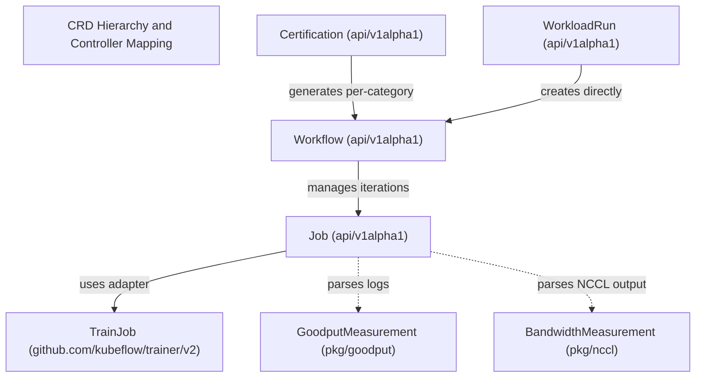
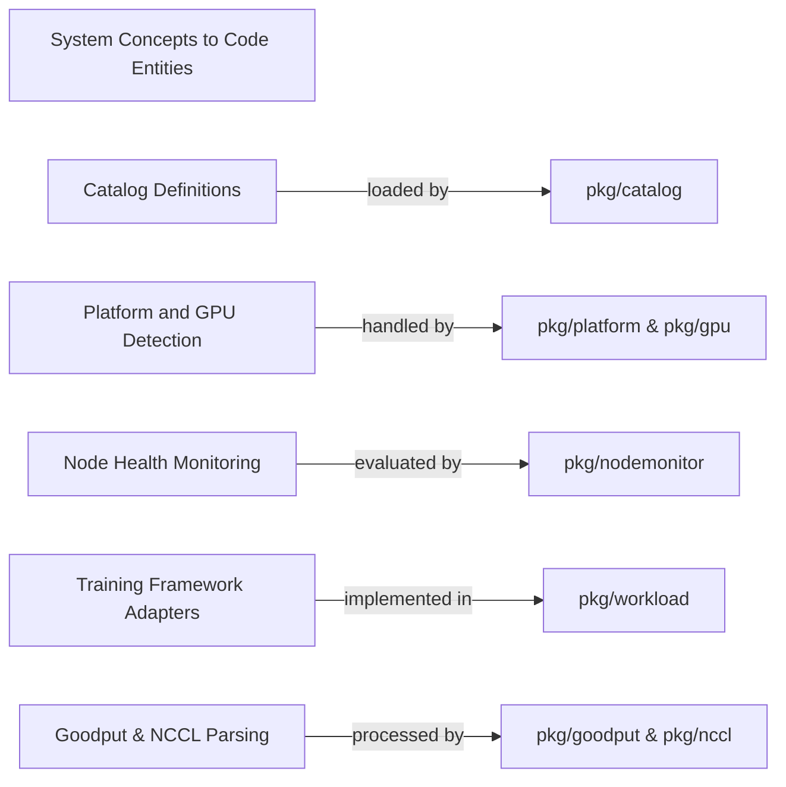

<!-- source: DeepWiki mcp.deepwiki.com · repo NVIDIA/cluster-readiness-engine · page 1 Overview · fetched 2026-10-26 -->

# Overview

Relevant source files

The following files were used as context for generating this wiki page:

- [.claude/skills/cre-test/SKILL.md](.claude/skills/cre-test/SKILL.md)
- [.claude/skills/managing-openvex/SKILL.md](.claude/skills/managing-openvex/SKILL.md)
- [.claude/skills/release-notes/SKILL.md](.claude/skills/release-notes/SKILL.md)
- [.github/workflows/attest-selftest.yml](.github/workflows/attest-selftest.yml)
- [.golangci.yml](.golangci.yml)
- [AGENTS.md](AGENTS.md)
- [CHANGELOG.md](CHANGELOG.md)
- [CLAUDE.md](CLAUDE.md)
- [CONTRIBUTING.md](CONTRIBUTING.md)
- [Dockerfile](Dockerfile)
- [README.md](README.md)
- [RELEASE.md](RELEASE.md)
- [SECURITY.md](SECURITY.md)
- [THIRD_PARTY_NOTICES.md](THIRD_PARTY_NOTICES.md)
- [config/samples/policy/kyverno-verify-images.yaml](config/samples/policy/kyverno-verify-images.yaml)
- [config/samples/policy/policy-controller-verify-images.yaml](config/samples/policy/policy-controller-verify-images.yaml)
- [docs/cli-reference/overview.md](docs/cli-reference/overview.md)
- [docs/concepts/health-monitoring-remediation.md](docs/concepts/health-monitoring-remediation.md)
- [docs/designs/081-cordoned-node-selection.md](docs/designs/081-cordoned-node-selection.md)
- [docs/getting-started/first-certification.md](docs/getting-started/first-certification.md)
- [docs/getting-started/install.md](docs/getting-started/install.md)
- [docs/operations/verifying-artifacts.md](docs/operations/verifying-artifacts.md)
- [go.mod](go.mod)
- [go.sum](go.sum)

The NVIDIA Cluster Readiness Engine (NVCRE) is a Kubernetes controller paired with the `nvcrectl` command-line interface designed to certify GPU clusters prior to running production workloads [README.md:1-8](). NVCRE executes real training and NCCL communication workloads across topology-aware node groups, evaluates performance metrics, detects hardware failures via Common Expression Language (CEL) expressions, and attributes failures to specific nodes without modifying node taints or cordons [README.md:8]().

This page serves as a high-level parent overview of NVCRE. For granular details, follow the child page links below:
- **Getting Started**: [Getting Started](#1.1) — Installing `nvcrectl` via the installer script, running `setup init`, and executing a first certification [README.md:41-95]().
- **Core Concepts**: [Core Concepts](#1.2) — Certification → Workflow → Job hierarchy, catalog entries, goodput and bandwidth measurements, platform/GPU detection, and node health monitoring [README.md:12-24]().
- **Repository Layout and Development Workflow**: [Repository Layout and Development Workflow](#1.3) — Directory map (`api/`, `cmd/`, `pkg/`, `helm/`, `test/`), Makefile targets, linting, and contribution guidelines [CONTRIBUTING.md:25-144]().

---

## High-Level Architecture and Control Flow

NVCRE APIs compose hierarchically using a pattern analogous to standard Kubernetes resources like `Deployment`, `ReplicaSet`, and `Pod` [README.md:27-40]().

Sources: [README.md:27-40](), [CLAUDE.md:72-84]()

---

## Natural Language to Code Entity Space

The following diagram associates high-level system concepts with their implementing packages and components in the codebase.

Sources: [CLAUDE.md:85-98]()

---

## 1.1. Getting Started

NVCRE requires a Kubernetes cluster equipped with the NVIDIA GPU Operator and Prometheus Operator CRDs (`monitoring.coreos.com/v1`) [README.md:46-54](). 

The `nvcrectl` CLI provides tools for preflight checks, installation, and certification execution [README.md:61-105](). For installation prerequisites, cluster validation steps, and complete walkthroughs, see the child documentation page [docs/getting-started/first-certification.md:1-117]().

Sources: [README.md:41-112](), [docs/getting-started/first-certification.md:1-117]()

---

## 1.2. Core Concepts

The core execution model revolves around the `Certification` → `Workflow` → `Job` hierarchy [README.md:39]():
- **Catalog**: Declarative YAML test specifications loaded via `pkg/catalog/` [CONTRIBUTING.md:29]().
- **Measurement**: `GoodputMeasurement` parses training logs using `pkg/goodput` while `BandwidthMeasurement` processes NCCL logs via `pkg/nccl` [README.md:35-39]().
- **Health Monitoring & Attribution**: `pkg/nodemonitor` continuously evaluates `Node` state using CEL expressions, propagating failed nodes through `status.failedNodesRef` ConfigMaps [docs/concepts/health-monitoring-remediation.md:9-77]().

For deep dives into partitioning, MNNVL handling, and failure attribution, see the child page [Core Concepts](#1.2).

Sources: [CLAUDE.md:72-98](), [docs/concepts/health-monitoring-remediation.md:9-77]()

---

## 1.3. Repository Layout and Development Workflow

The codebase is structured around standard Kubernetes controller conventions:
- `api/v1alpha1/`: Custom Resource Definitions and API types.
- `cmd/`: Entrypoints including `cmd/manager` and `cmd/integration` [CLAUDE.md:25]().
- `pkg/`: Core controller logic, catalog handlers, measurement logic, and framework adapters [CLAUDE.md:85-98]().
- `helm/`: Helm charts for deployment packaging [README.md:95]().
- `test/`: UAT and policy validation test suites [CLAUDE.md:35-48]().

Development relies on `make` targets (`make test`, `make lint`, `make manifests`) and requires adherence to Conventional Commits and DCO sign-offs [CONTRIBUTING.md:86-144](). For detailed directory mapping and workflow rules, see [Repository Layout and Development Workflow](#1.3).

Sources: [CLAUDE.md:5-16](), [CONTRIBUTING.md:86-144]()

---

