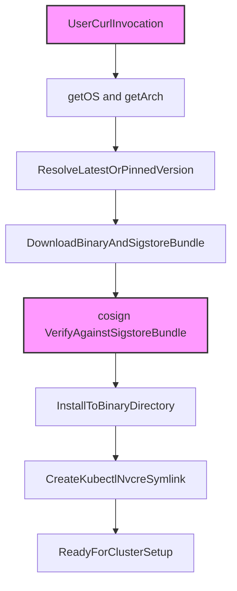
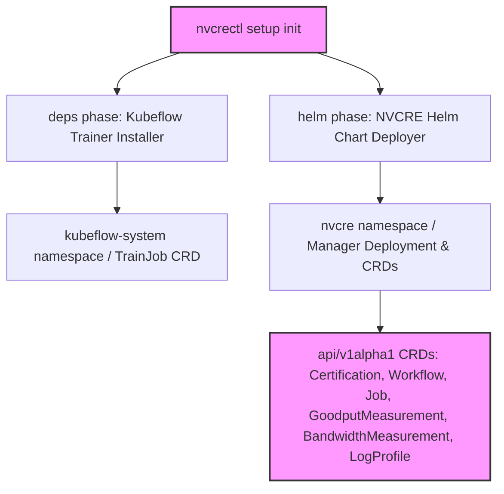
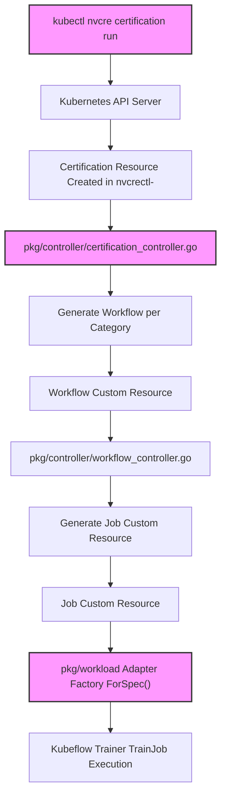

<!-- source: DeepWiki mcp.deepwiki.com · repo NVIDIA/cluster-readiness-engine · page 1.1 Getting Started · fetched 2026-10-26 -->

# Getting Started

<details>
<summary>Relevant source files</summary>

The following files were used as context for generating this wiki page:

- [.claude/skills/cre-test/SKILL.md](.claude/skills/cre-test/SKILL.md)
- [.claude/skills/managing-openvex/SKILL.md](.claude/skills/managing-openvex/SKILL.md)
- [.github/workflows/attest-selftest.yml](.github/workflows/attest-selftest.yml)
- [.github/workflows/build-image.yml](.github/workflows/build-image.yml)
- [.github/workflows/ci.yml](.github/workflows/ci.yml)
- [.github/workflows/codeql.yml](.github/workflows/codeql.yml)
- [.github/workflows/container-build.yml](.github/workflows/container-build.yml)
- [.github/workflows/govulncheck.yml](.github/workflows/govulncheck.yml)
- [.github/workflows/publish.yml](.github/workflows/publish.yml)
- [.github/workflows/release.yml](.github/workflows/release.yml)
- [.github/workflows/scorecard.yml](.github/workflows/scorecard.yml)
- [AGENTS.md](AGENTS.md)
- [CLAUDE.md](CLAUDE.md)
- [CONTRIBUTING.md](CONTRIBUTING.md)
- [Makefile](Makefile)
- [docs/cli-reference/certification.md](docs/cli-reference/certification.md)
- [docs/cli-reference/overview.md](docs/cli-reference/overview.md)
- [docs/getting-started/first-certification.md](docs/getting-started/first-certification.md)
- [docs/getting-started/install.md](docs/getting-started/install.md)
- [docs/how-to-guides/certify-a-cluster.md](docs/how-to-guides/certify-a-cluster.md)
- [docs/how-to-guides/run-workloadrun.md](docs/how-to-guides/run-workloadrun.md)
- [docs/how-to-guides/workloadrun-deepseek-v3.md](docs/how-to-guides/workloadrun-deepseek-v3.md)
- [docs/how-to-guides/workloadrun-nemotron5.md](docs/how-to-guides/workloadrun-nemotron5.md)
- [hack/verify-doc-links.sh](hack/verify-doc-links.sh)
- [helm/cluster-readiness-engine/templates/manager-role.yaml](helm/cluster-readiness-engine/templates/manager-role.yaml)
- [installer](installer)

</details>


## Purpose and Scope

This page covers the end-to-end onboarding workflow for the NVIDIA Cluster Readiness Engine (NVCRE). It details cluster requirements, pre-flight checks, installing the `nvcrectl` command-line interface via the installer script with Sigstore provenance verification, deploying controller dependencies and core components via `setup init`, and running an initial NCCL communication certification workload.

Sources: `docs/getting-started/install.md` [docs/getting-started/install.md:1-82](), `docs/getting-started/first-certification.md` [docs/getting-started/first-certification.md:1-117](), `installer` [installer:1-81]()

---

## Cluster Requirements and Prerequisites

Before bootstrapping NVCRE on a target Kubernetes cluster, ensure the cluster satisfies the following infrastructure and tooling dependencies:

| Requirement | Specification | Notes / Code Reference |
| :--- | :--- | :--- |
| **Kubernetes Version** | `v1.29+` | Required by the Certification CRD's Common Expression Language (CEL) validation rules utilizing the `quantity()` library [docs/getting-started/install.md:9-11](). |
| **GPU Operator** | NVIDIA GPU Operator | Must be pre-installed to populate `nvidia.com/gpu.product` node labels [docs/getting-started/install.md:12-13](), [docs/getting-started/first-certification.md:15](). |
| **CLI Tools** | `kubectl` & `helm` (`v3.x`) | `kubectl` configured with cluster admin permissions; `helm` required for chart rendering/installation [docs/getting-started/install.md:12-14](). |
| **Metrics Infrastructure** | Prometheus Operator CRDs (`monitoring.coreos.com/v1`) | Required by the default `ServiceMonitor` template in the Helm chart. Can be bypassed via `metrics.serviceMonitor.enabled=false` [docs/getting-started/first-certification.md:17-18](). |
| **Egress Access** | Outbound access to `github.com` (for training categories) | Required for training worker pods to clone Megatron-LM during initialization [docs/getting-started/first-certification.md:21](). |
| **Advanced Architectures** | NVIDIA DRA Driver (GB200/GB300) | Required for `ComputeDomain` resource provisioning [docs/getting-started/first-certification.md:20](). |

Cordoned nodes are excluded from certification targets unless explicitly opted in via `spec.target.taintSelectors` targeting `node.kubernetes.io/unschedulable` [docs/getting-started/first-certification.md:23-24]().

Sources: `docs/getting-started/install.md` [docs/getting-started/install.md:9-15](), `docs/getting-started/first-certification.md` [docs/getting-started/first-certification.md:11-24]()

---

## Installing the `nvcrectl` CLI

The `nvcrectl` CLI binary is distributed via a shell installer script that detects the host operating system and architecture, fetches the appropriate binary from GitHub releases, validates its cryptographic signature via Sigstore, and installs it into `/usr/local/bin` alongside a `kubectl-nvcre` symlink [installer:107-124](), [docs/getting-started/install.md:16-32](), [docs/getting-started/first-certification.md:25-39]().

### Installer Execution Flow


*Figure 1.1.1: `nvcrectl` installation and Sigstore verification pipeline.*

Sources: `installer` [installer:107-124](), `docs/getting-started/install.md` [docs/getting-started/install.md:16-32](), `docs/getting-started/first-certification.md` [docs/getting-started/first-certification.md:25-39]()

To install the latest stable version:
```bash
curl -fsSL https://github.com/NVIDIA/cluster-readiness-engine/releases/latest/download/installer | bash
```

To pin a specific release version or skip verification (not recommended for production):
```bash
curl -fsSL https://github.com/NVIDIA/cluster-readiness-engine/releases/download/<tag>/installer | bash -s -- -v <tag>
```

Verify the installation using either entrypoint:
```bash
nvcrectl --version
kubectl nvcre --version
```

Sources: `docs/getting-started/install.md` [docs/getting-started/install.md:16-37](), `docs/getting-started/first-certification.md` [docs/getting-started/first-certification.md:25-46]()

---

## Initializing the Cluster Environment (`setup init`)

Before running cluster certifications, the Kubernetes control plane must be provisioned with Kubeflow Trainer dependencies, NVCRE Custom Resource Definitions (CRDs), and controller deployments [docs/getting-started/install.md:39-44]().

Run pre-flight checks to validate cluster state:
```bash
kubectl nvcre cluster info
kubectl nvcre setup status
```
`cluster info` inspects `spec.providerID` and node labels (`nvidia.com/gpu.product`) to detect cloud platforms and GPU architectures, while `setup status` evaluates whether prerequisites and operator components are present [CLAUDE.md:97](), [docs/getting-started/first-certification.md:52-66]().

Execute the initialization command:
```bash
kubectl nvcre setup init
```
This command executes two distinct installation phases [docs/getting-started/install.md:41-47](), [docs/getting-started/first-certification.md:72-80]():

1. **`deps` Phase**: Installs Kubeflow Trainer (`v2.2.1`) into the `kubeflow-system` namespace. NVCRE delegates underlying workload orchestration to Kubeflow Trainer `TrainJob` custom resources [CLAUDE.md:78](), [docs/getting-started/install.md:43](), [docs/getting-started/first-certification.md:78]().
2. **`helm` Phase**: Installs the NVCRE Helm chart (`helm/cluster-readiness-engine`) into the `nvcre` namespace. This deploys the controller manager, seven CRDs, and built-in cluster-scoped `LogProfile` objects used for pod log parsing [CLAUDE.md:79-81](), [docs/getting-started/install.md:44](), [docs/getting-started/first-certification.md:79]().

### Setup Architecture and Code Entity Mapping


*Figure 1.1.2: Component mapping between setup command invocation and Kubernetes control plane resources.*

Sources: `docs/getting-started/install.md` [docs/getting-started/install.md:39-50](), `docs/getting-started/first-certification.md` [docs/getting-started/first-certification.md:50-86](), `CLAUDE.md` [CLAUDE.md:72-81]()

---

## Executing Your First Certification

Once setup succeeds, you can list available benchmark catalog categories and execute a burn-in test [docs/getting-started/first-certification.md:89-117](), [docs/cli-reference/certification.md:98-110]().

To list supported verification categories:
```bash
kubectl nvcre certification list-categories
```
The catalog includes communication benchmarks (`communication/nccl-all-reduce`, `nccl-all-gather`, `nccl-alltoall`, `nccl-loopback`), diagnostics (`diagnostics/dcgm-level4`), and large-scale training goodput benchmarks (`training/nemotron5-8b`, `training/nemotron5-56b`) [docs/getting-started/first-certification.md:97]().

To execute an all-reduce NCCL communication test across all target GPU nodes with real-time progress monitoring:
```bash
kubectl nvcre certification run \
  --category communication/nccl-all-reduce \
  --wait \
  --timeout 60m \
  --results-file ./cert-results.json
```

### Certification Execution Data Flow


*Figure 1.1.3: Data flow from `nvcrectl` execution to controller reconciliation hierarchy.*

Sources: `docs/getting-started/first-certification.md` [docs/getting-started/first-certification.md:89-117](), `docs/cli-reference/certification.md` [docs/cli-reference/certification.md:9-64](), `CLAUDE.md` [CLAUDE.md:76-87]()

---

## Teardown and Reset

To clean up NVCRE custom resources, the controller deployment, and Kubeflow Trainer components while retaining shared cluster CRDs like `JobSet`, run [docs/getting-started/install.md:72-82]():
```bash
nvcrectl setup reset
```

Sources: `docs/getting-started/install.md` [docs/getting-started/install.md:72-82]()

---

