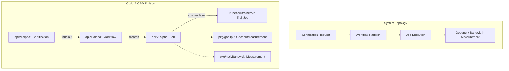
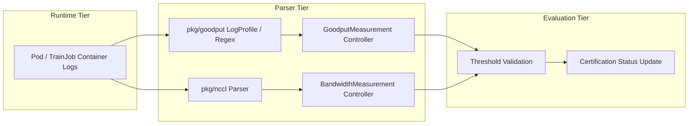
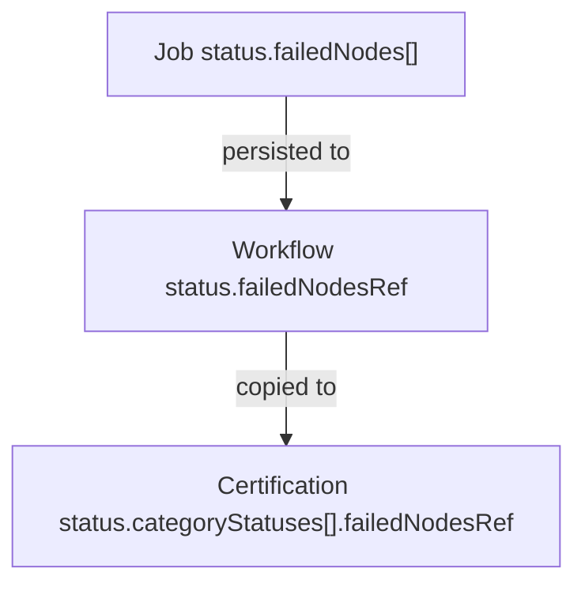

<!-- source: DeepWiki mcp.deepwiki.com · repo NVIDIA/cluster-readiness-engine · page 1.2 Core Concepts · fetched 2026-10-26 -->

# Core Concepts

<details>
<summary>Relevant source files</summary>

The following files were used as context for generating this wiki page:

- [.claude/skills/release-notes/SKILL.md](.claude/skills/release-notes/SKILL.md)
- [CHANGELOG.md](CHANGELOG.md)
- [README.md](README.md)
- [RELEASE.md](RELEASE.md)
- [SECURITY.md](SECURITY.md)
- [THIRD_PARTY_NOTICES.md](THIRD_PARTY_NOTICES.md)
- [config/samples/policy/kyverno-verify-images.yaml](config/samples/policy/kyverno-verify-images.yaml)
- [config/samples/policy/policy-controller-verify-images.yaml](config/samples/policy/policy-controller-verify-images.yaml)
- [docs/concepts/catalog.md](docs/concepts/catalog.md)
- [docs/concepts/health-monitoring-remediation.md](docs/concepts/health-monitoring-remediation.md)
- [docs/designs/000-adr.md](docs/designs/000-adr.md)
- [docs/designs/027-kustomize-override-ux.md](docs/designs/027-kustomize-override-ux.md)
- [docs/designs/031-platform-aware-nccl-config.md](docs/designs/031-platform-aware-nccl-config.md)
- [docs/designs/073-setup-retry-convergence.md](docs/designs/073-setup-retry-convergence.md)
- [docs/designs/079-workload-object-labels.md](docs/designs/079-workload-object-labels.md)
- [docs/designs/081-cordoned-node-selection.md](docs/designs/081-cordoned-node-selection.md)
- [docs/designs/README.md](docs/designs/README.md)
- [docs/how-to-guides/custom-catalog-entries.md](docs/how-to-guides/custom-catalog-entries.md)
- [docs/operations/verifying-artifacts.md](docs/operations/verifying-artifacts.md)

</details>


## Purpose and Scope

This document details the core architectural concepts of the NVIDIA Cluster Readiness Engine (NVCRE). It covers the hierarchical CRD execution model (`Certification` $\rightarrow$ `Workflow` $\rightarrow$ `Job`), the certification catalog design, goodput and per-bus bandwidth measurements, platform and GPU architecture detection, Multi-Node NVLink (MNNVL) orchestration, and Common Expression Language (CEL)-based node health monitoring with failure attribution.

Sources: [README.md:1-40](), [docs/designs/README.md:1-35]()

---

## 1. Certification $\rightarrow$ Workflow $\rightarrow$ Job Hierarchy

NVCRE's control plane models distributed cluster validation using a cascading custom resource hierarchy analogous to Kubernetes native primitives (`Deployment` $\rightarrow$ `ReplicaSet` $\rightarrow$ `Pod`) [README.md:27-40]():

1. **`Certification`**: The top-level orchestration primitive. It fans out execution across multiple catalog categories (e.g., communication benchmarks, multi-node training) [README.md:31-39]().
2. **`Workflow`**: Created per category or dynamically via ad-hoc execution. It handles node discovery, architectural filtering, topology-aware partitioning, and iteration state machines [README.md:31-39]().
3. **`Job`**: Manages the concrete workload execution. It instantiates underlying workloads through strongly typed adapters (such as Kubeflow Trainer `TrainJob`) and manages timeouts, stall detection, and log capture [README.md:33-35]().
4. **`WorkloadRun`**: A single-run shortcut resource that bypasses the catalog, creating a single `Workflow` and `Job` directly from an inline workload specification [README.md:32-39]().

### Hierarchy and Controller Data Flow



Sources: [README.md:25-40](), [THIRD_PARTY_NOTICES.md:18-18]()

---

## 2. Catalog and Workload Representation

The certification catalog defines structured test suites containing NCCL communication benchmarks and distributed training workloads [README.md:14-15](). Catalog definitions are resolved dynamically based on cluster scale, target node counts, and cloud provider characteristics.

* **Categories and Variants**: Each entry is categorized by domain (e.g., `communication`, `diagnostics`) and variant (e.g., `nccl-all-reduce`, `dcgm-level4`) [README.md:51-53]().
* **Workload Adapters**: The `Job` controller delegates specific runtime creation to pluggable adapters that translate declarative parameters into operator-specific objects like Kubeflow Trainer resources [README.md:33-35]().

Sources: [README.md:12-24](), [docs/designs/README.md:20-35]()

---

## 3. Platform and GPU Architecture Detection

NVCRE automatically identifies cloud environments and underlying hardware accelerators to apply appropriate tuning profiles and topological constraints [README.md:15]().

* **Platform Detection**: Identifies execution environments including AWS, GCP, Azure, OCI, nscale, TogetherAI, Mistral, Forge, and on-premises deployments [README.md:15]().
* **GPU Architecture Detection**: Detects GPU hardware families (e.g., GB200, GB300, H100, H200, B200, A100, L40S, L40) to resolve appropriate test parameters, environment variables, and transport-layer configurations [README.md:15]().
* **Overrides and Transforms (`WhenSpec`)**: Platform-specific configuration overrides are evaluated conditionally using evaluation logic to patch manifests, set worker resources, and configure gang schedulers [README.md:15]().

Sources: [README.md:12-24](), [docs/designs/README.md:25-35]()

---

## 4. Goodput, Bandwidth Measurement, and MNNVL

Performance evaluation relies on continuous log parsing and hardware topology awareness.

* **Goodput Measurement (`GoodputMeasurement`)**: Automatically monitors training iterations by parsing pod stdout/stderr logs using regular expression capture groups defined in cluster-scoped `LogProfile` resources [README.md:16](). It evaluates step times, tracks epochs, and freezes state upon terminal job conditions.
* **Bandwidth Measurement (`BandwidthMeasurement`)**: Parses NCCL benchmark logs to extract algorithm bandwidth (AlgBW) and bus bandwidth (BusBW) across various message payload sizes [README.md:17]().
* **Multi-Node NVLink (MNNVL)**: Coordinates multi-node GPU interconnect topologies, ensuring high-speed cluster communication domains (such as NVIDIA DRA `ComputeDomain` resources) are correctly integrated [README.md:48-51]().

### Measurement Pipeline Data Flow



Sources: [README.md:16-17](), [docs/designs/README.md:25-35]()

---

## 5. Node Health Monitoring and Failure Attribution

NVCRE executes health checks concurrently with workloads, isolating faulty hardware without altering cluster node states (NVCRE never cordons, taints, or modifies nodes directly) [README.md:8]().

### CEL-Based Node Health Monitoring
The `Job` controller evaluates Common Expression Language (CEL) expressions against Kubernetes `Node` objects (`pkg/nodemonitor`) [README.md:18]() [docs/concepts/health-monitoring-remediation.md:9-24](). Expressions inspect labels, conditions, taints, and allocatable metrics mid-run [docs/concepts/health-monitoring-remediation.md:15]():

```cel
node.metadata.labels["nvidia.com/gpu.ecc.error.count"] > "0"
```

### Failure Bubbling and Attribution Hierarchy
When nodes fail tests or trip health monitors, attribution bubbles up through the resource hierarchy into persistent `ConfigMap` structures [docs/concepts/health-monitoring-remediation.md:29-52]():



### Failure Reasons
Every failed node entry records a specific categorization reason [docs/concepts/health-monitoring-remediation.md:53-62]():
* `HardwareFailureDetected`: CEL health checks detected an active hardware anomaly mid-run [docs/concepts/health-monitoring-remediation.md:59]().
* `ThresholdViolation`: Performance metric (bandwidth, goodput, step time) missed configured pass/fail criteria [docs/concepts/health-monitoring-remediation.md:60]().
* `WorkloadFailed`: The workload exited with a non-zero status or experienced a startup stall [docs/concepts/health-monitoring-remediation.md:61]().

### Cordoned Node Selection
Operators can target cordoned nodes for validation (e.g., during bootstrapping or remediation workflows) by including the `node.kubernetes.io/unschedulable` taint inside `target.taintSelectors` [docs/designs/081-cordoned-node-selection.md:1-58](). When this taint selector is present, the default cordon health check is dropped for that run to prevent false positive hardware failure attributions [docs/designs/081-cordoned-node-selection.md:53-58]().

Sources: [README.md:18-20](), [docs/concepts/health-monitoring-remediation.md:1-104](), [docs/designs/081-cordoned-node-selection.md:1-58]()

---

