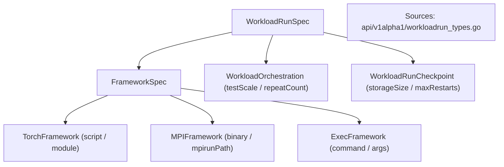
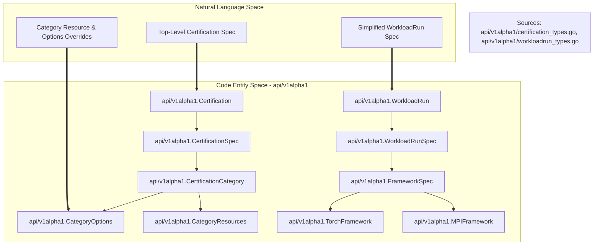

<!-- source: DeepWiki mcp.deepwiki.com · repo NVIDIA/cluster-readiness-engine · page 2.1 Certification and WorkloadRun Types · fetched 2026-10-26 -->

# Certification and WorkloadRun Types

<details>
<summary>Relevant source files</summary>

The following files were used as context for generating this wiki page:

- [api/v1alpha1/certification_types.go](api/v1alpha1/certification_types.go)
- [api/v1alpha1/workloadrun_types.go](api/v1alpha1/workloadrun_types.go)
- [cmd/integration/testdata/reconcile/certification-spec-immutable-terminal/expected.json](cmd/integration/testdata/reconcile/certification-spec-immutable-terminal/expected.json)
- [cmd/integration/testdata/reconcile/certification-spec-immutable-terminal/input_client_objects.yaml](cmd/integration/testdata/reconcile/certification-spec-immutable-terminal/input_client_objects.yaml)
- [cmd/integration/testdata/reconcile/certification-spec-immutable-terminal/input_config.yaml](cmd/integration/testdata/reconcile/certification-spec-immutable-terminal/input_config.yaml)
- [cmd/integration/testdata/reconcile/certification-spec-immutable/expected.json](cmd/integration/testdata/reconcile/certification-spec-immutable/expected.json)
- [cmd/integration/testdata/reconcile/certification-spec-immutable/input_client_objects.yaml](cmd/integration/testdata/reconcile/certification-spec-immutable/input_client_objects.yaml)
- [cmd/integration/testdata/reconcile/certification-spec-immutable/input_config.yaml](cmd/integration/testdata/reconcile/certification-spec-immutable/input_config.yaml)
- [cmd/integration/testdata/reconcile/workloadrun-mpi-aws-gb300/expected.json](cmd/integration/testdata/reconcile/workloadrun-mpi-aws-gb300/expected.json)
- [cmd/integration/testdata/reconcile/workloadrun-mpi/expected.json](cmd/integration/testdata/reconcile/workloadrun-mpi/expected.json)
- [cmd/integration/testdata/reconcile/workloadrun-spec-immutable/expected.json](cmd/integration/testdata/reconcile/workloadrun-spec-immutable/expected.json)
- [cmd/integration/testdata/reconcile/workloadrun-spec-immutable/input_client_objects.yaml](cmd/integration/testdata/reconcile/workloadrun-spec-immutable/input_client_objects.yaml)
- [cmd/integration/testdata/validation/certification-maxbytes-documented-value/expected.json](cmd/integration/testdata/validation/certification-maxbytes-documented-value/expected.json)
- [cmd/integration/testdata/validation/certification-maxbytes-documented-value/input.yaml](cmd/integration/testdata/validation/certification-maxbytes-documented-value/input.yaml)
- [cmd/integration/testdata/validation/certification-maxbytes-invalid-unit/expected.json](cmd/integration/testdata/validation/certification-maxbytes-invalid-unit/expected.json)
- [cmd/integration/testdata/validation/certification-maxbytes-invalid-unit/input.yaml](cmd/integration/testdata/validation/certification-maxbytes-invalid-unit/input.yaml)
- [cmd/integration/testdata/validation/certification-maxbytes-spec-level/expected.json](cmd/integration/testdata/validation/certification-maxbytes-spec-level/expected.json)
- [cmd/integration/testdata/validation/certification-maxbytes-spec-level/input.yaml](cmd/integration/testdata/validation/certification-maxbytes-spec-level/input.yaml)
- [cmd/integration/validation_test.go](cmd/integration/validation_test.go)
- [docs/api-reference/certification.md](docs/api-reference/certification.md)
- [docs/api-reference/workloadrun.md](docs/api-reference/workloadrun.md)
- [pkg/platform/runtime.go](pkg/platform/runtime.go)
- [pkg/workloadrun/testdata/build-workflow-spec/mpi-keeps-spec-env/expected.json](pkg/workloadrun/testdata/build-workflow-spec/mpi-keeps-spec-env/expected.json)
- [pkg/workloadrun/testdata/build-workflow-spec/mpi-keeps-spec-env/input.yaml](pkg/workloadrun/testdata/build-workflow-spec/mpi-keeps-spec-env/input.yaml)
- [pkg/workloadrun/testdata/build-workflow-spec/torch-keeps-spec-env/input.yaml](pkg/workloadrun/testdata/build-workflow-spec/torch-keeps-spec-env/input.yaml)

</details>


## Purpose and Scope
This page details the API specification, validation rules, and immutability invariants for the primary user-facing custom resources in the NVIDIA Cluster Readiness Engine (NVCRE): `Certification` and `WorkloadRun`. It covers the hierarchical configuration structures, framework definitions, orchestration flags, resource limits, and common validation patterns enforced by custom resource definition (CRD) validation rules and Common Expression Language (CEL) constraints.

Sources: `api/v1alpha1/certification_types.go:1-153` [api/v1alpha1/certification_types.go](), `api/v1alpha1/workloadrun_types.go:1-180` [api/v1alpha1/workloadrun_types.go]()

---

## 1. Certification Spec Structure
The `Certification` custom resource defines a comprehensive test suite executed against a designated GPU node pool. Its specification is partitioned into target cluster selectors, global test execution defaults, category-specific overrides, and gang-scheduling configurations.

### Key Fields and Sub-Structures
* **`target`**: Defines node selectors and taint tolerations to bound the scope of nodes eligible for certification tests.
* **`categories`**: A list of `CertificationCategory` entries specifying the domains (e.g., `communication`, `training`) and variants (e.g., `nccl-all-reduce`, `nemotron5-8b`) to execute.
* **`gangScheduler`**: Optional configuration opting workload pods into gang-aware schedulers (such as KAI Scheduler or Run:ai).
* **`maxBytes`**: Global default for the maximum transfer size tested during communication benchmarks, validated against pattern constraints like `^[0-9]+(K|M|G|T)?$`.

Each category may define a `CategoryOptions` structure and `CategoryResources` overrides. The `CategoryOptions` struct controls parameters such as `nodesPerJob`, `enableCheckpoint`, `maxSteps`, `exitDurationMins`, and `gpusPerNode` [api/v1alpha1/certification_types.go:121-150]().

```yaml
apiVersion: nvcre.nvidia.com/v1alpha1
kind: Certification
metadata:
  name: gpu-cluster-cert
  namespace: nvcre
spec:
  target:
    nodeSelector:
      nvidia.com/gpu.present: "true"
  enableMNNVL: false
  categories:
    - domain: communication
      variant: nccl-all-reduce
    - domain: training
      variant: nemotron5-8b
      options:
        maxSteps: 50
        nodesPerJob: 8
        resources:
          limits:
            cpu: "6"
            memory: 48Gi
          requests:
            cpu: "4"
            memory: 32Gi
```

Sources: `api/v1alpha1/certification_types.go:1-153` [api/v1alpha1/certification_types.go](), `docs/api-reference/certification.md:1-56` [docs/api-reference/certification.md]()

---

## 2. WorkloadRun Simplified Specification
`WorkloadRun` provides a streamlined, user-facing API for executing ad-hoc distributed workloads without constructing full certification multi-stage pipelines [docs/api-reference/workloadrun.md:9-10]().

### Framework Disriminated Union (`FrameworkSpec`)
The workload framework is modeled as a mutually exclusive discriminated union where exactly one framework backend must be populated (`minProperties: 1`, `maxProperties: 1`) [api/v1alpha1/workloadrun_types.go:28-50]():
1. **`Torch`**: Executes distributed training via `torchrun`. Supports `script` or `module` (which are mutually exclusive) along with argument lists [api/v1alpha1/workloadrun_types.go:34-72]().
2. **`MPI`**: Executes MPI-based benchmarks and workloads (e.g., NCCL tests) via configurable binaries, `mpirunPath`, and extra parameters [api/v1alpha1/workloadrun_types.go:74-100]().
3. **`Exec`**: Executes direct command arrays [api/v1alpha1/workloadrun_types.go:102-112]().


Sources: `api/v1alpha1/workloadrun_types.go:28-172` [api/v1alpha1/workloadrun_types.go](), `docs/api-reference/workloadrun.md:9-42` [docs/api-reference/workloadrun.md]()

---

## 3. Validation Rules and Immutability Semantics

### CEL Validation Rules
Custom resource definitions enforce strict admission-time validation checks via Common Expression Language (CEL):
* **Resource Request/Limit Ordering**: `CategoryResources` rules assert that CPU and memory requests do not exceed their corresponding limits [api/v1alpha1/certification_types.go:104-105]().
* **Mutually Exclusive Arguments**: `TorchFramework` enforces that `script` and `module` cannot both be specified [api/v1alpha1/workloadrun_types.go:54-55](). Similarly, `WorkloadConfig` enforces mutual exclusion between `inline` and `configMapRef` [api/v1alpha1/workloadrun_types.go:116-116]().
* **Label and Queue Formatting**: Gang scheduler queues and label keys are validated against Kubernetes qualified-name patterns and string length bounds (e.g., maximum length caps) [docs/api-reference/workloadrun.md:56-57]().

### Immutability Guarantees
* **`WorkloadRun` Immutability**: Once created, the entire `spec` of a `WorkloadRun` is strictly immutable (`self == oldSelf`). Any update attempt is rejected at admission time by CEL expressions [docs/api-reference/workloadrun.md:45-47]().
* **`Certification` Lifecycle Invariants**: Active certification jobs and terminal workflow configurations enforce update protections to preserve execution integrity and audit logs [cmd/integration/testdata/reconcile/certification-spec-immutable/expected.json:1-12]() [cmd/integration/testdata/reconcile/certification-spec-immutable-terminal/expected.json:1-12]().

Sources: `api/v1alpha1/certification_types.go:104-105` [api/v1alpha1/certification_types.go](), `api/v1alpha1/workloadrun_types.go:54-56` [api/v1alpha1/workloadrun_types.go](), `docs/api-reference/workloadrun.md:45-47` [docs/api-reference/workloadrun.md](), `cmd/integration/testdata/validation/certification-maxbytes-invalid-unit/expected.json:1-10` [cmd/integration/testdata/validation/certification-maxbytes-invalid-unit/expected.json]()

---

## 4. Code Entity Architecture and Data Flow

The following diagram illustrates how the natural language specifications map directly to concrete Go types within the `api/v1alpha1` package during API admission and controller reconciliation.



Sources: `api/v1alpha1/certification_types.go:1-153` [api/v1alpha1/certification_types.go](), `api/v1alpha1/workloadrun_types.go:28-180` [api/v1alpha1/workloadrun_types.go]()

---

