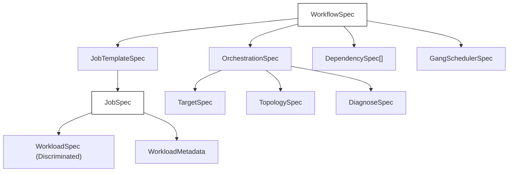
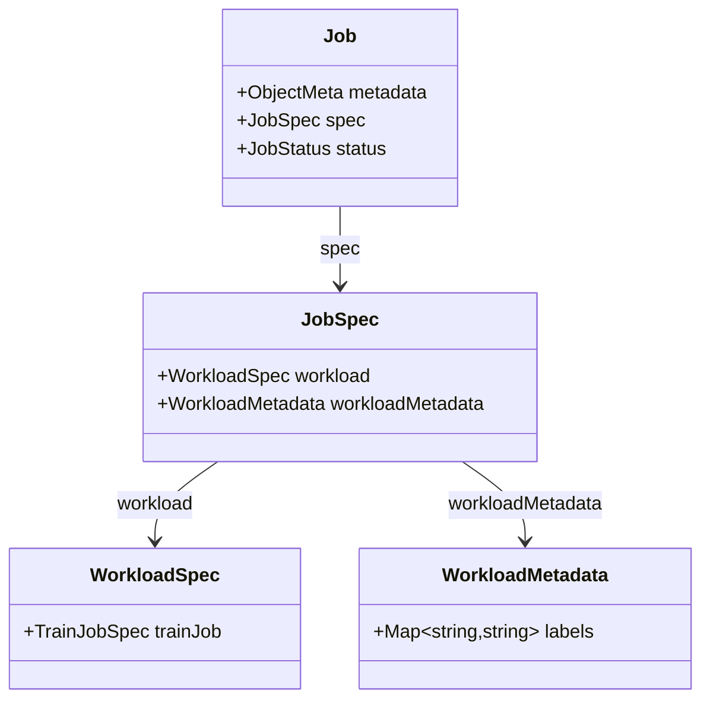
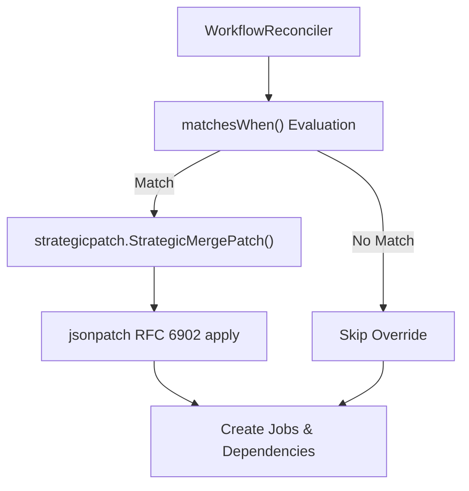

<!-- source: DeepWiki mcp.deepwiki.com · repo NVIDIA/cluster-readiness-engine · page 2.2 Workflow and Job Types · fetched 2026-10-26 -->

# Workflow and Job Types

Relevant source files

The following files were used as context for generating this wiki page:

- [api/v1alpha1/workflow_types.go](api/v1alpha1/workflow_types.go)
- [cmd/integration/testdata/reconcile/workflow-hardware-and-validation-failed/expected.json](cmd/integration/testdata/reconcile/workflow-hardware-and-validation-failed/expected.json)
- [cmd/integration/testdata/reconcile/workflow-hardware-and-validation-failed/input_client_objects.yaml](cmd/integration/testdata/reconcile/workflow-hardware-and-validation-failed/input_client_objects.yaml)
- [cmd/integration/testdata/reconcile/workflow-hardware-and-validation-failed/input_config.yaml](cmd/integration/testdata/reconcile/workflow-hardware-and-validation-failed/input_config.yaml)
- [cmd/integration/testdata/reconcile/workflow-validation-failed/expected.json](cmd/integration/testdata/reconcile/workflow-validation-failed/expected.json)
- [cmd/integration/testdata/reconcile/workloadrun-validation-failed/expected.json](cmd/integration/testdata/reconcile/workloadrun-validation-failed/expected.json)
- [cmd/integration/testdata/reconcile/workloadrun-validation-failed/input_client_objects.yaml](cmd/integration/testdata/reconcile/workloadrun-validation-failed/input_client_objects.yaml)
- [cmd/integration/testdata/reconcile/workloadrun-validation-failed/input_config.yaml](cmd/integration/testdata/reconcile/workloadrun-validation-failed/input_config.yaml)
- [docs/api-reference/workflow.md](docs/api-reference/workflow.md)
- [docs/designs/000-adr.md](docs/designs/000-adr.md)
- [docs/designs/027-kustomize-override-ux.md](docs/designs/027-kustomize-override-ux.md)
- [docs/designs/031-platform-aware-nccl-config.md](docs/designs/031-platform-aware-nccl-config.md)
- [docs/designs/073-setup-retry-convergence.md](docs/designs/073-setup-retry-convergence.md)
- [docs/designs/079-workload-object-labels.md](docs/designs/079-workload-object-labels.md)
- [docs/designs/README.md](docs/designs/README.md)
- [helm/cluster-readiness-engine/crds/nvcre.nvidia.com_certifications.yaml](helm/cluster-readiness-engine/crds/nvcre.nvidia.com_certifications.yaml)
- [helm/cluster-readiness-engine/crds/nvcre.nvidia.com_workflows.yaml](helm/cluster-readiness-engine/crds/nvcre.nvidia.com_workflows.yaml)
- [helm/cluster-readiness-engine/crds/nvcre.nvidia.com_workloadruns.yaml](helm/cluster-readiness-engine/crds/nvcre.nvidia.com_workloadruns.yaml)
- [pkg/controller/testdata/apply-workflow-validation-failed/idempotent-already-set/expected.json](pkg/controller/testdata/apply-workflow-validation-failed/idempotent-already-set/expected.json)
- [pkg/controller/testdata/apply-workflow-validation-failed/idempotent-already-set/input.yaml](pkg/controller/testdata/apply-workflow-validation-failed/idempotent-already-set/input.yaml)

## Purpose and Scope
This page details the technical specifications and runtime status schemas for `Workflow` and `Job` resources within the `nvcre.nvidia.com` API group (`api/v1alpha1/workflow_types.go` [api/v1alpha1/workflow_types.go:1-12]() and `api/v1alpha1/job_types.go`()). A `Workflow` governs a single certification category run or multi-node campaign, orchestrating node grouping, iterations, conditional dependencies, and overrides. A `Job` defines an individual execution unit inside a workflow via a strongly-typed, discriminated workload specification (`WorkloadSpec`) and workload metadata (`WorkloadMetadata`).

---

## 1. Workflow Specification and Status

The `Workflow` resource acts as the intermediate execution engine generated by the `Certification` controller (or submitted directly via WorkloadRun). Its `spec` defines the template for generated jobs, topological orchestration parameters, conditional dependencies, and runtime overrides.

### Core Spec Components
- **`jobTemplate`**: Houses standard object metadata (`metav1.ObjectMeta`) and the primary `JobSpec` template (`api/v1alpha1/workflow_types.go:70-79`()).
- **`orchestration`**: Configures topology-aware domain chunking, node selector targets, active test scale, and iteration counts (`api/v1alpha1/workflow_types.go:81-111`()).
- **`dependencies`**: Lists conditional auxiliary resources (such as `ConfigMap` or `TrainingRuntime`) materialized before job execution based on `WhenSpec` evaluation (`helm/cluster-readiness-engine/crds/nvcre.nvidia.com_workflows.yaml:42-53`()).
- **`gangScheduler`**: Records the resolved gang-scheduling contract for queue and queue label alignment (`docs/api-reference/workflow.md:18-37`()).

### Status and Condition Lifecycle
Workflow status reflects progress across iterations and hardware health attribution:
- **Conditions**: Exclusive execution states (`InProgress`, `Succeeded`, `Failed`) combined with additive quality signals like `ValidationFailed` when performance thresholds are breached (`api/v1alpha1/workflow_types.go:13-30`(), `docs/api-reference/workflow.md:120-124`()).
- **Attribution References**: `succeededNodesRef` and `failedNodesRef` point to compressed `ConfigMap` instances tracking individual node health outcomes across iterations (`docs/api-reference/workflow.md:120-127`()).

*Sources: `api/v1alpha1/workflow_types.go:1-140`(), `docs/api-reference/workflow.md:1-35`()*

---

## 2. Job Specification and Discriminated Workloads

The `Job` API (`api/v1alpha1/job_types.go`) wraps framework-neutral execution semantics through a discriminated union pattern.

### `JobSpec` and `WorkloadSpec`
`JobSpec` requires exactly one workload framework variant to be specified via `workload` (`api/v1alpha1/job_types.go`). The discriminated union `WorkloadSpec` delegates instantiation to registered workload adapters (such as Kubeflow Trainer `TrainJob`):
- **`WorkloadMetadata`**: Exposes fine-grained label controls (`WorkloadLabelValue`) applied directly to the generated workload object rather than pod templates (`docs/designs/079-workload-object-labels.md:63-80`()).
- **Validation**: Enforces `MinProperties=1` and `MaxProperties=1` at the `WorkloadSpec` boundary to prevent ambiguous multi-framework definitions.

*Sources: `api/v1alpha1/job_types.go:1-100`(), `docs/designs/079-workload-object-labels.md:63-95`()*

Sources: `api/v1alpha1/workflow_types.go:1-180`(), `api/v1alpha1/job_types.go:1-100`(), `docs/api-reference/workflow.md:1-133`(), `docs/designs/079-workload-object-labels.md:1-149`()

---

## 3. Overrides, Dependencies, and Conditional Execution

Workflows support platform- and architecture-aware configuration customization through an override syntax inspired by Kustomize (`docs/designs/027-kustomize-override-ux.md:1-22`).

### Override Evaluation Flow
1. **`WhenSpec` Matching**: The controller evaluates runtime conditions across six fields (`Platform`, `GPUArchitecture`, `WorkloadKind`, `Topology`, `Config`, and custom `Expression` via `cel-go`) against discovered node characteristics (`docs/designs/027-kustomize-override-ux.md:64-73`).
2. **Strategic Merge Patch**: Matched `jobTemplate` overrides are merged using Kubernetes' `strategicpatch.StrategicMergePatch` against base job definitions, correctly respecting `patchStrategy` and `patchMergeKey` annotations (e.g., merging container environment lists by variable `name`) (`docs/designs/027-kustomize-override-ux.md:25-34`).
3. **JSON Patch (`jobTemplatePatch`)**: RFC 6902 JSON patch operations are executed subsequently to enable precise field additions, removals, or replacements (`docs/designs/027-kustomize-override-ux.md:35-49`).

*Sources: `docs/designs/027-kustomize-override-ux.md:23-79`()*

Sources: `docs/designs/027-kustomize-override-ux.md:1-84`(), `docs/designs/031-platform-aware-nccl-config.md:1-92`()

---

## 4. Gang Scheduling Consistency Contract

To prevent schedulers like Kueue or KAI from failing due to misconfigured queue assignments or mismatched pod templates, `Workflow` enforces an immutable gang scheduling contract (`docs/api-reference/workflow.md:22-37`).

### Contract Rules and Enforcement
- **`gangScheduler` Immortality**: The top-level `spec.gangScheduler` field is decoupled from `jobTemplate` and `dependencies`, making it immune to override modifications (`docs/api-reference/workflow.md:22-26`).
- **Validation Checkpoints**: Prior to dependency or job materialization, the controller verifies that:
  1. The workload object's queue label matches the configured target.
  2. All effective runtime job templates and pod templates maintain matching scheduler names and queue labels (`docs/api-reference/workflow.md:28-31`).
  3. Discrepancies introduced by overrides cause the workflow to transition to `Failed` with reason `GangSchedulingConflict` rather than applying silent mutations (`docs/api-reference/workflow.md:31-34`).

Sources: `docs/api-reference/workflow.md:1-147`(), `api/v1alpha1/workflow_types.go:134-160`()

---

