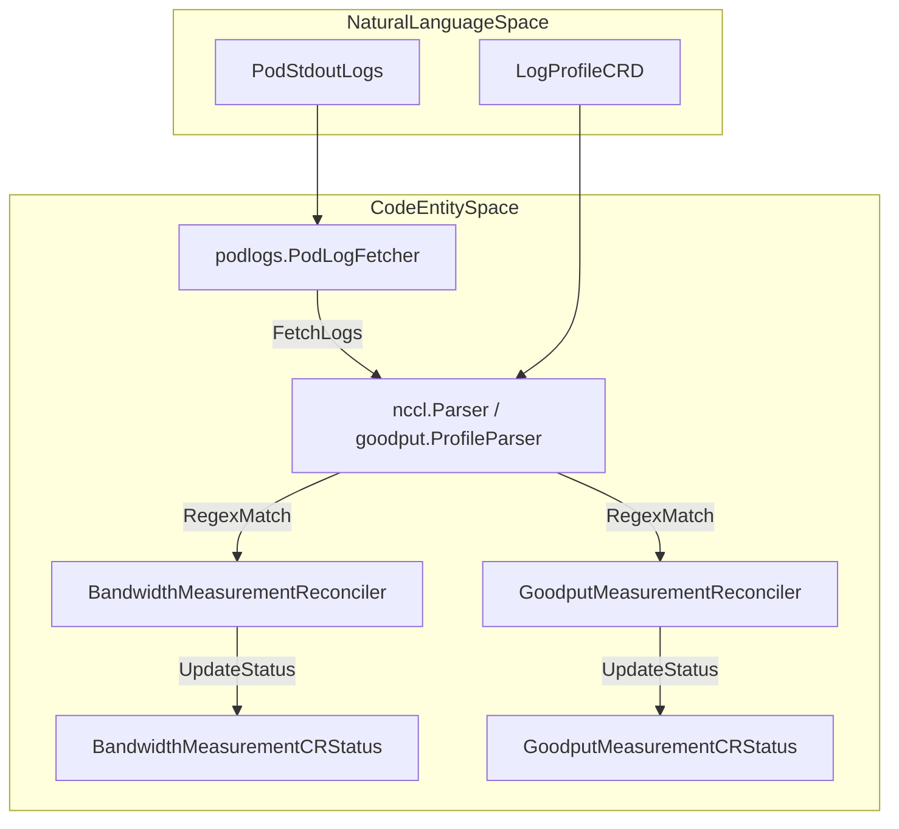
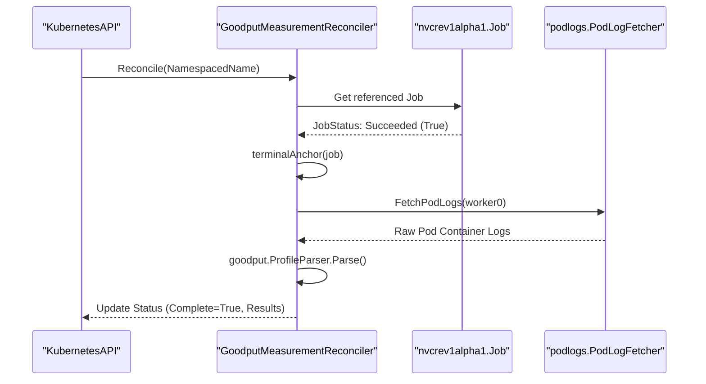

<!-- source: DeepWiki mcp.deepwiki.com · repo NVIDIA/cluster-readiness-engine · page 2.3 Measurement and LogProfile Types · fetched 2026-10-26 -->

# Measurement and LogProfile Types

<details>
<summary>Relevant source files</summary>

The following files were used as context for generating this wiki page:

- [cmd/integration/testdata/reconcile/bandwidth-measurement-job-succeed/expected.json](cmd/integration/testdata/reconcile/bandwidth-measurement-job-succeed/expected.json)
- [cmd/integration/testdata/reconcile/goodput-measurement-job-succeed/expected.json](cmd/integration/testdata/reconcile/goodput-measurement-job-succeed/expected.json)
- [pkg/controller/bandwidthmeasurement_controller.go](pkg/controller/bandwidthmeasurement_controller.go)
- [pkg/controller/event_helpers_test.go](pkg/controller/event_helpers_test.go)
- [pkg/controller/goodputmeasurement_controller.go](pkg/controller/goodputmeasurement_controller.go)
- [pkg/controller/testdata/unresolved-log-profile/bandwidth-running-profile-missing/expected.json](pkg/controller/testdata/unresolved-log-profile/bandwidth-running-profile-missing/expected.json)
- [pkg/controller/testdata/unresolved-log-profile/bandwidth-running-profile-missing/input.yaml](pkg/controller/testdata/unresolved-log-profile/bandwidth-running-profile-missing/input.yaml)
- [pkg/controller/testdata/unresolved-log-profile/bandwidth-succeeded-no-data/expected.json](pkg/controller/testdata/unresolved-log-profile/bandwidth-succeeded-no-data/expected.json)
- [pkg/controller/testdata/unresolved-log-profile/bandwidth-succeeded-no-data/input.yaml](pkg/controller/testdata/unresolved-log-profile/bandwidth-succeeded-no-data/input.yaml)
- [pkg/controller/testdata/unresolved-log-profile/bandwidth-succeeded-with-data/expected.json](pkg/controller/testdata/unresolved-log-profile/bandwidth-succeeded-with-data/expected.json)
- [pkg/controller/testdata/unresolved-log-profile/bandwidth-succeeded-with-data/input.yaml](pkg/controller/testdata/unresolved-log-profile/bandwidth-succeeded-with-data/input.yaml)
- [pkg/controller/testdata/unresolved-log-profile/goodput-running-profile-missing/expected.json](pkg/controller/testdata/unresolved-log-profile/goodput-running-profile-missing/expected.json)
- [pkg/controller/testdata/unresolved-log-profile/goodput-running-profile-missing/input.yaml](pkg/controller/testdata/unresolved-log-profile/goodput-running-profile-missing/input.yaml)
- [pkg/controller/testdata/unresolved-log-profile/goodput-succeeded-zero-result/expected.json](pkg/controller/testdata/unresolved-log-profile/goodput-succeeded-zero-result/expected.json)
- [pkg/controller/testdata/unresolved-log-profile/goodput-succeeded-zero-result/input.yaml](pkg/controller/testdata/unresolved-log-profile/goodput-succeeded-zero-result/input.yaml)
- [pkg/controller/unresolved_log_profile_test.go](pkg/controller/unresolved_log_profile_test.go)
- [pkg/podutil/discoverer.go](pkg/podutil/discoverer.go)

</details>


This page covers the technical architecture and implementation details of the `GoodputMeasurement`, `BandwidthMeasurement`, and cluster-scoped `LogProfile` Custom Resource Definitions (CRDs). It details how cluster readiness engines parse, sample, and evaluate training goodput and communication bandwidth metrics from pod logs using regular expression capture groups and configurable thresholds.

---

## 1. LogProfile CRD Structure and Pattern Sets

The `LogProfile` custom resource is a cluster-scoped object that defines how controller components parse unstructured pod logs into structured training metrics (such as iteration counts, resume times, and checkpoint save times) or networking benchmarks (such as algorithmic and bus bandwidth). 

A `LogProfile` contains a timestamp layout specification and a set of pattern definitions (`LogPatternSet`) utilizing named regular expression capture groups. For instance, training step patterns capture iteration numbers using named groups like `(?P<iteration>\d+)`.

```go
// Example logical configuration of a LogProfile spec (referencing pkg/controller/unresolved_log_profile_test.go)
profile := &nvcrev1alpha1.LogProfile{
    Name: "megatron-training",
    Spec: nvcrev1alpha1.LogProfileSpec{
        Timestamp: nvcrev1alpha1.TimestampSpec{Layout: "2006-01-02 15:04:05.999999"},
        Patterns: nvcrev1alpha1.LogPatternSet{
            TrainingStep: &nvcrev1alpha1.EventPattern{
                Regex: `iteration\s+(?P<iteration>\d+)`,
            },
        },
    },
}
```

Reconcilers cache compiled parsers mapped to the `LogProfile`'s `resourceVersion`, ensuring that edits to a `LogProfile` take effect immediately without requiring a controller restart `[pkg/controller/goodputmeasurement_controller.go:45-71](), [pkg/controller/bandwidthmeasurement_controller.go:71-84]()`.

Sources: `pkg/controller/unresolved_log_profile_test.go:61-71`, `pkg/controller/goodputmeasurement_controller.go:45-71`, `pkg/controller/bandwidthmeasurement_controller.go:71-84`

---

## 2. GoodputMeasurement CRD and Controller

The `GoodputMeasurement` CRD tracks training goodput metrics over the execution lifetime of a workload `Job`. The `GoodputMeasurementReconciler` monitors the target `Job`, fetches logs via a pluggable `podlogs.PodLogFetcher`, and maintains cumulative states `[pkg/controller/goodputmeasurement_controller.go:52-71]()`.

### Reconcile Lifecycle and Terminal Anchors

During reconciliation, the controller inspects the referenced `Job` status conditions (`JobSucceeded`, `JobFailed`, `JobInProgress`) `[pkg/controller/goodputmeasurement_controller.go:132-163]()`. All terminal-time computations anchor to the job's terminal condition timestamp to guarantee deterministic status writes (ADR-072) `[pkg/controller/goodputmeasurement_controller.go:146-159]()`:

```
+---------------------+     Job Running     +------------------------+
| Job InProgress      | ------------------> | Collect Periodic Sample|
+---------------------+                     +------------------------+
           |                                             |
           | Job Succeeded / Failed                      | Job Terminal
           v                                             v
+---------------------+                     +------------------------+
| Collect Final Sample| ------------------> | Write Terminal Status  |
+---------------------+                     +------------------------+
```

If a `LogProfileRef` cannot be resolved, the controller emits a warning event with reason `LogProfileNotFound` and requeues without failing terminally `[pkg/controller/goodputmeasurement_controller.go:37-43]()`. If a job succeeds but no matching logs are parsed, the measurement records a zero-data condition with reason `NoDataCollected` rather than leaving state fields uninitialized `[pkg/controller/goodputmeasurement_controller.go:40-43]()`.

Sources: `pkg/controller/goodputmeasurement_controller.go:52-163`

---

## 3. BandwidthMeasurement CRD and Controller

The `BandwidthMeasurement` CRD evaluates NCCL performance benchmarks (such as `all_reduce_perf` or `sendrecv_perf`). The `BandwidthMeasurementReconciler` parses algorithmic bandwidth (`AlgBW`) and bus bandwidth (`BusBW`) from worker pod logs `[pkg/controller/bandwidthmeasurement_controller.go:50-76]()`.

### Key Structs and Throttling

- **`BandwidthMeasurementReconciler`**: Manages finalizers (`bandwidthmeasurement-finalizer`), client readers, and event recorders `[pkg/controller/bandwidthmeasurement_controller.go:50-76]()`.
- **`cachedNCCLParser`**: Associates a compiled `nccl.Parser` with a `resourceVersion` string `[pkg/controller/bandwidthmeasurement_controller.go:78-83]`.
- **Sampling Throttles**: Uses `lastSample` maps to bound parsing frequency according to `spec.sampleInterval` (defaulting to 15s in production or 1s in tests) `[pkg/controller/bandwidthmeasurement_controller.go:74](), [pkg/controller/bandwidthmeasurement_controller.go:102-107]()`.

Sources: `pkg/controller/bandwidthmeasurement_controller.go:33-116`

---

## 4. Data Flow and Log Parsing Architecture

The subsystem bridges natural language log scraping requirements with compiled Go parsing structures and Kubernetes controllers.

### Architecture Mapping Diagram



Sources: `pkg/controller/goodputmeasurement_controller.go:52-79`, `pkg/controller/bandwidthmeasurement_controller.go:51-100`, `pkg/podlogs/`

### Terminal Flow Sequence Diagram



Sources: `pkg/controller/goodputmeasurement_controller.go:132-163`, `pkg/podutil/discoverer.go:31-93`

---

