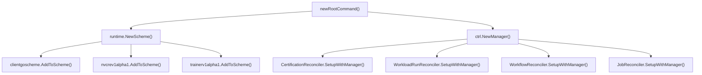
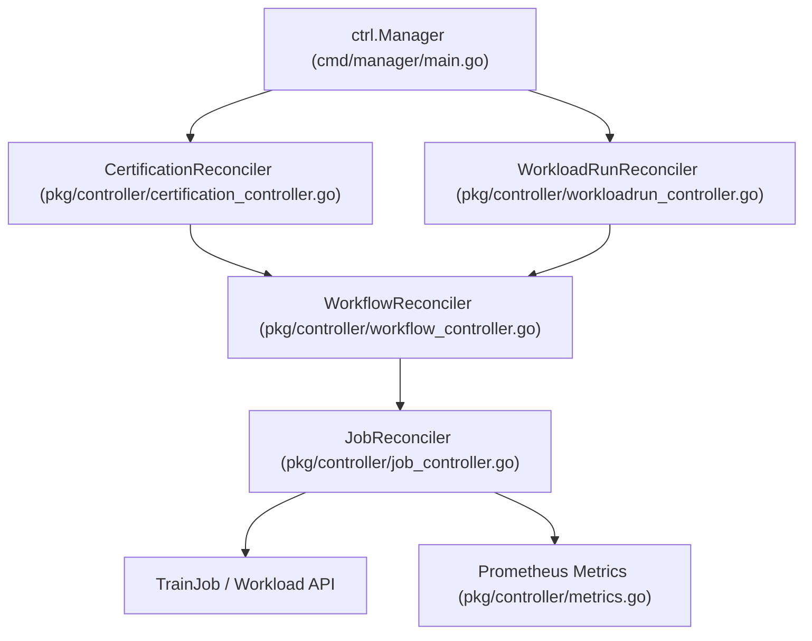

<!-- source: DeepWiki mcp.deepwiki.com · repo NVIDIA/cluster-readiness-engine · page 3 Controller Manager · fetched 2026-10-26 -->

# Controller Manager

Relevant source files

The following files were used as context for generating this wiki page:

- [cmd/integration/testdata/reconcile/bandwidth-measurement/expected.json](cmd/integration/testdata/reconcile/bandwidth-measurement/expected.json)
- [cmd/integration/testdata/reconcile/goodput-measurement/expected.json](cmd/integration/testdata/reconcile/goodput-measurement/expected.json)
- [cmd/integration/testdata/reconcile/goodput-measurement/input_config.yaml](cmd/integration/testdata/reconcile/goodput-measurement/input_config.yaml)
- [cmd/integration/testdata/reconcile/job/expected.json](cmd/integration/testdata/reconcile/job/expected.json)
- [cmd/integration/testdata/reconcile/workflow-topology-metrics-all-failed/expected.json](cmd/integration/testdata/reconcile/workflow-topology-metrics-all-failed/expected.json)
- [cmd/integration/testdata/reconcile/workflow-topology-metrics/expected.json](cmd/integration/testdata/reconcile/workflow-topology-metrics/expected.json)
- [cmd/manager/main.go](cmd/manager/main.go)
- [pkg/controller/certification_controller.go](pkg/controller/certification_controller.go)
- [pkg/controller/helpers.go](pkg/controller/helpers.go)
- [pkg/controller/job_controller.go](pkg/controller/job_controller.go)
- [pkg/controller/metrics.go](pkg/controller/metrics.go)
- [pkg/controller/metrics_cleanup_test.go](pkg/controller/metrics_cleanup_test.go)
- [pkg/controller/workflow_controller.go](pkg/controller/workflow_controller.go)
- [pkg/controller/workloadrun_controller.go](pkg/controller/workloadrun_controller.go)
- [pkg/controller/workloadrun_workflow_lookup_test.go](pkg/controller/workloadrun_workflow_lookup_test.go)

The controller manager binary (`cmd/manager`) serves as the core control plane component for the NVIDIA Cluster Readiness Engine (NVCRE). It initializes the Kubernetes scheme, registers core API groups and external dependencies (such as Kubeflow Trainer), binds concurrency and leader election parameters, and launches the asynchronous reconciliation loops defined under `pkg/controller`.

Sources: [cmd/manager/main.go:43-76](), [cmd/manager/main.go:173-192]()

---

## 3.1 Certification and WorkloadRun Reconcilers

The `CertificationReconciler` and `WorkloadRunReconciler` manage top-level user requests. The `CertificationReconciler` orchestrates multi-category GPU cluster certifications by generating sequential child `Workflow` objects for each test category, tracking adoption and name collisions, and mirroring aggregate status [pkg/controller/certification_controller.go:86-145](). Similarly, the `WorkloadRunReconciler` translates standalone user workloads into managed `Workflow` instances, handling input validation, immutable spec checks, and status propagation [pkg/controller/workloadrun_controller.go:32-110]().

For details, see [Certification and WorkloadRun Reconcilers](#3.1).

Sources: [pkg/controller/certification_controller.go:86-145](), [pkg/controller/workloadrun_controller.go:32-110]()

---

## 3.2 Workflow Reconciler: Node Discovery, Partitioning, Dependencies

The `WorkflowReconciler` oversees node discovery, architecture filtering, shortfall detection, and cordoned node selection [pkg/controller/workflow_controller.go:54-132](). It handles group partitioning across topology domains, materializes scoped dependency resources (such as `TrainingRuntime` or `PersistentVolumeClaim`), and drives the multi-iteration execution state machine.

For details, see [Workflow Reconciler: Node Discovery, Partitioning, Dependencies](#3.2).

Sources: [pkg/controller/workflow_controller.go:54-132]()

---

## 3.3 Job Reconciler and Workload Execution

The `JobReconciler` manages individual execution units by instantiating `TrainJob` and other workload primitives via pluggable workload adapters [pkg/controller/job_controller.go:90-164](). It monitors startup stalls, tracks job timeouts, captures failure logs, records `failedNodes` references, handles multi-node NVLink (MNNVL) configurations, and updates Prometheus metrics.

For details, see [Job Reconciler and Workload Execution](#3.3).

Sources: [pkg/controller/job_controller.go:90-164]()

---

## 3.4 Measurement Controllers and Thresholds

Measurement controllers (`GoodputMeasurement` and `BandwidthMeasurement`) parse pod logs (`pkg/goodput`, `pkg/nccl`) to extract performance metrics. They evaluate measured ratios against defined catalog thresholds and propagate failure reasons or success conditions back to the parent objects.

For details, see [Measurement Controllers and Thresholds](#3.4).

Sources: [pkg/controller/job_controller.go:95-116](), [pkg/controller/metrics.go:107-187]()

---

## 3.5 Node Health Monitoring and Fault Isolation

Node health monitoring uses CEL-based expressions within `NodeFailureDetector` (`pkg/nodemonitor`) to attribute hardware failures, execute adaptive bisection across diagnose groups, and issue remediation reports [pkg/controller/job_controller.go:95-98]().

For details, see [Node Health Monitoring and Fault Isolation](#3.5).

Sources: [pkg/controller/job_controller.go:95-98]()

---

Sources: [cmd/manager/main.go:173-192](), [pkg/controller/certification_controller.go:86-98](), [pkg/controller/workloadrun_controller.go:32-45](), [pkg/controller/workflow_controller.go:54-66](), [pkg/controller/job_controller.go:90-116](), [pkg/controller/metrics.go:21-106]()

---

