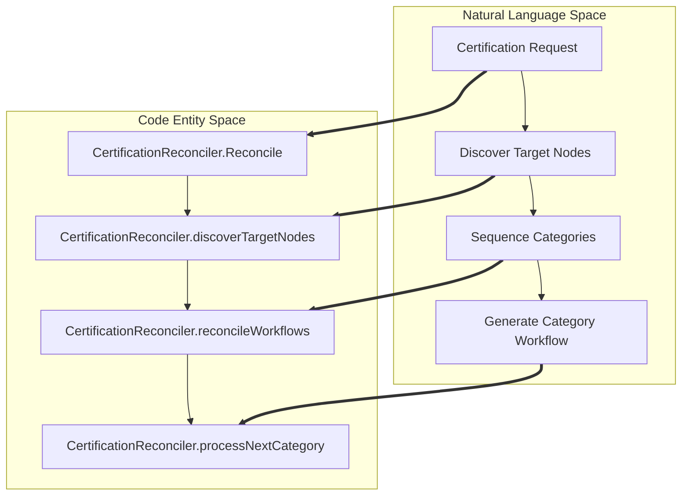
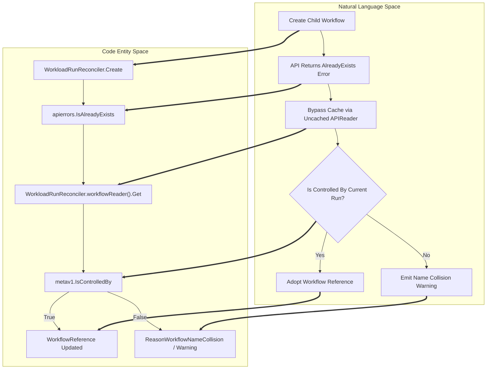

<!-- source: DeepWiki mcp.deepwiki.com · repo NVIDIA/cluster-readiness-engine · page 3.1 Certification and WorkloadRun Reconcilers · fetched 2026-10-26 -->

# Certification and WorkloadRun Reconcilers

Relevant source files

The following files were used as context for generating this wiki page:

- [cmd/integration/integration_test.go](cmd/integration/integration_test.go)
- [cmd/integration/testdata/reconcile/workloadrun-event-success/expected.json](cmd/integration/testdata/reconcile/workloadrun-event-success/expected.json)
- [cmd/integration/testdata/reconcile/workloadrun-event-success/input_client_objects.yaml](cmd/integration/testdata/reconcile/workloadrun-event-success/input_client_objects.yaml)
- [cmd/integration/testdata/reconcile/workloadrun-event-success/input_config.yaml](cmd/integration/testdata/reconcile/workloadrun-event-success/input_config.yaml)
- [cmd/integration/testdata/reconcile/workloadrun-mpi/input_config.yaml](cmd/integration/testdata/reconcile/workloadrun-mpi/input_config.yaml)
- [cmd/integration/testdata/reconcile/workloadrun-workflow-deleted/expected.json](cmd/integration/testdata/reconcile/workloadrun-workflow-deleted/expected.json)
- [cmd/integration/testdata/reconcile/workloadrun-workflow-deleted/input_client_objects.yaml](cmd/integration/testdata/reconcile/workloadrun-workflow-deleted/input_client_objects.yaml)
- [cmd/integration/testdata/reconcile/workloadrun-workflow-deleted/input_config.yaml](cmd/integration/testdata/reconcile/workloadrun-workflow-deleted/input_config.yaml)
- [cmd/manager/main.go](cmd/manager/main.go)
- [docs/designs/080-phase-transition-events.md](docs/designs/080-phase-transition-events.md)
- [pkg/controller/certification_controller.go](pkg/controller/certification_controller.go)
- [pkg/controller/helpers.go](pkg/controller/helpers.go)
- [pkg/controller/job_controller.go](pkg/controller/job_controller.go)
- [pkg/controller/testdata/certification-workflow-lookup/cache-hit/input.yaml](pkg/controller/testdata/certification-workflow-lookup/cache-hit/input.yaml)
- [pkg/controller/workflow_controller.go](pkg/controller/workflow_controller.go)
- [pkg/controller/workloadrun_controller.go](pkg/controller/workloadrun_controller.go)
- [pkg/controller/workloadrun_workflow_lookup_test.go](pkg/controller/workloadrun_workflow_lookup_test.go)

## Purpose and Scope
This section covers the technical implementation of the `CertificationReconciler` (`[pkg/controller/certification_controller.go:86-98]`) and `WorkloadRunReconciler` (`[pkg/controller/workloadrun_controller.go:32-45]`) within the NVIDIA Cluster Readiness Engine (`NVCRE`) controller manager (`[cmd/manager/main.go:32-37]()`). These controllers manage the top-level entry points of the NVCRE API group (`nvcre.nvidia.com/v1alpha1`), translating user intent into orchestrated `Workflow` custom resources. They handle per-category workflow generation, speculative adoption, name-collision resolution against etcd, direct `APIReader` cache synchronization fallbacks, exclusive status condition management, and phase transition event publishing.

---

## 1. CertificationReconciler: Per-Category Workflow Generation & Orchestration

The `CertificationReconciler` orchestrates cluster certification test suites by iterating through a declared list of categories (e.g., NCCL bandwidth, training goodput). When a `Certification` CR is created, the reconciler ensures a finalizer is attached (`[pkg/controller/certification_controller.go:137-141]()`) and initiates node discovery (`[pkg/controller/certification_controller.go:143-144]()`). 

Once target nodes are discovered, `reconcileWorkflows` (`[pkg/controller/certification_controller.go:147-164]()`) sequences through categories using internal status tracking (`categoryStatusPending`, `categoryStatusInProgress`, `categoryStatusSucceeded`, `categoryStatusFailed` defined at `[pkg/controller/certification_controller.go:70-74]()`). For each active category, it builds and submits a corresponding `Workflow` resource prefixed with certification labels (`labelCertification`, `labelCategoryDomain`, `labelCategoryVariant` at `[pkg/controller/certification_controller.go:75-77]`).

*Sources: `[pkg/controller/certification_controller.go:86-164]()`*

### Sources:
- `[pkg/controller/certification_controller.go:38-164]()`

---

## 2. WorkloadRunReconciler: Standalone Execution & Spec Translation

The `WorkloadRunReconciler` (`[pkg/controller/workloadrun_controller.go:32-45]()`) manages standalone `WorkloadRun` CRs, which execute single training or benchmark runs without full multi-category certification cycles. 

During reconciliation (`[pkg/controller/workloadrun_controller.go:71-91]()`), if a child workflow reference (`workflowRef`) is not yet established, the controller validates the execution framework. It ensures that at least one of `spec.framework.torch`, `spec.framework.mpi`, or `spec.framework.exec` is configured (`[pkg/controller/workloadrun_controller.go:96-108]()`). If validation fails, it records a `WorkloadRunFailed` condition with `ReasonBuildFailed` (`[pkg/controller/workloadrun_controller.go:110-126]()`). Otherwise, it generates a `Workflow` spec via `buildWorkflowSpec` (`[pkg/controller/workloadrun_controller.go:110]`), sets the controller owner reference (`[pkg/controller/workloadrun_controller.go:138-140]()`), and creates the child resource.

Once the workflow reference is recorded in the `WorkloadRun` status, subsequent reconcile passes invoke `mirrorWorkflowStatus` (`[pkg/controller/workloadrun_controller.go:89-91]()`), which copies condition states and phase transitions from the child `Workflow` to the parent `WorkloadRun`.

### Sources:
- `[pkg/controller/workloadrun_controller.go:32-140]()`

---

## 3. Adoption, Name Collisions, and Cache Consistency

Both reconcilers interact with controller-runtime informer caches and the live API server. Because cache synchronization lags can cause state discrepancies immediately following a `Create` call, both controllers utilize an `APIReader` interface (`[pkg/controller/certification_controller.go:91-95]()`, `[pkg/controller/workloadrun_controller.go:35-40]`).

When creating child workflows, a name collision may occur (`apierrors.IsAlreadyExists`). To prevent stranding an object when a write to status `workflowRef` fails after successful creation, `WorkloadRunReconciler` performs an uncached lookup via `workflowReader()` (`[pkg/controller/workloadrun_controller.go:51-56]()`, `[pkg/controller/workloadrun_controller.go:158-161]`). It checks whether the existing workflow is owned by the current `WorkloadRun` (`metav1.IsControlledBy`). If owned, it adopts the resource reference; if foreign and unowned, it flags a name collision.

*Sources: `[pkg/controller/workloadrun_controller.go:51-163]()`*

### Sources:
- `[pkg/controller/certification_controller.go:104-110]()`
- `[pkg/controller/workloadrun_controller.go:32-163]()`
- `[pkg/controller/workloadrun_workflow_lookup_test.go:28-116]()`

---

## 4. Exclusive Conditions and Phase Transition Events

Both `Certification` and `WorkloadRun` reconcilers manage exclusive condition sets (`InProgress`, `Succeeded`, `Failed`) to represent the lifecycle phase of the custom resource. Status updates are mediated by helper functions that evaluate whether condition types or reasons have changed before issuing Kubernetes API patches.

Per **ADR-080** (`[docs/designs/080-phase-transition-events.md:61-119]()`), phase transitions emit explicit Kubernetes Events through `events.EventRecorder` (`[pkg/controller/helpers.go:44-74]`). Rather than generating events on every periodic reconciliation requeue (which occurs every 15 seconds by default, per `[pkg/controller/certification_controller.go:67]` and `[pkg/controller/workloadrun_controller.go:63]`), event publishing is scoped strictly to state flips where an exclusive condition transitions to `True` for `InProgress`, `Succeeded`, or `Failed`.

### Sources:
- `[pkg/controller/helpers.go:13-82]()`
- `[docs/designs/080-phase-transition-events.md:1-119]()`

---

