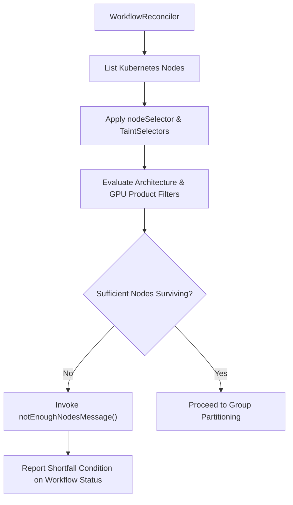

<!-- source: DeepWiki mcp.deepwiki.com · repo NVIDIA/cluster-readiness-engine · page 3.2 Workflow Reconciler: Node Discovery, Partitioning, Dependencies · fetched 2026-10-26 -->

# Workflow Reconciler: Node Discovery, Partitioning, Dependencies

<details>
<summary>Relevant source files</summary>

The following files were used as context for generating this wiki page:

- [cmd/integration/testdata/reconcile/cordoned-node-selected-explicit-monitor/expected.json](cmd/integration/testdata/reconcile/cordoned-node-selected-explicit-monitor/expected.json)
- [cmd/integration/testdata/reconcile/cordoned-node-selected-explicit-monitor/input_client_objects.yaml](cmd/integration/testdata/reconcile/cordoned-node-selected-explicit-monitor/input_client_objects.yaml)
- [cmd/integration/testdata/reconcile/cordoned-node-selected-explicit-monitor/input_config.yaml](cmd/integration/testdata/reconcile/cordoned-node-selected-explicit-monitor/input_config.yaml)
- [cmd/integration/testdata/reconcile/cordoned-node-selected/expected.json](cmd/integration/testdata/reconcile/cordoned-node-selected/expected.json)
- [cmd/integration/testdata/reconcile/cordoned-node-selected/input_client_objects.yaml](cmd/integration/testdata/reconcile/cordoned-node-selected/input_client_objects.yaml)
- [cmd/integration/testdata/reconcile/cordoned-node-selected/input_config.yaml](cmd/integration/testdata/reconcile/cordoned-node-selected/input_config.yaml)
- [cmd/integration/testdata/reconcile/workflow-explicit-health-monitor-preserved/expected.json](cmd/integration/testdata/reconcile/workflow-explicit-health-monitor-preserved/expected.json)
- [cmd/integration/testdata/reconcile/workflow-explicit-health-monitor-preserved/input_client_objects.yaml](cmd/integration/testdata/reconcile/workflow-explicit-health-monitor-preserved/input_client_objects.yaml)
- [cmd/integration/testdata/reconcile/workflow-explicit-health-monitor-preserved/input_config.yaml](cmd/integration/testdata/reconcile/workflow-explicit-health-monitor-preserved/input_config.yaml)
- [pkg/controller/certification_archfilter_test.go](pkg/controller/certification_archfilter_test.go)
- [pkg/controller/testdata/not-enough-nodes-message/heterogeneous-target/expected.json](pkg/controller/testdata/not-enough-nodes-message/heterogeneous-target/expected.json)
- [pkg/controller/testdata/not-enough-nodes-message/heterogeneous-target/input.yaml](pkg/controller/testdata/not-enough-nodes-message/heterogeneous-target/input.yaml)
- [pkg/controller/testdata/not-enough-nodes-message/no-exclusions/expected.json](pkg/controller/testdata/not-enough-nodes-message/no-exclusions/expected.json)
- [pkg/controller/testdata/not-enough-nodes-message/no-exclusions/input.yaml](pkg/controller/testdata/not-enough-nodes-message/no-exclusions/input.yaml)
- [pkg/controller/testdata/not-enough-nodes-message/several-excluded/expected.json](pkg/controller/testdata/not-enough-nodes-message/several-excluded/expected.json)
- [pkg/controller/testdata/not-enough-nodes-message/several-excluded/input.yaml](pkg/controller/testdata/not-enough-nodes-message/several-excluded/input.yaml)
- [pkg/controller/testdata/resolve-nodes-per-job-after-arch-filter/constraint-divisibility-honoured/expected.json](pkg/controller/testdata/resolve-nodes-per-job-after-arch-filter/constraint-divisibility-honoured/expected.json)
- [pkg/controller/testdata/resolve-nodes-per-job-after-arch-filter/constraint-divisibility-honoured/input.yaml](pkg/controller/testdata/resolve-nodes-per-job-after-arch-filter/constraint-divisibility-honoured/input.yaml)
- [pkg/controller/testdata/resolve-nodes-per-job-after-arch-filter/constraint-unsatisfiable-after-filter/expected.json](pkg/controller/testdata/resolve-nodes-per-job-after-arch-filter/constraint-unsatisfiable-after-filter/expected.json)
- [pkg/controller/testdata/resolve-nodes-per-job-after-arch-filter/constraint-unsatisfiable-after-filter/input.yaml](pkg/controller/testdata/resolve-nodes-per-job-after-arch-filter/constraint-unsatisfiable-after-filter/input.yaml)
- [pkg/controller/testdata/resolve-nodes-per-job-after-arch-filter/explicit-ceiling-still-applies/expected.json](pkg/controller/testdata/resolve-nodes-per-job-after-arch-filter/explicit-ceiling-still-applies/expected.json)
- [pkg/controller/testdata/resolve-nodes-per-job-after-arch-filter/explicit-ceiling-still-applies/input.yaml](pkg/controller/testdata/resolve-nodes-per-job-after-arch-filter/explicit-ceiling-still-applies/input.yaml)
- [pkg/controller/testdata/resolve-nodes-per-job-after-arch-filter/heterogeneous-sizes-to-survivors/expected.json](pkg/controller/testdata/resolve-nodes-per-job-after-arch-filter/heterogeneous-sizes-to-survivors/expected.json)
- [pkg/controller/testdata/waiting-for-nodes/no-schedulable-nodes/expected.json](pkg/controller/testdata/waiting-for-nodes/no-schedulable-nodes/expected.json)
- [pkg/controller/testdata/waiting-for-nodes/no-schedulable-nodes/input.yaml](pkg/controller/testdata/waiting-for-nodes/no-schedulable-nodes/input.yaml)
- [pkg/controller/waiting_for_nodes_test.go](pkg/controller/waiting_for_nodes_test.go)
- [pkg/controller/workflow_nodeshortfall_test.go](pkg/controller/workflow_nodeshortfall_test.go)

</details>


## Purpose and Scope

This page covers the technical implementation of the `Workflow` controller within the NVIDIA Cluster Readiness Engine (`pkg/controller`). The workflow reconciler is responsible for translating high-level certification orchestration targets into concrete, partitioned execution units (`Job` custom resources). Specifically, this document details node discovery, architectural filtering, node shortfall messaging, handling of cordoned/tainted nodes, group partitioning algorithms, dependency materialization, and the iteration state machine.

Sources: `pkg/controller/workflow_nodeshortfall_test.go` [pkg/controller/workflow_nodeshortfall_test.go:1-56](), `cmd/integration/testdata/reconcile/cordoned-node-selected/input_client_objects.yaml` [cmd/integration/testdata/reconcile/cordoned-node-selected/input_client_objects.yaml:1-46]()

---

## 1. Node Discovery and Filtering

The workflow reconciler initiates execution by querying the Kubernetes API server for `Node` objects that match the criteria specified under `Workflow.Spec.Orchestration.Target`. 

### Node Selectors and Taint Handling
Nodes are initially filtered via standard `nodeSelector` maps (e.g., matching `nvidia.com/gpu.present: "true"`). When nodes are cordoned (`spec.unschedulable: true` or carrying `NoSchedule` taints), they are omitted by default unless explicitly opted in via `Workflow.Spec.Orchestration.Target.TaintSelectors`. 

As demonstrated in integration test fixtures, selecting cordoned nodes dynamically generates appropriate tolerations and node affinity overrides in the spawned `Job` definitions:
- If a workflow selects cordoned nodes without an explicit `nodeHealthMonitor` override, the controller adapts the node monitor configuration [cmd/integration/testdata/reconcile/cordoned-node-selected/input_client_objects.yaml:1-46]().
- If an explicit `nodeHealthMonitor` expression is supplied in the `jobTemplate`, it is preserved rather than overwritten [cmd/integration/testdata/reconcile/workflow-explicit-health-monitor-preserved/input_client_objects.yaml:1-38]().

### Architecture Filters
Once candidate nodes are retrieved, architectural filters evaluate GPU product labels (e.g., `nvidia.com/gpu.product`) against requested target architectures (such as `h100`, `a100`, or `gb200`) [pkg/controller/testdata/resolve-nodes-per-job-after-arch-filter/constraint-unsatisfiable-after-filter/input.yaml:1-13](). Nodes failing architecture or capacity checks are excluded from the active pool [pkg/controller/workflow_nodeshortfall_test.go:40-43]().

### Node Shortfall Messaging
When the pool of surviving nodes falls below the required count for a given workload scale, the controller generates descriptive diagnostic errors using `notEnoughNodesMessage` [pkg/controller/workflow_nodeshortfall_test.go:45-45](). Rather than returning generic scheduling failures, the message explicitly differentiates between architecture mismatches, capacity shortfalls, and taint/cordon exclusions [pkg/controller/workflow_nodeshortfall_test.go:15-18]().


Sources: `pkg/controller/workflow_nodeshortfall_test.go` [pkg/controller/workflow_nodeshortfall_test.go:15-56](), `cmd/integration/testdata/reconcile/cordoned-node-selected/input_client_objects.yaml` [cmd/integration/testdata/reconcile/cordoned-node-selected/input_client_objects.yaml:5-19]()

---

## 2. Group Partitioning and Sizing Logic

After successful node discovery and filtering, the reconciler partitions the surviving node pool into discrete execution groups based on the test scale and nodes-per-job specifications.

### Partitioning Parameters
* **`totalNodes`**: Total count of operational nodes matching the target constraints.
* **`nodesPerJob`**: The number of nodes assigned to each individual `Job` instance.
* **`totalGroups`**: Calculated as `totalNodes / nodesPerJob`, determining how many parallel or sequential jobs run per iteration.

Divisibility constraints and explicit ceilings are strictly enforced. If `totalNodes` is not evenly divisible by `nodesPerJob`, the reconciler evaluates remainder policies or marks the configuration invalid depending on catalog constraints.

```mermaid
title: "Group Partitioning Code Entity Flow"
graph TD
    sub:WorkflowReconciler["WorkflowReconciler.reconcileWorkflow"] --> partFn["partitionNodesIntoGroups()"]
    partFn --> calc["Calculate totalGroups & nodesPerJob"]
    calc --> valDiv["Validate Divisibility & Ceilings"]
    valDiv -->|Invalid| errState["Fail Workflow Status"]
    valDiv -->|Valid| genJobs["Materialize Job CRs per Group"]
```
Sources: `pkg/controller/workflow_nodeshortfall_test.go` [pkg/controller/workflow_nodeshortfall_test.go:1-56](), `cmd/integration/testdata/reconcile/cordoned-node-selected/expected.json` [cmd/integration/testdata/reconcile/cordoned-node-selected/expected.json:1-15]()

---

## 3. Dependency Materialization and Iteration State Machine

Workflows manage execution through an iteration state machine that steps through certification phases across multiple iterations (`orchestration.iterations`).

### Iteration State Machine Data Flow
1. **Pending**: Workflow is created; nodes are discovered and filtered.
2. **InProgress**: Jobs for the current iteration (`currentIteration`) are materialized with owner references pointing to the `Workflow` resource [cmd/integration/testdata/reconcile/cordoned-node-selected/expected.json:16-25]().
3. **Job Running**: The controller monitors child `Job` execution and updates condition types (`InProgress`, `Succeeded`, `Failed`) [cmd/integration/testdata/reconcile/cordoned-node-selected/expected.json:101-135]().
4. **Iteration Transition**: Upon successful completion of all groups in iteration $N$, `currentIteration` increments until it equals `iterations`.
5. **Completion**: Once all iterations finish, the workflow transitions to `Succeeded`.

```mermaid
title: "Workflow Iteration State Machine"
graph LR
    start([Workflow Created]) --> discover[Node Discovery & Filtering]
    discover --> partition[Group Partitioning]
    partition --> mat[Materialize Jobs for Iteration i]
    mat --> monitor{Monitor Jobs}
    monitor -->|Running| monitor
    monitor -->|Failure| fail[Set Workflow Failed]
    monitor -->|Success| increment{More Iterations?}
    increment -->|Yes| mat
    increment -->|No| succeed[Set Workflow Succeeded]
```
Sources: `cmd/integration/testdata/reconcile/cordoned-node-selected/expected.json` [cmd/integration/testdata/reconcile/cordoned-node-selected/expected.json:101-215](), `cmd/integration/testdata/reconcile/cordoned-node-selected/input_config.yaml` [cmd/integration/testdata/reconcile/cordoned-node-selected/input_config.yaml:1-16]()

---

