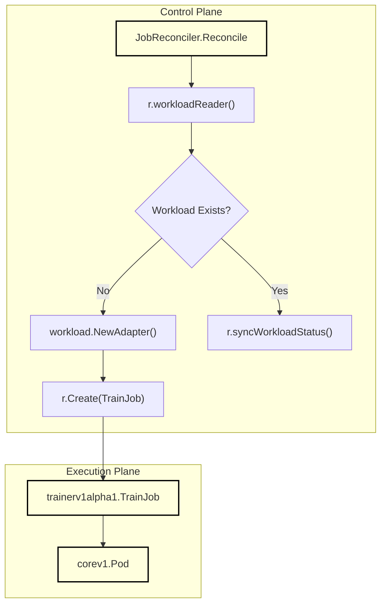
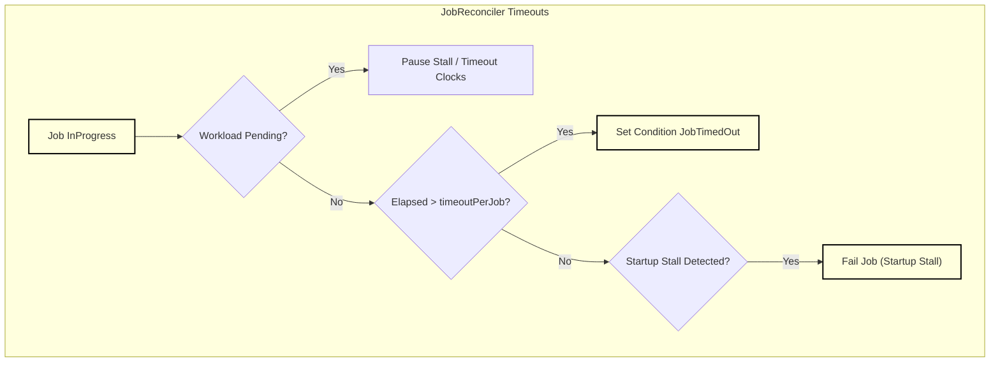
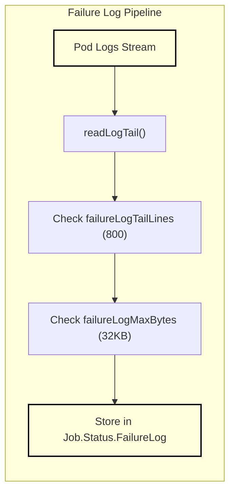
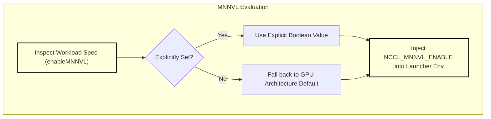

<!-- source: DeepWiki mcp.deepwiki.com · repo NVIDIA/cluster-readiness-engine · page 3.3 Job Reconciler and Workload Execution · fetched 2026-10-26 -->

# Job Reconciler and Workload Execution

Relevant source files

The following files were used as context for generating this wiki page:

- [cmd/manager/main.go](cmd/manager/main.go)
- [pkg/controller/certification_controller.go](pkg/controller/certification_controller.go)
- [pkg/controller/failure_log_test.go](pkg/controller/failure_log_test.go)
- [pkg/controller/helpers.go](pkg/controller/helpers.go)
- [pkg/controller/job_controller.go](pkg/controller/job_controller.go)
- [pkg/controller/testdata/apply-failed-nodes-ref/idempotent-same-ref/expected.json](pkg/controller/testdata/apply-failed-nodes-ref/idempotent-same-ref/expected.json)
- [pkg/controller/testdata/apply-failed-nodes-ref/idempotent-same-ref/input.yaml](pkg/controller/testdata/apply-failed-nodes-ref/idempotent-same-ref/input.yaml)
- [pkg/controller/testdata/apply-failed-nodes-ref/nil-ref-no-op/expected.json](pkg/controller/testdata/apply-failed-nodes-ref/nil-ref-no-op/expected.json)
- [pkg/controller/testdata/apply-failed-nodes-ref/nil-ref-no-op/input.yaml](pkg/controller/testdata/apply-failed-nodes-ref/nil-ref-no-op/input.yaml)
- [pkg/controller/testdata/apply-failed-nodes-ref/sets-new-ref/expected.json](pkg/controller/testdata/apply-failed-nodes-ref/sets-new-ref/expected.json)
- [pkg/controller/testdata/apply-failed-nodes-ref/sets-new-ref/input.yaml](pkg/controller/testdata/apply-failed-nodes-ref/sets-new-ref/input.yaml)
- [pkg/controller/testdata/apply-failed-nodes-ref/updates-different-ref/expected.json](pkg/controller/testdata/apply-failed-nodes-ref/updates-different-ref/expected.json)
- [pkg/controller/testdata/apply-failed-nodes-ref/updates-different-ref/input.yaml](pkg/controller/testdata/apply-failed-nodes-ref/updates-different-ref/input.yaml)
- [pkg/controller/testdata/apply-succeeded-nodes-ref/idempotent-same-ref/expected.json](pkg/controller/testdata/apply-succeeded-nodes-ref/idempotent-same-ref/expected.json)
- [pkg/controller/testdata/apply-succeeded-nodes-ref/idempotent-same-ref/input.yaml](pkg/controller/testdata/apply-succeeded-nodes-ref/idempotent-same-ref/input.yaml)
- [pkg/controller/testdata/apply-succeeded-nodes-ref/nil-ref-no-op/expected.json](pkg/controller/testdata/apply-succeeded-nodes-ref/nil-ref-no-op/expected.json)
- [pkg/controller/testdata/failure-log-capture/pod-already-deleted/expected.json](pkg/controller/testdata/failure-log-capture/pod-already-deleted/expected.json)
- [pkg/controller/testdata/failure-log-capture/pod-already-deleted/input.yaml](pkg/controller/testdata/failure-log-capture/pod-already-deleted/input.yaml)
- [pkg/controller/testdata/failure-log-capture/pod-present-nothing-terminated/expected.json](pkg/controller/testdata/failure-log-capture/pod-present-nothing-terminated/expected.json)
- [pkg/controller/testdata/failure-log-capture/pod-present-nothing-terminated/input.yaml](pkg/controller/testdata/failure-log-capture/pod-present-nothing-terminated/input.yaml)
- [pkg/controller/testdata/failure-log-tail/empty-stream/expected.json](pkg/controller/testdata/failure-log-tail/empty-stream/expected.json)
- [pkg/controller/testdata/failure-log-tail/empty-stream/input.yaml](pkg/controller/testdata/failure-log-tail/empty-stream/input.yaml)
- [pkg/controller/testdata/failure-log-tail/exactly-the-cap/expected.json](pkg/controller/testdata/failure-log-tail/exactly-the-cap/expected.json)
- [pkg/controller/testdata/workloadrun-mpi-launcher-mnnvl/gb300-explicit-false/expected.json](pkg/controller/testdata/workloadrun-mpi-launcher-mnnvl/gb300-explicit-false/expected.json)
- [pkg/controller/testdata/workloadrun-mpi-launcher-mnnvl/gb300-explicit-false/input.yaml](pkg/controller/testdata/workloadrun-mpi-launcher-mnnvl/gb300-explicit-false/input.yaml)
- [pkg/controller/testdata/workloadrun-mpi-launcher-mnnvl/gb300-unset/expected.json](pkg/controller/testdata/workloadrun-mpi-launcher-mnnvl/gb300-unset/expected.json)
- [pkg/controller/testdata/workloadrun-mpi-launcher-mnnvl/gb300-unset/input.yaml](pkg/controller/testdata/workloadrun-mpi-launcher-mnnvl/gb300-unset/input.yaml)
- [pkg/controller/testdata/workloadrun-mpi-launcher-mnnvl/h100-explicit-true/expected.json](pkg/controller/testdata/workloadrun-mpi-launcher-mnnvl/h100-explicit-true/expected.json)
- [pkg/controller/testdata/workloadrun-mpi-launcher-mnnvl/h100-explicit-true/input.yaml](pkg/controller/testdata/workloadrun-mpi-launcher-mnnvl/h100-explicit-true/input.yaml)
- [pkg/controller/testdata/workloadrun-mpi-launcher-mnnvl/h100-unset/expected.json](pkg/controller/testdata/workloadrun-mpi-launcher-mnnvl/h100-unset/expected.json)
- [pkg/controller/testdata/workloadrun-mpi-launcher-mnnvl/h100-unset/input.yaml](pkg/controller/testdata/workloadrun-mpi-launcher-mnnvl/h100-unset/input.yaml)
- [pkg/controller/workflow_controller.go](pkg/controller/workflow_controller.go)
- [pkg/controller/workloadrun_controller.go](pkg/controller/workloadrun_controller.go)
- [pkg/controller/workloadrun_mnnvl_test.go](pkg/controller/workloadrun_mnnvl_test.go)
- [pkg/controller/workloadrun_workflow_lookup_test.go](pkg/controller/workloadrun_workflow_lookup_test.go)
- [pkg/nodemonitor/cel/detector.go](pkg/nodemonitor/cel/detector.go)
- [pkg/podlogs/fetcher.go](pkg/podlogs/fetcher.go)
- [pkg/podlogs/fetcher_test.go](pkg/podlogs/fetcher_test.go)
- [pkg/podlogs/testdata/open-stream/default-timeout-cancel-on-close/expected.json](pkg/podlogs/testdata/open-stream/default-timeout-cancel-on-close/expected.json)
- [pkg/podlogs/testdata/open-stream/default-timeout-cancel-on-close/input.yaml](pkg/podlogs/testdata/open-stream/default-timeout-cancel-on-close/input.yaml)
- [pkg/podlogs/testdata/open-stream/parent-deadline-earlier/expected.json](pkg/podlogs/testdata/open-stream/parent-deadline-earlier/expected.json)
- [pkg/podlogs/testdata/open-stream/parent-deadline-earlier/input.yaml](pkg/podlogs/testdata/open-stream/parent-deadline-earlier/input.yaml)
- [pkg/podlogs/testdata/open-stream/stall-before-headers/expected.json](pkg/podlogs/testdata/open-stream/stall-before-headers/expected.json)
- [pkg/podlogs/testdata/open-stream/stall-before-headers/input.yaml](pkg/podlogs/testdata/open-stream/stall-before-headers/input.yaml)
- [pkg/podlogs/testdata/open-stream/stall-reading-body/expected.json](pkg/podlogs/testdata/open-stream/stall-reading-body/expected.json)

## Purpose and Scope

This page documents the technical implementation of the `JobReconciler` within the NVIDIA Cluster Readiness Engine (`cluster-readiness-engine`). It covers how `Job` custom resources drive underlying training workloads (such as Kubeflow `TrainJob` objects) via workload adapters, manage timeouts and stall detection, capture failure logs from pods, record node references (`failedNodes`), handle Multi-Node NVLink (`MNNVL`) parameters, and expose controller metrics.

---

## 1. Job Reconciler Architecture and Workload Creation

The `JobReconciler` is defined in `pkg/controller/job_controller.go` and manages the execution lifecycle of `Job` custom resources [pkg/controller/job_controller.go:90-116](). It watches `Job` objects and their owned workloads (such as Kubeflow Trainer `TrainJob` resources), reconciling cluster state to match the desired workload configuration [pkg/controller/job_controller.go:149-155]().

When a `Job` enters reconciliation, `JobReconciler` resolves the appropriate workload adapter via `pkg/workload` to instantiate the underlying custom resource on the API server [pkg/controller/job_controller.go:42](). Scheme registrations for `trainerv1alpha1` and `nvcrev1alpha1` are initialized in `cmd/manager/main.go` to support these third-party types [cmd/manager/main.go:70-76]().

*Figure 1: `JobReconciler` workload creation and synchronization flow.*

Sources: `pkg/controller/job_controller.go:90-116`, `cmd/manager/main.go:70-76`

---

## 2. Timeouts and Stall Detection

The reconciler enforces two primary time-based boundaries during workload execution:
1. **Job Timeout (`timeoutPerJob`)**: Bounds the total runtime of a job from creation to completion. If exceeded, the job is marked failed with reason `ReasonJobTimedOut` [pkg/controller/helpers.go:94-96](). Timed-out jobs are never retried [pkg/controller/helpers.go:95]().
2. **Startup Stall Timeout (`defaultStartupStallTimeout`)**: Bounded by `defaultStartupStallTimeout` (20 minutes) [pkg/controller/job_controller.go:67-70](), this detects jobs that fail to transition out of initialization or emit their first training step.

When a workload is suspended (e.g., a `TrainJob` suspended by Kueue waiting for cluster quota), it reports `ReasonWorkloadPending` [pkg/controller/helpers.go:139-143](). While pending, time does not count against `timeoutPerJob` or stall detection [pkg/controller/helpers.go:141-143]().

*Figure 2: Timeout and stall evaluation state machine.*

Sources: `pkg/controller/job_controller.go:67-70`, `pkg/controller/helpers.go:94-96`, `pkg/controller/helpers.go:139-143`

---

## 3. Failure Log Capture

When a workload fails, `JobReconciler` executes `captureFailureLog` to retrieve stdout/stderr tails from associated pods [pkg/controller/job_controller.go:119-120](), [pkg/controller/failure_log_test.go:63-128]().

The log extraction relies on `readLogTail` (`pkg/controller/job_controller.go`), adhering to fixed safety constraints:
* **Line Limit (`failureLogTailLines`)**: Defaults to 800 lines to avoid truncating structured JSON outputs (such as `dcgmi diag --json`) [pkg/controller/failure_log_test.go:156-159]().
* **Byte Cap (`failureLogMaxBytes`)**: Capped at `32 * 1024` bytes (32 KB), trimming from the front so that newest error outputs are preserved [pkg/controller/failure_log_test.go:156-160]().

If pods are already deleted when failure log capture runs, the reconciler handles the absence gracefully without blocking error propagation [pkg/controller/failure_log_test.go:63-67]().

*Figure 3: Failure log tail extraction and byte capping.*

Sources: `pkg/controller/job_controller.go:119-120`, `pkg/controller/failure_log_test.go:63-160`

---

## 4. Node Reference Tracking (`failedNodes` and `succeededNodes`)

To support fault isolation and cluster readiness scoring, the job execution framework populates and tracks node references (`failedNodesRef` and `succeededNodesRef`) [pkg/controller/job_controller.go:39]() (`pkg/noderesults`). 

The reconciler updates these lists idempotently, ensuring that repeated status updates for identical node selections result in no-ops, while changes correctly propagate node identifiers for downstream reporting and adaptive bisection (`pkg/nodemonitor`) [pkg/controller/job_controller.go:95-96]().

Sources: `pkg/controller/job_controller.go:39`, `pkg/controller/job_controller.go:95-96`

---

## 5. Multi-Node NVLink (MNNVL) Handling

Workloads targeting GPU architectures supporting Multi-Node NVLink (such as GB200, GB300, or explicitly configured H100 environments) evaluate the `NCCL_MNNVL_ENABLE` environment variable [pkg/controller/workflow_controller.go:47-48](), [pkg/controller/testdata/workloadrun-mpi-launcher-mnnvl/h100-explicit-true/input.yaml:4-7]().

The MNNVL handling logic checks:
1. Explicit specification overrides (`spec.enableMNNVL`) provided in workload runs [pkg/controller/testdata/workloadrun-mpi-launcher-mnnvl/h100-explicit-true/input.yaml:4-7]().
2. Architecture defaults from catalog profiles (`pkg/catalog`) [cmd/manager/main.go:116-119]().

If enabled, launcher arguments inject `-x NCCL_MNNVL_ENABLE=1` (or `0` when disabled or unset on non-MNNVL architectures) into MPI command lines [pkg/controller/testdata/workloadrun-mpi-launcher-mnnvl/gb300-explicit-false/expected.json:14-17]().

*Figure 4: MNNVL configuration resolution and launcher injection.*

Sources: `pkg/controller/workflow_controller.go:47-48`, `pkg/controller/testdata/workloadrun-mpi-launcher-mnnvl/h100-explicit-true/input.yaml:4-7`, `pkg/controller/testdata/workloadrun-mpi-launcher-mnnvl/gb300-explicit-false/expected.json:14-17`

---

## 6. Metrics and Telemetry

The `JobReconciler` integrates with controller-runtime's metrics registry (`cmd/manager/main.go`) to export operational telemetry:
* **Reconciliation Latency**: Histograms tracking duration per reconciliation pass.
* **Workload State Counters**: Gauges reflecting active, succeeded, failed, and timed-out jobs.
* **Failure Attribution Metrics**: Counters tracking hardware failures identified via CEL-based node monitors (`pkg/nodemonitor/cel`) [pkg/controller/job_controller.go:37-38]().

Sources: `cmd/manager/main.go:154-162`, `pkg/controller/job_controller.go:37-38`

---

