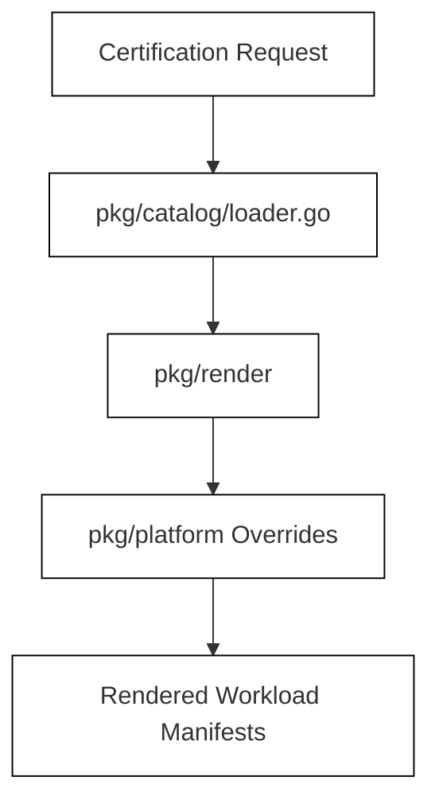
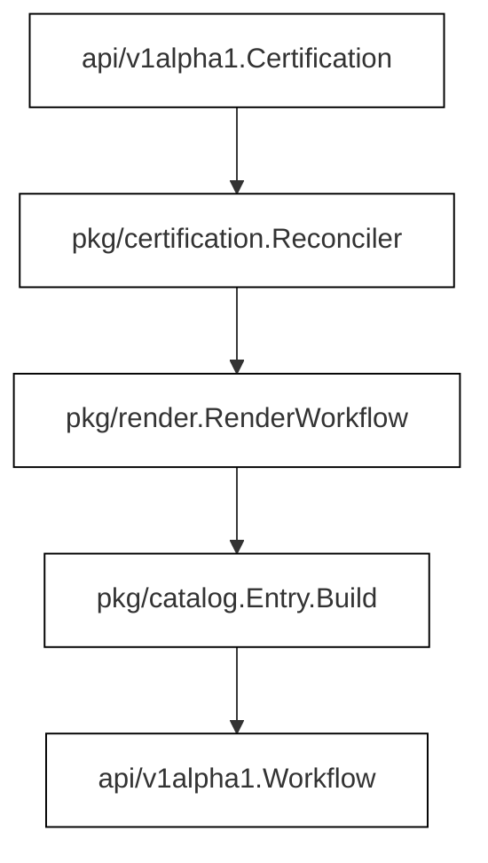

<!-- source: DeepWiki mcp.deepwiki.com · repo NVIDIA/cluster-readiness-engine · page 4 Catalog, Platform Configuration and Rendering · fetched 2026-10-26 -->

# Catalog, Platform Configuration and Rendering

Relevant source files

The following files were used as context for generating this wiki page:

- [cmd/integration/testdata/reconcile/certification-resources-override/expected.json](cmd/integration/testdata/reconcile/certification-resources-override/expected.json)
- [docs/concepts/catalog.md](docs/concepts/catalog.md)
- [docs/how-to-guides/custom-catalog-entries.md](docs/how-to-guides/custom-catalog-entries.md)
- [pkg/catalog/catalog.go](pkg/catalog/catalog.go)

## Purpose and Scope

This page provides a high-level overview of how NVIDIA Cluster Readiness Engine (`NVCRE`) defines certification test content, detects underlying cloud platforms and GPU architectures, and renders fully-qualified Kubernetes manifests. Certification logic is structured around domain and variant pairs (`pkg/catalog/` [pkg/catalog/catalog.go:4-8]()), specialized through platform overrides (`pkg/platform`), and materialized into executable workloads (`pkg/render`, `pkg/certification`).

This is a parent page. For deep technical details, refer to the child pages:
- [Certification Catalog](#4.1)
- [Platform and GPU Detection, Overrides and Transforms](#4.2)
- [Manifest Rendering](#4.3)

Sources: [docs/concepts/catalog.md:13-14](), [pkg/catalog/catalog.go:4-8]()

---

## 4.1 Certification Catalog

The certification catalog acts as the registry for all supported testing workloads, mapping domain and variant pairs (such as `communication/nccl-all-reduce` or `training/nemotron5-8b`) to pre-configured workflow specifications [docs/concepts/catalog.md:9-26](). Catalog entries are written as YAML files under `pkg/catalog/entries/` and embedded directly into binaries at compile time using Go's `//go:embed` directive in `pkg/catalog/loader.go` [docs/concepts/catalog.md:13](), [pkg/catalog/catalog.go:4-6]().

Each entry defines a base workload specification, orchestration parameters, default resource limits, and dependencies [docs/concepts/catalog.md:13](). Because entries are embedded into the binaries (`nvcrectl` and the controller manager), adding or modifying a catalog entry requires a rebuild [docs/concepts/catalog.md:13](). Users can customize entries using `BuildConfig` fields [pkg/catalog/catalog.go:27-144]() or fall back to runtime alternatives such as `WorkloadRun` or hand-authored `Workflow` custom resources [docs/how-to-guides/custom-catalog-entries.md:134-141]().

For detailed information on catalog file formatting, loader logic, shared `_lib` fragments, NCCL and training entries, and custom entry creation, see [Certification Catalog](#4.1).

Sources: [docs/concepts/catalog.md:9-26](), [docs/how-to-guides/custom-catalog-entries.md:13-20](), [pkg/catalog/catalog.go:4-144]()

---

## 4.2 Platform and GPU Detection, Overrides and Transforms

To support diverse cloud environments (AWS, Azure, OCI, on-premises) and accelerator architectures (such as H100, H200, B200, GB200, GB300), NVCRE dynamically inspects cluster node labels and applies environment-specific modifications [docs/concepts/catalog.md:87-91](). Platform and GPU detection routines identify the runtime context and match `WhenSpec` conditions defined within catalog entries [docs/concepts/catalog.md:89-91]().

Once conditions match, declarative patches—including strategic merge patches and JSON patches—are applied to the base workload specification. This layer handles node resource sizing, gang scheduler propagation (e.g., Volcano/Kueue), network interface counts (`MlnxPerNode`), and specialized hardware flags like multi-node NVLink (`MNNVL`).

For detailed information on platform override mechanics, `WhenSpec` matching rules, GPU architecture detection, and patch application, see [Platform and GPU Detection, Overrides and Transforms](#4.2).

Sources: [docs/concepts/catalog.md:87-91](), [pkg/catalog/catalog.go:40-54]()

---

## 4.3 Manifest Rendering

Manifest rendering translates high-level certification intents and catalog templates into concrete Kubernetes custom resources (`Workflow`, `TrainJob`, `JobSet`, etc.) ready for deployment or dry-run validation [docs/how-to-guides/custom-catalog-entries.md:70-71](). Handled primarily through packages `pkg/render` and `pkg/certification`, the rendering engine resolves template variables (like `{{ .NodesPerJob }}` and `{{ .GpusPerNode }}`), applies orchestration option defaults, and assigns deterministic naming conventions to generated child objects [docs/how-to-guides/custom-catalog-entries.md:70-71]().

Users can invoke offline rendering via the CLI (`nvcrectl certification render`) to inspect generated manifests before submitting them to the Kubernetes API server [docs/how-to-guides/custom-catalog-entries.md:127-130]().

Sources: [docs/how-to-guides/custom-catalog-entries.md:70-71](), [pkg/catalog/catalog.go:146-152]()

For detailed information on offline rendering paths, API server dry-runs, default orchestration option injection, and object naming schemes, see [Manifest Rendering](#4.3).

Sources: [docs/how-to-guides/custom-catalog-entries.md:70-71](), [pkg/catalog/catalog.go:146-152]()

---

