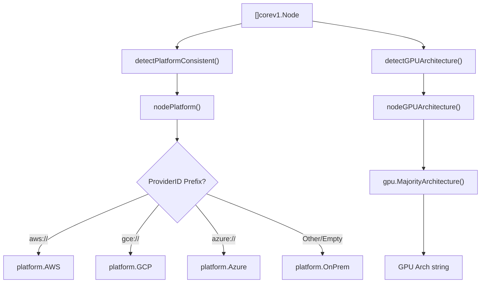
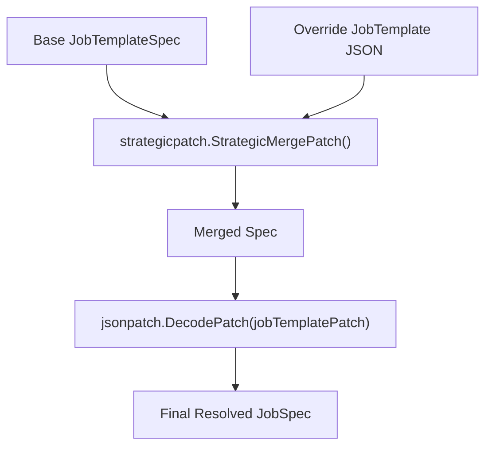
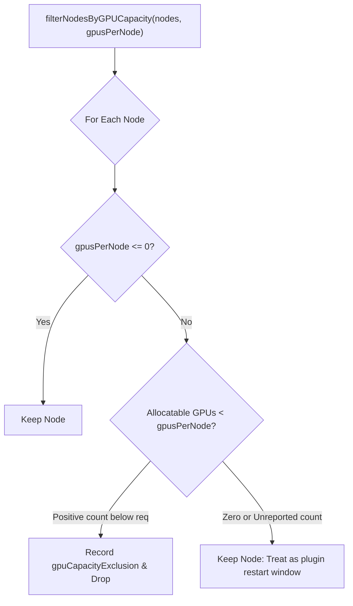

<!-- source: DeepWiki mcp.deepwiki.com · repo NVIDIA/cluster-readiness-engine · page 4.2 Platform and GPU Detection, Overrides and Transforms · fetched 2026-10-26 -->

# Platform and GPU Detection, Overrides and Transforms

<details>
<summary>Relevant source files</summary>

The following files were used as context for generating this wiki page:

- [cmd/integration/testdata/reconcile/certification-gangscheduler-nccl/expected.json](cmd/integration/testdata/reconcile/certification-gangscheduler-nccl/expected.json)
- [cmd/integration/testdata/reconcile/certification-gangscheduler-training/expected.json](cmd/integration/testdata/reconcile/certification-gangscheduler-training/expected.json)
- [docs/designs/000-adr.md](docs/designs/000-adr.md)
- [docs/designs/027-kustomize-override-ux.md](docs/designs/027-kustomize-override-ux.md)
- [docs/designs/031-platform-aware-nccl-config.md](docs/designs/031-platform-aware-nccl-config.md)
- [docs/designs/073-setup-retry-convergence.md](docs/designs/073-setup-retry-convergence.md)
- [docs/designs/079-workload-object-labels.md](docs/designs/079-workload-object-labels.md)
- [docs/designs/README.md](docs/designs/README.md)
- [pkg/certification/render_gang_scheduler_test.go](pkg/certification/render_gang_scheduler_test.go)
- [pkg/certification/testdata/certification-render-gang-scheduler/gang-scheduler-omitted/expected.json](pkg/certification/testdata/certification-render-gang-scheduler/gang-scheduler-omitted/expected.json)
- [pkg/certification/testdata/certification-render-gang-scheduler/nccl-explicit-queue/expected.json](pkg/certification/testdata/certification-render-gang-scheduler/nccl-explicit-queue/expected.json)
- [pkg/certification/testdata/certification-render-gang-scheduler/queue-omitted-defaults/expected.json](pkg/certification/testdata/certification-render-gang-scheduler/queue-omitted-defaults/expected.json)
- [pkg/certification/testdata/render-platform-flag/nscale/expected.json](pkg/certification/testdata/render-platform-flag/nscale/expected.json)
- [pkg/certification/testdata/render-platform-flag/nscale/input.yaml](pkg/certification/testdata/render-platform-flag/nscale/input.yaml)
- [pkg/certification/testdata/render-platform-flag/nscale/input_certification.yaml](pkg/certification/testdata/render-platform-flag/nscale/input_certification.yaml)
- [pkg/certification/testdata/render-platform-flag/unknown-platform/expected.json](pkg/certification/testdata/render-platform-flag/unknown-platform/expected.json)
- [pkg/certification/testdata/render-platform-flag/unknown-platform/input.yaml](pkg/certification/testdata/render-platform-flag/unknown-platform/input.yaml)
- [pkg/controller/workflow_detect.go](pkg/controller/workflow_detect.go)
- [pkg/platform/overrides/workloadrun.yaml](pkg/platform/overrides/workloadrun.yaml)
- [pkg/platform/platforms.go](pkg/platform/platforms.go)
- [pkg/platform/resources_test.go](pkg/platform/resources_test.go)
- [pkg/platform/testdata/worker-resources/empty-block-gets-a-gpu/expected.json](pkg/platform/testdata/worker-resources/empty-block-gets-a-gpu/expected.json)
- [pkg/platform/testdata/worker-resources/empty-block-gets-a-gpu/input.yaml](pkg/platform/testdata/worker-resources/empty-block-gets-a-gpu/input.yaml)
- [pkg/platform/testdata/worker-resources/explicit-gpu-count-kept/expected.json](pkg/platform/testdata/worker-resources/explicit-gpu-count-kept/expected.json)
- [pkg/platform/testdata/worker-resources/explicit-gpu-count-kept/input.yaml](pkg/platform/testdata/worker-resources/explicit-gpu-count-kept/input.yaml)
- [pkg/platform/testdata/worker-resources/explicit-zero-kept/expected.json](pkg/platform/testdata/worker-resources/explicit-zero-kept/expected.json)
- [pkg/platform/testdata/worker-resources/explicit-zero-kept/input.yaml](pkg/platform/testdata/worker-resources/explicit-zero-kept/input.yaml)
- [pkg/platform/testdata/worker-resources/gpu-named-in-requests-only/expected.json](pkg/platform/testdata/worker-resources/gpu-named-in-requests-only/expected.json)

</details>


## Purpose and Scope

This page details how the NVIDIA Cluster Readiness Engine (NVCRE) inspects cluster nodes to identify cloud platforms and GPU architectures, evaluates conditional constraints via `WhenSpec`, applies structural modifications using strategic merge and JSON patches, propagates gang scheduler metadata, and handles worker resource validation. These mechanisms allow a single certification catalog entry or workload spec to adapt dynamically across heterogeneous cloud environments (AWS, GCP, Azure, OCI, on-premises, and specialized sites).

Sources: `docs/designs/027-kustomize-override-ux.md]`, `pkg/controller/workflow_detect.go]()`

---

## Platform and GPU Architecture Detection

NVCRE detects the underlying cloud platform and GPU architecture by inspecting node metadata during workflow partitioning and reconciliation. 

### Platform Detection

The platform detection logic maps node `ProviderID` prefixes and specific control plane labels to standard platform constants defined in `pkg/platform/platforms.go`. 

- **AWS**: Provider ID prefix `aws://` [pkg/controller/workflow_detect.go:52-53]()
- **GCP**: Provider ID prefix `gce://` [pkg/controller/workflow_detect.go:54-55]()
- **Azure**: Provider ID prefix `azure://` [pkg/controller/workflow_detect.go:56-57]()
- **OCI**: Provider ID prefix `ocid1.` [pkg/controller/workflow_detect.go:58-59]()
- **NScale**: Provider ID prefix `openstack://` combined with allocatable resource `nscale.com/rdmashare` [pkg/controller/workflow_detect.go:60-63]()
- **TogetherAI**: Provider ID prefix `kubevirt://` combined with label `node-role.together.ai/worker` [pkg/controller/workflow_detect.go:66-68]()
- **Mistral**: Provider ID prefix `metal3://` [pkg/controller/workflow_detect.go:71-72]()
- **Forge**: Detected when `ProviderID` is empty if hostname contains `forge` or carries `nke.nvidia.com/site-name` [pkg/controller/workflow_detect.go:42-49]()
- **On-Premises**: Fallback for any unmatched prefix or empty provider ID lacking Forge markers [pkg/controller/workflow_detect.go:50-51](), [pkg/controller/workflow_detect.go:73-75]()

`detectPlatformConsistent` validates that all target nodes report an identical platform, returning an error if heterogeneous platforms are discovered within a single workflow target group [pkg/controller/workflow_detect.go:86-100]().

### GPU Architecture Detection

GPU architecture detection parses the `nvidia.com/gpu.product` node label via `gpu.ParseProduct` [pkg/controller/workflow_detect.go:102-110](). To handle heterogeneous clusters robustly without letting a single anomalous node skew results, `detectGPUArchitecture` invokes `gpu.MajorityArchitecture(nodes)` [pkg/controller/workflow_detect.go:118-123](). Unlabeled nodes do not vote; `"unknown"` is returned only if no node carries the product label [pkg/controller/workflow_detect.go:116-117]().


*Figure 1: Platform and GPU Architecture Detection Flow*

Sources: `pkg/platform/platforms.go]`, `pkg/controller/workflow_detect.go]`

---

## WhenSpec Condition Matching and Conditional Overrides

Catalog entries and `WorkloadRun` configurations use conditional override blocks governed by `WhenSpec`. An override matches if all specified fields evaluate to true against the runtime context (`OverrideContext`) [docs/designs/027-kustomize-override-ux.md:64-73]().

The `WhenSpec` structure evaluates six core conditions:
1. **Platform**: Target cloud provider matching [pkg/platform/overrides/workloadrun.yaml:23-25]()
2. **GPUArchitecture**: GPU model or family matching (supporting scalar equality or `in`/`notIn` lists) [pkg/platform/overrides/workloadrun.yaml:9-11]()
3. **WorkloadKind**: Workload framework type (e.g., `TrainJob`) [docs/designs/027-kustomize-override-ux.md:69-69]()
4. **Topology**: Topology-aware scheduling and domain counts [docs/designs/027-kustomize-override-ux.md:70-71]()
5. **Config**: Recursive subset matching against configuration blocks [docs/designs/027-kustomize-override-ux.md:71-72]()
6. **Expression**: Arbitrary CEL (Common Expression Language) expressions evaluated via `cel-go` [docs/designs/027-kustomize-override-ux.md:72-73]()

Platform-specific files (such as `pkg/platform/overrides/workloadrun.yaml`) leverage these conditions to inject EFA resource requests on AWS [pkg/platform/overrides/workloadrun.yaml:105-132](), configure FastRak environment variables on GCP [pkg/platform/overrides/workloadrun.yaml:176-189](), or mount topology XML files on Azure [docs/designs/031-platform-aware-nccl-config.md:27-34]().

Sources: `docs/designs/027-kustomize-override-ux.md]`, `docs/designs/031-platform-aware-nccl-config.md]`, `pkg/platform/overrides/workloadrun.yaml]`

---

## Strategic Merge and JSON Patches

Override application uses Kubernetes-standard merge libraries rather than custom implementations [docs/designs/027-kustomize-override-ux.md:26-33]().

- **Strategic Merge Patch**: `k8s.io/apimachinery/pkg/util/strategicpatch` processes `jobTemplate` overrides using struct tags (`patchStrategy` and `patchMergeKey`) [docs/designs/027-kustomize-override-ux.md:26-30](). For example, container environment variable lists (`corev1.Container.Env`) correctly merge by variable `name` instead of replacing the list entirely [docs/designs/027-kustomize-override-ux.md:28-30]().
- **JSON Patch (RFC 6902)**: Optional `jobTemplatePatch` fields in override specs execute precise operations (`add`, `remove`, `replace`, `test`) after strategic merge is complete, mirroring Kustomize's two-patch workflow [docs/designs/027-kustomize-override-ux.md:35-49]().


*Figure 2: Two-Stage Patch Pipeline (`JobTemplate` + `JobTemplatePatch`)*

Sources: `docs/designs/027-kustomize-override-ux.md]`

---

## Gang Scheduler Propagation and Workload Metadata

Workloads submitted to queue-based schedulers (such as Volcano, Kueue, or KAI) require specific metadata annotations and labels at the top-level workload object and pod template layers.

### WorkloadMetadata API

ADR-079 introduces `WorkloadMetadata` across `JobSpec`, `WorkloadRunSpec`, and `CategoryOptions` to allow declarative labeling of generated workload objects (such as `TrainJob`) without compromising the discriminated union structure of `WorkloadSpec` [docs/designs/079-workload-object-labels.md:65-80]().

```go
type WorkloadMetadata struct {
    Labels map[string]WorkloadLabelValue `json:"labels,omitempty"`
}
```
*[docs/designs/079-workload-object-labels.md:73-76]*

Labels are composed additively and deterministically in the following precedence order:
1. Labels present in the resolved catalog `JobSpec` [docs/designs/079-workload-object-labels.md:132-134]()
2. Global Certification or WorkloadRun `workloadMetadata.labels` [docs/designs/079-workload-object-labels.md:135-135]()
3. Per-category `options.workloadMetadata.labels` [docs/designs/079-workload-object-labels.md:136-136]()
4. Gang-scheduler queue-label invariants (e.g., `kueue.x-k8s.io/queue-name` or KAI queue labels) [docs/designs/079-workload-object-labels.md:137-137]()

Sources: `docs/designs/079-workload-object-labels.md]`

---

## Worker Resources and GPU Capacity Filtering

Before partitioning nodes into execution groups, `filterNodesByGPUCapacity` evaluates whether each candidate node's allocatable GPU count satisfies the workload's per-node requirement (`gpusPerNode`) [pkg/controller/workflow_detect.go:173-179]().

- **Under-Capacity Nodes**: Nodes reporting a positive allocatable count strictly lower than `gpusPerNode` are excluded, preventing workflow groups from stalling indefinitely in a `Pending` state [pkg/controller/workflow_detect.go:151-155]().
- **Unreported or Zero Counts**: Nodes reporting zero allocatable GPUs or omitting the extended resource are retained [pkg/controller/workflow_detect.go:156-167](). This avoids false-positive exclusions during device plugin restart windows, where the kubelet temporarily zeroes advertised counts [pkg/controller/workflow_detect.go:163-169]().


*Figure 3: GPU Capacity Filtering Logic*

Sources: `pkg/controller/workflow_detect.go]`

---

## Summary of Platform Detection and Override Codes

| Component / Function | File Path | Role |
|---|---|---|
| `nodePlatform` | `[pkg/controller/workflow_detect.go:41-76]()` | Derives cloud provider string from `ProviderID` and control plane labels. |
| `detectPlatformConsistent` | `[pkg/controller/workflow_detect.go:88-100]()` | Validates homogeneity across all target nodes in a workflow run. |
| `detectGPUArchitecture` | `[pkg/controller/workflow_detect.go:118-123]()` | Computes majority GPU architecture using `gpu.MajorityArchitecture`. |
| `filterNodesByGPUCapacity` | `[pkg/controller/workflow_detect.go:173-179]()` | Filters out under-capacity nodes while tolerating temporary device plugin resets. |
| `workloadrun.yaml` | `[pkg/platform/overrides/workloadrun.yaml:1-296]()` | Defines platform and GPU-specific overrides for dependencies, env vars, and MPI arguments. |

Sources: `pkg/platform/platforms.go]`, `pkg/controller/workflow_detect.go]`, `pkg/platform/overrides/workloadrun.yaml]`

---

