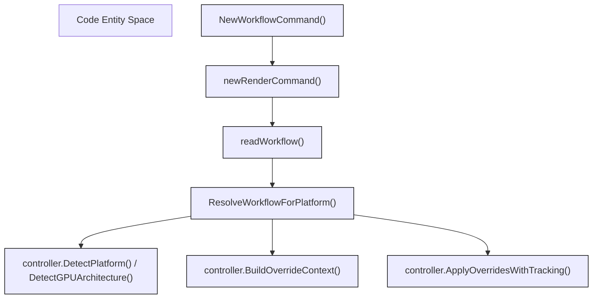
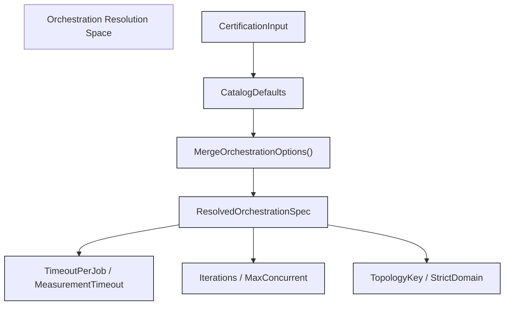

<!-- source: DeepWiki mcp.deepwiki.com · repo NVIDIA/cluster-readiness-engine · page 4.3 Manifest Rendering · fetched 2026-10-26 -->

# Manifest Rendering

Relevant source files

The following files were used as context for generating this wiki page:

- [docs/cli-reference/workflow.md](docs/cli-reference/workflow.md)
- [pkg/certification/render_orchestration_test.go](pkg/certification/render_orchestration_test.go)
- [pkg/certification/testdata/category-watch-labels/mnnvl-duplicate-pair/expected.json](pkg/certification/testdata/category-watch-labels/mnnvl-duplicate-pair/expected.json)
- [pkg/certification/testdata/category-watch-labels/mnnvl-duplicate-pair/input_certification.yaml](pkg/certification/testdata/category-watch-labels/mnnvl-duplicate-pair/input_certification.yaml)
- [pkg/certification/testdata/category-watch-labels/single-instance/expected.json](pkg/certification/testdata/category-watch-labels/single-instance/expected.json)
- [pkg/certification/testdata/category-watch-labels/single-instance/input_certification.yaml](pkg/certification/testdata/category-watch-labels/single-instance/input_certification.yaml)
- [pkg/certification/testdata/render-orchestration-options/checkpoint-max-restarts/expected.json](pkg/certification/testdata/render-orchestration-options/checkpoint-max-restarts/expected.json)
- [pkg/certification/testdata/render-orchestration-options/checkpoint-max-restarts/input.yaml](pkg/certification/testdata/render-orchestration-options/checkpoint-max-restarts/input.yaml)
- [pkg/certification/testdata/render-orchestration-options/defaults-when-unset/expected.json](pkg/certification/testdata/render-orchestration-options/defaults-when-unset/expected.json)
- [pkg/certification/testdata/render-orchestration-options/defaults-when-unset/input.yaml](pkg/certification/testdata/render-orchestration-options/defaults-when-unset/input.yaml)
- [pkg/certification/testdata/render-orchestration-options/diagnose-min-group-size/expected.json](pkg/certification/testdata/render-orchestration-options/diagnose-min-group-size/expected.json)
- [pkg/certification/testdata/render-orchestration-options/diagnose-min-group-size/input.yaml](pkg/certification/testdata/render-orchestration-options/diagnose-min-group-size/input.yaml)
- [pkg/certification/testdata/render-orchestration-options/measurement-timeout-with-thresholds/expected.json](pkg/certification/testdata/render-orchestration-options/measurement-timeout-with-thresholds/expected.json)
- [pkg/certification/testdata/render-orchestration-options/measurement-timeout-with-thresholds/input.yaml](pkg/certification/testdata/render-orchestration-options/measurement-timeout-with-thresholds/input.yaml)
- [pkg/certification/testdata/render-orchestration-options/timeout-and-repeat-count/expected.json](pkg/certification/testdata/render-orchestration-options/timeout-and-repeat-count/expected.json)
- [pkg/render/render.go](pkg/render/render.go)

## Purpose and Scope

This page details the implementation of manifest rendering and validation paths within the NVIDIA Cluster Readiness Engine (NVCRE), managed primarily by the `pkg/render` and `pkg/certification` packages. Manifest rendering allows operators and CI/CD pipelines to inspect fully resolved Kubernetes resources (`Workflow`, `Job`, and `TrainJob`) offline, apply platform and GPU architectural overrides, simulate execution against built-in mock node topologies or custom node definitions, and perform server-side dry-runs against a live Kubernetes API server.

---

## 1. Offline Rendering and the `pkg/render` Engine

The `pkg/render` package powers the `nvcrectl workflow render` command, enabling the inspection of workflow manifests after applying platform-specific adjustments [pkg/render/render.go:4-67](). 

The rendering pipeline supports three mutually exclusive node context input methods to supply node topology for override matching:
1. **Built-in Mock Templates**: Specifying `--platform` and `--gpu-arch` (`pkg/render/render.go:97-98`) constructs mock nodes from embedded filesystem assets (`pkg/render/render.go:34-35`).
2. **Custom Node Files**: Supplying a YAML file containing `corev1.Node` objects via `--nodes-file` (`pkg/render/render.go:99-100`).
3. **Live Cluster Discovery**: Connecting to an API server via `--dry-run` to discover real nodes (`pkg/render/render.go:102-103`).

*Figure 1: Offline rendering data flow bridging command-line entrypoints to controller resolution functions.*

### Key Functions and Data Structures
- `NewWorkflowCommand()`: Returns the parent Cobra command for workflow operations [pkg/render/render.go:41-51]().
- `newRenderCommand()`: Configures flags (`--platform`, `--gpu-arch`, `--nodes-file`, `--output`, `--dry-run`) and executes the parse-and-render lifecycle [pkg/render/render.go:53-107]().
- `ResolveWorkflowForPlatform()`: Forces explicit platform names or falls back to node-based detection, constructing an `OrchestrationStatus` and invoking override tracking [pkg/render/render.go:149-165]().
- `renderMetadata`: Captures detected platform, architecture, and applied overrides (`AppliedOverride`) [pkg/render/render.go:118-122]().

Sources:
- `pkg/render/render.go`

---

## 2. Server-Side Dry-Run and API Validation

When the `--dry-run` flag is passed to `nvcrectl workflow render`, the rendering engine connects to a live Kubernetes API server to perform server-side dry-run validations [pkg/render/render.go:74-80,102-103](). 

Unlike offline rendering—which relies entirely on static mock files or custom node specs—the dry-run path discovers cluster nodes dynamically and submits the rendered manifests with dry-run mutation semantics enabled (`dryRun: All`). This validates that the resulting custom resources (such as `TrainJob` and `JobSet`) satisfy schema requirements, admission webhooks, and CRD structural definitions without persisting state to etcd.

### `DryRunResult` Schema
Validation outcomes for individual resources are encapsulated in the `DryRunResult` structure [pkg/render/render.go:109-115]():

| Field | Type | Description |
|-------|------|-------------|
| `resource` | `string` | The namespaced kind and name of the rendered resource. |
| `valid` | `bool` | Indicates whether the server-side dry-run passed successfully. |
| `error` | `string` | Contains admission or schema rejection messages if validation failed. |
| `warning` | `string` | Non-fatal warnings returned by the API server during dry-run. |

Sources:
- `pkg/render/render.go`

---

## 3. Orchestration Option Defaults and Resolution

The `pkg/certification` render path manages the expansion of high-level certification categories into concrete workflow execution plans. When parameters such as job execution timeouts, iteration counts, maximum concurrency, or diagnostic group sizes are omitted from user-supplied manifests, the rendering path populates robust defaults derived from the certification catalog [pkg/certification/testdata/render-orchestration-options/defaults-when-unset/input.yaml]().

*Figure 2: Orchestration option resolution pipeline mapping unconfigured options to catalog defaults.*

### Option Normalization Rules
- **Timeouts**: If `measurementTimeout` is set alongside evaluation thresholds, it propagates to the job execution runtime [pkg/certification/testdata/render-orchestration-options/measurement-timeout-with-thresholds/input.yaml](). Default job timeouts apply when unspecified (e.g., `1h0m0s`) [pkg/certification/testdata/render-orchestration-options/defaults-when-unset/expected.json]().
- **Checkpointing and Restarts**: Training variants utilizing `enableCheckpoint: true` bind to `maxRestarts` parameters for fault-tolerant recovery loops [pkg/certification/testdata/render-orchestration-options/checkpoint-max-restarts/input.yaml]().
- **Diagnose Groups**: Diagnostic specifications define `minGroupSize` and topology constraints (`nvidia.com/gpu.clique`) to isolate faulty nodes during adaptive bisection [pkg/certification/testdata/render-orchestration-options/diagnose-min-group-size/expected.json]().

Sources:
- `pkg/certification/render_orchestration_test.go`
- `pkg/certification/testdata/render-orchestration-options/defaults-when-unset/input.yaml`
- `pkg/certification/testdata/render-orchestration-options/defaults-when-unset/expected.json`
- `pkg/certification/testdata/render-orchestration-options/checkpoint-max-restarts/input.yaml`
- `pkg/certification/testdata/render-orchestration-options/measurement-timeout-with-thresholds/input.yaml`

---

## 4. Naming Conventions, Watch Labels, and MNNVL Variances

When rendering certification status displays and watch summaries, categories and variants are translated into human-readable watch labels. The rendering logic accounts for multi-node NVLink (MNNVL) configurations by distinguishing between enabled and disabled execution variants, even when sharing identical domain and variant slugs [pkg/certification/testdata/category-watch-labels/mnnvl-duplicate-pair/input_certification.yaml]().

### Watch Label Derivation
- **Standard Categories**: Mapped directly from domain and variant names (e.g., `communication/nccl-all-reduce`, `training/nemotron5-8b`) [pkg/certification/testdata/category-watch-labels/single-instance/input_certification.yaml]().
- **MNNVL Variances**: When duplicate domain/variant pairs appear with differing MNNVL settings, the renderer suffixes the label to prevent display collisions:
  - `communication/nccl-all-reduce (MNNVL Enabled)` [pkg/certification/testdata/category-watch-labels/mnnvl-duplicate-pair/expected.json:2]()
  - `communication/nccl-all-reduce (MNNVL Disabled)` [pkg/certification/testdata/category-watch-labels/mnnvl-duplicate-pair/expected.json:3]()

Sources:
- `pkg/certification/testdata/category-watch-labels/single-instance/input_certification.yaml`
- `pkg/certification/testdata/category-watch-labels/single-instance/expected.json`
- `pkg/certification/testdata/category-watch-labels/mnnvl-duplicate-pair/input_certification.yaml`
- `pkg/certification/testdata/category-watch-labels/mnnvl-duplicate-pair/expected.json`

---

