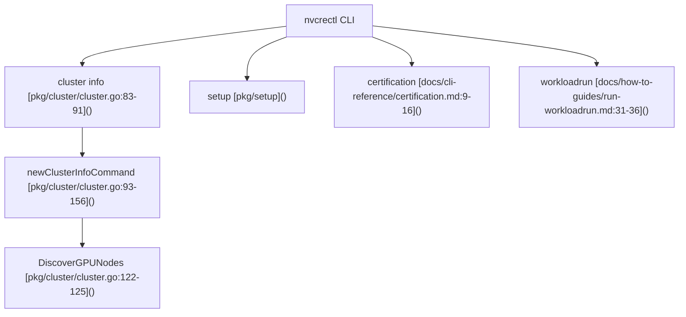
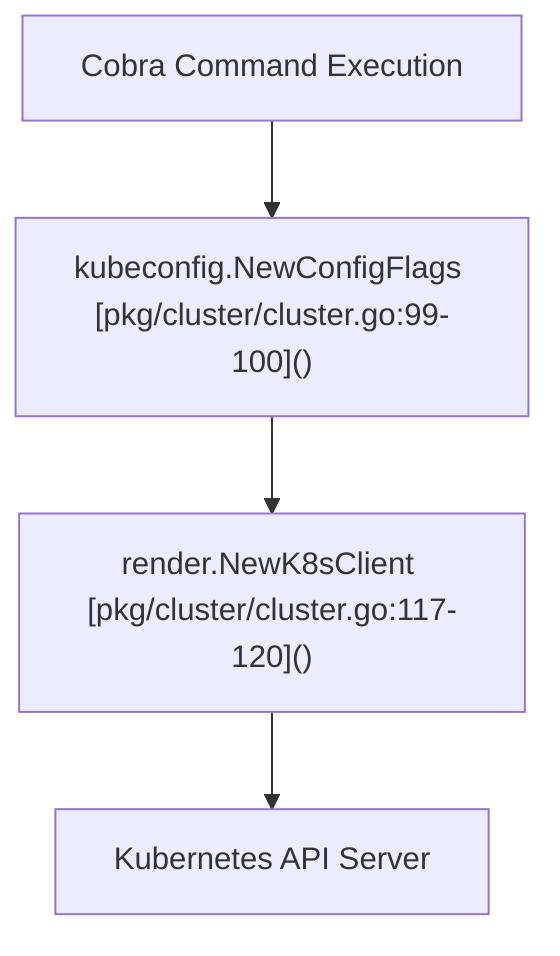

<!-- source: DeepWiki mcp.deepwiki.com · repo NVIDIA/cluster-readiness-engine · page 5 nvcrectl CLI · fetched 2026-10-26 -->

# nvcrectl CLI

Relevant source files

The following files were used as context for generating this wiki page:

- [docs/cli-reference/certification.md](docs/cli-reference/certification.md)
- [docs/how-to-guides/certify-a-cluster.md](docs/how-to-guides/certify-a-cluster.md)
- [docs/how-to-guides/run-workloadrun.md](docs/how-to-guides/run-workloadrun.md)
- [docs/how-to-guides/workloadrun-deepseek-v3.md](docs/how-to-guides/workloadrun-deepseek-v3.md)
- [docs/how-to-guides/workloadrun-nemotron5.md](docs/how-to-guides/workloadrun-nemotron5.md)
- [pkg/cluster/cluster.go](pkg/cluster/cluster.go)
- [pkg/cluster/cluster_test.go](pkg/cluster/cluster_test.go)

## Purpose and Scope

This page provides a high-level overview of the `nvcrectl` (also usable as `kubectl nvcre`) command-line interface. The CLI serves as the primary administrative and operational tool for interacting with the NVIDIA Cluster Readiness Engine (NVCRE). It handles cluster inspection, bootstrapping, workload execution, certification management, and reporting through a unified Cobra-based command tree [pkg/cluster/cluster.go:83-91](). 

This is a parent page. For detailed operational references, consult the following child pages:
- [setup: Install, Status, Reset](#5.1)
- [certification and workloadrun Commands](#5.2)
- [Reporting](#5.3)

---

## Command Tree Architecture

The `nvcrectl` binary organizes functionality into subcommands such as `cluster`, `setup`, `certification`, and `workloadrun`. Each subcommand binds to specific packages in the codebase to execute API calls, render manifests, or manage cluster state.

Title: nvcrectl Command Tree to Code Entities

Sources: [pkg/cluster/cluster.go:83-156](), [docs/cli-reference/certification.md:9-16](), [docs/how-to-guides/run-workloadrun.md:31-36]()

---

## Shared Cluster-Access Plumbing

All commands that interact with the Kubernetes API server share standard plumbing rooted in `kubeconfig` flag handling and client initialization. Commands utilize `kubeconfig.NewConfigFlags` to parse cluster connection parameters and instantiate Kubernetes clients via `render.NewK8sClient` [pkg/cluster/cluster.go:99-120]().

Title: Shared Cluster-Access Plumbing Flow

Sources: [pkg/cluster/cluster.go:99-120]()

---

## 5.1 setup: Install, Status, Reset

The `nvcrectl setup` command tree automates the installation and lifecycle management of NVCRE components on a Kubernetes cluster. This includes applying Custom Resource Definitions (CRDs), deploying the controller manager via Helm, pinning Kubeflow Trainer dependencies, and handling Server-Side Apply (SSA) conflict recovery. 

For complete installation workflows, status diagnostics, and cleanup mechanisms, see [setup: Install, Status, Reset](#5.1).

Sources: [docs/cli-reference/certification.md:25-43]()

---

## 5.2 certification and workloadrun Commands

The `nvcrectl certification` and `nvcrectl workloadrun` command groups allow operators to execute, monitor, and render distributed workloads and full cluster certifications. These commands support wait/timeout semantics, watch output streams, dry-run validation against live API servers, and registry authentication for pulling private workload images.

For details on running, watching, rendering, and timing out certifications and workload runs, see [certification and workloadrun Commands](#5.2).

Sources: [docs/cli-reference/certification.md:9-82](), [docs/how-to-guides/run-workloadrun.md:30-36]()

---

## 5.3 Reporting

The reporting subsystem processes completed certifications and workload runs to generate domain and clique reports. It formats outputs using terminal box-drawing characters, aggregates failure groups, extracts relevant failure log excerpts, and applies terminal escape sanitization.

For details on report generation and formatting options, see [Reporting](#5.3).

Sources: [docs/cli-reference/certification.md:84-97]()

---

