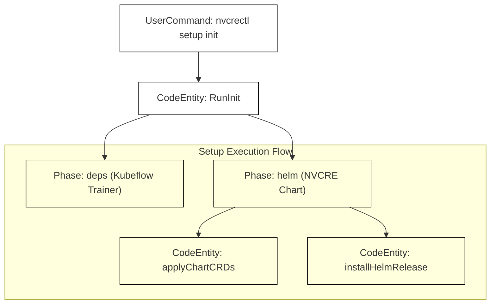
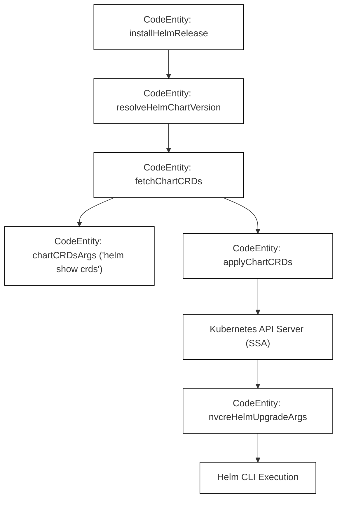
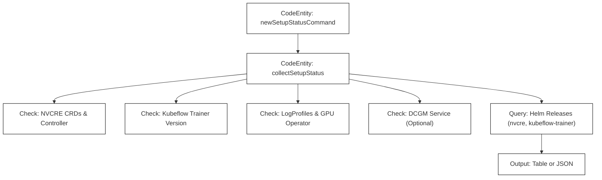

<!-- source: DeepWiki mcp.deepwiki.com · repo NVIDIA/cluster-readiness-engine · page 5.1 setup: Install, Status, Reset · fetched 2026-10-26 -->

# setup: Install, Status, Reset

<details>
<summary>Relevant source files</summary>

The following files were used as context for generating this wiki page:

- [docs/cli-reference/setup.md](docs/cli-reference/setup.md)
- [docs/designs/078-jobset-ownership.md](docs/designs/078-jobset-ownership.md)
- [pkg/setup/crds.go](pkg/setup/crds.go)
- [pkg/setup/crds_test.go](pkg/setup/crds_test.go)
- [pkg/setup/helm.go](pkg/setup/helm.go)
- [pkg/setup/helm_test.go](pkg/setup/helm_test.go)
- [pkg/setup/jobset_ownership.go](pkg/setup/jobset_ownership.go)
- [pkg/setup/jobset_ownership_test.go](pkg/setup/jobset_ownership_test.go)
- [pkg/setup/recovery_inventory.go](pkg/setup/recovery_inventory.go)
- [pkg/setup/retained_test.go](pkg/setup/retained_test.go)
- [pkg/setup/setup.go](pkg/setup/setup.go)
- [pkg/setup/setup_test.go](pkg/setup/setup_test.go)
- [pkg/setup/status.go](pkg/setup/status.go)
- [pkg/setup/status_test.go](pkg/setup/status_test.go)
- [pkg/setup/testdata/apply-chart-crds/fresh-install-creates/expected.txt](pkg/setup/testdata/apply-chart-crds/fresh-install-creates/expected.txt)
- [pkg/setup/testdata/apply-chart-crds/fresh-install-creates/input_crds.yaml](pkg/setup/testdata/apply-chart-crds/fresh-install-creates/input_crds.yaml)
- [pkg/setup/testdata/apply-chart-crds/invalid-document-fails/error](pkg/setup/testdata/apply-chart-crds/invalid-document-fails/error)
- [pkg/setup/testdata/apply-chart-crds/invalid-document-fails/input_crds.yaml](pkg/setup/testdata/apply-chart-crds/invalid-document-fails/input_crds.yaml)
- [pkg/setup/testdata/apply-chart-crds/no-crds-fails/error](pkg/setup/testdata/apply-chart-crds/no-crds-fails/error)
- [pkg/setup/testdata/init-recovery/bundled-jobset-blocks-recovery/input.yaml](pkg/setup/testdata/init-recovery/bundled-jobset-blocks-recovery/input.yaml)
- [pkg/setup/testdata/init-recovery/bundled-jobset-blocks-recovery/input_objects.yaml](pkg/setup/testdata/init-recovery/bundled-jobset-blocks-recovery/input_objects.yaml)
- [pkg/setup/testdata/init-recovery/fresh-install-readonly-clusterrole-collision/expected.txt](pkg/setup/testdata/init-recovery/fresh-install-readonly-clusterrole-collision/expected.txt)
- [pkg/setup/testdata/init-recovery/fresh-install-readonly-clusterrole-collision/input.yaml](pkg/setup/testdata/init-recovery/fresh-install-readonly-clusterrole-collision/input.yaml)
- [pkg/setup/testdata/init-recovery/fresh-install-readonly-clusterrole-collision/input_objects.yaml](pkg/setup/testdata/init-recovery/fresh-install-readonly-clusterrole-collision/input_objects.yaml)
- [pkg/setup/testdata/jobset-ownership/bundled-controller-with-gke-consumer/expected.json](pkg/setup/testdata/jobset-ownership/bundled-controller-with-gke-consumer/expected.json)
- [pkg/setup/testdata/print-retained-resources/all-retained/expected.txt](pkg/setup/testdata/print-retained-resources/all-retained/expected.txt)
- [pkg/setup/testdata/print-retained-resources/all-retained/input_config.yaml](pkg/setup/testdata/print-retained-resources/all-retained/input_config.yaml)
- [pkg/setup/testdata/print-retained-resources/all-retained/input_objects.yaml](pkg/setup/testdata/print-retained-resources/all-retained/input_objects.yaml)
- [pkg/setup/testdata/print-retained-resources/forbidden-lookup-reports-may-remain/expected.txt](pkg/setup/testdata/print-retained-resources/forbidden-lookup-reports-may-remain/expected.txt)
- [pkg/setup/testdata/print-retained-resources/forbidden-lookup-reports-may-remain/input_config.yaml](pkg/setup/testdata/print-retained-resources/forbidden-lookup-reports-may-remain/input_config.yaml)
- [pkg/setup/testdata/print-retained-resources/nothing-retained/expected.txt](pkg/setup/testdata/print-retained-resources/nothing-retained/expected.txt)
- [pkg/setup/testdata/print-retained-resources/nothing-retained/input_config.yaml](pkg/setup/testdata/print-retained-resources/nothing-retained/input_config.yaml)
- [pkg/setup/testdata/print-retained-resources/pull-secret-absent/expected.txt](pkg/setup/testdata/print-retained-resources/pull-secret-absent/expected.txt)
- [pkg/setup/testdata/print-retained-resources/pull-secret-absent/input_config.yaml](pkg/setup/testdata/print-retained-resources/pull-secret-absent/input_config.yaml)
- [pkg/setup/testdata/setup-status-helm/helm-unavailable/expected.txt](pkg/setup/testdata/setup-status-helm/helm-unavailable/expected.txt)
- [pkg/setup/testdata/setup-status-helm/helm-unavailable/input.yaml](pkg/setup/testdata/setup-status-helm/helm-unavailable/input.yaml)
- [pkg/setup/testdata/setup-status-helm/ready/expected.txt](pkg/setup/testdata/setup-status-helm/ready/expected.txt)
- [pkg/setup/testdata/setup-status-helm/ready/input.yaml](pkg/setup/testdata/setup-status-helm/ready/input.yaml)
- [pkg/setup/testdata/setup-status-helm/release-missing/expected.txt](pkg/setup/testdata/setup-status-helm/release-missing/expected.txt)
- [pkg/setup/testdata/setup-status-helm/trainer-release-failed/expected.txt](pkg/setup/testdata/setup-status-helm/trainer-release-failed/expected.txt)
- [pkg/setup/trainer_version_test.go](pkg/setup/trainer_version_test.go)
- [test/uat/Tiltfile](test/uat/Tiltfile)

</details>


## Purpose and Scope
This page documents the technical implementation of the `pkg/setup` package, which powers the `nvcrectl setup` command tree. The subsystem manages cluster bootstrap, dependency provisioning (specifically Kubeflow Trainer and Helm releases), CustomResourceDefinition (CRD) synchronization via Server-Side Apply (SSA), ownership conflict recovery, and cluster installation diagnostics.

Sources: [pkg/setup/setup.go:1-70](), [docs/cli-reference/setup.md:1-59]()

---

## 1. Setup Phases and Execution Pipeline

The setup command delegates to three core operational phases, modeled after Kubernetes lifecycle phases (`cr`, `deps`, `helm`). The `NewCommand` function initializes the `setup` command tree, mounting `init`, `reset`, and `status` subcommands.


*Figure 1: Setup Phase Execution Pipeline*

Sources: [pkg/setup/setup.go:42-90](), [pkg/setup/setup.go:167-177]()

---

## 2. Helm Automation and CRD Server-Side Apply

Helm manages the installation of NVCRE and Kubeflow Trainer releases. However, Helm natively applies charts' `crds/` directories exclusively upon initial chart installation (`helm upgrade --install`). Subsequent upgrades skip CRD updates, causing schema drift (Issue #145). 

To resolve this, NVCRE explicitly extracts and applies CRDs via Server-Side Apply (SSA) prior to executing Helm upgrades.


*Figure 2: Helm and CRD Synchronization Data Flow*

### CRD Reconcile Implementation
The `applyChartCRDs` function parses multi-document YAML manifests returned by `helm show crds`, filtering for `CustomResourceDefinition` kinds, and applies them using `client.ApplyConfigurationFromUnstructured` with field manager `nvcrectl-setup` and `client.ForceOwnership`.

Sources: [pkg/setup/helm.go:125-172](), [pkg/setup/crds.go:23-109]()

---

## 3. Kubeflow Trainer Pinning and JobSet Ownership Modes

NVCRE compiles against and mandates Kubeflow Trainer version `v2.2.1`. The version constant `kubeflowTrainerVersion` is statically bound to ensure schema compatibility between the controller and installed CRDs.

```go
const kubeflowTrainerVersion = "v2.2.1"
```

### JobSet Ownership (ADR-078)
Kubeflow Trainer vendors JobSet as a subchart. On clusters where JobSet is managed externally (e.g., via an independent Helm release or manual installation), installing Trainer with bundled JobSet ownership causes ownership collisions. 

`nvcrectl setup init` inspects existing cluster resources (`ValidatingWebhookConfiguration`, `MutatingWebhookConfiguration`, and `ClusterRole` objects matching `jobset.x-k8s.io`) to distinguish between:
1. **Absent / Clean State**: Safe for bundled deployment.
2. **External Controller Ownership**: Bypasses subchart installation or adapts parameters.
3. **Ambiguous Ownership**: Halts execution to prevent cluster degradation.

Sources: [pkg/setup/setup.go:31-36](), [docs/designs/078-jobset-ownership.md:1-42]()

---

## 4. SSA Conflict Recovery and Retry Logic

When upgrading or installing Helm releases, webhook Secret field-ownership conflicts (e.g., on `.data` fields in `kubeflow-system`) can leave releases wedged in `failed` or `pending-*` states.

* **Automatic Recovery**: Triggered when a install failure matches the webhook Secret conflict signature, provided no live Trainer workloads exist and JobSet ownership checks pass.
* **Recovery Procedure**:
  1. Uninstalls the `kubeflow-trainer` Helm release.
  2. Deletes Trainer CRDs while retaining `jobsets.jobset.x-k8s.io`.
  3. Purges the `kubeflow-system` namespace after safety inventory validations.
  4. Reinstalls the pinned Kubeflow Trainer release.

Sources: [docs/cli-reference/setup.md:30-58]()

---

## 5. Cluster Status Reporting (`nvcrectl setup status`)

The `status` subcommand evaluates the readiness of all NVCRE dependencies, CRDs, controller deployments, and optional monitoring services.


*Figure 3: Status Collection and Reporting Pipeline*

### Component Health Criteria
`SetupStatusComponents` tracks individual subsystem statuses. The top-level `installed` boolean evaluates to `true` if and only if all mandatory components are present and operational, and no managed Helm release is wedged in a failed or pending phase.

Sources: [pkg/setup/status.go:51-114](), [pkg/setup/status.go:115-174]()

---

## 6. Reset and Retained Resources

The `nvcrectl setup reset` command tears down NVCRE releases and associated cluster resources, with explicit protections for shared infrastructure (such as externally managed JobSet controllers and non-NVCRE namespaces) as dictated by ownership discovery rules.

Sources: [pkg/setup/setup.go:87-90]()

---

