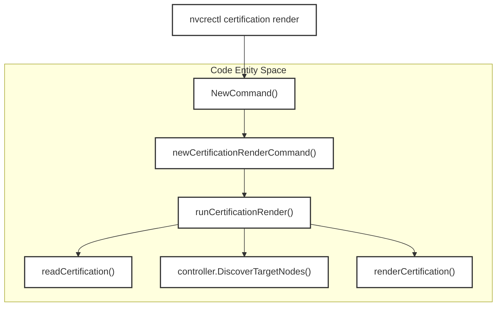
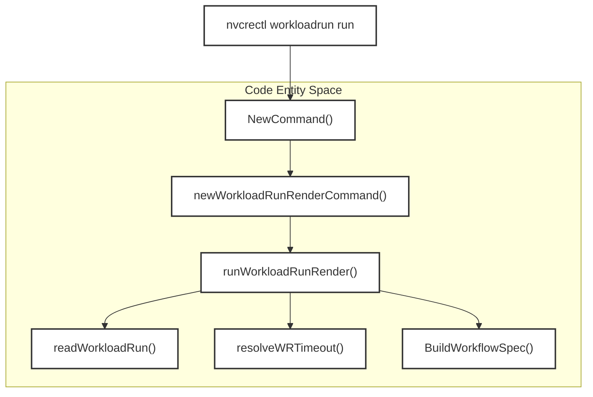

<!-- source: DeepWiki mcp.deepwiki.com · repo NVIDIA/cluster-readiness-engine · page 5.2 certification and workloadrun Commands · fetched 2026-10-26 -->

# certification and workloadrun Commands

<details>
<summary>Relevant source files</summary>

The following files were used as context for generating this wiki page:

- [docs/cli-reference/workloadrun.md](docs/cli-reference/workloadrun.md)
- [pkg/certification/certification.go](pkg/certification/certification.go)
- [pkg/workloadrun/build_workflow_spec_test.go](pkg/workloadrun/build_workflow_spec_test.go)
- [pkg/workloadrun/testdata/build-workflow-spec/gang-scheduler-propagates/expected.json](pkg/workloadrun/testdata/build-workflow-spec/gang-scheduler-propagates/expected.json)
- [pkg/workloadrun/testdata/build-workflow-spec/gang-scheduler-propagates/input.yaml](pkg/workloadrun/testdata/build-workflow-spec/gang-scheduler-propagates/input.yaml)
- [pkg/workloadrun/testdata/build-workflow-spec/intra-node-runs-one-node-per-job/input.yaml](pkg/workloadrun/testdata/build-workflow-spec/intra-node-runs-one-node-per-job/input.yaml)
- [pkg/workloadrun/testdata/build-workflow-spec/mpi-mnnvl-enable/expected.json](pkg/workloadrun/testdata/build-workflow-spec/mpi-mnnvl-enable/expected.json)
- [pkg/workloadrun/testdata/build-workflow-spec/mpi-mnnvl-enable/input.yaml](pkg/workloadrun/testdata/build-workflow-spec/mpi-mnnvl-enable/input.yaml)
- [pkg/workloadrun/testdata/finish-workloadrun-wait-terminal-at-timeout/failed/expected.txt](pkg/workloadrun/testdata/finish-workloadrun-wait-terminal-at-timeout/failed/expected.txt)
- [pkg/workloadrun/testdata/finish-workloadrun-wait-terminal-at-timeout/failed/input.yaml](pkg/workloadrun/testdata/finish-workloadrun-wait-terminal-at-timeout/failed/input.yaml)
- [pkg/workloadrun/testdata/finish-workloadrun-wait-terminal-at-timeout/succeeded/expected.txt](pkg/workloadrun/testdata/finish-workloadrun-wait-terminal-at-timeout/succeeded/expected.txt)
- [pkg/workloadrun/testdata/finish-workloadrun-wait-terminal-at-timeout/succeeded/input.yaml](pkg/workloadrun/testdata/finish-workloadrun-wait-terminal-at-timeout/succeeded/input.yaml)
- [pkg/workloadrun/testdata/finish-workloadrun-wait-timeout/run-remains-active/expected.txt](pkg/workloadrun/testdata/finish-workloadrun-wait-timeout/run-remains-active/expected.txt)
- [pkg/workloadrun/testdata/finish-workloadrun-wait-timeout/run-remains-active/input.yaml](pkg/workloadrun/testdata/finish-workloadrun-wait-timeout/run-remains-active/input.yaml)
- [pkg/workloadrun/testdata/finish-workloadrun-wait-timeout/state-unknown/expected.txt](pkg/workloadrun/testdata/finish-workloadrun-wait-timeout/state-unknown/expected.txt)
- [pkg/workloadrun/testdata/finish-workloadrun-wait-timeout/state-unknown/input.yaml](pkg/workloadrun/testdata/finish-workloadrun-wait-timeout/state-unknown/input.yaml)
- [pkg/workloadrun/testdata/finish-workloadrun-wait-timeout/workloadrun-missing/expected.txt](pkg/workloadrun/testdata/finish-workloadrun-wait-timeout/workloadrun-missing/expected.txt)
- [pkg/workloadrun/testdata/finish-workloadrun-wait-timeout/workloadrun-missing/input.yaml](pkg/workloadrun/testdata/finish-workloadrun-wait-timeout/workloadrun-missing/input.yaml)
- [pkg/workloadrun/testdata/validate-exec-framework/explicit-exec-allowed/expected.json](pkg/workloadrun/testdata/validate-exec-framework/explicit-exec-allowed/expected.json)
- [pkg/workloadrun/testdata/validate-exec-framework/explicit-exec-allowed/input.yaml](pkg/workloadrun/testdata/validate-exec-framework/explicit-exec-allowed/input.yaml)
- [pkg/workloadrun/testdata/validate-exec-framework/nil-exec-rejected/expected.json](pkg/workloadrun/testdata/validate-exec-framework/nil-exec-rejected/expected.json)
- [pkg/workloadrun/testdata/validate-exec-framework/nil-exec-rejected/input.yaml](pkg/workloadrun/testdata/validate-exec-framework/nil-exec-rejected/input.yaml)
- [pkg/workloadrun/testdata/watch-line/failed-carries-mirrored-workflow-failure/expected.txt](pkg/workloadrun/testdata/watch-line/failed-carries-mirrored-workflow-failure/expected.txt)
- [pkg/workloadrun/testdata/watch-line/failed-carries-mirrored-workflow-failure/input.yaml](pkg/workloadrun/testdata/watch-line/failed-carries-mirrored-workflow-failure/input.yaml)
- [pkg/workloadrun/testdata/watch-line/in-progress-appends-workflow-message/expected.txt](pkg/workloadrun/testdata/watch-line/in-progress-appends-workflow-message/expected.txt)
- [pkg/workloadrun/testdata/watch-line/in-progress-appends-workflow-message/input.yaml](pkg/workloadrun/testdata/watch-line/in-progress-appends-workflow-message/input.yaml)
- [pkg/workloadrun/testdata/watch-line/no-conditions-yet/expected.txt](pkg/workloadrun/testdata/watch-line/no-conditions-yet/expected.txt)
- [pkg/workloadrun/testdata/watch-line/no-conditions-yet/input.yaml](pkg/workloadrun/testdata/watch-line/no-conditions-yet/input.yaml)
- [pkg/workloadrun/testdata/watch-line/succeeded-without-message-omits-suffix/expected.txt](pkg/workloadrun/testdata/watch-line/succeeded-without-message-omits-suffix/expected.txt)
- [pkg/workloadrun/testdata/watch-line/succeeded-without-message-omits-suffix/input.yaml](pkg/workloadrun/testdata/watch-line/succeeded-without-message-omits-suffix/input.yaml)
- [pkg/workloadrun/watch_line_test.go](pkg/workloadrun/watch_line_test.go)
- [pkg/workloadrun/workloadrun.go](pkg/workloadrun/workloadrun.go)
- [test/uat/testdata/aws/gb200/nccl/expected_certification.yaml](test/uat/testdata/aws/gb200/nccl/expected_certification.yaml)
- [test/uat/testdata/aws/gb300/nccl/expected_certification.yaml](test/uat/testdata/aws/gb300/nccl/expected_certification.yaml)
- [test/uat/testdata/aws/h100/nccl/expected_certification.yaml](test/uat/testdata/aws/h100/nccl/expected_certification.yaml)
- [test/uat/testdata/gcp/gb200/nccl/expected_certification.yaml](test/uat/testdata/gcp/gb200/nccl/expected_certification.yaml)
- [test/uat/testdata/gcp/h100/nccl/expected_certification.yaml](test/uat/testdata/gcp/h100/nccl/expected_certification.yaml)
- [test/uat/testdata/togetherai/h100/nccl/expected_certification.yaml](test/uat/testdata/togetherai/h100/nccl/expected_certification.yaml)

</details>


## Purpose and Scope

This page details the implementation, architecture, and operational mechanics of the `nvcrectl certification` and `nvcrectl workloadrun` command trees within the NVIDIA Cluster Readiness Engine (NVCRE). These CLI toolchains provide operators with capabilities to render, execute, monitor, and clean up cluster-level certifications and individual workload runs. 

---

## 1. Certification Management Commands (`nvcrectl certification`)

The `certification` subcommand tree manages cluster-wide readiness validations. It is implemented in `pkg/certification/certification.go` and exposes subcommands including `render`, `list-categories`, `run`, and `report` [pkg/certification/certification.go:42-54]().

### Subcommand Implementation

- **`NewCommand(version string)`**: Instantiates the root `certification` Cobra command and registers its children [pkg/certification/certification.go:42-54]().
- **`newListCategoriesCommand()`**: Displays available catalog categories in table, YAML, or JSON formats by querying `catalog.List()` [pkg/certification/certification.go:56-101]().
- **`newCertificationRenderCommand()`**: Parses a certification YAML manifest, resolves categories against the catalog, and renders the corresponding `Workflow` resources [pkg/certification/certification.go:103-141]().

When executed with `--dry-run`, `runCertificationRender` connects to the Kubernetes API server, auto-detects GPU architecture from cluster nodes if omitted from the `nodeSelector`, discovers target nodes, applies network interface (NIC) detection logic, and validates resolved resources via server-side dry-run [pkg/certification/certification.go:143-205]().

### Diagram: Certification Command Flow (Natural Language to Code Space)



*Sources: [pkg/certification/certification.go:42-205]()*

---

## 2. WorkloadRun Management Commands (`nvcrectl workloadrun`)

The `workloadrun` subcommand tree provides direct management of single-workload executions (`WorkloadRun` CRDs). It is implemented in `pkg/workloadrun/workloadrun.go` and registers operations such as `render`, `run`, `report`, `status`, and `cancel` [pkg/workloadrun/workloadrun.go:79-91]().

### Timeout Resolution and Spec Building

The CLI resolves per-job timeouts using `resolveWRTimeout()`, which parses user-supplied strings or falls back to `catalog.DefaultWorkloadRunTimeoutPerJob` [pkg/workloadrun/workloadrun.go:58-69]().

```go
func resolveWRTimeout(v string) *metav1.Duration {
	if v != "" {
		if d, err := time.ParseDuration(v); err == nil {
			return &metav1.Duration{Duration: d}
		}
	}
	d, err := time.ParseDuration(catalog.DefaultWorkloadRunTimeoutPerJob)
	if err != nil {
		return nil
	}
	return &metav1.Duration{Duration: d}
}
```
*Sources: [pkg/workloadrun/workloadrun.go:58-69]()*

The `newWorkloadRunRenderCommand()` function handles offline rendering of workloads, reading framework configurations (PyTorch, MPI, or custom execution) and injecting platform-specific MPI arguments and environment variables before generating the workflow specification [pkg/workloadrun/workloadrun.go:95-192]().

### Diagram: WorkloadRun Execution Architecture (Natural Language to Code Space)



*Sources: [pkg/workloadrun/workloadrun.go:58-192]()*

---

## 3. Wait and Timeout Semantics

When executing `nvcrectl workloadrun run` or `nvcrectl certification run` with the `--wait` flag, the CLI blocks until the underlying resource transitions to a terminal state (`Succeeded` or `Failed`).

### Flag Behaviors

| Flag | Default | Description |
|------|---------|-------------|
| `--wait` | `false` | Block until the workload or certification completes. |
| `--timeout` | `30m` | Maximum duration to wait before timing out. |
| `--cleanup` | `false` | Automatically delete created resources, namespaces, and setup components upon completion. |

### Timeout and Cleanup Workflow

1. **Watch Loop**: The CLI establishes a Kubernetes watch stream on the target resource.
2. **Timeout Expiry**: If the timeout is reached while the resource remains active, the CLI prints a partial execution report, writes output to `--results-file` if specified, and exits with a timeout error [docs/cli-reference/workloadrun.md:37-40]().
3. **Cleanup Logic**: 
   - When `--cleanup` is enabled, cleanup runs on *every* exit path (success, failure, or timeout).
   - Resources are deleted via owner references and finalizers (e.g., deleting the parent `WorkloadRun` cascades deletion to the owned `Workflow`, `JobSet`, and pods) [docs/cli-reference/workloadrun.md:37]().
   - If `--setup` was also passed, NVCRE uninstalls control plane components after the workload cascade completes [docs/cli-reference/workloadrun.md:37]().
   - Without `--cleanup`, a timeout only terminates the CLI watch session; the workload continues running in the cluster [docs/cli-reference/workloadrun.md:37]().

*Sources: [docs/cli-reference/workloadrun.md:17-40]*

---

## 4. Watch Lines and Status Feedback

During `--wait` execution, the CLI prints real-time status updates ("watch lines") reflecting the progress of workflows and underlying jobs. 

### Status Line States
- **InProgress**: Appends current workflow execution messages and active iteration counters.
- **Succeeded**: Omits redundant suffixes when cleanly resolved.
- **Failed**: Carries mirrored workflow failure attribution and node fault reports.

Unit tests in the codebase validate these formatting rules against edge cases such as missing conditions, active progressions, and mirrored errors [pkg/workloadrun/watch_line_test.go]().

*Sources: [pkg/workloadrun/watch_line_test.go]*

---

## 5. How-To Guides

### Rendering a Workload Run Offline with Platform Simulation
To inspect the rendered workflow for a PyTorch workload targeted at AWS H100 nodes without connecting to a live cluster:
```bash
nvcrectl workloadrun render --platform aws workload.yaml
```
*Sources: [docs/cli-reference/workloadrun.md:57-72]*

### Running a Workload with NGC Registry Authentication
To execute a workload requiring private container registry credentials and block until completion with automatic cleanup:
```bash
nvcrectl workloadrun run \
  --workload-registry nvcr.io \
  --workload-registry-username '$oauthtoken' \
  --workload-registry-password "$NGC_API_KEY" \
  --wait \
  --cleanup \
  my-workload.yaml
```
*Sources: [docs/cli-reference/workloadrun.md:43-55]*

---

